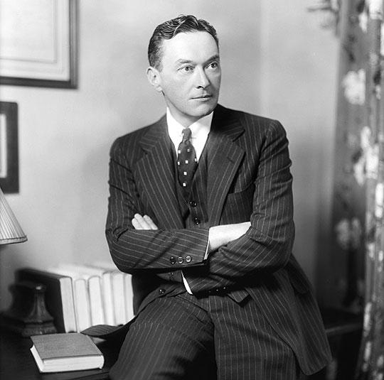

# 正文（1979年2月14日）

**讲座提要**

德国新自由主义（III）——对现实进行历史分析的益处——新自由主义与传统自由主义的区别在哪里——特殊的关键点：如何依据市场经济原理来调控政治权力的总体作用，以及随之而来的变化——市场经济与放任自由政策之间的脱节——瓦尔特 •李普曼（Walter Lippmann）研讨会（1938年8月26-30日）—政府行的式样问题。三种例子：（a）垄断问题；（b）恰当行为（actions conformes）问题。欧肯所认为的经济政策的基础。调节行为和调度行为（action ordonnatrices）；（c）社会政策。秩序自由主义对福利经济的批评——社会作为治理干预的应用点。“社会政策”（Gesellschaftpolitik）——此政策的首要方面：按照企业的模式来使社会形式化——企业社会和司法社会，同一种现象的两个方面

## 一、方法论

### 1. 三种批评

今天我继续之前关于德国新自由主义的话题。当人们谈论新自由主义，不管是德国的还是其他的，总之谈论当代新自由主义，一般会得到三种类型的答案。

第一种：从经济角度来看，新自由主义是什么？它只是使用已久的旧有经济理论的复活。

第二种：从社会角度来看，新自由主义是什么？它只是严格的商品关系据以在社会中建立起来的手段。

最后，第三种，从政治角度来看，新自由主义只是一个为国家的一种普遍的和行政的干预而采取的掩护手段，干预越沉重越不容易被发现，并且越是以新自由主义的面目隐藏起来。

这三种类型的答案，我们可以看到，它们最终都轻视了新自由主义或者说无论如何都只是把它当作一样的东西，总是最坏的那个东西。也就是说，首先，它就是亚当 •斯密的勉强复活；其次，它就是那个被《资本论》第一卷所破解和揭露的商品社会；最后，它就是国家权力的普遍化，即全球范围内的索尔仁尼琴（Soljenitsyne）<a id="ref-1" href="#note-1">〔1〕</a>。

### 2. 历史分析

亚当•斯密、马克思、索尔仁尼琴；放任自由、商品社会和景观社会、集中营和古拉格（Goulag）世界：大体上这就是通常人们分析和批评新自由主义问题的三个模板，它们因而使得新自由主义问题被轻视，200年来，100年来，10年来，人们继续重复着同样的批评。然而，我要向你们证明，新自由主义恰恰还是某种不一样的东西。这是否有重大意义，我不知道，但它肯定就是这样的东西。我想要抓住的是这种东西的独特性。因为如果历史分析确实带来一些重要的或珍贵的政治影响，这些分析自身正好也表现为历史的，并试图发现在某时某地曾出现过和运转过的各种实践类型和制度形式等；如果说指出某一时期的监狱（机制）是什么样的，并且弄清这种纯粹的历史分析给当前形势带来何种影响，这首先是非常重要的；那么这样做绝对不是，也从来不是为了暗含地或更有理由明确地表明过去之所是就是今日之所是。而问题在于要使关于过去的知识对当下的经历和实践发生作用。问题完全不是要把当下压进过去之一个已知的、被认为对当下有价值的形式之中。可能无论如何都要避免历史分析的政治影响以一种简单重复的形式而实施的这种转换，这也是为什么我要强调新自由主义的问题以设法使它摆脱那些基于简单地转换历史模板所进行的批评。新自由主义不是亚当•斯密；新自由主义不是商品社会；新自由主义不是资本主义之隐藏范围内的古拉格。

## 二、竞争

### 1. 市场治理

那么，这个新自由主义是什么？上次课至少我已经指出了它的理论和政治原则是什么。我已经指出，新自由主义的问题完全不是像亚当•斯密类型的自由主义和18世纪的自由主义那样—去弄清楚如何在一个既有的政治社会内部，分割和安排出一个自由的市场空间。与此相反，新自由主义的问题是弄明白如何以市场经济原则为模式来调控政治权力的总体运作。因此问题不是释放出空位子，而是根据一种治理的总体技艺带来、召唤、规划市场经济的各种形式原则（principes formels）。我认为这才是关键之处，并且我已说明为了实践这一步骤，即弄明白在何种范围内、在何种程度上，市场经济的形式原则能够把一种治理的总体技艺列入索引；新自由主义者不得不对传统自由主义做一些改变。

### 2. 竞争与放任自由

第一种改变，上次我已经说过，就是市场经济、市场的经济原理与放任自由的政策原理从根本上相互脱离开来。市场经济与放任自由政策之间的脱节。我认为，这种脱节的取得和界定——至少其原理已经被提出来了—是在这样一个时候开始的：那时新自由主义者们提出一种纯粹竞争理论，这种理论显示出竞争完全不是那种只需将其拉回表面便可发现的、对社会原理和社会基础的原初和自然的呈现；竞争远不是这样，竞争是一种结构，是具有形式属性的一种结构，并且正是竞争型结构的形式属性已经确保并且能够确保通过价格机制来进行经济调整。因此，如果说竞争这种形式结构，其内在结构是严密的，但其历史的和现实的存在却是不稳固的，那么自由主义政策的问题恰恰就是从事实上安排出一种可容纳竞争形式结构运转的具体的和现实的空间。所以这是一种与放任自由无关的市场经济，即一种与统制经济无关的积极政策。因此新自由主义将并不处于放任自由的影响之下，相反它是处于警惕性、能动性和永久干预的影响之下。

### 3. 李普曼研讨会



  这一点在大多数新自由主义者们的文本中都有很明显的体现，这里有我要参考到的一个文本（如果你们手头上有最好，因为它不是很容易找到。很奇怪它在国家图书馆一时不见了，但是在社会博物馆那里肯定能找到<a id="ref-2" href="#note-2">〔2〕</a>）。这个文本就是1939年战争前夜所举行的“瓦尔特•李普曼会议”<a id="ref-3" href="#note-3">〔3〕</a>的会议概要。此会议在法国召开正是在李普曼那本译名为《（自由的）城邦》<a id="ref-4" href="#note-4">〔4〕</a>（La Cite）的著作出版之后<a id="ref-5" href="#note-5">〔5〕</a>。这是一本奇怪的书，因为一方面它以简单而纯粹的形式对传统自由主义的观点作出反馈，另一方面从某些角度，它又提出了一些属于新自由主义的东西。这本书在美国出版不久就被译成法文并且人们在巴黎举行了一场会议讨论此书，到场的有李普曼本人、法国一些古典传统的老自由派，比如<a id="ref-6" href="#note-6">〔6〕</a>博丹（Baudin）<a id="ref-7" href="#note-7">〔7〕</a>，然后有一些德国和奥地利的新自由主义者，那些恰恰是弗赖堡学派的成员，他们中的一部分被德国驱逐，另一部分在德国被压制言论，却在这里都找到了表达的机会。罗普克<a id="ref-8" href="#note-8">〔8〕</a>，鲁斯图、哈耶克、米塞斯<a id="ref-9" href="#note-9">〔9〕</a>也都参加了会议，还有一些中间派，如雅克•吕埃夫（jacques Rueff）<a id="ref-10" href="#note-10">〔10〕</a>以及在战后的法国经济中扮演重要角色的马若兰（Marjolin）<a id="ref-11" href="#note-11">〔11〕</a>，而担任大会的总秘书者———虽然没有发言但也不是无所事事——就是雷蒙•阿隆（Raymond Aron）<a id="ref-12" href="#note-12">〔12〕</a>。正是在这次会议结束之后—我提醒大家注意这个是因为一些人对能指结构（structure du signifiant）尤其关注——在1939年7月13日<a id="ref-13" href="#note-13">〔13〕</a>，成立了一个永久的委员会，叫做“复兴自由主义国际研究委员会”（Comite international d'etude pour le renouveau du liberalisme），简称CIERL<a id="ref-14" href="#note-14">〔14〕</a>。正是在这次会议中，人们界定出——这可以从那篇贯穿着其他观点和传统自由主义主题的概要中看出来新自由主义特有的、独特的一些提议。

### 4. 积极自由主义

正是在这次会议上，一名与会者，我忘记了是哪一位<a id="ref-15" href="#note-15">〔15〕</a>，提出将这个人们正要表达的自由主义冠以一个意味深长的名称——“积极的自由主义”（liberalisme positif）。这个积极的自由主义因而就是一种进行干预的自由主义。这个自由主义就是罗普克在李普曼会议结束之后不久所出版的 Gesellschaftskrisis（《社会危机》）一书中所提到的：“市场自由使一种积极的和极具警觉性的政策成为必然。”<a id="ref-16" href="#note-16">〔16〕</a>你们在所有新自由主义的文本中都能找到同样的观点，即自由主义体制下的政府是一个积极的政府、警觉的政府和进行干预的政府，以及无论19世纪的传统自由主义还是当代美国的无政府资本主义都不能加以认同的一些惯用语。比如欧肯说过：“国家要对经济活动的结果负责。”<a id="ref-17" href="#note-17">〔17〕</a>弗兰兹•伯姆说过：“国家应该掌控经济的未来。”<a id="ref-18" href="#note-18">〔18〕</a>米其（Miksch）说过：“在这种自由主义政策中”这句很重要——“很有可能在自由主义政策中，对经济的干预与在计划政策中的一样多，但它们的性质是不同的。”<a id="ref-19" href="#note-19">〔19〕</a>在这个干预的性质问题中，我认为存在着可以作为着手研究新自由主义政策的特殊之处的出发点。众所周知，大体上来说，18世纪至 19世纪初期自由主义的问题是，区分应该做的和不应该做的，区分人们能够干预的领域和不能干预的领域。这就是agenda 和non agenda 的区分<a id="ref-20" href="#note-20">〔20〕</a>。在新自由主义者看来，这是很天真的立场，其问题并不是要知道是否存在着一些东西是人们不能触碰的，而另一些东西则是人们有权利去触碰的。问题在于弄清楚如何触碰。这是做事方式的问题，或者说，这是治理式样的问题。

### 5. 治理式样

为了渐进地指出新自由主义者如何定义治理行为的式样，我会举出三个事例。我会以概括、简明和粗糙的方式来讲解。但是你们将看到这些肯定是你们都熟知的东西，因为你们正沉浸于其中。我想简单概括地说明三个东西：第一，垄断问题；第二，新自由主义所称的经济恰当行为（action conforme）问题；第三，社会政策问题。然后在此基础之上，我设法指出我所认为的这个新自由主义的一些独特之处，并且把它完全与当人们批评新自由主义的自由政策时一般所认为要加以批评的东西区分开来。

## 三、垄断

### 1. 垄断悖论

那么，首先来看垄断问题。请再一次原谅我老生常谈，但我认为至少为了更新某些问题，这是必经之路。我们说在对经济的理解中，或者对经济的传统理解之一，垄断被认为是在资本主义体制下由竞争所导致的半自然半必然（mi-naturelle mi-necessaire）的一个结果；也就是说如果人们不同时看到垄断现象的出现就不能任由竞争发展，而垄断现象带来的结果恰恰就是限制、缓和，直至消除了竞争。因此垄断处于竞争消除其自身的历史一经济（historico-economique）逻辑之中，这一观点自然就导致任何想要确保自由竞争运转的自由主义者都应该介入到经济机制的内部之中，对这些促进、自身包含和规定垄断现象的经济机制进行干预。也就是说，如果想要把竞争从其自身结果中拯救出来，就必须对经济机制干预。这就是自由主义经济所具有的垄断悖论（paradoxe du monopole），这种自由主义经济提出了竞争问题并且同时承认垄断事实上属于竞争逻辑的一部分。当然你们可以想到，新自由主义的立场与之完全不同，他们的问题是要证明垄断和垄断化趋势不属于竞争的历史和经济逻辑。罗普克在《社会危机》（Gesellschaftskrisis）一书中说道：“垄断是经济活动中一个奇怪的主要部分”，而且它不是自发地形成于经济活动中的<a id="ref-21" href="#note-21">〔21〕</a>。为了支持这一观点，新自由主义者拿出了一些论据。这里我只对这些论据做些介绍。

### 2. 特权与法律

第一种是历史类型的论据，即事实上，垄断远不是自由主义经济历史上某种最终的、最近的现象，而是一种古老现象，这种古老现象的原则从本质上就是国家公共权力对经济的干预。毕竟，如果出现垄断，那是因为国家公共权力或者那时候确保国家公共权力运作和实施之人赋予行会和作坊一些特权；是因为各邦国或君主授予一些个人或家族垄断地位用来换取一种以派生的或隐蔽的征税为形式的诸多财政便利。比如马克西米利安一世（Maximilien Ier）给予富格尔（Fugger）家族垄断地位以换取财政便利<a id="ref-22" href="#note-22">〔22〕</a>。总之，在中世纪作为中央权力增强之条件的税收自身的发展，导致了垄断的产生。垄断是一种古老现象和干预现象。

对法律运转条件的法学分析，也同样使垄断出现或促进其产生。遗产继承的实践、合资公司法的出现、专利权问题等，它们是如何由于其自身的法律功能而完全不是经济原因而引发出垄断现象的？这里，新自由主义者又另外提出了一系列更是历史的和制度的问题，而不是专门的经济的问题，但是他们为一系列非常有趣地探索资本主义的政治-制度（politico-institutionnel）的发展框架开辟了道路，美国人、美国的新自由主义者从中受益良多。比如，诺斯（North）<a id="ref-23" href="#note-23">〔23〕</a>关于资本主义发展的若干想法，正是沿着新自由主义者开辟的道路，而它的问题域（problematique）在李普曼会议的多方参与中已经清晰地呈现出来。

### 3. 保护主义

为了表明垄断化现象在法理和逻辑上都不属于竞争经济（economie de la concurrence）的另一种论据就是：对国民经济的存在、关税保护主义和垄断这三者之间的联系进行政策分析。比如米塞斯在这一点上做过一系列的分析<a id="ref-24" href="#note-24">〔24〕</a>。他指出，一方面各国市场的分散促进了垄断，这种分散把经济统一体缩减为相对较小的规模，这样使得那些在世界经济中无法维持的垄断现象得以在这种框架的内部实际地存在<a id="ref-25" href="#note-25">〔25〕</a>。他更确切、更直接地指出，国家实际所采取的保护主义的有效条件如何只能是：人们要求并创造出能够控制生产、国外销售和价格水平等方面的卡特尔联合企业（cartels）或垄断企业的存在<a id="ref-26" href="#note-26">〔26〕</a>。大体上这就是俾斯麦的政策。

### 4. 生产集中

第三，新自由主义者在经济方面注意到这个。他们说：当人们表明在资本主义中固定资本的必要增长无可否认地成为集中化和垄断趋势的一个依托点时，人们作出这种传统分析是正确的。但是他们又说，首先这种集中化（concentration）趋势并不是必然地、不可避免地导致垄断。当然存在着一种集中化的最优状态使资本主义制度趋于稳定，但是介于这种集中化的最优状态和由垄断化事实所体现的集中最大化状态之间，存在着一个直接的竞争游戏和直接的经济活动游戏所无法自发跨越的门槛。还需要有鲁斯图所称的那种得到“国家、法律、法院和公众意见的支持”的“掠夺性的新封建制度<a id="ref-27" href="#note-27">〔27〕</a>”（neo-feodalite predatoire）。为了从集中化的最优过渡到垄断最大化，还需要这种掠夺性的新封建制度。罗普克也说过，不管怎样，一种垄断化现象即使存在，其自身也不稳定<a id="ref-28" href="#note-28">〔28〕</a>。也就是说，从中期而不是从短期来看，在经济活动中总是会产生或者生产能力的变化，或者技术上的变化，或者生产率的大量增长，或者一些新市场的出现。所有这些使得趋于垄断的发展只能是某段时间内的运行于其他变量之间的一个变量，而另一些变量在其他时间段上将会具有优势。在其整体动态中，竞争结构包含着整个系列的变量，而集中化趋势总是被其他趋势所压制。

### 5. 似乎政策

总之—-这仍旧是米塞斯这样推理的<a id="ref-29" href="#note-29">〔29〕</a>-—从根本上来看，与经济游戏相比，垄断现象的重要之处是什么，或者说麻烦之处是什么？是否是只有一位生产者这一事实？当然不是。是否只有一个企业具有销售权力这一事实？当然也不是。使垄断带来麻烦结果是在这样的范围内讲的：垄断影响价格，也就是说它影响经济的调节机制。这样一种垄断价格，即价格的增长可以无须通过降低销售和降低收益实现，我们很容易想象到——事实上也经常是如此—垄断企业自身不执行也不能够执行垄断价格，因为如果它们执行了垄断价格，立刻就总要面对一种竞争现象，而竞争会利用这些垄断价格的滥用来压制住垄断。因此，如果一个垄断企业想要保持其垄断力量，应该执行的就不是垄断价格而是认同价格（prix identique），或者至少接近于竞争价格。也就是说，垄断企业应该按照似乎存在着的竞争那样去做。这时候它就不会破坏市场规则，不会破坏价格机制，而垄断地位并不重要。通过执行这种竞争的“似乎政策”（la politique du comme si） <a id="ref-30" href="#note-30">〔30〕</a>，垄断商就使得这个重要的并且在竞争中是决定性现象的结构运转起来。实际上从这个层面来说，考察是否存在垄断这并不准确。

### 6. 竞争秩序

所说这些都只是为了确定出新自由主义想要提出的问题。在某种程度上，他们摆脱了垄断这个障碍的问题。他们可以声称：你们看到在经济活动中没有什么要直接干预的，因为如果使经济活动充分运转，经济活动自身就具有一种调节结构，即竞争调节结构；这样的经济活动就永远不会丧失规则。竞争所特有的，就是竞争活动在形式上的严密性。但是所能保障这种形式活动不会丧失规则的是：在实际中，如果任由竞争运转，那么来自竞争和来自经济活动本身的一切将都不会改变活动进程。由此，从这一层面来说，非干预是必要的。保证非干预的条件当然是建立一套制度框架来阻止拥有个人权力或者国家公共权力之人进行干预从而产生垄断。正是因为这个原因，我们在德国的法律中会发现一种巨大的、反垄断化的制度框架，但是后者的功能完全不是为了介入经济领域以阻止经济自身产生垄断，而是为了阻止外部活动的介入而产生垄断现象。

## 四、经济政策

### 1. 恰当行为

该新自由主义规划的第二个要点是恰当行为的问题<a id="ref-31" href="#note-31">〔31〕</a>。这种恰当行为理论，这个恰当行为的规划设计，我们基本上可以从曾作为当代德国政策的重要纲领之一的一篇文本中找到。它是欧肯的一本遗作，出版于 1951年或1952年，书名是 Grundsitze der Wirtschaftspolitik（《经济政策原理》）<a id="ref-32" href="#note-32">〔32〕</a>。从某种程度上来说，它是十二年前出版的那部书 Grundlagen der Nationalokonomie（《国民经济学基础》）的实践层面，而后者则完全是理论层面的<a id="ref-33" href="#note-33">〔33〕</a>。在《基础》和《经济政策原理》中，欧肯告诉我们：自由主义政府必须永久地保持警惕性和积极性，应当以两种方式进行干预：第一，通过调节行为（actions regulatrices）；第二，通过调度行为<a id="ref-34" href="#note-34">〔34〕</a>（actions ordonnatrices）。

### 2. 调节行为

首先来看调节行为。我们不要忘了这位欧肯是另一位欧肯的儿子，其父是20世纪初期的新康德主义者并且因此获得过诺贝尔奖<a id="ref-35" href="#note-35">〔35〕</a>。作为一个十足的康德主义者，欧肯说：政府应当如何干预？以调节行为的方式，也就是说当由于经济形势的原因，干预非要不可时，就应该切实地对经济活动干预。他说：“经济活动总是导致一些暂时性质的摩擦，带来很可能导致一些特殊情况的变化以及适应的困难和对各集团产生或多或少严重的间接影响。”<a id="ref-36" href="#note-36">〔36〕</a>因此，就应该不对市场经济的机制，而对市场条件进行干预<a id="ref-37" href="#note-37">〔37〕</a>。

按照严格康德式的调节观点来看，对市场条件进行干预是指辨认它们、认可它们并任其发展；但所有这些都是为了对其促进，并且从某种程度上来说，是为了把体现该市场根本特征的三种趋势推向极致并使其完全实现。这三种趋势是：缩减成本的趋势；企业利润减少的趋势；最后，利润增长的暂时和局部趋势，这种趋势或者是由于决定性地、大规模地降低成本，或者是由于生产效率的提高所致<a id="ref-38" href="#note-38">〔38〕</a>。以上就是市场调节、调节行为所必须考虑的三种趋势，因为它们就是市场调节的变化趋势本身。

清楚地来看，就目标而言，这意味着：首先，调节行为必然会以价格稳定主要目标，不是限定价格意义上的价格稳定，而是控制通货膨胀意义上的。因此，除稳定价格之外的所有目标只能是第二位的，某种意义上说其他目标是相近的。任何情况下，它们都不能成为首要目标。尤其是维持购买力、维持充分就业，甚至保持支出平衡，这些都不能成力首要目标。

第二，就手段而言，这意味着什么？意味着首先要利用信贷政策创造出贴现率。如果想遏制外贸价格的上涨，那么就通过减少贷方余额来做外贸。如果想影响储蓄或投资，同样可以通过改变税费。但是任何计划经济所使用的那些手段——也就是限定价格，或是为了支持市场的某一领域，或是为了系统地创造就业，或是为了公共投资—所有这些形式的干预都要严格地被抛弃，取而代之的是我说过的那些纯粹的市场手段。

尤其是，新自由主义关于失业方面的政策是完全明晰的。在失业情境下，不管失业率如何，人们要做的都绝对不是直接地或是首先去干预失业，就好像充分就业将成为政策的理想样式以及无论如何都要保全的经济原则。而首要保全的，第一位要去做的是维持价格稳定。这个价格稳定了，接下来可能就可以切实地维持购买力，并且产生出比失业危机时更高的就业水平，但是充分就业不是目标，甚至失业储备对经济而言是绝对必要的。正如罗普克所言，失业者是什么？不是经济上的残疾人。失业者也不是社会牺牲品。失业者是什么？它是中转的劳动者。它是处于无收益活动和更多收益活动中转之间的劳动者<a id="ref-39" href="#note-39">〔39〕</a>。这些就是关于调节行为我所要讲的。

### 3. 调度行为

调度行为更值得关注，因为它依然有利于我们抓住专门的对象。调度行为是什么？它是这样一些行为：其功能是对市场条件进行干预，但却是对比我之前所提到的那些更为基础的、更具结构性的、更一般的市场条件进行干预。事实上，我们永远不要忘记这条原则：市场是经济和社会的总调节者，但是这并不因此意味着它是一种要在社会的基础处加以找回的自然背景。相反，（请原谅我又重复一遍）它是一种可靠的、极其精细的机制，但其前提条件是它能够很好地运转并且没有什么去扰乱它。因此，政府的干预原则和持久操心之处，不是我刚才所说的经济形势的这些瞬间，而应该是市场存在的条件，即秩序自由主义者所称的“框架”（cadre）<a id="ref-40" href="#note-40">〔40〕</a>。

### 4. 农业与框架

什么框架政策？如果我们以欧肯的那个文本为例，样本就会很清晰地显现。在1952年的那本《原理》（Grundsitze）的书中，他重新考察了德国的农业问题，但是他认为这些思考对大多数欧洲国家的农业同样适用<a id="ref-41" href="#note-41">〔41〕</a>。他说，事实上这些国家的农业从来就不曾正常地、完全地、彻底地融人到市场经济中去。这是由于关税保护划定、勾勒出了欧洲农业、欧洲农业空间；而各国的技术差别以及总体上每个国家在农业上的技术不足也使得关税保护必不可少。差别和不足都与人口过剩的出现有关，而人口过剩使得干预和技术完善变得毫无用处，或者说不尽如人意。

因此，如果我们想按照1952年的那本书所言——把欧洲农业纳人到市场经济中，那么应该怎么做？应当不去影响那些直接的经济背景，而去影响为了产生一种可能的市场经济所应具备的那些条件性背景。因此，应当去影响什么？不是价格，也不去影响某一部门以支持较少收益的部门。所有上述这些都是坏的干预。那么好的干预是去影响什么？就是去影响框架，也就是说，首先去影响人口。如果农业人口过多，那么通过人口转移、移民等干预使其减少。其次也应该从技术层面上进行干预，通过给人们配备一定数量的工具，通过完善一些农业要素：比如肥料的生产技术，通过对农民培训和教育，使他们可以改善（农业）技术。第三，修改关于土地开垦的法律制度，特别是通过修改继承法以及关于地租和土地出租方面的法律，试图找到一些途径使法规、组织制度、股份公司制度等融入到农业中。第四，在可能的范围内改变土地补助和可利用土地的面积、性质和开垦。最后，如果必要，还应该对气候进行干预<a id="ref-42" href="#note-42">〔42〕</a>。

人口、技术、培训教育、法律制度、土地的可使用率、气候，所有这些要素，我们可以看到它们都不是直接的经济要素，它们不是市场的自身机制，但是对欧肯来说，它们是农业的市场化运作，农业进入市场所依据的条件。这种观念所引发的问题不是：在事物的某种状态已成事实的情况下，如何找到一种市场体系能够顾及欧洲农业所特有的一些基础背景？而是：既然政治-经济上的调节活动就是并且只能是市场，那么如何修改这些在欧洲已成事实的、物质的、文化的、技术的和法律的基础要素。如何修改这些背景，如何修改这一框架，以使得市场经济得以介入？在这里我们会看到一种东西，一会儿我还要再谈到它，就是：**最终，政府干预越是在经济活动的自身层面上保持谨慎，相反，在包括了技术的、科学的、法律的、人口的背景整体方面，即我概括地称之为社会背景方面，政府干预的程度越重，那么这些社会背景越来越成为政府干预的对象**。另外，我们在1952年的文本中，即使以很粗略地方式也能看到关于十年之后的农业共同市场的规划。它在1952年就已经被透露出来了。曼斯霍尔特（Mansholt）计划<a id="ref-43" href="#note-43">〔43〕</a>已经在欧肯那里了，至少部分地在1952年的欧肯那里了。好了，这些就是框架层面上的恰当行、经济形势行为（actions conjoncturelles）和调度行为。这就是秩序自由主义者所称的对市场秩序和竞争秩序的组织<a id="ref-44" href="#note-44">〔44〕</a>。因此，欧洲农业政策就是：如何重建一种竞争秩序来充当市场的调节者？

## 五、社会政策

### 1. 福利经济学

我们来看社会政策这第三个方面。我认为在这一点上，还是以间接的方式来说明，由于时间和能力的原因，我不想详细地展开；但是不管怎样还是要说一些陈词滥调和烦人的东西，因为它们可以指出某些重要因素。对福利经济学来说——它是由庇古（Pigou）<a id="ref-45" href="#note-45">〔45〕</a>所设想出来的，随后在凯恩斯派经济学家、罗斯福新政和贝弗里奇计划以及欧洲战后计划那里以这样的或那样的方式被继承下来—一社会政策指什么？大体上来说，是指一种社会政策，它的目标是使每个人相对均等地获取生活消费品。

福利经济学如何来看待这种社会政策？首先它被看作是对那些不符合规定的经济活动的一种平衡力量，这些经济活动本身将导致不平等的后果，并且总体上还会导致对社会的破坏性后果。因此，社会政策的性质在某种程度上是与经济活动相对位（contrapuntique）的。第二，福利经济学认为社会政策应该具有什么样的主要功能？那就是使某些消费要素社会化：出现一种社会化消费或集体式消费形式—医疗消费、文化消费，等等。第二个功能就是以家庭补助（allocations familiales）的形式进行收入要素的转移（⋯⋯）。最后第三点，在福利经济学中，社会政策认同经济增长越快，某种程度上作为补偿和回报，社会政策就应该越积极、密集和慷慨。

### 2. 不平等

正是针对这三个原理，秩序自由主义很早就提出怀疑。首先秩序自由主义者们说，一种社会政策如果想要真实地与一个经济政策融为一体，如果不想成为该经济政策的破坏者，那么它不能扮演平衡力量的角色，它不能被定义为经济活动之效果的补偿。尤其是每个人平等、相对均等地获取生活消费品，在任何情况下，这一点都不能成为目标。它不能成为目标，因为在一个经济系统中，经济调节作用，即价格机制的获取完全不是通过均等化现象，而是通过差别化游戏，后者是整个竞争机制所固有的并通过一些波动所建立起来的，这些波动当然只有在它们被放任自由并且是凭有差别的放任自由的条件下才能具有其功能和调节者的功效。

总之，为了调节能进行，就必须有人劳动，有人不劳动，或者有人工资高，有人工资低；就必须价格能上涨也能回落。因此，一种以相对的平等化为首要目标、以均等为中心论题的社会政策，它只能是反经济的。一种社会政策不能把平等确定为目标。相反，它应该放任不平等，就像某人说过的那样，我记不清谁说的了，应该是罗普克：人们抱怨不平等，但是这意味着什么？这意味着“不平等对所有人都一样”<a id="ref-46" href="#note-46">〔46〕</a>。显然，这个表述像谜一样，但是它很容易理解——只要人们认同经济游戏以及它所包含的不平等结果是对社会的一种总体调节，每个人应该对其顺从和屈服。

因此，不要平等化，更确切地来说，不要使一部分人的收入转移给另一部分。（特别是当收入转移活动抽取了一部分带来储蓄和投资的收入时，这种收入转移是危险的。）因此，这种抽取的意思就是从投资中取出一部分收入并将其转入消费。人们唯一能做的，就是从最高所得中抽取必定要贡献给消费，或者超消费（surconsommation）的那部分，然后将超消费的这部分转移给或是由于最终残疾的原因，或是由于发生共同负担的风险的缘故而处于消费不足（sousconsommation）状态中的那些人。但仅此而已。因此，我们看到社会转移是非常有限的。它所要确保的完全不是维持购买力，而仅仅是最终或暂时不能维持其自身生存的那些人的最低生活需要。它是从最高到最低的边际转移（transfert marginal）。它完全不是要建立起平均，以平均为调节方向。

### 3. 风险个人化

第二，这种社会政策的手段，如果我们还能称其为一个社会政策，它就不会是消费和收入的社会化。相反，它只能是一种私有化，也就是说不能要求整个社会来保护个人对抗风险，这不管是疾病或事故类型的个人风险，还是如灾害类型的集体风险。我们不能要求社会来保护个人对抗这些风险。只能要求社会或者要求经济使每个人拥有足够高的收入能够（要么直接地作为个人，要么作为集体性互助组织的一环）在面对现存的风险或者生存的风险或者衰老和死亡这种宿命时进行自我保护，而这一切的基础是他自己的个人储备金。也就是说，社会政策应该成为这样一个政策，它的手段将不会是将收入从一方转移到另一方，而是尽可能广泛地为所有社会阶层提供资金，它的手段将会是个人保险和互助保险，最终它的手段将会是私有财产。这就是德国人所称的“个人化的社会政策”，它与社会主义者的社会政策相对立<a id="ref-47" href="#note-47">〔47〕</a>。重要的是社会政策的个人化以及通过社会政策的个人化，而不是通过社会政策以及社会政策的集体化和社会化。总之，重要的不是给个人提供一个风险的社会保护，而是赋予每个人一种经济空间，每个人在该空间中可以承担和对抗风险。

### 4. 经济增长

当然，我们由此而得出的结论是：社会政策的真实和根本东西只有一个，那就是经济增长。社会政策的根本形式不应该反击经济政策并对其进行补偿；社会政策不应该随着经济不断增长而变得更加宽厚。正是经济增长本身，应该使所有个人达到一种收入水平以建立起个人保险、对私有财产的使用、个人或家庭财产的资本化，而通过上述手段，个人能够消除风险。这就是艾哈德的总理顾问——阿尔马克（Miller-Armack）在1952--1953年所称的“市场之社会经济”<a id="ref-48" href="#note-48">〔48〕</a>，这也是德国社会政策的另一个名称。另外，我补充一点：由于各种原因，这种由新自由主义者们所确定的社会政策的极端规划，事实上未曾并且也未能严格地在德国实施。德国的社会政策充斥着各种因素：一部分来自俾斯麦国家的社会主义，另一部分来自凯恩斯经济，有的则来自贝弗里奇计划或欧洲所实行的一些安全计划，以至于在这一点上，德国的政策不能完全是新自由主义式和秩序自由主义式的。但是一我强调两点—首先，正是在拒斥此种社会政策的基础之上，美国的无政府资本主义开始发展起来；其次，重要地要看到，不管怎样至少在那些越来越奉行新自由主义的国家中，它们的社会政策越来越遵循我们所说的情况。保险机制的私人化（privatisation）这一想法，即指个人通过他所能支配的所有储备金，或单独作为个人，或作为互助组织的一环等（来抵御风险）；目前像在法国的新自由主义政策中所起作用的仍旧是这个目标<a id="ref-49" href="#note-49">〔49〕</a>。私人化的社会政策是一种发展趋势。

## 六、社会治理

### 1. 治理干预的对象

（请原谅我）花这么长的时间唠叨这些东西，但对目前来讲，我觉得重要的是指出构成新自由主义的原初基础的那些东西。所要强调的第一点：就像我们看到的那样—新自由主义者也一直是这样认为的——治理干预的密度、次数、积极程度和连续性都不比在其他体系中来得少。重要的是看清楚现在这些治理干预的应用点是什么。治理——这是在自由主义体制下所一致认同——并不是对市场的效果进行干预。新自由主义、新自由主义治理也不是—这是新自由主义与福利政策和（从20年代到60年代）我们所身处的那些东西的不同之处—要修正市场对社会的破坏性后果。它差不多并不是要在社会和经济活动之间建立一种对位（contrepoint）或一种屏障。它要在社会自身的网络和深度上对社会进行干预。根本上——正是通过这方面，治理干预能够实现它的目标，即建立市场对社会的普遍调节器——新自由主义政府要对社会进行干预以使得竞争机制在每一时刻以及社会深度的每个点上都能发挥调节作用。因而，它不会是重农主义所想往的那种经济治理<a id="ref-50" href="#note-50">〔50〕</a>，即治理只承认和遵守经济规律；它不是一种经济治理，它是一种社会治理。

此外，在李普曼会议上，有一位与会者在1939年探寻对自由主义新的定义时说过：难道我们不能将其称为“有关社会问题的自由主义"<a id="ref-51" href="#note-51">〔51〕</a> （liberalisme sociologique）吗？不管怎样，它是一种社会治理，新自由主义者想实行的是一种社会政策。另外，阿尔马克所赋予艾哈德政策那个意味深长的名称：Gesellschaftspolitik<a id="ref-52" href="#note-52">〔52〕</a>，它就是社会政策的意思。这些语词想表达他们（所说过的），语词的轨迹实际上指出了他们所能的活动进程。当1969年至1970年，沙邦（Chaban）提出一种经济和社会的政策时，他将其介绍为一种社会规划，也就是说，他确切地把社会作为治理实践的靶子和目标<a id="ref-53" href="#note-53">〔53〕</a>。这时候，人们就将从或多或少仍残存在戴高乐主义（Gaulliste）政策中的那种大致是凯恩斯类型的体系过渡到将由吉斯卡尔<a id="ref-54" href="#note-54">〔54〕</a>（Giscard）所实际采取的那种新治理技艺。两者的断裂之处就是：治理行为的对象，就是德国人所称的“die soziale Umzvelt”<a id="ref-55" href="#note-55">〔55〕</a>，即社会环境。

## 七、企业社会

### 1. 竞争与企业

社会现已成为治理干预、治理实践和社会治理的目标本身，然而对这样的社会来说，它所要做的是什么呢？当然，它想要使市场成为可能。如果人们想要发挥市场总调节者的角色和作为政策合理性之原则的角色，市场就必须成为可能。但是：引入市场调节，将其作为社会调节的原则，这又是什么意思？这是否意味着建立一种市场社会，即一种商品社会和消费社会，在其之内，交换价值既是各要素的一般尺度和准则，也是个体间交换和货物流通的原则？换言之，在这个新自由主义治理技艺中，重要的是否在市场价值和市场形式的基础上来规范和训导（discipliner）社会呢？是否人们没有回到大众社会、商品社会以及1903年首次由桑巴特所定义的景观社会、幻象社会（societe des simulacres）和高节奏社会这样的模式<a id="ref-56" href="#note-56">〔56〕</a>？

我认为情况并非如此。这个新治理技艺的重心并不是商品经济社会。重要的并不是要构建这样的商品社会。在新自由主义者所考虑的根据市场来调节的社会中，它的调节原则不是商品交换，而是竞争机制。是在社会中尽可能占有最大面积和最深度、尽可能占据最大体积的那些竞争机制。也就是说人们寻求获取的，并不是一个服从商品效用（effet-marchandise）的社会，而是一个服从于竞争型动态活动的社会。不是一个超级市场社会（une societe de supermarche），而是一个企业社会。它所要构建的 homo cconomicus（经济人）不是交换之人（homme de l'echange），也不是消费之人，而是企业之人和生产之人。在这里有一点非常重要，下堂课我还会设法谈到它。它是一系列东西的交叉点。

### 2. 企业伦理

首先，当然是从19世纪起所发展起来的企业分析，对企业进行经济和道德的分析，韦伯<a id="ref-57" href="#note-57">〔57〕</a>、桑巴特<a id="ref-58" href="#note-58">〔58〕</a>、熊彼特（Schumpeter）<a id="ref-59" href="#note-59">〔59〕</a>关于企业所做的系列分析工作，都实际地支持了新自由主义的大部分分析或设想。因此，如果在自由主义政策中有一种回归，那当然不是指回归到一种放任自由的治理实践去，不是回归到马克思在《资本论》第一卷开头所揭露的那种商品社会中去。人们所试图回归的是一种企业社会伦理，韦伯、桑巴特和熊彼特已经指出了这种企业的社会伦理在政治方面、文化方面和经济方面的历史。

更具体一点来看，1950年罗普克出版了《德国经济政策的转向》一书，并由阿登纳（Adenauer）<a id="ref-60" href="#note-60">〔60〕</a> 作序。在这个文本中、在这个宪章中，罗普克说：什么是治理行为的对象、最后靶子和最终目标？他说—我列举一下他所规定的不同目标：第一，尽可能地让每个人能够拥有私有财产；第二，缓解城市庞大症，用中等城市政策代替庞大郊区政策，以单独家庭式政策和布局（economie）取代庞大群体式布局和政策，鼓励一些微小单元（petites unites）到乡下开垦，发展一些他所称的非无产阶级行业，即手工业和小商业；第三，分散居住地点、生产地点和管理地点，纠正劳动的专业化和分工的影响，在自然社群、家庭、邻近地区的基础之上重建社会组织结构；最后，以更普遍的方式，组织、布置和控制由于人们共同居住或企业发展和生产集中所造成的所有环境影响。总之，罗普克在1950年说：“要把治理行为的重心转移到下层。”<a id="ref-61" href="#note-61">〔61〕</a>

### 3. 生命政策

25年来，这个文本被重复了25000遍，这一点你们都会承认。实际上，正是它构成了当前治理实践的主题。只看到外表、只看到一种正当化和一种遮盖了某些东西的屏障，这可能是错误的。不管怎样，必须抓住事情的本来面目，即把它当作一种合理化规划，一种经济合理化规划。这涉及什么？如果仔细一点来看，我们当然会认为它或多或少类似于卢梭式的返回自然，类似于鲁斯图用非常模糊的字眼所称的“Vitalpolitik”，生命政策<a id="ref-62" href="#note-62">〔62〕</a>。但是鲁斯图所谈的和人们所表述的这个 Vitalpolitik 是指什么？

众所周知，实际上，重要的并不是构建一个社会网，在其中，个人将直接地与自然接触；而是构建一个社会网，在其中，下层的那些单元恰恰将具有企业形式，因为私有财产不是一个企业还能是什么？单独家庭不是企业还能是什么？对这些相邻小社群的管理（••••）如果不以企业的其他形式还能以什么形式？换句话说，重要的是，通过尽可能地散播和繁殖，使得“企业”形式普遍化，而企业“形式”不应该局限于国有或国际大型企业，或是一些国营类型的大型企业。我认为“企业”形式在社会机体（corps social）内部的这种繁殖就是新自由主义政策的关键之处。重要的是要把市场、竞争以及随之而来的企业当成我们所称的社会塑形力量（puissance informante）。

### 4. 商品社会批判

这样来看，人们正处于十字路口：关于家庭生活和共有制（copropriete）的一些旧有议题又重新活跃，同时各个领域都有如此多的对商品社会和对消费所导致的均一化的批评论题。这是因为，这完全不是某种类似复兴的东西，这个词严格来说不能说明什么；而是从1900年开始的所谓桑巴特风格的对商品社会和均一化的批评与当前政府政策的目标之间，有一种非常确切的会合。以上两者所想要的是同一种东西。只是那些批评者想象着他们是在揭露所谓的“桑巴特”社会——我加上引号用来专指那种均一化社会、大众社会和消费社会——但是他们错了；他们认为自己正在批判的就是治理政策的当前目标，但是他们错了。他们所批判的是另一个东西。他们在清楚的或隐含的、想要的或不想要的视域中所批判的东西可能曾经是过去年代（从20年代到60年代）的治理技艺。但我们已经跨过这个台阶。我们已经不处在那里了。秩序自由主义者在1930年左右所规划的，并且现在已经成为大多数资本主义国家治理程序的治理技艺，它完全不是寻求建立桑巴特类型的社会。相反，重要的是要获得不是一个以商品和商品均一化为指标，而是以企业的大量化和差异化为指标的社会。

## 八、司法社会

好了，这就是我所要讲的第一个东西。第二个东西——但我想现在真的没有时间了——即这个自由主义治理技艺所带来的第二个后果，就是在法律体系和司法制度中深层次上的变化。因为事实上，一种与企业形式相挂钩的社会（⋯⋯）与一种以司法制度为公共服务原则的社会，它们之间存在着一种优先的关联。我们越增加企业，我们越繁殖大量企业，越繁殖大量的企业培育中心，越迫使治理行为去放任这些企业运作，当然也就越会出现企业之间的大量摩擦，企业之间出现争端的场合也就越多，司法裁决的必要性也就越大。企业社会和司法社会，与企业相挂钩的社会和大量司法制度框架下的社会，它们是同一个现象的两个面。下次课我要谈的就是这个问题，再顺便展开一下新自由主义治理技艺中的其他后果和其他构成。

## 编者注释

<a id="note-1" href="#ref-1">〔1〕</a> 亚历山大•伊萨耶维奇 • 索尔仁尼琴（生于1918年），俄国作家，著作颇丰（其中著名的有：《伊凡•杰尼索维奇的一天》，1962；《第一圈》，1968；《癌症楼》，1968）。1973年在国外出版《古拉格群岛，1918—1956》法译（s.n.），巴黎，瑟伊出版社，1974年］，其中《论文学研究》一文对苏维埃集中营情形做了详细描述，这导致他被捕、被剥夺苏维埃公民权并遭到驱逐。这本书在西方激起了对苏维埃体系下的压迫系统的争论［参见 A.Glucksman：《人类之厨师和食者。论国家、马克思主义和集中营之间的关系》（La Cuisiniere et le Mangeur d'hommes. Essai sur les rapports entre ！'Etat, le marzisme et les camps de concentration）， Paris, Le Seuil，“Combats”，1975。福柯1977年在说明同一个作者的思想大师时提及这本书：“受惊吓的学者们从斯大林回溯到马克思，就像追溯到其系谱树。Glucksmann 直接降至索尔仁尼琴”（《言与文》，第三卷，第204篇，第278页）］。在第一版的《监视与惩罚》（1975）中，福柯使用了“archipel carceral”（监狱群岛）（第304页；重版“Tel”第347页）这一表述来纪念索尔仁尼琴（参见“Questionsa M. Foucault sur la geographie”，《言与文》，第三卷，第169篇，第32页）。这里，索尔仁尼琴的名字来指代集中营和古拉格。

<a id="note-2" href="#ref-2">〔2〕</a> 建馆于1894年，目的是收集对“社会问题”有用的著作、手册、期刊杂志，社会博物馆的收藏涵盖广义上的社会领域。它位于巴黎七区 Las Cases 街5号。李普曼会议之后成立的研究中心也位于此（参见下文，注14）。

<a id="note-3" href="#ref-3">〔3〕</a> 《李普曼会议会期说明（1938年8月26-30日）》［Compte rendu des seances du collogue Walter Lippmam （26-30 aod, 1938）］，Travaux du Centre international d'etudes pour la renovation du liberalisme, cahier n 1, Librairie de Medicis，1939。参见 P.-A Kunz，：《德国新自由主义经验》（L'Experience neoliberale allemande），同前书（上文，第98页，注13），第32—33页。

<a id="note-4" href="#ref-4">〔4〕</a> 会议发起人为L.鲁吉耶（参见下文，1979年2月21 日课程，第166页）。

<a id="note-5" href="#ref-5">〔5〕</a> 瓦尔特 •李普曼（1889—1974）：An Inquiry into the Principles of the Good Society,Boston, Little, Brown,1937/法文版：G. Blumberg,La Cite libre，G. Blumberg 翻译，A. Maurois 写序，Paris, Librairie de Medicis, 1938。在会议20年之后发表的一篇文章中，L.鲁吉耶这样介绍这位“伟大的美国专栏作家”的著作：“这本著作拒绝把自由主义等同于重农主义和曼彻斯特学派的那种‘放任自由’学说。它证实市场经济不是自然秩序的自发结果，就像传统经济学家所认为的那样；而是以国家司法干预为前提的法律秩序的结果”（“Le liberalisme economique et politique”，Les Essais,11,1961，第47页）。参见K.波普《开放社会及其敌人》（1962年初版，巴黎，瑟伊出版社，1979年版）第二卷题词中李普曼的引语：“自由主义科学的溃败导致了现代世界的道德分裂，这种道德分裂如此悲惨地造成了有识之士的分歧。”

<a id="note-6" href="#ref-6">〔6〕</a> 路易斯 •博丹（1887—1964），法国经济学家，《伟大经济学家》（“Grands Economistes”）丛书主编，著有《货币》（La Monnaie. Ce que tout le monde dewait en savoir），Paris, Librairie de Medicis, 1938；《货币和价格构成》（La Monnaie et la Formation des priz），第二版，Paris,Sirey,1947；《经济学说简史》（Precis d'histoire des doctrines economiques），Paris, F. Loviton,1941；《新自由主义黎明》（L'Aube d'un nouveau Liberalisme）， Paris, M. -T. Genin,1953。

<a id="note-7" href="#ref-7">〔7〕</a> 与会的其他法国成员，除下面提到的几位之外，还有 R.Auboin,M Bourgeois,A. Detoeuf, B. Lavergne［著有《资本主义的跃进和衰败》（Essor et Decadence du capitalisme），Paris,Payot,1938 以及《危机及其治愈》（La Crise et ses remedes），Paris, Librairie de Medicis, 1938］，E. Mantoux,L. Marlio［著有《资本主义的命运》（Le Sort du capitalisme），Paris, Flammarion, 1938］，（？）Mercier et A. Piatier。欧肯收到邀请但没有获得离开德国的许可。

<a id="note-8" href="#ref-8">〔8〕</a> 参见上文，1979年2月7日课程，第128页，注16 和注21。

<a id="note-9" href="#ref-9">〔9〕</a> 参见上文，1979年1月31日课程，第98页，注11。米塞斯著作的法文版《社会主义》（Le Socialisme），刚刚由 Librairie de Medicis（李普曼著作的出版社）出版。

<a id="note-10" href="#ref-10">〔10〕</a> 雅克 • 吕埃夫（1896—1978），法国综合理工学院（Ecole polytechnique）毕业，财政监察员，人民阵线时期的全面基金运动（国库指导小组的前身）领导人。自由主义经济学家，从实验上建立起失业与劳动成本过高之间的联系（“吕埃夫法”）。他认为一个稳定的有效的价格体系是经济发展的核心要素，为了捍卫它，经济政策应该与其两个主要障碍做斗争：竞争的缺失和通货膨胀。在会议之前，他出版了《资本主义的危机》（La Crise du capitalisme），Paris, Edition de la“Revue Bleue”，1935；而著作《致经济统制论者们的信》［（L'Epitre auz dirigistes），Paris,Gallimard, 1949］又重提并阐发了会议的某些结论。其主要著作为《社会秩序》（L'Ordre social），Paris,Librairie du Recueil Sirey,1945。参见他的自传《从黎明到黄昏》（De l'wube au crepuscule），Paris, Plon, 1977。福柯曾多次与他会面。

<a id="note-11" href="#ref-11">〔11〕</a> 罗伯特•马若兰（1911—1986），法国经济学家，1947年实现“现代化与装备”的莫奈计划（Plan Monnet pour Modernisation et Equipement）的委员长，后1948年至1955 年任欧洲经济合作组织（OEEC）秘书长。参见其回忆录《一生劳作》Le Travail d'une vie，合作者 Ph. Bauchard），Paris,R. Laffont,1986。

<a id="note-12" href="#ref-12">〔12〕</a> 雷蒙 •阿隆（1905-1983），哲学家和社会学家，1945年后，可以被认为是自由主义思想最活跃的捍卫者之一。以拒斥共产主义之名，他只出版过著作《当代德国社会学》（La Sociologie allemande contemporaine,Paris, Felix Alcan，1935）和两篇论文《历史哲学导论》（Introduction a la philosophie de l'histoire，Paris, Gallimard, 1938）与《批判的历史哲学》La Philosophie crtigue de l'histoire Paris, Vrin,1938）。

<a id="note-13" href="#ref-13">〔13〕</a> 确切日期是：1938年8月30日（参见《李普曼会议》，第107页）。

<a id="note-14" href="#ref-14">〔14〕</a> 更准确的名称是：复兴自由主义国际研究中心［会议后决定缩写名称为CIRL（参见第110页），但是会议概要却是以缩写CRL.出版的］。参见会议概要中所发表的章程：“复兴自由主义国际研究中心的目标是研究、界定、宣扬：在一个生产和交换的合同体制下——后者不排斥国家应有义务的干预——与计划经济不同的是，自由主义的基础原则，主要是价格机制如何确保人们需求的最大满足，以及确保社会平衡和社会延续的必要条件”（n. p.）。1939年3月8日，这个国际中心成立于社会博物馆的当天，中心主席 Louis Marlio发表了演讲，并且魯吉耶召开了一场题内“经济计划主义，其诺言，其结果”的会议。有关文章以及会场发言记录发表于《随笔》（Les Essais）杂志第12期，1961年，名为：“经济自由主义的现代趋势”。

<a id="note-15" href="#ref-15">〔15〕</a> 指的是L.鲁吉耶。参见 Collogue W. Lippman，同前书，第18页。他说：“只有在解决以下两个问题之后（（1）排除所有国家干预的影响，由于其自身的发展规律，自由主义的衰败是否是不可避免的？（2）经济自由主义能否满足大众的社会要求？），我们才可能开始研究我们所称的积极自由主义的自身任务是什么。”同样参见L.Marlio 的会议发言，同上，第102页：“我同意吕埃夫先生，但是我不愿意使用‘左派自由主义’这一表述［参见吕埃夫的会议发言，同上，第101页：‘（李普曼先生的文章）为我冠名为左派自由主义的政策定下基调，因为这种政策势必要给予最贫困阶层尽可能的福利”，因为这样说在我看来似乎不太合适，我认为当前左派与右派的观点相同（•••••）我想最好把这种学说称之为‘积极自由主义’、‘社会自由主义’或‘新自由主义’，但不要用左派一词，因为后者表明一种政治立场。”

<a id="note-16" href="#ref-16">〔16〕</a> 参见 W. Ropke：《我们时代的危机》（La Crise de notre temps），法译和引用本（上文，第128页，注21），第3章，第299页：“市场自由必然需要积极的和高度警觉的经济政策，但同时要完全意识到自己的目标及活动领域的界限，这种政策从不试图超越恰当干预行为所确定的界限。”

<a id="note-17" href="#ref-17">〔17〕</a> 被F.Bilger引用于其《当代德国自由主义经济思想》（La Penste economigue liberale de l'Alleragne contemporaine），同前书，第182页，但未注明出处。

<a id="note-18" href="#ref-18">〔18〕</a> F.Bohm：《作为历史任务安排的经济和创造性成就》（Die ordnung der Wirtschaft als geschichtliche Aufgabe und rechts-schopferische Leistung），Stuttgart-Berlin,Kohlhammer, 1937，第10页：“所有名副其实的经济体系的基本要求是：政策指引在经济的部分和整体层面，都是经济的主妇；国家的经济政策在精神上和物质上掌握经济的未来，这是非常必要的”（由F.Bilger 翻译和引用，同前书，第173页）。

<a id="note-19" href="#ref-19">〔19〕</a> 看起来，福柯在这里非常灵活地重构了米其从 1949年的文章［“均衡理论中的货币创造”（Die Geldschopfung in der Gleichgewichtstheorie），Ordo，II，1949，P.327］中的一句话，由 F. Bilger引用，同上，第188页：“即使一些看起来是必要的正确集体干预应该显得如此广泛，以致这样来看，这些干预与计划主义者的愿望不再有量的差异。在此体现出来的原则也不会丧失其价值。”

<a id="note-20" href="#ref-20">〔20〕</a> 参见上文，1979年1月10日课程，第14页。

<a id="note-21" href="#ref-21">〔21〕</a> 参见W. Ropke：《我们时代的危机》（La Crise de notre temps），Ie部分，第3章，第300页：“垄断并不仅从社会来看是不公正的，而且同时它也是经济活动中的特殊体，是对生产力的完全抑制。”

<a id="note-22" href="#ref-22">〔22〕</a> 参见W.Ropke，同上，第302页：“我们应该记得，通常是国家自己，通过立法、行政管理和司法活动创造出形成垄断的条件。（•••••）国家的同谋关系是公认的：它通过能赋予优先权的契约来创造出垄断，欧洲的第一批垄断经营所采用的就是这一步骤。但在这时，这种行为方式体现出国家的衰退，因为当德国的马克西米利安一世（Maximilien Ter） 赋予富格尔（Fugger）家族垄断地位时，其政府就是要试图从债务中解脱出来。”

<a id="note-23" href="#ref-23">〔23〕</a> 道格拉斯•诺斯（生于1920年），著有《西方世界的崛起》（The Rise of the Western World，合作者 R. -P. Thomas），Cambridage University Press, 1973/《西方世界的跃进：新经济史》，J.-M,Denis 翻译，巴黎，Flammarion（“L'Histoire vivante”），1980。参见 H. Lepage：《明日资本主义》（Demain le capitalisme），Librairie Generale Francaise, 1978，第43页以及第3章和第4章（这本书是福柯在此系列课程的最后几次课中所使用过的参考文献之一）。

<a id="note-24" href="#ref-24">〔24〕</a> 参见《李普曼会议》（Collogue W. Lippman），第36—37页。

<a id="note-25" href="#ref-25">〔25〕</a> L. Von. Mises，同上，第36页：“保护主义把经济体系分割成大量的分散市场，并且通过缩减经济单元的扩展面积，导致卡特尔的产生。”

<a id="note-26" href="#ref-26">〔26〕</a> L. Von. Mises，在上述引文中：“对于产生已经超过需求的国内市场，保护主义只能通过有能力控制生产、外销和价格的卡特尔组织，才能取得实效。”

<a id="note-27" href="#ref-27">〔27〕</a> A. Ristow，同上，第41 页：“超越集中化经济最优状态的趋势，无疑不能成为竞争体系意义上的经济秩序的趋势。它更像是一种垄断化、新封建主义和掠夺性趋势，离开了国家、法规、法院、法官和公众意见的支持，它们不能成功。”

<a id="note-28" href="#ref-28">〔28〕</a> 参见W.Ropke：《我们时代的危机》（La Crise de notre temps），第一部分，第3章，第180页。作者拿出一些论据来反对这样一种观点：即“技术发展（….•）明显导致越来越强调对企业和产业部门的整齐划一”。

<a id="note-29" href="#ref-29">〔29〕</a> 参见《李普曼会议》（Colloque W. Lippman），第41页。

<a id="note-30" href="#ref-30">〔30〕</a> 这种“似乎”政策（ALsob Politik）是由欧肯的一位学生米其（Miksch）所阐发的。［《作为责任的竞爭》Wetthewerb als Aufgube），Stuttgart-Berlin, W. Kohlhammer，1937，第2版，1947。这个政策使得秩序自由主义规划与实现完全竞争的要求区分开来，参见 F.Bilger：《当代德国自由主义经济思想》（La Pensee economique liberale de l'Allemagne contemporaine），第88页、第155页以及第二部分第三章全部，“经济政策”，第170-206 页；J.Francois Poncet：《西德经济政策》（La Politigue economique de l Allemagne occidentale），同前书，第63页。

<a id="note-31" href="#ref-31">〔31〕</a> 关于“恰当行为”与“不恰当行为”的区别，参见 W. Ropke：《当代社会危机》（Die Gesellscha ftskrisis der Gegenuurt），同前书（第5版，1948年），第258-264页/法译和引用，第205—211 页；Civitas Humana，法译和引用（上文，第128页，注21），第67—68页。参见F.，同前书，第190—192页（相较于罗普克模式的“静态”符合和“动态”符合）。

<a id="note-32" href="#ref-32">〔32〕</a> Eucken：《经济政策原理》（Die Grundsatze der Wirtschaftspolitik），BernTubingen,Francke &. J. C. B. Mohr,1952。

<a id="note-33" href="#ref-33">〔33〕</a> 参见上文，1979年2月7日课程，第126页，注9。参见F.Bilger的《••自由主义经济思想》，第62页：“这样本书就作为前者的确切反面；在政治经济之后，是经济政治。”

<a id="note-34" href="#ref-34">〔34〕</a> 这个区分并没有在《原理》（Grundsatze）中被清楚地表述（有关Ordungspolitik，参见第242页及其以下诸页）。这里福柯参考的是 F. Bilger，同前书，第174—188页。

<a id="note-35" href="#ref-35">〔35〕</a> 鲁道夫•欧肯（1846—1926），1871年任巴塞尔大学教授，随后1874年任教于耶拿大学直至退休。1908年诺贝尔文学奖得主。主要著作有：Geistige Strimungen der Gegenunrt （Berlin, Verleger,1904/《当代思想重大潮流》，第4版由 H. Buriot 和 G.-H. Luquet 翻译，E. Boutroux 撰写前言，巴黎，F. Alcan, 1912）；《现代宗教哲学主要问题》（Hauptprobleme der Religionsthilosophie der Gegenzevart，Berlin,Reuther und Reichard, 1907/《现代宗教哲学关键问题》，Ch.Brognard 翻译，洛桑，Payot, 1910年）：Der Sinn und Wert des Lebens （Leipzig, Quelle &Meyer,1908/《生命的意义和价值》，第3版由 M.-A. Hullet 和 A. Leicht 翻译，H.柏格森撰写前言，巴黎，F.Alcan，1912年）。“十足的新康德主义者”无疑是借用F. Bilger 的表述（同前书，第41—42页），它并不能完全定义欧肯的哲学——具有宗教色彩的、与德国理智主义和科学主义相对的、属于生机唯灵论（spiritualisme vitalise）流派的一种行动哲学［参见G.Campagnolo：“秩序自由主义反思的三个哲学来源”，载P.Commun编撰的《德国秩序自由主义》，同前书（上文，第125页，注2），第138—143页］。这里，福柯把“调节行为”问题关联到新康德主义上，无疑所指的是康德在《纯粹理性批判》第二部分第二卷第二章第三节（“经验的类比”）中所做的对“构造原理”和“调节性原理”的区分，A. Tremesaygues &. B. Pacaud 译，第6 版，Pairs,PUF，1968，P.176。

<a id="note-36" href="#ref-36">〔36〕</a> 事实上，引文出自 Ropke：《我们时代的危机》（La Crise de notre temps），第二部分，第2章，第243页：“但是还有一项任务（与建立和强化‘第三条道路’同样重要），因为在永久的法律和制度框架下，经济活动总是会带来某些过渡性摩擦和变化，后者会引起某些群体进行抗告的危险和严重的群体适应困难的危险。”

<a id="note-37" href="#ref-37">〔37〕</a> 参见W.欧肯：《原理》（Grundsatze），第5卷，第19章，第336页：“政府政策、经济活动应直接向经济秩序的形式设计，而不是在经济过程督导。”

<a id="note-38" href="#ref-38">〔38〕</a> 这里涉及对“定义出恰当干预的界限”，伯姆认为，“它不应该与市场的三种根本趋势相抵触：缩减成本的趋势、企业利润逐渐减少的趋势以及降低成本和生产率提高带来的暂时的利润升高趋势”［参见 F. Bilger：《当代德国自由主义经济思想》（La Pensee economique liberale de l'Allemagne contemporaine，）第190-191页］。

<a id="note-39" href="#ref-39">〔39〕</a> 把这句话归于罗普克似乎是错误的。我们在《李普曼会议》和 Bilger 的著作中都没有找到其线索。

<a id="note-40" href="#ref-40">〔40〕</a> 关于这个概念，参见 F.Bilger：《当代德国自由主义经济思想》（La Pensee economique liberale de l'Allemagne contemporaine），第180—181页：“秩序自由主义者们越试图限制对经济活动的干预（这是调节行为的目标），他们越支持国家对框架的动作加大。因为经济活动运行的好与坏，取决于框架被布置的好坏与否。（••••）框架是国家的专属领域，是公共领域，在其之中，国家可以发挥它的调度功能。框架包含了不是自发地产生于经济生活中的所有东西：因此它包含这样客观实在，它们通过相互依存的社会事实，对经济生活进行限定，或者反之受其影响：人类及其需求、自然资源、活动人口和非活动人口、技术知识和科学知识、社会的政治和法律组织形式、精神生活、地理条件、社会集团和阶层、心理结构，等等。”

<a id="note-41" href="#ref-41">〔41〕</a> 在手稿中，福柯在此依据 Bilger（同前书，第181页）引用了欧肯的著作《原理》（Grundsitze）第377—378页。但是，这个引用不准确。在其著作的这个部分中，欧肯并没有特别地探讨与农业相关的问题。

<a id="note-42" href="#ref-42">〔42〕</a> 参见F.Bilger，同前书，第185页：“必须为农业进人自由市场做准备，同时提防为达到目标所采取的所有措施，不要对其他市场产生不良影响，为了达到最终结果，国家可以对前面所列举的那些事实进行干预并且限定农业活动：从事农业的人口、所使用的技术、土地开垦的法律制度、可用土地面积、气候，等等。”参见，同上，第181页所引用的欧肯的话［《原理》（Grundsitze），第378页］：“可能，经济政策对总体事实的动作是有限度的。但是其中每个条件都是可影响的。即使一个国家的气候也可以通过人类干预而被改变（Selbst das Klima eines Landes kann durch menschliches Eingreifen verindert wverden）。更别说其他因素了，比如人口数量、人口的知识水平和能力，等等。对广阔的动作领域是由第六个事实，即社会和法律框架所提供的。”

<a id="note-43" href="#ref-43">〔43〕</a> 曼斯霍尔特（1908-1995），荷兰政客，1967—1972年任荷兰副总统，后任欧洲委员会主席（1972-1973），从1946年开始，致力于比荷卢三国关税同盟（Benelux）和欧洲共同市场。他建立了两份农业计划，第一份于1953年，旨在用共同的农业政策取代各种国内政策，第二份于1968年，他提出了重组农业共同体的计划（“曼斯霍尔特计划”）。参见《欧盟委员会报告》（Rapport de la. Comamission des Communautes europeennes），［曼斯霍尔特计划（••••）］，Bruxelles， （CEE 秘书长），1968年。

<a id="note-44" href="#ref-44">〔44〕</a> 关于“竞争秩序”（Wettbecverbsordrung）这个概念，参见欧肯：“竞争法及其实施”（“Die Wettbewerbsordnung und ihre Verwirklichung”），Ordo，第2卷，1949，以及《原理》（Grundsitze）第4册的相同标题，第151—190页。

<a id="note-45" href="#ref-45">〔45〕</a> 阿瑟•塞西尔• 庇古（1877—1959），英国经济学家，提出以福利经济（个人满足的最大增长）来反对财富经济。著有《财富与福利》（Wealth and Welfare），Londres,Macmillan & co.，1912（该书经大篇幅修订后以 Economics of Wel fare书名重版于1920年，伦敦，麦克米兰）。参见 K. Pribram,A History of Economic Reasoning,Baltimore,Johns Hopkins University Press,1983/《经济思想基础》，H.P.Bernard 翻译，巴黎，Economica，1986，第466—467页：“作为一种被认为是实在论的一种实证理论，福利经济学应该研究价值的数量和再分配。庇古或多或少在公理上假定—某些特殊情况除外——当实际收人总量提高时福利就增长，并且当生产的辛劳减轻时，收入总量的流动就更有规律，国民总所得的再分配就会对最穷的人有利。”

<a id="note-46" href="#ref-46">〔46〕</a> 在福柯所查阅的所有罗普克的著作中都未找到这个表述，这个表述的归属仍不确定。

<a id="note-47" href="#ref-47">〔47〕</a> 参见 F.Bilger,La Penste economique liberale de l'Allemagne contemporaine，第198页：“秩序自由主义者并不认为，一种个人化的社会政策比社会主义者的社会政策所具有的“社会’含义少。”

<a id="note-48" href="#ref-48">〔48〕</a> 参见 A. Muller-Armack：《社会市场经济》（Soziale Marktrerirtschaft），载E. Von Beckerath 和其他人编辑的《简明社会科学辞典》（Handrevirterbuch der Soxialrerissenschaften），第9 卷，Stuttgart-Tuibingen-Gottingen,G. Fischer, J. C. B.Mohr, Vandenhoeck &. Ruprecht, 1956［重版于 A. Muller-Armack：《经济秩序和经济政策》（Wirtscha ftsordnung und Wirtschaftspolitik），同上（上文，第128页，注 15），第243-—248页］/"The meaning of the social market economy”，译文见于A. Peacock 和 H. Willgerodt: Germany's Social Market Economy...，同前书（上文，第126页，注8），第82--86页。1947年，在一篇递交给北莱茵一威斯特法伦工商业协会的一篇报告中，阿尔马克第一次使用了这个表述（重印于其著作 Genealogie der sozialen Marktreirtscha ft , Berne, Paul Haupt, 1974,p. 5965）。在被基民盟纲领所采纳并用于第一次联邦议院选举活动之后，这一表述便通行起来［1949年7月15日的《关于经济政策、社会政策和住房杜塞尔多夫指南》（Diisseldor fer Leitsitze iiber Wirtschaftspolitik, Sozialpolitik und Wohnungsbau）］。

<a id="note-49" href="#ref-49">〔49〕</a> 关于70年代，法国所实行的新自由主义政策，参见下文，1979年3月7日课程。

<a id="note-50" href="#ref-50">〔50〕</a> 关于重农主义者的“经济治理”概念，参见《安全、领土与人口》，同前书，1978年1月25日课程，第88页，注40，以及1978年2月1日课程，第116页，注23。

<a id="note-51" href="#ref-51">〔51〕</a> 在“李普曼会议”的文件中并没有这个表述［可能，福柯把它和L.Marlio的表述搞混了，第102页（“社会自由主义”：参见上文，注15）］。不过，罗普克在Civitas Humana（法译，引用，同上，第128 页，注21）第43页中使用过这个表述：“我们所实现的自由主义（•••…•）可以称之为社会自由主义，以对抗旧有的单一的经济自由主义。”

<a id="note-52" href="#ref-52">〔52〕</a> 参见 F.Bilger：《当代德国自由主义经济思想史》（La Pensee economique liberale de ！'Allemagne contemporaine），第111页（它未明确出处）。Gesellschaftspolitik这个术语似乎只在1960年以后的阿尔马克的著作中出现。参见“在社会市场经济的第二阶段。补充模式，最近公司的政策”（“Die zweite Phase der sozialen Marktwirtschaft. Ihre Erganzung durch das Leitbild einer neuren Gesellschaftspolitik”），1960［再版于 A. Muller-Arack，《经济秩序和经济政策》（Wirtschaftsordnung und Wirtschaftspolitik），第267—291 页；以及 W. Stiitzel 和其他人编辑的《社会市场经济基础文本》（Grundterte der sozialen Marktrerrtschaft），同前书（上文，第98页，注21），第63—78 页］；以及《社会市场经济的社会政治模式》（Das gesellscha ftspolitische Leitbild der sozialen Markturirtschaft），1962 ［再版于《经济秩序》（Wirtschaftsordnung），第293—317页］。对国内政策规划而言，这一术语用来指建立社会市场经济的第二个阶段。

<a id="note-53" href="#ref-53">〔53〕</a> 雅克•沙邦一戴尔马（1915—2000），1969年至1972年任蓬皮杜总统时期的法国总理。1969年9月16日，在授职仪式上发表演说提出“新社会”规划（受到其两位同事 Simon Nora 和 Jacques Delors 的影响），这引发了来自保守派的反对。在指出“我们的产业弱点”的同时，他宣称：“在这里，经济与政治和社会重新会聚。因此，国家的功能不足以及社会结构的过时成为必要的经济发展的障碍。（•••••）活力、创造和发明作为新的酵母可以使年迈的社会精神抖擞，将会给所有的社会机构和灵活的、去集中化的社会带来更丰富的新的民主和参与形式。”（来源：www.assemblee- nat, fr）

<a id="note-54" href="#ref-54">〔54〕</a> 瓦莱里•吉斯卡尔•德斯坦（生于1926年），1974年5月当选为共和国总统。参见下文，1979年3月7日课程，第203页和第216页，注20。

<a id="note-55" href="#ref-55">〔55〕</a> 阿尔马克的表述，由F. Bilger 引用于《•••自由主义经济思想》，第111 163页。参见“社会市场经济的第二阶段”（“Die zweite Phase der sozialen Marktwirtschaft”），同前书（W. Stitzel 及其他人主编），第72页。

<a id="note-56" href="#ref-56">〔56〕</a> 福柯所给出日期的依据是桑巴特在《德国社会主义》Le Socialisme allemand）（法译，引用参见上文，第132页，注42，1990年版，第48页，注1）中，谈到“经济时代”对“当下时代人们精神生活领域”的毁灭时，所参考的自己的著作：“参见我的著作《德国经济》（Deutsche Volkserirtschaft）（1903）［《19世纪和20世纪初的德国经济》（Die deusche Volksverirtschaft inn 19 Jahrhundert und im Anfang des20 Jahrhundert,Berlin, G. Bondi）］；《无产阶级》（Das Proletariat，1906）（同前书，上文，第132页，注45）：《资产阶级》（Der Bourgeois,1913）［《资产阶级：现代经济人思想史》（Der Bourgeois. Zur Cieistesgeschichte des modernen Wirtschaftsmenschen），Munich-Leipzig,Duncker & Humblot］；《经销商和异教徒》（Handler und Helden,1915）［《经销商和异教徒。爱国主义思考》（Hindler und Helden.Patriotische Besinnungen），Munich-Leipzig,Duncker & Humblot］”；同见《现代资本主义》（Der moderne Kapitalismnus），同前书（上文，第131 页，注41），第三部分，第53章。关于福柯所描述的资本主义社会的各种不同特征，特别参见《德国社会主义》（Le Socialisme allemand），第49—52页和第56页。

<a id="note-57" href="#ref-57">〔57〕</a> 参见上文，第130页，注26。

<a id="note-58" href="#ref-58">〔58〕</a> 参见 W. Sombart：《现代资本主义》（Der moderne Kapitalismus），第一部分，第1—2章。法译引用第一卷，第24—41页：“资本主义企业主的角色”和“新领导人”；Id.，《商贸一：产业的组织和历史》（Gecverberevesen, 1: Organisation und Geschichte des Gereerbes），《商贸二：资本主义鼎盛时代的贸易》（2:Das Gerrerbe im Zeitalter des Hochkapitalismus），Leipzig,1904；第2版修订版，柏林，W. De.Gruyter, 1929;Id.，“资本主义商人”（“Der kapitalistische Unternehmer”），《社会科学和社会政策档案》（Archir fir Soxialwrssenschaft und Soxialpolitik），29，1909，第689-758页。

<a id="note-59" href="#ref-59">〔59〕</a> 约瑟夫•熊彼特（1883—1950），正是在出版于1921年的《经济发展理论》（Theorie der wrirtschaftlichen Enturcklung）（再版于 Munich,Duncker & Humblot,1934/《经济发展理论》，J.-J.Anstett 翻译，巴黎，Librairie Dalloz,1935年，F.Perroux 写有长序“］.熊彼特的经济思想”；1999年再版，无序言）一书中，这位里程碑式著作 History of Economic Analysis（同前书，上文，第49页，注2）的作者第一次阐述了他的企业创造者的概念，后者由于自己的先驱精神和创新能力成为经济发展的真正动因。同见其文章“企业家”（“Unternehmer”），载于《简明政治学词典》（Handrevoirterbuch der Staat steissenschaften），Iena,1928，第8卷。这个关于企业家胆识的理论成为1942年 Capitalism, Socialism and Democracy（New YorkLondon,Harper &. Brothers/《资本主义、社会主义和民主》，G. Fain 译，巴黎，Payot，1951年）一书中的悲观主义的基础（特别参见第179—184页：“企业家功能的衰败”），在这部分内容中他预见了计划经济的来临。参见下文，1979年2月21日课程，第182—183页。

<a id="note-60" href="#ref-60">〔60〕</a> W. Ropke：《德国经济政策正确吗？》（Ist die deutsche Wirtschaftspolitik richtig？），同前书（上文，第128页，注20）。

<a id="note-61" href="#ref-61">〔61〕</a> 同上，以及 W. Stitzel 和其他人编辑的《社会市场经济基础文本》（Grundtexte zur sozialen Marktrerirtschaft），第59页。罗普克所提出的方法列表与福柯的列举并不完全相符："Die MaBnahmen,die hier ins Auge zu fassen sind ［fur eine grundsatzliche Anderung soziologischer Grundlagen（Entmassung und Entproletarisierung） ］，betreffen vor allem die Forderung der wirtschaftlichen und sozialen Dezentralisation im Sinne einer die Gebote der Wirtschaftlichkeit beachtenden Streuung des kleinen und mittleren Betriebes, der Bevolkerungsverteilung zwischen 164Stadt und Land und zwischen Industrie und Landwirtschaft, einer Auflockerung der GroBbetriebe und eiener Forderung des Kleineigentums der Massen und sonstiger Umstande, die die Verwurzelung des heutigen GroBstadt-und Industrie-nomaden begunstigen. Es ist anzustreben, das Proletariat im Sinne einer freien Klasse von Beziehern kurzfristigen Lohneinkommens zu beseitigen und eine neue Klasse von Arbeitern zu schaffen,die durch Eigentum, Reserven, Einbettung in Natur und Gemeinschaft, Mitverantwortung und ihren Sinn in sich selbst tragende Arbeit zu vollwertigen Biirgen einer Gesellschaft freier Menschen werden. ”参见 Civitas Humana（法译，引用，第250页）的摘要，由F.Bliger复述于《••••自由主义经济思想》，第103页（“社会重心由高转低”）。

<a id="note-62" href="#ref-62">〔62〕</a> 鲁斯图这样定义 Vitulpolitik：“（••一种生命政策，根本上来说，并不像传统的社会政策那样以提高工作和减少劳动时间为导向，而是注意全体劳动者的生命情况，其真实的、具体的、从早到晚和从晚到早的生命情况”，物质上的和道德上的健康，所有权感和社会归属感，等等，在他看来，与工资和劳动时间同样重要（由F. Bliger 引用，同前书，第106页，他只提到“一篇发表在《没有惊奇的奇迹》（Wirtschaft ohne Wunder）上的文章”。可能涉及的是“社会市场经济作为反对共产主义和布尔什维主义的方案”（“Soziale Marktwirtschaft als Gegenprogramm gegen Kommunismus und Bolschewismus”），载 A. Hunold编辑的《没有惊奇的奇迹》（Wirtschaft ohne Wunder），Erlenbach-Zirich,E. Rentsch, 1953,P. 97—108）。同样参见 Ristow 的“社会政策或生命政策”（“Sozialpolitik oder Vitalpolitik”），Mitteilungen der Industrie-und Handelskammer zu Dortmund, 1951 年11月 11日，Dortmund，第453—459页；"Vitalpolitik gegen Vermassung”，载 A. Hunold 编辑的，Masse und Demokratie,Volkswrirtschaftliche Studien fir das Schwreizer Institut fiir Auslands forschung,Erlenbach-Zirich,E. Rentsch,1957，第215--238页。关于 Vitalpolitik 与 Soxialpolitik 的对比，参见C.J. Friedrich，“The political thought of Neo-liberalism”文章引用（上文，第129页，注23）第513-514页。正是阿尔马克将与总体环境（“die Ciesamtheit der Umwelt”）相关的措施与 Vitalpolitik联系起来：“Die hier erhobene Forderung dirfte in etwa dem Wunsche nach einer Vitalpolitik im Sinne von Alexander Riistow entsprechen, einer Politik, die jenseits des Okonomischen aud die Vitale Einheit des Menschen gerichtet ist”［“在社会市场的第二阶段”（“Die zweite Phase der sozialen Marktwirtschaft”），同前书，（W.Stitzel及其他人编辑），第7！页］。

# 笔记

## 联邦德国的历任总理与经济政策人物（1949—1982）

这是一份配合阅读米歇尔·福柯《生命政治的诞生》（1978—1979年度讲座）的人物笔记。重点放在1949年德意志联邦共和国成立至1982年施密特政府结束这一时期，另用科尔说明此后的政策转向。人物的政治任期、政府政策来自德国联邦政府、联邦议院、联邦经济部门及德国联邦政治教育中心等史料〔1〕〔2〕

## 一、政治背景

1949年，德意志联邦共和国（Bundesrepublik Deutschland，简称BRD）在西部占领区成立，通常称为**联邦德国或西德**；德意志民主共和国（DDR）则在同年成立于东部。1990年德国统一后，国家仍使用“德意志联邦共和国”这一正式名称。因此，这份笔记中的“联邦德国”主要指1949—1990年的西德历史语境。

联邦德国是议会制联邦国家。总理的实际政治权力明显大于总统。

**联邦总统（Bundespräsident）** 主要承担国家元首职责；

**联邦总理（Bundeskanzler）** 是政府首脑，由联邦议院选出并确定政府政策的基本方向；

**联邦经济部长（Bundeswirtschaftsminister）** 管理经济政策相关部门。〔1〕

| 联邦总理 | 所属政治阵营 | 任期 | 记忆关键词 |
|---|---|---|---|
| 康拉德·阿登纳 Konrad Adenauer | CDU | 1949—1963 | 建国、西方结盟、欧洲一体化 |
| 路德维希·艾哈德 Ludwig Erhard | 基民盟执政阵营 | 1963—1966 | 社会市场经济、战后经济增长 |
| 库尔特·格奥尔格·基辛格 Kurt Georg Kiesinger | CDU | 1966—1969 | 首次大联合政府、宏观经济调控 |
| 维利·勃兰特 Willy Brandt | SPD | 1969—1974 | 东方政策、社会改革 |
| 赫尔穆特·施密特 Helmut Schmidt | SPD | 1974—1982 | 石油危机、滞胀、经济与安全政策 |
| 赫尔穆特·科尔 Helmut Kohl | CDU | 1982—1998 | 1982年政策转向、德国统一 |

CDU 是基督教民主联盟（Christlich Demokratische Union Deutschlands），CSU 是基督教社会联盟（Christlich-Soziale Union in Bayern，主要在巴伐利亚），SPD 是德国社会民主党（Sozialdemokratische Partei Deutschlands），FDP 是自由民主党（Freie Demokratische Partei）。CDU/CSU 通常在联邦议院组成联合议会党团。〔1〕

## 二、历任总理

### 1. 康拉德·阿登纳（Konrad Adenauer，1876—1967）



*图：康拉德·阿登纳（1951年）。来源：[Wikimedia Commons 原始文件与许可说明](https://commons.wikimedia.org/wiki/File:Bundesarchiv_B_145_Bild-P000668,_Konrad_Adenauer.jpg)；德国联邦档案馆，CC BY-SA 3.0 DE。*

身份：第一任联邦总理，1949—1963年在任，基民盟重要领导人。阿登纳的历史任务是把战败、分裂并受到盟国管制的西德，建设为拥有稳定议会民主制度的新国家。他推动西德与西方国家结盟，1955年加入北大西洋公约组织，并把法德和解和欧洲经济共同体建设作为外交重点。他领导政府的年代，也是艾哈德作为经济部长推行社会市场经济、战后经济高速增长的主要时期。〔2〕

与福柯的联系：此前几讲讲到，新成立的联邦德国如何通过经济秩序、经济发展及经济自由，为自身建构政治合法性。阿登纳是这个政治重建过程中的总理；经济政策的具体代表则是艾哈德。因而不要把二人的历史作用混为一谈。

### 2. 路德维希·艾哈德（Ludwig Erhard，1897—1977）



*图：路德维希·艾哈德（1963年）。来源：[Wikimedia Commons 原始文件与许可说明](https://commons.wikimedia.org/wiki/File:Bundesarchiv_B_145_Bild-F015320-0001,_Ludwig_Erhard.jpg)；摄影 Renate Patzek／德国联邦档案馆，CC BY-SA 3.0 DE。*

身份：1949—1963年联邦经济部长，1957—1963年兼任副总理，1963—1966年第二任联邦总理。在1948年西部占领区货币改革前后，艾哈德支持取消广泛的价格管制与配给，推动商品市场恢复。他是联邦德国社会市场经济（Soziale Marktwirtschaft）最重要的政治推广者之一。〔3〕

与福柯的联系：艾哈德是德国秩序自由主义思想进入联邦政府政策体系的重要政治人物。福柯谈德国新自由主义时反复提到他，尤其关心市场秩序如何成为战后政府合理性的依据。

### 3. 库尔特·格奥尔格·基辛格（Kurt Georg Kiesinger，1904—1988）



*图：库尔特·格奥尔格·基辛格（1966年）。来源：[Wikimedia Commons 原始文件与许可说明](https://commons.wikimedia.org/wiki/File:Kurt_Georg_Kiesinger.jpg)；Anefo，CC BY-SA 4.0。*

身份：1966—1969年第三任联邦总理，基民盟政治家。1966年艾哈德政府陷入财政和联合执政危机后，基辛格领导了联邦德国第一次由CDU/CSU与SPD组成的“大联合政府”（Große Koalition）。这个时期出现了影响深远的经济政策转向：面对1966—1967年的衰退，政府支持以财政政策和宏观需求管理稳定经济，经济部长卡尔·席勒的作用尤其重要。1968年紧急状态立法也引起广泛社会争论。〔4〕

历史争议：基辛格1933年加入纳粹党，并在1940—1945年间于纳粹德国外交部工作，因而其战后执政长期受到批评。这个背景与1960年代的学生运动、纳粹历史反思有联系。〔5〕

与福柯的联系：基辛格时期的经济政策提醒我们，联邦德国并未始终按照一种纯粹的秩序自由主义方案行事；凯恩斯主义的宏观调控在1960年代后期取得了显著的政策地位。

### 4. 维利·勃兰特（Willy Brandt，1913—1992）



*图：维利·勃兰特（1980年）。来源：[Wikimedia Commons 原始文件与许可说明](https://commons.wikimedia.org/wiki/File:Bundesarchiv_B_145_Bild-F057884-0009,_Willy_Brandt_(cropped).jpg)；摄影 Engelbert Reineke／德国联邦档案馆，CC BY-SA 3.0 DE。*

身份：1969—1974年第四任联邦总理，社民党政治家，此前曾担任西柏林市长。勃兰特领导SPD与FDP组成的社会—自由主义联合政府（sozialliberale Koalition）。他的代表性政策是东方政策（Ostpolitik），即在冷战分裂状态下缓和与苏联、波兰及东德的关系，1972年西德与东德签订《基础条约》。1970年华沙之跪成为其历史形象的重要组成部分，1971年他获得诺贝尔和平奖。国内政策上，勃兰特推动民主参与、教育资助、社会与法律制度改革。1974年，因其身边工作人员纪尧姆被揭露为东德间谍，勃兰特承担政治责任辞职。〔6〕

与福柯的联系：勃兰特时期有很强的社会改革和福利政策色彩，难以把当时的西德理解为完全服从秩序自由主义原则的国家。福柯恰恰提醒读者区分经济学派的理论规划与具体政府政策。

### 5. 赫尔穆特·施密特（Helmut Schmidt，1918—2015）



*图：赫尔穆特·施密特（1977年）。来源：[Wikimedia Commons 原始文件与许可说明](https://commons.wikimedia.org/wiki/File:Bundeskanzler_Helmut_Schmidt.jpg)；摄影 Hans Schafgans，CC BY-SA 2.0。*

身份：1974—1982年第五任联邦总理，社民党政治家。施密特先后担任国防部长、经济与财政部长、财政部长，之后接替勃兰特领导SPD—FDP联合政府。他出任总理时，西德和其他西方工业国家正面临1973年石油危机之后的通货膨胀、增长放缓和失业上升，1979年又遭遇第二次石油价格冲击。他以经济危机管理和国际政策协调著称，1975年与法国总统吉斯卡尔·德斯坦推动主要工业国家领导人峰会的形成；安全政策上则与北约1979年“双轨决定”密切相关。〔7〕

与福柯的联系：1979年福柯在法兰西公学院讲《生命政治的诞生》时，西德的在任总理就是施密特。因此，福柯讨论的是一套始于1930年代、1949年后在德国获得重要影响、同时又与凯恩斯主义和社会民主主义政策长期交织的治理传统。他不能被简单视为欧肯理论的直接执行者。1982年SPD与FDP在财政、社会政策和外交安全问题上发生严重分歧，联合政府最终解体。〔7〕〔8〕

### 6. 赫尔穆特·科尔（Helmut Kohl，1930—2017）



*图：赫尔穆特·科尔（1996年）。来源：[Wikimedia Commons 原始文件与许可说明](https://commons.wikimedia.org/wiki/File:Helmut_Kohl_(1996)_cropped.jpg)；Wikimedia Commons，见文件页许可条款。*

身份：1982—1998年第六任联邦总理，基民盟政治家。1982年10月1日，CDU/CSU联合FDP通过联邦议院的建设性不信任投票（Konstruktives Misstrauensvotum）选举科尔，取代施密特。所谓建设性不信任投票，要求议会在撤换现任总理时同时选出继任者，避免政府陷入没有新总理的权力真空。科尔政府提出更多市场、控制财政支出、促进企业投资等政策方向。此后最重要的历史事件是1990年德国统一，其任内也推动了欧洲一体化。〔8〕〔9〕

与福柯的联系：科尔1982年才上台，发生在1979年讲座之后。把他纳入笔记，是为了看清福柯所描述的治理思想如何与1980年代的具体政治经济转向发生关联。

## 三、重要经济政策官员

### 1. 阿尔弗雷德·米勒-阿尔马克（Alfred Müller-Armack，1901—1978）



*图：阿尔弗雷德·米勒-阿尔马克（历史照片）。来源：[Konrad](https://www.konrad-adenauer.de/personen/seite/alfred-mueller-armack/?utm_source=chatgpt.com)*

身份：经济学家兼政府官员，1952年进入联邦经济部，1958—1963年担任负责欧洲事务的国务秘书。他是“社会市场经济”概念的重要提出者和命名者，也是艾哈德的重要政策合作者。两人的区别是：艾哈德主要承担政治领导与政策推广，米勒-阿尔马克则进一步从经济思想、社会政策和欧洲经济一体化方面阐述这一制度理念。〔10〕

与福柯的联系：本讲出现的 Gesellschaftspolitik（针对社会整体的政策）与社会市场经济的关系，就与米勒-阿尔马克密切相关。福柯要强调，市场竞争的建立涉及对社会环境和社会结构的长期政策安排。还应知道，米勒-阿尔马克1933年加入纳粹党并曾公开支持纳粹主义，后来才在战后成为社会市场经济的主要思想家，其思想史不能略去这一转折。〔10〕

### 2. 卡尔·席勒（Karl Schiller，1911—1994）



*图：卡尔·席勒（历史照片）。来源：[Wikimedia Commons 原始文件与许可说明](https://commons.wikimedia.org/wiki/File:Bundesarchiv_B_145_Bild-F029983-0017,_Bonn,_SPD-Pressekonferenz,_Karl_Schiller_(crop).jpg)；德国联邦档案馆，见文件页许可条款。*

身份：社民党经济学家，1966—1972年联邦经济政策的核心部长级人物，1971—1972年兼管财政。席勒强调宏观总体调控（Globalsteuerung），将凯恩斯主义的反周期政策引入联邦德国经济治理。1967年《促进经济稳定与增长法》强调价格稳定、高就业、对外经济平衡和适度而持续的增长，即著名的“魔法四边形”（Magisches Viereck）；他还倡导政府、企业、工会和德国联邦银行等参与的“协调行动”（Konzertierte Aktion）。〔11〕

与福柯的联系：席勒是理解战后德国经济政策“混合性”的关键人物。福柯介绍的欧肯式秩序政策强调建立竞争框架、限制直接干预经济过程；席勒则通过宏观经济管理追求增长、就业和稳定等目标。

### 3. 奥托·格拉夫·兰布斯多夫（Otto Graf Lambsdorff，1926—2009）



*图：奥托·格拉夫·兰布斯多夫（历史照片）。来源：[Wikimedia Commons 原始文件与许可说明](https://commons.wikimedia.org/wiki/File:Otto_Graf_Lambsdorff.jpg)；弗里德里希·瑙曼自由基金会，见文件页许可条款。*

身份：自由民主党政治家，1977—1984年联邦经济部长（1982年政权更替期间有短暂职务中断）。在施密特执政后期，他代表FDP中更强调市场竞争和企业投资的经济政策方向。1982年9月，他提出政策备忘录，主张削减部分社会支出、财政整顿、市场松绑和提高投资积极性。这份文件与SPD—FDP联合政府的破裂密切相关。〔8〕〔12〕

与福柯的联系：兰布斯多夫使我们能够把1979年讲座讨论的思想问题，放到1982年发生的政策争论之中。但他并不是1930年代秩序自由主义理论的创始人；他的意义在于1980年代的具体政策转向。

## 四、经济思想家

下列人物中多数并非联邦总理，也不应被统称为政府官员。他们主要提供了福柯讲座分析的理论文本。德国新自由主义内部并非完全一致：欧肯与弗朗茨·伯姆代表弗赖堡学派，罗普克和鲁斯图更关注社会结构，米勒-阿尔马克则将有关思想转换为社会市场经济的政策语言。〔13〕

### 1. 瓦尔特·欧肯（Walter Eucken，1891—1950）

*图：瓦尔特·欧肯（历史照片）。来源：[Wikimedia Commons 原始文件与许可说明](https://commons.wikimedia.org/wiki/File:Walter_Eucken2.jpg)；瓦尔特·欧肯研究所，CC BY-SA 3.0。*

身份：经济学家、弗赖堡学派的重要创建者。欧肯主张国家必须建立和维护竞争经济的制度秩序。他的重要著作包括《国民经济学基础》和身后出版的《经济政策原理》。福柯2月14日讲到的调节行为、调度行为、市场框架及农业市场化，主要围绕他所代表的秩序政策展开。必须注意，欧肯1950年已经去世，所以他不可能在后来的艾哈德或施密特政府中担任官员。

### 2. 威廉·罗普克（Wilhelm Röpke，1899—1966）

*图：威廉·罗普克（1950年）。来源：[Wikimedia Commons 原始文件与许可说明](https://commons.wikimedia.org/wiki/File:Wilhelm_R%C3%B6pke.jpg)；路德维希·冯·米塞斯研究所，CC BY-SA 3.0。*

身份：经济学家、德国新自由主义的重要社会理论家。罗普克在支持竞争市场的同时，关注工业社会的大众化、城市集中、无产阶级化和家庭生活。他推崇广泛的私人财产、小型经营、地方社区与社会分散化。福柯本讲末尾对企业社会的分析，很大程度上依靠罗普克的社会规划材料。

### 3. 亚历山大·鲁斯图（Alexander Rüstow，1885—1963）

*图：亚历山大·鲁斯图（约1960年）。来源：[Wikimedia Commons 原始文件与许可说明](https://commons.wikimedia.org/wiki/File:Alexander_R%C3%BCstow.jpg)；Johannes Lorenz，Commons 标注公有领域。*

身份：经济社会学家、新自由主义思想家。鲁斯图提出的生命政策（Vitalpolitik）强调社会政策不能只关注工资和工时，也需要重视人的具体生活状况、精神健康、家庭与共同体关系。福柯引用他的原因，是为了说明德国新自由主义如何把人口和日常生活环境纳入治理的对象。

### 4. 弗朗茨·伯姆（Franz Böhm，1895—1977）

*图：弗朗茨·伯姆，1950年盟军签发护照上的照片。来源：[Wikimedia Commons 原始文件与许可说明](https://commons.wikimedia.org/wiki/File:1950_Allied_issued_passport_to_Franz_B%C3%B6hm.jpg)；Huddyhuddy，CC0。*

身份：法学家、弗赖堡学派的重要奠基人，战后也曾短暂担任黑森州文化部长，并在1953—1965年担任联邦议院议员。伯姆关注私人经济权力与法律秩序的关系，强调竞争不能只靠经济政策，还需要能够限制卡特尔和排他性特权的法律结构。阅读福柯关于垄断、竞争秩序以及下一讲“企业社会与司法社会”的内容时，应当把伯姆作为主要法学背景人物。〔13〕

## 五、政策史的三次变化

1949—1966年：阿登纳与艾哈德。战后经济重建、货币改革后的市场秩序、社会市场经济制度逐步建立，秩序自由主义获得重要政治影响。这一阶段为理解福柯所说的战后国家合法性提供历史背景。

1966—1982年：基辛格、勃兰特与施密特。第一次大联合政府引入更鲜明的凯恩斯主义宏观调控；勃兰特时期推进社会改革和东方政策；施密特时期应对石油危机、失业与通货膨胀。因而1979年福柯讨论的德国新自由主义，是一种持续发挥影响的思想与制度传统，而当时西德的实际政策已经混合了多种经济治理方式。

1982年以后：科尔与兰布斯多夫。联合政府更替与经济政策重新强调市场、企业投资及财政约束联系在一起。科尔的执政后来还跨越了1990年统一这一重大转折。

记忆顺序：阿登纳负责战后政治重建；艾哈德代表社会市场经济的政治实践；欧肯提供竞争秩序的理论；米勒-阿尔马克为社会市场经济命名并将其政策化；席勒标志着凯恩斯主义宏观调控的加强；勃兰特代表东方政策和社会改革；施密特是福柯1979年讲座期间的在任总理；兰布斯多夫与科尔则帮助理解1982年以后的变化。

## 参考资料

〔1〕[德国联邦政府：《1949年以来的历任联邦总理》](https://www.bundeskanzler.de/bk-en/federal-chancellery/federal-chancellors-since-1949)；[德国联邦政治教育中心：联邦总理制度](https://www.bpb.de/kurz-knapp/lexika/das-junge-politik-lexikon/319976/bundeskanzler-in/)。

〔2〕[德国联邦政府：阿登纳传记](https://www.bundeskanzler.de/bk-en/federal-chancellery/federal-chancellors-since-1949/konrad-adenauer)。

〔3〕[德国联邦政府：艾哈德传记](https://www.bundeskanzler.de/bk-en/federal-chancellery/federal-chancellors-since-1949/ludwig-erhard)；[德国联邦政治教育中心：社会市场经济](https://www.bpb.de/kurz-knapp/lexika/lexikon-der-wirtschaft/20642/soziale-marktwirtschaft/)。

〔4〕[德国联邦政府：基辛格时期](https://www.bundeskanzler.de/bk-en/kurt-georg-kiesinger-1966-1969--1850218)。

〔5〕[德国联邦议院：基辛格就任总理与历史背景](https://www.bundestag.de/dokumente/textarchiv/1966-12-01-kiesinger-481690)；[《德国传记》基辛格条目](https://www.deutsche-biographie.de/dbo080414.html)。

〔6〕[德国联邦政府：勃兰特传记](https://www.bundeskanzler.de/bk-en/federal-chancellery/federal-chancellors-since-1949/willy-brandt)。

〔7〕[德国联邦政府：施密特时期](https://www.bundeskanzler.de/bk-en/chancellery/federal-chancellors-since-1949/helmut-schmidt)。

〔8〕[德国联邦议院：1982年建设性不信任投票](https://www.bundestag.de/dokumente/textarchiv/1982-10-01-misstrauensvotum-schmidt-908192)。

〔9〕[德国联邦政府：科尔时期](https://www.bundeskanzler.de/bk-en/federal-chancellery/federal-chancellors-since-1949/helmut-kohl)。

〔10〕[康拉德·阿登纳基金会：米勒-阿尔马克](https://www.kas.de/en/web/geschichte-der-cdu/personen/vorlaeufer-ideengeber/alfred-mueller-armack)；[德国历史博物馆人物传记](https://www.hdg.de/lemo/biografie/alfred-mueller-armack.html)。

〔11〕[德国联邦经济部门：大联合政府与宏观总体调控（1966—1972）](https://www.bundeswirtschaftsministerium.de/Redaktion/DE/Artikel/Ministerium/66-72.html)；[德国联邦议院：1967年《稳定法》](https://www.bundestag.de/dokumente/textarchiv/1967-05-10-stabilitaetsgesetz-505290)。

〔12〕[德国联邦经济部门：1982—1989年市场化政策](https://www.bundeswirtschaftsministerium.de/Redaktion/DE/Artikel/Ministerium/Geschichte/1982-1989.html)；[兰布斯多夫1982年政策备忘录](https://germanhistorydocs.org/de/zwei-deutsche-staaten-1961-1989/scheidungspapier-das-ende-der-sozialliberalen-koalition-9-september-1982)。

〔13〕[学术论文：秩序自由主义的不同理论流派及欧洲经济一体化](https://www.tandfonline.com/doi/full/10.1080/01916599.2022.2151494)。
