# 正文（1982年1月6日）

## 讲座提要

各种精神性要求相互冲突的出现：笛卡尔之前的科学与神学；古典的与现代的哲学；马克思主义与心理分析——对一句斯巴达格言的分析：关心自己作为法定特权——对柏拉图的《阿尔西比亚德篇》的第一次分析——阿尔西比亚德的各种政治抱负和苏格拉底的插话—对阿尔西比亚德的教育被比作为对斯巴达年轻人和波斯君主的教育—关心自己的要求在《阿尔西比亚德篇》中第一次出现时的上下文：政治抱负、教育缺陷、批判时代、政治知识的缺乏——自身不确定的本性及其政治内涵

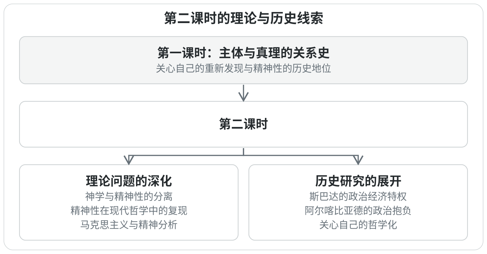

## 一、神学与精神性的分离

### 1. 笛卡尔时刻的历史起源

有一点要指出，尽管我解答得不错，而且时间的使用也还算得当，但是我完全没有像我希望的那样被时间套牢。关于哲学与精神性关系的这个一般主题，以及关心自己这个概念逐渐从哲学思想和关注中销声匿迹的原因，我还是要说几句。我会说我以为在某个时期（当我说“时期”时，它绝对不是指哪个日期、哪个地方，或者具体到哪个人）里，作为认识的自主发展的真理之路与主体改变自己及其存在的要求之间的关系中断了。当我说“我相信这确实是中断了”时，再说除了事物的旨趣外并不相信这一点，这是无益的，这就是说，这些关系不会像刀切的那样突然中断。

首先，让我们向上追溯事物的源头。切口不是像这样造成的。它不是在笛卡尔提出自明性规则或发现我思等的时候出现的。其实，把只发生在认识主体之中的真理通道原则与主体修养的精神必要性（即主体塑造自身、从真理那里得到灵感并改变自己）拆开，由来已久。两者之间早就被嵌入了一个楔子。那么，我们必须从科学一边来探究这个楔子吗？根本不必。我们必须在神学中探求它。神学〔这一神学可能奠基于亚里士多德（“confer”给予，我稍后再说），并随着圣托马斯•阿奎那和经院哲学等在西方思想中占据了一席之地〕成了从基督教出发奠定一种有着普遍使命的信仰的理性反思，同时奠定了一般认识主体的原则，即认识主体在上帝之中同时找到了他的典范、他的绝对实现、他的最完善的程度，以及他的创造者与模型。

在全知的上帝与有认识能力的主体之间的一致（当然，信仰除外），是使得西方思想（主要的反思方式），特别是哲学思想摆脱了一直与它相伴的精神性条件，后者最一般的公式就是“关心你自己”的原则。

### 2. 神学与科学的区别

我以为，必须理解从公元5世纪末（当然是指圣奥古斯丁）到17世纪贯穿在基督教中的主要冲突。在这12个世纪中，冲突并不是发生在精神性与科学之间，而是在精神性与神学之间。

冲突不是在精神性与科学之间的最好证据就是出现了精神认识的所有实践、奥妙知识的整个发展，以及这一观念（有关浮士德的论题就非常有趣地说明了它〔1〕），即如果不深入地改变主体的存在，那么就不可能有知识，比如炼金术。而且那个时代大部分的知识只有在改变主体存在的情况下才可能得到，这证明了在科学与精神性之间并不存在结构上的对立。对立发生在神学思想与精神性的要求之间。因此，这一脱节不是随着现代科学的出现而突然发生的。它是一个缓慢的过程，所以我们必须发现这一过程的起源，以及在神学方面的发展。

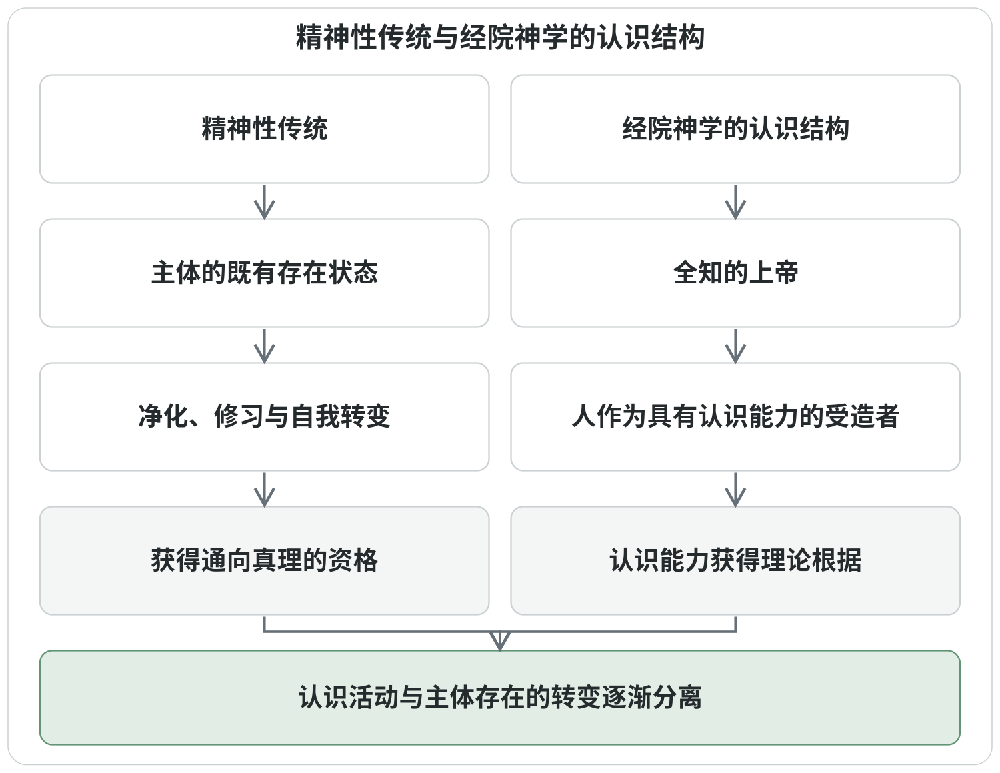

## 二、精神性在现代哲学中的复现

### 1. 斯宾诺莎的知性改进论

不要以为在我随意称呼的“笛卡尔时期”里，切口已经有了。相反，看看在17世纪是怎样提出了有关精神性的条件和追求真理的方法之间关系的问题，是十分有趣的。

存在着许多接触面、摩擦点和拷问方式。比如带有16世纪末与17世纪初特点的这一十分有趣的概念：“理智改进”概念。具体说来，斯宾诺莎的《理智改进论》的前9段。〔2〕你们会非常清楚地看到——出于你们都知道的原因，我就不必在这里强调了—在斯宾诺莎的叙述中，达至真理的问题是怎样与一系列有关主体存在的要求相关的：我应该凭什么和如何改变我自己的主体存在呢？为了能够达至真理，我应该给主体设定什么样的条件，而且在多大程度上，这一真理通道会给予我所要寻求的至善呢？这是一个精神问题，而且我以为17世纪有关理智改进的论题，其特点就是在一种知识哲学与一种有关主体自身塑造的精神性之间有着十分严格的、密切的联系。

### 2. 十九世纪以来的哲学

如果我们现在就提出这个问题，不是向上游追溯，而是向下游看，如果我们转到另一边，从康德出发，那么我以为大家会看到精神性的结构并没有从哲学反思中，甚至没有从知识中消失。我不想现在就勾勒它，我只想指出某些事情来。拿19世纪的哲学来说吧：黑格尔、谢林、叔本华、尼采、《危机》时期的胡塞尔、〔3〕海德格尔，〔4〕你们会明白情况究竟如何，〔精神性〕遭到了贬低和批判的考察，在黑格尔那里则相反，受到称颂，总之，认识—认识活动—一仍然是与精神性的要求相关的。

在所有这些哲学中，某种精神结构试图把认识、认识活动、这一认识活动的条件及其结果与主体存在的改变联系起来。总之，《精神现象学》〔5〕除此之外，别无他意。我认为，我们可以把整个19世纪的哲学史理解为一种压力，它促使人们重新在哲学内部思考精神性的结构，而从笛卡尔主义以来，也即从17世纪的哲学以来，人们却是力图摆脱这些结构。由此，在所有“经典的”哲学体系中出现了深刻的敌对关系，笛卡尔、莱布尼茨等人依靠的就是这一传统，而19世纪的哲学则至少是含蓄地提出了非常古老的有关精神性的问题，它默默地重新找到了对关心自己的关注。

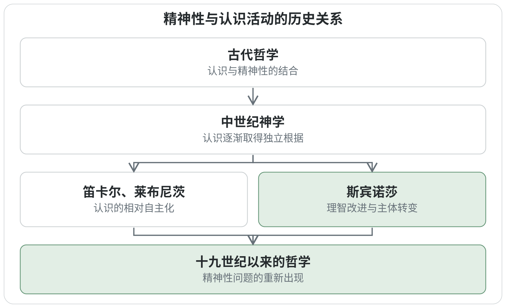

## 三、马克思主义与精神分析

### 1. 知识形式中的精神性问题

但是，我要说的是，即使是在知识领域里，精神性结构的这一压力、这一涌现和这一再现同样是显著的。如果像所有科学家所说的，人真的能够认识到一门伪科学，因为它要求主体转向，以便能够达到它，它还允诺最终要揭示主体。如果人可以根据某门学科有着精神性的结构就认为它是伪科学（这是理所当然的，所有科学家都了解这一点），那么不要忘了在非科学的知识形式中，不要试图用十分明确的方式把某些要素、某些精神性要素吸纳入科学的结构中。

当然，没有必要给你们勾勒一番：你们已经知道像马克思主义或精神分析之类的知识形式。要把它们归入宗教，就完全错了，这是理所当然的。这没有任何意义。相反，如果你们分别坚持它们的立场，那么你们就知道，出于完全不同的理由（但是结果却是相似的），在马克思主义和精神分析中，究竟什么是主体的存在（为了主体达至真理，主体的存在究竟应该是什么）的问题和如何改变主体（因为主体有着真理通道）的问题，这两个问题绝对带有精神性的特点，并且存在于这些知识的核心或根据与结论中。

当然，我不是说它们是精神性的形式。我的意思是说，在这些知识形式中，就有这些问题、拷问、要求，我以为它们〔从横跨数千年（至少是一千年或两千年）的历史角度来看〕是最古老的、最根本的 “epimeleia heautou”和精神性问题，它们是达至真理的条件。

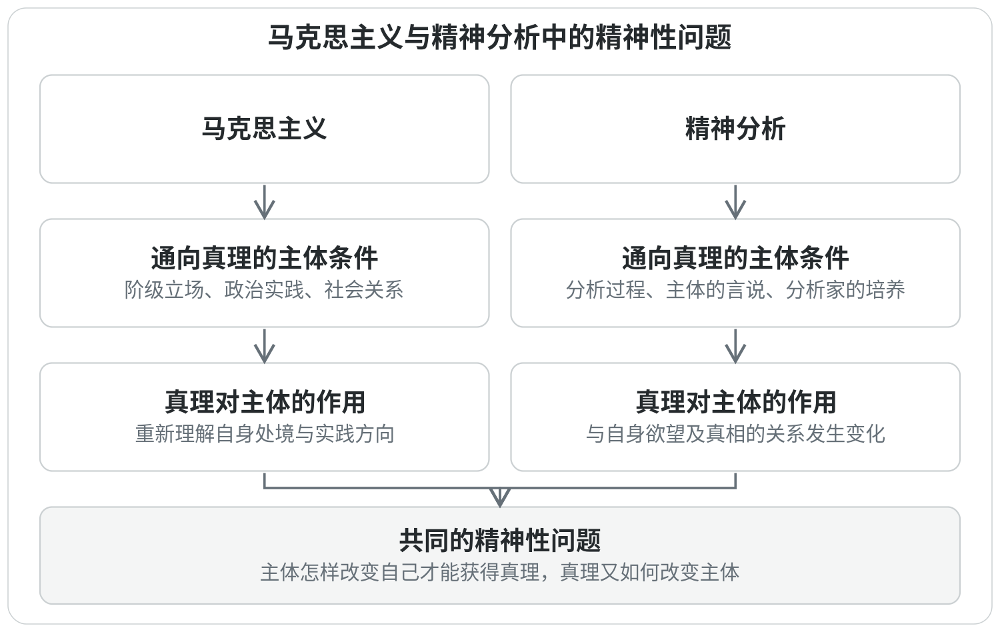

### 2. 精神性问题的组织化

当然，这两种知识形式都没有清楚地和大胆地考虑过这一观点。人们力图在某些社会形式中掩盖这种知识形式的这些精神性条件。阶层的立场观念、党派的后果观念、加入一个群体、进入一个学派、奥义传授、分析家的培养，等等，所有这些都涉及为达至真理而培养主体的条件的这些问题，但是我们是用社会术语和组织化术语来思考它们的。我们不是根据精神性的生存及其要求的历史边锋来思考它们的。

同时，为了把有关“真理与主体”的这些问题移植和转换到属于（某一群体、学派、党派、阶层等）的问题上，要付出的代价就是忘了真理与主体之间的关系问题。

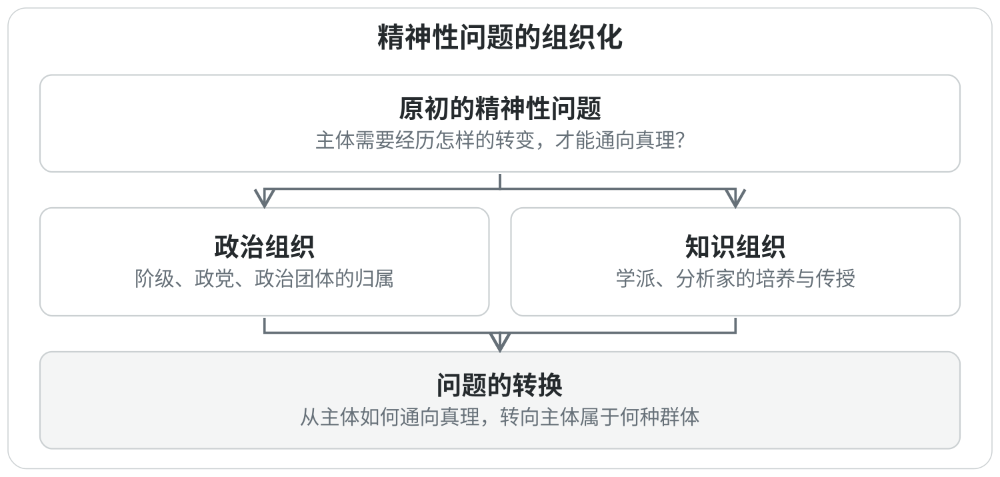

### 3. 拉康与主体的真理

我以为，拉康的分析的所有旨趣与力量，其根源就在于：拉康是弗洛伊德以来唯一愿意让精神分析的问题以主体与真理的关系问题为中心。〔6〕这就是说，根据绝对不同于这种精神性的历史传统（即苏格拉底或尼斯的格里高利及其中间人的传统）的术语，根据分析知识的术语，他试图提出在历史上是精神性的问题：主体要说出真相必须付出的代价问题，根据他说出的、可能说出的有关自己的真相确定对主体的影响的问题。我认为，重提这个问题，实际上是在精神分析之内重提有关这“epimeleia heautou” 的最古老的传统、最古老的拷问、最古老的不安，它曾是最一般的精神性形式。

当然，我也不会解决这一问题：我们是否可以根据精神分析的术语（即认识的效果）提出主体与真理的这些关系问题（总之，从精神性和“epimeleia heautou”的角度来看，这个问题是不能根据认识的术语来提出的）呢？

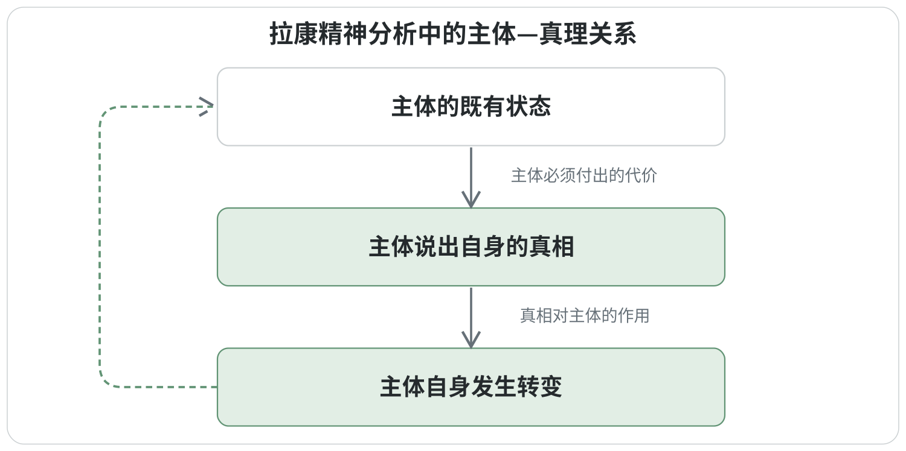

## 四、关心自己的历史形态

### 1. 历史研究分期

这就是我在上面想对你们说的。现在，换一个更简单的训练。让我们再回到文本上。当然，对于我来说，重述我提到的这一概念、这一实践、这些关心自己的法则的历史，是不成问题的。由于我没有掌握好时间，所以今年我想分成三个有趣的时期来研究：苏格拉底一柏拉图时期，“关心自己”出现在哲学反思中；第二个是教化自身、关心自身的黄金时代，即公元头两个世纪；然后是到了公元4—5世纪，大致是从异端哲学的修行到基督教的禁欲主义。〔7〕

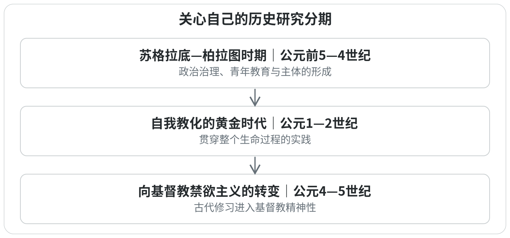

### 2. 斯巴达的政治经济特权

第一个时期就是苏格拉底一柏拉图时期。我想参考的文本是对关心自己的分析和理论。这个⻓篇大论在《阿尔西比亚德篇》对话的第二部分得到了阐发。在开始谈一点这篇文本之前，我想提两件事，首先，如果关心自己真的是随苏格拉底出现在哲学反思中，特别是在《阿尔西比亚德篇》这个文本中，那么不要忘了“关心自己”这个原则（作为法则，作为律令，作为令我们很期望的正面的律令）在希腊文化中自始至终对于哲学家来说都不是一条禁令，不是哲学家对过路的年轻人的质询。这不是一种理智的态度，不是某些智叟给某些殷勤的年轻人提的劝告。相反，“必须关心自己”这个原则和断言是希腊文化的一个古老格言。而且特别是一句斯巴达的格言。

在一篇晚出的普吕塔尔克的文本中，涉及一句非常古老的格言，普吕塔尔克提到亚历山大里德的一个词，这个斯巴达人，人们本想询问他：你们这些斯巴达人，有点怪。你们有许多土地，而且你们的土地面积很大，或者说，很重要。但是，为什么你们不亲自耕种它们呢？为什么你们要把它们交给希洛人〔斯巴达人的奴隶——译注〕呢？亚历山大里德的回答是；这只是为了能够让我们关心我们自己。〔8〕

当然，当斯巴达人说：我们需要关心我们自己，所以我们不必耕种我们的土地时，显然，这与〔哲学〕无关。对于这些人来说，哲学、理智主义等不是非常肯定的价值，而是肯定一种与某种特权、政治特权相关的生存方式：如果我们有希洛人，如果我们不自己耕种我们的土地，如果我们委托别人来管理，那么这是为了让我们关心我们自己。这个斯巴达贵族集团的社会特权、政治特权、经济特权就以这种方式表现出来：我们必须关心我们自己，为此，我们委托别人来做我们的工作。因此，“关心自己”就成了相当流行的原则，不过不是哲学的原则，而是与一种特权相关，在此，与一种政治的、社会的和经济的特权相关（这是一个在“关心自己”的历史上不断出现的问题）。

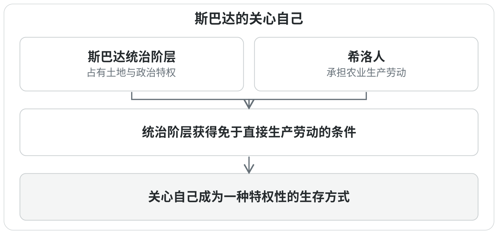

## 五、《阿尔喀比亚德前篇》

### 1. 政治抱负与身份特权

当苏格拉底重提“关心自己”这个问题时，他是从一个传统出发的。此外，你们会发现，在《阿尔西比亚德篇》中，从第一个有关关心自己的主要理论起，就提到了斯巴达。现在，让我们来看《阿尔西比亚德篇》这个文本。今天或下一次，我讨论的不是它的真伪问题，而是其非常复杂的年代问题。〔9〕但是，我们必须好好地研究这篇文本，以便逐渐地让这些问题呈现出来。

我想快一点讨论一下《阿尔西比亚德篇》这个对话的开篇。我只想指出，在这个开篇中，苏格拉底上前与阿尔西比亚德攀谈，让对方注意到，与其他的爱慕者不同，他至今尚未与阿尔西比亚德攀谈过，他只是今天才决定这么做。而且，他这么决定，是因为他认为阿尔西比亚德脑子里有某个东西。〔10〕他脑子里有某种东西，而且如果有人向他（阿尔西比亚德）提出希腊教育中与荷马有关的这个经典老问题：如果有人让你选择今天是去死，还是继续过一种平淡的生活，那么你选择哪个呢？〔阿尔西比亚德回答道〕：〔11〕我宁愿今天就死去，也不想过一种不会带来任何新东西的生活。这就是苏格拉底为什么与阿尔西比亚德攀谈的原因。

阿尔西比亚德想要别的东西，那么他已经有了什么呢？关于阿尔西比亚德的家族的详细情况，如它在城邦中的地位、祖先的特权，都让阿尔西比亚德优越于其他人。这篇文本说他有“城中最富冒险精神的家族之一”。。〔12〕在他父亲这一边（他的父亲曾是欧帕特里德贵族集团的一员），他有许多有钱有势的亲戚和朋友。在他母亲（曾是阿尔克梅奥尼德贵族集团的一员）这一边，情况也是如此。〔13〕而且，即使他失去了父母，他也有并非一文不名的人做靠山，因为这个人就是伯里克利。文本中说伯里克利是城邦中想做什么就做什么的人，不仅是在希腊，甚至在某些番邦，也是如此。〔14〕

此外，阿尔西比亚德还有大量财富。另一方面，阿尔西比亚德很英俊，众所周知。他有很多追求者，也确实如此，而且，他为自己的英俊感到十分骄傲，并因此而拒绝了所有的追求者，苏格拉底是唯一坚持不懈地追求他的人。为什么他是唯一的呢？理由如下：由于回绝了所有的追求者，阿尔西比亚德也老大不小了。即达到了男孩子这一著名的临界年龄（去年我曾向你们谈过），〔15〕别人就不能爱他了。

但是，苏格拉底却继续对阿尔西比亚德感兴趣，他甚至第一次向他说话。为什么呢？因为他明白了阿尔西比亚德的大脑里有一种不同于靠他的亲戚、家庭和财富生活的意志的东西；至于他的英俊，它正在消失。

阿尔西比亚德不想满足于此。他想回到人民中，想掌握城邦的命运，想统治其他人。简言之，〔他〕想改变他在政治活动和治理其他人方面的特权身份和法定的优先权。这是因为这种意向正在成形，而且正是在阿尔西比亚德在受惠于或拒绝让其他人受益于他的英俊之后转而想治理其他人时（在“爱欲”之后：政治、城邦），苏格拉底听到了启发他的神告诉他现在可以向阿尔西比亚德说话了。他有事要做：改变身份特权，以及在治理其他人方面的法定优越性。显然，在这个《阿尔西比亚德篇》文本中，关心自己的问题就在这个时候出现了。

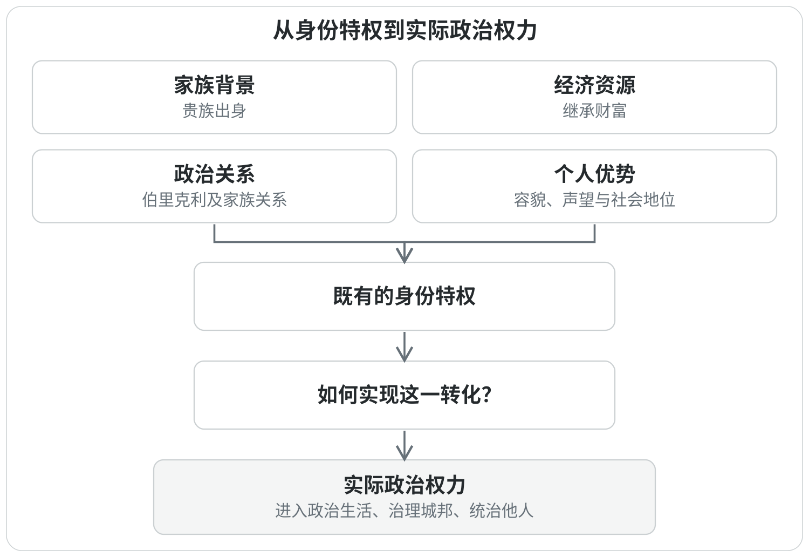

这在色诺芬有关苏格拉底的叙述中也有。比如，在《回忆录》第Ⅲ卷中，色诺芬引述了苏格拉底与年轻人夏尔米德之间的一段对话。〔16〕夏尔米德也是一位要进入政界的年轻人，当然，要比我和你们谈的这篇对话中的阿尔西比亚德年长一点，因为他在政治上的进步足以进入议事会，发表他的意见。情况只是：夏尔米德发表的意见是有人听的。因为他的意见富有智慧，在议事会上有听众的夏尔米德是腼腆的。他腼腆，他有听众也是枉然的，当人们开小会商议事情时，他不敢当众说话，所以他知道大家都在听他的话，也是枉然的。于是，苏格拉底对他说：不过，你同样必须关心一下你自己；用点心思在你自己身上，意识到你自己的素质，这样，你就可以参加政治生活了。他没用“epimeleisthai heautou”或 “epimelei sautou” 这类表述，而是“用点你的心思”。“Notn prosekhei”：〔17〕用点心思在你自己身上。但是，情况是相同的，除非它是相反的：必须鼓励夏尔米德，尽管他聪明，但是不敢进入公共政治活动，而阿尔西比亚德则是一个跺着脚只想去搞政治，并在实际的政治活动中改变其法定利益的年轻人。

### 2. 政治竞争与教育缺陷

不过，我要研究的这部分对话就是从这里开始的；苏格拉底问道，如果你统治城邦，那么为了统治它，你必须面对两种对手。〔18〕一方面是你在城邦中遇到的内部对手，因为不仅仅只有你想统治城邦。随后，当你统治它时，你就遇上了城邦的敌人。你会碰上斯巴达人，碰上波斯帝国。不过，苏格拉底说，你很了解究竟什么是斯巴达人和波斯人：他们对雅典人和你自己是占优势的。首先在财富方面：尽管你也富裕，但是你能和波斯国王比富吗？至于教育，尽管你也受过教育，但是你实际上能够与斯巴达人、波斯人比教养吗？

在斯巴达人那里，〔人们〕对斯巴达人的教育有一个简短的描述，它不是作为模范，而总是作为素质的参照系；这种教育让人有优雅的举止、伟大的灵魂、勇气、耐力，它让年轻人爱好训练、胜利和荣誉等。

在波斯人那里，也是如此，而且方式有趣，在那里所受教育的好处是很大的；教育针对的是国王，年轻的君主，他从年幼时起（从其懂事时起）就有四位老师陪伴左右：一个是教智慧（sophia）的老师，另一个是教法律（dikaiosune）的老师，第三位是传授节制（sophrosune）的老师，第四位则是教授勇敢（andreia）的老师。第一个问题是必须确定文本的时间：一方面，对于斯巴达的魅力和兴趣经常出现在柏拉图的对话（从苏格拉底的对话以来）中；相反，对于波斯人的魅力和旨趣则被认为是柏拉图和柏拉图主义者那里晚出的要素〔…只能听到：“我们在晚期的柏拉图主义那里，总之在柏拉图主义的下半节中发现到⋯⋯”〕。

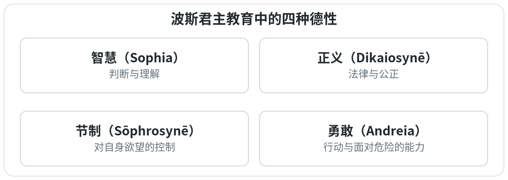

不过，相对于这种教育（要么是斯巴达人的教育，要么是波斯人的教育），阿尔西比亚德是怎样被培养的呢？苏格拉底说，这要看你身上发生了什么。你在你父母去世后被托付给了伯里克利。伯里克利，当然了，“他可以对他的城邦、希腊和某些番邦做一切事情”。但是，他最终却没有能力教育他的儿子们。他有两个儿子，这是两个毫无用处的人。因此，你就很失落。但是，在这一方面，不要对严格的教育想得太多。而另一方面，你的监护人伯里克利想方设法把你托付给一个老奴〔色雷斯的佐皮〕，可是，这个老奴是个典型的无知无识的人，结果他什么也没教给你。

在这些条件下，苏格拉底对阿尔西比亚德说，必须做一点比较：你想进入政治生活，你想掌握城邦的命运；你没有你的对手那么多的财富；特别是，你没有受到相同的教育。所以，你必须反省一下你自己，必须认识你自己。这样，这里就出现了“gnothi seauton”这个概念和原则（明显指的是德尔斐神喻）。〔19〕但是，有趣的是看到，“gnothi seauton” 是以弱化的方式出现在所有关心自己的概念之前。这只是一个审慎的劝告。这跟它以后的强烈意义不同。这里，苏格拉底要求阿尔西比亚德反省一下自己，与他的对手们比一比。这一审慎的劝告是：注意一下你是什么，面对你要对抗的人，这样，你就会发现你的劣势。

### 3. 政治技艺与无知

这一劣势就在于：你不仅不富裕，没有受过教育，而且你又无法通过可能让你在没有太多劣势的情况下去对抗他们的东西（一种知识，一种技艺〔20〕）来改变这两个缺陷（在财富与教育方面）。你没有可以让你一开始就改变这些劣势的技艺。你没有技艺。这里，苏格拉底向阿尔西比亚德指出他没有让他可以很好地统治城邦、至少与他的对手旗鼓相当的技艺。

苏格拉底是根据在所有苏格拉底的对话中绝对经典的程序向他指出的：什么是统治城邦？对城邦的良好统治在于什么？人们是在什么上面认识到这一点的？随后是一长串的探讨。最后是阿尔西比亚德提出的这一界定：当城邦的公民们和睦相处时，城邦就算是被统治好了。〔21〕有人向阿尔西比亚德提出这样一个问题：什么是这种和睦相处呢？它在于什么呢？阿尔西比亚德无法回答。这个可怜的男孩于是陷入失望之中。他说：“我自己都不知我说了什么。真的，也许是我长久以来一直生活在可耻的无知状态中，甚至连自己都没察觉到。”〔22〕

对此，苏格拉底的回答是：你不要担忧；发现你处于可耻的无知状态，发现你甚至不知道自己所说的，如果你到了50岁才达到这个境界，那么你将难以补救，因为你已难以关心自己了（epimelethenai sautou）。但是，“你正好处于必须发现它的年龄上”。〔23〕好，我想让我们暂时审视一下第一次出现在这篇哲学对话中的表述“照顾自己”、“关心自己”（不过，让我们再一次把有关《阿尔西比亚德篇》的时间问题搁置一边）。

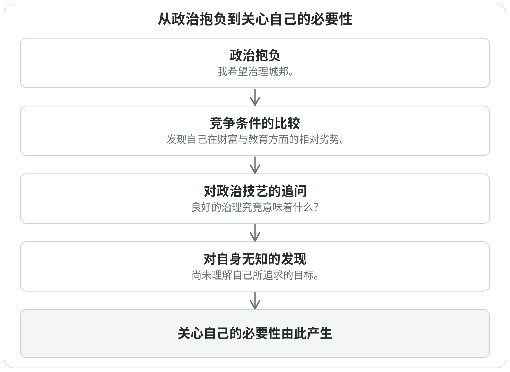

## 六、关心自己的四个特征

### 1. 权力与政治实践

第一，关心自己的必要性是与权力的运用联系在一起的。我们在亚历山大里德的斯巴达格言中就碰上过。不过，在传统的格言中，是这样说的：“我们把我们的土地交给希洛人去耕种，以便我们能够照顾我们自己”，“照顾自己”就是权力法定情况的结果。相反，在这里，关心自己的问题，关心自己的论题不是作为法定特权的某一方面出现的。相反，它是作为从阿尔西比亚德享有的法定特权（传统的大富豪家族，等等）过渡到确定的政治活动、城邦的实际治理的条件出现的。但是，“关心自己”牵涉到个人向其他人施加政治权力的意志，并源于此。如果不关心自己，那么人就不能统治其他人，不能很好地统治其他人，不能改变他在针对其他人的政治活动和理性活动上的特权。关心自己这一概念就是在特权与政治活动之间出现的。

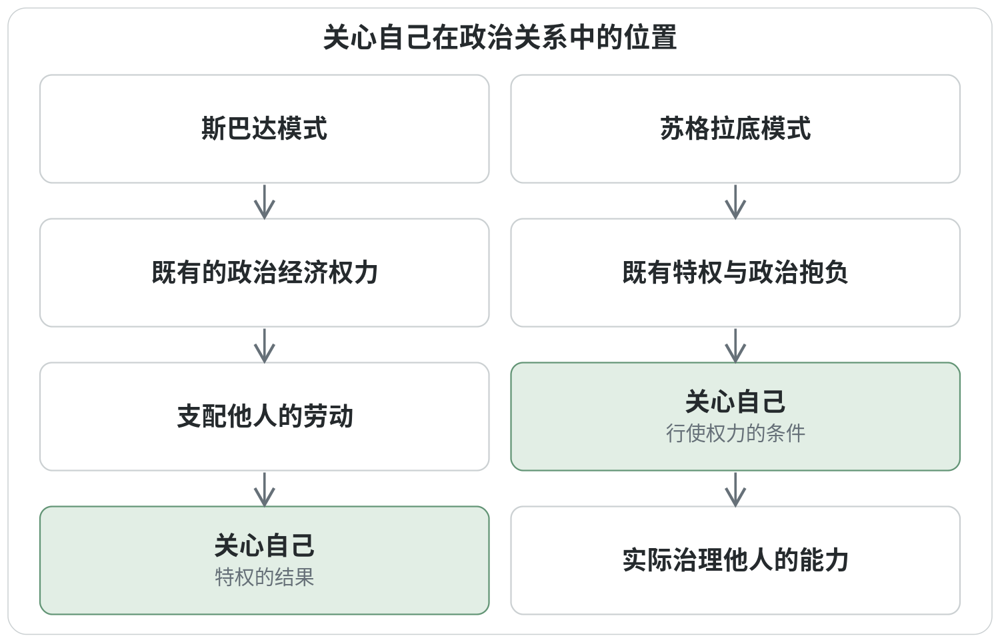

### 2. 教育与导师关系

第二，这一关心自己的概念，这个关心自己的必要性，是与阿尔西比亚德受教育不够相关的。但是，由此观之，雅典人的教育在两个方面是完全不够的：一是教学法方面（阿尔西比亚德的老师毫无价值，他是一个奴隶，而且无知无识，但是教育却是十分严肃的，把一个注定要搞政治的年轻贵族交给一个熟识的家奴，是不适当的）；同样，对另一方面也进行了不太直露的批评，但是从对话的一开始就蔓延开去：对男童之爱的批评，对于阿尔西比亚德来说，这不是他本应该有的职责，因为阿尔西比亚德曾被许多只想得到他的肉体的人追求过，这些人并不想关心他（这个论题随后又出现过），也不想促使阿尔西比亚德关心他自己。最好的证明就是，他们感兴趣的不是阿尔西比亚德自己，他们也不照顾阿尔西比亚德，让他关心自已：一旦他青春不再，他们就会抛弃他，让他做他想做的事。因此，关心自己的必要性不仅要被纳入政治计划之内，还要用来填补教学法的空白。

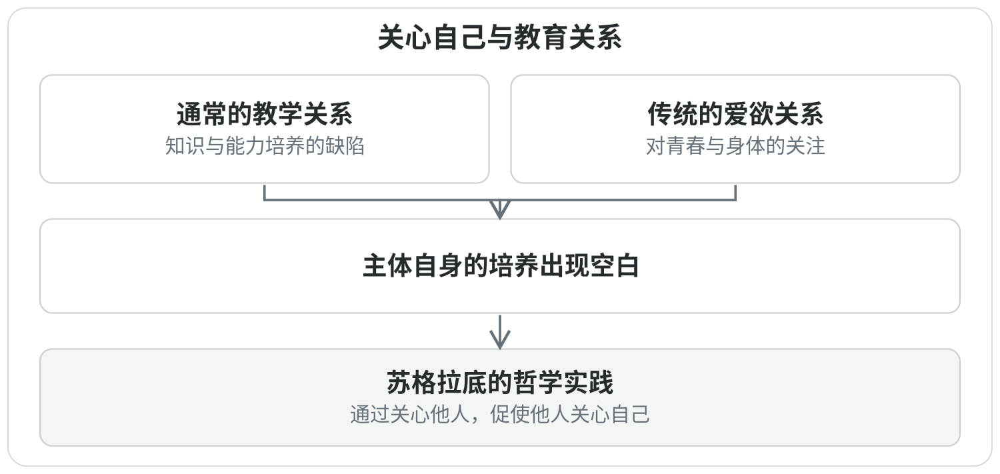

### 3. 年龄与生命阶段

第三（个性也重要，并与此直接相关），对话中说，如果阿尔西比亚德50岁了，那么要纠正这些事，就太晚了。这不是关心自己的年龄了。当人到了这个年龄临界点时（即他不需要老师的扶持了，并要进入政治活动时期），必须学会关心自已。

这篇文本在某种程度上是矛盾的，它最后对我将要给你们讲解的另一篇文本“苏格拉底申辩录”提出了问题。当苏格拉底在法官们面前为自己辩护时，他说：我在雅典从事的职业是一个重要的职业。它是诸神交给我的，即我要站在马路上，叫住所有的人，不论年少，还是老人，也不管是不是公民，告诉他们要关心自己。〔24〕在此，“epimeleia heautou” 是作为所有人的一般职责出现的，而在《阿尔西比亚德篇》中，它却是作为培养年轻人的一个必要阶段出现的。这将是有关关心自己的一个十分重要的问题、重要的论争之一和失衡点之一，我们将会看到，随着伊壁鸠鲁的哲学和斯多葛派哲学的出现，关心自己成了每个人一生的一个永恒职责。

但是，在这一早熟的苏格拉底一柏拉图的形式中，关心自己是年轻人在与自己老师的关系中，或在与自己的情人的关系中，或在与自己的老师、情人的关系中的一种活动，一种必要性。这是关心自己的第三点和第三个特征。

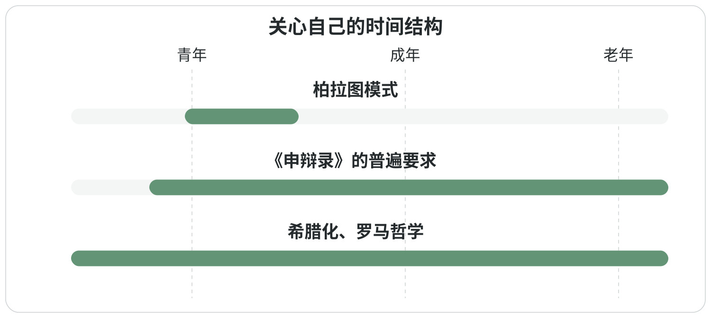

### 4. 无知与政治目标

最后，也就是第四点，在这篇文本中，关心自己的必要性成了一种迫切要求，这倒不是在阿尔西比亚德陈述他的政治计划的时候，而是在他发现自己忽视……的时候，他忽视了什么呢？他忽视了他要关心的对象及其本质。他知道自己想关心城邦。因为他的身份，他是有根据这样做的。但是，他不知道如何关心自己，他不知道他的政治活动的目标和目的（也即公民们生活美满，相互和睦）何在。他不知道什么是好的统治目标，为此，他必须关心自己。

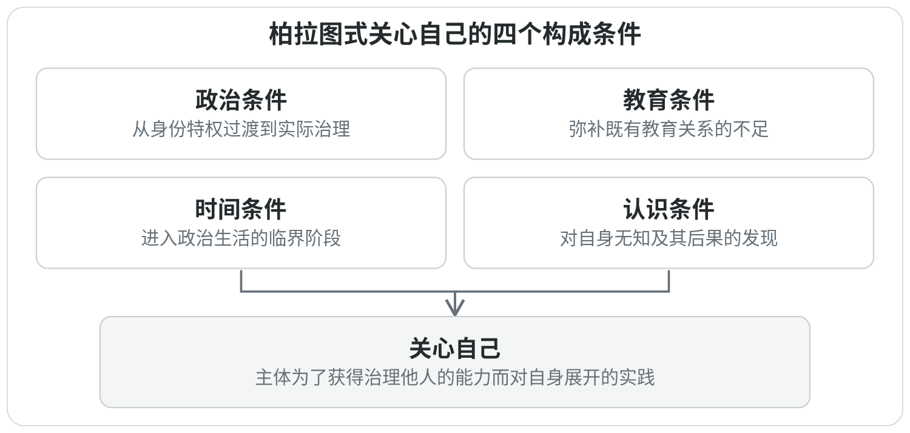

## 七、主体与政治治理

### 1. 关心自己的对象

此时此刻，出现了两个问题，这两个有待解决的问题是直接相关的。必须关心自己但是问题是：当说必须关心自己时，必须被关心的这个自己是什么呢？请看我在下次课上要大幅度评论的这段话，它十分重要。《阿尔西比亚德篇》这个对话是有副标题的，它很晚才被加上去的，我以为是在亚历山大时代，但是我不太确定，从现在到下一次，我会证实它的。这个副标题是“论人的本性”。〔25〕不过，当你们看到这篇文本展开的最后部分时（这一展开是从我向你们指出的那一段开始的），苏格拉底提出并试图加以解决的问题不是：你必须关心你自已；或者你是一个人，因此我提出的问题是：什么是人？苏格拉底提出的问题比较具体，很棘手，也很有趣。它就是：你必须关心你自己；但是什么是这个自己（auto to auto）呢？〔26〕因为它是你必须关心的你自己吗？

因此，这个问题针对的不是人的本性，而是我们现在所说的主体问题（因为这个词没有出现在这个希腊文本中）。什么是这个主体，什么是这个被这种反省活动（即个体诉诸自身的活动）必须朝向的目标呢？什么是这个自己呢？这是第一个问题。

### 2. 自我关心与治理他人

必须解决的第二个问题是：如果一本正经地去做，那么这种关心自己如何会引导我们，引导阿尔西比亚德实现他的愿望，也即认识到他为统治其他人所需要的技艺，即让他可以很好地统治的艺术呢？

总之，这篇对话的第二部分的目标是：必须根据“关心自己”这一说法给这个“自己”一个界定，这样，它就包含、开放或达到了良好统治必要的知识。因此，这篇对话的目标就是：为了能够照顾好我必须统治的其他人，我必须关心的这个自己是什么呢？这个循环就是从作为关心对象的自己到作为管理其他人的统治知识，我认为，它是这篇对话最后部分的核心所在。总之，这个问题就是在古代哲学中首次出现的“关心自己”的问题。好，我谢谢你们，下星期我们还是从9点15分开始。我将结束对这篇对话的读解。

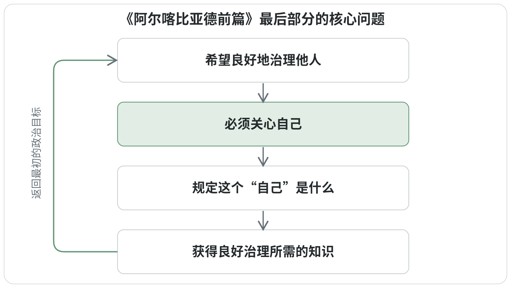

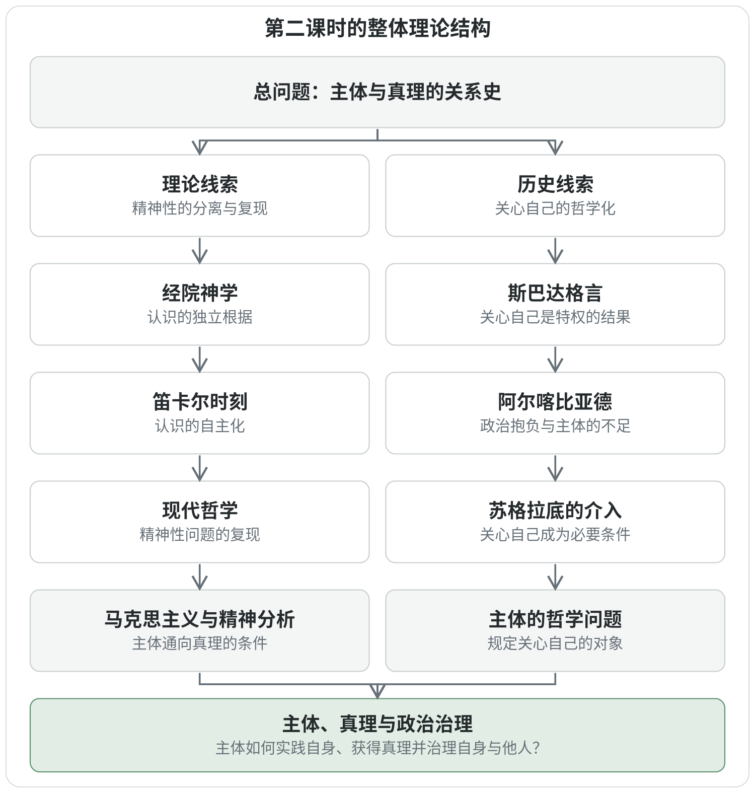

## 编者注释

〔1〕 福柯后来在2月24日第二课时的课上用了较长的时间考察了浮士德的神话。

〔2〕 B. 斯宾诺莎：《理智改进论》，载 “Benedicti de Spinoza: Opera quotquot reperta sunt”，J.范•维洛顿和J.P.N. 兰德编辑，海牙，1882一1884年（C. 阿皮恩译成法文，收入《斯宾诺莎著作集》，巴黎，1904年）。

〔3〕 E.胡塞尔：《欧洲科学的危机和先验现象学》，贝尔格莱德，“哲学”丛书，1936年（G.格拉内译，巴黎，伽利玛出版社，1976年）。

〔4〕 福柯同时认为这种传统是“现代”哲学的传统，他自己就是它的继承者（参见《言与文》，IV，第351号，第687—688页，和第364号，第813—814页）。

〔5〕 G.W.F. 黑格尔：《精神现象学》，Wurtzbourg, Anton Goebhardt，1807年（让•伊波利特译，巴黎，Aubier-Montaigne 出版社，1941年）。

〔6〕 关于拉康重新讨论的主体问题，参见《言与文》，Ⅲ，第235号，第590页；IV，第299号，第204—205页；和第330号，第435页。关于拉康在这方面的文本见“心理分析中的话语与语言的功能与领域”（1953年），载《作品集》，巴黎，瑟依出版社，1966年，第237—322页；“弗洛伊德无意识中主体的颠覆和欲望辩证法”（1960年），同上，第793—827页；“科学与真理”（1965年），同上，第855-877页；“最终主体成了问题”（1966年），同上，第229—236页；“讨论班I：弗洛伊德的技术作品”（1953—1954年），巴黎，瑟依出版社，1975年，第287—299页；“讨论班I：弗洛伊德理论和心理分析技术中的自我”（1954—1955年），巴黎，瑟依出版社，1978年；“讨论班XI：心理分析的四个基本概念”（1964年），巴黎，瑟依出版社，第31—41页，第125—135页；“关于心理分析的对象对哲学专业学生的答复”载《分析手册》，3，1966年，第5—13页；“对认知主体的蔑视”‘，载《就是说》，I，巴黎，瑟依出版社，1968年，第31—41页；“讨论班XX：进一步”（1973年），巴黎，瑟依出版社，1975年，第83—91 页；“症状”，载《就是说》，6/7，巴黎，瑟依出版社，1976年，第42—52页（我要把这个注释归功于J.拉格朗日和 M. 贝尔塔尼）。

〔7〕 在本年度和下一年度的课上都没有讨论过这第三个时期。

〔8〕 “正如有人询问为什么他们要把田间劳动交给希洛人去做，而不是自己去做（kai ouk autoi epimelountai），他回答道：‘因为我们有所收成不是为了让我们去关心他们，而是让我们关心自己 （ou tout6n epimelomenoi all'hauton）。’ "（“Apophtegmes laconiens"，217a，载普吕塔尔克的《道德作品集》，卷Ⅲ，F.菲尔曼译成法文，巴黎美文出版社，1988年，第171—172页）参见《关心自己》中对这个例子的再解释，第58页。

〔9〕 它们会在1月13日第二课时的课上得到考察。

〔10〕 所有这些阐述都在这篇文本的一开头，从103a到 105e【《阿尔西比亚德篇》，载柏拉图的《全集》，卷I，M.克鲁瓦泽译成法文，巴黎，美文出版社，1920年（以后都将参考这个版本），第60—63页］。

〔11〕 福柯在这里想到的是阿基里斯的双重命运：“我母亲经常对我说起崇拜金钱的女神西蒂斯：两种命运会把我带向终结一切的死亡。如果我仍然在特洛伊城周围打仗，那么这对于我来说是要报答使然；但是，有一个不朽的荣耀在等着我。如果我因此而回到我的祖国，那么这对于我来说是尊贵的荣耀使然：一段漫长的人生留给了我，而终结一切的死亡就长期不会落到我身上。”（《伊利亚德》，诗章区，第410—-416 诗节，P.马松译成法文，巴黎，美文出版社，1937年，第67页）

〔12〕 《阿尔西比亚德篇》，104a（第60页）。

〔13〕 阿尔西比亚德因其父克利尼亚斯（Clinias）而成了“有好爸爸的人”（genos des Eupatrides） 之一，这是一个拥有大量财产的贵族家庭，从古代以来就在政治上统治着雅典。克利尼亚斯的妻子（是曾遭放逐的梅伽克勒的女儿）则来自阿尔克梅奥尼德家族，它无疑在古雅典的政治史上起着最关键的作用。

〔14〕 《阿尔西比亚德篇》，104b（第61页）。

〔15〕 福柯在1981年1月28日的授课中已经讨论过男童关键年龄的问题，这次授课主要讨论的是 “aphrodisia”的伦理知觉的构成（社会一性别同构原则和活动原则）以及在此范围内由出身很好的男童之恋所引起的问题。

〔16〕 色诺芬：《回忆录》，Ⅲ，VI，前引版本，第363—365页。

〔17〕 希腊文本记载得更清楚：“alla diateinou mallon pros to seaut6 prosekhein。”（色诺芬：《回忆录》，VI，9，E.C.马康德编辑，伦敦，勒布古典丛书，1923年，第216页）

〔18〕 这段话出自《阿尔西比亚德篇》，119a 124b（第86-93页）。

〔19〕 “好了，孩子，你太天真了，相信我，相信这些刻在德尔斐神庙里的字：‘认识你自己。’”（《阿尔西比亚德篇》，124b，第92页）

〔20〕 《阿尔西比亚德篇》，125d（第95页）。

〔21〕 《阿尔西比亚德篇》，126c（第97页）。

〔22〕 《阿尔西比亚德篇》，127d（第99页）。

〔23〕 《阿尔西比亚德篇》，127e（第99页）。

〔24〕 《苏格拉底申辩录》，30a，M.克鲁瓦泽译，前引版本，第157页。

〔25〕 据第欧根尼，拉尔修（《著名哲学家的生平与学说》，Ⅲ，57—62，M.-O. 古勒-卡泽主译，巴黎，袖珍书丛书，1999年，第430—433页）说，特拉思菜〔公元1世纪第拜尔（Tibere）的星相学家和尼禄朝廷上的哲学家〕把柏拉图的对话录分成4部曲，给每个对话确定的第一个标题通常是苏格拉底的特对话者的名字（这种命名对话的方式可能追溯到柏拉图本人），而第二个标题则表示对话的主题。

〔26〕 这种说法就在《阿尔西比亚德篇》中，129b（第102页）。
