# 正文（1982年1月13日）

## 讲座提要

在《阿尔西比亚德篇》中，关心自己被规定为认识自己：柏拉图著作中两个律令之间的对抗——眼的隐喻：视觉起源与神的成分——对话的目的：关心公正——对话的真实性问题及其与柏拉图主义的一般关系——《阿尔西比亚德篇》的关心自己与政治活动的关系、与教育的关系、与男童之爱的关系——《阿尔西比亚德篇》中有关关心自己在柏拉图主义中的命运的预见——《阿尔西比亚德篇》的新柏拉图主义传人—柏拉图主义的悖论

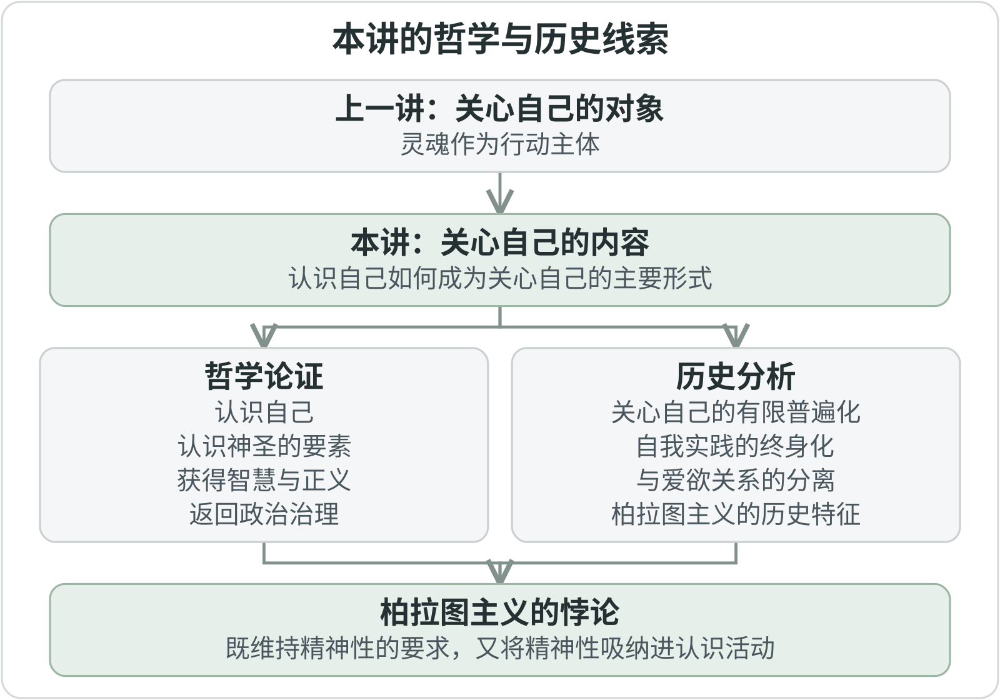

## 导言

（……）（是否还有）另一间空教室吗？有吗？这些人都在这里，是因为他们无法去另一间教室里，还是因为他们喜欢呆在这里呢？对不起，这里的条件实在是太糟糕了，我无能为力，我将尽可能不让你们感到太痛苦。〔1〕

好，刚才在谈到这些修身技术及其先于柏拉图对于“关心自己”的反思的存在时，我就想到（我忘了向你们提及这一点）有一篇文本，我认为是罕见的文本之一、罕见的研究之一，其中这些问题根据柏拉图的哲学都被讨论过：这就是亨利•诺里的书《柏拉图的革命：逻各斯一认识一政治》。他把那讨论这种先在性的十几页纸归结为“萨满教的结构”，我们可以讨论一下这个词，但是这不重要。〔2〕他坚持这些技术中有些早就存在于远古希腊文化中（吸纳技术、身体技术等）。你们可以参考这本书。〔3〕总之，这篇文本给了我一些观念，因此，我刚才没有向你们引述它是不对的。

好，第三个评论也是有关方法的。这两个课时：我对这个安排并非不满意。我不知道你们对此的想法。这可以让我们更缓慢进行。显然，我可能更喜欢用第二节课的一部分时间来与你们讨论，回答像这样一类的问题或诀窍。而与此同时，我必须向你们坦承，我有点怀疑，因为在这样一个听众众多的教室里，进行讨论是困难的。我不知道会怎样。如果你们真的认为这是可能的，而且可以严肃地进行，那么我悉听尊便。我希望我们尝试用一部分时间来回答你们可能有的问题。总之，你们待会告诉我吧。我们可以以希腊的方式来做：进行抽签，每次抽出20个或30个听众，我们来弄个小型讨论班……

现在，我想结束对这个《阿尔西比亚德篇》的读解。这对于我来说又是我今年授课内容的导言。因为我的计划从各个方面来看都不是重谈柏拉图的关心自己这个十分重要的问题，因为我们看到它不仅仅是在《阿尔西比亚德篇》中被谈到，即使在《阿尔西比亚德篇》中对它阐述了一套完备的理论。我也不想重构关心自己的连续史，从苏格拉底一柏拉图对它的阐述一直到基督教。这次对《阿尔西比亚德篇》的读解可以说是导言，是古典哲学中的一个标点。随后，我将转向希腊化和罗马哲学（帝国时代）。因此，这只是一个标点。现在，我想结束对该文本的读解，然后确定几个问题、这篇文本的几个特征。我们随后还会再发现这几个特征，它使我们可以在历史的向度上提出这个关心自己的问题。因此，《阿尔西比亚德篇》第二部分讨论的第一个问题是：我们必须关心的这个自身是什么呢？

## 一、认识自己与关心自己

### 1. 德尔斐箴言的三次出现

这第二部分的第二部分及其问题（整个结构既简洁明白，又便于阅读）就是：这种关心必须包括哪些内容呢？什么是自己关心自己呢？回答是紧随其后的。我们甚至不必去尝试人们对付灵魂所使用的那种稀奇古怪的方法，即人们根据“khresis/khresthai”这一概念确定必须关心的是灵魂。不。关心自己必须包括哪些内容呢？这很简单：认识自己，这里，我们第三次在这篇文本中发现涉及“gnothi seauton”这个德尔斐戒律。但是，这第三次涉及的意义却完全不同于前两次。你们都记得，第一次只是一次审慎的劝告：告诉我，阿尔西比亚德，你有许多伟大的抱负，但是对自己是什么却关心不够，你是否认为你真的能够以这些抱负为荣吗？这第一次涉及其实只是引出 “epimeleia heautou”：正是在转眼看一下自己，发现自己的不足之后，阿尔西比亚德才被敦促去关心自己。〔4〕第二次提到 “gnothi seautou” 是在必须关心自己这一命令之后，但是以一个方法论的问题提出的：必须关心的这个自己是什么呢？这个“heautou”意味着什么，它指的是什么？这是德尔斐戒律第二次被引用。〔5〕最后，“gnoth seautou” 第三次出现是在问及关心自己必须包含哪些内容时。〔6〕而且这一次，“gnoth seautou” 得到了充分的阐述：关心自己必须在于认识自己。

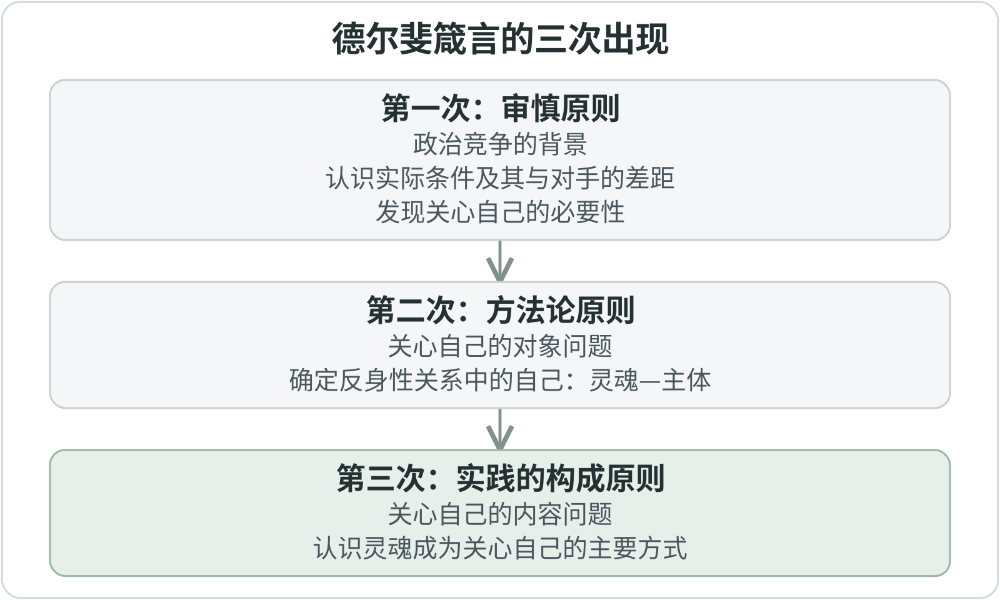

### 2. 古老修身技术的重组

完整意义上的 “gnoth seautou”：当然，这是这篇文本的关键时刻之一；我认为这也是柏拉图主义的构成阶段之一，而且是修身技术史和关心自己的漫长历史上的主要插曲之一，在整个希腊、希腊化和罗马文明的进程中分量很重，或者说影响巨大。

确切地说，就像我刚才说的，在诸如《斐多篇》和《饮宴篇》等文本中，有一大堆有关完全不属于“认识你自己”的实践的暗示：让思想关注自己的实践，让灵魂围绕自己的主轴转的实践，反求诸己的实践，培养耐心的实践，等等。有许多关心自己的方式，至少初看上去，完全不可以直接归入认识自己的范围内。

其实，我认为整个柏拉图主义的思想运动在关心自己的问题上都会通过恢复和整合某些事先就存在的古老技术，整理它们，让它们遵从“认识你自己”这一主要原则。正是为了认识自己，所以必须反求诸己；正是为了认识自己，所以必须摆脱让我们产生错觉的各种感觉；正是为了认识自己，所以必须心如止水，不受任何外在事件的影响，等等。正是为了认识自己，也正是因为人要认识自己，所以必须要做这一切，而且也能够做到。因此，在我看来，对于所有这些“认识你自己”的技术要有一番大重组。总之，在这里，在这篇文本中，所有这些预先的技术，这些修身的技术都没有提到，可以说，一旦关心自己的空间开放了，一旦自身被界定为灵魂，那么如此开放的空间就被“认识你自己”这一原则覆盖了。我们可以说，这是 “gnothi seauton”在关心自己开放出来的空间中用力的结果。当我说“用力”（coup de force）时，这显然是有点隐喻意味的。

你们都记得，上一次（这就是我今年要向你们谈的），我提到“gnothi seauton”（认识自己）和关心自己之间这些棘手的和有着悠久历史意义的问题。而且，我认为近现代哲学（原因就是我曾在我称为“笛卡尔阶段”中所指出的，大致如此罢，并非开玩笑）曾全力强调“gnothi seauton”，因而遗忘、冷落和边缘化了关心自己这个问题。因此，关心自己就是我今年想要揭示的、相对于长久以来享有特权的 “gnothi seauton”（认识自己）的东西。但是，重新揭示关心自己，决不意味着 “gnothi seauton” 是不存在的、不重要的，或者是一个配角。

其实，我想说的是（这里有一个最好的例子）“gnothi seauton”和 “epimeleia heautou” （“认识你自己”和“关心自己”）之间的混杂。由此可见，在全文中，这两个东西是混杂在一起的：正是通过提醒阿尔西比亚德，他才稍稍关注起自己来，在别人的启发下说道：“是的，这是真的，我必须关心我自己”；随后，当苏格拉底提出了这个原则，而且阿尔西比亚德接受了它时，［这个问题］又一次被提出了：“必须好好地认识这个必须关心的自己本身”；后来，当提起关心自己包括什么内容时，人们第三次发现了“gnothi seauton”。在此，“gnothi seauton" 和 “epimeleia heautou”（认识自己和关心自己）之间有着一种动态的交织，一种相互召唤。我认为，这种交织，这种相互召唤是柏拉图的特点。它一再出现在整个希腊、希腊化和罗马的思想史上，当然，两者之间的平衡和关系在不同时期是各不相同的，对双方的强调也时而不同，而且两者之间时段分布在我们所遇到的不同思想中亦是不同的。但是，我认这种交织是非常重要的，其中，我们不应该为了照顾某一个而忽视另一个。

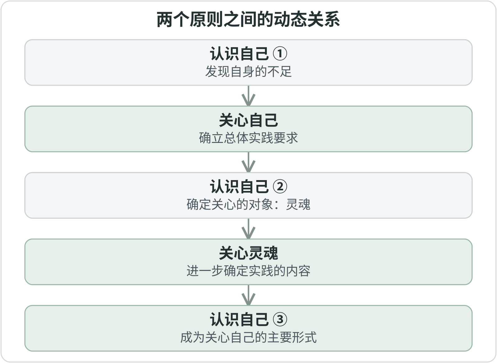

## 二、眼睛的隐喻与自我认识

### 1. 自我认识的反身性结构

因此，让我们再来看（第三次）我们的文本和“gnothi seauton”的凯旋式的再出场：关心自己就是认识自己。当然，问题是：人怎么能够认识自己呢？这种认识包含什么内容呢？在柏拉图的其他文本中，尤其是在晚期的文本中，有一篇文本重复过一些有关眼的隐喻，它不仅众所周知，而且常被人使用。〔7〕如果想知道灵魂是怎样能够认识自己的，因为我们现在知道正是灵魂必须认识自己，那么就让我们来看有关眼的例子吧。当一只眼可以看自己时，那么这需要什么条件呢？又是如何看自己的呢？当它看到镜子反射给它自己的形象时。但是，对于想看到自己的那只眼来说，镜子不是唯一的反射表面。总之，当某人的眼通过别人的眼反观自身时，当一只眼通过另一只绝对类似于它的眼反观自身时，它在别人的眼中看到了什么？它看到了自己。因此，一种自然的身份是个人能够认识到自己是什么的条件。自然的身份是个人能够认识自己是什么的反射表面。

第二，当眼这样在别人的眼中感知到自己时，这是否是在这个眼中他看到了自己，或者，是否是在作为瞳孔的眼的这个特殊要素中，并通过它才有了视觉活动呢？其实，眼不是在眼中看到自己的。眼是在视觉的要素中看到自己的。这就是说，让眼可以把握自己的视觉行为只能发生在另一个视觉行为中，即出现在另一个人的眼中。

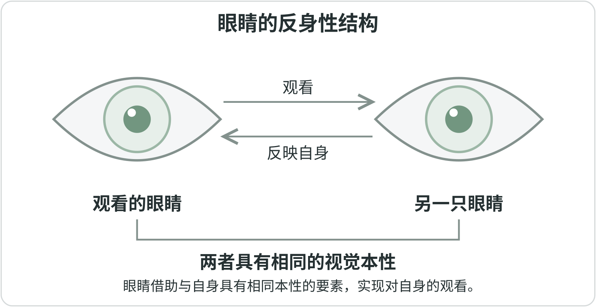

### 2. 灵魂与神圣要素

那么，这个知名的比较是否就被应用到灵魂上了呢？它指出，灵魂只是通过关注一个与它本性相同的要素才看到自己的，具体说来：通过观察与灵魂本性相同的要素，通过关注形成灵魂本性的要素本身，即思想和知识 （to phronein, to eidenai）。〔8〕灵魂是通过关注这个要素（它确保了思想与知识）才能看到自己。不过，这个要素究竟是什么呢？它就是神的要素。因此，灵魂正是通过关注神才能够把握自身。

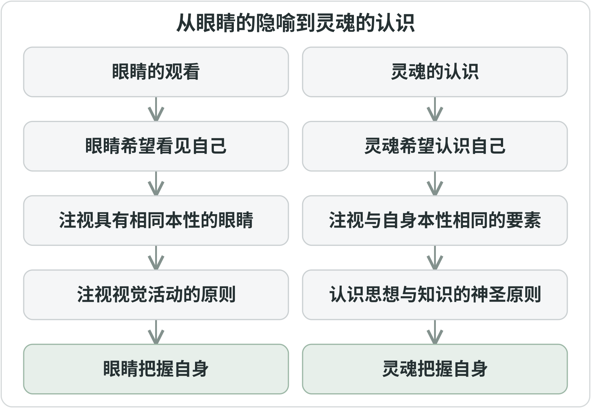

### 3. 神圣的镜子

于是，问题就出现了，这当然是一个我无法解决的专门问题，但是挺有趣，而且在思想史上反复出现：即有关其真实性受到质疑的过渡问题。它最初出现在苏格拉底的一次反驳中：“因为真实的镜子都是比眼的镜子更清晰、更纯洁和更明亮，同样，神（ho theos）比我们灵魂中最好的部分更纯洁、更明亮。”阿尔西比亚德回答道：“看来是这样，苏格拉底。”这时，苏格拉底则回应道：“因此，必须关注神：它是人事的最好的镜子，它愿意评判灵魂的资质，而且，我们正是通过它才能够更好地看到和认识到自己。”对此，阿尔西比亚德则说：“是的。”〔9〕由此可见，在这段话中，最好的镜子就是那些比眼更纯洁、更明亮的东西。同样，因为当镜子对我们来说比我们的眼更明亮时，我们才更好地看到自己，所以只要我们不在一个与我们类似的，甚至是一样明亮的灵魂中，而是在一个比我们的更明亮、更纯洁的要素（也即神）中观察自己的灵魂，那么我们就看得更清楚。

实际上，这段话只在塞撒雷的巴斯勒的一篇文本（“福音书预习”）中被引用过，〔10〕而且因此被怀疑曾被一种新柏拉图主义的传统，或被一种基督教的传统，或被一种柏拉图主义一基督教传统引入过。总之，无论这篇文本确实是柏拉图的，还是后来被添加过内容，即使它相对于我们所认为的柏拉图自己的哲学是通向极限的一段，但是这篇文本的一般运动在我看来是再清楚不过的了，即使它不依赖于这一段，甚至人们把它抽象化了。而且，它把认识神当作认识自己的条件。

删去这一段，让我们把这篇对话的其余部分放在一边，这样，我们就会几乎相信它的真实性，我们有的这个原则是：为了关心自己，必须认识自己；为了认识自己，必须在自身这个要素内反观自己；必须在这个要素中观察什么是认识和知识的原则；而且，这个知识与认识的原则就是神的要素。因此，必须在神的要素中反观自身，从而认识到自己：为了认识自己，必须认识神。

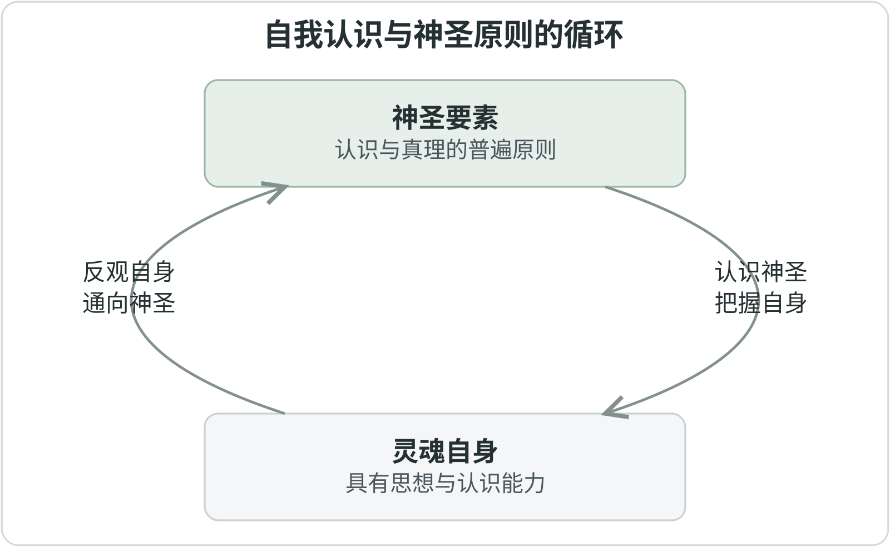

## 三、自我认识与政治正义

### 1. 灵魂的上升与返回

由此，我认为我们可以尽快推理出这篇文本表示的目的。通过向这种神的认识开放，我们借以认识自己的这一运动，在我们对自身的重大担心中，将会允许灵魂达至智慧。一旦灵魂接触到神，一旦它把握了神，一旦它能够思考和认识到这个思想与认识的原则就是神，那么它就有了智慧（sophrosune）。由于有了智慧，灵魂这时候就能够回到这个世俗世界。它就能区别善与恶、真与假。这时，灵魂将能够恰当地行事，知道如何正确地行事，它将能够治理城邦。我非常简要地概括了一篇有点长的文本，但是，我想立即就着手讨论这篇文本在135e的一个有趣的反思中最后的或接近最后的答复。

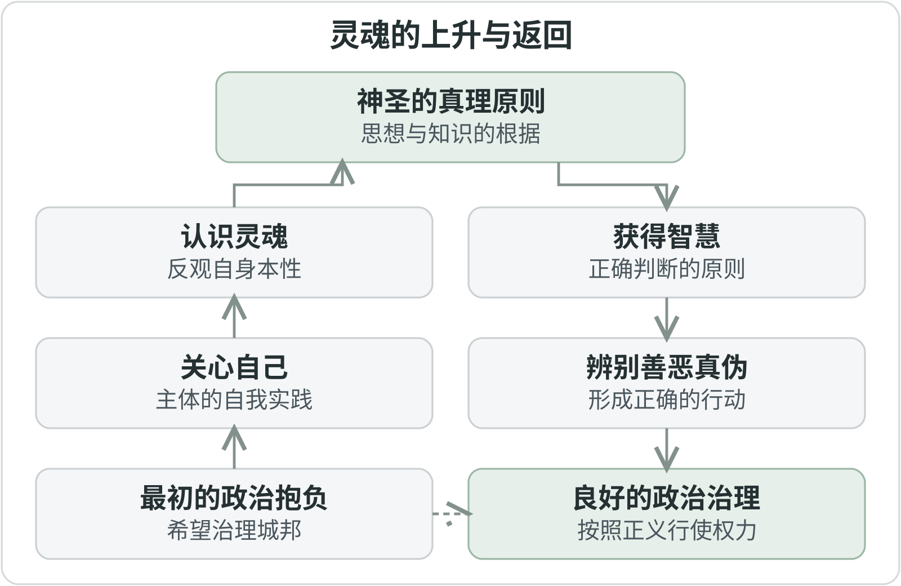

### 2. 关心正义

现在，我们就落脚在认识自己上，它就是认识神，就是认识作为正确行为规则的智慧，我们现在知道了，我们可以治理了，而做过这种上上下下运动的人可以成为治理他的城邦的高素质的人。于是，阿尔西比亚德做了承诺。在这篇对话的末尾，别人十分急切地敦促他关心自己，他做出了什么承诺呢？他对他说出了“关心”（epimelesthai）我自己吗？（这确实是阿尔西比亚德的最后答复，随后是苏格拉底的一段反思：总之，确实如此，我现在就从 “epimelesthai” 开始吧。）不，而是关心“正义”（dikaiousunes）。这可能有点自相矛盾，因为整篇对话，总之，这篇对话的第二部分，涉及的是关心自己，关心自己的必要性。而且以上就是，在这篇对话要结束时，被说服的阿尔西比亚德开始关心正义了。

但是，这并没有什么不同。或者说，这就是这篇对话得到的好处和这篇对话的最终结果：说服了阿尔西比亚德，他必须关心他自己；为阿尔西比亚德界定了他必须关心的对象：灵魂；向阿尔西比亚德说明了他必须怎样关心他的灵魂：即把目光转向神，那里有智慧的原则；［这样］，当他反观自身时，他从中就会发现神；而且，他从中会发现智慧的本质；或者，反过来，当他观察到智慧的本质时，〔11〕他会同时发现神的要素；而他就是凭借神的要素认识自己、承认自己的，因为正是在本身这个要素中，神反映了我是什么。因此，关心自己或关心正义是殊途同归，而且，整篇对话的展开是从“我怎样才能够成为一个好的统治者？”这个问题到让阿尔西比亚德接受“关心你自己”这个戒律，通过展现什么是和应该是“关心你自己”这个戒律，即必须向他揭示的意义，我们从中发现“关心自己”就是关心正义。而这正是阿尔西比亚德在这篇对话的末尾着手要做的。这篇文本就是这样展开的。

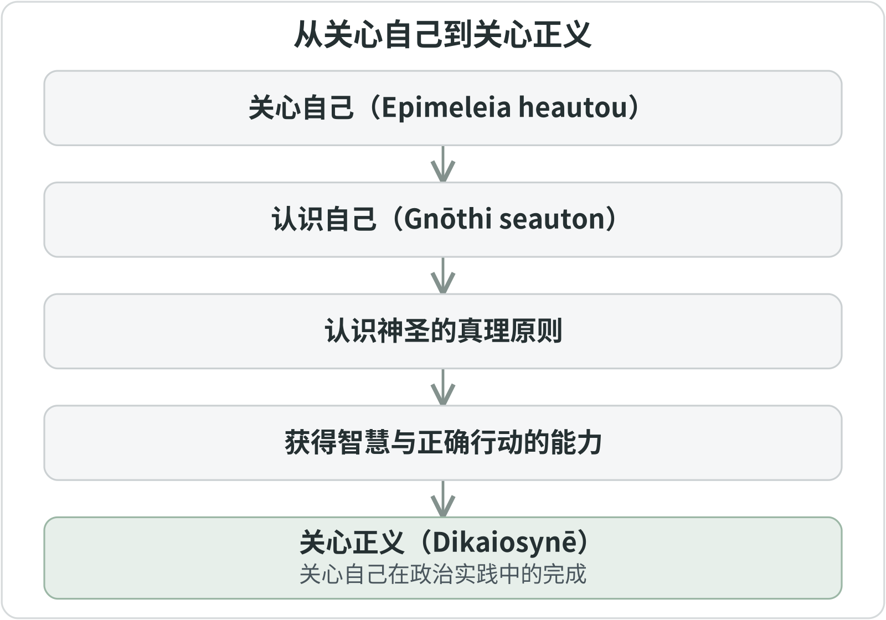

## 四、《阿尔喀比亚德前篇》的思想史位置

### 1. 真实性与成书年代

由此，我认为现在可以做一些比较一般的反思。一开始，我们就讨论一下这篇对话和它提出的问题，因为我多次提到过一段话的真实性，或这篇对话的问题，有些人曾认为它不是真的。其实，我认为现在已不止一个学者严肃地提出了它的真实性问题。〔12〕而且，关于它的年代，也有不少的问题。在这方面，雷蒙•韦伊在《文学信息》上写过一篇很棒的文章，它总结和澄清了有关这篇文本及其时代的问题，我认为非常缜密。〔13〕因为这篇文本的许多要素表明是早期的作品：根据提出问题的类型，早期对话的苏格拉底要素很明显。我随后会提到它们：这个问题有关这位想治理城邦的年轻贵族、教育的不足、男童之爱应有的作用，等等，这篇对话及其问题有点阻滞：这一切既表明了苏格拉底对话的社会政治背景，也指出了这些没有结果的辩难对话的方法。

不过，另一方面，在这篇对话中，还有一些要素似乎透露出它的年代比较晚，这些外在的要素我无法判定；我是直接从雷蒙•韦伊的文章中借用它们的。比如，有个时候曾暗示过斯巴达的财富，当时苏格拉底对阿尔西比亚德说：但是，你要遇上劲敌，斯巴达人同样比你富裕。看来，诸如这类提到斯巴达比雅典有着更多的财富的话，只有在奔罗伯尼撒战争之后才有意义，而且是在斯巴达的经济发展之后，这当然和柏拉图的早期对话不是同时代的。还有第二个要素，可以说是有点外在的要素，即对波斯的兴趣。在柏拉图那里，提到波斯比较晚。在早期对话中，还没有其他证据表明他曾提到过波斯。

### 2. 对话的内部思想运动

但是，关于这篇对话的时代问题，让我感兴趣的是这篇对话的内在思路。一方面，事实上，这篇对话一开始绝对带有苏格拉底对话的风格：什么是治理、正义的问题，然后是城邦中的幸福是什么的问题。而且，所有这些对话最后都是通过一个没有结论的问题，或没有肯定答案的问题结束的。不过，经过很长时间的毫无进展之后，突然出现了一个认识自己的概念，它认为认识自己就是认识神。这个分析是要明确地确定 “dikaiosune"，并没有早期对话的风格。而后是一些其他要素。这个有关四个德性的学说就是从波斯人那里借来的；这是正统的柏拉图主义中的四德性学说。把灵魂比作镜子的隐喻，说的是灵魂在神的镜子中反观自身：这也是晚期的柏拉图主义。灵魂作为“khresis”的主体和行为者的观念，远不是指囚禁在肉身中的实体，它是一个在亚里士多德那里又出现过的要素，而且，如果它出自早期，那么它表明柏拉图主义经过了一番相当令人吃惊的改变。

简言之，我们有了一篇在年代上奇异的文本，而且可以说贯穿了柏拉图的全部作品：年轻时的风格与参考资料都是非常当下的，不可否认的；另一方面，其中出现的正统柏拉图主义的论题与形式也是很明显的。我认为，某些人的假说（在我看来，这是韦伊小心谨慎地提出的）是，这也许是老年柏拉图在某个时候重新改写了这篇对话，或者，极而言之，也许是在柏拉图去世后被改写的：在这篇文本中，有两个相关的要素、两个层面，它们在这篇对话中到了一定的时候会介入进来。

总之，因为这不是我力所能及的，而且，我也不想讨论它，在这篇对话中，令人感兴趣的，我也发觉很有吸引力的，就是从中看到了柏拉图哲学的走向，即从苏格拉底式探问到非常接近柏拉图晚期或新柏拉图主义的一些要素的走向。这使得塞撒雷的巴斯勒引述的这篇被伪造的文本，它的出现（也许是被加进来的）是和这个主要内容不协调的，即这样发展的柏拉图主义并没有出现在它的所有要素中，但是它至少指出了其走向的关键之所在。以上是这篇文本令我感兴趣的第一个理由。

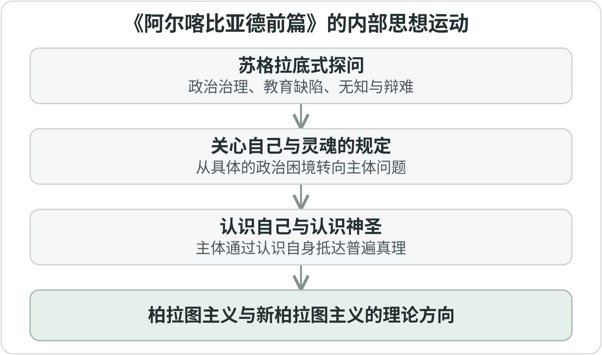

## 五、关心自己的有限普遍化

此外，从这个主要走向来看，我以为我们可以孤立地看某些要素，它们很好地提出了问题，不是关于“epimelei heautou”的柏拉图式问题，而是有关这一概念及其在希腊、希腊化和罗马思想上的实践和哲学定位的纯粹历史的问题。一方面，在这篇文本中，很显然出现了某些问题：与政治活动的关系、与教育的关系、与男童之爱的关系。这些问题根据其表述和这里提出的解决办法，带有典型的苏格拉底一柏拉图的思想，但是，它们又连续地出现在希腊一罗马的思想史上，而且一直到公元2—3世纪，才有了一些有点不同的解决办法，或者说是明确提出了这些问题。

### 1. 政治特权与普遍化

第一，与政治活动的关系。在苏格拉底那里，在《阿尔西比亚德篇》这个对话中，非常明确的是，关心自己是向那些想治理其他人的人提出的一个律令，而且是对这样一个问题的回答：“我们怎样才能统治好呢？”关心自己是统治者的一个特长，或者说，这同时也是统治者的一个职责，因为他们是要去统治的。非常有趣的是，看到关心自己这个律令怎么会普遍化的，而且成了“适用于所有人”的一条律令，但是，我立即给“所有人”加上双引号。是会出现这种律令的普遍化的（我下次会给你们说明的），但是这也是一种很局部的普遍化，为此，必须考虑到两个重要的限定。

### 2. 社会区分与伦理区分

第一个就是，为了关心自己，〔还〕必须有这方面的能力、时间、教养等。这是精英的行为。而且，当斯多葛派和犬儒派对大家说要“关心你自己”时，其实这只能在那些在这方面具有文化的、经济的和社会的能力的人那里化为实践。

第二，还必须牢记，在这种普遍化中，会有第二个限定原则。这就是，关心自己，其结果（即其意义和其目的）是让关心他自己的个人成为一个不同于群众的人，一个不同于大多数人的人，一个不同于被日常生活融化的人（hoi polloi）的人。〔14〕由此，应用“关心你自己”这一原则，其结果就隐含着一个伦理区分，〔轮到它，已是第二个区分了〕，其实只有通过一位道德精英和有能力自救的人才能被实施。这两种区分的交织—一是有教养的精英的区分，另一个是通过关心自己的实践而获得的区分—因此构成了对这种普遍化的主要限定，而比较晚出的哲学家们则要求、表达、呼唤这种普遍化。

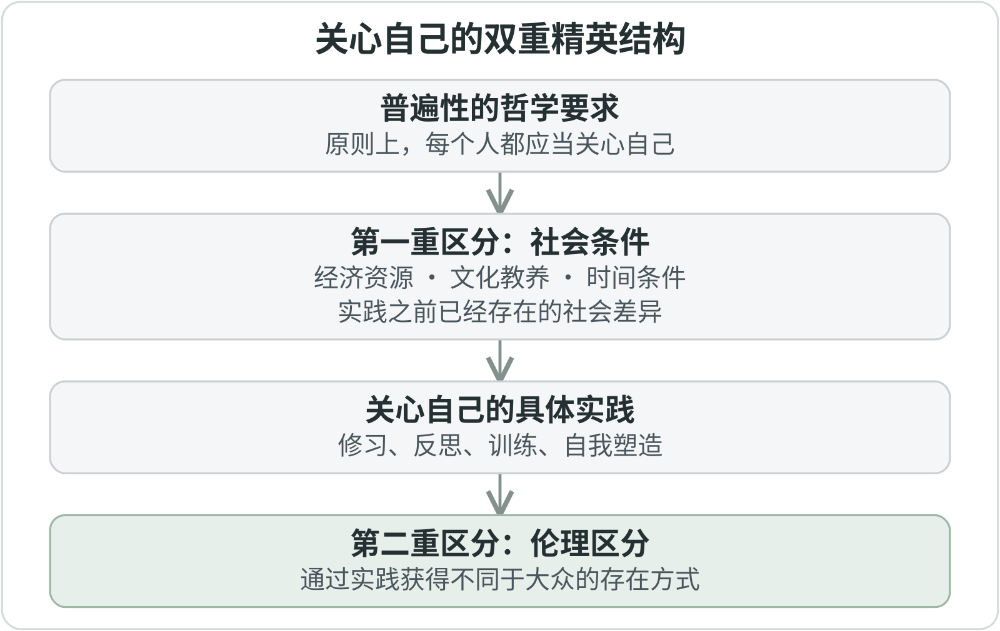

## 六、关心自己的时间结构与爱欲关系

### 1. 青年教育与终身实践

第二，在苏格拉底与柏拉图那里，关心自己是与教学问题直接相关的。因为教学的不足，所以就有必要关心自己。不过，我们随后就介入到第二个变动之中，这个变动针对的不只是普遍性，而是年龄。必须关心自己，不是在人年轻的时候，因为雅典的教育不足，而是不论什么原因，都必须关心自己，因为任何教育都无法确保它。而且，必须在整个一生中一直关心自己，在关键的年纪、决定性的年纪、成熟的年纪里关心自已。成熟期（而不是刚出了青春期）将是特殊的年龄段，关心自己成为必不可少的。

由此可见，关心自己所要准备的，不像青春期那样是进入了成人生活和市民生活。年轻人不是为了成为公民，或者是为人所需要的首领，而去关心他自己的。成人必须关心他自己，这是为了作何准备呢？为了他的老年。为了准备在这个生命将结束的年龄段完成一生，这个年龄段就是老年。关心自己作为为老年做准备，完全不同于作为为人生做准备的教育进补的关心自己。

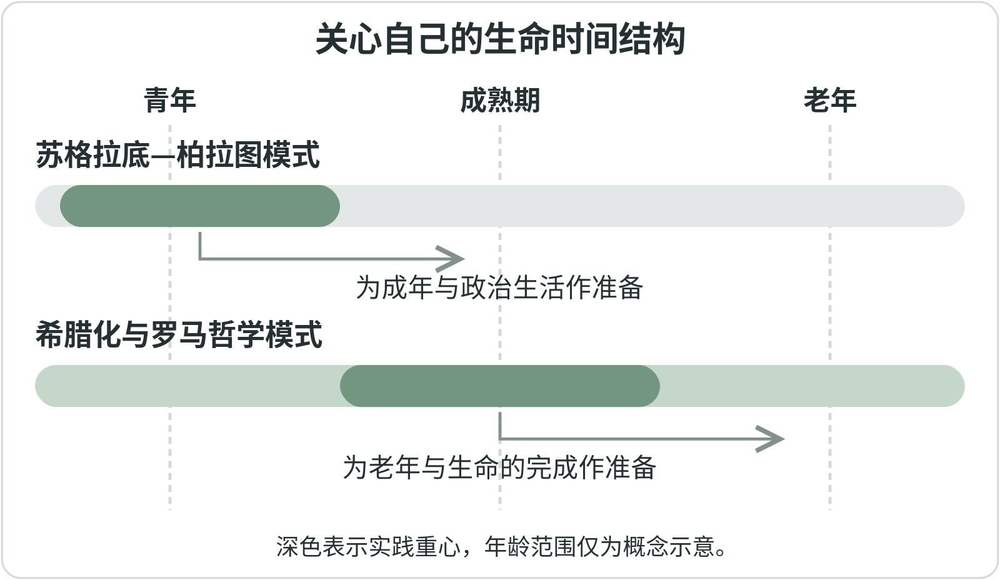

### 2. 爱欲与精神指导

最后是与男童之爱的关系（我刚才向你们指出过这一点，我以后不再说了）。这种关系在柏拉图那里是非常清楚的。渐渐地，在希腊化和罗马时代的修身技术和修身文化中，这种关系脱节了，而且男童之爱消失了，或者趋于消失。当然，还是有一些著名的例外、一系列的迟缓和困难的。比如，当你们读到佩尔斯的第三或第四首讽刺诗时，就会发现他提到他的老师科尔尼蒂斯时绝对是把他当作情人的；〔15〕而且弗隆顿和马克•奥勒留相互之间的通信亦是情人之间的鸿雁传书。〔16〕因此，这个问题更加棘手和费时。

## 七、柏拉图主义的自我实践模式

为此，我们可以说，这些论题（与性爱的关系、与教学的关系、与政治的关系）总是会出现的，当然，也会有一系列的变动，它们构成了后古典文明中关心自己的历史。

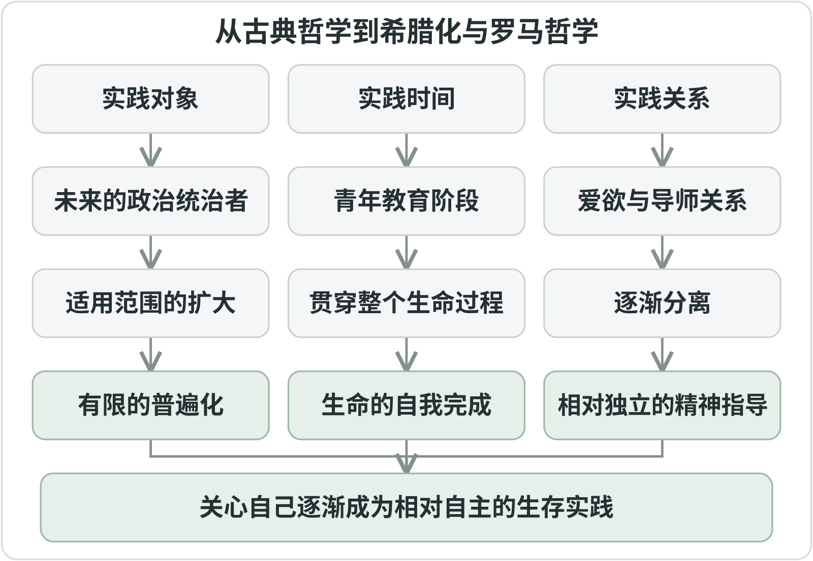

因此，如果可以说阿尔西比亚德提出的问题开启了一个十分漫长的历史，那么他同时也非常好地指出了在这个时期出现的柏拉图主义或新柏拉图主义的解决方式就是针对这些问题的。而且，在此意义上，阿尔西比亚德见证的，或预见的不是有关关心自己的一般历史，而是有关他所坚持的柏拉图主义的形式。

因为我认为，在柏拉图主义或新柏拉图主义的传统中，显示关心自己的特征的，一方面是，关心自己在认识自己中找到了自己的形式和完成，这种形式如果不是唯一的，至少也是关心自己的最高形式。

第二，同样带有柏拉图主义或新柏拉图主义特征的事实就是，这种认识自己作为关心自己的主要和最高的表现，指出了迈向真理、普遍真理的通道。

最后是第三点，带有柏拉图主义和新柏拉图主义的关心自己方式的特点的事实就是，真理通道同时也让人认识到自身中就可能有神圣。认识自己、认识神灵、认识自身中的神灵，我认为这在柏拉图主义和新柏拉图主义的关心自己的方式中是根本的。这些要素在其他〔关心自已〕的方式（伊壁鸠鲁主义、斯多葛主义或毕达哥拉斯主义）中是不存在的（总之，不是像这样结构谨严的），尽管在随后的新毕达哥拉斯主义和新柏拉图主义之间可能有过许多插曲。

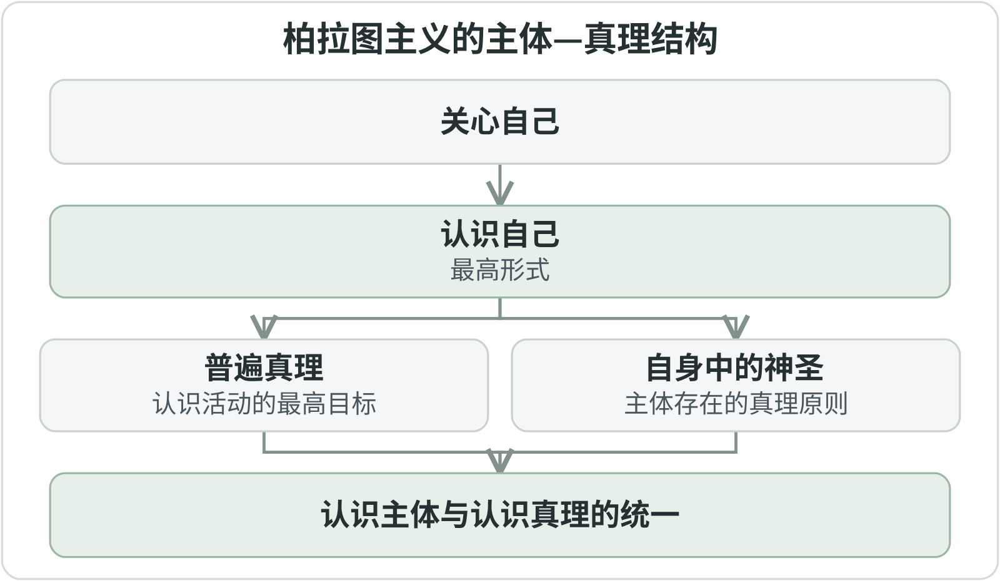

## 八、柏拉图主义的悖论

### 1. 精神性的延续

总之，我认为，我们据此可以理解思想史上主要的“柏拉图主义的悖论”的某些方面，当然，不仅是在古代思想史上，而且至少是到17世纪的欧洲思想史上。这个悖论就是：一方面，柏拉图主义曾经是不同精神运动的起因，甚至可以说是主要起因，因为柏拉图主义只是根据认识自己（即在自身中发现神灵）来理解真理认识和方法的。从此以后，对于柏拉图主义来说，真理认识和方法只能在与自身、神灵有关的灵魂的精神运动中形成：与神灵的关系，是因为它与自身是有关系的；与自身的关系，则是因为它是与神灵有关系的。与自身、神灵的关系的这种条件，与作为神灵的自身的关系和与作为自身的神灵的关系的这个条件，对于柏拉图主义来说，曾是达至真理的条件之一。在此意义上，我们就明白了它是怎样一直成为一系列精神运动的起因、土壤、气候和风景的，在其核心或顶端上，就有过种种诺斯替教运动。

### 2. 精神性与认识活动

但是，你们同时也会发现柏拉图主义怎样能够一直也是所谓“理性”发展的气候。而且，因为把精神性与理性对立起来是毫无意义的，好像这是同一档次的两个东西，所以我要说的是，柏拉图主义倒是永恒的气候，其中孕育出一种不以精神性为条件的纯粹知识的运动，因为柏拉图主义的实质就是表明如果人想达至真理，那么所有修身作用，一切人必须对自身的关心，就是认识自己，即认识真理。而且在此意义上，认识自己和认识真理（认识行为、认识的途径与方法）可以说是把各种精神性要求纳入自身中。

因此，我认为，柏拉图主义后来在古代文化和欧洲文化历史中发挥了这一双重作用：既要不断地重新提出达至真理所必需的各种精神性条件，又要把精神性纳入认识活动中，即认识自己、神灵和本质的活动中。

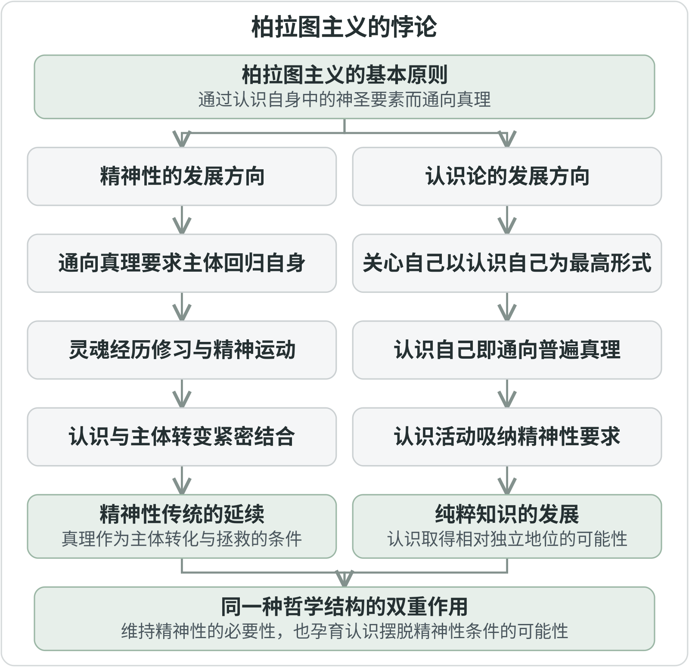

大致说来，以上就是我想向你们讲解的有关《阿尔西比亚德篇》及其开启的历史视点的观点。好，下一次我们就研究在另一个历史时期（也即公元1—2世纪的伊壁鸠鲁主义和斯多葛主义等的哲学）里有关 “epimeleia heautou”的问题。

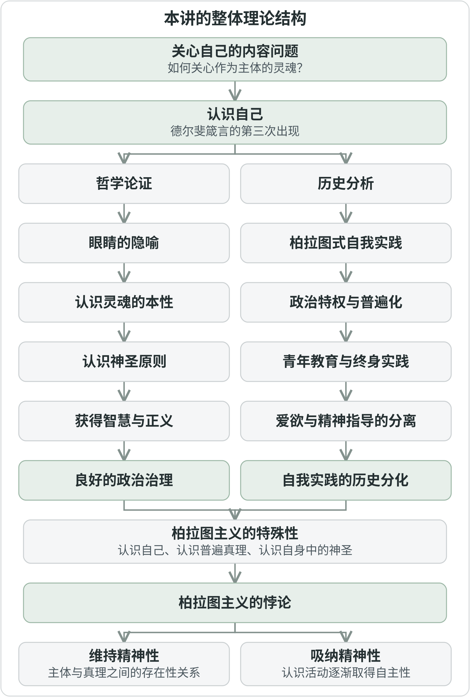

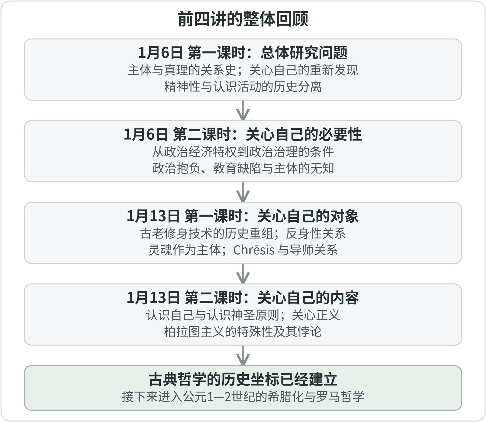

## 编者注释

〔1〕 法兰西学院在福柯上课的大教室之外，安排了第二间教室供公众使用，在那里，福柯的声音通过麦克风直接被传送过来。

〔2〕 P. 亚多根据对萨满教的严格界定—作为“与狩猎文明有着本质关系的社会现象”（《什么是古代哲学？》，前引该书，第279页），在此拒绝论及萨满教。

〔3〕 参见H，诺里：《柏拉图的革命：逻各斯一认识一政治》，前引该书，第3章：“认识的古语和清教主义””，第64—70页：“认识的纯洁性”。

〔4〕 《阿尔西比亚德篇》，124b（前引版本，第92页）；参见1月6日第二课时的授课。

〔5〕 《阿尔西比亚德篇》，129a（第102页）；参见当日第二次授课。

〔6〕 “但是，我们现在提及的这个十分公义的德尔斐神谕，我们是否确信理解了它呢？”（《阿尔西比亚德篇》，132c，第108页）

〔7〕 参见《阿尔西比亚德篇》的最后阐述之一，132d 133c（第108110页）。

〔8〕 《阿尔西比亚德篇》，133c（第109页）。

〔9〕 同上（第110页）。

〔10〕 塞撒雷的欧埃伯：《福音预习》，卷X，第27章，G.法弗尔勒译，巴黎，塞尔夫出版社，1982年，第178—191页。

〔11〕 除非福柯想用“公义”代替“智慧”；否则他在这里和其他地方想说的是“sophrosune”（而非“dikaiosune”）。

〔12〕 有关《阿尔西比亚德篇》的真实性的争论在19世纪初由德国学者施莱尔马赫挑起，他认为这篇对话是由柏拉图学园的一位成员撰写的教科书。从此之后，这些争论就没有停止过。毫无疑问，福柯可能熟悉的主要法国注释家（M. 克鲁瓦泽、L.罗斑、V. 戈德施密特、R. 韦伊）承认它的真实性，但是，许多盎格鲁一撒克逊或德意志的学者们在福柯那个时代还继续怀疑它。今天，一些著名的法国专家（如L. 布里松、J.布伦施维克、M. 迪克索特）又质疑起它的真实性，但是另一些人（J-F.普拉多）则坚决捍卫它的真实性。关于各种观点的详尽罗列，参见J-F.普拉多的导言和他编辑的《阿尔西比亚德篇》的附录工，巴黎，伽尔尼耶一弗拉马里翁，1999年，第24—29页和第219一220页。

〔13〕 R. 韦伊：“《第一阿尔西比亚德篇》在柏拉图著作中的地位”，载《文学信息》，16，1964年，第74—84页。

〔14〕 这个词组字面上指的是“许多”或“众多”，而且自柏拉图以来，指与有能力、有学识的精英相对的大众（关于这个词组的用法例证，参见《克里托篇》，44b—49C，其中苏格拉底指出，根据伦理抉择，意见毫无价值）。

〔15〕 这与第5首讽刺诗有关。福柯在此特别指的是第36—37节和第40—41节：“我在等待你；我正是在你苏格拉底的怀抱中度过了我的幼年，我记得，科尔尼蒂斯，我就是和你在一起，度过了许多漫长的、阳光灿烂的日子，夜晚降临时，我们又一起饮宴。”（佩尔斯：《讽刺诗》，A.卡尔陶特译，巴黎，美文出版社，1920年，第43页）

〔16〕 关于这类通信，参见1月27日第二课时的授课。
