# 正文（1982年1月20日）

## 讲座提要

从《阿尔西比亚德篇》到公元头两个世纪的关心自己：总的演变—围绕“关心自己”的词典研究——各种说法的星状分布—关心自己的推广：共同扩展到全部生活的原则——文本阅读：伊壁鸠鲁、穆索尼乌斯•鲁弗斯、塞涅卡、埃皮克泰德、亚历山大里亚的斐洛、吕西安—这种推广的各种伦理后果：关心自己作为塑造和纠正的轴心；医疗活动与哲学活动的比较（共同的概念；治疗的目标）

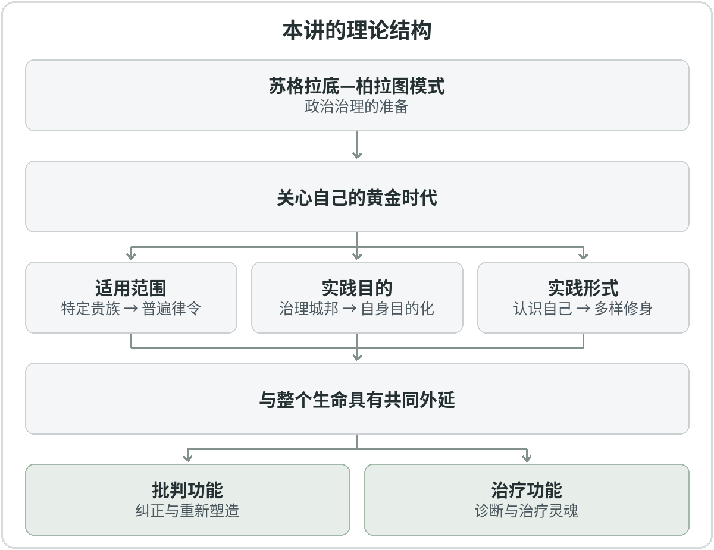

## 一、关心自己的黄金时代

### 1. 历史时期

我现在想从我选择的各种时间标志中取出一些来，把自已确定在公元1—2世纪这一时期里：从政治标志上来看，这一时期是从奥古斯都王朝或朱利亚一克劳狄王朝的建立一直到安东尼统治的结束，〔1〕或者，从哲学标志（即在我要研究的领域里的各种标志）来看，我将从罗马斯多葛主义时期开始，经穆索尼乌斯•鲁弗斯的发扬光大，直至马克•奥勒留，也即希腊化古典文化的复兴时期，以及基督教传播与早期主要基督教思想家的出现之前：特尔图良和亚历山大里亚的克莱蒙。〔2〕我之所以要选择这一时期，是因为它是关心自己的历史上一个真正的黄金时代，关心自己既被理解为概念，又被当作修养和制度。那么，我们能够怎样简单地确定这个黄金时代的特征呢？

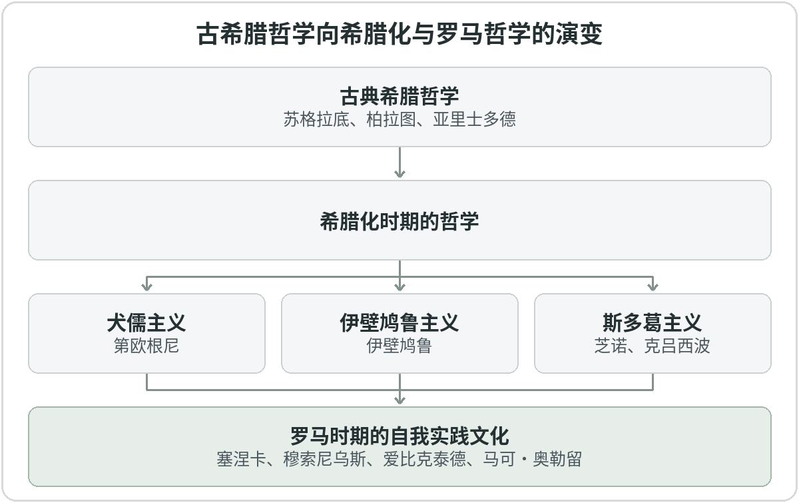

### 2. 柏拉图式三重限定

我认为，在《阿尔西比亚德篇》中，有三个条件同时规定了关心自己的存在根据和形式。其一涉及关心自己的应用领域：谁必须关心自己呢？《阿尔西比亚德篇》这个文本在这一点上是十分清楚的：必须关心自己的人就是注定要行使权力的年轻贵族。这在《阿尔西比亚德篇》中是清楚的。我并不是说这在柏拉图的其他文本中和其他苏格拉底的对话中就有，而是说在这篇文本中有，即阿尔西比亚德这个年轻贵族因为出身将来有一天一定要领导城邦，而且像他这样的人必须关心自已。第二，第二个规定显然是与第一个相关的，即关心自己有一个目标，一个具体的辩护：这就是关心自己，以便能够恰当地、合理地、合乎道德地使用他注定要有的权力。最后是第三个限定，它非常清楚地出现在对话结束时，即关心自己的主要形式（如果不是绝对的形式）就是认识自己：关心自己就是认识自己。

不过，我认为我们可以大致上说，当我们身处我所说的公元1—2世纪时，这三个条件已经发生了变化。当我说它们发生了变化时，我想最终强调的是，我并不是说它们在这个时候就发生变化了，而且在罗马帝国建立时期，突然出现了某个东西，它使得关心自己突然有了新的形式。其实，我们可以在柏拉图著作的内部发现，只有经过了十分漫长的演变，这些在《阿尔西比亚德篇》中提出的有关关心自己的实践的不同条件才最终消失了。这种演变在柏拉图那里已经可以感受到了，而且在整个希腊化时代一直进行着，在很大程度上受到作为生活艺术的犬儒哲学、伊壁鸠鲁主义哲学和斯多葛主义哲学（亦是这一演变的主要载体）的影响。在我确定要研究的年代里，在《阿尔西比亚德篇》中规定关心自己的必要性的这三个限定（或条件）已经消失了。总之，初看上去，它们已经消失。

### 3. 自身目的化

第一，关心自己成了一个普遍的和无条件的原则，一个强加给所有人、不论时间和出身的律令。

第二，关心自己似乎不再以一种特殊的活动（即统治其他人）作为存在的根据。看来，关心自己不是以城邦这个特的对象为最终目的的，但是，如果有人现在就关心自己，那么这是为了自己和作为自身的目的。我们还可以这样来说：在《阿尔西比亚德篇》的分析中，大致说来，自己——这篇文本在这一点上是非常清楚的，因为它多次重复了这个问题：必须关心的这个自己是什么？我必须关心的我自己是什么？——十分清楚地被界定为关心自己的对象，而且，必须拷问这个对象的本性。但是，这一关心自已的目的不是它的对象，而是另一个东西，即城邦。当然，因为统治者属于城邦，同样，他在某种意义上也是关心自己的目的，而且，我们在古典时期的文本中经常发现统治者必须恰当地统治、以便拯救自己和城邦（他自己也是城邦的一部分）的看法。但是，在阿尔西比亚德式的关心自己中，有一种较复杂的结构，其中关心的对象就是自己，但是关心自己的目的却是城邦，而且自己只是城邦的一分子。城邦是自身与自身关系的中介，而且，这造成了自身可以既是对象，又是目的，但是，它作为目的，只是因为存在城邦这个中介。现在，可以说（这是我想向你们指出的），关心自己在罗马帝国黄金时代的新古典文化中得到了发展，其中，自己既是人关心的对象，人必须关心它，更主要的还是人在关心自己时所设想的目的。人关心自己，为什么？不是为了城邦，而是为了自己。换言之：这种反身形式构造的不仅是与对象的关系（关心作为对象的自己），还有与目标、目的的关系。可以说，这是与自身关系的一种自身目的化：这是我在以后授课过程中想要说明的第二个主要特征。

最后是第三个特征，即关心自己并不限于认识自己的方式。当然，这也不是说这种律令，或者这种认识自己的方式消失了。我们只是说，它弱化了，或者说，它被纳入了更大的整体中，对于这一整体，我们可以通过标明某些词汇要素和表达形式做一个大致的定位说明。

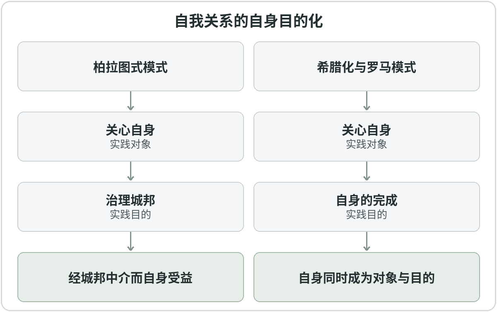

## 二、关心自己的词汇体系

### 1. 训练与实践

首先，必须牢记，这种规范的基本表达从柏拉图的《阿尔西比亚德篇》一直到尼斯的格里高利仍然是 “epimeleisthai heautou”（关心自己、照顾自己、担心自己），它同样有一个必须强调的意义：“epimeleisthai”不只是指一种精神态度、一种关注方式、一种不要忘记这个或那个东西的方式。在词源学上涉及一系列的词汇，如“meletan”“melete”、“meletai” 等等。“Meletan”通常是与动词 “gumnazein”一道使用的，〔3〕即训练自己。“meletai”则是指各种训练：体操训练、军事训练、军事锻炼。而“Epimeleisthai” 不只是与一种精神态度、一种活动方式、一种小心的、连续的、应用的、有规则的方式相关。以在古典词汇中色诺芬的“家政学”为例。在谈到他在《家政学》中描述其生活的那位乡绅（土地所有者）的所有活动时，色诺芬谈到他的活动是十分有利的，对于他这位有产者是有利的，因为它们让他身体健康，对他的家庭也是有利的，因为它们让它富裕了。〔4〕因此“meletan”'、“melete"'、“epimeleisthai"“epimeleia”等一系列词汇指的就是这一套实践。而且，用公元4世纪基督教的用词来说，“epimeleia” 通常有着训练和修行的意义。因此，我们不要忘了：“epimeleia/epimeleisthai”与各种活动方式有关。围绕着这个关键的词语，我们不难在哲学文献，甚至是文学文本中确定一切含糊的用词和表达，而且还发现它大大超出了认识活动的范围。可以说，我们能够确定四组表达。

### 2. 四组表达

其中一些涉及各种认识活动，而且与人对自己的注意、关注和知觉有关：关注自己（prosekhein ton nodn）；〔5〕返观自身（比如，普吕塔尔克就曾关闭靠近外面院子的门板和百叶窗，把目光转向房内和自身之内）；〔6〕检查自己（必须检查自己：“skepteon sauton”）。〔7〕

但是，在关心自己方面，还有一类词汇不仅与这种目光的转向、这种对自身的必要小心有关，还与围绕自身旋转的并转向自己的整个生存活动有关。转向自己，这是著名的 “convertere”，是著名的“metanoia”，必须再来谈谈。〔8〕这有一系列的表达：“se retirer en soi”（退回自身）、“退回自身”'，〔9〕或者，退向自身的最深处。这些表达与向自身汇聚、向自身收拢、在自身中确立自身的活动和态度有关，这里，自身就像避难所、坚固的城堡和有保护墙的要塞等一样。〔10〕

第三类表达是与修身行为有关的。其中一些非常直接地受到了医学词汇的影响：必须照料自己、治愈自己、给自己动手术、切开自己的脓肿，等等。〔11〕你们也有一些表达总是与人关注自身的活动有关的，不过，这些都是司法类的活动：正如塞涅卡在他的第一封信中对鲁西里乌斯说的，必须“恢复自己的权利”’。〔12〕这就是说，必须提出这种司法要求，强调他的权利，即他对自己的权利，他自己现在背负着必须摆脱的债务和义务，或者正受到奴役。所以，必须解放自己，必须释放自己。他们还有一些表达说的是宗教类的关注自己的活动：必须崇拜自己、尊崇自己、尊重自已、对自己有羞耻感。〔13〕

最后是第四类含糊的表达：它们表示某类与自身持久的关系，即控制与主宰的关系（做自己的主人），也即感受关系（自身有快感、自身感到快乐、面对自身感到高兴、对自己感到满意，等等）。〔14〕

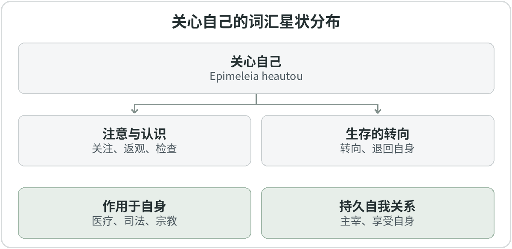

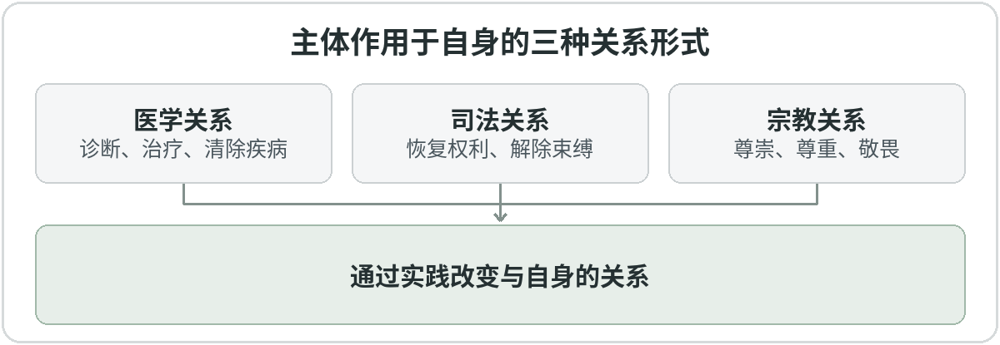

## 三、关心自己的普遍化

### 1. 两个向度

因此，这里有一系列的表达表明了在我这里所构想的时期里展开、表现和表达的关心自己，大大超出了认识活动的范围，而且，它涉及的就是修身实践。如此说来，为了确定一下关心自己的爆发点，或者，为了确定它的嬗变（关心自己转变成了一种形式多样的以自身为目的的自主实践），为了进一步探究它，我今天想分析一下关心自己的普遍化过程，这种普遍化是在两个向度上围绕两个轴心展开的。一方面是在个人生活中普遍化的。关心自己是怎样与个人生活有着共同外延的呢？它必须与这种生活有着共同外延吗？这就是我在这第一课时里要向你们解释的。在第二课时里，我想分析一下这种普遍化使得关心自己必须延伸到所有的个人，无论他们是谁，不过，附有一些重要的限制（我会向你们谈的）。第一是延伸到个人生活上，或者说，关心自己与生活艺术（即著名的 “tekhne tou biou”）有着共同的外延，这种生活艺术，这种生存艺术（众所周知），从柏拉图以降，特别是在后柏拉图主义运动中，成了哲学的基本定义。关心自己是与生活有着共同外延的。

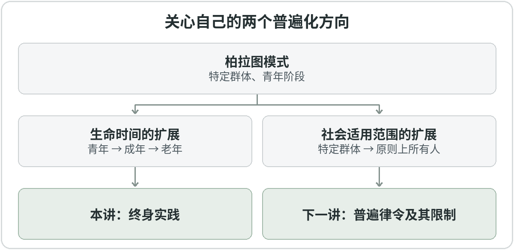

### 2. 青年与成年之间的过渡

你们都记得，为了一直把这个《阿尔西比亚德篇》当作所有这些过程的历史标志和理解关键，在《阿尔西比亚德篇》中，关心自己对于人生中的某个时期和具体的场合是必要的。这个时候，这个场合，不是希腊文中的 “Kairos” 〔15〕后者可以说是一个事件的特殊时机。这个时候和这个场合是希腊人所说的“hora”，即生命和生存中必须关心自己的那个时刻和季节。这个生存中的季节（我不再说了，我曾向你们强调过），对于教育、性爱和政治都是临界的年龄段：这时候，年轻人不再受制于教育者，也不是性爱欲望的对象了，他必须进入生活，施展他的实际权力。〔16〕 大家都知道，在所有社会中，青少年进入社会，他向我们称之为“成年人”的这个阶段的过渡，提出了一些问题，而且，大部分的社会都强有力地把从青少年到成年的这个危险和困难的过渡仪式化。我认为，令人感兴趣的，也值得作点思考的，就是在希腊，或总之在雅典（因为在斯巴达，这一定是不同的），人们不停地为没有在这些青少年进入生活时为他们制定规范的和有效的过渡期感到痛苦，并抱怨不止。〔17〕批评雅典教育不能确保从青少年到成年的过渡期，不能确保和规范他们进入生活，这在我看来是希腊哲学的恒常特征之一。我们甚至可以说，正是在这一点上（关于这个问题，在这个制度空洞中，在这个教育缺陷中，在从青春期结束到进入生活这个在政治和性爱上产生麻烦的时期里），哲学话语形成了，或者至少是苏格拉底一柏拉图式的哲学话语形成了。我们不再回到这个我已经多次说过的问题上。〔18〕

## 四、伊壁鸠鲁主义与终身哲学

总之，有一件事是肯定的，这就是在柏拉图之后，当然一直到我现在讨论的时期里，关心自己的必要性不只在人生的这一点上，在青春期结束的这一麻烦丛生的临界阶段上，得到了肯定。从此以后，关心自己作为一个律令，不只是与从青少年到成年的这段时期的教育危机有关。关心自己是一个必须伴随整个人生的持久的义务。而且在这方面，没有必要等到公元1—2世纪再去肯定它。如果你们愿意去查，那么在伊壁鸠鲁那里，《给梅内塞的信》的一开头，就有这么一段话：“年轻时，不要在进行哲学思考上有所迟疑，年老了，也不要对哲学感到厌烦。关心自己的灵魂，决不会太早，也不会太晚。说还没有或不再有时间做哲学的人，就像说还没有或不再有时间期待幸福的人一样。因此，人必须在年轻和年老时进行哲学思考，在第二种情况下（当人年老了—福柯注），是为了通过回忆旧日时光而有善的感触，变得年轻；在第一种情况下（当人年轻时—福柯注），是为了和老年人一样坚信未来。”〔19〕

其实，这篇文本非常厚实，包括了一系列必须仔细观察的要素。这里，我只是想强调其中的一些要素。当然，你们察觉到了“哲学思考”与“关心自己的灵魂”之间的相似性；这种哲学思考和关心自己的灵魂的活动，其目标就是达到幸福；而且，人必须穷其一生来关心他的灵魂，不论是年轻时，还是年老时。不过，不同年龄时期的思考有着不同的作用：当人年轻时，就要为生活做准备（这就是著名的 “paraskheue”，我以后会讨论的，而且它在伊壁鸠鲁派和斯多葛派那里也十分重要），〔20〕武装自己，让自己有生存的手段；另一方面，到了老年，哲学思考就是让自己变得年轻。这就是说，让时间倒流，或者说，摆脱时间，而这就依赖于一种回忆活动，在伊壁鸠鲁派那里，就是追忆旧日时光。实际上，这一切都把我们置入这种修身实践的核心，但是，我回头会讨论这篇文本的各种不同要素的。因此，对于伊壁鸠鲁来说，必须终生进行哲学思考，必须不停地关心自己。

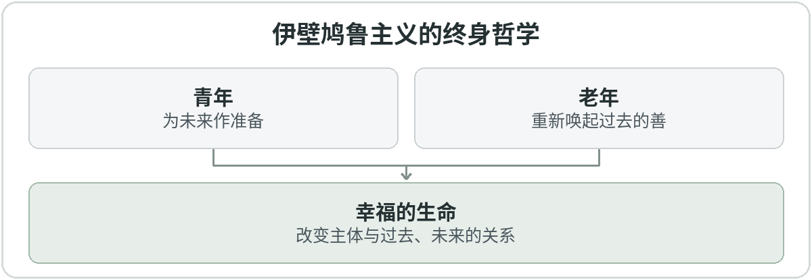

## 五、斯多葛主义与成年人的自我实践

### 1. 成年期的实践重心

而且，如果我们现在来看斯多葛派的文本，情况也一样。在数百篇文本中，我只引述穆索尼乌斯•鲁弗斯的文本，他说人只是在不停地关心自己的过程中才能自救。〔21〕因此，关心自己是一生的事。而且，实际上，当你们看到人们是怎样在我所说的这个时期里关心自己、修身养性时，你们就会发觉这其实是人一生的活动。甚至可以说，这是成年人的一种活动，而且，关心自己的重心和特殊的时间轴心，不是青春期的事，而是成年时的环。也许是在成年结束时，而非青春期结束时。总之，人不是在这些在公元前5—4世纪的雅典试图施展权力的雄心勃勃的年轻人的背景中，而是与年轻人，或完全成熟的人，或被我们认为是老人的人的小世界或大世界打交道，他们刚刚入门，相互鼓励，独自地或集体地进行修身实践。

### 2. 塞涅卡的精神指导

这里只举几个例子。在个人修身方面，以塞涅卡与塞里努斯的关系为例。塞里努斯在《论灵魂的安宁》的一开头向塞涅卡请教，其中，他给塞涅卡写了（或者被认为是写了，或者可能写了）一封信，描述了自己的灵魂状态，要求塞涅卡给他些建议，做个诊断，可以说给他当个灵魂医师。〔22〕这位塞里努斯也就是塞涅卡把“智者的恒心”’、（也许还有）“论游手好闲”〔23〕给他的人，那么他是谁呢？〔24〕这绝不是阿尔西比亚德那种类型的青少年。他是一个年轻人，来自外省（出身名门，是塞涅卡的远亲），已经来到罗马，开始了作为政治人物与大臣的生涯。他为尼禄和尼禄的情妇（我不知道是其中的哪一个，但是这无关紧要）牵线搭桥。〔25〕大约是在这个时期里，塞里努斯（已经走入生活，作出了选择，并开始了自己的职业生涯）向塞涅卡请教。

让我们以鲁西里乌斯为例，他总是围着塞涅卡转，与他保持着个人关系，而且塞涅卡一直给他写了很长时间的信（从第62封信起），还撰写了《自然问题》，这也是题献给鲁西里乌斯的。好，那么谁是鲁西里乌斯呢？他是一位比塞涅卡小15岁的人。〔26〕 不过，如果让我猜想的话：塞涅卡在退休后开始写这些信和《自然问题》时，是个60岁的人了。〔27〕因此，大致上可以说，鲁西里乌斯应该有50岁，40或50岁。总之，在写这些信的时候，他在西西里当总督。对于塞涅卡来说，写信这件事是为了把鲁西里乌斯从伊壁鸠鲁主义者（有点宽容论，不过不是理论上的）转变成一位严格的斯多葛主义者。好，你们会对我说，塞涅卡在此遇到的是一个非常特的情况：一方面是一种个人行为，另一方面又涉及高度的政治责任，总之，他不会有时间、空闲和兴趣给任何年轻人写信，教导他们。

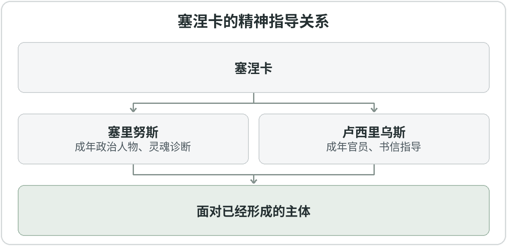

### 3. 爱比克泰德的哲学学校

但是，如果以埃皮克泰德为例，那么他与塞涅卡不同，是一位职业教师，而且有一个学校。他开办了一所“学校”收学生。当然，在他的学生中，有些年轻人，毫无疑问，大多数的年轻人是来接受教育的。埃皮克泰德学校的这种培养功能在阿里安收集的《对谈录》中已被指出过。〔28〕比如，他批评那些来这里只为了让家里相信是在一个好的哲学学校里受教育，而且一门心思地想在回去后出人头地、找到重要职位的年轻人。他还批评那些满怀热情地来到这里，一段时间后却讨厌不教他们出人头地、而是要求他们太多道德的东西，最后离开学校的人。对于这些年轻人，当他们被派去赛跑时，也会遇到一些在城邦中如何行走的规则。这似乎表明了，这不仅与年轻人的软弱有关，而且人们要让他们在一个很有纪律性的寄宿学校里变得坚强。因此，埃皮克泰德确实向这些年轻学生说过话，即根本不要相信关心自己作为生活艺术的主轴只是成年人的事。

但是，在这方面，还有一样东西与这种对年轻人的教育交织在一起，即在埃皮克泰德的学校里，有一样东西，打个不恰当的比方，就是一种开放的服务：向成年人开放的服务。因为有些成年人会来埃皮克泰德的学校听他讲课，有的是一天，有的是几天，有的是一段时间。而且，在埃皮克泰德的《对谈录》描述的社会景观中，比如就有城邦的检察员、税务检察官经过。这是位伊壁鸠鲁主义者，他来向埃皮克泰德请教，向他提了些问题。还有一个人，被城邦派往罗马执行任务，要途经小亚细亚前往罗马，他就来找埃皮克泰德，提了些问题，询问他如何才能最好地完成他的使命。埃皮克泰德并不忽视这位客人，或者说是这些成年的对话者，因为他建议他的年轻学生们去找一些城邦里有名望的人，震震他们，对他们说：请说一说，你们是怎么活的？你们是否真的在关心自己呢？〔29〕

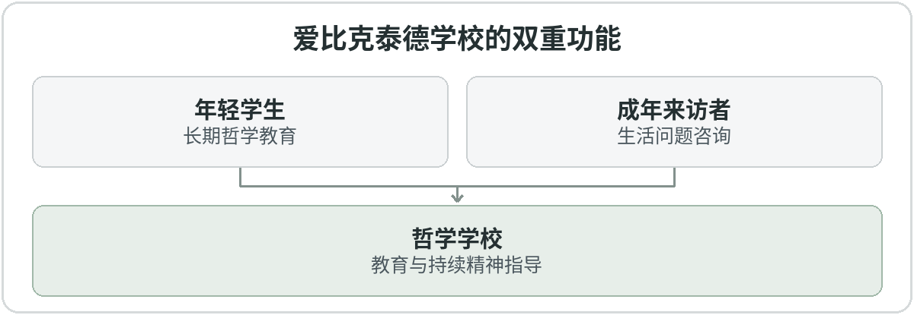

## 六、关心自己的社会形式

### 1. 犬儒派公共演说

当然，我们可以引述犬儒派演说家的活动，这很有名，他们在公共场合，在街边或在庄重的节日里，向一般大众说话，其中有成年人，也有年轻人。在这类严肃和高尚的公开抨击或演说中，就有普鲁士的迪翁的主要文本，〔30〕其中许多文本是讨论苦行、反求诸已、“anakharesis eis heauton”（退回自身）等问题的。〔31〕

### 2. 治疗家团体

最后，我就成人、把成人纳入修身实践中的这个问题举出最后一个例子。在一个重要的小组中，尽管它像谜一样不为人知，因为它只是通过亚历山大里亚的斐洛的一篇文本才为人所知：即著名的治疗家团体，我稍后会详细地给你们讲它。让我们暂时把有关他们是谁、做什么的等问题搁在一边。总之，这是一个苦修团体，在亚历山大里亚附近，其目标之一就是这篇文本所说的：“epimeleia tes psukhes”（关心你的灵魂）。关心灵魂，这就是他们想要做的。不过，亚历山大里亚的斐洛在《论思辨生活》中的一段话（因为他就是在这里这样说的）曾针对这些治疗家们指出：“他们对不朽和幸福生活的欲望让他们相信自己已经终结了有生之年（我稍后将讨论这段有关老年的话——福柯注），他们把自己的财富都给了自己的儿子、女儿和亲近的人：为审慎之见，他们事先就让他们继承了它们；至于那些没有家庭的人，他们则把一切都留给了自己的伙伴和朋友。”〔32〕由此可见，这里有一段文字完全不同于《阿尔西比亚德篇》。在《阿尔西比亚德篇》中，关心自己的年轻人不完全是由他的父母抚养成人的（如阿尔西比亚德就是由他的监护人伯里克利抚养成人的）。而且，正是与此相关，他很年轻就来向苏格拉底请教问题，接受苏格拉底的质询。而在这里，情况则相反，这些人都已经有了孩子，儿子和女儿，他们都有家庭，而且，到了一定时刻，会感到自己好像结束了有生之年，要离开人世了，要关心自己的灵魂了。人是在结束人生的时候关心自己的灵魂的，而不是在人生的开端。总之，成年期，远不止是向成年的过渡期，或者说，成年向老年的过渡期，将成为修身实践的重心和敏感点。

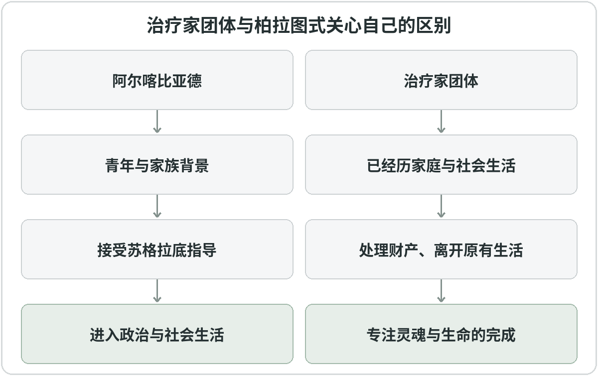

### 3. 生活方式的市场

而且，这在吕西安的一篇非常有趣的文本中得到最后的证实。你们都知道，吕西安在公元2世纪未撰写了一系列的讽刺诗、反讽文本，它们对于我要给你们讲解的主题是相当值得关注的。有一个法译本，10多年前发表过，不幸的是，译得非常糟糕，它的标题是“在拍卖的哲学家”；〔33〕其实，这个标题指的是某个非常不同的东西：即生活（或生活方式）的市场，〔34〕因为不同的哲学家向人们推荐这些生活方式，可以说，他们就在市场上，每个人通过招揽学生力图推销他的生活方式。你们都有这篇文本，你们还有另一篇也值得关注的文本，它名为“埃尔谟蒂姆”，其中很幽默地叙述了两个人的讨论。〔35〕它非常好玩，必须像在纽约看伍迪•阿伦有关精神分析的电影那样来读它：吕西安就像这样来说明人们与他们哲学老师的关系，以及这些人与他们自己通过关心自己对幸福的追求的关系的。这样，埃尔谟蒂姆在街上散步。当然，他正在独自含糊不清地说着他从老师那里学到的东西，是利西努斯找他说话，问他正在做什么；嗯，他从他老师那里出来，或者是去老师那里，我记不清了，这无关紧要。〔36〕

但是，利西努斯问埃尔谟蒂姆：你隔多长时间才去你老师那里呢？后者答道：过了20年罢。—怎么，过了20年，你给他许多钱了吧？—是的。我给了他许多钱。—但是，这种学习哲学、生活艺术和幸福的学徒期不会很快就结束吧？——埃尔谟蒂姆答道：不，这当然不会再拖延了！我想还要20年吧。而且，随后在这篇文本中，埃尔谟蒂姆说明了他是从40岁开始做哲学的，此外，我们知道他拜访他的哲学老师达20年之久，那么，他到了60岁才发现自己入了门径。我不知道是否有人研究和确定过这篇文本和其他哲学文本之间的参照或关系，但是，你们都记得，在毕达哥拉斯派那里，人的一生分为4个阶段，每个阶段20年：根据毕达哥拉斯派传统，在第一个20年中，人是孩子；从20岁到40岁，人是青少年；从40岁到60岁，人是青年；而从60岁起，人就进入了老年。〔37〕埃尔谟蒂姆到了60岁，已是饱经沧桑了。他曾经有过青年时代：他学了20年的哲学。而且，他也只剩下20年继续做哲学了（这20年是他的余生，把他与他的死亡区隔开来）。利西努斯发现到他的对话者埃尔谟蒂姆是从40岁开始的（这里，利西努斯是个怀疑论者，以他为中心，并从他出发对埃尔谟蒂姆及其这一整套修身实践进行了讽刺），就说：这很好，我40岁了，我正好到了开始修身的年纪了。而且，他找到埃尔谟蒂姆，对他说：请帮帮我，手把手地指点我。〔38〕

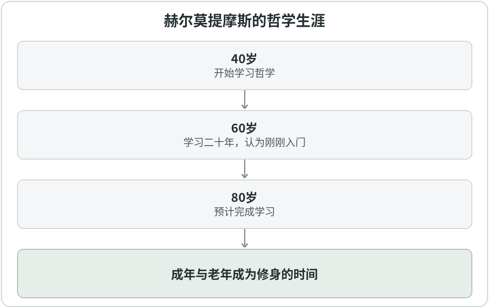

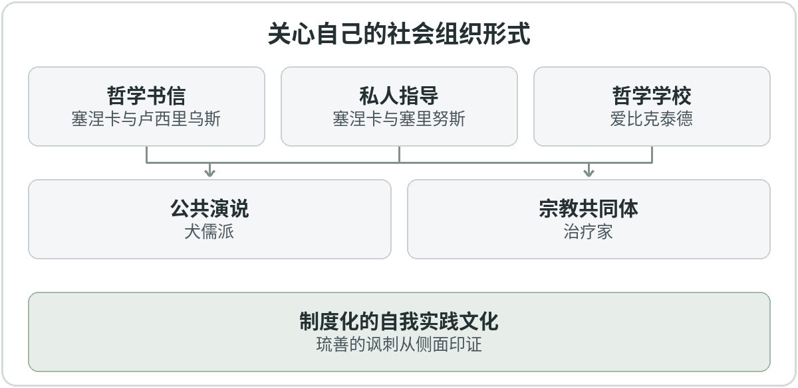

## 七、关心自己的培养与批判功能

### 1. 生存装备

嗯，从青少年时期到成年或成年将结束的时期的这种对关心自己的专注或不在意，会引起某些我认为是重要的结果。第一，从关心自己成了这种成年人的活动起，它的批判功能就愈来愈突出了。修身实践会有一种纠正作用，至少同培养一样。还有：修身实践愈来愈成了一种相对于自身、它的文化世界、其他人的生活的批判活动。

当然，这决不是说，修身实践只有批判功能。培养要素总还存在着，但是与这种批判实践有着本质的关系。可以说，在《阿尔西比亚德篇》中，如同在其他苏格拉底对话录中，关心自己的必要性是以人们所处的无知状态为参照系的。人们发现阿尔西比亚德不知道他想做什么（也就是不知道怎样才能治理好城邦），而且他还不知道他对此一无所知。如果说这里有着对教育的批评，那么这尤其是要向阿尔西比亚德指出他什么也没有学到，或者，他自以为学到的一切其实只是空论。与此相反，在从希腊化和罗马时代发展起来的修身实践，是有培养作用的，而且它与个人的准备有着本质的关系。但是，这不是为这种职业或社会活动形式做准备：像在《阿尔西比亚德篇》中一样，这不是把个人培养成一位好的统治者，而是独立于一切专门的职业，培养个人，以便他可以恰当地承受所有偶然事件、所有可能的不幸、所有灾祸和所有可能的失败。因此，这旨在装配一种自信机制。这不是要把与某类活动相关的技术知识和职业知识牢记在心。这种培养，这种构成，这种对于世界的其余部分、对于一切可能发生的意外或事件的保护装置，就是希腊人所说的“Paraskheue”，后来塞涅卡把它译成“instructio”。〔39〕 “instructio” 就是个人面对各种事件的这种装置，而且它根本不是根据一种既定的职业目标来进行的培训。这就是公元1—2世纪修身实践的培养层面。

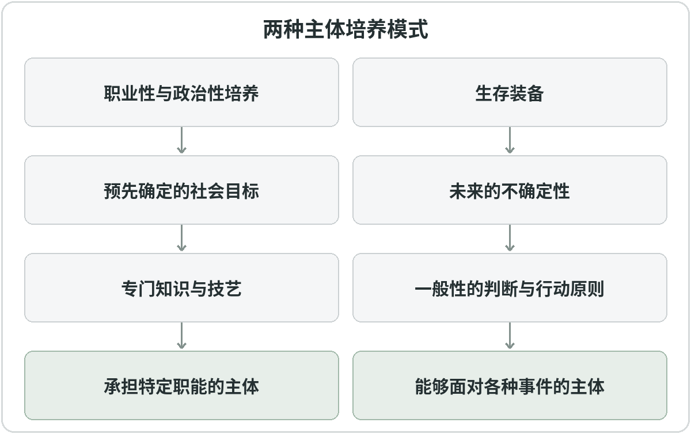

### 2. 纠正与解放

但是，这一培养层面绝不可与纠正层面分割开来，我认为后者变得日益重要。修身实践不只是以无知为根基的，就像阿尔西比亚德那样，以不知道自己无知为基础的。修身实践是以错误、恶习和养成的依赖性和变态（必须加以改变）为基础的。改正一解放远不止于培训一认识：修身实践就是以此为轴心发展起来的，而且显然是主要的。为此，我给你们举个例子。在塞涅卡致鲁西里乌斯的第50封信中，他说：嗯，不要以为我们身上的恶来自外面；它不外在于我们（extrinsecus），它就在我们之内 （intra nos est）。后来，他又说：“恶就在我们的内脏中”（in visceribus ipsis sedet） 〔40〕在我们的这种修身实践中，必须努力把这个内在于我们之中的恶排除掉、控制住。而且，他还补充道：当然，如果有人在年轻和稚嫩的时期犯了这种罪恶，而且这种罪恶尚未深入内心，那么自己改正错误还很容易。但是，无论如何，即使被视为一种年轻人的修身，这种修身实践也是需要改进的，而非培训；不只是培训：它尤其是要改正已经存在的过错。必须不断修身，即使是在年轻时。当然，如果从一开始染病就被要求去修身，那么医生就比在快痊愈时有着更多成功的机会。〔41〕但是，无论如何，即使人在年轻时没有好好改进自己，但是，他总能够活下去。即使我们对一切都安之若素了，但是，还是存在各种手段让人可以有所改正，有所改进，可以再变成人本应该成为、却从没有成为的人。〔42〕

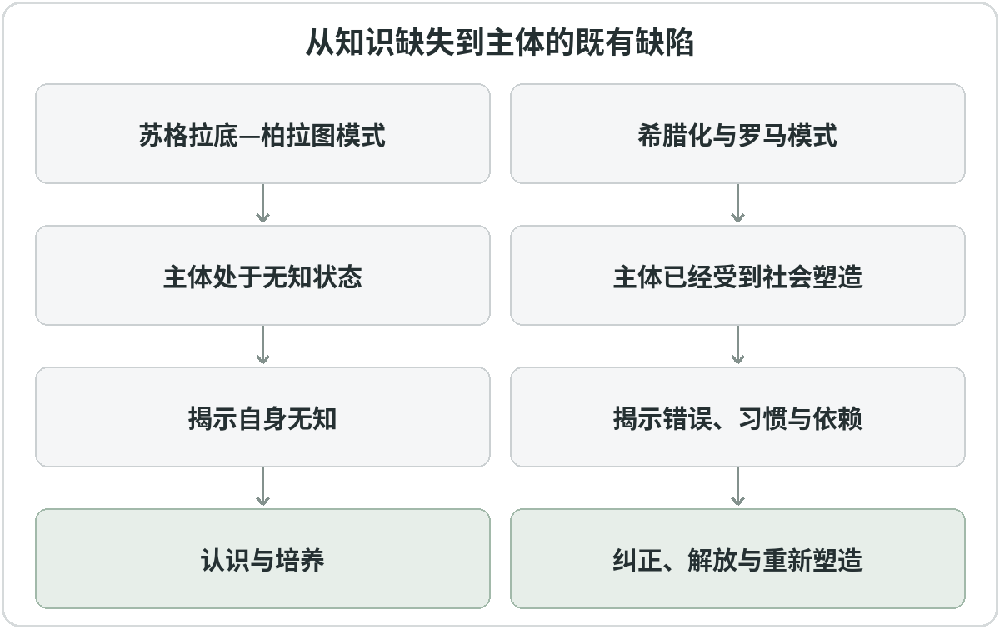

### 3. 从未成为过的人

我认为，再成为人从没有成为的人，这就是这种修身实践最根本的要素之一、论题之一。而且，塞涅卡提到它被视为身体要素、肉体。他说：如果粗大的屋梁向内弯曲了，那么我们就要再把它扶正。而人的精神如果弯曲了，那么人也更有理由能够把它再扶正。〔43〕总之，他说，好的灵魂 （bona mens）从不会在有缺陷的灵魂（mala mens）之前出现。〔44〕好的灵魂只会跟在有缺陷的灵魂之后。在这第50封信中，我们总是“praeoccupati”：我们即使是在行善时也已经在忙于某事了。〔45〕

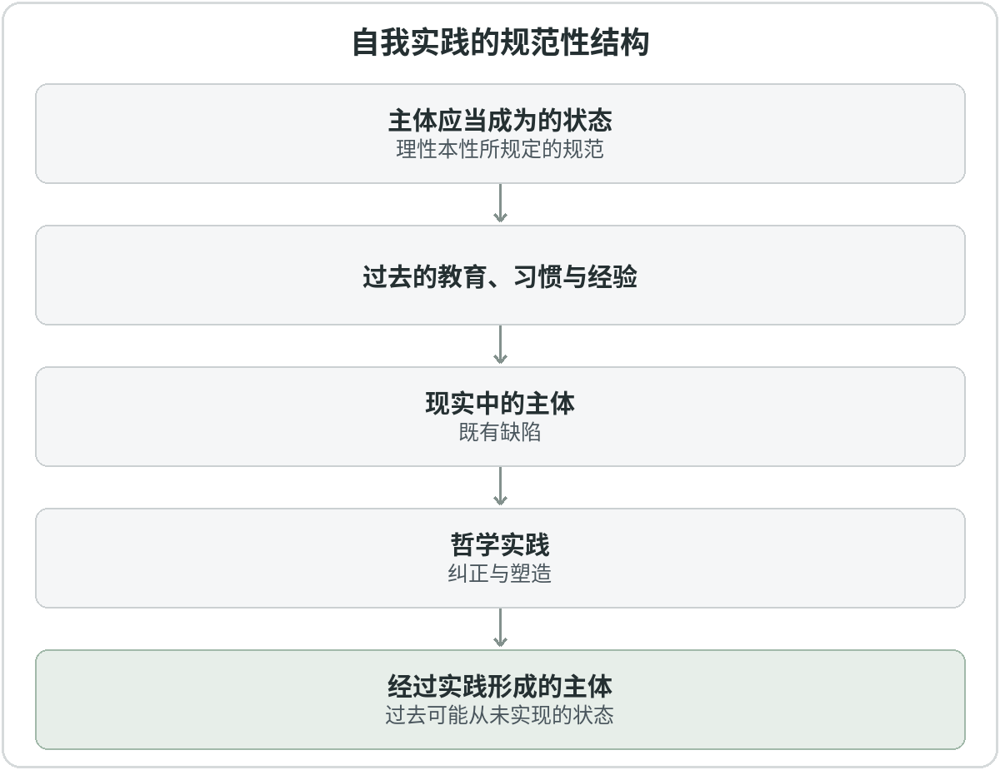

### 4. 学习德性与忘掉邪恶

而且，塞涅卡在此又找出了在犬儒派语汇中很重要的一种说法。他说：“virtutes discere”（学习德性）就是“vitia dediscere”（忘掉邪恶）。〔46〕这种忘记概念在犬儒派那里是首要的〔47〕，而且又出现在斯多葛派那里。不过，无论如何，即使修身实践始于年轻时，这种忘记观念也必须开始有了，而且，这种对自身的改进是以一种自然（但是，这是一种从未被给予的自然，从未这样出现在有一定年纪的个人身上）为标准的，所有这一切相对于所受的教育、养成的习惯和环境，自然有着洗心革面的样子。

### 5. 家庭与教育的批判

首先剔除的是孩提时代可能有的一切污垢。这是对初级教育的著名批评，经常被引用，也是对有关被雇来磨灭和改变儿童精神的奶妈的著名故事的批评。西塞罗在《图斯库拉尼论争》中有一篇有名的文本：“一旦我们来到世上，一旦我们得以进入我们的家庭，我们就发现身处一个完全变了形的环境中，它充满了反常的判断，因此可以说，我们已经把错误连同我们奶妈的奶一起吸入又中。”〔48〕因此，这是对幼儿时期及其条件的批评，是对家庭环境（不仅仅是它的教育影响，而且还有它所传达和强加的一整套价值）的批评，是对在我们的语汇中所谓的“家庭意识形态”的批评。我想到的是塞涅卡致鲁西里乌斯的那封信，他在这封信中说：让你自信，努力回到你自己，“我深知，你父母对你的希望是与此不同的；而且，我对你的祝愿也是不同于你的家庭的；我希望你蔑视的一切，恰恰是你父母想要你尽量多地拥有的”〔49〕由此，关心自己必须完全推翻家庭承载和强加的价值体系。

最后是第三点，而且，我也不想强调它，因为它太有名了：这就是对教育的批评，是对初级教育的老师的批评，尤其是对修辞教师的批评。而且，我们在此又回到了哲学实践与教育和［对他者的］修辞教育之间的大论争（我还是不想强调它，因为它很有名）。”比如，埃皮克泰德对前来学修辞的年轻学生的嘲笑就很好玩。〔50〕对这个学修辞的小学生的身体描绘就令人感兴趣，因为这向你们表明这里就有着哲学修身和修辞教育之间的主要冲突点：这位学修辞的小学生，来的时候浓妆艳抹，短短的头发都卷过，由此表明了修辞教育是一种装饰、伪装、诱惑的教育。这不是关心自己，而是取悦别人。而且埃皮克泰德为此询问起这个学修辞的小学生，对他说：很好，你精心打扮了一番自己，你以为是在关心自己。但是，其实，请想一想：什么是关心自己呢？而且，人们可能会看到对当时的读者或听众来说似乎是完全清楚的和合理的相似性；作为《阿尔西比亚德篇》的回声，重读《阿尔西比亚德篇》提出过的问题：你必须关心你自己，那么你怎样才能做到它呢，而且，什么是你自己呢？而且，人们重新回到了：这就是关心他的灵魂，而不是他的身体。因此，可以说，从青少年时期的结束到成年的有关关心自己的年代变换的重要后果，就是修身实践的这种批判功能。

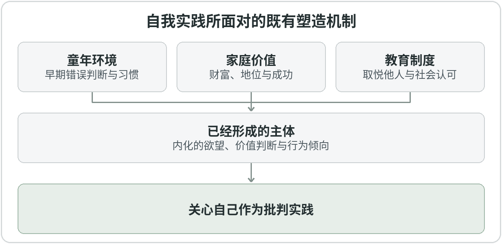

## 八、哲学与医学

### 1. 修身的治疗性质

第二个后果则是修身实践和医学之间的一种特别明确和突出的对比。〔51〕因为既然修身实践的主要功能或主要功能之一就是改进、修复和确立一种也许从未存在过的状态（但是，其本性表明了原则），那么我们就接近于一种医学实践了。如果哲学总是根据一种与医学的特关系来理解的话，那么也不要等到我跟你们说起的那个时期（公元1—2世纪）才出现。这在柏拉图那里已经很清楚了。〔52〕而且，在后柏拉图主义的哲学传统中，这也是比较清楚的：伊壁鸠鲁的“ont6s philosophein”就是用真理来照料、治疗（kat’ aletheian hugiainein）；〔53〕在斯多葛派那里，尤其是从波塞多尼奥斯起，〔54〕医学和哲学的关系（更确切地说：把哲学实践纳入一种医疗实践中）是很清楚的。穆索尼乌斯说：一旦生病了，人们像请医生那样去请哲学家。〔55〕而且，哲学家对灵魂的影响完全类似于医生对身体的影响。我们还可以引述普吕塔尔克的说法，即医学和哲学有着（或者，更确切地说，是）“同一个领域”（mia khora）。〔56〕 好”。医学和关心自己之间的这种联系（既是古老的和传统的，也是不断被重建的）曾被不同的方式规定过。

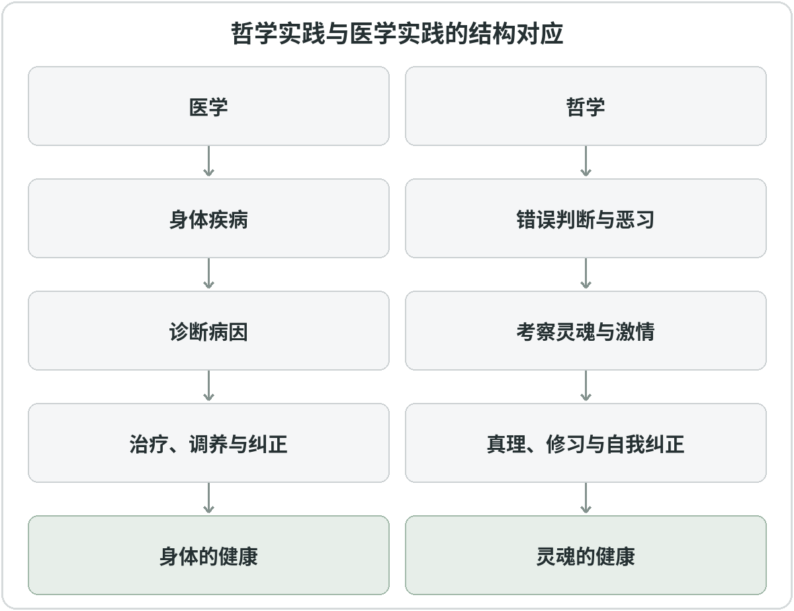

### 2. 激情与疾病

首先，它被规定为医学与哲学之间有着相同的概念结构和框架。当然，其中心概念是 “pathos”’，被伊壁鸠鲁派和斯多葛派理解为激情和疾病，以及随之而产生的一系列的类比，在这方面，斯多葛派要更啰嗦点，而且通常也比其他各派更系统。他们把一种激情的演变描述成一种疾病的变化。第一阶段〔57〕就是他们用希腊文所说的“euemptosia”（proclivitas），即导致生病的体质。随后是 “pathos””，灵魂的非理性活动，西塞罗用拉丁文把它译作“pertubatio”而塞涅卡则译为“affectus””。在“pathos”之后，就是疾病了，即“nosema”，意思是演变成慢性病：也就是演变成“hexis”，塞涅卡称之为“morbus”。 再后来是“arrostema”，西塞罗是用 “aegrotatio”来翻译的，也就是一种持久的疾病，可以通过不同的方式表现出来，但是让个人永久地生病。最后一个阶段是邪恶（kakia），即西塞罗说的“aegrotatio inveterata”，或塞涅卡说的 “vitium malum”（pestis〔58〕），此时，个人完全被控制了，他的激情改变了、感染了、迷惑了。关于这一套类比，我只是一带而过，因为它众所周知。

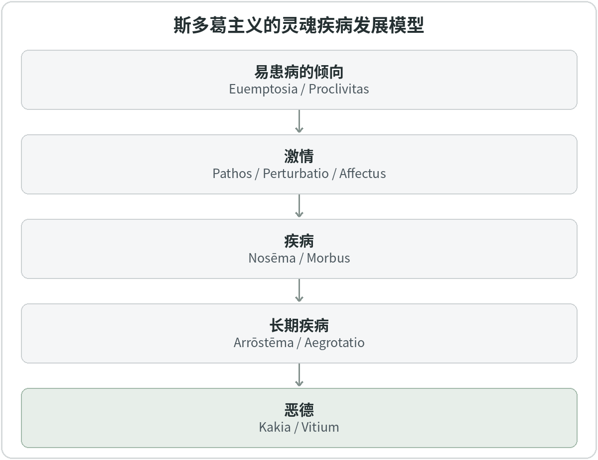

### 3. 治疗、服侍与崇拜

毫无疑问，最有趣的是，修身实践，即被哲学界定、明确和规范的那种，是被视为一种医疗手术。而且，其中心概念就是 “therapeuein”。你们都知道，“Therapeuein"在希腊文中有三个含义。“Therapeuein” 当然是完成一种旨在治愈、养护的医疗行为；但是它也是服侍主人的听话的奴仆的行为；最后，“Therapeuein”是指搞崇拜。不过，“therapeuein heauton”〔59〕 同时是指：照顾自己、作自身的奴仆，以及崇拜自己。当然，这方面发生了一系列的变化，我以后会再来谈谈其中的某些变化。

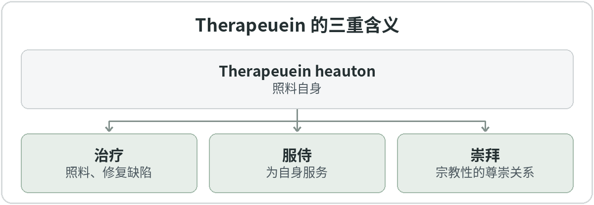

但是，让我们以亚历山大里亚的斐洛在《论思辨生活》中的关键文本为例，它是有关治疗家团体的，这些人在某个时候隐居在亚历山大里亚附近，形成了一个共同体，关于它的规范，我稍后会谈及，而斐洛则在一开始就说他们自称治疗家。为什么自称为治疗家呢？嗯，他说，因为他们治疗灵魂像医生治疗身体一样。他说，他们的实践是“therapeutike”像医生的实践是“iatrike” 〔60〕 斐洛像某些希腊作者（而不是所有希腊作者）那样，在治疗（therapeutique） 和医疗（iatrique） 之间做了区分，治疗是一种比医生的医疗（他们只给它保留了形容词形式 “iatrike”—对身体的医疗实践）更大、更精神化、更少针对肉体的行为方式。而且，他说，他们自称为治疗家是因为他们想像医生医治身体一样治疗灵魂，也是因为他们崇拜存在 （to on:therapeuousi to on）。他们呵护存在，他们关心他们的灵魂。而且，正是在同时做这两件事时，正是呵护存在和关心灵魂的关联中，他们能够给自已冠以“治疗家”的名号。〔61〕当然，我以后会回到这个问题上来，因为亚历山大里亚的斐洛的所有这些论点都是很重要的。

我只是向你们指出在一种与上述实践一样纯粹是宗教的实践中呈现出了精神修行和医学之间非常密切的关系。在哲学与医学、精神修行与身体医学之间的这种日益坚实和突出的关系中，我以为我们可以举出三个要素（也是我特别要举出的），因为它们与修身有关。

## 九、哲学学校作为灵魂门诊所

第一，出现了一种观念，即一个为了修身而聚集起来的团体，或者一个哲学学校，其实像一个灵魂门诊所；人为了修身而来到了这里，或把自己的朋友送到这里，等等。人们来到这里一段时间，为的是请人治疗自己感受到的罪恶或激情。这正是埃皮克泰德在谈到他的哲学学校时说的。他把它说成是一个灵魂医院，一个灵魂门诊所。请看第I卷第21次对谈，其中，他激烈地指责他那些来这里只是为了学习“哲学”（像我们说的那样）、学习辩论、学习三段论艺术的学生们：〔62〕你们是为此而来的，而不是为了治愈你们，以及想要让你们来治疗（therapeuthesomenoi）。〔63〕你们不是为此而来的。不过，这是你们必须做的。你们必须记住，你们到这里来主要是为了治疗。而且，在要你们去学习三段论之前，“请治愈你们的伤又，不要任性，要心静”。〔64〕

还有，在卷皿第 23次对谈中，他更明确地说：什么是一个哲学学校呢？一个哲学学校就是一个门诊所（iatreion）。当我们离开哲学学校后，我们不要学会了享乐，我们必须是经历了痛苦。你们之所以没有到哲学学校里，是因为你们是健康的，而且现在是健康的。来这里的，一个是肩膀脱白，另一个是有脓肿，第三个人是得了瘘病，还有一个是得了头痛病。〔65〕

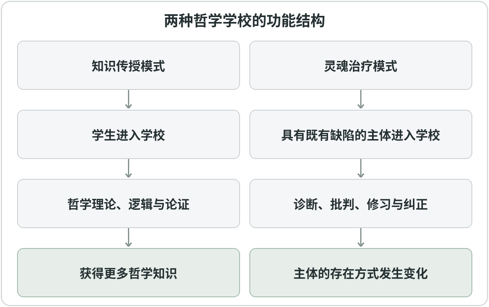

好，我感到录音机出了紧急问题。因此，我不得不停下来了。我对医学还有几句话要说，以后再说吧。而且，我还要给你们谈一点老年问题以及关心自己这个律令的普遍化问题。

## 编者注释

〔1〕 屋大维在公元前27年实行了新的权力分配（元首制），自封“Augustus”（奥古斯都）。公元前14年，他临终前传位于养子提比略（出生于克劳狄家族），后者开启了朱里亚一克劳狄王朝，他一直统治到公元68年尼禄死去为止。至于安东尼家族，继位于弗拉维王室，他们从公元96年一直统治到公元192年（康茂德被谋杀），而且以图拉真、哈德良和马克，奥勒留为代表。福柯选择的这个时期包括了历史学家们所说的早期罗马帝国。

〔2〕 穆索尼乌斯•鲁弗斯（其道德教训为我们所知，因为斯托倍在《诗选》中为我们保存了这些教训），是一位来自托斯卡纳（位于意大利中部——译者）的罗马骑士，活跃的犬儒主义者，而且从弗拉维王室统治开始起，其教训在罗马就占主导地位。埃及克泰德听过他的课，留下了非常清晰的记忆，并常常在他的《对谈录》中提到它。特别是他有关具体生活实践（怎么吃、穿衣、睡觉等等）的教训，是很有名的。福柯在《性经验史》（“关心自己”，前引该书，第177—180页、第187—188页、第197—198页和第201-202页）中大量引述了他对婚姻的诅咒。出生于公元121年的马克•奥勒留在138年继位于哈德良。看来，他的《沉思录》是在临终前（至少从170年起）撰写的。他于180年去世。德尔图良（在155—225年左右）的第一部主要著作《护教论》写于197年。亚历山大里亚的克莱蒙（约150—220年）在公元3世纪初撰写了有关指导的论著（三部曲：《劝告希腊人》，《教育者》、《挂毯》）。

〔3〕 关于作为思想训练的“meletan” 和作为实际训练的 “gumnazein”之间更深入的概念区分，参见3月3日第二课时的授课。

〔4〕 “最富裕的人不可满足于农业：你知道，这份职业（epimeleia）是快乐的来源、发家的手段、以自由人可能使用的一切适合的方式训练身体的手段。”（色诺芬：《家政学》，P.尚特罕尼译，巴黎，美文出版社，1949年，V-1，第51页）

〔5〕 参见柏拉图对这种说法的举例运用：“你必须开始更小心地检查你自己”（mallon prosekhon ton noun kai eis seauton apoblepsas）。（《夏尔米德篇》，160d,A. 克鲁瓦泽译，载柏拉图的《全集》，卷1，巴黎，美文出版社，1921年，第61页）“因此，首先必须想想我们自己”（Prosekteon ton noun hemin autois）。（《曼诺篇》，96d, A. 克鲁瓦泽译，载柏拉图的《全集》，卷I-2，巴黎，美文出版社，1923年，第274页）

〔6〕 《论好奇心》，515e（载普吕塔尔克的《道德著作集》，卷VI-1，J.迪谟尔蒂耶和J.德弗拉达斯译，巴黎，美文出版社，1975年，第266 —267页）。福柯在2月10日第一课时的授课中比较详细地分析了这段话。

〔7〕 关于转而关注自身这个论题，参见当日第一课时的授课。

〔8〕 关于转向以及“metanoia” 的希腊语和基督教的意义，参见本日第一课时的授课。

〔9〕 关于退隐 （anakhoresis），参见1月12日第一课时的授课和2月10日第一课时的授课。

〔10〕 “你回忆一下，当退回自身时，你的内心向导变得坚不可摧，它只满足于不去做自己不想做的事「……〕。这也是理智摆脫情绪的堡垒。要想从此坚不可摧，人没有比这更坚固的退隐之处了。”（马克•奥勒留：《沉思录》，VI，48，前引版本，第93页）“但愿哲学在我们周围筑起坚不可摧的堡垒，即使命运万箭齐发，也不会被攻破。哲学立场坚定，摆脱了外在事物的灵魂在自身筑起的堡垒中保护自己。”（塞涅卡：《给鲁西里乌斯的信》，卷皿，第X部分，第82封信，5，前引版本，第102页）在埃皮克泰德那里，也有相同的比喻（《对谈录》，IV,1，86），不过，意思却相反，因为它是要颠覆内心堡垒。

〔11〕 参见《关心自己》，第69—74页，特别是参考埃皮克泰德和塞涅卡之处。

〔12〕 塞涅卡写给鲁西里乌斯的第一封信的第一句话：“Vindica te tibi."（“给鲁西里乌斯的信”，卷I，第3页）

〔13〕 这里，特别是指马克•奥勒留的思想，如“尊重评价的能力”（ten hupoleptiken dunamin sebe）（《沉思录》，皿，9，第23页），或者“尊重（tima）你身上最优秀的品格”（《沉思录》，V，21，第49页）。

〔14〕 参见塞涅卡给鲁西里乌斯的第23封信（3-6） 和第72封信（4）。

〔15〕 “时机”（kairos）的首要意义是空间方面的（即目标对于弓箭手的恰当位置），它在古典文化中指的是一种时间的质量段：恰当的时刻、有益的时刻（参见M.特雷德：《“时机”：时刻和机会。公元前4世纪末荷马这个词和这个概念》，巴黎，克林科斯埃克出版社，1992年）。

〔16〕 参见1月6日第二课时的课程。

〔17〕 只是到了公元前4世纪末，雅典才实行了兵役制，即在年轻人成为成熟的和负责任的公民之前让他们入伍。在此之前，雅典没有强调通向成年的强力制度。而斯巴达则一直有着持续的、非常规范的军事化编制结构。参见H.I. 马鲁：《古代教育史》，前引该书；关于雅典的文化和军事学校（I'ephebie： 古代雅典18岁至20岁青年男子学习文化与军事的学校—译者注），参见P.维达尔-纳盖：“黑猎人和雅典文化军事学校的起源”（1968年），收入《黑猎人》，巴黎，发现出版社，1983年，第151-174页。

〔18〕 福柯在《快感的享用》第5章中阐述了这个论点，见前引该书。它还是他在法兰西学院1981年1月28日授课的对象。

〔19〕 “伊壁鸠鲁在梅内塞”，载第欧根尼•拉尔修：《著名哲学家的生平、学说和格言》，卷I，R. 热纳耶译，巴黎，伽尔尼耶一弗拉马里翁出版社，1965年，第258 页。

〔20〕 参见2月24日第二课时的授课。

〔21〕 “好！在我们掌握的穆索尼乌斯的最好格言中，它是其中之一，即：如果想生活得身心健康，那么必须不断地照顾自己 （to dein aei therapeuomenous）。”（“制怒”，453d，载普吕塔尔克：《道德著作集》，卷VII-I，J.迪谟尔蒂耶和J.德弗拉达斯译，前引版本，第59页；O.亨斯编辑的穆索尼乌斯的《剩余》第36残篇，莱比锡，Teubner,1905年，第123 页）

〔22〕 这是指对苏格拉底对话的最初论述（《论灵魂的宁静》，I，1—18，载《对话》，卷IV，R.瓦尔兹译，前引版本，第71—75页）。

〔23〕 这三篇论著（《论智者的恒心》、《论灵魂的宁静》、《论游手好闲》）传统上代表了塞里努斯（在塞涅卡的影响下）从伊壁鸠鲁主义转向斯多葛主义的三部曲。不过，P.维尼（见他给塞涅卡的《对谈录、给鲁西里乌斯的信》撰写的序言，巴黎，罗贝尔一拉丰出版社，1993年，第375—376页）认为这篇论著源于公元62—65年（这就排除了题献给塞里努斯的可能性，因为后者死于公元62年前），当时，塞涅卡决心退隐，认为退隐是一种运气。

〔24〕 关于塞里努斯和塞涅卡的关系，除了福柯在《关心自己》（第64页和第69页）中谈到的，我们尤其要提及在P. 格里马尔的经典著作（《塞涅卡或帝国的良心》，巴黎，美文出版社，1979年）有几页是专门谈这个关系的（第13—14页，第26—28页，特别是第287—292页谈到他的生平以及他所谓的伊壁鸠鲁主义）。我们认为塞里努斯是塞涅卡的一个亲戚（两人有着相同的姓），他的事业也得力于塞涅卡的支持（作为骑士，他在公元50年代提任了巡夜警督）。他于公元62年去世，是被一盘蘑菇毒死的，为此，塞涅卡在给鲁西里乌斯的第63封信（14）中大感悲伤。

〔25〕 这与被释女奴（Acte）有关，塞里努斯用君主掩饰了对她的爱：“〔尼禄〕不再听从他的母亲，而任由塞涅卡的摆布，安奈厄斯，塞里努斯是塞湿卡身边的人之一，为了掩盖年轻的尼禄的初恋，竟然假装爱上了这位被释女奴，还以自己的名义把皇帝私下送给这个年轻女人的礼物当作他自己的馈赠。”（塔西佗：《编年史》，XI，13，P.格里马尔译，巴黎，伽利玛出版社，1990年，第310页）

〔26〕 关于塞涅卡和鲁西里乌斯（以及后者的年龄）的关系，请参考P. 格里马尔的著作（《塞涅卡或帝国的良心》，前引该书，第13页和第92—93页），以及L.德拉特较早的论文“塞涅卡的朋友鲁西里乌斯”，载《古典研究》，I,1935年，第367—545页；还参见《关心自己》，第64页和第69页。

〔27〕 关于《自然问题》的时间问题，基本的文本仍然是P.奥尔特拉马尔为他在美文出版社发表的著作所撰写的序言（卷I，巴黎，1929年）。在这个文本中，P.奥尔特拉马尔认为《自然问题》成书于公元61年与64年之间（甚至是从公元63年末到65年初），由此可以得出结论，“它先于《给魯西里乌斯的信》中的大部分内容”（第VI页）。至于《给鲁西里乌斯的信》的时间，P.格里马尔在《塞涅卡或帝国的良心》中作过详细的讨论（第219—224页）；特别是要参见附录I：“《给鲁西里乌斯的信》。年表。种类”（第441一456页）。

〔28〕 弗拉维•阿里安（约公元89—166年）出生于比蒂尼（Bythinie）的一个贵族家庭，他在尼科博利（Nicopolis）拜埃皮克泰德为师。从此，他热心于把老师的话如实地记载下来（参见《对谈录》，它成了埃皮克泰德又头传授的唯一见证）。据塞姆利西乌斯说，阿里安还是其师名言集“手册”的作者。后来，这位想成为当世色诺芬的人在作为名人定居于雅典之前，成了哈德良王朝的贷款人和顾问。

〔29〕 在1月27日第一课时的授课中，福柯在系统分析这些文本时又谈到了这些例子。

〔30〕 普鲁士的迪翁（公元40—120年）被人作为“雄辩家”：从这位出身于普鲁士最重要家族之一的人的金口里，开始了在⻙斯巴芗玉朝时期辉煌的雄辩家生涯（冯•阿尼姆认为这是泰米斯蒂乌斯之后的诡辩时期，后来他在多米提安统治罗马时不得不流亡在外。于是，他过着犬儒式的生活，从一个城市游荡到另一个城市，大费口舌地劝说当时人向善，这些说教保存至今。参见博罗•德斯德里在《古代哲学家辞典》中对迪翁的完整概述，该书由K.古勒主编，卷耳，巴黎，国家科研中心出版社，1994年，第841-856页）。

〔31〕 参见“第20次讲话：Peri anakhorese6s（论退隐）”（载雄辩家迪翁：《讲话》，卷I，J.W.科洪译，勒布古典丛书，1959年，第246—269页）。这次讲话在福柯的案卷中成了深入研究的对象，其中就有从世界中退隐、以便一直关心 （logon apodidonai） 自己所作所为的概念。

〔32〕 亚历山大里亚的斐洛：《论思辨生活》，473M，P.米盖尔译，前引版本，§13，第87页。

〔33〕 吕西安：《叫卖的哲学家》，Th.博拜尔译，巴黎，美文出版社，1967年。

〔34〕 “Bion prasis"：生活方式、生活种类、生活方式的市场。

〔35〕 参见最新的法文版，吕西安：《埃尔谟蒂姆》，J.-P.迪攀译，巴黎，法国大学出版社，1993年（其希腊文本见吕西安：《埃尔谟蒂姆著作集》，卷IV,K. 基尔巴姆译，剑桥，勒布古典丛书，1959年，第65页及以后各页）。

〔36〕 这涉及：“就这本书和这个急速的步伐证明了这一点而言，你要快一点听到别人在你老师那里会说什么。”（《埃尔谟蒂姆》，法译本，前引版本，第11页）

〔37〕 “他〔毕达哥拉斯〕这样划分了人的一生，‘童年20年，少年20年，青年20年，老年20年”。”（“毕达哥拉斯”，载第欧根尼•拉尔修：《著名哲学家的生平与学说》，V，10，M.-O. 古勒一卡泽主译，前引版本，第948页）

〔38〕 “H.：你不要这样做。我开始做哲学时，像你一样近40岁了。这和你的年纪差不多吧？L.：这很好，埃尔谟蒂姆。做我的导师和我的启蒙者吧。”《《埃尔谟蒂姆》，法译本，第25页）关于这个文本，还请参见《关心自己》，第64—65页。

〔39〕 关于这种用法，参见“给鲁西里乌斯的信”，24, 5; 61, 4;109, 8和 113，28，从有关波塞多尼奥斯的一段引文开始。

〔40〕 “我们为什么要误解自己呢？我们的恶不是来自外面 （non est extrinsecus malum nostrum）；它就在我们之中 （intra nos est），官就位于我们内脏的深处 （in visceribus ipsis sedet），而我们为什么难以康复的原因，就在于我们还不知道自己染上恶疾了。”（《给鲁西里乌斯的信》，卷I，第V部分，第50封信，4，第34页）

〔41〕 “如果是最近才染上了恶习，那么医生〔……〕就不必做什么了。这些仍然稚嫩的灵魂会驯服地遵循他向它们指明的理性道路。”（同上，第50封信，4，第35页）

〔42〕 “这里是有工作可做的 （laborandum est），而且说真的，如果像说过的那样，我们只是刚好在恶习定型之前开始熏陶、改正我们的灵魂，那么这份工作不是重大的。即使是定型了，我也不失望。这只不过是要进行一番坚忍不拔的工作，要有一种持久的和理智的热情。”（同上，第50封信，5一6，第35页）

〔43〕 “大树的树枝，无论有多弯曲，你都要把它们弄直了；天热会让内曲的梁柱变直，而且，我们为了按照我们的需要制作它们，改变了它们的自然结构。灵魂是多么容易接受它的形式，灵魂是可塑的本质，比任何流体都更能延展！那么，它是否不同于以某种方式形成的气息呢？不过，你看到了，空气是极有弹性的要素，它越是稀薄，就越有弹性。”（同上，第50封信，6，第35页）

〔44〕 “智慧决不会在不理智之前降落在人身上的。”（ad neminem ante bona mens venit quam mala）（同上，第50 封信，7，第36页）

〔45〕 “我们大家的敌人就在这个地方。”（omnes praeoccupati sumus）（同上）

〔46〕 同上。

〔47〕 福柯在此参考的是第欧根尼，拉尔修给出的一段安蒂斯泰尼的引文：“当有人问他什么是最不可缺的知识时，他的回答是：‘避免忘记的知识。”（to periairein ton apomanthanein）”（《著名哲学家的生平与学说》，VI,7，第686页）。通过尽早掌握有用知识与无用知识的分别，人们就避免了为了以后必须忘撑无用的知识而去学习它们。不过，更确切地说，犬儒派有关生活方式的论点 “Kata phusin”意味着人们忘记了各种习俗和 “Paideia” 的其他内容（关于自然与法律的不同，参见安蒂斯泰尼和第欧根尼的说法，载《著名哲学家的生平与学说》，VI，11 和70—71，第689页和第737—738页）。正如 M.-O. 古勒一卡泽就这个主题所说的：“西律斯（Cyrus）这个典型的安帮斯泰尼派的英雄，最初的回答是：‘最必要的知识就是忘掉恶。’”（《犬儒派的苦修：评第欧根尼•拉尔修“著名哲学家的生平与学说”一书的VI 70—71》，巴黎弗罕出版社，1986年，第143页；对斯托倍的引文，，31,34）。塞涅卡则谈到 “dediscere ：“要让你的眼睛去忘记。”（sine dediscere oculos tuos）（《给鲁西里乌斯的信》，卷I，第VI部分，第69封信，2，第146页）

〔48〕 西塞罗：《图斯库拉尼论争》，卷耳，皿，I，2，J.于姆贝译，巴黎，美文出版社，1931年，第3页。

〔49〕 这指的是写给鲁西里乌斯的第32封信，但是福柯在此使用的是一个旧译本（平特雷尔译，拉封丹校），它被收入《哲学家塞涅卡全集》，M.尼扎尔编辑，巴黎菲尔曼，迪多，1869年（以后参考的是这个版本），第583页。

〔50〕 埃皮克泰德：《对谈录》，皿，1，前引版本，第5—12页。

〔51〕 参见《关心自己》，第69—74页。

〔52〕 有关医学和哲学之间的这种补充关系的基础文本无疑是希波克拉底著作集中的《古代医学》：“某些医生和学者认为如果不知道什么是人，那么就无法了解医学，但是，恰当地治愈病人的人一定要掌握的就是这门科学，而且他掌握的这种话语是在哲学的意义上而言的。”（A. J.费斯蒂耶尔译，巴黎，克林科斯埃克出版社，1948年，第17—18页）关于柏拉图以及古希腊文化中对这种关系的研究，福柯可能曾读过W.耶格尔的《教化》中的“作为教化的希腊医学”这一章（卷皿，牛津，巴斯尔•布莱克维尔出版社，1945年，作者校阅过这个英译本），以及 R.若里的“柏拉图和医学”，载《纪尧姆•布代学会通报》，第435—451页；P.-M.舒尔的《柏拉图和医学》，载《希腊研究杂志》，83，1960年，第73—79页；J.儒昂纳的“希波克拉底著作集和柏拉图”，载《希腊研究杂志》，90，1977年，第15—28页。关于最近的综合，参见B.维特拉克的《希波克拉底时代的医学和哲学》，圣邓尼斯，文森大学出版社，1989年。

〔53〕 “不要假装做哲学，而要真正地做哲学（ont6s philosophein）；因为我们不必身体健康，而要真正地活着（Kat' aletheian hugiainein）。”（伊壁鸠鲁：“梵蒂冈格言第54条” ，载《书信与格言集》，前引版本，第260—261页）

〔54〕 关于这一点，关键的文本仍然是伽利安对波塞多尼奥斯在其“希波克拉底和柏拉图的教义”（参见《波塞多尼奥斯》，I，“残篇”'，L.埃德尔斯泰因和I.G.基德编辑，剑桥，剑桥大学出版社，1972年）中所说的“hegemonikon”（灵魂的主要部分）的三种功能的介绍。为了反对克里斯普（Chrysippe），波塞多尼奥斯赞同灵魂的非理性的（暴躁的和贪婪的）功能的相对独立性。因此，为了控制有关身体及其平衡的情绪，仅靠一个正直的判断是不够的，还要有化解情绪所必需的一整套的治疗措施，一种饮食法，而不只是一种端正思想。参见 A.J. 沃埃尔克的著述（《斯多葛主义的意志观念》，巴黎，法国大学出版社，1973年，第121—130页）和E.K. 多兹的论述（《希腊人和非理性》，同上，第236—237页），称赞波塞多尼奥斯回到了柏拉图的道德现实主义上。关于对波塞多尼奥斯的较一般的介绍，参见M.拉夫朗格的《阿帕梅的波塞多尼奥斯》，巴黎，法国大学出版社，1964年，特别是有关“人类学”这一章，第369—448页。

〔55〕 在穆索尼乌斯的著作中找不到这个论断，可能福柯脑子里记的是普鲁士的迪翁有关向哲学家呼吁的XXVI次演讲：“大部分的人都对作为医学的哲学感到厌恶；同样，人只是在生了重病后才去买药，因此，人只要不感到太痛苦，就会忽视哲学。这里有一个富人，他有收入或大批地产〔……〕一旦他失去财产或健康，那么他就会很容易来听哲学；如果现在，他的妻子或儿子、兄弟要死了，天啊！那么他就会请来哲学家，他请求他。”（载康斯坦，马撒编译的《罗马帝国的道德家们》，巴黎拉谢特出版社，1881年，第244页）

〔56〕 “也不要指责讨论与健康相关的问题的哲学家们逾界了，而是相反，如果他们认为在取消了一切边界之后不应该寻求通过他们的论争追寻可爱又必要的东西来炫耀自己，像在公共领域里一样（en mia khora koin6s）。”（“健康戒条”，122e，载普吕塔尔克：《道德著作集》，卷耳，J，德弗拉达斯、J. 昂尼和 R.克莱尔译，前引版本，第101页）

〔57〕 福柯在此只是照抄了I.亚多在《塞涅卡和希腊一罗马的精神指导传统》（同上，第口部分，§2：“精神疾病的等级”，第145页）中列的表。他在《关心自己》（第70页）中又提到了这些区分。为了找到有关希腊疾病分类的译文，1.亚多使用的主要拉丁文本是：西塞罗的《图斯库拉尼论争》（IV,10，23, 27,29） 和塞涅卡的《给鲁西里乌斯的信》（75和94）。但是，这段文字无疑也受到了当时刚发表的］.皮诺德的《灵魂的疾病：关于古代医学一哲学传统中身心关系的研究》（巴黎，美文出版社，1981年）的启发。

〔58〕 “它们〔自然倾向〕重新勃起，除非长期的变质（pestis）最终渗透其中，并导致它们死亡：这样，即使哲学尽其所能，它也不会因为它的教导让它们复活。”（塞涅卡：《给鲁西里乌斯的信》，卷I，第XV部分，第94封信，31，第75 页）

〔59〕 这里参考的显然是马克•奥勒留，关于内在的才华，他写道：必须“让它以一种真诚的崇拜（gnesi6s therapeuein）为中心。这种崇拜（therapeia）就在于让它保持纯洁，不受任何情绪的影响。”（《沉思录》，1，13，前引版本，第14页）在埃皮克泰德那里，也有“heauton therapeuein”（治疗自身）的说法（《对谈录》，I，19，5，第72页）。

〔60〕 “这些哲学家的选择立即通过他们的名字表现出来：治疗家（therapeutai） 和治疗师（therapeutrides）是他们真正的名字，这首先是因为他们从事的治疗家这一职业（paroson iatriken）优越于我们城邦中现有的职业—后者只治愈身体，而前者还治愈灵魂。”（斐洛：《论思辨生活》，471M，§2，第79页）

〔61〕 “〔如果他们被称为治疗家〕，那么这也是因为他们接受了一种符合自然和神圣法律、符合比善更好的存在崇拜（therepeuousi to on）的教育。”（同上，472M，§2，第81页）

〔62〕 埃皮克泰德：《对谈录》，I，21，12-22（第93-95页）。

〔63〕 同上，§15（第94页）。

〔64〕 同上，§22（第95页）。

〔65〕 《对谈录》，皿，23,30（第92页）。福柯在《关心自己》（第71页）中分析过这个文本。

# 附录

以下为阅读辅助材料，与原著正文区分。

## 一、希腊化哲学的三个学派

### 1. 伊壁鸠鲁主义（Epicureanism）

伊壁鸠鲁（Epicurus，前341—前270）所处理的问题是，人如何解除由于错误信念、死亡恐惧及无限欲望所产生的痛苦。原子论（Atomism）为自然现象及死亡提供解释，伦理学则以快乐（Hēdonē）为幸福的原则，尤其重视身体免于痛苦（Aponia）和灵魂免于扰动（Ataraxia）。理性判断使人区分自然且必要、自然但非必要，以及非自然且非必要的欲望。后来的四重药方（Tetrapharmakos）概括为神不足畏、死不足忧、善易获得、痛苦可承受。福柯在本讲借《致美诺伊克斯书信》说明哲学的终身性。

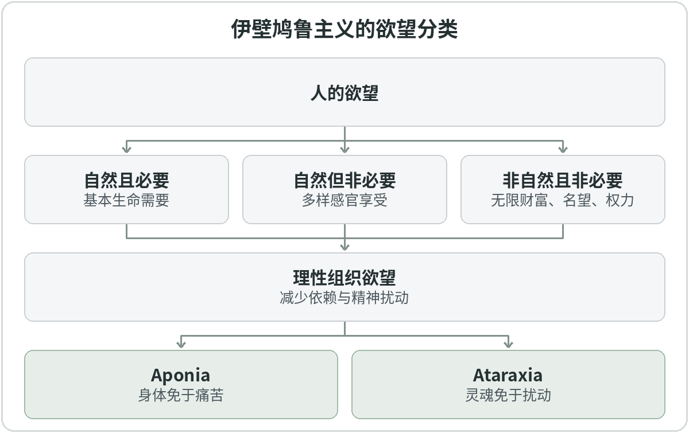

### 2. 斯多葛主义（Stoicism）

当幸福依赖于财富、健康和政治地位时，主体便受到无法完全支配的外部事件制约。斯多葛主义将幸福建立在德性（Aretē）上，主张按照自然的理性秩序（Logos）生活。爱比克泰德尤其强调区分取决于自身的判断、同意、欲求与行动意向，以及外在事物。外部事件产生表象（Phantasia），主体通过检验与同意（Synkatathesis）决定是否接受其中的判断。哲学修习由此能够改变主体回应世界的方式。

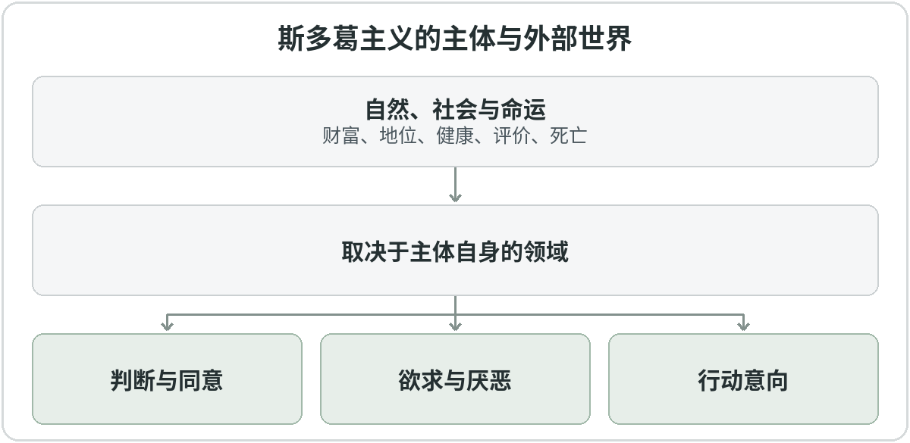

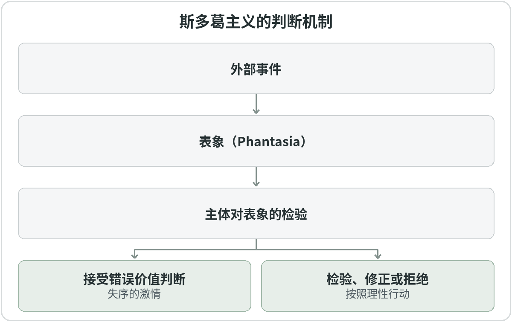

### 3. 犬儒主义（Cynicism）

犬儒主义面对的是主体对人为习俗（Nomos）、财富、声誉和社会认可的依赖。它强调按照自然（Physis）生活，以修习（Askēsis）、直言（Parrhēsia）和自足（Autarkeia）实现自由。代表人物为锡诺普的第欧根尼；本讲的金口狄翁则体现了犬儒式公共演说的社会形式。

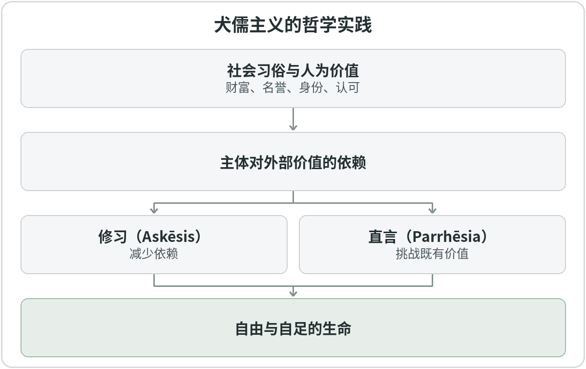

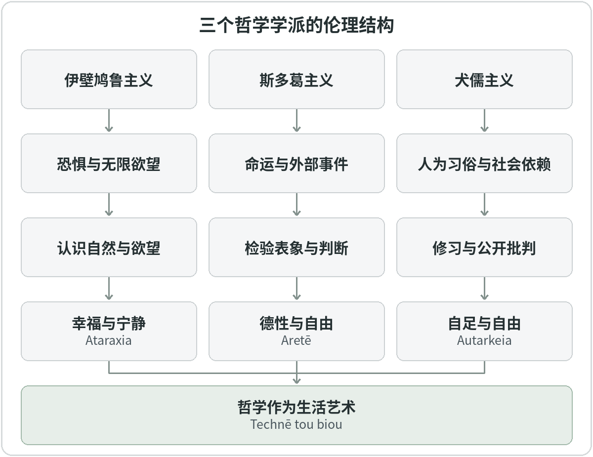

## 二、主要人物

### 1. 西塞罗（Marcus Tullius Cicero，前106—前43）

罗马共和国末期政治家、律师、演说家、哲学家，前63年担任执政官，后因反对马克·安东尼而死于后三头同盟的政治清洗。他主要认同学院派怀疑主义（Academic Skepticism），同时广泛吸收斯多葛派等希腊思想，推动希腊哲学术语进入拉丁语世界。主要著作有《论共和国》《论法律》《论义务》《论善恶之极》《图斯库兰论辩》《论神性》。本讲通过《图斯库兰论辩》讨论早期家庭环境对价值判断的塑造，以及激情与疾病的概念关系。

[肖像：卡比托利欧博物馆西塞罗胸像（Wikimedia Commons）](https://commons.wikimedia.org/wiki/File:Cicero_-_Musei_Capitolini.JPG)

### 2. 塞涅卡（Lucius Annaeus Seneca，约前4—65）

罗马斯多葛派哲学家、政治家、悲剧作家，曾遭流放，后成为尼禄的导师与顾问，并与布鲁斯共同参与帝国政治。其巨额财富与斯多葛伦理形成值得讨论的张力；65年尼禄命令他自杀。主要著作包括《论愤怒》《论幸福生活》《论生命之短暂》《论心灵的宁静》和《道德书简》。福柯特别重视其书信指导、纠正既有习惯以及灵魂治疗的实践。

[肖像：柏林古代雕塑双面赫尔墨柱上的塞涅卡](https://commons.wikimedia.org/wiki/File:Seneca._Double_herm_with_portraits_of_Socrates_and_roman_philosopher_Seneca.jpg)

### 3. 卢西里乌斯（Lucilius）与塞里努斯（Serenus）

卢西里乌斯（亦译鲁西利乌斯）是塞涅卡的朋友、罗马帝国官员，曾在西西里任财务行政官。塞涅卡晚年写给他的126封现存书信构成《道德书简》（Epistulae Morales ad Lucilium），《自然问题》也题献给他。福柯借此说明成年人的精神指导，以及从伊壁鸠鲁主义转向斯多葛主义的实践。

安奈乌斯·塞里努斯是塞涅卡的朋友，可能是亲属，曾担任巡夜警队长官。《论心灵的宁静》《论智者的坚定》等文本与他有关；传统上这些著作也被理解为他从伊壁鸠鲁主义转向斯多葛主义的记录。本讲尤其关注他向塞涅卡描述自身状态、请求诊断的关系。

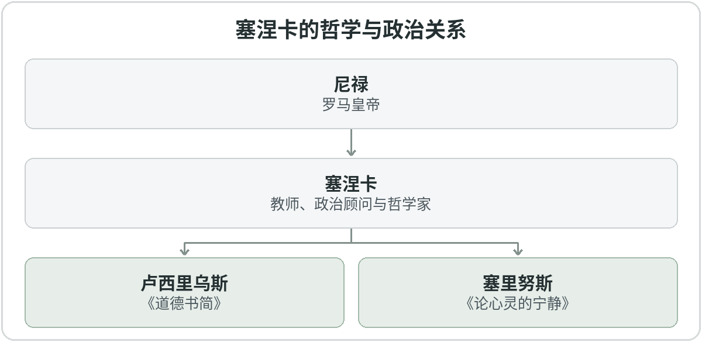

### 4. 波塞多尼乌斯（Posidonius，约前135—前51）

中期斯多葛主义哲学家、地理学家、历史学家，在罗德岛讲学，与西塞罗有交往。他强调灵魂中非理性力量的作用，与克吕西波将激情密切关联于判断的理论有所不同。福柯提及他是为了追溯哲学与医学相结合的历史；其著作多已散佚，相关材料部分由盖伦保存。

[肖像：传统归为波塞多尼乌斯的胸像（身份存疑）](https://commons.wikimedia.org/wiki/Category:Bust_of_so-called_Posidonius_%28MANN_6142%29)

### 5. 穆索尼乌斯·鲁弗斯（Gaius Musonius Rufus，约30—100）

罗马斯多葛派教师，出身骑士阶层，曾遭流放。他强调哲学实践，讨论饮食、衣着、婚姻、教育等具体生活，主张女性也应该接受哲学教育。爱比克泰德曾受教于他。本讲引用其终身关心自己的主张。

### 6. 爱比克泰德（Epictetus，约50—135）

曾为奴隶，获得自由后成为职业哲学教师，在尼科波利斯开办学校。他尤其重视选择能力（Prohairesis），强调主体对判断、欲求及行动负责。其学生阿里安（Arrian）记录了《论说集》（亦译《对谈录》）和《手册》。福柯借这些文本考察哲学学校的教育、成人咨询和灵魂治疗功能。

[肖像：1715年出版的爱比克泰德后世版画](https://commons.wikimedia.org/wiki/File:Epiktet.png)

### 7. 马可·奥勒留（Marcus Aurelius，121—180）

罗马皇帝，161—180年在位，斯多葛主义哲学家。《沉思录》（Meditations）具有私人精神练习性质，反复考察判断、行动、死亡及政治责任，是自我实践的重要文本。

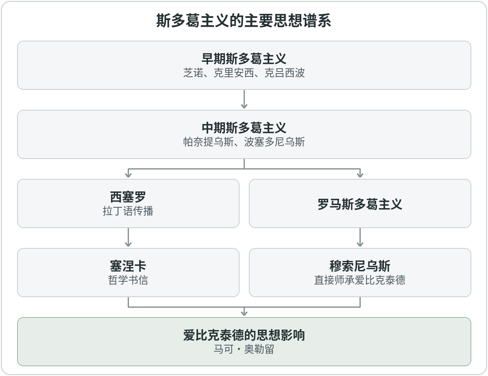

[肖像：卢浮宫所藏马可·奥勒留胸像](https://commons.wikimedia.org/wiki/Category:Busts_of_Marcus_Aurelius_in_the_Louvre)

### 8. 普鲁塔克（Plutarch，约45—120）

希腊哲学家、传记作家、德尔斐神庙祭司，属中期柏拉图主义（Middle Platonism）。主要作品《希腊罗马名人传》《道德论集》保存了政治伦理、日常生活、宗教与修身实践的丰富材料。本讲引用其关于医学与哲学具有共同领域的论述。

[肖像：德尔斐传统归为普鲁塔克的胸像](https://commons.wikimedia.org/wiki/File:Plutarch_at_Delphi.jpg)

### 9. 亚历山大里亚的斐洛（Philo of Alexandria，约前20—50）

希腊化犹太哲学家，借助柏拉图主义、斯多葛主义及寓意解释理解犹太宗教经典。《论沉思生活》（De Vita Contemplativa，原译《论思辨生活》）描述治疗家（Therapeutae）共同体的宗教生活。福柯借此考察灵魂治疗、宗教崇拜与成年人的修身实践。

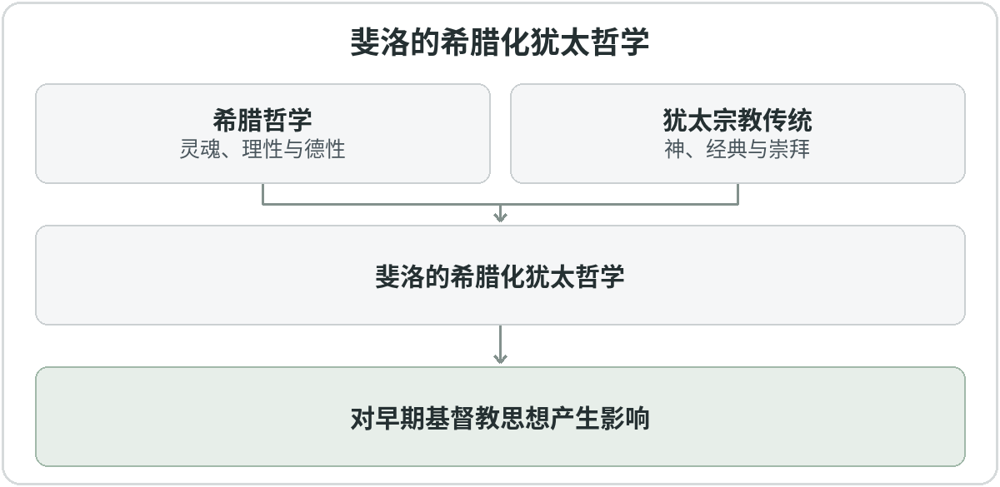

[肖像：斐洛的后世版画](https://commons.wikimedia.org/wiki/File:Philo.jpg)

### 10. 金口狄翁（Dio Chrysostom，约40—120）

又称普鲁萨的狄翁，原书译“普鲁士的迪翁”。罗马帝国时期的希腊演说家，曾被流放，思想吸收犬儒主义、斯多葛主义和柏拉图主义。他既向普通民众公开演说，也讨论君主德性。福柯借此说明哲学实践的公共传播。

### 11. 琉善（Lucian of Samosata，约125—180年以后）

原书译“吕西安”，古希腊语讽刺作家。《哲学家拍卖》（Biōn Prasis）将哲学家的生活方式表现为市场上的商品；《赫尔莫提摩斯》（Hermotimus）借赫尔莫提摩斯与利西努斯的对话讽刺漫长而昂贵的哲学学习。这些文本为福柯考察自我实践的社会组织提供了文学材料。

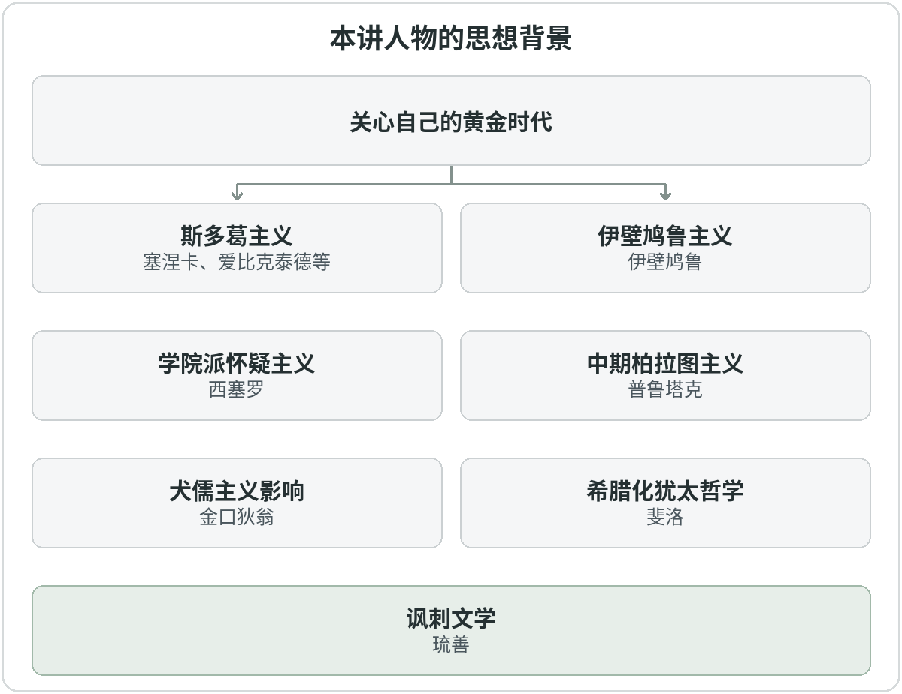

## 三、本讲的整体结构

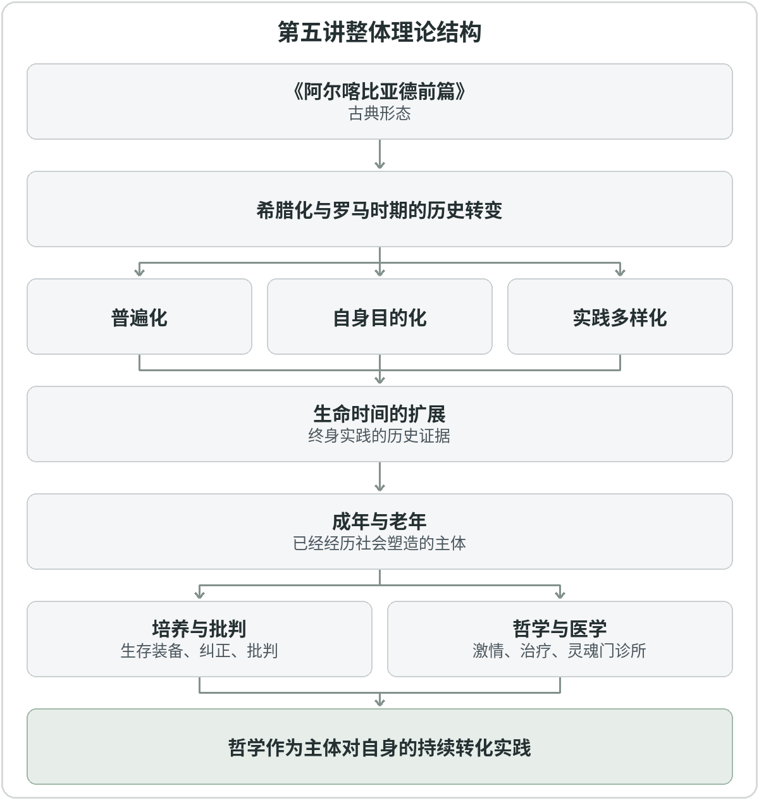
