# 正文（1982年1月20日）

## 讲座提要

老年人的得天独厚之处（生活的积极目标与理想方面）—关心自己原则的推广和宗派现象的确立—相关的社会褶子：从大众文化环境到罗马人友爱的贵族政治网络——另外两个例子：伊壁鸠鲁团体与治疗家团体—拒斥法律范式—双重肯定的结构原则：要求的普遍性与选择的稀有性—拯救的方式

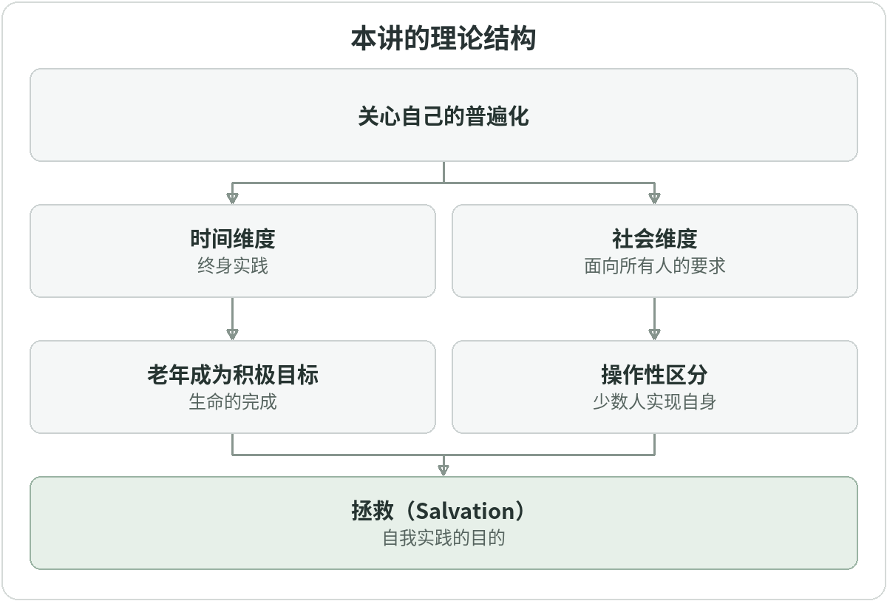

## 一、身体与灵魂的共同照料

从青少年晚期到成年和成人生活的有关修身的年代学置换，我想从中得出两个结论：一是有关这种自身修养的批判功能，它配合和掩盖了培养功能；二是与医学的近似性，这是相关的结论，我还没有谈及，但是不久就会讨论到：身体的艺术在柏拉图那里是明显区别于灵魂的艺术的。你们都记得，在《阿尔西比亚德篇》中，正是从这一分析或这一区分出发，灵魂才被确定为关心自己的对象。相反，〔后来〕身体才被整合进来的。显然，在伊壁鸠鲁主义者那里，在斯多葛主义者（对于他们来说，有关灵魂与身体健康之间紧张关系的各种问题是深入地联系在一起的）那里，〔1〕我们会看到身体再次作为担忧的对象而出现，以至于关心自己同时就是关心他的灵魂与他的身体。这在塞涅卡的这些略带忧郁的信件中，是显著的。〔2〕而且，这种忧郁情绪也明显地表现在马克•奥勒留、弗隆顿〔3〕、埃利乌斯•阿里斯蒂德〔4〕等人那里。最后，我们会再回到这个问题上，我以为，医学与关心自己之间的这种接近，其后果之一就是：我们要和作为这一关心之中心的错综复杂的身心关系打交道。

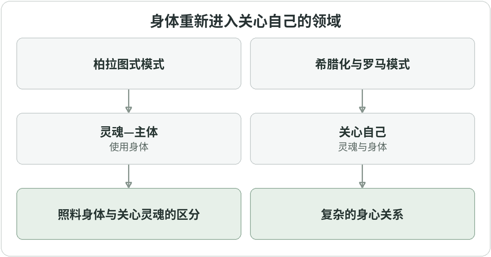

## 二、老年作为生命的积极目标

### 1. 老年价值的转变

最后，这一年代学置换的第三个后果显然是老年人具有的新的重要性和新的价值。当然，在古代文化中，老年人有一种众所周知的传统价值，但是这种价值却是有限的、补充的和局部的。老年人有智慧，但也是虚弱的。老年人有经验，但是无法再积极参与到日常生活或政治生活中。老年人可以提供建议，但是因为身体虚弱而要依靠其他人：他为他们出谋划策，但是保卫城邦的却还是年轻人，因此正是他们保护了老年人，而且他们工作，从而为老年人提供了生活的必需品，等等。因此，老年人具有的这种传统价值是模糊的或有限的。大致说来，在传统的希腊文化中，老年人当然是令人尊敬的，但却不是人所希望的。人们不可能希望变老，即使人们长久以来一直引用索福克勒斯的名言，即他庆幸自己终于老了，因为他摆脱了性欲。〔5〕但是，如果我们要引用它，那么也是作为特例：他就是想变老的人，或者是因为老了可以摆脱性欲而感到快乐的人，索福克勒斯的这句话经常被后来人引用。

然而，现在关心自己必须终生践行，尤其是在成年后，正是从这时起，关心自已在整个成年期把握了它的全部向度和后果，人也明白了关心自己的终点、最高形式和补偿时刻就在老年。随着基督教和对超越的承诺的出现，人们又理解了另一种体系。但是，在这个以死亡问题（我们会再回到这个问题上）为目标的体系内，正是老年构成了伴随个人或个人一生遵循的这一长期修养的肯定阶段、完成阶段和顶峰。摆脱了所有物质欲望，摆脱了他现在拒斥的所有政治欲望，获得了可能得到的一切经验，老年人将成为自己的主宰，而且能够让自己完全感到满意。老年人的界定就在这一历史和这种自身修养的方式中：他最终可以自身愉悦、自我满足、把一切快乐与满足都寓于自身，不从外人那里得到任何快感、愉悦和满足，也不想得到他无法消受的物质快感以及他拒斥的雄心快感。因此，老年人就是自身感到愉悦的人，老年人达到的境界如果是长期自身修养的结果，那么就像塞涅卡所说的，达到了自身，人重新回到自身，而且与自身保持一种既控制又满足的完满关系。

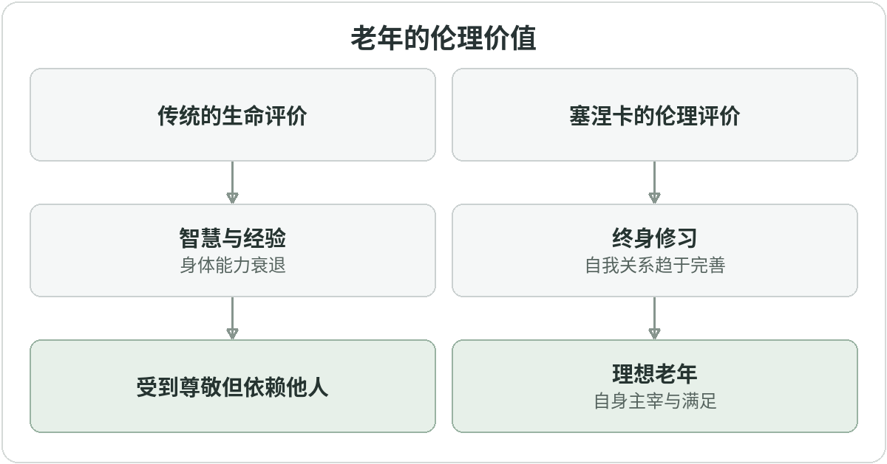

### 2. 生命的动态统一

由此，如果老年是人所希望的，那么必须明白（第一个结论）老年不应该只被理解为生命的终点，不应该被视为一个生命在萎缩的阶段。相反，老年必须被理解为一个正面的生存目标。必须迈向老年，不要听天由命地去遭遇它。它，以及它的方式和价值，必须让整个生命过程极化。而且，我认为，塞涅卡有一封信涉及这个问题，十分重要，也十分有特点。它之所以有特点，是因为它一开始就附带（或隐晦地）批评了那些在一生的每个年龄段采取特方式的人。〔6〕塞涅卡就是这样涉及这个在希腊一罗马伦理中非常传统和重要的论题，即一生分为不同的年龄段，每个年龄段对应着一种特殊的生活方式。当然，对于不同的学派和不同的宇宙一人类学的思考，这一划分是不同的。我随后会为你们引用毕达哥拉斯学派关于童年、少年、青年、老年等的划分（还有其他方式）。但是，令人感兴趣的是，一方面是人们认为这些不同阶段的重要性，以及每个阶段特有的生活方式被赋予的重要性；另一方面，从伦理的观点来看，人们认为在人选择的生活方式、他的生存方式和他所处的年龄段之间的良好关系是重要的。一个年轻人就必须像一个年轻人一样生活，一个成年人就必须像一个成年人一样生活，一个老年人就必须像一个老年人一样生活。

然而，塞涅卡在考虑这一传统划分时，说我无法同意那些把人生切成几片的人，他们在不同的年龄段里没有相同的生活方式。塞涅卡则提出用一种动态的统一来代替这种划分：迈向老年的连续运动的统一性。

而且，他还使用了某些很有特点的习语：做事时好像背后有追兵似的，生活必须要有紧迫感，你一辈子都必须感到身后有人，有敌人在追赶你。〔7〕这些敌人就是生活中的事故和敌人，特别是你因这些事故而产生的各种激情和烦恼，如在你年轻或成年的时候，当你还想得到什么东西时，或者在你沉溺于快感或垂诞于金钱、权力时，正是这些敌人在追赶你。面对这些追赶你的敌人，你必须逃避，必须尽可能快地逃避。请你赶快到为你提供安全居所的地方。这就是说，老年根本不是生活模糊的终点，而是生活的一极，必须达到的一个正面极。如果你们愿意，要用一句塞涅卡没说过的习语来概括他的说法，那么我们可以说：从此必须“为变老而活着”。为变老而活着，这是因为我们会在老年找到安宁，找到躲避处，找到愉悦。

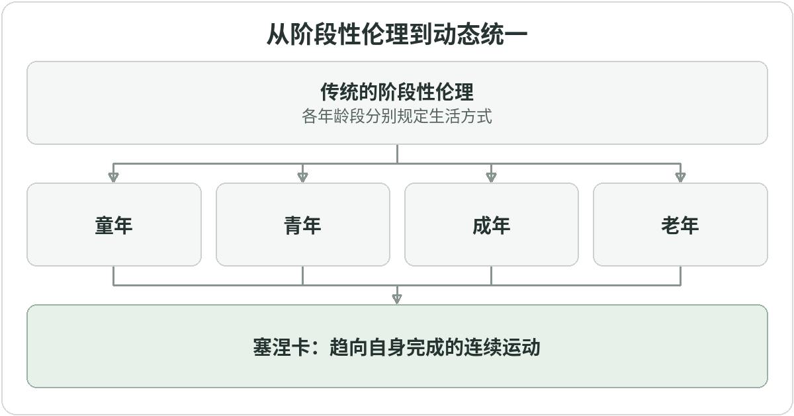

### 3. 理想老年与生命完成

第二个结论：这个老年就是按年月确定的老年，大部分的古代人一般都认为到了60岁时才算老年，而且快到这个年龄时，塞涅卡就退休了，决定完全享受生活。但是，这不只是说60岁在时间上到了老年，还是一个理想的老年，一个人塑造自己的老年，一个人训练自己的老年。有关老年的这一新的伦理核心相对于他的生活来说，就在于他经历了它，就像已经完成了它。在每个时期，即使我们年轻，即使我们是成年人，即使我们还是满负荷工作，相对于我们所做的一切、我们所曾是的一切，我们有了已入老年并完成自己生活的人的态度、行为、超脱和圆满。我们不必对自己的生活有所期望而生活，而且，即使是在年轻时，也要像老年人那样不期望生活什么。人必须在死去之前完成他的生活。这个说法出自塞涅卡，而且总是在第32封信：“必须在去世前完成自己的生活”（consummare vitam ante mortem）。必须在死亡时刻到来时完成自己的生活，必须达到自身的完善。“Summa tui satietas”：即完满地实现自己。〔8〕这是塞涅卡希望鲁西里乌斯赶紧达到的这一点。这一观念就是人必须为了变老而组织好自己的生活，必须赶紧变老，必须在生活方面变得老成持重，即使人还年轻。

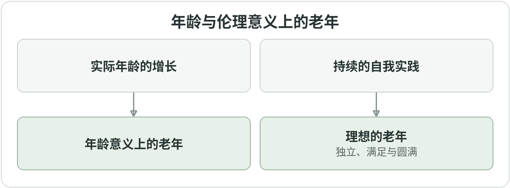

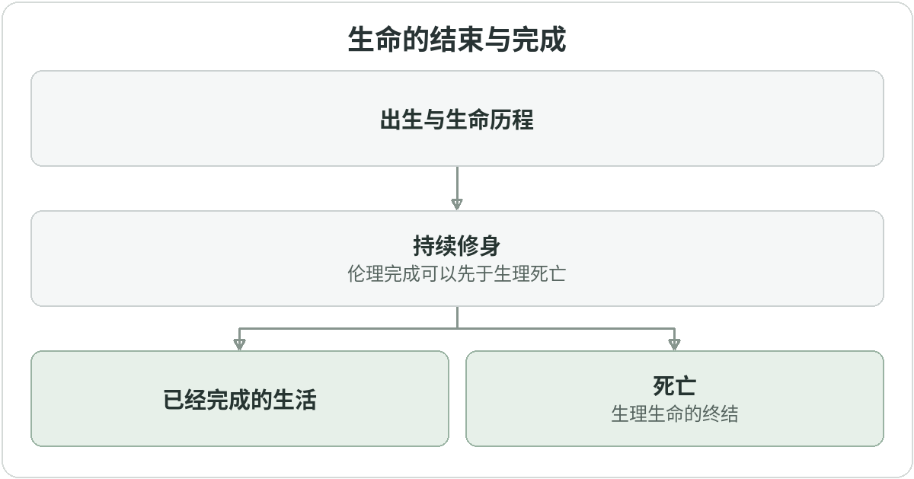

而且，这一主题触及一系列我们将要讨论的重要问题。当然，首先是死亡训练的问题（对死亡的沉思是死亡实践）：生活有如度过末日。〔9〕这就是人可能有的自身满足和愉快的类型问题。这是老年与不之间的关系问题，当然非常重要：在这一希腊一罗马的伦理中，老年凭什么预见或触及有关个人不和余生的论题。最后，我们进入到了将要被澄清的一系列问题的核心。〔10〕以下就是关心自己这一年代学变化的某些特征和结果：从青少年时期的要求（在《阿尔西比亚德篇》中）到成年（在公元1—2世纪的罗马帝国时代），或者，成年与实际的或理想的老年之间的某种链接。

## 三、普遍化与法律范式

### 1. 无条件的自我关心

第二，今天我要讨论的第二个问题：不再是这种年代学的外延或位移，而是数量的外延。其实，关心自己在我说的时代里以及长久以来都不是为了一个既定目的而对某些个人的劝告。简言之，人们不再向人说苏格拉底对阿尔西比亚德的告诫：如果你想支配其他人，那么就要关心你自己。而是说：关心你自己，这就是一切。“关心你自己，这就是一切”，也就是说，关心自己是要求所有人做到的一个普遍原则。

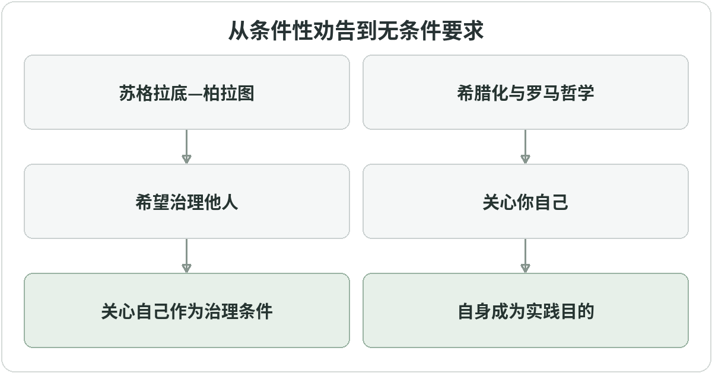

### 2. 法律范式的拒斥

我想提出的问题既是历史的，又是方法论的，即：我们是否可以说关心自已现在成了一种普遍的伦理法则呢？你们知道我会立即回答：不。我想指出的是，所有这一切（总之是一部分）的方法论互动就是：不要让自己陷入这以后的历史进程，它源自中世纪，逐渐受到西方文化的控制。这种控制就是让我们把法律、法律形式作为人的实践中一切法规的普遍原则。我想向你们指出的则相反，即法律作为插曲和过渡形式只是一种更广大的历史的一部分，这一历史就是主体修身的技术史，这些技术是不依赖于法律形式的，而且优越于它。总之，法律只是主体自身技术的可能方面之一。或者更确切地说：法律只是这一漫长历史的诸方面之一，西方的主体就是在这一历史中逐渐形成的，比如我们现在就和它打交道。这样，让我们回到我提出的问题上：在希腊化和罗马文化中，这种关心自己是否可以被认为是一种普遍的法律呢？

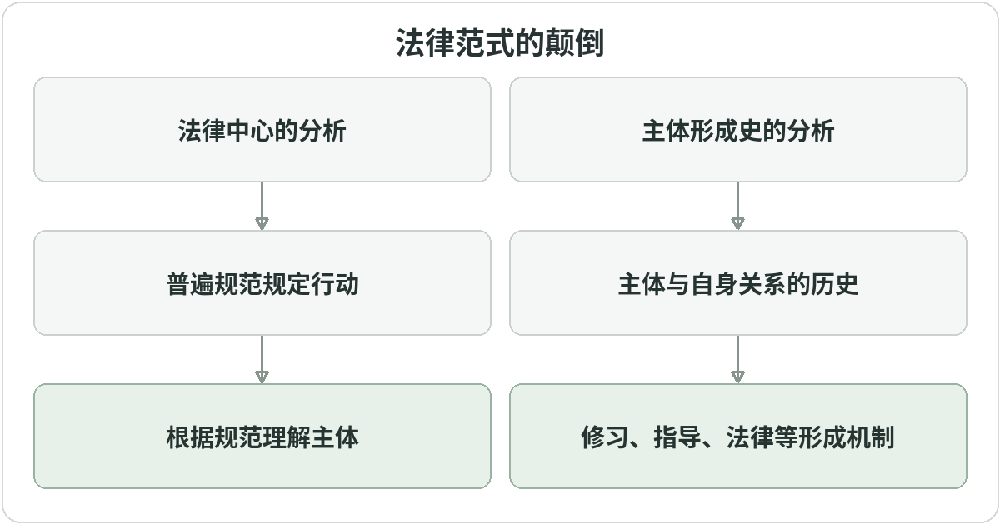

## 四、自我实践的社会条件

### 1. 闲暇与生活方式

首先，我们必须指出，这种普遍化如果真的发生过，如果人们真的把“关心你自己”说成是一种普遍法律，那么它完全是虚构的。因为事实上，一种类似的规范（关心自己）只能被数量非常有限的个人实践过。总之，你们记得我们上次或前次给你们说过的斯巴达格言：为了能够让我们关心自己，我们把我们的世俗文化托付给了希洛人［斯巴达的国有奴隶—译注］。〔11〕关心自己，这显然是精英的一种特权。这就是斯巴达人如此界定的一种精英特权，而且很久之后，在我所说的时代里，也是如此，那时关心成了我们必须优先要讨论的一个概念的相关要素，这个概念就是休闲概念（skhole 或otium）。〔12〕人们要能关心自己，除非让自己过一种奢侈的“休闲”（当然，这不是我们所理解的“休闲”，以后，我们再讨论它）生活。总之，这是某种特生活的方式，其特性就在于它有别于所有其他生活，而且被认为是关心自己的实际条件。因此，在古代文化中，在希腊和罗马文化中，关心自己决没有被视为适用于所有个体（不论他采取何种生活方式）的一种普遍法律。关心自己总是包含生活方式的选择，即在选择这种或那种生活方式的人之间进行划分。

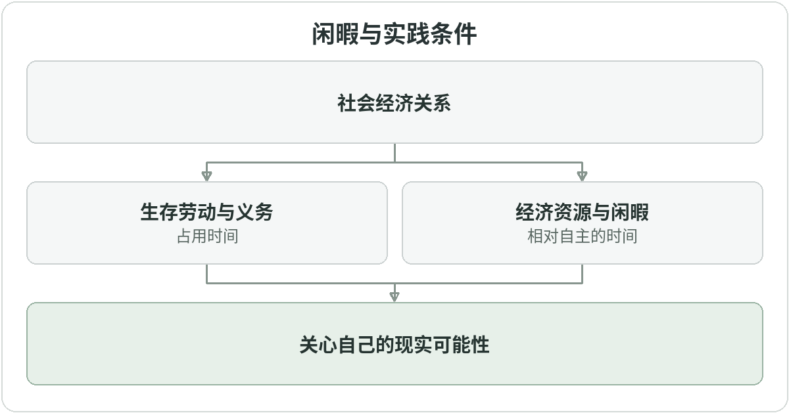

### 2. 宗派现象

但是，我认为还有另一个东西让我们无法把关心自己（即使是无条件的，即使是自身目的化的）吸纳到一种普遍的法律中：其实，在这种希腊一希腊化一罗马文化中，关心自己总是表现在各种实践、制度、群体中，后者相互之间完全不同，经常相互封闭，而且在大多数时间里相互排斥。关心自己是与团体、友爱、学校、宗派的组织或实践相关的。而且，通过误用“宗派”（Secte）一词（或者赋予它希腊文中一般的意义：你们知道“genos”一词指的是家庭、氏族、种类、种族等，被用来表示像伊壁鸠鲁教派或斯多葛教派之类聚集起来的全部个人），以及在比日常用法更广泛的意义上使用法语词“secte ，关心自己在希腊文化中被一般化为原则，但总是与一种教派现象有关。

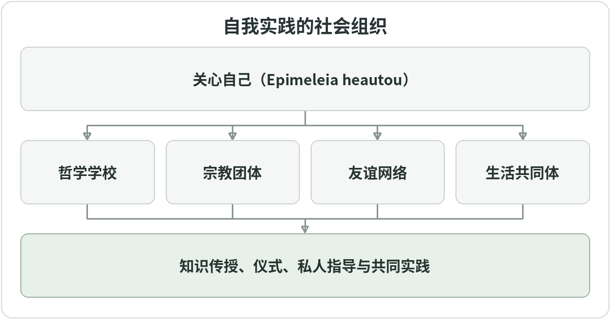

## 五、大众宗教与贵族友谊网络

### 1. 大众宗教与集体仪式

根据这个简单的提示，为了指出和确定扇面，我要指出：其实不必相信人们只在各种贵族体制中发现关心自己。也不只是那些在经济、社会和政治上享有特权的最富裕的人才关心自己。这在一个人群中相当广泛地传播开来，当然，必须指出，这个人群不包括最低下的阶层（当然是指奴隶）（但是即使如此，还需要做一些更正），这是一个比我们一直到19世纪所认识到的群体都更有教养的人群。在这个人群中，必须指出关心自己出现并形成在并非特殊的环境中。有一个极端：在地位低下的阶层中，修身实践是与宗教团体的生存有着密切关系的，这些宗教团体完全是以既定的崇拜为中心，根据通常是仪式化的程序组成起来的体制化的群体。此外，这种仪式崇拜的特点使得个人文化和理论探究的最精致和最睿智的形式毫无必要了。这种宗教的和崇拜的框架也就不再需要个人自己探究、分析和确立自身的工作。但是，在这些团体中，修身实践同样是重要的。在这些崇拜中，比如在对伊西斯的崇拜中，〔13〕人们要求所有参与者必须节制饮食和性欲，坦白罪恶，并做忏悔，等等。

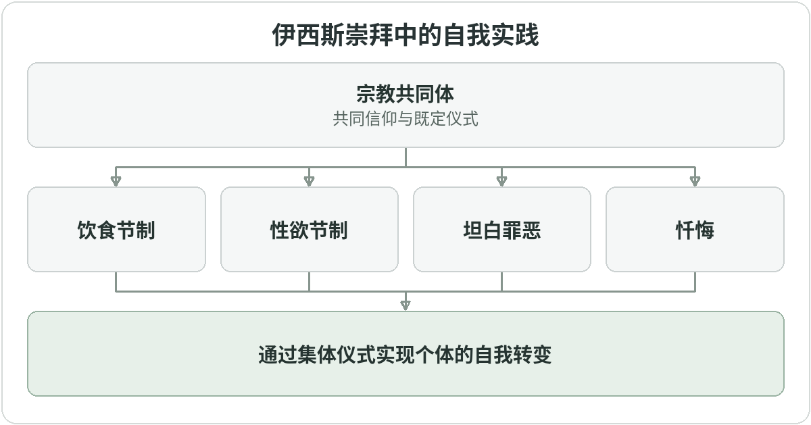

### 2. 罗马友谊的等级结构

当然，在这个扇形的另一个极端，有许多考究的修身实践，它们显然与个人的选择、优雅的休闲生活和理论探究更加有关。但是，这决不意味着这些实践是孤立的。它们属于“时尚”的一部分。如果它们依赖的不是具体的文化组织，那么至少取决于早已存在的社会网络（朋友网）。〔14〕这种在希腊文化中就以某种形式存在的友谊在罗马文化和社会中变得更加强大和等级化了，等等。罗马社会中的友谊是一种等级制，其中个人通过一整套的服务和职责相互联系起来；在这一套职责中，每个人对于其他人并没有相同的立场。友谊一般是以一个人为中心的，一些人与他亲近，另一些人则与他疏远。为了达到与另一个人的亲近程度，这是有一系列既含蓄又明确的条件的，甚至有一些仪式、姿势和语句向某人表明他已在与另一个人的友谊中取得了进展，等等。最后，这里有一整套的社会网络，部分是体制化的，而且在我随后要谈的文化共同体之外，成了修身实践的主要支点之一。修身实践、关心灵魂以其个人的和个人之间的方式，取决于这些现象。

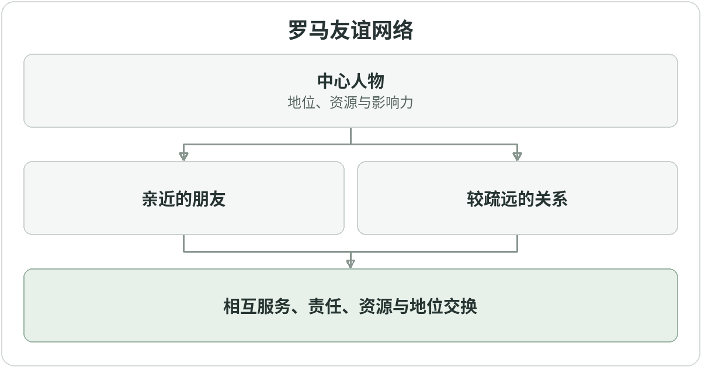

### 3. 塞涅卡与塞里努斯

我曾经多次跟你们谈过塞涅卡、鲁西里乌斯、塞里努斯，等等。绝对是有关这种类型的。塞里努斯（这位外省亲戚满怀抱负地来到罗马，试图进入尼禄的宫廷）看望他的叔叔，或者他的远亲：塞涅卡，这位亲戚对他是有责任的，因为他是长辈，而且有着重要的地位。这样，塞里努斯进入了他的朋友圈，在这种半体制化的关系内，塞涅卡给他一些建议，或者说是塞里努斯向塞涅卡征询意见。而且，塞涅卡在给予塞里努斯的所有帮助（他在尼禄身边帮助塞里努斯，在宫廷上给他帮忙，而且还给他财政帮助）中，还给予他“灵魂上的帮助”。〔15〕塞里努斯说：我不知道我喜欢什么哲学，我感到皮肤上不舒服，我不知道我是否太斯多葛主义了，也不知道我应该学会或不应该学会什么，等等。所有这些问题，是与人们要求的帮助类似的；在宫廷上我应该和谁说话？我是否应该谋求这个或其他职务呢？塞涅卡给出了这一整套的建议。灵魂上的帮助也纳入到朋友网中，就像它在文化共同体中表现的那样。

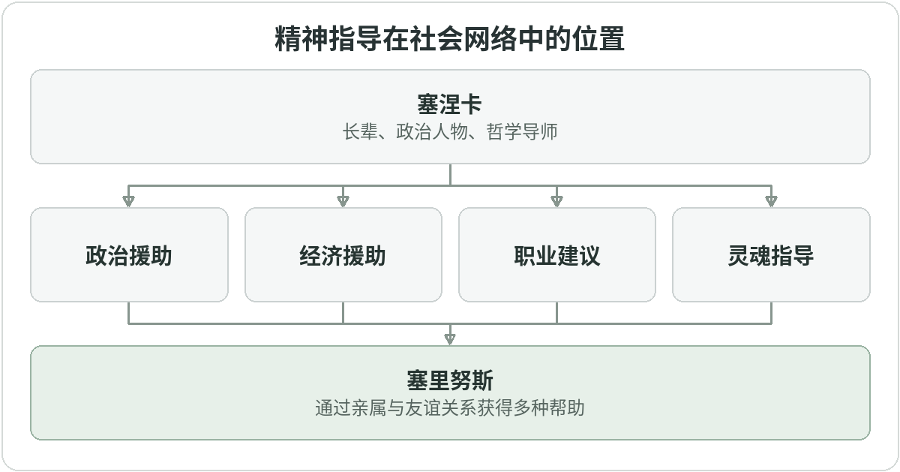

于是，我们认为存在两个极端：一边是比较大众化的、宗教的、文化的、在理论上比较粗糙的一极；而在另一极上，则是关心灵魂、自身、修身，它们比较个人化、有教养和相互关联，在最有利的情况下更为频繁，而且部分地依赖于朋友网。但是，我指出这两个极端，并不是想说存在着两个范畴，而且只有两个范畴：一个是大众化和粗糙的，另一个则是有知识、有教养的和友好的。其实，事情更为复杂。〔16〕

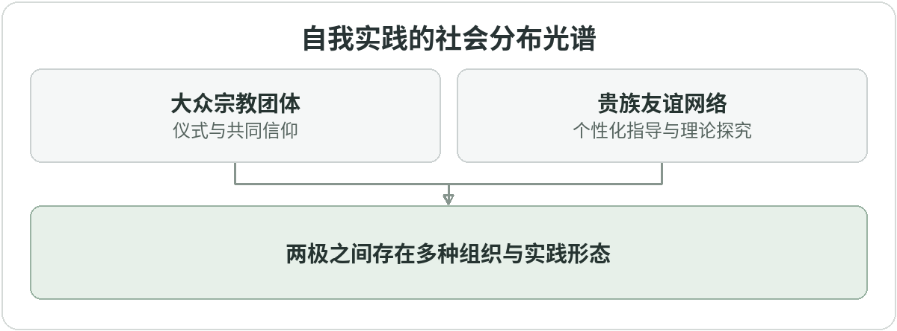

## 六、伊壁鸠鲁团体与治疗家团体

### 1. 伊壁鸠鲁团体

我们可以就这种复杂性举出两个例子。一是伊壁鸠鲁派团体，它们不是宗教团体，而是哲学团体，但是至少最初在希腊在很大程度上是大众化的社群，有手艺人、小商人、没有多少财富的农民，它代表了民主政治的选择，反对柏拉图派团体或亚里士多德派团体的贵族制选择，而且它还隐含着一种完全大众化的理论思考和哲学思考，总之是一种重要的理论尝试。此外，这并不妨碍这个伊壁鸠鲁主义在意大利，尤其是在那不勒斯，〔17〕当然是围绕着梅塞尼并在奥古斯都的宫廷〔18〕上，产生了一些非常诡辩的和有知识的小组。

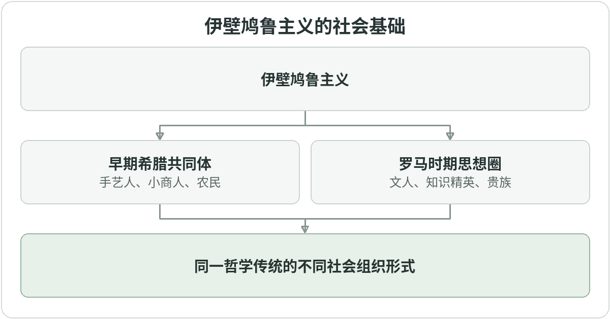

### 2. 治疗家团体

但是，还有另一个例子，可以说明关心自己的所有这些制度向度的复杂性和变化：即亚历山大里亚的斐洛在其《论思辨生活》中描述的这个著名的“治疗家”团体。这治疗家团体是一个谜一样的团体，我已经向你们说过，因为其实只有亚历山大里亚的斐洛提到过它，实际上（除了可能与治疗家们有关的某些文本外），斐洛在我们保存的文本中只是在这篇文本中说到这些治疗家。虽然某些人认为这些治疗家并不存在，而且这只是对一个本应该存在的共同体的理想的和乌托邦的描述。当然，当代的批评（我无法绝对证实它）似乎认为这个团体其实可能是存在的。〔19〕因为那些证实总是太逼真了。不过，我对你们说过，这个治疗家团体里的人都隐居在亚历山大里亚附近，不像后来基督教隐士们隐居在沙漠里，〔20〕而在市郊的一些小花园里，其中每个人都有自己的起居室或房间，还有一些公共场所。

而且，这种治疗家的共同体有着三个轴心和三个向度。一方面，有着非常明显的文化和宗教实践，表明了人们是在与一个宗教团体打交道：每天祈祷两次，每周聚会一次，大家按年龄顺序排座次，而且每个人必须采取应有的态度〔21〕〔⋯”〕另一方面，同样非常强调理智的和理论的研究、认识的作用。关于关心自己，据说从一开始，这些犹太僧侣们要隐居，以便能够治愈因为“快感、欲望、悲伤、担心、贪婪、愚蠢、不必和许许多多的情绪”〔22〕造成的疾病。就是这些治疗家们：他们刚刚治愈好自己。第二，与此相关的是：他们首先要探寻的是“egkrateia" （节制自己），他们认为这是所有其他德性的基础。〔23〕最后，这篇文本从词汇上看特别重要：每当到了这著名的第七天时，他们就聚在一起，而且在一周里，他们只是这一次在每日的“关心自己的灵魂”之外还要关心自己的身体。〔24〕因此，“关心自己的灵魂”（epimeleia tes psukhes），这是他们每天必须要做的事。

而且，在关心自己灵魂的同时，认识也得到了强调。他们的目标像他们说的那样，像斐洛说的那样，就是学会洞察秋毫。〔25〕而洞察秋毫就是为了能够沉思上帝，要看得很清楚。斐洛说，他们对科学的热爱使得他们在三天里（对于某些人要6天时间）完全忘了进食。〔26〕他们阅读圣经，热衷于讽喻哲学，也就是解释文本。〔27〕同样，他们也阅读斐洛没有提到的那些作者，这些作者就是他们宗派的创始人，他们与知识的关系，他们的学习活动是如此地努力，他们对学习的热心是如此地强烈（这里有一个在所有修身实践中十分重要的论题，我认为以前曾提到过），以至于即使是在睡眠中，他们的梦“说的都是神圣哲学的各种学说”。〔28〕这里就有例子说明了睡眠和梦是个体与真相关系的标准，即个人纯洁性与真相的揭示之间关系的标准（我认为我也是在谈论毕达哥拉斯派时向你们引用过它 〔29〕）。

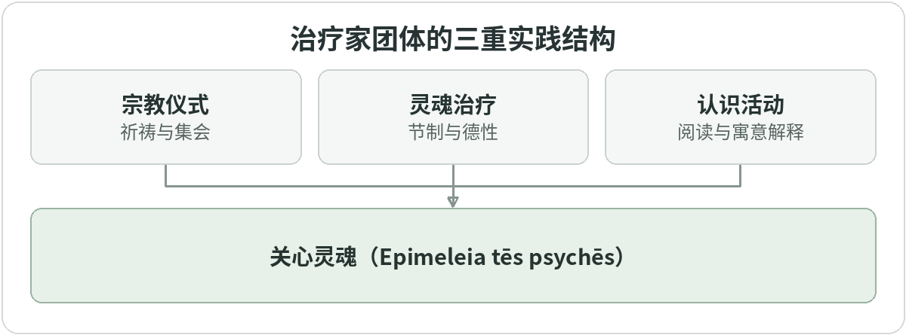

### 3. 自我实践的社会褶皱

我之所以举这个例子，是因为这完全是一个宗教团体。关于这个团体的成员们的社会来源，我们一无所知；认为这是贵族制的或有特权的场所，是没有根据的。但是，认识、沉思、学习、阅读、讽喻解释等向度也是十分重要的。因此，必须指出，关心自己的方式是在彼此不同的网络或团体中形成的，涉及文化、治疗（通常所说的）、认识、理论之间的关系，但是这些关系因团体、环境和情况的不同而不同。总之，在这个小圈子里，或者在这个所属的宗派或团体中，关心自己才表现出来，也得到了肯定。人们不可能以普遍的方式来关心自己。并不是作为这样的人，不只是因为属于人的共同体（即使属于这种共同体是十分重要的），才能够关心自己，特别是进行修身实践。关心自己只能够在这个特殊的团体内部进行。

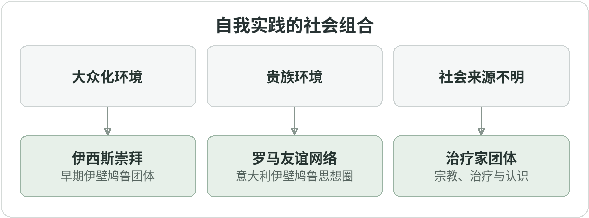

## 七、身份等级与操作性区分

### 1. 社会身份与伦理自由

这里，我们碰上了一个重要的东西。当然，我们可以说，而且，必须指出，这个困体的大部分人绝对反对（这是他们的立身之本，而且也是他们在希腊、希腊化和罗马的社会中的根据之一）肯定和重新提起他们在城邦或社会中的地位差异。比如，对于《阿尔西比亚德篇》来说，关心自己是身份差异之内的事，它使得阿尔西比亚德命中注定就是统治者，而且，正是由于这一点，由于所接受的地位（这没有受到质疑），他必须关心他〔自己〕。在我向你们说的这个团体的大部分成员中，大家原则上不肯定、不承认、不接受穷人与富人、出身显贵的人与出身低微的人、行使政治权力的人与隐士之间的差别。也许除了毕达哥拉斯派（有关他们，也有一些问题〔30〕）外，对于这些团体的大部分成员来说，自由人与奴隶的对立至少在理论上是不被接受的。关于这一点，伊壁鸠鲁派和斯多葛派在许多文本中一再讨论过：首先，一个奴隶可能比一个自由人更自由，如果后者没有摆脱所有邪恶、激情、依赖心等，而是受制于它们。〔31〕因此，因为不存在地位差异，所以可以说，所有个人都“能够”进行这种修身实践。并没有因为出身或地位而先验地贬低某个人。

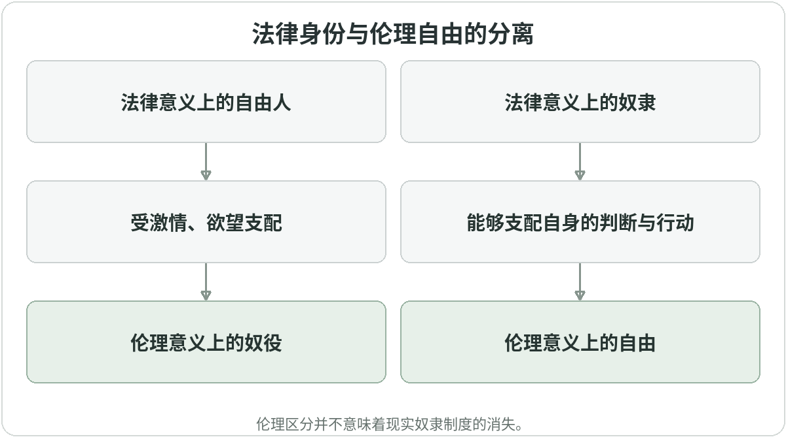

### 2. 普遍资格与实践的稀有性

但是，另一方面，如果大家原则上都能够进行这种修身实践，那么其实只有很少的人才能够修身。缺乏勇气、缺乏力量、缺乏恒心，不能认识到这个使命的重要性、不能很好地实现它：这其实是大多数人的命运。修身的原则（“epimeleisthai heautou” 的职责）是可以四处向大家重复的。总之，聆听、理智、进行这种修身实践会是软弱的。而且，这甚至是因为聆听是软弱的，因为很少有人能够去聆听，正是因为这一点，必须四处重复这个原则。

在这一方面，埃皮克泰德有一篇十分有趣的文本。他又提出了“gnothi seauton”（德尔斐戒律），指出：请看看在这个德尔斐戒律上究竟发生了什么。它被刻在文明世界中心的石头上（他使用的是“oikoumene”一词）。它就在“oikoumene”的中心内，即这个用希腊文来说话、阅读和写作的世界内，这个文化世界是唯一可以接受的人类共同体。因此，它就被刻写在这个文化世界的中心内，大家都能看到。但是，“gnothi seauton”是被神放入这个可接受的人类共同体的地理中心内的，不过，它不为人知，而且不为人理解。从这个普遍规律、这个一般原则谈到苏格拉底这个例子，他指出：看看苏格拉底吧。苏格拉底要在路上询问多少年轻人，才会有某些人愿意听他说，并关心自己呢？埃皮克泰德说，苏格拉底真的说服了所有来到他身边的人关心他们自己吗？甚至千分之一都不到。〔32〕

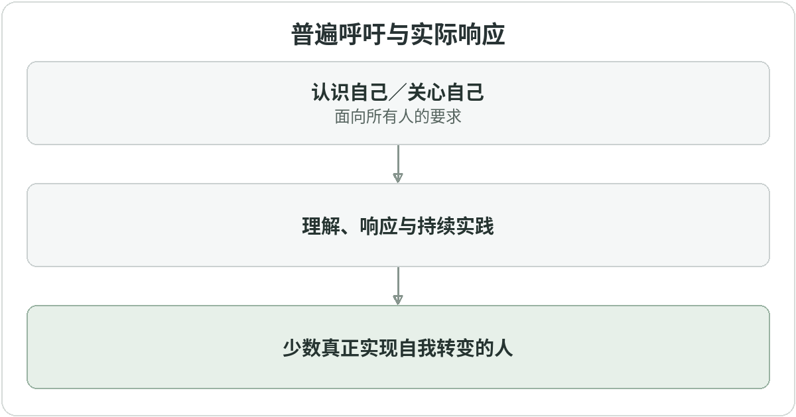

### 3. 操作性区分

由此可见，在肯定了把原则交给大家之后却很少有人能够听他的话这件事中，有一种传统的著名划分，它在古代文化中十分重要和关键，即我们与他们、先驱与大众、优秀人物与群氓（在“oi prōtoi” 和 “oi polloi” 之间：先驱者，然后是众人）之间的划分。这个区分轴在希腊、希腊化和罗马的文化中，让先驱者（其特权没有必要受到质疑，即使人们可以质疑他们行使特权的方式）与其他人之间的等级制划分得以可能。现在，我们还会发现某些人与所有其他人之间的对立，不过，这个划分不再是一种等级制的划分了：这是有修身能力的人与没有修身能力的人之间的一种操作性划分。不再是个人的地位预先通过他的出身界定了他与群众、其他人的不同，而是与自身的关系、与自身关系的方式和类型，是把自身确定为他关心的对象的方式：正是在这些方面，某些人与最大多数人区分了开来。为此，必须向大家发出呼吁，因为唯有某些人才能够关心自己。而且，由此可见，人们由此认识到了向大家呼吁的主要方式，而且只为少数人听见，这是普遍呼吁的主要方式，只确保了某些人的地位。你们在此还会发现，这种方式后来在我们整个文化中有着十分重要的意义。必须指出，这种方式在此尚未真的创造出来。其实，在我向你们说起的所有这些团体中，至少在某些团体中，我们会发现向大家发出呼吁这个原则，但是，很少有人真的喝醉了。〔33〕

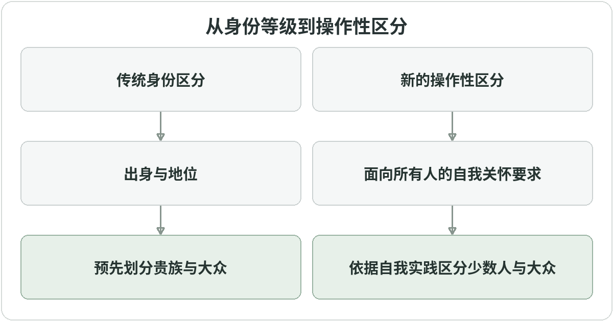

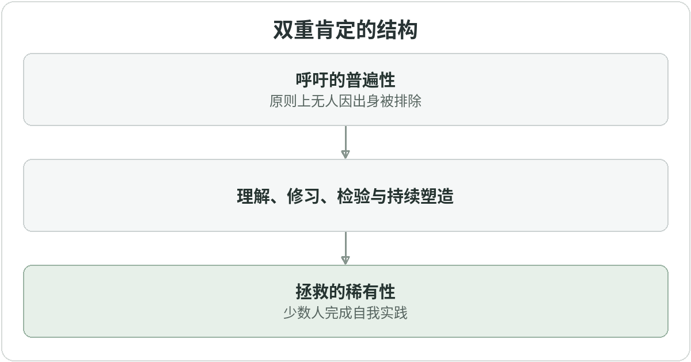

## 八、普遍呼吁与稀有拯救

### 1. 基督教中的重新组织

这种方式后来又出现在基督教之中，被基督教围绕着启示、信仰、文本、神恩等问题做了重新阐述。但是，我认为重要之处就是我今天想要强调的，即在西方，有关自身和修身关系的问题就是根据这种有着两种要素（呼吁的普世性和获救的稀有性）的方式被质疑的。换言之，与自身的关系、修身的功夫，通过自身发现自己，这在西方是被视为从普世的呼吁（只能为某些人所理解）到拯救的稀有性（不过，最初没有人被排除在拯救之外）的唯一可能的道路。在一种普世原则（只能为某些人理解）和这种稀有的拯救（不过，最初无人被排除在外）之间的这种互动，将会出现在基督教中大多数神学的、精神的、社会的、政治的问题之中。不过，这种方式在这种修身技术中得到了非常明确的阐述，或者说（因为这不再只是必须说的技术了）：希腊的、希腊化的和罗马的文明引发了一种真正的修身文化，我认为它在公元1—2世纪有着巨大的影响。正是在这种修身文化中，在普世的呼吁和稀有的拯救之间的这种方式（在我们的文化中总是根本的）充分发挥着作用。

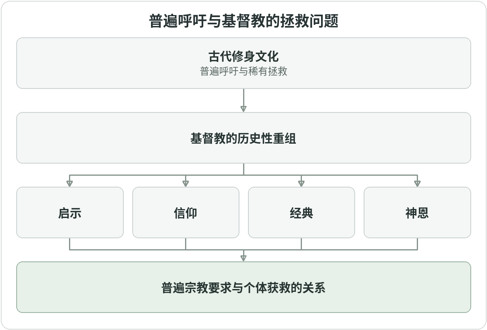

### 2. 拯救的问题

而且，这种拯救（自救、拯救自己）概念绝对是其中的中心概念。我还没有向你们讲起过它，因为我们就是这样一步步走到这里，不过，你们也看到，把我们从对青少年时的自己的关心引向了对要变老的自己的关心的年代学变化，它提出的问题是要了解什么才是这种关心自己的目标；人凭什么才能获救呢？而且，医学与修身实践之间的关系把我们引向了如何“自救”这个问题：什么是身体健康、避免疾病？什么是既要走向死亡、又要以某种方式拯救自己、免于死亡呢？所有这些把我们引向了一个拯救论题，其方式在我刚才给你们引用的埃皮克泰德的一篇文本中得到了明确的界定。这种拯救总是必须回应一种只能为某些人理解的普世的呼吁。

嗯，请听清楚了，我下一次将给你们讲解这种修身文化的另一面：即有关“修身”和“关心自己”的方式，它引发了各种修身方式、把自己确立为认识的对象，它们完全不同于柏拉图主义。

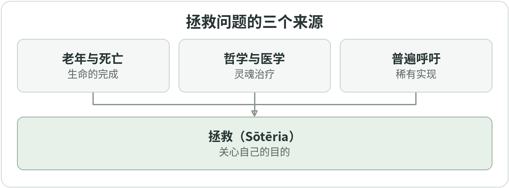

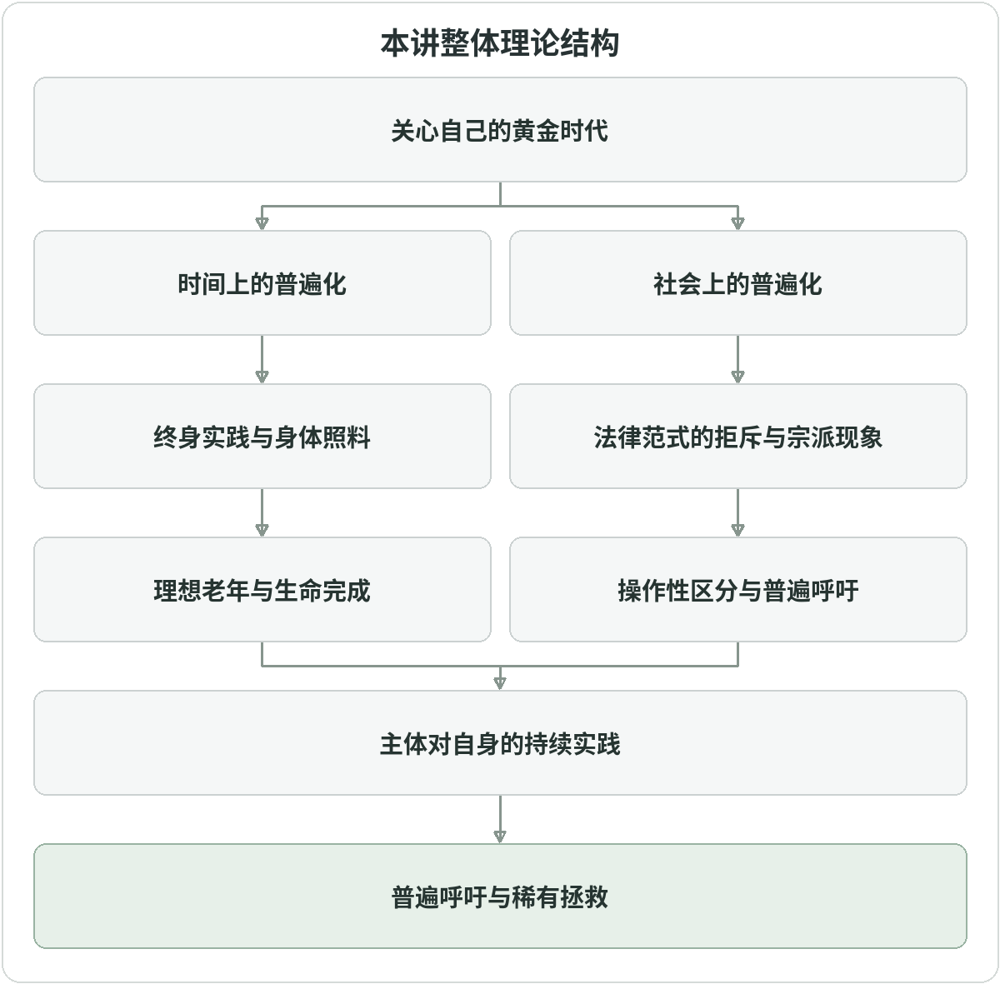

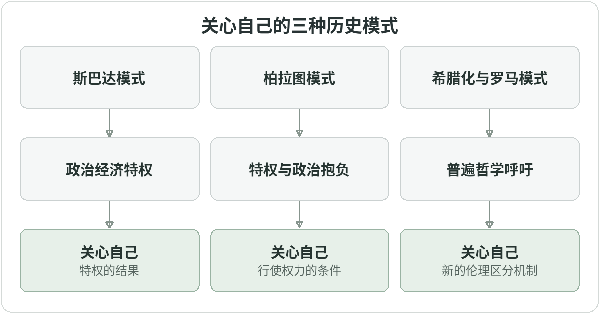

## 编者注释

〔1〕 参见斯托倍的叙述：“身体的力量是神经中的一种充分的张力（tonos），同样，灵魂的力量是灵魂在判断或行动中的一种充分的张力。”（《诗选》，I，564）关于斯多葛主义中这种张力问题及其一元论框架（“*tonos’是把一个人完整地统一起来的内在张力”，第90页），主要的参考书是A.J.沃埃尔克的著作：《斯多葛主义的意义观念》，前引该书，以后是E，布雷叶在《克里斯普和古代斯多葛主义》中的经典分析，巴黎法国大学出版社，1910年（1950 年第二版）。

〔2〕 关于第55、57、78 封信，福柯写道：“塞涅卡的书信为这种对健康、饮食法、疾病和一切可能纠缠身心的麻烦的关心提供了各种例证。”（《关心自已》，前引该书，第73页）

〔3〕 弗隆顿（公元100—166年）出生于努米德（Numide），公元年担任执政官，因为曾担任过马克•奥勒留的修辞学老师而尤为著名。他似乎是一个不错的雄辩家，但是他只给我们留下了他与这位未来皇帝之间的通信供人评判。这个通信从公元139年一直到公元166年（弗隆顿的卒年）。参见福柯在1月27日第二课时的授课中对这些通信的分析。

〔4〕 埃利乌斯•阿里斯蒂德是“六次神圣讲话”的作者，讨论了他的疾病和治愈（A.J.费斯蒂耶尔译，巴黎马居拉出版社，1986年）。关于这一点，参见《关心自己》，第73页。

〔5〕 参见柏拉图《理想国》的开头，当克法洛斯被问到老年的痛苦时，他答道：“相反，我碰到过许多老年人，他们的感受却不同，其中就有诗人索福克勒斯。我有一天和他在一起，当时有人就问他：“索福克勒斯，你在爱情方面怎么样呢？你还能追求女人吗？’索福克勒斯答道：‘闭嘴吧，朋友，我幸好躲开了爱情，好像我从一个疯狂野蛮的人手中逃脱出来一样。’”（《理想国》，卷1，329b一C，载柏拉图：《全集》，卷VI，E.尚布里译，前引版本，第6页）

〔6〕 在以后的所有描述中，福柯其实混淆了塞涅卡的两篇文本：一是有关《论灵魂的安宁》的会谈中的一段话：“这里还要加上那些辗转反侧睡不着觉的人，他们不断地变换各种姿势，一直折腾到困乏入睡为止：经过上百次改变他们的生存状态，他们终于不再不安分了，而是进入了梦境。”（I，6，R. 瓦尔兹译，前引版本，第76页）二是第32 封信：“这一生真是太短暂了！而且，我们轻易就缩短了它，一次次地与它重新开始。我们分割一生，我们把一生弄得支离破碎。”（《给鲁西里乌斯的信》，卷I，第IV部分，第32封信，2，前引版本，第142页）也参见：“你晓得人的轻浮易变，他们每天都把生活建立在新的基础之上。”（同上，第I部分，第13封信，16，第51页）以及第23封信，9。

〔7〕 “快点，我亲爱的鲁西里乌斯。要想象成好像你背后有敌人，好像你担心追捕逃兵的骑兵部队飞驰而来，你就不得不加速一样。你现在的情况就是这样：有人在追捕你。跑快点！”（同上，32，3，第142页）

〔8〕 同上，32,4（第143页）。

〔9〕 参见3月24日第二课时的授课。

〔10〕 关于斯多葛派（特别是塞涅卡）有关灵魂是否具有不朽性的一种新考察，参见3月17日第二课时的授课。

〔11〕 参见1月6日第二课时的授课中福柯对这个格言的分析。

〔12〕 参见J.-M. 安德烈：《从起源到奥古斯都时代罗马道德与理智生活中的“Otium”》，巴黎，法国大学出版社，1966年。

〔13〕 埃及神伊西斯因为收集了奥斯里斯（Osiris）的碎尸而特别出名，这个著名的传说在普吕塔尔克那里有完整的叙述（《伊西斯和奥斯里斯》，载普吕塔尔克：《道德著作集》，卷V-2，C.弗鲁瓦德丰译，巴黎，美文出版社，1988年）。在公元头几个世纪里，对它的崇拜（它既是奸诈的女人，又是忠实的配偶和生仔的母亲）传播得很广，在民间很得势，连罗马皇帝都迷恋它（卡利古拉为此还在罗马造了一座伊西斯的庙），甚至成了诺斯替教派的一个哲学一神秘的实体。关于这些仪式中的节制和忏悔，参见F.居蒙：《罗马异教中的东方宗教》，巴黎，E.勒胡出版社，1929年，第36—37页，第218页，注释40；以及 R.蒂尔冈：《罗马世界里的东方崇拜》，巴黎，美文出版社，1989年，第113页（这些参考资料是保罗•维尼向我指出的）。

〔14〕 参见《关心自己》，第68页。

〔15〕 同上，第69页。

〔16〕 关于古代哲学学派中的生活与组织，参见卡洛•纳塔利：“求知的地方和学校”，载《希腊知识》，J.布伦施维克和 G.勒鲁瓦德主编，巴黎，弗拉马里翁出版社，1996年，第229—248页。这在P.亚多的《什么是古代哲学？》（同上，第154—158页）中也有一般的说明。

〔17〕 关于公元前30年代末在奥古斯都宫廷上的梅塞尼小组（包括维吉尔、贺拉斯、普鲁佩尔斯等人）的结构，参见J.-M. 安德烈：《梅塞尼：论精神传记》，巴黎，美文出版社，1967年。

〔18〕 关于坎帕尼亚（意大利西南部地区——译者注）的罗马伊壁鸠鲁主义，特别是以伽达拉的费洛德姆和鲁西乌斯•皮索为中心的伊壁鸠鲁主义，参见这方面专家的基本著作：M. 吉冈特的《费洛德姆的书目和罗马伊壁鸠鲁主义》，巴黎，美文出版社，1987年。

〔19〕 人们一般区分三个批判“时期”（参见F.多马为其翻译的斐洛《论思辨生活》一书撰写的序，前引版本；以及 R.拉蒂斯编写的非常完备的书目提要：《亚历山大里亚的斐洛》，那不勒斯，Bibliopolis，1983年）：古代时期（从3世纪的塞撒雷的欧埃伯到18世纪的B.德蒙福孔）把“治疗家们”纳入了一个基督教的群体中；19世纪的现代时期（以及勒南和 P. 拉格朗日）认为斐洛的描述是一幅理想的绘画；最后，当代批评印证了治疗家团体实际上就存在，并且认为他们接近“艾塞尼教派”（les Esseniens：一个犹太教的异端教派，出现在公元前3世纪左右。据说他们在位于死海西北角的库姆兰地区隐修。公元68年，当罗马人入侵时，他们把一批重要文本藏在附近山洞里。直至1947年才陆续被人发现，世称“死海古卷”。译者注）（参见 M. 德尔科，等等）。

〔20〕 在1980年3月19日的授课上，福柯从有关在前往沙漠之前的隐士教育的问题出发，阐述了他对卡西安把有关指导与考验的哲学和异端的技术纳入基督教中的做法的主要看法。

〔21〕 “双手放在衣服内，右手放在胸部和下巴之间，左手挂在肋部。”（斐洛：《论思辨生活》，476M，P. 米盖尔译，前引版本，§30，第99—101页）

〔22〕 同上，471M，§2，（第81页）。

〔23〕 “在自控（egkrateian）的基础上，他们确立了灵魂的其他德性。”（同上，476M，§34，第103页）

〔24〕 “考虑到第7天是非常神圣的日子，他们很荣幸地推崇它：在这一天里，照顾好灵魂之后（ten tes psukhes epimeleian），他们要给身体抹油。”（同上，477M，§36，第105页）

〔25〕 “治疗家这族人，坚持不懈地努力学会去明察秋毫，专心思考存在。”（同上，473M，§10，第85页）

〔26〕 同上，476M，§35（第103—104页）。

〔27〕 同上，475M，§28（第97—98页）。

〔28〕 同上，§26（第97页）。

〔29〕 参见1月12日第一课时的授课和3月24日第二课时的授课。

〔30〕 关于毕达哥拉斯派的政治组织及其贵族倾向，参见 A.德拉特经典和宝贵的研究：《论毕达哥拉斯派的政治》（1922年）中的一章“毕达哥拉斯派的政治组织”，日内瓦，Slatkine Reprints, 1979年，第3—34页。

〔31〕 参见埃皮克泰德《对谈录》中的关键文本（卷I的第一章，特别是卷1的I，从22到28，他指出为了不成为奴隶，仅仅不欠人钱是不够的）和《手册》（XIV），以及有关智者的自由，参见伊壁鸠鲁的“梵蒂冈格言第67条和第77条"

〔32〕 “为什么他是阿波罗呢？为什么他发布神谕？为什么要在一个地方为他塑身，把他当作先知、真理来源和与所有文明世界的居民有约定（ek tes oikoumenes）呢？为什么要在庙上刻上“认识你自己”这句无人能懂的话呢？难道苏格拉底成功地说服了所有来到他身边的人去关心他们自身吗？甚至千分之一都没有。”（《对谈录》，皿，1，18—19，前引版本，第8页）

〔33〕 暗指奥尔弗斯神秘主义的一句著名入门秘语，只与极少数被选中的人有关，参见“手拿酒神杖的人很多，但是，祭酒神的巫师却很少”（柏拉图：《斐多篇》，69c，L.罗斑译，前引版本，第23页）。
