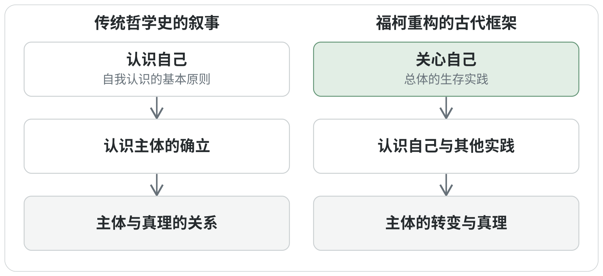
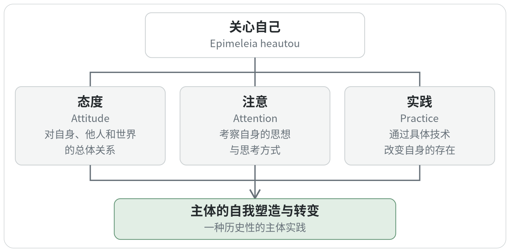
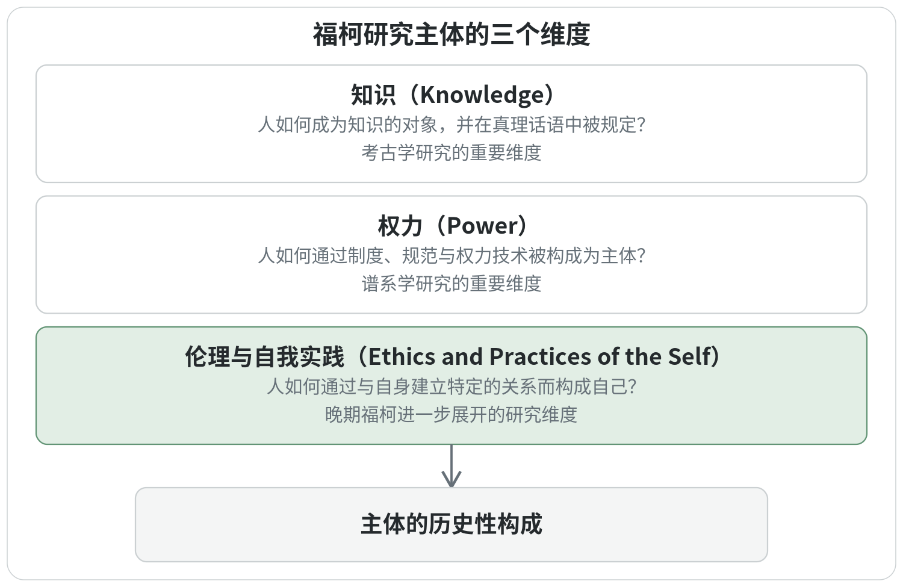
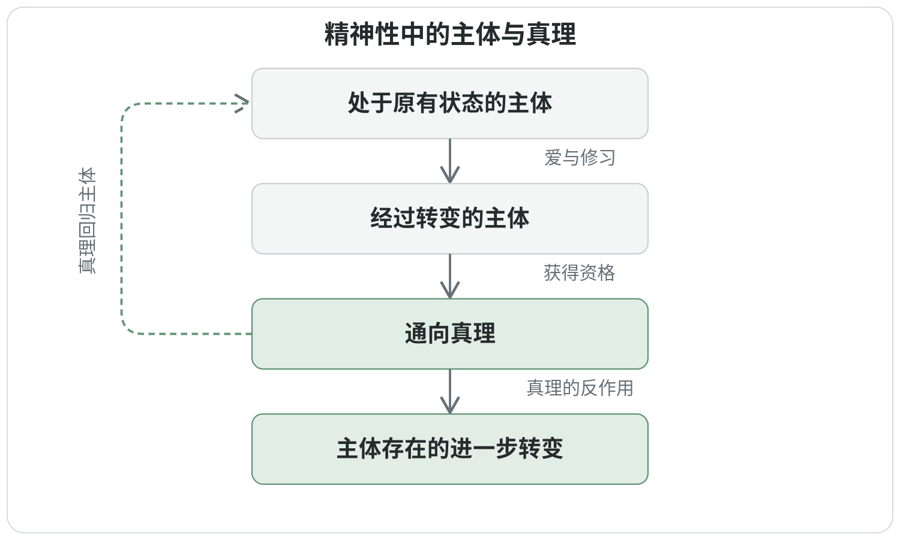
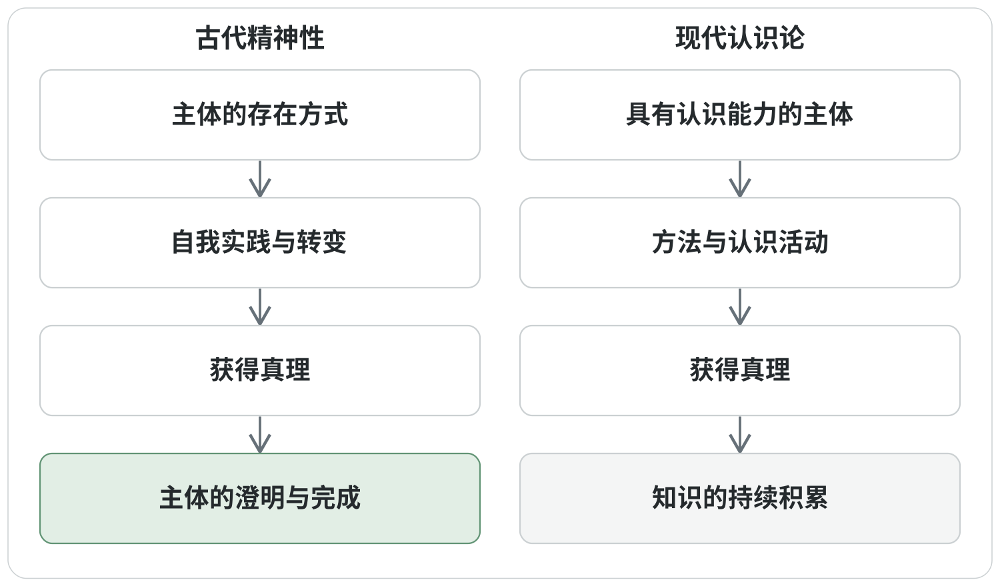
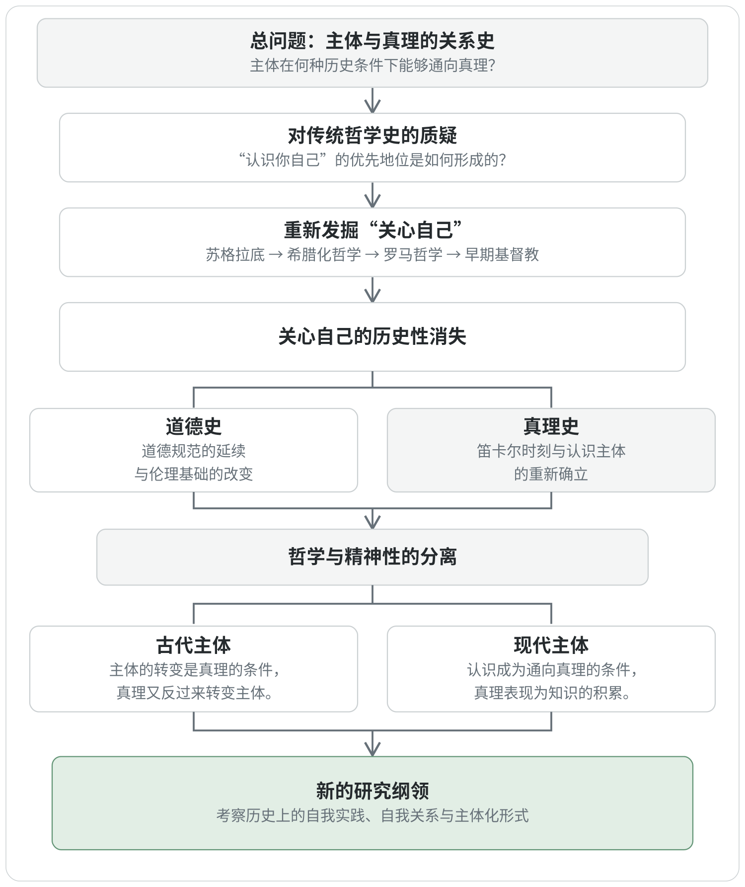

# 正文（1982年1月6日）

## 讲座提要

总问题的回顾：主体性与真理——新的理论出发点：关心自己——对德尔斐箴言“认识你自己”的种种解释——苏格拉底作为关心自己的人：对《苏格拉底申辩录》中三段摘要的分析——关心自己作为古代哲学与道德生活的箴言——在最初的基督教文本中的关心自己——关心自己作为总态度、与自身的关系、全部实践现代人为了认识自己而贬低关心自己的各种理由：现代道德、笛卡尔时代—诺斯替教是个例外——哲学与精神性

## 一、主体与真理

### 1. 课程安排

今年，我打算采用以下这种方法：〔1〕上两个小时的课（从9点15分到11点15分），一小时后中断几分钟，以便让你们可以休息一下，如果你们感到厌倦了，请走人，让我也可以休息一会儿。而且，我将尽力让这两个小时的课有点多样化，这就是说，在第一个小时里，或者在两个小时里用一个小时做一点总的理论阐释；随后，在另一个小时里，做点类似文献释义的事，当然，这种安排会造成许多麻烦和不便：因为我们不能给你们分发所要解释的文本，因为我们不知道你们有多少人，等等。总之，我们总会尽力的。如果此法行不通，那么我们就尽力在下一年度或本年度想出另一种办法。9点15分就赶来，这是否让你们很不方便呢？行吗？这可是对你们比对我更有利啊。

### 2. 总问题

去年，我已经尝试开始对主体与真理之间诸关系的论题进行一番历史的反思。〔2〕而且，为了研究这一问题，我选择了古代有关性行为与性快感的养生法问题作为特例和折射面，你们知道，这是在公元头两个世纪里出现的并被界定的“性行为”养生法。〔3〕我以为这种养生法在它关心的方方面面上都包含了这一点：正是在这种“性行为”养生法中，而不是在基督教的道德或者犹太一基督教的道德中，我们发现了近现代欧洲性道德的基本框架。〔4〕

今年，我想回避一下这个具体的例子，以及有关“aphrodisia”（性活动、性快感）和性行为的养生法的这个特殊的材料，我想从这个具体的例子中剥离出“主体与真实”中比较一般的术语。确切地说：我并不想取消或去除我曾企图把有关主体性和真实的关系的这一问题置入其中的历史向度，而是要让它以一种更一般的方式呈现出来。我今年讨论的问题是：“主体”和“真实”这两个要素（不属于实践和通常的历史分析）之间的各种关系是在什么历史形式中相互维系起来的。

## 二、关心自己与认识自己

### 1. 理论出发点

那么，我想就从去年我曾向你们提到过的一个概念开始吧。〔5〕这就是“关心自己”这个概念。我勉强用这个术语来译一个极其复杂、内涵丰富的常见概念，它在整个希腊文化中延续了很长时间：即 “epimeleia heautou” 概念，拉丁人用诸如 “cura sui”〔6〕来译它，人们通常指责或指出这种译法太乏味了。〔7〕“Epimeleia heautou” 就是关心自己，就是照料自己、呵护自己等行为。

你们会对我说，为了研究主体与真实的关系，选择哲学历史形态学至今也不认为很重要的这个 “epimeleia heautou”概念，显然有点自相矛盾，也可以说是老于世故。虽然人人长久以来都知道、都说、都重复的主体问题（认识主体的问题、主体自我认识的问题）最初是以一种完全不同的说法和格言提出的：即著名的德尔斐神谕“gnothiseauton”（认识你自己）。〔8〕但是选择这一概念还是有点自相矛盾和老于世故。尽管在哲学史上—在更大的意义上，在西方思想史上—一切都向我们表明，正是“gqnothi seautou”是主体与真实的关系问题的基本格式，但是为什么选择了这个看上去有点边缘的概念—当然，它在希腊思想中延伸着，但是并没有什么特的地位：这就是关心自己的概念“epimeleia heautou”？好吧，我想在这第一个小时的课上，在“关心自己”与“认识你自己”的这一关系问题上停留一会。

### 2. 德尔斐箴言

关于“认识你自己”，我想参考历史学家和考古学家的研究来做出第一个非常简单的评论。同样，必须牢记这一点：尽管它表述得非常清楚明白，而且刻在神庙的石头上，但是“认识你自己”最初并没有随后人们赋予它的意义。你们知道（我们会再讨论它的）有篇著名的文本，其中埃皮克泰德说过这一“认识你自己”的格言曾铭刻在社区的中心。〔9〕其实，它无疑曾被铭刻在这个地方，这里曾是希腊生活的中心之一，以后是人类共同体的一个中心，〔10〕但是，其意义当然不是哲学意义上的“认识你自己”。它不是在这一公式中被规定的认识自己，也不是作为道德基础的认识自己，不是作为与诸神的关系之根据的认识自己。

人们提出过一些解释。罗舍尔1901年在一篇发表在《语文学》上的文章中〔11〕提出过一个陈旧的解释，他认为，总之，德尔斐的劝诫是向那些来向神请教的人说的，必须把它们读解成各种法则、与请教行为相关的各种劝告仪式。而且，这三个劝诫，你们都知道。在罗舍尔看来，“meden agan”（凡事不要过分）绝对不是表示有关人类行为的伦理与尺度的一般原则。“Meden agan”（凡事不要过分）指的是：你这个来请教的人，不要提太多的问题，只提有用的问题，你要提的问题都是必要的。第二劝诫有关各种保证（eggue）， 〔12〕指的正是：当你向诸神请教时，不要许愿，不要答应你无法偿付的事情和承诺。至于 “gnothi seauton”，根据罗舍尔的看法，它指的是：在你向神谕提问时，好好检查一下你心中需要和想要提出的问题；因为你必须尽量多地提出你的问题，但是不要太多，所以请关注你需要知道的东西。

这种解释比德弗拉达斯1954年在有关“德尔斐劝谕的主题”的著作中的解释在时间上更近些。〔13〕德弗拉达斯提出了另一种解释，但是他也指出 “gnothi seauton”绝对不是一种认识自身的原则。在德弗拉达斯看来，这三个德尔斐劝谕都是一般审慎的律令：在需求和希望方面“不要太过分”，在行事方式上也要如此。至于“担保”，这是一个让求教者避免各种因过分慷慨造成的危险的劝谕。至于“认识你自己”，这只是不断地提醒人不要忘了自已只是一个不免一死的人、而不是神的劝谕，它告诫人不要把自己的力量估计得过大，也不要与神的力量较量。

### 3. 两种原则的关系

让我们快点结束这一点吧。我想强调另一件事，它更多涉及我所关心的主题。其实，在阿波罗崇拜中，无论“认识你自己”这个德尔斐神谕被赋予了何种意义，我认为当这句德尔斐神谕 “gnothi seauton”出现在哲学中，出现在哲学思想中时，这其实是围绕着苏格拉底展开的。色诺芬在《回忆录》中证实了这一点，〔14〕而且，柏拉图在某些文本（以后我们要讨论的）中也证实了它。

然而，当这个德尔斐神谕（gnothi seauton）出现时，它虽然不是一直是，但却是多次以一种非常有意思的方式与“关心你自己”（epimelei heautou）成双成对。我说的是“成双成对”。其实，这决不是指它们是耦合的。在我们将要讨论的某些文本中，更多的是指“认识你自己”这一法则是低于“关心自己”这一神谕的。“gnothi seauton”（认识你自己）相当清晰地一再出现在某些有意思的文本中，出现在“关心自己”的更一般的范围内，作为一般法则的形式、结果和具体的、特别的应用之一：你必须关心你自己，不要忘了你自己，你必须照顾你自己。正是在这个一般法则的内部以及这一关心的尽头，出现了“认识你自己”这一法则。

总之，不要忘了，正是在柏拉图的文本《苏格拉底的申辩录》（当然，它非常出名，但也同样是根本的）中，苏格拉底成了一个基本上以促使其他人关心自己、照顾自己、不要忘了自己为志业的人。在《申辩录》中，其实有三个文本、三段话是十分清楚明白的。

## 三、苏格拉底的哲学实践

### 1. 《苏格拉底申辩录》

第一段话出自《申辩录》29d。〔15〕在这一段中，苏格拉底面对控告他的人与法官为自己辩护，作了这一虚构的申辩，以回应随后的反驳。人们指责他安于现在的处境，“他应该为此感到羞耻”。这一指责就是说：我不太清楚你做了什么错事，但是，我认为你过的这种生活让你现在出现在法庭面前，受到指控，可能会被判有罪，也许是死刑，这是令人可耻的。是否有人过着某种别人不知晓的生活，但是却因此可能在一次类似的判决之后被处死呢？是否这最终不是一件令人羞耻的事呢？在这段话中，苏格拉底对此的回答是他特别为自己过的这种生活感到骄傲，而且，如果别人要求他过另一种生活，那么他会拒绝。因此：我就是为自己过的这种生活感到骄傲，即使别人宣布我有罪，我也不会有所改变。

以下这段话就是苏格拉底说的：“雅典人，我要感谢你们，我爱你们；但是，我服从的是神，而不是你们；而且，只要我一息尚存，只要我还能够，请相信我，我会不断地做哲学，劝告你们，教导我碰到的你们中的人。”〔16〕 

如果他没被判罪，那么他就要教导别人，因为他在遭控告前已经这么做了。那么这是一种什么教导呢？根据习惯，他会对他遇到的人说：“什么？亲爱的朋友，你是雅典人，一个因其科学和力量而比任何城邦都伟大和著名的城邦的公民，而且你不为关心自己的财富、让它尽可能地增值（以及你的声名和菜誉）的事感到羞愧；但是，至于你的理性、真理和你的灵魂，重要的是不断地完善它们，而你却对此毫不担心，甚至连想都没有想过。”

于是，苏格拉底提到他经常说的话，他对所遇到的人一定要说的话：你关心一堆东⻄、你的财富、你的声望。而你不关心你自己。而且，他继续说：“如果你们中有人怀疑，如果他关心（他的灵魂、真理和理性—福柯注），那么不要以为我会放松，立即走开；不，我要质问他、考察他，与他彻底争论一番。〔17〕无论我碰到的是年轻人还是老年人，外国人还是同胞，我都和他这么做。特别是与你们，我的同胞们，因为你我血统最近。因为这是神命令我的，请你们听好了；而且，我认为没有什么比我执行这一命令的热诚对城邦更有好处的了。”〔18〕因此，这一“命令”就是诸神赋予苏格拉底质询别人（无论是年轻人还是老年人，同胞还是外国人）的使命，要他对他们说：关心你们自己。这就是苏格拉底的使命。

在第二段中，他又回到关心自己的论题上，而且他说，如果雅典人真的判他死刑，那么苏格拉底没有失去重要的东西。相反，雅典人因为他的死却遭受十分重大的损失。〔19〕他说，因为他们不再会有人敦促他们关心自己及其美德。除非诸神对雅典特别关心，为他们派一个替代苏格拉底的人，派一个人不断地提醒他们必须关心自己。〔20〕 

最后是第三个段落；36b一C，有关遭受的惩罚。根据传统的司法方式，〔21〕苏格拉底提出了如果他被判刑他可以接受的刑罚。原文如下：“我应该接受什么处置和罚金，以便让我相信我必须放弃一种安宁的生活，忽略大多数人心中所想的财富、私利、戒律、军事、成功裁决、行政官员、联盟、政治党派呢？以便让我相信如果我走上了这条路就要担心自己会失足？以便不愿意介入到对你我都没有好处的事中？以便给你们每个人最重要的服务，力图劝说你们不要关心身外之物，而要关心自己的人，以便让自己尽可能地杰出和理智，不要考虑城邦之事，而要想到城邦本身，到处应用这些原则？我要问，我配得上什么，以便我这样来行事（并敦促你们关心自己？当然，任何处罚—福柯注），但却是一个好的处置，雅典人，如果你们想处事公正的话。”〔22〕

### 2. 苏格拉底的使命与导师关系

我暂时还停留在这个论题上。我只是想向你们指出这些段落，其中苏格拉底被描写成劝导其他人关心自己的人，同时请你们注意三至四个重要之处。

首先，这个旨在劝导别人关心自己的活动是苏格拉底的活动，那是诸神托付他这么做的。苏格拉底这么做时，他只是履行诸神给予他的命令、职能和地位（他用的是“taxis”术语）。〔23〕这一点在本段的其他地方也有，这是因为诸神关心雅典人，给他们派来了苏格拉底，也可能给他们派来另一个人，为的是敦促他们关心自己。

其次，你们也会看到，在我刚才给你们念的最后一段里，如果苏格拉底关心其他人，那么这显然就是为了这一活动，同时他不关心他自己，或者是忽视一系列为了各种有利可图的行为的其他活动。苏格拉底不顾他的财产，忽视了某些公民利益，放弃了所有政治事业，也不追求任何职务或官职，只为了能够关心其他人。因此，这就提出了一个问题，即在这个哲学家敦促的“关心自己”与关心他自己或牺牲他自己对这位哲学家的意义之间的关系问题：也即导师在这个“关心自己”的问题上的立场。

第三，我没有过多引用这一段，但是这不要紧，你们可以查阅它：在这一旨在劝告别人关心他们自己的活动中，苏格拉底说他相对于他的同胞们来说起着提醒者的作用。〔24〕因此，关心自己就被认为是第一次觉醒时刻。它就在于睁眼之时、醒来之时、看见之时：这是“关心自己”这一问题的有趣的第三点。

最后，还是在我没有给你们读的那一段最后：关于苏格拉底与牛虻之间的著名比较，这个昆虫附在动物身上，可咬它们，让它们奔跑和激动起来。〔25〕关心自己是一种刺激，应该被置入人体内，放入人的生存中，它是一种行动原则，一种活动原则，一种在生存过程中不断担忧的原则。

因此，我认为，这个“关心自己”的问题也许应该摆脱“认识自己”的权威，它让后者退居其次。在我随后要给你们详细解释的一篇文本（即著名的《阿尔西比亚德篇》的最后一部分）中，你们会发现“关心自己”是“认识你自己”这一律令得以证实的范围和基础。因此，“关心自己”这个概念在苏格拉底这个人身上是重要的，然而，大家通常是把“认识你自己”与他联系在一起（如果不是绝对的话，至少是优先的）。苏格拉底，他是关心自己的人，而且他一直都是。在后来的一系列文本（特别是斯多葛派、犬儒派、伊壁鸠鲁派）中，〔26〕 苏格拉底总是在路上劝导年轻人，对他们说：“你们必须关心你们自己。”

## 四、关心自己的历史形态

### 1. 希腊化与罗马哲学

第三点有关“关心自己”这个概念及其与“认识你自己”的关系。我认为，“关心自己”这个概念不只是出现在苏格拉底的思想、生活和个性中才伴随、包含和奠定了认识自己的必要性。我以这个“关心自己”（也即与他相关的法则）一直是在整个希腊、希腊化和罗马文化中规定哲学态度的一个基本原则。当然，这一关心自己的概念在柏拉图那里是重要的。在伊壁鸠鲁那里也是重要的，因为伊壁鸠鲁经常重复这一说法：任何人，无论昼夜，在一生中都要关心他自己的灵魂。〔27〕他用一个有着多重意义的动词 “therapeuein”（治疗）〔28〕 来表示“关心”：“therapeuein”指的是治疗（一种灵魂治疗，它对于伊壁鸠鲁主义者是十分重要的），〔29〕但是，“therapeuein”也是仆人向其主人提供的服务；而且，动词 “therapeuein”还是与崇拜服务、人们定期对某位神灵或神力的崇拜有关的。

在犬儒学派那里，关心自己是极其重要的。比如在塞涅卡引述的文本中，在《论善行》第7卷的前几段中，犬儒者德梅特里乌斯根据某些原则（我们随后会讨论，因为它们十分重要）说明了专心思考某些自然现象（比如地震的根源、风景的成因、双胞胎能够降生的根据）是多么无益，大家必须转而关注与己有关的直接的东西，关注某些指导自己和控制自己所作所为的法则。〔30〕

更不用说在斯多葛学派那里，这一“关心自己”的概念是重要的，它在塞涅卡那里与 “cura sui” 概念都是中心概念；在埃皮克泰德那里，它贯穿在《对谈录》中。对于它们，我们可以谈很多。

但是，这个“关心自己”的概念不只是在哲学家们那里是根本的。必须关心自己，在其严格的和完整的意义上，这不只是进入哲学生活之中的条件。但是，你们会看到，我要向你们指出这一必须关心自己的原则是怎样一般地在一切想遵循道德理性原则的积极生活的方式中变成了一切理性行为的原则。关心自己的敦促在漫长的希腊化和罗马思想中得到了极大的扩张，以至于它成了一个真正总体的文化现象。〔31〕

今年，我要向你们说明的，就是有关这一历史，它使得这一总体的文化现象（敦促、必须关心自己的原则被普遍接受）只是希腊化和罗马社会特有的一个总体文化现象（总之，是其精英们特有的），而且，它同时是思想中的一次事件。〔32〕我认为，整个思想史必须提出的目标、挑战，就是把握一个内涵确定的文化现象可以在思想史上构成一个涉及现代主体的存在方式的关键时期的时代。

### 2. 基督教精神性

我还要补充一点：如果这个关心自己的概念（我们看到它是从苏格拉底这个人那里才开始明显出现的）贯穿了整个古代哲学（直到基督教的出现），那么你们还会发现这个“关心”（epimeleia）概念出现在基督教中，甚至是在某种程度上构成了基督教的外延和准备阶段：亚历山大里亚学派的精神性。总之，在斐洛（参见文本《论思辨生活》〔33〕）那里，也有这种有着特殊意义的“关心”概念。在普罗丁的《九章集》耳中也有。〔34〕

你们还可以在基督教的禁欲主义中找到这种“关心”概念：在奥林匹亚的梅托德〔35〕和塞撒雷的巴斯勒〔36〕 那里。而且，在尼斯的格里高利那里，在《摩西的生平》〔37〕里，在《感恩歌中的感恩歌》〔38〕中，在《论真福》〔39〕中。特别是在《论贞洁》〔40〕中有关心自己的概念，其第13卷的标题就是“关心自己从摆脱婚姻开始”。〔41〕

因为对于尼斯的格里高利来说，摆脱婚姻（单身汉）是禁欲生活的第一种方式和最初的变化，这种用摆脱婚姻来吸收关心自己的第一次方式向我们表明了关心自己怎样变成了基督教禁欲主义的基本形式。自从苏格拉底这个人敦促年轻人关心自己，直到通过关心自己而开始禁欲生活的基督教禁欲主义，你们看到我们已经有了一个关心自己概念的漫长历史。

### 3. 态度、注意与实践

在这一历史中，这一概念当然是扩大了，其意义变得多样了，而且也被曲解了。因为今年课程的对象就是澄清这些（现在我给你们说的只是纯粹的框架，简单的预览），所以我们必须记住，在这个“关心自己”的概念中：

首先存在着一般态度和某种构想事物、立身处世、行为举止、与他人交往的方式的论题。“关心自己”就是一种态度：关于自身、关于他人、关于世界的态度；

—其次，“关心自己”也是某种注意、看的方式。关心自己包含有改变他的注意力的意思，而且把注意力由外转向“内”。让我们把这个词（你们知道它弄出了一大堆的问题）放在一边，我们只想说人们必须把注意力从外部、他人和世界等转向“自己”。关心自己意味着监督我们的所思和所想的方式。“epimeleia" 和“melete”的相似性既意味着训练，也同时指沉思。〔42〕而且，这还有待说明；

—第三，“epimeleia”不只是指这种一般态度或这种把注意力转向自己的方式。“epimeleia” 也总是指某些人自身训练的活动，人通过它们控制自己、改变自己、净化自己和改头换面。由此，就有了一系列的实践，大部分都是（在西方文化、哲学、道德和精神史上）有着特别漫长遭遇的训练。比如，沉思的技术〔43〕、记忆过去的技术、良心考验的技术〔44〕、根据表象对精神的表现来检验表象的技术 〔45〕，等等。

### 4. 主体性的实践史

随着关心自己这个论题的出现，就有了一种不成熟的哲学论述（公元前5世纪就有了），一种概念（贯穿了整个希腊、希腊化和罗马的哲学，也包括基督教的精神性，直到公元4一5世纪）。最后，有关这个“epimeleia heautou” 概念，有一大堆文集界定过一种生存方式、一种态度、各种反思方式，让“关心自己”成为一种极端重要的现象的各种实践，这不仅是在表象的历史中，不仅是在概念史或理论史中，而且是在主体性的历史中，或者是在主体性的实践史中。总之，从这一“关心自己”的概念出发，我们至少可以根据研究假设重新理解这一长达千年的演变（公元前5世纪一公元5世纪），它从出现在希腊人那里的第一批哲学态度一直到基督教禁欲主义的第一批态度。从哲学训练到基督教禁欲主义，经历了千年的变化和演进，毫无疑问，关心自己是其主线之一；总之，说得恰当一点的话，即可能的主线之一。

## 五、关心自己的遗忘

### 1. 关心自己与严格道德

在结束这些一般话题之前，我同样想提出如下问题：究竟是什么使得“关心自己”在西方思想（哲学）重塑自己历史的方式中被忽视了呢？人们是怎样十分强调、推崇“认识你自己”，而把关心自己这一概念扔在一边，至少是打入冷宫—当我们查阅文件和文本，后者在历史上首先是围绕“认识你自己”这一原则，而且是一整套十分丰富和深厚的概念、实践、存在方式、生存形式等的支点？为什么我们会以损害“关心自己”为代价来强调 “gnothi seauton” 呢？好，我这里要概述的，当然只是些假设，以及许多拷问和悬置。

第一条途径是非常肤浅的，我认为我们可以说它尽管没有达到事物的根本，但是也许值得研究：显然在这种关心自己的原则中存在着有点麻烦的东西。其实，在这些文本中，各种不同的哲学形式、训练方式和哲学的或精神性的实践，即这种关心自己的原则是在如下一系列的惯用语中形成的：“照料自己”、“关心自己”、“反求诸己”、“退回自身”、“在自身中找到快乐”、“只在自身中寻求其他享乐”、“陪伴自身”、“做自身的朋友”’、“在自身中就像在堡垒中”、“照顾自己”或“崇拜自己”、“尊重自身”等。

然而，存在某种传统（也许是许多传统），让我们（今天的我们）不赋予所有这些用语、所有这些格言和法则一种肯定的价值，特别是让它们成为道德的基础。所有这些要求赞美自己、崇拜自己、反省自己、服务自己的命令，它们还在我们的耳边回响，那么是什么呢？或是一种挑战和对抗，一种伦理断裂的意志，一种道德时髦，是对不可超越的个人审美阶段的肯定与挑战。〔46〕或是对个人命运起伏的有点优伤的表达，他对让人坚持一种集体道德（如城邦的道德）感到无能为力，而且，面对这种集体道德的瓦解，他只有洁身自好。〔47〕因此，这些涵义，所有这些惯用语对我们产生的首要反响是让我们不要以为这些戒律有一种正面的价值。

然而，在我向你们说的这个古代思想中，即在苏格拉底或尼斯的格里高利那里，“照顾自己”总是有一种正面的意义，从没有一种负面的意义。但是，这附带了一个悖论，即西方人所经历过的最严肃、最严格、最有约束力的道德都是从“照顾自己”这一命令出发的，对此，我已在去年的课上说过，这里，我还要说，不要把它们归因于基督教，而要归因于公元前几个世纪和公元初的道德（斯多葛主义的道德、犬儒主义的道德，以及某种程度上的伊壁鸠鲁主义的道德）。因此，“关心自己”这一戒律是有悖论的，它对于我们来说，指的是利己主义或自省，在许多世纪中，相对于各种极其严格的道德来说一直是一种正面的原则，一种基本的正面原则。

### 2. 道德信码与伦理基础

此外，为了说明关心自己这一概念是怎样落入阴影之中的，我们还必须揭示出另一个悖论来，即这一源自“关心你自己”原则的严格道德，这些严厉的法则，我们已经重新掌握了它们：因为这些法则实际上又出现或重新出现在基督教的道德中，或现代非基督教的道德中。但是，其氛围已完全不同。我们会发现这些严厉的法则在其信码结构方面是相同的，而且我们让它们适应并移植到一种非利己主义的一般道德的背景中，或者是以要求否弃自身的基督教的方式，或者是以善待其他人（要么是他人，要么是集体，要么是阶级，要么是祖国，等等）的“现代”方式。因此，所有这些论题，这一严格道德的所有信码，基督教与现代世界都把它们奠定在一种非利己主义的道德中，而它们却是在以关心自己这一要求为显著特点的这一环境中的。我认为，所有这些悖论构成了关心自己这一论题可能被忽视并在历史学家关心的视野中消失的原因之一。

### 3. 笛卡尔时刻

但是，我认为存在着一种比道德史的这些悖论更根本的理由。它涉及真相的问题和真相史的问题。这一理由在我看来是关心自己这一戒律遭遗忘的最重要的理由，也是这一原则在古代文化中的地位丢失了近千年的理由，这一理由被我称为“笛卡尔时期”（我知道这个词不好，纯粹是约定的）。我以为这个带上引号的“笛卡尔时期”是以两种方式起作用的，既在哲学上重新确定“认识你自己”，又同时贬低“关心自己”。

首先，这一笛卡尔时期在哲学上重新确立了“认识你自己”的地位。其实，事情非常简单，笛卡尔的方法在《沉思集》中说得非常清楚，〔48〕把自明性作为根源，作为哲学方法的出发点，自明性就是如其所呈现的，即如其所与的，给予意识的〔……〕“因此，笛卡尔的方法指的是认识自己，至少是把它作为意识形式。而且，把主体自身存在的自明性作为通向存在的根据，这一对自身的认识（不再是以检查自明性的方式，而是以我作主体而存在的不可置疑性的方式）使得“认识你自己”成了通向真理的一条根本途径。当然，在苏格拉底的“认识你自己”与笛卡尔的方法之间，存在着巨大的差距。但是，你们知道，根据这一方法，“认识你自己”这一原则作为哲学方法的基本时期为什么能够从17世纪以来在某些哲学实践或方法中被人接受。

但是，如果笛卡尔的方法出于一些相当简单的原则而重新确立了“认识你自己”的地位，那么它同时也大力促成了对关心自己这一原则的贬低，贬低它并把它从现代哲学思想的领域里排斥出去，这就是我想在上面强调的。

## 六、哲学与精神性

### 1. 哲学与精神性的规定

对此，让我们退而观之。我们称之为“哲学”的思维方式，拷问的不是何谓真，何谓假，而是什么使得存在和可能存在真和假，以及人们能够或不能够区分真和假。我们称之为“哲学”的思维方式，拷问的是什么允许主体达到真理，它试图规定主体达至真理的各种条件与局限。

如果我们是这样来称呼“哲学”的，那么我认为我们可以把主体为了达至真理而用来塑造自己的探究、实践与体验称为“精神性”。这样，我们会把诸如净化、禁欲、摒弃、目不斜视、改变生存等一整套探究、修养和体验称力“精神性”，它们不是为了认识，而是为了主体和主体的存在，成了达至真理的代价。我们认为，这种精神性，至少是在西方出现的这种精神性，有着三个特点。

### 2. 主体的转变

精神性要求真理决不是被给予完全的主体的。精神性要求这样的主体是没有理由和能力达至真理的。它要求真理不是通过一次简单的认识活动而给予主体的，它是被确定的和被确定为合法的。因为它是主体，因为它有着这样的主体结构。精神性要求为了达至真理，主体必须改变自己、转换自己，在一定程度上与自身不同。真理只是以置主体的存在于互动之中为代价才给予主体的：因为它就是这样，它无法获得真理。我认为，这是最简单和最根本的说法，我们可以以此来界定精神性。其结果就是：由此观之，不让主体皈依或改变主体，那么不可能存在真理。

主体的这种转变（这是精神性的第二个主要方面），可以有不同的方式。大致说来（这也是概要说明），这种转变可以通过让主体脱离它的地位和实际处境的运动（主体上升的运动；真理来到它之中并让他豁然开朗的运动）来实现。让我们大致根据这一运动具有的意义来称呼它：爱的运动。

为了达至真理，主体能够和应该用来改变自身的另一个主要方式是劳作。即自身对自身的一种劳作，一种自身对自身的设置，一种自身对自身的渐进性的改变，人们在长期的苦行劳作中是自己对这种改变负责的。我认“爱”（Eros）和“苦行”（askesis）是人们在西方精神性中用来理解主体为了最终成为能够获得真理的主体而必须有所改变的样式的两个主要方式。这就是精神性的第二个特点。

### 3. 真理的回归

最后，精神性要求一旦通向真理的道路开放了，这一道路就会产生为达至真理而形成精神方法的结果。但是它同时又是另一个东西：我称之为真理“回归”主体的结果。对于精神性来说，真理不仅是被给予主体的东西，以便通过认识活动来报答它，以及用来充实这一认识活动。真理就是让主体澄明的东西；真理赋予它真福；赋予它灵魂的安宁。简言之，在真理和通向真理的途中，存在着完成主体自身、完成主体的存在或改变主体形象的某种东西。我认为，我们可以这样说：对于精神性来说，如果认识活动没有通过某种主体（非个人，而是主体自身的存在）的改变来作准备、陪伴、配合和完成，它是无法最终给出通向真理之路的。

### 4. 古代哲学中的例外

毫无疑问，对于我刚才所说的一切，存在着一种异乎寻常的反对意⻅和例外，这当然是指诺斯替教，〔49〕我们必须再回到这个问题上。但是，诺斯替教，整个诺斯替教运动就是从事这一认识活动的运动，在通向真理的道路上，认识活动被赋予了至高无上的地位。人们让它承载了精神活动的所有条件和结构。总之，诺斯替教总是力图把精神体验的各种条件、形式与结果转移到认识活动中。

大致说来：在整个古代，尽管方式各不相同，“怎样达至真理”的哲学问题和精神性实践（可以达至真理的主体存在的必要变化），这两个问题，这两个论题从未分开过。显然，对于毕达哥拉斯学派来说，它们是不可分割的。对于苏格拉底和柏拉图也是如此：“关心自己”具体指的是精神性的全部条件，一整套对自身的改变，它们是人们可能达至真理的必要条件。因此，在整个古代（在毕达哥拉斯学派、柏拉图、斯多葛学派、犬儒学派、伊壁鸠鲁学派、新柏拉图主义者那里），哲学论题（怎样达至真理？）和精神性问题（哪些是为达至真理而必须对主体存在的改变呢？），这两个问题从未分开过。

当然，也有例外。主要的和根本的例外是，我们称之为哲学家〔50〕的那位，因为他无疑是古代唯一的哲学家；对于这位哲学家的哲学家，精神性问题是最不重要的；我们承认他是现代意义上的哲学的创始人，他就是亚里士多德。但是，众所周知，亚里士多德不是古代的顶峰，他只是例外。

## 七、现代主体与真理

### 1. 通向真理的条件

现在，如果我们跳过许多世纪，那么我们可以说我们进入了现代（我想说的是，真理历史进入了它的现代），这时，大家一致认为让主体可以达至真理的条件只是认识。我以为，我所说的“笛卡尔时期”就是在现代才有它的地位与意义，但是这不意味着它只与笛卡尔有关，他是它的发明者，以及他是始作俑者。我认为，真理史上的现代是从唯有认识才使人达至真理的时期开始的。这就是说，从这样一个时期开始的，即在没有别的要求的条件下，在不需要改变其主体存在的条件下，哲学家（或智者，或只是探求真理的人）就能够通过自己的认识活动，认识到真理，并能够达至真理。

当然，这不是说真理的获得是不需要条件的。这些条件分属两个层面，但是都不属于精神性。一方面是他为达至真理必须遵守的认识活动的各种内在条件和法则：形式的条件、客观的条件、有关方法的形式法则、认识对象的结构。〔51〕但是，总而言之，主体达至真理的条件是在认识之内被界定的。

至于其他条件，它们都是外在的，如：“要认识真理，必须不是疯子”（这一时期在笛卡尔那里是重要的）。〔52〕文化条件也是如此：要达至真理，必须学习，必须培养，必须接受某种科学共识。道德条件则是：为了认识真理，必须努力，不要想欺骗他的世界，各种金钱利益、职业利益或地位利益必须以适当的方式与客观研究的规范联系起来，等等。

在所有这些条件中，有些条件有时是内在于认识的，而另一些则是外在于认识活动的，但是都不涉及主体的存在：它们只与个体及其具体的生存有关，而不是这一主体的结构。从这一时刻开始（即：“总之，如果是这样，那么主体就可以达至真理”—在内在于认识的条件和外在于个体的条件下”），一旦主体的存在没有被达至真理的必要性置疑，那么我认为我们已经进入了主体与真理的关系史上的另一个时代了。

### 2. 真理与主体的分离

其结果，或者说另一方面，就是通向真理的道路从此只以认识作为条件，而且作为补偿和完成，在认识中只会找到无止境的认识之路。这一澄明点，这一完成点，这一主体通过他认识到真理“向他自身的回归”而改变自身形象的时刻，而且这一真理的回归穿过、改变他的存在，所有这一切都无法再存在了。人们不可能再认为真理通道将在主体中结束了劳作或牺牲，即为达至真理而付出的代价。

认识只会沿着无止境的进步方向走下去，人们不知道其终点何在，其在历史上的好处只有通过知识的累积才能得到，或者，当人们为了寻求真理而感到许多痛苦时，需要找出真理在社会或心理方面的好处。要是真理真是如此，那么它就无法拯救主体。

如果我们把精神性界定为修养形式，它认定要是主体如此，主体是无法达至真理的，相反，要是真理如此，真理就能够改变和拯救主体，那么我们就可以说，当我们认定要是主体如此，它就可以达至真理，相反，要是真理如此，真理就无法拯救主体时，有关主体与真理关系的现代时期就开始了。

好，如果你们愿意，那么就休息一下。5分钟后，我们再开始上课。

## 编者注释

〔1〕 在1982年之前，福柯在法兰西学院同时开设一个讨论班和一门课，从 1982年开始，他决定放弃讨论班，只开一门课，每次两个小时。

〔2〕 参见“1980—1981年度在法兰西学院的课程概要”，载米歇尔•福柯的《言与文》（1954—1988），D. 德费尔与F.艾华德编辑，合作者是J，拉格朗日，巴黎，伽利玛，1994年，4卷本。（以后我们参考的都是这一版本）；参见第4卷，第303号，第213-218页。

〔3〕 有关这个论题的第一次阐述，参见1981年1月28日的授课，尤其是《快感的享用》（巴黎，伽利玛，1984年，第47—62页）。我们可以说，福柯是把“aphrodisia”（性快感）理解为一种“经验”，而且是一种“历史的”经验：希腊人的快感经验是不同于基督教的“肉体”经验和近现代的“性”经验的。“aphrodisia” 被当作为古代道德的“伦理实体”。

〔4〕 在1981年度的第一次授课（《主体性和真实》，1月7日的授课）上，福柯指出以后的研究目标就是理解我们道德法则的严厉性和羞耻感是否没有被异教准确地揭示出来（而且，它让基督教和异教在道德史的范围内的停顿成了问题）。

〔5〕 1981年的课程没有对关心自己进行明确的阐释。相反，其中倒有对生存艺术和主体化过程的长篇分析（1月13日、3月25日和4月1日的课程）。然而，总的来说，1981年的课程一方面继续只讨论 “aphrodisia” 在公元头两个世纪的异端伦理中的地位，另一方面，则坚持认为我们无法谈论希腊世界中的主体性，因为这一伦理要素被规定为 “bios”（生活方式）。

〔6〕 西塞罗、卢克菜修与塞涅卡有关这些翻译问题的所有重要文本都被卡洛•莱维收在他的论文“从希腊人到拉丁人”（载《哲学话语》，巴黎法国大学出版社，1998年，第1145—1154页）。

〔7〕 “如果我是根据我个人的兴趣来做一切的，那么我对我个人的兴趣先于一切。”〔塞涅卡：《给鲁西里乌斯的信》，第V册，第XIX一X又卷，第121封信，17，H.诺布洛译，巴黎，美文出版社，1945年（以后都以这一版为参考书），第78页）

〔8〕 参见P.库尔塞勒的《认识你自己：从苏格拉底到圣贝尔纳》，巴黎，“奥古斯丁研究”1974年，第3卷。

〔9〕 埃皮克泰德：《对谈录》，皿，1，18—19，J.苏易菜的法译本，巴黎美文出版社，1963年（以后都参考这一版本），第8页。参见1月20日第二课时的授课中对这一文本的分析。

〔10〕 对于希腊人来说，德尔斐是世界的地理中心（omphalos：世界之脐），宙斯从大地圆周的两边派来的两只鹰就在此会合。德尔斐从公元前8世纪末起成了一处重要的宗教中心（阿波罗神庙，它的女祭司在那里发布各种神谕），直至公元4世纪末，它的听众扩展到整个罗马世界。

〔11〕 W.H. 罗舍尔：“再论德尔斐“担保’的意义和其余德尔斐文法”，载《语文学》，60,1901年，第81—101⻚。

〔12〕 第二句格言是 “eggua, para date"。参见普吕塔尔克的声明：“我无法向你解释它，因为我没有从这些先生们那里明白他们所说的“凡事不要过分’、“认识你自己’以及这句著名的格言的意思，它让许多人难成眷属，让许多人心生疑虑，又让许多人缄默不语：“行事难免不幸。’”（《七位贤人的会饮》，164b，载《道德著作集》，第又卷，J.德弗拉达斯、J.昂尼和R.克莱尔译，巴黎，美文出版社，1985年，第236 页）

〔13〕 J. 德弗拉达斯：《德尔斐劝谕的主题》，巴黎克林科斯埃克出版社，1954年，第3章“德尔斐的智慧”，第268—283页。

〔14〕 “于是，苏格拉底问道：欧蒂代谟，告诉我，你从没去过德尔斐神庙吗？—欧蒂代谟回答道：去过，凭宙斯发誓，我去过两次。那么，你注意到庙上的铭文：认识你自己吗？—是的。—你看的时候是心不在焉，还是仔细看了，试图考察你是谁呢？”（色诺芬：《回忆录》，W，"，24，P.尚布里译，巴黎，卡尔尼耶一弗拉马里翁，1966年，第390页）

〔15〕 福柯通常在课上使用美文版（或称为布代版）的书，这使得他可以利用带有译文的原文文本（希腊语或拉丁语）。因此，遇到重要的术语或段落，他在读解中参考的都是原文文本。此外，当福柯这样读解法文译本时，他并不总是在字面上亦步亦趋，而是让它们适于又头表达的需要，添加了许多逻辑联系词（“和”，“或者”’，“即”、“那么”等等），或者提及前面的论据。我们通常会恢复原来的法文译文，同时用括号指出他添加的内容（后用“福柯注”来表示）。

〔16〕 《苏格拉底申辩录》，29d，载《柏拉图全集》，卷I，M.克鲁瓦泽译，巴黎，美文出版社，1920年，第156—157页。

〔17〕 福柯在此概括了30a的句子：“如果他在我看来真的没有美德，那么无论他说什么，我都会指责他这么不看重最有价值的东西，而这么看重最没价值的东西。”（同上，第157页）

〔18〕 《苏格拉底申辩录》，30a，第156—157页。

〔19〕 “我向你们申明：如果你们处死我，一旦如此，这不是你们对我犯了最大的错误，而是对你们自己。”（同上，30c，第158页）

〔20〕 福柯在此参考的是从31a到31c 的段落。（同上，第158- -159页）

〔21〕 在35e-37a中，刚刚得知自己被判死刑的苏格拉底，要提出一个替代的刑罚。因为在他作为被告的这个案件中，法律没有任何确定的刑罚：都是由法官们来定的。原告们要求判处（而且在这个起诉中已经表示过）的，是死刑，而且判官们刚才认定苏格拉底犯了对于别人指控他的罪行，可以被判死刑。但是，当时被判有罪的苏格拉底必须提出一个替代刑罚。随后，法官们只要根据诉讼双方的刑罚提案给被告确定一个刑罚。更详细的情况，参见C. 莫塞的《苏格拉底审判案》（布鲁塞尔，贡布莱克斯出版社，1996年），以及L. 布里松为他的《苏格拉底申辩录》（巴黎卡尔尼耶一弗拉马里翁出版社，1997年）撰写的长篇导言。

〔22〕 《苏格拉底申辩录》，36c一d，载《柏拉图全集》，第1卷，M.克鲁瓦泽译，美文出版社，第165—166页。

〔23〕 指的是28d这个著名段落：“雅典人，以下才是真正的原则。无论谁有一个职位（taxe）（他是把它作为最令人尊敬的职位来选择的，或者，他是被上级安排在这个职位上的），我认为都有坚守它的职责，无论出现什么样的危险，决不考虑可能会死去和其他危险，决不做丢脸的事。”（同上，第155页）埃皮克泰德赞美这种忠于职守是最好的哲学态度（比如参见《对谈录》，I, 9,24；皿，24，36和95，其中埃皮克泰德一次又一次使用了“taxis”和“khora”这两个术语；还有在有关塞涅卡的《智者的恒心》的对谈结尾处（XIX,4）：“坚守自然分派给你的职位（locum）。你们还要什么职位呢？只是人的职位。”（载塞涅卡的《对话》，卷4，R.瓦尔兹译，巴黎，美文出版社，1927年，第60页）

〔24〕 苏格拉底向雅典人预示了如果他们判他死刑将会有的后果：“你们的余生将在睡眠中度过。”（同上，31a，第159页）

〔25〕 “如果你们让我去死，那么你们就不容易找到另一个人〔•…〕凭着诸神的意志关心你们，像牛虻叮咬马一样刺激你们。”（同上，30e，第158页）

〔26〕 “苏格拉底是否成功地说服了所有来他这里的人去关心自己（epimeleisthai heaut6n）呢？”（《对谈录》，皿，1，19，第8页）

〔27〕 它就在《给梅内塞的信》中。确切地说，这篇文本指出：“对于任何人来说，保持灵魂健康既不太早，也不太晚。［•••〕因此，年轻人和老年人都要做哲学。”（埃皮克泰德：《信件和格言》，M.孔施译，梅伽尔出版社，1977年〔以后都参考这个版本〕，§122，第217页）。福柯在《性经验史》中也引述过这句话，见该书卷3“关心自己”，巴黎，伽利玛出版社，1984年（以后都参考这个版本），第60页。

〔28〕 其实，希腊文本上写的是 to kata psukhen hugiainon”。动词 “therapeuein”在伊壁鸠鲁那里只认识到“梵蒂冈格言”第55条中的一种情况：“必须通过心生感激地回忆起人所失去的，来治愈 （therapeuteon）不幸引发的伤痛，而且必须认识到让已有的一切不完整是不可能的。”（《信件和格言》，第260 261页）

〔29〕 这种主题是以伊壁鸠鲁的这句话为重心的：“哲学话语是空洞的，它不会治愈人的疾病。因为不会驱除身体疾病的医学是没有任何用处的，所以如果一个哲学不会驱除灵魂的疾病，那么它也是没有用处的。（221Us.）”（A.-J. 沃埃尔克译，载《哲学作为灵魂治疗》，巴黎，塞尔夫出版社，1993年，第36页；参见本书中的文章：“灵魂健康和理性幸福。伊壁鸠鲁主义眼中哲学的治疗功能”和“有关灵魂的空洞的和暧昧的观点：伊壁鸠鲁派的治疗措施”）

〔30〕 塞涅卡：《善行》，卷琪，VI，I，3—7，E. 普雷夏克译，巴黎，美文出版社，1927年，第75—77页。这篇文本将是2月10日第二课时课上长时间考察的对象。

〔31〕 关于修身 （la culture de soi） 观念的概念化，参见2月3日第一课时的授课。

〔32〕 关于福柯的事件概念，参见《言与文》，1，第84号，第136页，涉及该概念的尼采来源；I，第102号，第260页，涉及在批驳德里达的起源形而上学的思想中事件的论战价值；IV，第278号，第23页，涉及历史知识“事件化”的纲要，尤其是第341号，第580页，涉及“思想史的独特性原则”。

〔33〕 “他们认为第7天是个非常神圣的日子，是一个重大节庆日，所以赋予它很高的荣誉：这一天，在治疗好灵魂之后 （tes psukhes epimeleian），他们给身体抹上油。”（亚历山大里亚的斐洛：《论思辨生活》，477M，P.米盖尔译，巴黎，塞尔夫出版社，1963年，§36，第105页）

〔34〕 “我们于是思考起与它（宇宙的灵魂）相同的对象，因为多亏了我们的本性和我们的努力，我们在这里也准备好了。”（普罗丁：《九章集》，"，9，18，E.布雷叶译，巴黎，美文出版社，1924年，第138页）

〔35〕 “法律教导人德性是可以传授的，如果人勤于应用（ex epimeleias Prosginomenen），那么德性就会培养起来，这样，法律就把命运剔除了。”（奥林匹亚的梅托德：《饮宴》，172c，V.-H. 德比杜译，巴黎，塞尔夫出版社，1963年，§ 226，第255页）

〔36〕 “一旦这种对身体的过分关心对于身体无益并危害灵魂，那么沉溺于此种关心之中就是一种显而易见的癫狂了。"（Hote toinun he agan haute tou somatos epimeleia aut6 tealusiteles to somatic, kai prostenpsukhenempodion esti；to ge hupopeptokenai tout6kai therapeuein mania saphes）（译文未经整理）（塞撒雷的巴斯勒：“Sermo de legendis libris gentilium”，584d，载《希腊教父著作全集》［Patrologie grecque］，卷31,J.-P.米涅编辑，SEU Petit-Montrouge出版社，1857年）

〔37〕 “现在他〔摩西〕在灵魂德性上上升到了最高的境界，既是长期努力（makras epimeleias）的结束，也是上天启示使然，相反，他以他兄弟的化身却有着一种幸运的与和平的遭遇〔……〕。上帝对我们本性的救助〔……〕只有当我们通过进步和努力（epimeleias）完全熟悉了上天的生活时才会出现。”〔尼斯的格利高里：《摩西的生平，或论德性完善》，337c一d，J.丹涅鲁译，巴黎，塞尔夫出版社，1965年，§43—44，第130—131页；也参见341b，§55，它提出了进行“长期严格的学习” （toiautes kai tosautes epimeleias） 的要求，第138页〕

〔38〕 “但是，现在我又回到这种恩惠中，通过对我老师的爱拥有了它；也请你们加强我身上这种恩惠的秩序和稳重，你们都是我未婚妻的朋友，请你们耐心地（epimeleias）让我保持对神的激情。”（尼斯的格利高里：《感恩歌中的感恩歌》，C.布歇译，米涅出版社，巴黎，1990年，第106页）

〔39〕 “如果你在关心你的生活的同时清除遍布你心中的炉渣，那么你身上就会闪耀着神圣的美。”〔未经整理的译文〕（尼斯的格利高里：《论真福》，Oratio VI，载《希腊教父著作全集》，卷44,1272a）

〔40〕 尼斯的格利高里：《论贞洁》，M.奥比诺译，巴黎，塞尔夫出版社，1966年，参见该书中丢失的德拉克马（古希腊银币名称——译者）寓言（300c -301c，X，第411—417页），福柯经常引用它来说明关心自己（在1982年10月的一次讲演中，收入《言与文》，I，第363号，第787页）：“必须把身上的污点看成垃圾：当人‘清除’了它时，当人用‘关心’自己生命的方式来清洁它时，对象就出现在光天化日之下。”（301c，X，3，第415页）

〔41〕 在1984年1月的一次访谈中，福柯指出，在尼斯的格利高里的这篇论著（303c一305c，X皿，第423—431页）中，关心自己“主要被界定力对一切世俗关系的拒斥；这是拒斥一切可能的自爱、对世俗自身的爱”（《言与文》，IV，第356号， 第716页）。

〔42〕 关于“melete” 的意义，参见3月3日第二课时的授课和3月17日第一课时的授课。

〔43〕 关于沉思（特别是死亡沉思）的技术，参见3月24日第二课时、2月27日第二课时和3月3日第一课时的授课。

〔44〕 关于良心考察，参见3月24日第二课时的授课。

〔45〕 关于过滤表象的技术，尤其是在马克•奥勒留那里，以及与卡西安的观念考察的比较，参见2月24日第一课时的授课。

〔46〕 我们会发现在“道德时髦”（le dandysme morale）中有着波德莱尔的影子（参见福柯有关“现代性的态度”和波德莱尔式“气质”的论述，载《言与文》，IV，第339号，第568—571页），而且，在“审美阶段”中明确提到了克尔凯郭尔的生存的胰蛋白酶（审美的、伦理的和宗教的阶段），审美领域（具体代表有流亡的犹太人，浮士德和唐璜）属于个人，他在无止境的探求中耗尽了许多作为不稳定的快感原子的时刻（正是反讽让人可以通向伦理）。福柯是克尔凯郭尔的一位重要读者，即使他实际上从未提到过这位作者，但是，后者对他来说却有着既隐秘又关键的重要性。

〔47〕 这个希腊化和罗马哲学家的论点不是在让他自由地做出道德与政治选择的新的社会政治条件（好像希腊城邦一直以来都是他的自然要素）中，而是在自身中发现了一个权宜之处，除非这不是哲学史上最无可争议的事实（布雷叶、费斯蒂耶尔等人都认为这是无可争议的事实）。在本世纪的下半叶，路易•罗贝尔这位享誉国际的著名学者发表了一些有关铭文和教育的文章（《“Opera minora selecta" ：铭文与古希腊》，阿姆斯特丹，Hakkert 出版社，1989年，卷VI，第715页），认为希腊人迷失在超越其城邦的更广大的世界里的这个观点是没有根据的（多亏了保罗•维尼给我指出了这些）。因此，这种认为城邦在希腊化时代消失的论点在《关心自己》（参见第皿章：“自身与他人”’，第101-117页；“政治博弈”；也参见第55—57页）中受到福柯的强烈质疑。他首先质疑认为城邦政治体在希腊化君主制中分崩离析了的论点（第101—103页），然后指出关心自己主要是被界定为一种集体生活的方式，而非一种个体主义的诉求（“关心自己〔……〕于是表现为一种对社会关系的强化”，第69页）（而且，在今年的课上他还专门讨论了这一点）。P.亚多（《什么是古代哲学？》，巴黎，伽利玛出版社，1995年，第146—147页）则把这种希腊城邦消失的偏见追溯到G. 穆雷于1912年发表的一本著作（《希腊宗教的四个阶段》，纽约，哥伦比亚大学出版社）。

〔48〕 笛卡尔：《第一哲学沉思集》（1641年），载《著作集》，巴黎，伽利玛出版社，“七星诗社丛书”，1952年。

〔49〕 诺斯替教派是公元初发展起来的一种秘传的哲学的宗教思潮。这个思潮极其散漫，难以界定，同时遭到教父们和柏拉图派哲学的排斥。“诺斯替”（希腊文为“gnosis"，指的是知识）指的是一种秘传知识，如它给予入门者以拯救，对于内行的人来说，它代表着有关其来源和命运的知识，以及从隐秘注解传统中开始显露的有关上天的奥秘和神秘（自身就有上天巡游的诺言）。在这种拯救的、入门的和象征的知识的意义上，“诺斯替”囊括了从《圣经》开始的一大堆的犹太一基督教的沉思。因此，“诺斯替教派”的运动允诺通过超自然知识的启示，灵魂可以得到解放，可以战胜邪恶的宇宙力量。对于一种文献背景下的回忆，参见《言与文》，I，第21号，第326页。正如 A.I.戴维森给我的建议，我们可以认为福柯是很了解H.-Ch.皮奇有关这个主题的研究的（参见《论摩尼教及其他论文》，巴黎，弗拉马里翁出版社，1979年）。

〔50〕 “这个”哲学家：这是圣托马斯•阿奎那在他的评论中这样指亚里士多德的。

〔51〕 在随后对认识条件的分类中，有着一种对福柯在法兰西学院的开讲辞（《话语的秩序》，巴黎，伽利玛出版社，1971年）所说的“话语的限制程序”的巨大反响。不过，在1970年，基本要素是话语要素，像一大片不知名的白台布一样，而在这里，一切都是围绕着“主体”与“真理”的关系展开的。

〔52〕 这里反映的是福柯在其《癫狂史》中有关笛卡尔《沉思集》的著名分析。笛卡尔在进行怀疑时遇到了还是怀疑理性的癫狂发作，他会先天地排除它，拒绝听从其疯言疯语，宁愿喜欢梦的温和暧昧性：“癫狂被怀疑主体排除了。”（《癫狂史》，巴黎，伽利玛出版社，“如是”丛书，1972年，第57页）不久，德里达就质疑这种论点（参见“我思和癫狂史”，载《书写与差异》，巴黎，瑟依出版社，1967年，第51—97页，它是德里达1963年3月4日在哲学学院里所作的讲演），指出笛卡尔我思的实质是指在诉诸狡猾的神灵这个假设后就有了“完全癫狂”的危险（第81—82页）。众所周知，福柯被这个批评激怒了，几年之后发表了一篇出色的回应文章，通过对后续文本的严格说明，把这种专家之争上升到了本体论论争的高度（“我的身体、这张纸、这火”，以及“答复德里达”，载《言与文》，丑，第102号，第245—267页；第104号，第281—296页）。所谓有关笛卡尔《沉思集》的“福柯一德里达论争”就是这样产生的。
