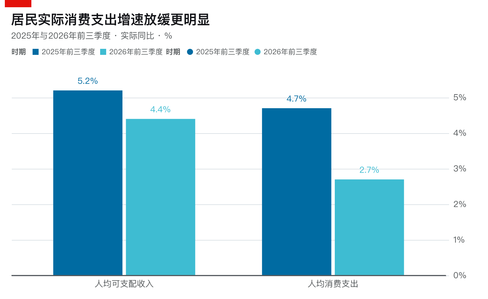
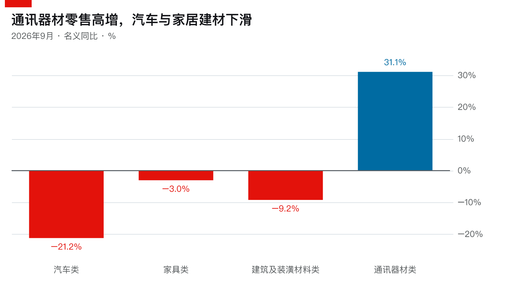
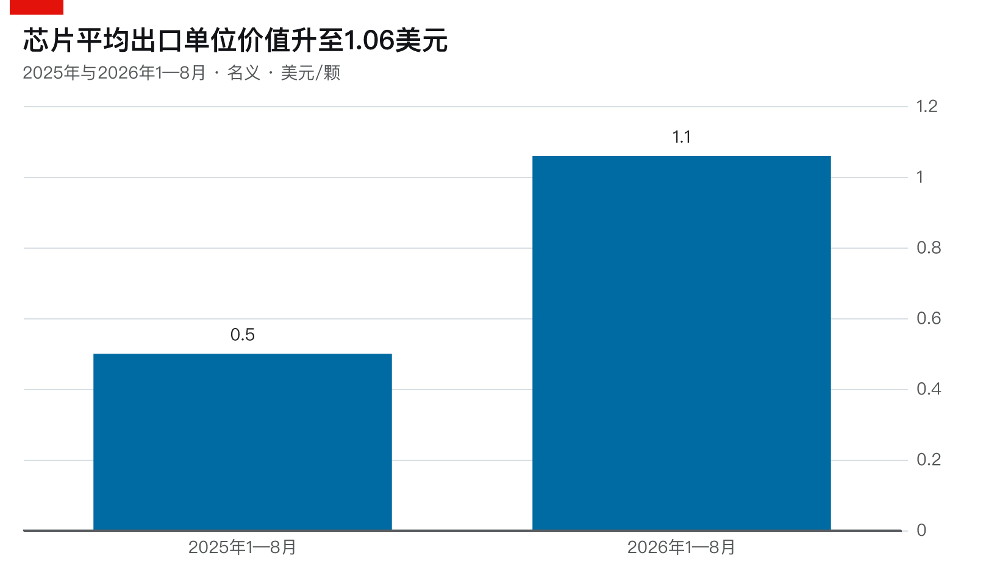
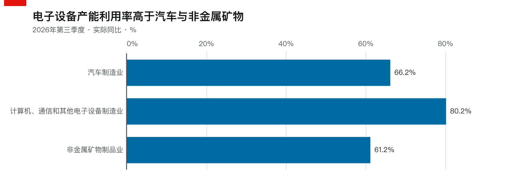
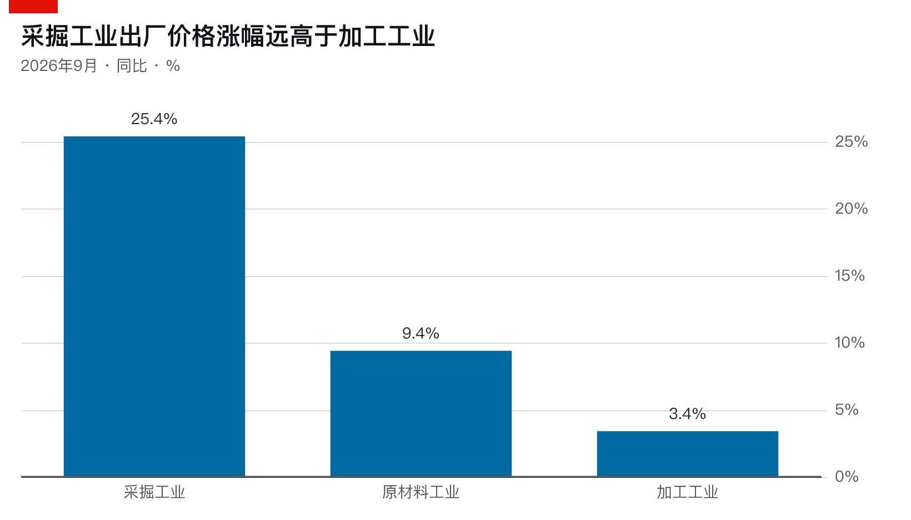
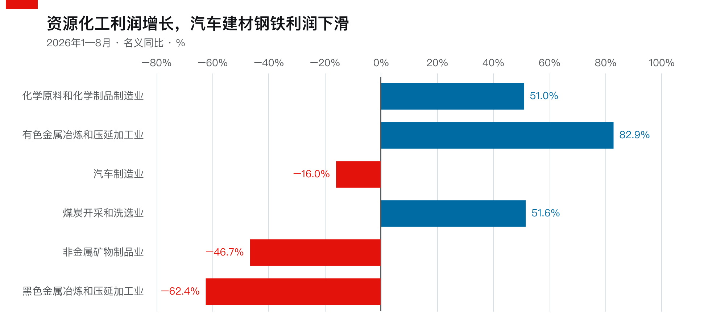

2026年10月19日，国家统计局公布了前三季度国民经济运行数据。当天，财新分别从居民消费、工业生产和价格传导三个角度进行了报道。9月社会消费品零售总额同比增长1.1%，规模以上工业增加值实际增长5.5%，工业企业出口交货值名义增长17%。与此同时，工业生产者出厂价格指数（PPI）同比上涨5.0%，居民消费价格指数（CPI）却只上涨0.9%。此前公布的工业企业财务数据还显示，1—8月规模以上工业企业利润总额同比增长15.7%。〔1〕〔2〕〔3〕

这些数据反映出的经济状况并不完全一致。一方面，工业生产和出口保持较快增长，部分高技术制造业的生产、投资和利润表现尤其突出；另一方面，居民消费增长缓慢，房地产投资持续收缩，汽车、建材等部分制造业面临较大的需求压力。工业产品价格明显上涨，也没有带来所有企业利润的同步改善。

这里首先需要区分生产、销售、价格和利润。工业增加值衡量的是生产活动中新创造的价值，社会消费品零售总额反映的是特定商品和餐饮消费的销售金额，PPI与CPI衡量不同交易环节的价格变化，企业利润则取决于收入与成本费用的关系。它们之间存在经济联系，却不是可以直接相互替代的指标。

此外，不同统计数据采用的时间和价格口径也有所区别。工业增加值的同比增速已经剔除价格因素，而社会消费品零售总额、出口交货值等通常采用名义金额。只要商品价格出现较大变化，名义销售额与实际产品数量之间就可能产生显著差异。

将这几组指标结合起来，可以发现2026年前三季度中国经济的一个重要特征：**生产能力、市场需求以及企业盈利状况之间存在明显的结构性分化。** 工业和出口仍然具有较强的增长能力，但不同产业所面对的需求条件、成本变化和经营压力并不相同。要理解这一现象，需要先考察国内消费，再将视角扩展到工业生产、出口和全球产业链。

## 一、消费增长放缓与需求结构分化

2026年9月，社会消费品零售总额同比增长1.1%，比8月加快0.7个百分点。经过季节调整后，环比增长0.35%，结束了8月的环比负增长。财新据此指出，消费增长动能出现边际改善，但同时强调，去年同期基数变化和中秋假期错位，也是推动9月同比增速回升的重要因素。〔1〕

这组数据确实表明9月零售市场有所改善，但如果扩大比较的时间范围，情况便不那么乐观。2025年前三季度社会消费品零售总额同比增长4.5%，2026年同期仅增长1.1%；2025年9月单月增长3.0%，今年同期也只有1.1%。同时，今年1—8月累计增速已经是1.1%，纳入9月后，前三季度累计增速仍然没有变化。〔4〕〔5〕

这里涉及同比（Year-over-Year，YoY）与环比（Month-over-Month，MoM）的区别。同比是与上一年同一时期比较，容易受到去年基数影响；环比则与上一个时期比较，更适合观察近期变化，但也容易受到季节性因素和单月异常波动的干扰。

另一个需要注意的问题是，社会消费品零售总额并不等于居民全部消费支出。它主要覆盖商品零售和餐饮收入，也包含社会集团购买的部分非生产经营性商品，但不能完整反映教育、医疗、住房租赁及其他服务消费。同时，社零通常采用名义金额，价格上涨可能在商品销量变化有限的情况下提高销售额。

因此，要判断居民消费的整体情况，还需要观察居民消费支出调查。2026年前三季度，全国居民人均可支配收入实际增长4.4%，人均消费支出实际增长2.7%；而2025年同期，两项指标分别增长5.2%和4.7%。也就是说，居民收入仍在增长，但收入增速有所放缓，实际消费支出的放缓程度则更加明显。〔6〕〔7〕

<!-- ai-chart:d9b7adda712c47bcdadd -->

从商品类别来看，这种疲弱表现得很不均匀。

9月汽车类零售额同比下降21.2%，家具类下降3.0%，建筑及装潢材料类下降9.2%。汽车以旧换新等政策可能提前释放了上一年的部分购车需求，从而抬高比较基数。但汽车类零售额在2026年前三季度累计已经下降14.9%，说明消费疲弱并不是单独9月份才出现的现象。

<!-- ai-chart:b3b43b12134a7d7c57c0 -->

家具与建筑装潢材料的表现，则与房地产市场调整存在更直接的联系。2026年前三季度，全国房地产开发投资同比下降20.6%，新建商品房销售面积下降13.2%，房屋新开工面积下降24.9%。房地产开发和交易活动的收缩，会影响新房装修、建筑材料以及相关家居产品的需求。〔20〕

与这些行业形成对照的是通讯器材类。9月通讯器材类零售额同比增长31.1%，成为少数增长较快的商品类别之一。但是，同期移动电话机价格同比上涨14.9%。虽然两项指标的统计范围并不完全一致，不能直接计算所谓的实际手机销量增速，却足以提醒我们，**商品销售金额增长并不意味着实际购买数量同比例增长。**

服务消费则表现出更强的韧性。2026年前三季度服务零售额同比增长5.0%，明显高于商品零售额1.0%的增速。通讯信息、旅游咨询租赁、文体休闲等服务仍然具有一定增长空间。不过，服务零售额属于另一套统计范围，不能将其与传统社会消费品零售总额直接相加，也不能把名义增长率等同于实际服务消费数量的增长。

因此，当前消费市场并不是所有类别都在萎缩。部分服务、新型电子产品和升级类商品仍然存在需求，但汽车、房地产相关耐用品等领域持续疲弱，拖累了整体商品消费。**9月零售额的边际改善是真实存在的，但它尚未改变居民消费支出增长明显放缓的整体状况。**

## 二、工业生产与出口需求

与国内消费相比，工业生产的表现明显更强。2026年9月，规模以上工业增加值同比实际增长5.5%，环比增长0.61%；前三季度累计增长5.3%。虽然今年的累计工业增速低于2025年同期的6.2%，但仍然保持了较明显的实际增长。〔2〕〔8〕

这并不意味着工业产品都能够被国内居民消费市场吸收。工业生产与居民消费之间本来就不存在简单的一一对应关系。一部分工业产品是居民购买的最终消费品，另一部分则作为原材料、中间产品和资本品进入其他企业的生产过程，还有相当一部分直接出口。

因此，即使国内消费增长缓慢，工业企业仍然可能依靠海外市场、企业设备需求以及国际供应链订单扩大生产。

2026年9月，规模以上工业企业出口交货值达到17132亿元，同比名义增长17%。前三季度，中国机电产品出口约2.17万亿美元，占全部货物出口总额的64.4%。其中，计算机及相关产品、集成电路、汽车、机械设备和船舶等，已经成为出口的重要组成部分。〔2〕〔8〕〔9〕

中国的出口结构也早已不只是传统意义上的服装、鞋帽、家具和玩具。电子信息、机械设备、汽车和工业零部件，在当前出口体系中占有越来越重要的位置。

电子信息产业出口包括服务器、计算机、手机、存储设备、集成电路、显示面板及其他电子元器件。汽车产业出口既包含燃油汽车、新能源汽车，也包括汽车零部件。机械设备产业则提供工程机械、机床、工业设备、电机、泵和压缩机等产品。新能源产业的出口还涉及锂电池、储能设备、光伏组件、逆变器和风电设备。

与此同时，服装、纺织品、塑料制品、家具、家电和部分化工材料仍然拥有庞大的出口规模。它们并没有因为高技术产品的发展而失去重要性，只是不同产业的增长速度、盈利能力和竞争条件存在明显差异。

这里还需要引入中间品（Intermediate Goods）的概念。传统上，人们习惯于将出口理解为把最终商品卖给国外消费者，但国际制造业越来越多地采用跨国分工。一件最终产品的生产，可能涉及多个国家的原材料、零部件、设备和加工环节。

例如，中国生产的电子元器件可以出口到越南，再由当地工厂组装成计算机或其他电子设备；中国生产的汽车零部件可以进入德国、日本及其他国家的汽车制造体系。这些产品并没有直接进入最终消费市场，而是继续参与其他企业的生产。

2026年前三季度，中间品已经占中国出口总值的一半以上。这表明中国不仅是全球终端商品的重要生产基地，也是国际制造业生产网络的重要组成部分。

不过，**出口金额增长与实际出口数量增长仍然需要区分。** 出口统计通常记录跨境交易的货币价值，而商品价格、汇率和产品结构变化都可能影响出口额。一些行业可能在出货数量没有明显增加的情况下，依靠价格上涨获得更高的出口金额。

2026年的集成电路出口就是一个很有代表性的案例。

## 三、芯片分类与GPU存储架构

2026年9月，中国集成电路出口金额达到约449.5亿美元，同比增长136%左右，但出口数量的增长远远没有这么高。《南方周末》根据海关详细数据统计，2026年1—8月中国集成电路出口金额同比增长103.9%，出口数量却只增长约4%。其中，存储芯片相关类别贡献了约72%的出口金额。〔10〕

这一现象容易使人产生疑惑。中国在先进AI计算芯片和尖端晶圆制造领域仍然与国际领先企业存在明显差距，但芯片出口金额却能够快速增长。要理解这个问题，首先需要明确，日常所说的芯片并不是单一产品。

中央处理器、图形处理器、存储芯片、模拟芯片和功率半导体虽然都使用半导体技术，但它们承担的功能不同，涉及的制造工艺和市场竞争格局也不相同。因此，存储芯片出口增加，并不能直接证明中国在先进AI计算芯片设计领域取得了相同程度的进展。

### 1. CPU、GPU与AI加速器

传统计算机需要一种能够执行通用程序、管理操作系统以及协调其他设备的处理器，这就是中央处理器（Central Processing Unit，CPU）。

美国的英特尔（Intel）和超威半导体（Advanced Micro Devices，AMD）是这一领域的重要企业。英特尔的Core系列主要面向个人电脑，Xeon系列主要面向服务器；AMD则拥有Ryzen和EPYC等产品线。两家公司长期在个人电脑及服务器处理器市场竞争。

不过，现代人工智能的发展提出了新的计算需求。深度神经网络需要执行大量矩阵乘法和其他能够并行处理的数值运算。CPU虽然可以执行这些计算，但它还需要支持复杂的程序控制、系统调度和大量不同性质的计算任务，并不总是适合以极高吞吐量完成大规模并行运算。

这使图形处理器（Graphics Processing Unit，GPU）在人工智能时代获得了更加重要的地位。

GPU最初主要服务于图形渲染，但它拥有大量并行计算单元，能够同时处理许多数值运算任务。英伟达（NVIDIA）在GPU内部发展了专门用于矩阵运算的Tensor Core，并通过CUDA（Compute Unified Device Architecture，统一计算设备架构）以及配套计算库，使研究人员能够利用GPU完成神经网络训练和推理。

英伟达的优势因而不只是某一款GPU芯片的理论计算能力，还包括CUDA软件生态、算子库、高速互联、网络系统以及服务器平台。现代AI训练往往需要成百上千块GPU共同运行，单个处理器的性能只是完整计算系统的一部分。

AMD同样发展了GPU和AI加速器产品，例如Instinct系列；谷歌则开发了张量处理单元（Tensor Processing Unit，TPU），主要针对机器学习工作负载进行优化。中国的华为昇腾、寒武纪等企业，也在发展不同的AI计算芯片和加速系统。

这些产品的技术路线存在区别，但它们共同解决的是大规模数值计算的问题。与之相比，存储芯片主要承担数据保存和传输任务，并不直接替代GPU完成神经网络计算。

### 2. DRAM、NAND与HBM

计算能力提高以后，另一个问题就变得越来越突出。GPU执行矩阵运算，需要不断读取模型参数、输入数据和中间结果。如果数据无法及时提供给计算单元，即使GPU具有很高的理论计算吞吐量，也可能因为等待数据而无法充分发挥性能。

这使存储系统的重要性明显提高。

动态随机存取存储器（Dynamic Random-Access Memory，DRAM）主要承担计算机运行时的数据存储任务，例如系统内存和GPU显存。DRAM通常需要持续供电并周期性刷新数据，断电后无法长期保存原有信息。

NAND闪存（NAND Flash Memory）则属于非易失性存储器，断电后仍然能够保存数据，因此广泛用于固态硬盘、手机存储和数据中心存储设备。

两者都被称为存储芯片，但承担着不同的功能。DRAM更适合运行中的数据访问，NAND则主要用于保存大量需要长期保留的数据。

到了AI时代，GPU对显存带宽提出了更高要求，由此推动了高带宽存储器（High Bandwidth Memory，HBM）的发展。

HBM本质上仍然属于DRAM，只不过采用了与普通内存模组不同的封装和连接方式。它将多层DRAM晶粒垂直堆叠，通过硅通孔（Through-Silicon Via，TSV）实现层间连接，并通过先进封装技术与GPU计算晶粒建立高密度互联。

这种设计能够在较紧凑的封装空间内提供很高的数据传输带宽，同时改善单位传输数据所需要的能耗。

因此，HBM不是一种新的计算核心，也不是能够替代GPU的处理器。它的作用是为GPU提供足够快的数据访问能力，减少计算单元等待数据的时间。

这一点也解释了AI产业发展为什么会同时推动GPU和存储芯片需求。英伟达等企业需要设计更强大的计算芯片，而SK海力士、三星、美光等存储制造商，则需要提供足够容量和带宽的HBM产品。

### 3. GPU内部存储层级与HBM

这里可以联系此前写过的《GPU 和 LLM》。那篇文章主要以NVIDIA A100为例，介绍了GPU内部的流式多处理器（Streaming Multiprocessor，SM）、CUDA Core、Tensor Core、寄存器、共享内存和缓存等结构。

这些组件虽然都与GPU计算有关，但承担着不同的任务。Tensor Core负责执行矩阵运算，而寄存器、共享内存和缓存等结构主要负责暂时保存、组织和复用数据。

从靠近计算单元的位置向外看，GPU内部通常包含寄存器（Register File）、共享内存（Shared Memory）、一级缓存（L1 Cache）和二级缓存（L2 Cache），最后才是容量更大的全局显存。

这些存储层级在容量、访问延迟和带宽方面存在不同的权衡。寄存器和片上共享内存距离计算单元很近，能够支持高效的数据访问，但容量有限；HBM可以容纳更多模型参数和运行数据，却无法在访问特性上完全取代片上存储。

以NVIDIA A100 80GB SXM为例，它采用HBM2e，显存带宽约为2TB/s。之后的H100 SXM采用80GB HBM3，显存带宽达到约3.35TB/s。两代GPU之间不仅存在计算架构的变化，显存带宽也得到了明显提高。〔11〕

这里涉及存储带宽瓶颈（Memory Bandwidth Bottleneck）。如果GPU能够以很高的速度执行计算，但模型权重和其他数据需要频繁从显存读取，那么实际计算速度就可能受到数据传输能力的限制。

因此，提高AI计算性能并不只是增加计算核心，还需要协调计算吞吐量、存储容量、存储带宽以及数据复用效率。

另外，HBM与GPU内部的共享内存不是同一回事。HBM通常是与GPU计算晶粒共同封装的独立存储晶粒，而共享内存则位于SM附近，属于片上的高速存储资源。

还需要区分GPU内部的分布式共享内存，以及多GPU之间的分布式计算。

NVIDIA Hopper架构引入了分布式共享内存（Distributed Shared Memory，DSMEM），使同一个线程块集群中的不同线程块能够访问其他参与线程块的共享内存。这里的分布式共享内存仍然属于GPU片上存储机制，并不意味着HBM被改造成了分布式共享内存。〔12〕

而在多GPU训练中，每块GPU通常拥有自己的本地显存，大型模型的参数、计算任务和中间数据需要按照并行策略分配到不同设备。NVLink、NVSwitch等技术负责支持GPU之间的高速数据交换。

因此，GPU内部的寄存器和缓存、GPU封装中的HBM，以及多GPU系统之间的高速互联，属于三个不同层次的问题。它们分别决定数据如何在计算单元附近复用、如何从显存供应给GPU，以及如何在多个计算设备之间交换。

**现代AI加速器的性能，是计算架构、存储系统和设备互联共同作用的结果，而不是单纯由GPU计算核心数量决定的。**

## 四、全球半导体产业链的专业化分工

一块先进AI加速器同时涉及逻辑计算芯片、存储芯片、先进封装及复杂的高速互联，但这些组件并不由同一家企业独立完成。

早期半导体企业往往同时承担芯片设计、制造和销售任务，但先进芯片的生产逐渐需要极其庞大的研发投入与晶圆厂建设成本。随着工艺复杂程度提高，许多设计公司已经无法或不愿承担独立建设先进晶圆厂的成本，由此形成了越来越专业化的产业分工。

### 1. 英伟达、AMD与台积电的设计制造分工

半导体产业中存在一种重要模式，称为无晶圆厂设计（Fabless Semiconductor Design）。企业主要负责芯片架构、电路设计与产品研发，而将晶圆制造交给其他企业。

英伟达和AMD是这种模式的典型代表。

与之对应的是专业晶圆代工（Semiconductor Foundry）。台积电（Taiwan Semiconductor Manufacturing Company，TSMC）是全球最重要的晶圆代工企业之一，主要根据客户提供的设计完成芯片制造。

因此，英伟达与台积电并不是简单的竞争关系。英伟达负责GPU架构、电路、计算平台及软件生态，台积电则利用先进制程将这些设计制造成实际芯片。

以英伟达H100为例，英伟达负责GPU设计，台积电使用先进工艺制造相应逻辑芯片，并通过先进封装技术，将计算晶粒与HBM集成到完整的产品封装中。

这里还需要解释先进封装的重要性。现代AI加速器通常需要将GPU计算晶粒和多个HBM堆栈放在同一个高密度封装系统内，通过中介层等技术实现高速连接。

台积电的CoWoS（Chip-on-Wafer-on-Substrate）技术，就是这一类先进封装方案的重要代表。

因此，一家企业即使能够设计先进GPU，如果缺少足够的晶圆制造产能、先进封装能力以及HBM供应，也很难实现大规模生产和交付。

相比之下，英特尔长期采取集成器件制造商（Integrated Device Manufacturer，IDM）模式，同时从事芯片设计与制造。三星也拥有存储芯片设计制造、逻辑芯片代工和消费电子等多种业务。不同企业采取的生产组织方式并不相同。〔13〕

### 2. 半导体制造设备与材料

即使拥有台积电这样的晶圆代工厂，也不意味着它可以独立完成所有制造环节。芯片生产需要反复经过光刻、沉积、刻蚀、清洗、检测等工序，而每一种工序又依赖不同的设备、材料和工艺技术。

荷兰阿斯麦（ASML）是其中最重要的设备供应商之一。它主要生产光刻设备，尤其是用于先进制程关键工艺的极紫外光刻（Extreme Ultraviolet Lithography，EUV）系统。

美国的应用材料、泛林集团和科磊等企业，分别在沉积、刻蚀、检测等半导体制造设备领域具有重要地位。日本企业则在硅片、光刻胶、部分化学材料和生产设备等方面拥有较强竞争力。

此外，芯片设计本身还需要复杂的电子设计自动化（Electronic Design Automation，EDA）软件，以及处理器架构、接口和其他知识产权支持。

这些企业未必直接生产消费者熟悉的CPU或GPU，但缺少其提供的软件、材料和设备，先进芯片就很难完成设计与制造。

因此，全球半导体产业链并不是简单的美国设计、台湾制造、韩国提供存储。它还包含来自欧洲、日本及其他国家的设备、材料和工艺技术。〔13〕

这种高度专业化的国际分工提高了全球半导体生产效率，也使产业链容易受到国际贸易政策、出口管制和供应中断的影响。

### 3. 三星、SK海力士与美光的存储芯片业务

三星电子、SK海力士（SK hynix）和美光科技（Micron Technology）是全球存储芯片产业的重要企业。

三星业务范围较广，既生产DRAM、NAND等存储芯片，也经营逻辑芯片代工、消费电子等业务。SK海力士的业务则主要集中于存储芯片，包括DRAM、NAND以及面向AI计算的HBM。美光同样以DRAM和NAND为核心业务，并参与高性能服务器内存和HBM市场。

在AI产业链中，它们与英伟达更多体现为供应链合作关系。英伟达需要高性能HBM来支持AI加速器，而这些存储企业负责提供相应产品。

随着全球AI数据中心投资扩张，HBM和服务器内存的需求快速增加，存储制造商可能将更多生产资源和投资转向相关产品。这种调整又可能影响普通DRAM、NAND等市场的供需关系。

不过，不能因此认为所有存储芯片价格都会以相同速度上涨。DRAM、NAND和HBM虽然都属于存储产业，但技术要求、制造成本、市场用途以及供需结构并不相同。

这一点对于理解中国2026年的芯片出口数据尤其重要。

## 五、中国在全球半导体产业链中的位置

如果只以最先进GPU和尖端晶圆制造技术作为评价标准，中国与国际领先企业之间仍然存在明显差距。但如果因此认为中国整个半导体产业都缺乏竞争力，同样会忽略不同技术领域的发展程度。

中国已经在部分成熟制程芯片、存储芯片、芯片设计、封装测试及半导体设备领域建立了一定产业基础，同时也在先进逻辑制造、高端存储和部分关键设备等环节面临限制。

### 1. 华为海思、中芯国际与AI计算芯片

华为海思主要从事半导体设计，相关产品包括面向移动终端的麒麟系列及AI计算领域的昇腾系列。

昇腾的发展不仅涉及芯片本身，还包括CANN计算软件平台、算子库、开发工具和设备互联等技术。它与英伟达的竞争，因此不只是理论算力的比较，还涉及软件生态、实际计算效率、模型适配以及规模化部署能力。

中芯国际（Semiconductor Manufacturing International Corporation，SMIC）则主要从事晶圆代工，与台积电属于产业链中的相近环节。

但两者在先进制程技术、良率、成本控制、量产规模以及产业配套方面仍然存在差距。尤其是在受到先进半导体制造设备出口限制的情况下，中国部分先进制造工艺的持续发展会面临额外约束。

这里需要区分芯片设计能力与芯片制造能力。能够设计某种先进计算芯片，并不意味着已经能够以足够高的良率、足够低的成本和足够大的规模制造出来。

同样，即使具备晶圆制造能力，如果先进封装、HBM供应、软件生态或多设备互联方面存在限制，最终AI计算系统的竞争力仍然会受到影响。

### 2. 长江存储与长鑫存储

中国存储芯片产业的情况有所不同。

长江存储（Yangtze Memory Technologies，YMTC）主要发展NAND闪存，其技术进步集中在三维NAND制造及相关工艺。

根据路透社2026年10月21日的报道，长江存储当年第二季度在中国NAND市场的份额达到38.5%，超过三星在中国市场的份额。这说明国内企业已经在部分存储产品市场建立起相当强的竞争力，但中国市场份额不能直接理解为全球市场份额。〔14〕

长鑫存储（ChangXin Memory Technologies，CXMT）则主要发展DRAM。其运营主体为长鑫科技集团股份有限公司。

2026年9月20日，长鑫宣布第五代DRAM技术平台实现量产，并展示基于该平台开发的LPDDR5X产品。相关进展说明中国在DRAM制造领域继续取得技术突破，但公司随后披露，新平台产品当时尚未形成规模销售，良率提升、客户认证和市场导入仍需要时间。〔15〕

这里还需要强调，LPDDR5X与HBM并不是同一种产品。两者虽然都属于DRAM体系，但HBM在多层堆叠、高密度互联、存储带宽以及先进封装方面具有不同的要求。

因此，长鑫在普通DRAM和低功耗DRAM领域的进步，并不能直接证明中国已经建立与国际领先企业相同的大规模高端HBM供应能力。

除此之外，中国在半导体设备和封装测试领域也已经形成一定的产业基础。例如北方华创、中微公司参与半导体设备制造，长电科技、通富微电等企业从事芯片封装测试。

这些企业的发展说明中国半导体产业已经覆盖多个生产环节，但这不意味着全部先进制造设备、材料和软件都已经实现自主供应。

### 3. 外资半导体企业在中国的生产布局

中国是重要的半导体生产基地，但在中国境内制造芯片的并不只有中国本土企业。

三星在西安拥有大型NAND生产基地，SK海力士在无锡生产DRAM，在大连也拥有NAND生产设施。

2026年10月21日，路透社报道，三星与SK海力士正在推进中国境内NAND工厂的技术升级，以适应全球存储技术发展和市场竞争。不过，相关计划需要面对美国半导体设备出口管制及许可要求。〔14〕

这些工厂虽然位于中国境内，但其技术、设备以及经营收益涉及多个国家和企业。韩国企业可能负责设计和制造工艺，美国、荷兰、日本企业则可能提供重要的设备及材料。

而在海关统计中，只要相关芯片从中国境内出口，就可能被计入中国的集成电路出口金额。

因此，**中国境内芯片出口、中国本土企业芯片销售，以及中国企业自主掌握的半导体技术能力，并不是同一个概念。**

这一区别是理解2026年集成电路出口增长的关键。

## 六、芯片出口增长的来源与统计局限

现在重新观察中国2026年的芯片出口数据，就能够更清楚地理解其增长来源。

根据《南方周末》对海关数据的分析，2026年前八个月中国集成电路出口金额达到2567.51亿美元，同比增长103.9%，出口数量却只增长约4%。按出口金额和数量计算，单颗芯片的平均出口单位价值由上年同期约0.5美元提高到1.06美元。〔10〕

<!-- ai-chart:815b3bb41ad8a04d52c4 -->

但这里的平均单位价值不能直接理解为同一种芯片的市场价格。集成电路包含从低价元器件到高性能处理器、存储芯片等不同产品，商品结构变化本身就可能提高平均单位价值。

更值得注意的是存储芯片的出口结构。2026年前八个月，存储芯片相关类别贡献了约72%的集成电路出口金额，而它们在出口数量中的比重只有约9%。这表明中国芯片出口金额的增长高度集中于存储产品。

从全球产业背景来看，AI数据中心投资扩张推动了服务器内存、HBM和其他存储产品需求增长。与此同时，存储制造商调整产品结构和产能配置，普通DRAM、NAND市场也受到供需变化影响。

这种变化使存储芯片价格明显上涨，从而推高中国境内相关产品的名义出口金额。

但是，海关分类中的存储芯片并不全是HBM。它还包括大量普通DRAM、NAND及嵌入式存储产品，不能因为AI推动了HBM需求，就认为中国出口的存储芯片主要是高端AI显存。

此外，中国境内的部分存储芯片产量来自三星、SK海力士等外资企业，这些产品的出口同样可能进入中国的海关统计。

因此，2026年集成电路出口金额快速增长，至少涉及三个不同因素：全球存储芯片价格上涨、出口产品结构变化，以及中国境内本土与外资企业共同组成的半导体生产和贸易网络。

这里还涉及出口总额与国内增加值的区别。

海关出口金额记录的是跨境交易价值，但某个国家从出口活动中实际获得的国内增加值，需要进一步考虑生产过程中使用的进口中间投入。

一件从中国出口的芯片，其价值可能包含外国企业的技术和部分进口材料，也可能包含中国境内的制造、工程、封装、测试、物流及其他生产活动。出口总额不能直接等同于中国本土企业获得的利润，更不能直接等同于中国居民新增收入。

当然，这并不意味着外资企业在中国的生产活动没有经济价值。它们仍然可能创造国内增加值、就业、税收和产业配套需求。问题在于，这些经济贡献需要通过更具体的统计方法衡量，而不能直接由出口总金额推导出来。

**中国芯片出口金额翻倍是真实的，但它不能被解释为实际芯片出货数量翻倍，也不能说明中国已经在先进AI计算芯片和尖端晶圆制造领域全面追平国际领先企业。**

这个案例也说明，名义出口金额、实际产品数量、国内增加值以及产业技术水平，是四个需要分别分析的问题。

## 七、工业生产与产能利用率的行业分化

芯片产业的发展表明，全球AI投资能够为部分中国制造业提供较强的外部需求。但这种需求并不会均匀分布于所有工业部门。

2026年9月，计算机、通信和其他电子设备制造业增加值同比增长16.4%，专用设备制造业增长12.1%，铁路、船舶、航空航天和其他运输设备制造业增长11.7%。与此同时，汽车实物产量同比下降5.7%，钢材产量下降3.8%，水泥产量下降5.3%。新能源汽车产量仍然增长16.9%，说明即使在汽车产业内部，不同产品也存在明显分化。〔8〕

这里需要注意，工业增加值与具体商品产量不是相同指标。汽车制造业增加值增长，并不要求整车产量同步增加，因为汽车产业还包括零部件生产及其他制造活动。

为了进一步观察工业生产的状况，还需要考察产能利用率（Capacity Utilization Rate）。

产能利用率衡量实际生产规模与可持续生产能力之间的关系。生产总量增长，并不意味着企业现有设备得到更加充分的利用。如果新增产能扩张得比实际产量更快，产能利用率反而可能下降。

2026年第三季度，全国规模以上工业产能利用率为73.1%，同比下降1.5个百分点。其中，计算机、通信和其他电子设备制造业达到80.2%，汽车制造业为66.2%，非金属矿物制品业为61.2%。〔16〕

<!-- ai-chart:dd41dcd221e56bb2462d -->

这些数字说明，部分电子制造业仍然保持较高的产能利用水平，而汽车和建筑材料等行业则存在更明显的产能配置压力。

当然，产能利用率低并不必然意味着企业正在亏损，也不能直接用它计算需要关闭多少工厂。不同产业的正常利用水平、生产组织方式和设备周期本来就有差别。

但将汽车消费下滑、房地产投资收缩、部分产品产量下降与产能利用率变化结合起来，可以发现国内需求不足仍然是影响部分制造业的重要因素。

因此，当前的工业经济不是所有部门都在繁荣，也不是所有部门都在衰退。电子信息、部分装备制造以及受到海外市场支持的产业保持增长，而房地产相关制造业、部分传统材料工业及汽车产业中的部分环节，仍然面临需求和产能调整的压力。

## 八、PPI、CPI与产业链价格传导

前面主要讨论了工业生产数量和产业结构，但2026年还有一个不能忽视的变化，即工业品价格明显上涨。

9月工业生产者出厂价格指数（Producer Price Index，PPI）同比上涨5.0%，居民消费价格指数（Consumer Price Index，CPI）却只上涨0.9%。财新在10月19日关于价格传导的报道中指出，国家统计局认为本轮物价回升同时受到国际输入性因素和国内需求改善的影响，但价格沿产业链向下游传导时，往往会受到企业议价能力、市场竞争和生产周期等因素制约。〔3〕

这里需要先解释PPI和CPI的区别。

工业生产的商品并不全部直接进入居民消费市场。煤炭、钢铁、化工原料、工业机械等商品，往往要经过进一步加工或进入其他企业的生产过程。相比之下，居民购买的商品和服务还包括食品、医疗、教育、交通以及其他大量生活服务。

因此，PPI主要衡量工业产品在生产出厂环节的价格变化，CPI则衡量居民购买消费品和服务时的价格变化。

两种指数在统计范围、商品类别和权重上都不相同，不能简单将PPI上涨5%、CPI上涨0.9%，理解为工业企业涨价5%，而消费者只承担了0.9%的涨价。

从PPI内部结构看，2026年9月生产资料价格同比上涨6.5%，生活资料价格却下降0.1%。其中采掘工业价格上涨25.4%，原材料工业上涨9.4%，加工工业上涨3.4%。〔17〕

<!-- ai-chart:a8082282cf6e0fcb2c64 -->

这说明工业品涨价主要集中于生产资料和部分上游行业，而不是所有工业制成品价格均匀上涨。

CPI内部则呈现出不同的结构。9月食品价格同比下降1.7%，服务价格上涨0.8%。即使部分电子产品和工业消费品价格上涨，其他商品和服务的价格变化仍然可能使总体CPI保持温和。〔18〕

不过，区分PPI和CPI还不能完全解释上下游价格变化。我们还需要进一步分析，一个产业环节的成本上涨如何影响其他企业。

### 1. 输入性通胀与工业成本上涨

中国工业生产需要大量能源、金属和化工原料，其中部分商品价格受到国际市场影响。

当国际原油、天然气及其他大宗商品价格上涨时，即使国内最终消费需求没有明显增加，相关企业的原材料和能源采购成本也可能上升。

这种通过国际贸易、汇率及相关成本渠道传入国内的物价上涨压力，被称为输入性通胀（Imported Inflation）。

如果企业的生产成本上升，并进一步推动产品销售价格提高，就涉及成本推动型通胀（Cost-Push Inflation）。

与之不同，需求拉动型通胀（Demand-Pull Inflation）主要强调市场需求增长较快，而供给无法及时跟上，由此推动商品和服务价格上涨。

现实中的物价变化往往同时受到多种因素影响。例如，部分能源和原材料价格上涨可能来自国际市场供需变化，而AI基础设施投资扩张则会增加对计算芯片、存储芯片和相关设备的需求。

因此，不能将2026年工业品价格上涨全部归因于输入性通胀，也不能认为所有涨价都说明国内需求已经明显恢复。

### 2. 上下游企业的价格传导与议价能力

一件最终商品通常需要经过多个生产环节。

以汽车为例，铁矿石、能源等原材料首先进入钢铁和材料生产环节，再进入汽车零部件制造，最后由汽车企业完成整车生产，并通过销售渠道进入消费市场。

在这个过程中，一家企业的销售价格可能就是下一家企业的采购成本。上游企业产品涨价，会提高下游企业的投入成本，但下游企业不一定能够按照相同幅度提高自己的售价。

这种一个环节的价格变化影响其他环节价格的过程，被称为价格传导（Price Pass-Through）。

假设钢材价格上涨10%，汽车制造商的采购成本随之提高。汽车企业当然可以尝试通过提高汽车售价，将一部分成本转移给消费者。但如果汽车市场竞争激烈、购买需求疲弱，提价就可能导致销量下降。

在这种情况下，企业可能选择压缩利润、要求供应商降价、改变采购结构、提高生产效率，或者减少产量。

这就涉及议价能力（Bargaining Power）。企业能否影响价格和其他交易条件，取决于市场竞争程度、产品可替代性、供需关系、客户集中度以及合同安排等因素。

某些上游企业在供给紧张时能够提高售价，但部分下游企业即使面临成本上涨，也未必能够把新增成本全部转嫁给消费者。

这就是财新报道中提到的价格传导沿产业链逐级递减的含义。价格从上游传递到下游，需要经过多个市场，而不同市场的竞争状况和需求条件并不相同。上游产品价格上涨，并不要求下游所有商品按照相同比例涨价。〔3〕

2026年9月，工业生产者购进价格同比上涨6.9%，高于工业生产者出厂价格5.0%的涨幅。这提示部分企业可能面临采购成本上涨较快的压力。

不过，购进价格指数与出厂价格指数包含的商品结构不同，不能直接用两个总体指数的差距计算企业利润率变化。

具体企业是否受到成本挤压，仍然需要观察其采购结构、产品销售价格、库存成本、生产效率以及市场竞争情况。

## 九、工业企业利润的增长与分化

工业品价格上涨可能增加企业销售收入，但产品涨价不代表利润一定增加。

企业利润最基本的关系是：

$$
\text{利润}=\text{收入}-\text{成本费用}
$$

假设一家企业原来销售一件商品获得100元收入，总成本费用为80元，利润为20元。如果之后售价提高到105元，而成本费用提高到90元，那么即使收入有所增加，利润仍然会下降。

因此，工业品价格上涨是否能够改善盈利，取决于产品售价与生产成本的共同变化，也受到企业产量、经营费用和市场竞争的影响。

2026年1—8月，全国规模以上工业企业利润总额同比增长15.7%，营业收入增长6.6%，营业收入利润率达到5.66%，同比提高0.44个百分点。〔19〕

这说明工业企业总体利润确实获得改善，不能简单认为上游价格上涨必然导致工业部门利润整体下降。

但如果进一步观察行业数据，就会发现利润增长高度不均衡。

同期，计算机、通信和其他电子设备制造业利润同比增长约1.1倍，有色金属冶炼和压延加工业增长82.9%，煤炭开采和洗选业增长51.6%，化学原料和化学制品制造业增长51.0%。

<!-- ai-chart:e438ce99d1e2502f69bf -->

与此同时，汽车制造业利润下降16.0%，非金属矿物制品业下降46.7%，黑色金属冶炼和压延加工业下降62.4%。〔19〕

这种分化与前面讨论的需求结构、工业生产和价格变化具有明显联系。

电子信息产业受全球AI投资和电子设备需求带动，部分企业的生产与利润增长较快；某些资源行业则受商品价格上涨推动，收入和利润得到改善。

相反，汽车行业面临较激烈的价格竞争、部分产品销售疲弱以及产能压力。房地产相关建材需求下降，又对非金属矿物制品行业形成持续拖累。

不过，也不能将全部利润变化简单归因于PPI。企业利润还受到销量、产品结构、库存计价、原材料采购、生产效率和经营费用等因素影响。部分行业可能在产品价格上涨的同时获得更高利润，也可能因为成本增加更快而利润下降。

此外，即使企业利润增加，也不意味着资金周转情况一定同步改善。

截至2026年8月末，规模以上工业企业产成品存货同比增长11.0%，应收账款增长9.0%，而同期营业收入增长6.6%。产成品存货周转天数和应收账款平均回收期也都有所延长。〔19〕

这些变化并不能直接证明工业企业出现普遍的产品积压，因为存货金额还受到价格、产品结构和企业规模影响。但存货及应收账款增长较快，说明企业的库存管理和销售回款仍然值得关注。

由此可以看到，工业生产增长、出口金额增加、价格上涨和企业盈利改善，并不是完全相同的经济过程。

某些企业可以在产品数量变化不大的情况下，通过价格上涨增加销售收入；另一些企业即使扩大生产，也可能因为价格竞争和成本上升而利润下降；还有一些企业虽然完成销售，却需要较长时间才能收回货款。

因此，工业企业利润总额增长15.7%，说明整体盈利有所改善，但不能据此认为所有工业企业都已经摆脱经营压力。

## 十、国内需求与工业增长的关系

将消费、工业、出口和价格数据放在一起，可以更完整地理解2026年前三季度中国经济的运行状况。

一方面，中国工业体系仍然拥有较强的生产能力。电子信息、部分装备制造和出口导向产业能够从全球市场获得需求，AI产业扩张也为计算机、存储芯片及相关电子设备提供了新的增长机会。

另一方面，居民消费、房地产投资及部分传统制造业的需求恢复明显滞后。工业生产增长并没有均匀带动所有产业扩张，价格上涨也没有使所有企业获得相同的利润改善。

这种分化还体现在投资数据中。

2026年前三季度，全国固定资产投资同比下降7.2%，民间固定资产投资下降10.4%，制造业投资下降2.1%，房地产开发投资下降20.6%。但部分电子信息、交通运输设备及其他高技术制造领域仍然保持投资增长。〔21〕

这说明当前工业部门并非缺乏所有类型的投资需求，而是不同产业之间的投资方向和经营预期存在明显差异。

部分行业仍然能够依靠技术进步、海外市场和新兴需求扩大生产，但房地产相关产业、部分传统工业部门以及国内耐用品消费仍然面临较大的调整压力。

由此，还需要进一步讨论生产能力增长与居民收入之间的关系。

工业增加值增长并不必然要求就业人数同比例增长。生产率提高、资本投入增加和自动化都可能使企业利用相对较少的劳动投入完成更多生产。这种变化本身可能代表生产效率的提高。

但生产率提高所创造的收入如何分配，以及能否进一步形成居民消费需求，是另一个问题。

如果工业增长主要集中于资本和技术密集型产业，相关企业的生产和利润可能较快增长，但就业、劳动收入和居民消费未必会立即按照相同速度扩张。尤其当居民对未来就业、收入和资产价值的预期仍然谨慎时，消费支出可能继续受到抑制。

不过，仅凭工业增加值、社零和企业利润数据，还不能证明增长收益主要集中于某一经济主体。要进一步判断收入分配和需求传导机制，需要结合劳动报酬、就业、居民资产负债表、企业投资、政府消费及财政政策等更完整的数据。

统计指标的比较基准也会影响对经济状况的理解。

例如，国家统计局公布，2026年前三季度最终消费支出对经济增长的贡献率为46.7%，比上半年提高0.7个百分点。但如果与2025年前三季度的53.5%比较，则下降了6.8个百分点。〔22〕

这两个数字反映的变化都是真实的，但采用不同的时间基准，会使读者对消费增长动力形成不同判断。

还需要注意，最终消费支出对GDP增长的贡献率，并不是居民消费占GDP的比重。最终消费支出还包括政府消费，贡献率衡量的是它对当期GDP增量的贡献，而不是它在GDP总量中的份额。

同样，不能用工业增加值实际增长5.5%减去社零名义增长1.1%，就认为有4.4个百分点的工业产品没有被国内市场消化。工业增加值与社零的统计对象、价格口径和经济含义都不相同。要分析整体经济的供需关系，还需要结合国民经济核算、库存变化、固定资本形成以及货物和服务进出口等指标。

因此，统计误导不一定来自数字本身错误，也可能来自不同统计口径被混合使用，或者选择某个短期比较基准，而忽略更长时期的结构变化。

## 结语

2026年前三季度的经济数据，并不能简单概括成中国经济正在全面复苏或者全面衰退。

工业生产依然保持增长，出口和部分高技术产业表现强劲，部分企业也确实获得了明显的利润改善。这些增长是真实存在的。

但与此同时，居民消费支出增长放缓，民间投资和房地产投资疲弱，汽车、建材等部分产业仍然面临需求不足和产能调整压力。

全球AI投资带来的新增需求，正在支持部分电子信息和半导体产业的发展。但芯片出口金额快速增长，也受到存储产品价格上涨和跨国生产网络的影响。它不能直接等同于中国芯片出货数量、国内增加值或者自主技术能力的同比增长。

工业品价格上涨同样如此。部分上游资源企业可能因此获得更高收入和利润，而下游企业能否转嫁成本，还取决于市场需求、竞争程度和议价能力。价格回升能够改善部分企业的经营状况，却不意味着所有工业部门都能够同步受益。

因此，当前中国经济的一个重要特征，是不同产业和经济主体之间的增长条件存在明显差异。工业技术进步与出口竞争力依然能够创造新的增长空间，但它们不会自动解决国内所有产业的需求问题，也不会使生产增长立即转化为居民消费和民间投资的同步扩张。

**真正值得进一步研究的，是工业生产所创造的增加值如何转化为企业利润、劳动收入和国内最终需求，以及不同产业之间的结构性调整将如何影响这一过程。**

从这个角度看，中国经济当前面临的并不只是增长速度的问题，也包括生产、需求、价格和收入之间的关系如何重新调整。

---

## 参考文献

本文以财新2026年10月19日关于消费、工业生产和价格传导的三篇报道为主要分析材料，并结合国家统计局、海关统计、半导体企业技术资料及其他媒体调查进行补充。部分半导体技术内容采用简化解释，未展开具体制造工艺和GPU微架构细节。

〔1〕范浅蝉，[《9月社零同比增速超预期加快至1.1% 通讯器材类涨幅创年内新高》](https://economy.caixin.com/2026-10-19/102494742.html)，财新网，2026年10月19日。

〔2〕程思炜，[《9月工业增加值同比增长5.5% 出口交货值增速创新高》](https://economy.caixin.com/2026-10-19/102494718.html)，财新网，2026年10月19日。

〔3〕于海荣，[《统计局谈价格传导：沿产业链逐级递减，对改善企业盈利发挥积极作用》](https://economy.caixin.com/2026-10-19/102494746.html)，财新网，2026年10月19日。

〔4〕国家统计局，[《2026年1—9月份社会消费品零售总额增长1.1%》](https://www.stats.gov.cn/sj/zxfb/202610/t20261019_1965614.html)，2026年10月19日。

〔5〕国家统计局，[《2025年9月份社会消费品零售总额增长3.0%》](https://www.stats.gov.cn/sj/zxfb/202510/t20251020_1961606.html)，2025年10月20日。

〔6〕国家统计局，[《2026年前三季度居民收入和消费支出情况》](https://www.stats.gov.cn/sj/zxfb/202610/t20261019_1965612.html)，2026年10月19日。

〔7〕国家统计局，[《2025年前三季度居民收入和消费支出情况》](https://www.stats.gov.cn/xxgk/sjfb/zxfb2020/202510/t20251020_1961604.html)，2025年10月20日。

〔8〕国家统计局，[《2026年9月份规模以上工业增加值增长5.5%》](https://www.stats.gov.cn/zwfwck/sjfb/202610/t20261019_1965617.html)，2026年10月19日。

〔9〕中国机电产品进出口商会，[《前三季度我国机电产品出口2.17万亿美元，同比增长29%》](https://www.cccme.org.cn/news/details.aspx?classid=4D172B126A6A8E01&id=C37CB482023555B098B5417AC440738A&xgid=F868932F64EB7AAF)，2026年10月14日。

〔10〕周小铃，[《从海关出口数据读懂中国存储芯片“增长地图”》](https://www.infzm.com/contents/342409)，南方周末，2026年10月12日。

〔11〕NVIDIA，[A100官方技术规格](https://www.nvidia.com/en-us/data-center/a100/)；[H100官方技术规格](https://www.nvidia.com/en-us/data-center/h100/)。

〔12〕NVIDIA，[CUDA Programming Guide — Distributed Shared Memory](https://docs.nvidia.com/cuda/cuda-programming-guide/02-basics/writing-cuda-kernels.html)。

〔13〕ASML，[How Microchips Are Made](https://www.asml.com/en/technology/all-about-microchips/how-microchips-are-made)。

〔14〕Reuters，[Samsung, SK Hynix Upgrading China Plants to Make More Advanced Chips](https://www.reuters.com/world/china/samsung-sk-hynix-upgrading-china-plants-make-more-advanced-chips-people-say-2026-10-21/)，2026年10月21日。

〔15〕长鑫存储，[《长鑫存储第五代技术平台正式量产，实现微缩工艺新突破》](https://www.cxmt.com/news/info_97.html)，2026年9月20日；长鑫科技集团股份有限公司，《关于第五代工艺技术平台实现量产的自愿性披露公告》，2026年9月21日。

〔16〕国家统计局，[《2026年三季度规模以上工业产能利用率》](https://www.stats.gov.cn/xxgk/sjfb/zxfb2020/202610/t20261019_1965611.html)，2026年10月19日。

〔17〕国家统计局，[《2026年9月份工业生产者出厂价格同比上涨5.0%》](https://www.stats.gov.cn/sj/zxfbhjd/202610/t20261014_1965476.html)，2026年10月14日。

〔18〕国家统计局，[《2026年9月份居民消费价格同比上涨0.9%》](https://www.stats.gov.cn/sj/zxfbhjd/202610/t20261014_1965477.html)，2026年10月14日。

〔19〕国家统计局，[《2026年1—8月份全国规模以上工业企业利润增长15.7%》](https://www.stats.gov.cn/zwfwck/sjfb/202609/t20260928_1965425.html)，2026年9月28日。

〔20〕国家统计局，[《2026年1—9月份全国房地产市场基本情况》](https://www.stats.gov.cn/xxgk/sjfb/zxfb2020/202610/t20261019_1965615.html)，2026年10月19日。

〔21〕国家统计局，[《2026年1—9月份全国固定资产投资基本情况》](https://www.stats.gov.cn/sj/zxfb/202610/t20261019_1965616.html)，2026年10月19日。

〔22〕国家统计局，[《国家统计局新闻发言人就2025年前三季度国民经济运行情况答记者问》](https://www.stats.gov.cn/zwfwck/sjfb/202510/t20251020_1961614.html)，2025年10月20日；[《国家统计局副局长就2026年前三季度国民经济运行情况答记者问》](https://www.stats.gov.cn/sj/sjjd/202610/t20261019_1965653.html)，2026年10月19日。
