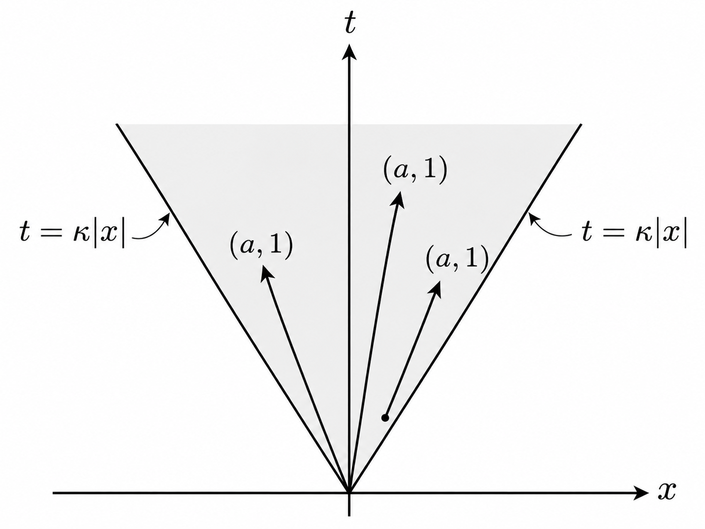
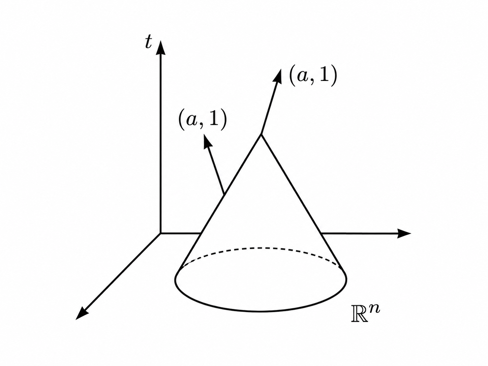
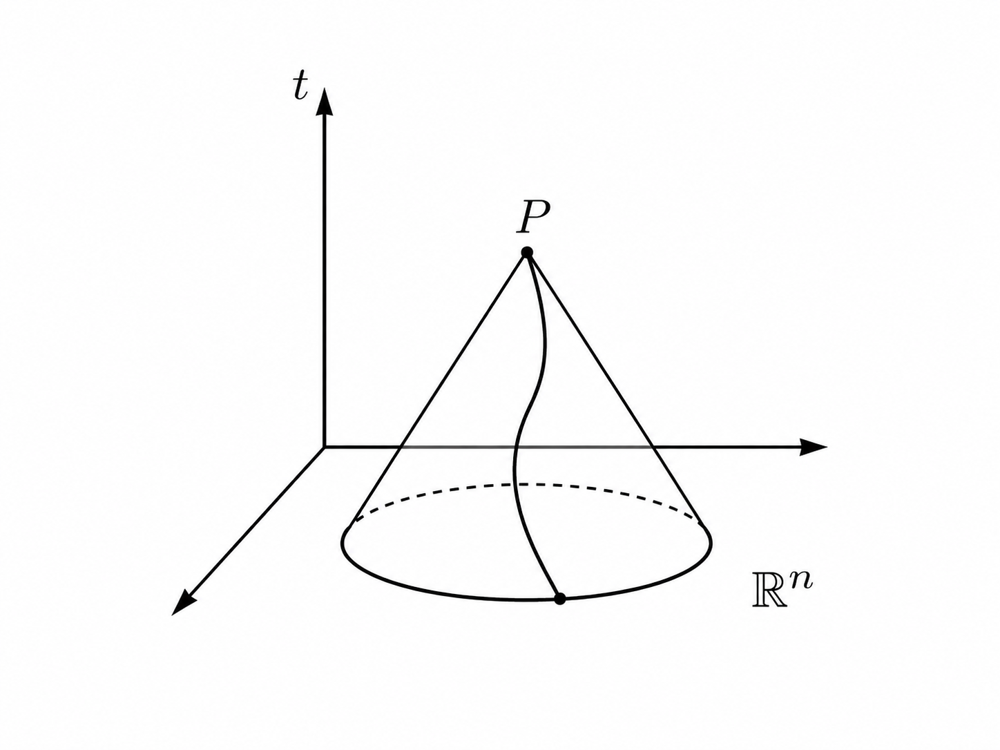

## 一、非特征超曲面

在研究偏微分方程时，一个最基本的问题是：给定某些已知条件以后，我们能否确定未知函数？

例如，对于一阶偏微分方程（First-Order Partial Differential Equation，PDE）

$$
u_x+u_t=0,
$$

我们可以验证，对于任意可微函数 $g$，$u(x,t)=g(x-t)$ 都满足原方程。因为

$$
u_x=g'(x-t),\qquad u_t=-g'(x-t),
$$

所以 $u_x+u_t=0$。

这说明，单凭微分方程还无法确定一个具体的解。为了从无穷多个可能的函数中确定我们需要的函数，就必须增加额外条件。

例如，给定

$$
u(x,0)=u_0(x),
$$

其中 $u_0$ 是预先确定的已知函数。那么代入前面的表达式，就可以得到

$$
u(x,t)=u_0(x-t).
$$

如果将 $t$ 理解为时间，这意味着初始函数的图像随着时间向右平移，而形状保持不变。

但是，这里还存在一个没有解决的问题：为什么在 $t=0$ 上规定初值，就能够确定解？如果把初值规定在其他曲线上，结果是否仍然相同？

### Cauchy 问题

为了研究这个问题，我们首先需要将初始条件推广到一般情形。

考虑定义在区域 $\Omega\subset\mathbb R^n$ 中的一阶 PDE：

$$
F(x,u,\nabla u)=0.
$$

现在选取一个光滑的 $(n-1)$ 维超曲面 $\Sigma$，并预先规定未知函数在这个超曲面上的取值：

$$
u|_\Sigma=u_0.
$$

其中，$\Sigma$ 称为**初始超曲面（initial hypersurface）**，$u_0$ 称为**初始函数（initial function）**，给定的数据也称为 Cauchy 数据（Cauchy data）。将 PDE 与这样的初始条件结合起来，就形成了 **Cauchy 问题（Cauchy problem，也称柯西问题）**。

它研究的是：已知未知函数在某个超曲面上的取值，能否利用微分方程确定它在附近区域中的取值？

例如，在二维空间中，初始超曲面是一条曲线；在三维空间中，它通常是一个二维曲面。而我们熟悉的 $t=0$，只是其中一种特殊的初始超平面。

不过，并非任何初始超曲面都能够使 Cauchy 问题具有唯一解。

### 特征方向

重新考虑

$$
u_x+u_t=0.
$$

之前我们将初值规定在 $t=0$ 上，现在改成在直线 $x=t$ 上规定：

$$
u(s,s)=h(s).
$$

由于解必须具有 $u(x,t)=g(x-t)$ 的形式，所以在 $x=t$ 上，

$$
u(s,s)=g(0).
$$

这意味着，解在整条直线 $x=t$ 上必须保持常数。如果给定的 $h(s)$ 不是常数，那么根本不存在满足初始条件的解；如果 $h(s)$ 是常数，那么满足条件的解又有无穷多个，因为它只确定了 $g(0)$，没有确定整个函数 $g$。

为什么同一个 PDE，在不同初始曲线上规定初值，会得到完全不同的结果？

关键在于方程自身规定的方向。

原方程可以写成

$$
\nabla u\cdot(1,1)=0.
$$

根据方向导数的定义，这意味着函数沿向量 $(1,1)$ 所指定的方向，变化率为零。

如果构造一条切向方向始终为 $(1,1)$ 的曲线，那么它满足

$$
\frac{dx}{ds}=1,\qquad \frac{dt}{ds}=1.
$$

积分得到 $x-t=C$。这些直线就是该方程的**特征曲线（characteristic curves）**。之所以称为“特征”，是因为它们的方向直接由 PDE 的一阶导数系数决定，并且解沿这些曲线具有特殊的变化规律：对于当前的齐次方程，函数值保持不变。

现在回到初始曲线 $x=t$。它本身就是一条特征曲线，切向方向恰好也是 $(1,1)$。因此，初始条件只是在同一条特征曲线上重复规定函数值，无法提供确定其他方向上函数变化的信息。

相反，直线 $t=0$ 与特征方向横截相交。我们可以从这条直线上的不同初始点出发，沿特征方向将初值传播到附近的点。

这就引出了**特征条件（characteristic condition）和非特征条件（noncharacteristic condition）**。

对于一阶线性 PDE，如果初始超曲面在某点的切空间包含方程所规定的特征方向，那么它在该点是特征的；如果特征方向与初始超曲面横截，则它在该点是非特征的。

因此，初始超曲面的选择并不只是几何上的任意规定。它必须与 PDE 自身的微分结构相适应，才能使初始数据有可能确定附近的解。

### 法向导数

我们还可以从另一个角度理解非特征条件的必要性。

考虑一般的一阶线性 PDE：

$$
\sum_{i=1}^n a_i(x)u_{x_i}+b(x)u=f(x).
$$

其中，$a_i(x)$ 是各个一阶偏导数的系数，$b(x)$ 是未知函数本身的系数，$f(x)$ 是非齐次项。

为了方便讨论，假设初始超曲面是平面 $x_n=0$。将前 $n-1$ 个坐标记作 $x'=(x_1,\ldots,x_{n-1})$，初始条件便是

$$
u(x',0)=u_0(x').
$$

这里，$u_0$ 是已知函数，所以我们可以直接计算它的各阶导数。

首先，对于 $i=1,\ldots,n-1$，对初始条件关于 $x_i$ 求导：

$$
u_{x_i}(x',0)=u_{0,x_i}(x').
$$

这意味着，沿初始平面内部各个方向的偏导数都已经确定，它们称为切向导数（tangential derivatives）。

但是，沿 $x_n$ 方向的导数 $u_{x_n}$ 还不知道。因为初始函数只规定了平面上的函数值，没有直接告诉我们函数离开这个平面以后怎样变化。

这个未知导数称为法向导数（normal derivative）。要确定它，我们必须利用 PDE 本身：

$$
a_nu_{x_n}
=f-bu-\sum_{i=1}^{n-1}a_i u_{x_i}.
$$

由于右边的函数值、切向导数及各项系数都已经确定，只要 $a_n\neq0$，就可以解出

$$
\boxed{
u_{x_n}
=\frac{f-bu-\sum_{i=1}^{n-1}a_i u_{x_i}}{a_n}.
}
$$

**这就是非特征条件在代数上的来源：为了通过方程确定未知的法向导数，法向导数前面的系数必须非零。**

它的意义还不止于确定一阶导数。

假设解和数据足够光滑，我们可以继续对 PDE 求导，依次确定更高阶导数。例如，初始函数已经确定了全部二阶切向导数 $u_{x_ix_j}$（$i,j<n$）。对原 PDE 关于各个切向变量求导，可以在 $a_n\neq0$ 的条件下解出混合导数 $u_{x_ix_n}$；然后再对法向变量 $x_n$ 求导，便能够解出 $u_{x_nx_n}$。

这样，全部二阶导数就都确定了。对于三阶以及更高阶导数，可以按照相同的思路反复进行。

因此，只要 $a_n\neq0$，并且具有相应的光滑性，就能够利用初始函数和 PDE 逐阶确定假定存在的解在初始平面上的全部导数。

这并不意味着我们已经求出了完整的解。因为即使知道一个光滑函数在某个平面上的全部导数，也未必足以确定它在平面之外的取值。这里得到的是解的局部导数信息，真正的解还需要在后面的特征线法中构造。

### 一般超曲面

前面的讨论建立在初始平面 $x_n=0$ 上。但是，一般 Cauchy 问题中的初始超曲面可能是弯曲的。

为了将前面的结论推广出去，作者考虑一个由 $\varphi(x)=0$ 定义的光滑超曲面 $\Sigma$，其中 $\nabla\varphi\neq0$。

我们已经知道，$\nabla\varphi$ 是超曲面的法向量。现在引入新坐标：

$$
y=(x_1,\ldots,x_{n-1},\varphi(x)).
$$

这样，原来满足 $\varphi(x)=0$ 的超曲面，在新坐标中就变成了 $y_n=0$。

换句话说，我们希望通过改变坐标，将弯曲的初始超曲面局部转化为平面，从而继续使用前面已经得到的结论。

要保证这种坐标变换在局部合法，就需要它具有局部逆映射。为此，作者计算其 Jacobian 行列式，得到

$$
\det J=\varphi_{x_n}.
$$

由于 $\nabla\varphi\neq0$，通过适当调整坐标方向，可以令所讨论点处的 $\varphi_{x_n}\neq0$。因此，根据逆函数定理（Inverse Function Theorem），这个坐标变换在该点附近可逆。

现在将原来的 PDE 写成新坐标形式。根据链式法则，

$$
u_{x_i}
=\sum_{k=1}^n\frac{\partial y_k}{\partial x_i}u_{y_k}.
$$

将其代入原方程，便可以发现，新坐标中法向导数 $u_{y_n}$ 前面的系数恰好是

$$
\sum_{i=1}^n a_i(x)\varphi_{x_i}(x)
=a(x)\cdot\nabla\varphi(x),
$$

其中 $a(x)=(a_1(x),\ldots,a_n(x))$。

因此，要在新坐标中解出法向导数，就必须要求

$$
a(x_0)\cdot\nabla\varphi(x_0)\neq0.
$$

由于 $\nabla\varphi(x_0)$ 与超曲面的法向量 $\nu$ 平行，所以这个条件又可以写成

$$
\boxed{a(x_0)\cdot\nu\neq0.}
$$

这就是一般一阶线性 PDE 的非特征条件。

它要求系数向量 $a(x_0)$ 不能与初始超曲面相切。对于平面 $x_n=0$，法向量为 $(0,\ldots,0,1)$，所以上述条件恰好退化为此前的 $a_n(x_0)\neq0$。

这样一来，非特征条件就具有了统一的几何意义：它描述的是方程的一阶导数系数向量与初始超曲面之间的横截关系。

而且，这种关系在可逆的 $C^1$ 坐标变换下保持不变。改变坐标只会改变向量和超曲面的表达方式，并不会改变它们是否相切。

这里还需要区分两个概念：一个超曲面可以在某些点处非特征，在其他点处特征。只有当非特征条件在超曲面的每一点都成立时，才能称整个超曲面为非特征超曲面。

## 二、拟线性方程

此前讨论的是线性 PDE，其一阶导数系数只依赖于自变量。现在考虑，如果这些系数还依赖于未知函数 $u$，非特征条件会发生什么变化？

这就进入了一阶拟线性偏微分方程（first-order quasilinear partial differential equation）：

$$
\sum_{i=1}^n a_i(x,u)u_{x_i}=f(x,u).
$$

这里的各个一阶导数仍然线性出现，但它们的系数可以依赖于未知函数本身。

我们仍然在初始平面 $x_n=0$ 上规定

$$
u(x',0)=u_0(x').
$$

由于初始函数已知，切向导数也已经确定。于是，从原方程中仍然可以单独解出法向导数：

$$
u_{x_n}
=\frac{f(x,u)-\sum_{i=1}^{n-1}a_i(x,u)u_{x_i}}{a_n(x,u)}.
$$

但现在的分母是 $a_n(x,u)$，它依赖于未知函数的取值。

在初始平面上，我们已经知道 $u=u_0$。因此，在原点处，非特征条件变成

$$
\boxed{a_n(0,u_0(0))\neq0.}
$$

这意味着，**拟线性方程的非特征条件不仅取决于方程与初始超曲面，还取决于给定的初始函数。**

例如，考虑方程

$$
u\,u_x+u_y=0.
$$

如果初始曲线为 $x=0$，并给定 $u(0,y)=g(y)$，那么未知法向导数就是 $u_x$，它的系数为 $u$。

因此，在初始曲线上，非特征条件就是

$$
g(y)\neq0.
$$

如果给定 $g(y)=1$，那么初始曲线处处非特征；如果给定 $g(y)=y$，那么它在原点处是特征的，而在其他位置是非特征的。

这说明，同一条初始曲线，对于同一个拟线性 PDE，也可能因为初始函数不同而具有不同的非特征性质。

其原因在于，方程的系数向量现在是 $a(x,u)$，而它的方向会随着 $u$ 的取值改变。在初始超曲面上，$u$ 的取值由初始函数 $u_0$ 决定，所以初值会直接影响特征方向。

因此，对于一般光滑超曲面 $\Sigma$，设 $\nu$ 是它在 $x_0$ 处的法向量，那么拟线性 PDE 的非特征条件可以写成

$$
\boxed{
a(x_0,u_0(x_0))\cdot\nu\neq0.
}
$$

与线性 PDE 相比，它的几何意义没有改变：方程的方向向量仍然必须横截初始超曲面。区别只在于，这个方向向量现在需要先代入初始函数的取值才能确定。

## 三、一般非线性方程

接下来，我们进一步考虑一般的一阶非线性 PDE：

$$
F(x,u,\nabla u)=0.
$$

这里出现了新的困难。在拟线性方程中，一阶导数虽然具有依赖于 $u$ 的系数，但仍然以线性形式出现，所以我们可以直接解出法向导数。

然而，在一般非线性 PDE 中，导数本身也可能以平方、乘积或者其他非线性形式出现。因此，即使已经知道全部切向导数，也未必能够直接得到唯一的法向导数。

例如，考虑

$$
|\nabla u|^2=1,
$$

也就是

$$
\sum_{i=1}^n u_{x_i}^2=1.
$$

这个方程是一类程函方程（Eikonal equation）。

仍然假设初始平面为 $x_n=0$，并给定

$$
u(x',0)=u_0(x').
$$

由于初始函数已知，我们可以直接确定所有切向导数，即 $u_{x_i}=u_{0,x_i}$（$i<n$）。

因此，在初始平面上，

$$
\sum_{i=1}^{n-1}u_{x_i}^2
=|\nabla_{x'}u_0|^2.
$$

代入原方程：

$$
|\nabla_{x'}u_0|^2+u_{x_n}^2=1.
$$

整理得到

$$
\boxed{
u_{x_n}^2=1-|\nabla_{x'}u_0|^2.
}
$$

这个结果揭示了三种不同的情况。

当 $|\nabla_{x'}u_0|>1$ 时，右边小于零，不存在实数法向导数满足方程，因此初值与 PDE 不相容。

当 $|\nabla_{x'}u_0|=1$ 时，法向导数只能取零。但此时方程在法向导数上的非线性关系处于退化位置，后面将看到，非特征条件并不成立。

当 $|\nabla_{x'}u_0|<1$ 时，可以得到两个不同的法向导数：

$$
u_{x_n}
=\pm\sqrt{1-|\nabla_{x'}u_0|^2}.
$$

因此，即使初值与 PDE 相容，也可能存在不同的法向导数分支。

例如，在二维空间中，给定 $u(x,0)=0$，那么 $u_x(x,0)=0$，所以 $u_y(x,0)=\pm1$。于是，$u(x,y)=y$ 和 $u(x,y)=-y$ 都满足原 PDE，并且在初始直线上具有完全相同的函数值。

这个例子说明，对于一般非线性 PDE，我们首先需要确定初值与方程是否相容；如果存在多个法向导数分支，还需要明确选择哪一个分支。

### 隐函数定理

现在，我们希望将前面线性、拟线性方程中的非特征条件，推广到一般非线性方程。

问题仍然是：在已知初始函数和切向导数的情况下，能否在局部解出法向导数？

令

$$
p_i=u_{x_i},\qquad i=1,\ldots,n.
$$

那么，原方程就可以写成

$$
F(x,u,p_1,\ldots,p_n)=0.
$$

其中 $p_1,\ldots,p_{n-1}$ 已经由初始函数确定，只有 $p_n$ 是未知的。

因此，我们实际面对的是一个关于 $p_n$ 的非线性方程。为了能够在某个已知的相容解附近，将 $p_n$ 表示成其他变量的函数，就需要使用隐函数定理（Implicit Function Theorem）。

根据隐函数定理，如果在所选的相容梯度值处满足

$$
\boxed{F_{p_n}\neq0,}
$$

那么就可以在该点附近，局部唯一地将 $p_n$ 表示为其他变量的光滑函数。

这里的 $F_{p_n}$ 表示函数 $F$ 对梯度变量 $p_n$ 的偏导数。它的作用与前面线性方程中的系数 $a_n$ 完全对应：我们要求方程对未知法向导数的变化具有非零响应，从而保证能够局部解出这个导数。

对于一般初始超曲面，将 $F$ 对各个梯度变量的偏导数组成向量

$$
F_p=(F_{p_1},\ldots,F_{p_n}),
$$

那么非特征条件可以统一写成

$$
\boxed{
F_p(x_0,u_0(x_0),p)\cdot\nu\neq0.
}
$$

其中，$p$ 是在点 $x_0$ 处与初始切向导数相容、并满足原方程的选定梯度，$\nu$ 是初始超曲面的法向量。

这里的几何意义仍然与之前相似：向量 $F_p$ 必须与初始超曲面横截。只是现在决定这一方向的，不再是简单的导数系数，而是非线性函数 $F$ 对梯度变量的偏导数。

最后，回到刚才的程函方程：

$$
F(x,u,p)=|p|^2-1.
$$

因为

$$
F_{p_n}=2p_n=2u_{x_n},
$$

所以非特征条件就是 $u_{x_n}\neq0$。

结合此前得到的

$$
u_{x_n}^2=1-|\nabla_{x'}u_0|^2,
$$

就知道非特征条件成立，当且仅当

$$
\boxed{|\nabla_{x'}u_0|<1.}
$$

因此，对于这个非线性方程，初值的切向梯度必须足够小，才能在相容的梯度分支上满足非特征条件。即使如此，正负两个法向导数分支仍然需要分别选择。

## 四、三种非特征条件

经过前面的讨论，我们可以把三类一阶 PDE 的非特征条件统一整理出来。它们都在解决同一个问题：**已知初始函数及其切向导数以后，能否利用 PDE 在局部确定法向导数？**

**1. 线性 PDE（Linear PDE）**

| 项目 | 内容 |
|---|---|
| 方程形式 | $\displaystyle\sum_{i=1}^n a_i(x)u_{x_i}+b(x)u=f(x)$ |
| 初始超曲面 | $\Sigma$，在 $x_0$ 处的法向量为 $\nu$ |
| 非特征条件 | $\boxed{a(x_0)\cdot\nu\neq0}$ |
| 判断依据 | 方程的一阶导数系数与超曲面的法向量 |
| 几何意义 | 系数向量 $a(x_0)$ 不与超曲面相切 |

**2. 拟线性 PDE（Quasilinear PDE）**

| 项目 | 内容 |
|---|---|
| 方程形式 | $\displaystyle\sum_{i=1}^n a_i(x,u)u_{x_i}=f(x,u)$ |
| 初始超曲面 | $\Sigma$，初始函数为 $u_0$ |
| 非特征条件 | $\boxed{a(x_0,u_0(x_0))\cdot\nu\neq0}$ |
| 判断依据 | 方程系数、初始超曲面以及初始函数的取值 |
| 几何意义 | 将初值代入后，系数向量不与超曲面相切 |

**3. 一般非线性 PDE（General Nonlinear PDE）**

| 项目 | 内容 |
|---|---|
| 方程形式 | $F(x,u,\nabla u)=0$ |
| 辅助变量 | $p=\nabla u$ |
| 相容性要求 | 选定的 $p$ 与初始切向导数相容，并满足 $F(x_0,u_0(x_0),p)=0$ |
| 非特征条件 | $\boxed{F_p(x_0,u_0(x_0),p)\cdot\nu\neq0}$ |
| 判断依据 | 原方程对梯度变量的偏导数，以及选定的相容梯度 |
| 几何意义 | 向量 $F_p$ 不与初始超曲面相切 |
| 特殊情况 | 可能存在多个法向导数分支，需要分别选择 |

## 五、特征线法

上一节已经证明，对于一阶 PDE，只要初始超曲面满足非特征条件，就可以通过初始函数和方程本身，逐阶确定假定存在的光滑解在初始超曲面上的导数。

但是，确定这些导数并不等于真正求出了函数。我们仍然需要一种方法，将初始超曲面上已经给定的函数值扩展到附近的区域，同时保证扩展后的函数满足原 PDE。

这就引出了**特征线法（Method of Characteristics）**。它的基本思想是寻找由方程自身决定的曲线，将 PDE 转化为沿这些曲线的常微分方程（Ordinary Differential Equation，ODE），再利用已知的初始数据构造局部解。

### 齐次线性方程

首先考虑一阶齐次线性 PDE：

$$
\sum_{i=1}^n a_i(x)u_{x_i}=0,
$$

以及初始条件

$$
u(x',0)=u_0(x').
$$

将一阶偏导数的系数组成向量 $a(x)=(a_1(x),\ldots,a_n(x))$，原方程可以写成

$$
\boxed{a(x)\cdot\nabla u(x)=0.}
$$

这个形式揭示了方程本身规定的变化规律：$a(x)\cdot\nabla u(x)$ 是函数沿向量 $a(x)$ 的方向导数，因此原方程意味着，函数沿这个方向的变化率为零。

如果能够找到一条曲线，使它在每一点的切向量都是 $a(x)$，那么沿着这条曲线，函数值就必然保持常数。

为此，考虑参数曲线 $x=x(s)$。根据链式法则，

$$
\frac{d}{ds}u(x(s))
=\sum_{i=1}^n u_{x_i}\frac{dx_i}{ds}.
$$

与原方程比较，只要令

$$
\boxed{\frac{dx_i}{ds}=a_i(x),\qquad i=1,\ldots,n,}
$$

便有

$$
\frac{d}{ds}u(x(s))
=\sum_{i=1}^n a_i(x)u_{x_i}=0.
$$

所以，$u$ 沿这条曲线保持常数。

满足 $dx/ds=a(x)$ 的曲线称为向量场 $a$ 的积分曲线（Integral Curve）。在当前 PDE 中，它也称为特征曲线（Characteristic Curve），而相应的 ODE 称为特征常微分方程。

特征曲线的方向来自 PDE 的一阶导数系数。对于不同的方程，这个方向可能随着空间位置变化，因此特征曲线未必是直线。

### 局部解

现在，从初始超平面 $x_n=0$ 上的点 $(y,0)$ 出发，求解特征 ODE：

$$
\begin{cases}
\dfrac{dx}{ds}=a(x),\\[4pt]
x(0)=(y,0).
\end{cases}
$$

其中，$y\in\mathbb R^{n-1}$ 表示初始位置，$s$ 表示沿曲线移动的参数。

求解后得到

$$
x=x(y,s).
$$

由于函数沿特征曲线保持常数，而这条曲线从 $(y,0)$ 出发，所以我们可以规定

$$
\boxed{u(x(y,s))=u_0(y).}
$$

这样，初始函数 $u_0$ 在每一个初始点上的取值，就沿着对应的特征曲线被延伸到初始超平面之外。

但这里还存在一个问题：我们真正需要的是以空间坐标 $x$ 为自变量的函数 $u(x)$，而现在的表达式使用的是参数 $(y,s)$。

因此，必须证明映射

$$
(y,s)\longmapsto x(y,s)
$$

在局部可以反过来求解，即能够从空间位置 $x$ 唯一确定相应的 $(y,s)$。

**引理 2.2.2** 证明了这一点。由于 $x(y,0)=(y,0)$，而 $x_s=a(x)$，所以这个映射在原点处的 Jacobian 行列式恰好为

$$
\det J(0)=a_n(0).
$$

根据上一节的非特征条件，

$$
a_n(0)\neq0.
$$

因此，由逆函数定理（Inverse Function Theorem），映射 $(y,s)\mapsto x(y,s)$ 在原点附近是微分同胚（Diffeomorphism），即它与逆映射都足够光滑。

这意味着，对于原点附近任意一点 $\bar x$，都可以找到唯一的 $(\bar y,\bar s)$，使得

$$
\bar x=x(\bar y,\bar s).
$$

于是，我们就能通过

$$
\boxed{u(\bar x)=u_0(\bar y)}
$$

定义附近的函数值。

这里可以进一步理解 2.1 节与 2.2 节之间的联系。初始超平面已经提供了 $n-1$ 个独立的切向方向，而特征曲线需要提供剩下的一个方向。非特征条件保证特征方向不与初始超平面相切，因此初始位置参数 $y$ 与曲线参数 $s$ 能够共同构成一套局部坐标。

在 2.1 节中，这个条件使我们能够解出法向导数；在这里，它保证我们能够通过特征曲线，从初始数据真正构造出局部解。

作者随后引入两个概念。对于目标点 $\bar x$，它的函数值只取决于对应初始点 $(\bar y,0)$ 的数据，因此这个初始点构成当前方程的依赖域（Domain of Dependence）。反过来，初始点 $(\bar y,0)$ 处的数据沿其对应的特征曲线传播，这条曲线就是该初始数据的影响范围（Range of Influence）。

不过，引理 2.2.2 只证明了局部可逆性，因此我们首先得到的也是局部解。若希望将解延拓到整个空间，就需要保证相关特征曲线能够与初始超曲面建立一致的对应关系。如果某条特征曲线不与初始超曲面相交，那么对应位置的函数值便无法由初值确定；如果同一条特征曲线与初始超曲面相交多次，那么这些交点上的初值必须相互一致。

### 例 2.2.3

考虑

$$
\begin{cases}
u_t+u_x=0,\\
u(x,0)=u_0(x).
\end{cases}
$$

初始直线 $t=0$ 满足非特征条件。根据方程的一阶导数系数，特征 ODE 为

$$
\frac{dx}{ds}=1,\qquad
\frac{dt}{ds}=1.
$$

从初始点 $(x_0,0)$ 出发，规定 $x(0)=x_0$、$t(0)=0$，积分得到

$$
x=x_0+s,\qquad t=s.
$$

消去 $s$：

$$
\boxed{x-t=x_0.}
$$

这说明特征曲线是斜率为 $1$ 的直线。由于函数沿这些直线保持常数，所以

$$
u(x,t)=u_0(x_0).
$$

再利用 $x_0=x-t$，得到

$$
\boxed{u(x,t)=u_0(x-t).}
$$

如果将 $t$ 视为时间，那么这个解表示初始函数以速度 $1$ 向右平移，形状保持不变。

在这个例子中，每一条特征直线都与初始直线 $t=0$ 恰好相交一次，并且任意 $(x,t)$ 都能唯一确定 $x_0=x-t$。因此，只要 $u_0$ 在整个实数轴上光滑定义，这个解就可以在整个平面上定义。

## 六、拟线性方程

### 特征方程

接下来，作者将特征线法推广到一阶拟线性 PDE：

$$
\boxed{
\sum_{i=1}^n a_i(x,u)u_{x_i}=f(x,u).
}
$$

初始条件仍然是 $u(x',0)=u_0(x')$，并假设非特征条件

$$
a_n(0,u_0(0))\neq0
$$

成立。

与齐次线性方程相比，现在的系数 $a_i$ 可以依赖于未知函数 $u$。因此，特征曲线的方向不再只由已知的空间位置决定，还取决于函数值。

如果仍然规定

$$
\frac{dx}{ds}=a(x,u),
$$

就无法单独求出特征曲线，因为其中包含尚未求出的 $u$。

不过，我们可以继续利用链式法则研究函数沿曲线的变化：

$$
\begin{aligned}
\frac{du}{ds}
&=\sum_{i=1}^n u_{x_i}\frac{dx_i}{ds}\\
&=\sum_{i=1}^n a_i(x,u)u_{x_i}\\
&=f(x,u).
\end{aligned}
$$

因此，将位置与函数值放在一起，就得到完整的特征 ODE 系统：

$$
\boxed{
\begin{cases}
\dfrac{dx}{ds}=a(x,u),\\[5pt]
\dfrac{du}{ds}=f(x,u).
\end{cases}
}
$$

相应的初始条件为

$$
x(0)=(y,0),\qquad u(0)=u_0(y).
$$

这里，$x$ 有 $n$ 个分量，$u$ 有一个分量，所以整个系统包含 $n+1$ 个未知函数和 $n+1$ 个 ODE。

求解以后，作者记作

$$
x=x(y,s),\qquad u=\varphi(y,s).
$$

与引理 2.2.2 类似，在非特征条件下，映射 $(y,s)\mapsto x(y,s)$ 在原点附近可逆。于是，对于给定的空间位置 $\bar x$，先确定唯一的 $(\bar y,\bar s)$，再令

$$
\boxed{u(\bar x)=\varphi(\bar y,\bar s).}
$$

这样就完成了拟线性 PDE 的局部构造。

可以看到，方法的基本结构没有改变：仍然是先求特征 ODE，再将特征参数还原为空间坐标。新的困难在于特征方向依赖函数值，因此必须同时求解 $x$ 和 $u$。

### 例 2.2.4

作者首先考虑一个非齐次线性方程：

$$
\begin{cases}
u_t-u_x=f(x,t),\\
u(x,0)=u_0(x).
\end{cases}
$$

这里虽然仍是线性方程，但它能够清楚地说明，当原方程右边不为零时，函数值如何沿特征曲线变化。

特征 ODE 为

$$
\frac{dx}{ds}=-1,\qquad
\frac{dt}{ds}=1,\qquad
\frac{du}{ds}=f(x,t).
$$

初始条件为

$$
x(0)=x_0,\qquad t(0)=0,\qquad u(0)=u_0(x_0).
$$

先求解位置：

$$
x=x_0-s,\qquad t=s.
$$

再代入关于 $u$ 的方程：

$$
\frac{du}{ds}=f(x_0-s,s).
$$

对 $s$ 积分：

$$
u=u_0(x_0)+\int_0^s f(x_0-\tau,\tau)\,d\tau.
$$

最后利用 $s=t$、$x_0=x+t$，得到

$$
\boxed{
u(x,t)=u_0(x+t)+\int_0^t f(x+t-\tau,\tau)\,d\tau.
}
$$

这个解包含两个部分：$u_0(x+t)$ 是沿特征曲线追溯到初始位置得到的函数值；积分项则表示非齐次项 $f$ 沿特征曲线产生的累积变化。

因此，对于非齐次方程，函数沿特征曲线不一定保持常数，但它的变化仍然可以由一个 ODE 确定。

### 例 2.2.5

接下来，作者考虑无黏性 Burgers 方程（Inviscid Burgers Equation）：

$$
\begin{cases}
u_t+uu_x=0,\\
u(x,0)=u_0(x).
\end{cases}
$$

这是一个真正的拟线性方程，因为 $u_x$ 的系数就是未知函数 $u$ 本身。

初始直线 $t=0$ 始终满足非特征条件。根据前面的方法，特征 ODE 为

$$
\frac{dx}{ds}=u,\qquad
\frac{dt}{ds}=1,\qquad
\frac{du}{ds}=0.
$$

取初始条件 $x(0)=x_0$、$t(0)=0$、$u(0)=u_0(x_0)$。

由于 $du/ds=0$，所以沿特征曲线有 $u=u_0(x_0)$。再利用 $t=s$，得到

$$
\boxed{x=x_0+t\,u_0(x_0).}
$$

这就是公式 (2.2.6)。

它说明，每条特征曲线都从初始点 $x_0$ 出发，并以速度 $u_0(x_0)$ 运动。由于不同初始位置可能具有不同的函数值，所以不同特征曲线的传播速度也可能不同。

只要特征坐标在局部可逆，就可以由 $(x,t)$ 解出初始位置 $x_0=x_0(x,t)$，从而得到

$$
u(x,t)=u_0(x_0(x,t)).
$$

也可以消去 $x_0$，写成隐式表达式：

$$
\boxed{u=u_0(x-ut).}
$$

不过，这个局部解能否延拓到整个空间，还取决于特征线的演化。

假设 $x_0<x_1$，但 $u_0(x_0)>u_0(x_1)$。那么左侧特征线的运动速度更大，可能追上右侧特征线。两条曲线相交的时间满足

$$
\boxed{
T=-\frac{x_0-x_1}{u_0(x_0)-u_0(x_1)}>0.
}
$$

一旦两条携带不同函数值的特征线相交，同一个空间位置就会被要求具有两个不同的函数值。因此，原来的经典解无法继续作为连续函数延拓到相交点。

作者进一步取一个具体的初始函数：

$$
u_0(x)=-x.
$$

此时特征曲线满足

$$
x=x_0(1-t).
$$

当 $t=1$ 时，无论 $x_0$ 取什么值，都有 $x=0$。因此，所有特征线都在 $(0,1)$ 相交。

当 $t<1$ 时，由 $x_0=x/(1-t)$，得到

$$
\boxed{
u(x,t)=\frac{x}{t-1}.
}
$$

这个函数无法延拓为 $t=1$ 附近的光滑解。事实上，

$$
u_x=\frac{1}{t-1},
$$

当 $t\to1^-$ 时，空间导数趋于负无穷。

这种现象称为梯度爆破（Gradient Blow-Up）。

为什么初始直线明明满足非特征条件，解却仍然失效？因为非特征条件只保证最初的特征坐标在局部可逆，并没有保证这种可逆性能够一直保持。

对于 Burgers 方程，特征映射为 $x=x_0+t\,u_0(x_0)$，它关于初始位置的导数为

$$
\frac{\partial x}{\partial x_0}=1+t\,u_0'(x_0).
$$

当这个值趋于零时，特征映射可能失去局部可逆性，解的空间梯度也可能随之发散。

因此，Burgers 方程说明：**即使初始数据光滑、非特征条件成立，一阶非线性 PDE 的经典解也可能在有限时间内失去光滑性。**

### 积分解

Burgers 方程的例子自然引出了下一个问题：如果经典解在有限时间内失效，是否还能用更一般的方式理解方程的解？

作者首先利用 Burgers 方程的守恒形式：

$$
u_t+\left(\frac{u^2}{2}\right)_x=0.
$$

然后推广到标量守恒律（Scalar Conservation Law）：

$$
\boxed{u_t+\bigl(F(u)\bigr)_x=0,}
$$

其中 $F$ 是给定的光滑函数。

取一个具有紧支撑的 $C^1$ 测试函数 $\varphi(x,t)$，将原方程乘以 $\varphi$ 后进行分部积分，可以得到

$$
\boxed{
\int_{\mathbb R\times(0,\infty)}
\left[u\varphi_t+F(u)\varphi_x\right]\,dx\,dt=0.
}
$$

这就是原书的公式 (2.2.8)。

与原 PDE 相比，这个积分等式将导数从未知函数 $u$ 转移到了测试函数 $\varphi$ 上。因此，即使 $u$ 不具有经典导数，也有可能满足这一积分关系。

作者将对所有这样的测试函数都满足积分等式的局部有界函数称为积分解（Integral Solution）。

这允许某些不连续函数成为解。即使初值连续，积分解也可能沿某条曲线出现跳跃不连续，这种现象称为激波（Shock）。

这部分只是对守恒律与激波理论的简要引入，原书并没有继续研究积分解的唯一性或激波的具体结构。

### 相容性条件

最后，作者回到初始超曲面的选择问题。

此前的构造始终假设初始超曲面是非特征的。如果初始平面 $x_n=0$ 在原点处相对于初值 $u_0$ 是特征的，那么

$$
a_n(0,u_0(0))=0.
$$

此时，将拟线性 PDE

$$
\sum_{i=1}^n a_i(x,u)u_{x_i}=f(x,u)
$$

限制到原点，就会发现法向导数 $u_{x_n}(0)$ 前面的系数为零，因此它从方程中消失。

而剩下的切向导数又全部由初始函数确定，所以原方程要求

$$
\boxed{
\sum_{i=1}^{n-1}
a_i(0,u_0(0))u_{0,x_i}(0)
=f(0,u_0(0)).
}
$$

这就是公式 (2.2.9)，称为初值的相容性条件（Compatibility Condition）。

它的意义在于：当初始超曲面在某点是特征的，PDE 无法通过原来的方式确定法向导数，反而对已给定的初始数据提出了额外约束。如果初值不满足该约束，就不可能存在满足初始条件的光滑解。

不过，满足相容性条件也不一定保证局部解存在。因为它只检查原点处的代数关系，并没有保证能够恢复特征坐标的局部可逆性。作者将相应的反例留给习题 2.5。

## 七、一般非线性方程

### 初始梯度

现在进入 2.2 节的最后一部分。作者考虑一般的一阶非线性 PDE：

$$
\boxed{F(x,u,\nabla u)=0,}
$$

以及初始条件 $u(x',0)=u_0(x')$。

此前对于拟线性 PDE，我们只需要把位置 $x$ 和函数值 $u$ 放进同一个 ODE 系统。但对于一般非线性 PDE，方程还可能以非线性形式依赖梯度 $\nabla u$。因此，要确定特征方向，可能还需要知道未知函数的梯度。

为此，作者准备将梯度也作为独立变量，一起纳入特征 ODE 系统。

不过，这要求我们首先确定完整的初始梯度。

已知函数 $u_0$ 能够确定初始平面上的全部切向导数，剩下的法向导数仍然未知。根据上一节的讨论，我们首先选择一个标量 $a_0$，使其在原点处与 PDE 相容：

$$
F(0,u_0(0),\nabla_{x'}u_0(0),a_0)=0.
$$

如果还满足非特征条件

$$
\boxed{
F_{p_n}(0,u_0(0),\nabla_{x'}u_0(0),a_0)\neq0,
}
$$

那么根据隐函数定理，可以在原点附近得到一个光滑函数 $a(x')$，使得

$$
F((x',0),u_0(x'),\nabla_{x'}u_0(x'),a(x'))=0.
$$

这样，初始超平面上的完整梯度就确定为

$$
\nabla u(x',0)=\bigl(\nabla_{x'}u_0(x'),a(x')\bigr).
$$

对于一般非线性 PDE，可能存在多个相容的法向导数分支。这里的 $a_0$ 就是我们选择的一个分支在原点处的值；后面构造出的解也依赖于这一选择。

### 特征系统

现在，作者暂时假设存在一个光滑解，并引入梯度变量：

$$
\boxed{p_i=u_{x_i},\qquad i=1,\ldots,n.}
$$

于是原方程写成

$$
F(x,u,p)=0.
$$

为了确定梯度应当怎样沿特征曲线变化，对原方程关于 $x_i$ 求偏导。利用多元链式法则，以及混合二阶偏导数的交换关系，可以得到

$$
\boxed{
\sum_{j=1}^n F_{p_j}p_{i,x_j}
=-F_{x_i}-F_up_i.
}
$$

这就是原书的公式 (2.2.16)。

它的关键之处在于：对于每个固定的 $i$，这个式子都具有一阶拟线性 PDE 的形式，其中未知函数是 $p_i$，而它的各个一阶偏导数前面的系数是 $F_{p_j}$。

因此，根据之前的特征线法，我们自然选择特征方向

$$
\frac{dx_j}{ds}=F_{p_j}.
$$

沿这条曲线，梯度变量满足

$$
\frac{dp_i}{ds}
=\sum_{j=1}^n p_{i,x_j}\frac{dx_j}{ds}
=-F_{x_i}-F_up_i.
$$

与此同时，由 $p=\nabla u$ 和链式法则，函数值满足

$$
\frac{du}{ds}
=\sum_{j=1}^n p_jF_{p_j}.
$$

因此，作者得到一般非线性 PDE 的特征 ODE 系统：

$$
\boxed{
\begin{cases}
\displaystyle\frac{dx_j}{ds}=F_{p_j}(x,u,p),\\[6pt]
\displaystyle\frac{dp_i}{ds}=-F_{x_i}(x,u,p)-F_u(x,u,p)p_i,\\[6pt]
\displaystyle\frac{du}{ds}=\sum_{j=1}^n p_jF_{p_j}(x,u,p).
\end{cases}
}
$$

其中 $i,j=1,\ldots,n$。

这就是公式 (2.2.17)。它包含 $2n+1$ 个 ODE，对应 $n$ 个位置分量、$n$ 个梯度分量和一个函数值。

可以看到，特征方向 $F_p$ 同样来自原 PDE 自身的微分结构。它是在对原非线性方程求导以后，由梯度变量所满足的拟线性 PDE 确定的。

### 局部存在性

建立特征系统后，还需要给出初始条件。按照原书公式 (2.2.18)，从初始点 $(y,0)$ 出发，规定

$$
\boxed{
\begin{cases}
x(0)=(y,0),\\
u(0)=u_0(y),\\
p_i(0)=u_{0,x_i}(y),&i=1,\ldots,n-1,\\
p_n(0)=a(y).
\end{cases}
}
$$

这里，位置与函数值由原来的初值问题给定，切向梯度由 $u_0$ 的偏导数确定，而法向梯度由前面选定的相容分支 $a(y)$ 确定。

求解特征 ODE 后，得到

$$
x=x(y,s),\qquad
u=\varphi(y,s),\qquad
p=p(y,s).
$$

根据非特征条件，可以像引理 2.2.2 那样，证明 $(y,s)\mapsto x(y,s)$ 在原点附近是微分同胚。

因此，给定附近的空间位置 $\bar x$，能够唯一确定其对应的 $(\bar y,\bar s)$，从而定义

$$
\boxed{u(\bar x)=\varphi(\bar y,\bar s).}
$$

现在问题只剩下：这个构造出的函数是否真正满足原 PDE？

**定理 2.2.6** 给出了肯定的回答：按照上述方式构造的函数 $u$，是原初值问题的一个局部解。

这个定理的证明主要完成三个步骤。首先，利用非特征条件保证特征坐标局部可逆；其次，证明 $F(x,u,p)=0$ 沿特征曲线始终成立；最后，证明作为独立变量求解的 $p$，确实等于最终构造出的函数 $u$ 的梯度，即 $p=\nabla u$。

其中，最后一步是严格性上的关键，因为我们最初定义 $p=\nabla u$，却在求解 ODE 时将它当作独立变量。作者通过构造二者之差，并利用常微分方程的唯一性，证明这个关系在特征演化过程中始终保持。

因此，定理最终保证了

$$
F(x,u,\nabla u)=0.
$$

这就完成了一般一阶非线性 PDE 的局部解构造。

与前面的方法相比，这里虽然增加了梯度变量和相应的 ODE，但整体逻辑没有改变：从初始超曲面出发，利用 PDE 决定特征方向和沿曲线的变化规律，再通过非特征条件把特征参数中的结果还原为原空间中的局部解。

## 八、公式汇总

整个 2.2 节的三类方程，其特征线法具有共同的数学结构：先根据 PDE 确定特征方向，再建立沿特征曲线的 ODE，最后利用非特征条件及局部可逆性，从初始数据构造解。

随着方程的非线性程度增加，需要纳入 ODE 系统的未知量也逐渐增加。

### 1. 线性 PDE

| 项目 | 核心公式 |
|---|---|
| 齐次方程 | $a(x)\cdot\nabla u=0$ |
| 特征 ODE | $\displaystyle\frac{dx}{ds}=a(x)$ |
| 初始条件 | $x(0)=(y,0)$ |
| 沿特征线的变化 | $\displaystyle\frac{du}{ds}=0$ |
| 解的构造 | $u(x(y,s))=u_0(y)$ |
| 非特征条件 | $a_n(0)\neq0$ |
| 非齐次方程 $a(x)\cdot\nabla u=f(x)$ | $\displaystyle\frac{du}{ds}=f(x(s))$ |

线性方程的特征方向由已知系数决定，可以先独立求出特征曲线。对于齐次方程，函数沿特征曲线保持常数；对于非齐次方程，则沿特征曲线积分。

### 2. 拟线性 PDE

| 项目 | 核心公式 |
|---|---|
| 方程形式 | $\displaystyle\sum_{i=1}^n a_i(x,u)u_{x_i}=f(x,u)$ |
| 位置演化 | $\displaystyle\frac{dx}{ds}=a(x,u)$ |
| 函数值演化 | $\displaystyle\frac{du}{ds}=f(x,u)$ |
| 初始条件 | $x(0)=(y,0),\quad u(0)=u_0(y)$ |
| 解的构造 | $x=x(y,s),\quad u=\varphi(y,s)$ |
| 非特征条件 | $a_n(0,u_0(0))\neq0$ |
| Burgers 方程 | $u_t+uu_x=0$ |
| Burgers 特征线 | $x=x_0+t\,u_0(x_0)$ |
| Burgers 隐式解 | $u=u_0(x-tu)$ |

拟线性方程的特征方向还依赖函数值，因此需要同时求解位置 $x$ 和函数值 $u$，共 $n+1$ 个 ODE。Burgers 方程进一步说明，特征线可能在有限时间内相交，导致经典解失去光滑性。

### 3. 一般非线性 PDE

| 项目 | 核心公式 |
|---|---|
| 方程形式 | $F(x,u,\nabla u)=0$ |
| 梯度变量 | $p_i=u_{x_i}$ |
| 位置演化 | $\displaystyle\frac{dx_i}{ds}=F_{p_i}$ |
| 梯度演化 | $\displaystyle\frac{dp_i}{ds}=-F_{x_i}-F_up_i$ |
| 函数值演化 | $\displaystyle\frac{du}{ds}=\sum_{i=1}^n p_iF_{p_i}$ |
| 初始位置与函数值 | $x(0)=(y,0),\quad u(0)=u_0(y)$ |
| 初始切向梯度 | $p_i(0)=u_{0,x_i}(y),\quad i<n$ |
| 初始法向梯度 | $p_n(0)=a(y)$ |
| 相容性要求 | $F((y,0),u_0(y),\nabla_{x'}u_0(y),a(y))=0$ |
| 非特征条件 | $F_{p_n}(0,u_0(0),\nabla_{x'}u_0(0),a_0)\neq0$ |
| 局部解 | $u(x(y,s))=\varphi(y,s)$ |

一般非线性 PDE 的特征方向可能依赖梯度，因此必须同时求解 $x,u,p$，共 $2n+1$ 个 ODE。初始法向梯度需要先从原 PDE 中选择相容分支，再利用非特征条件确定其局部光滑表达。定理 2.2.6 保证最终构造出的梯度变量满足 $p=\nabla u$，从而真正得到原 PDE 的局部解。

至此，2.2 节完成了从齐次线性方程到一般非线性方程的特征线法构造。整个方法的基础始终是链式法则、常微分方程的局部求解，以及非特征条件所保证的特征坐标局部可逆性。

## 九、先验估计

在上一节中，我们通过特征线法，将一阶 PDE 转化为常微分方程，从而构造局部解。然而，对于更复杂的 PDE，我们未必能够直接求出解的表达式，甚至可能尚未证明解的存在性。因此，我们还需要一种方法，在不知道解的具体形式时，研究它必须满足的性质。

这就引出了**先验估计（A Priori Estimates）**。它的基本思想是：先假设解存在，再利用 PDE 本身，建立解的某种范数与已知数据之间的不等式。例如，

$$
\|u\|\le C\bigl(\|u_0\|+\|f\|\bigr).
$$

这里 $u$ 是未知解，$u_0$ 是初始函数，$f$ 是非齐次项，而常数 $C$ 由方程的系数、研究区域等已知条件决定。这样的估计不需要先求出 $u$ 的具体表达式，却能够限制解的大小，并进一步用于证明唯一性、连续依赖性和存在性。

本节主要研究两类先验估计：$L^\infty$ 估计控制函数的最大幅度，$L^2$ 估计控制函数的平方积分。后者还可以利用 Hilbert 空间（Hilbert Space）的结构，将先验估计与弱解的存在性联系起来。

作者首先考虑一阶线性 ODE：

$$
\frac{du}{dt}-\beta u=f(t),
$$

其中 $\beta$ 为常数，$f$ 是已知连续函数。利用积分因子 $e^{-\beta t}$，可以得到

$$
u(t)=e^{\beta t}u(0)+\int_0^t e^{\beta(t-s)}f(s)\,ds.
$$

当 $\beta\ge0$ 且 $0\le t\le T$ 时，根据三角不等式，

$$
\begin{aligned}
|u(t)|
&\le e^{\beta t}|u(0)|+\int_0^t e^{\beta(t-s)}|f(s)|\,ds\\
&\le e^{\beta t}\left(|u(0)|+T\sup_{[0,T]}|f|\right).
\end{aligned}
$$

这个不等式将未知解的大小限制在初始值和非齐次项决定的范围之内。接下来，作者将同样的思想推广到一阶线性 PDE。

## 十、$L^\infty$ 估计

### 传播速度

考虑初值问题

$$
\boxed{
\begin{cases}
u_t+a(x,t)\cdot\nabla_xu+b(x,t)u=f(x,t),\\
u(x,0)=u_0(x),
\end{cases}
}
$$

其中 $x\in\mathbb R^n$ 是空间变量，$t$ 是时间变量，$a=(a_1,\ldots,a_n)$ 是已知的系数向量。由于 $u_t$ 的系数始终为 $1$，初始超平面 $t=0$ 是非特征的。

作者进一步假设存在常数 $\kappa>0$，使得

$$
\tag{2.3.1}
\boxed{|a(x,t)|\le\frac1\kappa.}
$$

这个条件具有明确的几何意义。根据上一节的特征线法，特征曲线的空间位置满足 $dx/dt=a(x,t)$，因此 $|a|$ 就是其空间传播速度的大小。条件 (2.3.1) 保证了传播速度存在统一上界。

由于 PDE 中的一阶导数部分是 $u_t+a\cdot\nabla_xu$，其对应的时空特征方向为 $(a,1)$。而 $|a|\le1/\kappa$ 意味着

$$
\kappa|a|\le1.
$$

因此，所有这样的特征方向都位于以原点为顶点、沿时间正方向张开的圆锥 $\{(y,s):\kappa|y|\le s\}$ 内。这就是图 2.3.1 的含义。



现在固定一个时空点 $P=(X,T)$，定义以 $P$ 为顶点、向过去展开的圆锥：

$$
\boxed{
C_\kappa(P)=
\{(x,t):0<t<T,\ \kappa|x-X|<T-t\}.
}
$$

其侧面和底部分别记作

$$
\begin{aligned}
\partial_sC_\kappa(P)
&=\{(x,t):0<t\le T,\ \kappa|x-X|=T-t\},\\
\partial_-C_\kappa(P)
&=\{(x,0):\kappa|x-X|\le T\}.
\end{aligned}
$$

底部实际上就是初始平面上以 $X$ 为中心、半径为 $T/\kappa$ 的闭球。



由于传播速度受到限制，位于圆锥侧面的向量 $(a,1)$ 总是指向圆锥外侧，或者沿侧面运动。

为了证明这一点，令 $\varphi(x,t)=\kappa|x-X|-(T-t)$。圆锥侧面满足 $\varphi=0$，而其单位外法向量为

$$
\nu=\frac1{\sqrt{\kappa^2+1}}
\left(\kappa\frac{x-X}{|x-X|},1\right).
$$

于是

$$
\begin{aligned}
(a,1)\cdot\nu
&=\frac{1+\kappa a\cdot\frac{x-X}{|x-X|}}{\sqrt{\kappa^2+1}}\\
&\ge\frac{1-\kappa|a|}{\sqrt{\kappa^2+1}}\ge0.
\end{aligned}
$$

这个结果确认了图 2.3.2 所描述的几何性质。沿特征曲线从 $P$ 向过去追溯时，曲线不会穿过圆锥侧面跑到外部，而是始终留在圆锥内部，并最终到达其底部的初始平面。



经过目标点 $P$ 的特征曲线向过去延伸，并在圆锥底部与初始平面相交。因此，圆锥给出了影响 $P$ 处解值的数据可能所在的范围。

这意味着，$P$ 处的函数值只需要依赖圆锥内部的非齐次项 $f$，以及圆锥底部的初始函数 $u_0$。接下来的定理将这一几何事实转化为定量估计。

### 定理 2.3.1

**定理 2.3.1** 假设上述初值问题存在一个足够光滑的解，并且在圆锥 $C_\kappa(P)$ 内有 $b\ge-\beta$，其中 $\beta\ge0$。那么

$$
\boxed{
\sup_{C_\kappa(P)}|e^{-\beta t}u|
\le
\sup_{\partial_-C_\kappa(P)}|u_0|
+
T\sup_{C_\kappa(P)}|e^{-\beta t}f|.
}
$$

其中，$L^\infty$ 范数（Essential Supremum Norm，本质上确界范数）对于当前的连续函数可以直接理解为绝对值的上确界。

这个估计说明：**圆锥内部解的最大幅度受到初始数据和非齐次项的控制。** 指数因子 $e^{-\beta t}$ 用于处理方程中 $bu$ 一项可能造成的指数增长。

特别地，当 $b\ge0$ 时，可以取 $\beta=0$，于是

$$
\boxed{
\sup_{C_\kappa(P)}|u|
\le
\sup_{\partial_-C_\kappa(P)}|u_0|
+
T\sup_{C_\kappa(P)}|f|.
}
$$

定理的证明采用最大值原理（Maximum Principle）。作者构造辅助函数 $w=e^{-\beta't}u-M-tF$，其中 $\beta'>\beta$，$M$ 和 $F$ 分别控制初值与加权非齐次项。随后证明 $w$ 不可能在圆锥底部、内部或侧面取得正的最大值，从而获得上界；对 $-u$ 重复论证得到下界，最后令 $\beta'\to\beta$。

这里真正需要掌握的是估计的结构，以及圆锥几何性质如何支持最大值原理。

### 推论 2.3.2

定理 2.3.1 的第一个直接推论是**解的唯一性**。

**推论 2.3.2** 在上述条件下，初值问题至多存在一个相应的经典解。

证明非常简单。假设 $u_1,u_2$ 都是同一个初值问题的解，令 $w=u_1-u_2$。由于方程是线性的，两式相减得到

$$
\begin{cases}
w_t+a\cdot\nabla_xw+bw=0,\\
w(x,0)=0.
\end{cases}
$$

于是，对 $w$ 应用定理 2.3.1：

$$
\sup_{C_\kappa(P)}|e^{-\beta t}w|
\le0+T\cdot0=0.
$$

因此，$w=0$，即

$$
\boxed{u_1=u_2.}
$$

这里最重要的思想是：对于线性 PDE，两个解的差仍然满足同类型的方程。如果先验估计能够证明零初值、零非齐次项所对应的解只能是零函数，那么原问题的解就具有唯一性。

### 推论 2.3.3

第二个推论是**解对初始数据和非齐次项的连续依赖**。

**推论 2.3.3** 假设 $u_1,u_2$ 对应相同的系数 $a,b$，但分别具有初值 $u_{01},u_{02}$ 和非齐次项 $f_1,f_2$，那么

$$
\boxed{
\begin{aligned}
\sup_{C_\kappa(P)}|e^{-\beta t}(u_1-u_2)|
&\le\sup_{\partial_-C_\kappa(P)}|u_{01}-u_{02}|\\
&\quad+T\sup_{C_\kappa(P)}|e^{-\beta t}(f_1-f_2)|.
\end{aligned}
}
$$

证明与上一条推论完全相同。令 $w=u_1-u_2$，两式相减得到

$$
\begin{cases}
w_t+a\cdot\nabla_xw+bw=f_1-f_2,\\
w(x,0)=u_{01}(x)-u_{02}(x).
\end{cases}
$$

然后对 $w$ 应用定理 2.3.1，即得所需的不等式。

这里的数学意义在于：如果初始函数和非齐次项发生了很小的扰动，那么对应的解也只能发生受到估计控制的变化。因此，先验估计同时提供了唯一性和稳定性。

### 有限传播速度

从定理 2.3.1 还可以进一步理解初始数据的影响范围。

前面讨论的是依赖域（Domain of Dependence）：给定一个目标点 $P$，研究哪些过去的数据可能影响它。

现在反过来，考虑影响范围（Range of Influence）：给定初始区域 $D_0\subset\mathbb R^n$，研究其中的数据能够传播到什么地方。

假设 $f=0$，并且 $u_0$ 在有界区域 $D_0$ 外恒为零。由于特征速度满足 $|a|\le1/\kappa$，经过时间 $t$，初始数据最多只能传播距离 $t/\kappa$。因此，解在下列区域之外必然为零：

$$
\boxed{
D_t=
\left\{x\in\mathbb R^n:
\exists x_0\in D_0,\ 
\kappa|x-x_0|<t
\right\}.
}
$$

<!-- 在此插入图 2.3.4 -->

*图 2.3.4：初始数据的影响范围。初始区域 $D_0$ 随时间向外扩张，形成一个向上张开的传播区域。由于特征速度有上界，区域外的初始零数据不会被内部的非零数据瞬间改变。*

这就是有限传播速度（Finite-Speed Propagation）。它与前面的依赖域实际上是同一个传播机制的两种描述：前者追踪一个位置受到哪些过去数据的影响，后者追踪一组初始数据能够影响哪些未来位置。

## 十一、$L^2$ 估计

### 定理 2.3.4

前面的 $L^\infty$ 估计控制函数的最大幅度。作者接下来希望研究另一种控制方式，即函数在整个区域中的平方积分。

对于区域 $\Omega$，$L^2$ 范数定义为

$$
\|u\|_{L^2(\Omega)}
=
\left(\int_\Omega|u|^2\,dx\right)^{1/2}.
$$

之所以需要 $L^2$ 估计，是因为 $L^2$ 空间具有 Hilbert 空间结构，能够将微分方程的估计与泛函分析中的存在性定理联系起来。

**定理 2.3.4** 在系数满足相应的有界性、连续可微性条件下，存在常数 $\alpha>0$，使得

$$
\boxed{
\begin{aligned}
\int_{C_\kappa(P)}e^{-\alpha t}u^2\,dx\,dt
&\le\int_{\partial_-C_\kappa(P)}u_0^2\,dx\\
&\quad+\int_{C_\kappa(P)}e^{-\alpha t}f^2\,dx\,dt.
\end{aligned}
}
$$

它与定理 2.3.1 的结构非常相似：未知解的整体大小，受到已知初始数据与非齐次项的控制。区别在于，原来的上确界现在变成了平方积分。

这个定理的证明展示了一种很重要的方法：能量估计（Energy Estimate）。

### 能量估计

仍然从原方程出发：

$$
u_t+\sum_{i=1}^na_i u_{x_i}+bu=f.
$$

为了得到关于 $u^2$ 的估计，作者将方程乘以 $2e^{-\alpha t}u$，其中 $\alpha$ 是稍后确定的非负常数。

关键在于两个乘积求导公式：

$$
\begin{aligned}
2e^{-\alpha t}uu_t
&=(e^{-\alpha t}u^2)_t+\alpha e^{-\alpha t}u^2,\\
2e^{-\alpha t}a_i uu_{x_i}
&=(e^{-\alpha t}a_i u^2)_{x_i}
-e^{-\alpha t}a_{i,x_i}u^2.
\end{aligned}
$$

代回原方程并整理，得到

$$
\boxed{
\begin{aligned}
&(e^{-\alpha t}u^2)_t
+\sum_{i=1}^n(e^{-\alpha t}a_i u^2)_{x_i}\\
&\quad+e^{-\alpha t}
\left(\alpha+2b-\sum_{i=1}^na_{i,x_i}\right)u^2
=2e^{-\alpha t}uf.
\end{aligned}
}
$$

这一步的核心作用，是将含有 $u_t,u_{x_i}$ 的表达式转化成含有 $u^2$ 及其导数的表达式。

接下来，在圆锥 $C_\kappa(P)$ 上积分，并利用散度定理（Divergence Theorem），将导数项的积分转化为边界积分。此时，由于圆锥侧面的外法向量满足 $\nu_t+a\cdot\nu_x\ge0$，侧面上的通量积分非负，可以在推导上界时去掉。

再选择足够大的 $\alpha$，使得

$$
\alpha+2b-\sum_{i=1}^na_{i,x_i}\ge2,
$$

便得到

$$
2\int_{C_\kappa(P)}e^{-\alpha t}u^2
\le
\int_{\partial_-C_\kappa(P)}u_0^2
+
2\int_{C_\kappa(P)}e^{-\alpha t}uf.
$$

最后利用 $2|uf|\le u^2+f^2$，将右边的交叉项分离，并把其中的 $u^2$ 移到左边，就得到了定理 2.3.4。

这套推导最值得掌握的是三个步骤：首先乘以 $u$，使微分项变成 $u^2$ 的导数；其次通过积分和散度定理，将导数项变成边界通量；最后利用边界通量的非负性、指数权重和基本不等式，建立对 $u^2$ 的控制。

### 定理 2.3.5

接下来，作者将有限圆锥中的估计推广到整个空间。

**定理 2.3.5** 在适当的系数条件下，如果 $u_0\in L^2(\mathbb R^n)$ 且 $f\in L^2(\mathbb R^n\times(0,T))$，那么存在 $\alpha>0$，使得

$$
\boxed{
\begin{aligned}
&e^{-\alpha T}\int_{\mathbb R^n}u(x,T)^2\,dx
+\int_0^T\int_{\mathbb R^n}e^{-\alpha t}u^2\,dx\,dt\\
&\le
\int_{\mathbb R^n}u_0^2\,dx
+\int_0^T\int_{\mathbb R^n}e^{-\alpha t}f^2\,dx\,dt.
\end{aligned}
}
$$

与定理 2.3.4 相比，这里增加了最终时刻 $T$ 的平方积分项，因此不仅控制整个时间区间内解的大小，还控制解在终点时刻的大小。

证明方法仍然是能量估计。作者先在顶部被截断的圆锥区域上进行积分，由于区域增加了一个位于 $t=T$ 的顶部边界，所以积分公式中出现最终时刻的 $u^2$ 项。随后让圆锥不断扩大，最终覆盖整个 $\mathbb R^n\times(0,T)$，就得到上述估计。

由此可以像 $L^\infty$ 情形一样，在 $L^2$ 意义下讨论唯一性、连续依赖性以及传播范围。不过，$L^2$ 估计还有一个更重要的用途：它可以帮助证明弱解存在。

## 十二、弱解

### 伴随算子

在前面的所有估计中，作者都先假设经典解已经存在。然而，先验估计本身并不能直接保证存在这样的解。

为了进一步研究存在性，我们需要允许未知函数不一定具有经典偏导数，同时仍然能够满足 PDE 的某种积分形式。这就引出了弱解（Weak Solution）。

作者首先定义线性微分算子

$$
\tag{2.3.3}
\boxed{
Lu=u_t+\sum_{i=1}^na_i u_{x_i}+bu.
}
$$

于是原 PDE 可以简写为 $Lu=f$。

现在考虑一个光滑函数 $v$，并将 $vLu$ 展开。利用乘积求导法则：

$$
vu_t=(uv)_t-uv_t,
$$

以及

$$
a_iv u_{x_i}=(a_iuv)_{x_i}-u(a_iv)_{x_i},
$$

得到

$$
vLu=uL^*v+(uv)_t+\sum_{i=1}^n(a_iuv)_{x_i},
$$

其中

$$
\boxed{
L^*v=-v_t-\sum_{i=1}^n(a_iv)_{x_i}+bv.
}
$$

这里的 $L^*$ 称为形式伴随算子（Formal Adjoint Operator）。它的出现源于分部积分：原本作用在未知函数 $u$ 上的导数，被转移到了函数 $v$ 上。

### 弱解的定义

如果 $v$ 是定义在 $\mathbb R^n\times(0,T)$ 内部的光滑紧支撑函数，那么对刚才的恒等式积分后，所有边界项都会消失。因此，经典方程 $Lu=f$ 可以推出

$$
\tag{2.3.4}
\boxed{
\int_0^T\int_{\mathbb R^n}uL^*v\,dx\,dt
=
\int_0^T\int_{\mathbb R^n}fv\,dx\,dt.
}
$$

这里的 $v$ 称为测试函数（Test Function）。

**定义 2.3.6** 将满足上述积分等式的 $u\in L^2(\mathbb R^n\times(0,T))$ 称为 $Lu=f$ 的弱解。

与原来的 PDE 相比，弱形式中已经不再出现未知函数 $u$ 的经典偏导数。导数全部作用在已知的光滑测试函数 $v$ 上。因此，即使 $u$ 只有 $L^2$ 正则性，也有可能满足这一积分关系。

不过，这个定义只表达区域内部的 PDE，还没有规定初始条件。因为上述测试函数在 $t=0$ 和 $t=T$ 附近都为零，分部积分产生的时间边界项完全消失，无法通过它们约束初始值。

### 定理 2.3.7

作者接下来研究零初值问题：

$$
\tag{2.3.5}
\boxed{
\begin{cases}
Lu=f,&(x,t)\in\mathbb R^n\times(0,T),\\
u(x,0)=0.
\end{cases}
}
$$

这里选择零初值主要是为了简化积分表达式。如果初始条件是一般的 $u(x,0)=u_0(x)$，相应的弱形式只需要增加初始数据项：

$$
\int uL^*v
=
\int fv+\int_{\mathbb R^n}u_0(x)v(x,0)\,dx.
$$

**定理 2.3.7** 在系数满足相应的有界性和光滑性条件下，对于任意 $f\in L^2(\mathbb R^n\times(0,T))$，都存在一个 $u\in L^2(\mathbb R^n\times(0,T))$，使得

$$
\boxed{
\int_0^T\int_{\mathbb R^n}uL^*v\,dx\,dt
=
\int_0^T\int_{\mathbb R^n}fv\,dx\,dt.
}
$$

这里允许的测试函数 $v$ 在空间方向具有紧支撑，在终点 $t=T$ 处为零，但**不要求在初始时刻 $t=0$ 处为零**。

这个变化非常重要。由于测试函数可以在 $t=0$ 处取非零值，初始条件就能通过分部积分产生的边界项进入弱解的定义。因此，定理 2.3.7 证明存在的弱解，同时包含了内部 PDE 和零初值这两项要求。

定理的严格证明使用 Hahn–Banach 定理（Hahn–Banach Theorem）和 Riesz 表示定理（Riesz Representation Theorem），这里略去。

其主要依据是定理 2.3.5 所建立的 $L^2$ 估计。在零初值条件下，可以得到

$$
\|u\|_{L^2}\le C\|Lu\|_{L^2}.
$$

对伴随算子考虑反向时间的初值问题，还能得到

$$
\boxed{\|v\|_{L^2}\le C\|L^*v\|_{L^2}.}
$$

这个估计允许我们建立一个有界线性泛函，再利用 Hilbert 空间中的表示定理，证明存在满足弱形式的 $L^2$ 函数。这就是先验估计能够用于存在性证明的根本联系。

### 经典解

定理 2.3.7 已经证明弱解存在，但它仅保证 $u\in L^2$。因此，我们还需要研究：在什么条件下，已经得到的弱解能够成为原初值问题的经典解？

作者指出，如果这个弱解进一步具有足够的光滑性，例如在区域内部属于 $C^1$，并且能够连续延拓到初始平面，那么就可以反向进行分部积分。

从弱解条件

$$
\int uL^*v=\int fv
$$

出发，将导数重新转移回 $u$。由于 $v(x,T)=0$，并且空间边界项消失，得到

$$
\boxed{
\int_0^T\int_{\mathbb R^n}(Lu-f)v\,dx\,dt
+
\int_{\mathbb R^n}u(x,0)v(x,0)\,dx=0.
}
$$

现在分两步恢复原来的初值问题。

首先，选择在整个时空区域内部具有紧支撑的测试函数。这时 $v(x,0)=0$，上式只剩下

$$
\int_0^T\int_{\mathbb R^n}(Lu-f)v\,dx\,dt=0.
$$

由于该等式对所有这样的测试函数成立，而 $Lu-f$ 是连续函数，因此只能有

$$
\boxed{Lu=f.}
$$

这就恢复了经典意义下的 PDE。

其次，将这个结果代回刚才的积分等式，得到

$$
\int_{\mathbb R^n}u(x,0)v(x,0)\,dx=0.
$$

此时，关键就在于定理 2.3.7 允许测试函数在 $t=0$ 处不为零。因为 $v(x,0)$ 可以任意选取光滑紧支撑的空间函数，所以必然有

$$
\boxed{u(x,0)=0.}
$$

这样，我们不仅恢复了经典 PDE，也恢复了原来的初始条件。因此，这个具有足够光滑性的弱解就是原初值问题的经典解（Classical Solution）。

这里可以清楚地看到两种弱形式之间的区别：如果测试函数在时间区间两端都消失，积分等式只能表达内部的 PDE；如果允许测试函数在初始时刻不为零，那么弱形式还能够表达初始条件。

所以，从弱解到经典解的最后一步，主要依靠分部积分和测试函数的任意性。真正困难的是证明已经存在的 $L^2$ 弱解还具有足够的光滑性。

## 十三、方法总结

至此，作者将通过先验估计建立 PDE 解的理论概括为四个步骤。

| 步骤 | 核心任务 | 主要方法 |
|---|---|---|
| 1. 先验估计 | 在假设解存在的前提下，控制解及其导数的大小 | 最大值原理、能量估计 |
| 2. 弱解存在性 | 在较弱的函数空间中证明解存在 | Hahn–Banach 定理、Riesz 表示定理 |
| 3. 正则性 | 证明弱解具有更多的导数及适当的连续性 | 导数估计、Sobolev 空间 |
| 4. 经典解 | 证明足够光滑的弱解满足原 PDE 与初始条件 | 分部积分、测试函数的任意性 |

本节具体完成了第一、第二和第四步。第三步没有展开，但作者指出，它是从弱解过渡到经典解的关键。

事实上，第四步对正则性的要求还可以放宽。我们未必需要假设 $u$ 具有连续的一阶偏导数；如果它具有 $L^2$ 意义下的弱导数，并且能够进行相应的分部积分，那么仍然可以证明 $Lu=f$ 在几乎处处意义下成立。

由此产生了对 Sobolev 空间（Sobolev Spaces）的需求。例如，$H^1(\Omega)=W^{1,2}(\Omega)$ 包含函数本身及其一阶弱导数都属于 $L^2(\Omega)$ 的函数。这样的空间既保留了 Hilbert 空间的结构，又允许研究不具有经典连续导数的函数，是后续 PDE 正则性理论的重要基础。

回顾整个 2.3 节，最重要的先验估计及其作用如下。

| 内容 | 核心公式 | 主要作用 |
|---|---|---|
| 传播速度 | $\lvert a\rvert\le 1/\kappa$ | 限制数据的传播范围 |
| 向后圆锥 | $\kappa\lvert x-X\rvert<T-t$ | 确定依赖区域 |
| $L^\infty$ 估计 | $\displaystyle\sup_C\lvert e^{-\beta t}u\rvert\le\sup_{\partial_-C}\lvert u_0\rvert+T\sup_C\lvert e^{-\beta t}f\rvert$ | 控制最大幅度 |
| $L^2$ 估计 | $\displaystyle\int_C e^{-\alpha t}u^2\le\int_{\partial_-C}u_0^2+\int_C e^{-\alpha t}f^2$ | 控制平方积分 |
| 伴随算子 | $L^*v=-v_t-\sum_i(a_iv)_{x_i}+bv$ | 将导数转移到测试函数 |
| 弱解条件 | $(u,L^*v)_{L^2}=(f,v)_{L^2}$ | 在 $L^2$ 中定义解 |
| 伴随估计 | $\lVert v\rVert_{L^2}\le C\lVert L^*v\rVert_{L^2}$ | 用于证明弱解存在性 |

2.2 节通过特征线法直接构造一阶 PDE 的局部解，而 2.3 节进一步展示了另一条研究路径：即使尚未得到解的表达式，也可以先利用方程建立定量估计，并借助这些估计证明解的唯一性、稳定性与存在性。对于更高阶的 PDE，这种结合先验估计、泛函分析与正则性理论的方法将变得更加重要。
