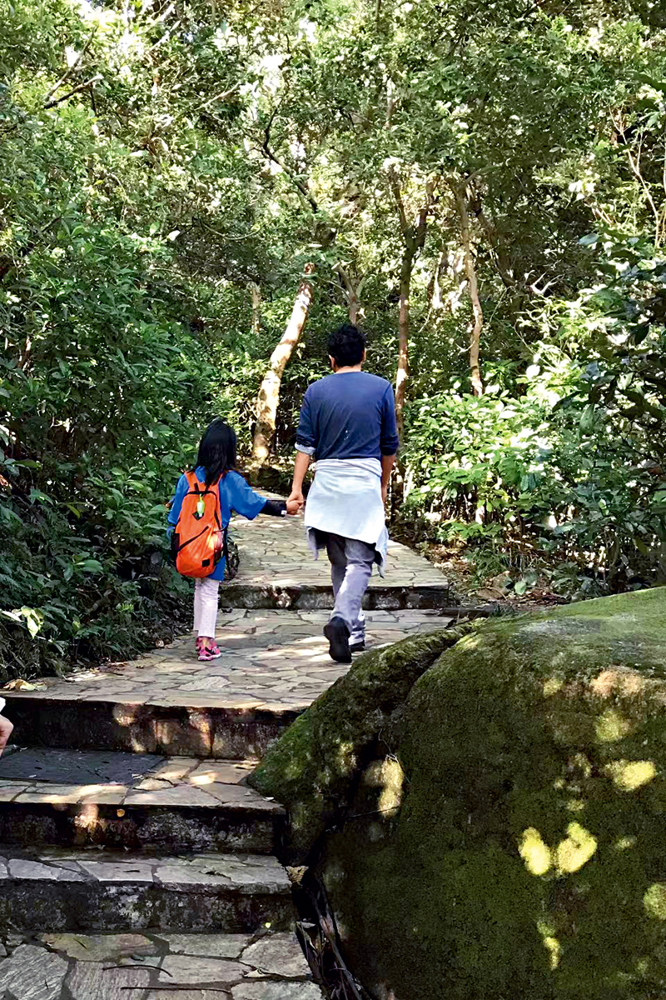

# 正文

**文｜阿茶**  
**自由撰稿人、前金融从业者**

2026年元旦刚过的一个早上，我正在卧室整理床铺，先生突然从卫生间跑出来，停在门口，半晌才说了一句：“好像……东老师去世了。”

惊讶，惋惜，心痛，又似乎是某种预感落地了。不多时，在几个相关群里，人们开始了对一个中年人猝死的讨论。有人说他太理想化，过于感性，对资本缺乏认识，行业方向也不明朗。他们似乎希望得出一个结论：东老师的秉性不适合创业。

东老师早年曾在诗里写：“我想冲下车去，/随便在一棵不难看的树下站一会儿，/就一会儿，/然后放弃一切牛逼理想。”这似乎映照了他近几年来的内心纠结。

放弃还是继续，也许一直在他心头缠绕。无论理想是什么，最终的选择并不完全在自己手中；而年轻时射出的那支箭，最终击中了他自己。

## 一

东老师是安徽人。我很小的时候随父亲去过一次亳州，记忆里两淮的空气有些甜香，看起来富庶得多，每一样东西都让从北方来的我感到好奇。有一次东老师跟我说起他的家乡，在他记忆里，两淮的冬天是寒冷的。他说，有一年，不知道什么亲戚，送了件大约蛮廉价的毛衣给他，那毛衣穿起来“好像软猬甲一样”。

不知年轻时的他，如何从家乡出发，坐着绿皮火车，来到北方城市读书，之后再走到更北的北京。

他的本科四年是在西安度过的。20世纪90年代中后期的西安，还存留着质朴又喧嚣的空气，南郊文教区由多个高校校区自然相连，其间夹杂着不少廉价商业，面向消费欲望躁动但缺乏经济实力的学生群体。东老师就读的学校，占地1000余亩，广植国槐、苦楝、银杏和雪松，这两年凭借AI在专业领域的应用，排名提升迅速。但在路演的聚光灯下，对于这段履历，他的语言始终混杂着平静的自信和尴尬的谦卑。

东老师爱写诗，水木BBS诗歌版有很多他的作品。我是很久之后才知道他也是个诗人。他本科毕业后离开西安，到北京读研。可能是怀念，也可能是对前路有些迷茫，他在一首短诗里这样写道：“我正在艰难地爱上这样一种孤独感。/就好像一个人在巷子深处的饭馆里吃泡馍。/没有你，/也没有糖蒜。”他是我见过的被西安饮食同化最彻底的南方人。

2002年左右，东老师赴美读博，加上博士后工作，他在美国一待就是九年。才华终究会被看到。博士毕业后，他在北京找到美国在华大厂的工作。不久又被挖到香港，在一间中资大厂的香港实验室里任职，带团队，做研究。在香港的那段时间，东老师和太太过着典型的中产生活。他曾经跟我讲过菲佣的英文听力笑话，说好晚餐不要鸡肉，回家发现一只白斩鸡摆在桌上。还记得刚到香港时，我们在香港北区同一个小区租房。他后来还一直怀念那里，说那儿是一个美食天堂。

2015年秋，我从对冲基金离职，有点盲目地加入新公司，开始筹备深圳办公室。我在福田租了一间联合办公室，招了一个刚毕业的年轻人。我已经很久没有做过财务顾问方面的业务，好项目对当时的我来说求之不得。年末，我去北京出差，在朋友的引荐下，第一次跟东老师见面。那时他还没离职，是个有个性的研究员。

2017年底，东老师离开香港，离开就职数年的知名公司，远赴北京创业。他的太太和孩子曾一度随他北上。那时候，东老师的知名度很高，业内对他的研究能力十分认可，称他为相关细分领域的先驱。他太太也在一次谈话中对我说，东东在以前的公司发展得很好，因为一个投资经理的鼓动，动了创业的念头。

## 二

2017年AI已经有点热度了，客服机器人、视觉AI等领域都在探索创新的变现方式。不少AI领域的关注者都曾是东老师的微博粉丝，他的天使轮融资很容易。2018年，他委托我们公司担任项目的A轮融资顾问。

与当时的热点项目不同，东老师的项目是一个TO G（面向政府服务）的应用。他们的产品模块能够帮助相应场景的快速甄别与锁定，大大提升效率，在多个省级平台上已经被初步应用。我们公司内部当时对这个项目的意见比较两极，我认为，当时AI创业还处于早期阶段，好项目需要尽快介入，因为东老师比较坚实的研究背景，公司内部最终同意立项。

2018年深秋，我们准备在两天内见三四拨投资人。我从香港赤鱲角机场出发，误了原本开往虹桥机场的班机，换了一架到浦东的航班。磁悬浮坐到龙阳路，接着往浦西去。我到咖啡店的时候，东老师已经在跟投资人交流了。作为顾问，我羞愧难当。在公司的BP（商业计划书）中，东老师在团队页最突出的位置，他的合伙人常说，以东东在业内的名气，投资人可以说是捡到宝了。

以我们当时的判断，东老师项目的背后技术站在AI金字塔尖上，但当时的市场已经在悄悄发生改变，市场反馈并不算十分理想。不少投资人不再关注AB轮的早期项目，基金纷纷向稳健的中后期转型。一些曾经以早期投资著称的机构，也十分关注项目的盈利预期和实现概率。我曾提示东老师，项目的财务预测比较难，市场公开数据和可比公司不多，因此团队印象非常重要。这是早期投资的基本共识。东老师点头称是。在我的记忆里，他始终微笑着，说“没事，慢慢来”。在接下来的路演中，东老师对技术问题的解答游刃有余，但在面对个人背景和公司志向的问题上，总表现出一种与初创企业掌舵人不太相称的气质特征。

11月下旬，上海的夜晚已经有些凉了。我们在咖啡店匆匆垫了一口饭，东老师叫了一辆不贵但也不寒酸的网约车，与第二家投资人约在一间日式茶室。服务员捧着香炉上来，边备着香篆，边问我们点什么茶。东老师指着茶单笑说：“沉香茶，来一个尝尝吧。”介绍完基本情况，投资人简单问了一下基本业务和团队背景。东老师介绍公司业务清楚明白，即使没有技术背景的投资人听起来依然深入浅出。投资人后来跟我说，项目太早期，不好投。但请转告，东老师人特别好，聊天很舒服。

第二天白天的第一场路演结束后，我有点生气地对东老师说，你介绍自己的背景要大大方方的，谈及自己时不必难为情。我还记得，东老师只是尴尬地笑笑。他似乎天生对“吹牛”这件事有种生理性抵触。在整个融资过程中，我不断提醒他应该注意的沟通方式，不要犯“大忌”。有时我们复盘得失，他会恍然大悟一般“哦”地一声，叹出一句“原来如此”。他太太曾对我说，在她看来，东东的性格和能力属性并不适合创业方向，“他创业时征求过我的意见，但那不过是给个面子。”。

融资过程没有东老师和公司团队想象的顺利，但也得到一些机构的青睐。当时AI的方向是绞尽脑汁寻找应用场景，各种TO B类项目涌出来。资金面表象热闹，境外挂牌的公司往回拆，引导基金还算活跃，掩盖着大量积压的退出需求。公司在2019年与几家投资机构进入到相对实质的谈判阶段。我们尽力拿掉了一些风险条款，给公司预留比较大的发展空间。融资落地最终分成两批，这对早期项目的投资人的确是一种不伤和气的保护。

东老师始终重视研究的taste，也很注重团队的调性。他曾在微博上十分活跃，不少业内人士跟进。从第一次创业开始，他吸引了不少名校学生来公司实习，协助他完成了很多代码和落地的工作。这自然降低了一些成本，但似乎并没有培养起能打持久战的核心队伍。2021年端午前后，我问他第一个项目的发展情况如何，他回复我：“卖身中。”尽管没有透露细节，可以看出，公司似乎也难以维持下去。

## 三

大部分公司在疫情期间都发展艰难，东老师的公司也不例外。客户逐渐放缓了需求，与此同时，投资行业也完成了一次重大洗牌。我熟识的一些投资人开始转型，有的甚至投入到全新的事业当中。2022年早春，东老师问我能否接受一家准独角兽公司的邀约，他们看中的，自然是东老师的技术能力。我看了条件，认为难以谈成，便如实相告。2023年，东老师凭借之前的人脉和声望，加盟了一家总部设在浙江的AI应用类公司，公开身份是“合伙人”。这家公司涉及游戏业务，成为日后他再次创业的一个伏笔。

我并没有跟他细聊这段经历，只知道之后不久他又再次返回北京。有一次我问他近况，他说要等一等再聊，因为他正在打开“花呗”支付早餐，然后去见一家投资机构。

2025年夏天，他带着自己的新项目南下香港。五六年没见，他基本上保持着不修边幅的穿着，头发更稀疏了，黑框眼镜下仍然是狡黠聪慧又腼腆内向的目光。他有点得意又有点害羞地告诉我，这个新项目是一个基于人工智能底层技术的文本类游戏，名字里有“白日梦”三个字，据他说，顺应了当下AI和短剧的两大趋势——“圆普通人一个当爽文男女主的梦想”。内容是时下流行的爽文剧本，霸道总裁，年下美男，恶毒女二，可以反转剧情。尽管我已经远离行业一段时间，但以经验判断，这款产品的呈现形式决定了受众的广度有限。听起来，新项目跟他在2017年和2023年的两次创业项目差距挺大。不过，他是一个非常有好奇心的人，早在大厂平台的时候，总有很多新奇的研究思路。

我们那两三天见了几次面，有时是为了谈项目，有时只是叙旧聊天。有一天，我们在香港金钟一间经营了35年、即将结业的酒楼吃饭。“菜不错。”东老师拿起牙签费力地想把卡在牙缝里的鸡肉挑出来：“我现在牙龈萎缩得厉害。”我说你可以用齿缝刷，他说：“你这个年纪就用齿缝刷也不是什么好事。”尽管他看起来的确显得十分疲惫，但仍保持着业内人士的灵敏，评点着行业和热门事件。至少从表面上看，他还是很乐观。他说，香港的AI创业环境不错，似乎有重新迁移回香港的打算。

我知道他在香港没有落脚的地方，有心帮他找一间能安静开电话会议的地方。东老师信心满满地说，这次要来港注册公司，下午可以借朋友办公室开会。我心里明白，借办公室开会这回事，在香港大概率行不通。不出所料，东老师果然被朋友客气地请了出来。我没有多问，选了一间点心茶室，两三款点心配一款茶，300多港币买个座位。单枞泡在不伦不类的日式铁茶壶里，涩得人直咧嘴。东老师的电脑上插着商用WiFi设备，疲惫中有一些矜持，投资人的声音听起来很年轻，东老师对游戏的内测和上线时点等问题逐一解答。对于业务，我听得似懂非懂。会议结束后，我问他如何变现，他讲的付费方式，我似乎没有体会到合理的场景。

## 四

从香港返回北京之前，我们一起到港岛屋苑的一间会所去见一位朋友。闲谈时聊到孩子，他说，孩子在北京时曾经问，同学的生日party在大house里，为什么我们没有？言语中有着小小无奈。大约2024年前后，他太太和孩子迁回香港居住，孩子读香港的国际学校，太太也找了一份合意的工作。我说，你应该先回家去看看孩子，“好像孩子大了，也没有那么多话可以说。”他如是说。最终我也不知道，在离开香港之前，他有没有见到孩子。



东老师离开香港一个多月之后，有一天，他打来电话，用尽量不太世俗又保持自尊的方式，问我借一笔钱。后来我得知，很多朋友已经陆续借款给他，看起来他的财务状况不容乐观。不多久，我得到他在北京生病住院的消息。

“生病了，一直在住院。”我问及他身体情况，他说：“我之前特别担心查出一堆毛病，出不去了。后来也坦然了：万般皆是命，半点不由人。”人常常活在矛盾与纠结当中，聪慧而敏感的人则时常感到无助。我劝他回香港休养，陪陪家人，给自己放个大假。他敷衍地答应。他跟我聊到女儿、老父亲时说，“以后大概率还是跟着我们。”现实在他心里其实有挺重的分量，但他似乎更愿意选择用自己的方式去面对。

我一直认为，如果项目不能走得长远，以他的资历，去大厂再谋一个好职位，不在话下。2025年8月见面时，他对我说，近两年曾帮助另一位创业不成的朋友牵线搭桥，进入一家如今市值了得的公司任职。我问他怎么想，能否自己也找一个机会先安顿下来，他笑笑不说话。

他太太在访谈中说，创业万分之一能成功，不成功怎么办？拖得越久，越难以回归职场。“但好像中年男人都更有好胜心，想证明自己。”我曾经问她，如何定义创业成功。她说，始终有事做，有追求。的确，以行业的经验来看，上市只是投资机构松口气的时刻，对于创业者而言是新的旅程。去年南下路演时，东老师充满热情又极尽疲惫地讲述，深色的T恤和深色的短裤，腿上有一处明显的严重皮肤溃烂。我说你该去看看，他摆摆手说，“老问题”。我预感到事情的发展方向并不算良好。

东老师曾对我说，创业的初衷，就是想简单而自由地活着。我觉得，这也许是懵懂又善良的人对创业的最大误会。“原始时代”的创业没有修辞，有的人入局甚至不过是阴差阳错。他们大多没做过“白日梦”，成了就成了，不成就回去上班。东老师入局，按他太太的话说，是投资经理的“鼓舞”。他成为市场话术中的“连续创业家”，像一句香港电影的台词，“光光烈烈咁去光光烈烈”。

如果家庭是社会的一个单元，创业的边界应该在哪里？我曾经访问过数位创业者的家属，“不能动家里的钱”只是明面上的底线。实际上，连续创业的人，大多获得过家庭提供的资金或者其他方面的支持。东老师的家庭为他的付出亦在数百万之巨。创业如果仅仅是一张人生体验卡，时间一到就可以自动回归原位，自然不会伤筋动骨。大多数连续创业者行走在黑暗中，花掉职业生涯三分之一的时间，借款、展期、私人借债，并不鲜见。我见过一些创业家庭的分崩离析，痛苦纠缠，有的人背负数百万债务，房产即将被银行执行，还有的为了偿还上千万债务，远赴第三世界国家淘金。

尽管我见过很多在创业中走到绝境的朋友，但我仍然难以给出“为何不能回头”的答案。是胜负欲还是惯性，很难讲得清楚。他们最喜欢对家人说的一句话是：这是我现在最好的机会。东老师的太太曾经说，他们沟通过很多次这个问题，到最后只能是言尽于此。她是一个理智的职场女性，有自己的事业、爱好、主见。

## 五

东老师的一位朋友曾对我说，如果不考虑其他因素，跟东老师一起工作是最快乐的。我基本上认同。然而，我也知道，他在公司时也是个有个性的研究员，为了防止他过于“直接”的发言，他往往被排除在一些重大活动之外。有朋友说，如果他选择留在公司，已经赶上了现在AI的风口。而以他的性格，恐怕也未必能适应如今过度“内卷”的行业现状。

我在最当红的Chat-Bot（对话机器人）上搜索东老师的名字，AI仍称他为“该领域具有国际声誉的科学家”。他的成就之一，被视为ChatGPT交互模式的先驱。然而他的个人经历，永远停留在2023年浙江的创业节点上。

2026年初，他的葬礼并未邀请朋友，这是一个我完全能够理解的决定，只是我似乎还没有适应他的离开。疫情期间，他曾开心地对我说：“我已经被封在家里了。现在住望京，全北京惟一可以买到肉丸胡辣汤的地方。”他永远如此乐观，对世界带着些许天真与勇气。

我还记得，东老师第一次创业的时候，行业很热，满天满地的研讨会，五星级酒店的靠背椅上包着香槟色的椅套，柔软的地毯上，乌泱泱的人。茶歇时，大家嚼着袖珍三明治和蛋糕，热烈的气氛随着咖啡香气弥漫开来。当时的东老师踌躇满志。我有一次问他参会专家的信息，他回复我说：“这两人的认知，在对行业无知的排行榜里，一个第一，另一个第二。”

他的一生，可以说都是反平庸的。“如果可能，/我愿意做一回小地主，/住在三百年前山东乡下，/生活美满，/热爱粮食。”这是他在诗歌里对平庸的终极想象，让我想起2015年冬天我们第一次见面，几个朋友一起吃烤鱼，东老师活跃着全桌的气氛。

我始终觉得，对他而言，无需悲戚来加持曾经流转人间的价值。朋友们为他办了一场线上读诗会，海报上，他依旧略带羞涩地微笑。一些曾经熟悉、后来失联的朋友，一群联系紧密、但对他的创作毫不知情的朋友，一位对他一无所知、但欣赏他诗歌的主持人，天马行空地说着理想、青春、爱情……那些或引人发笑或令人沉思的句子，似乎更能为他的一生画上句号。

他曾努力地把自己装进创业的壳子里，期待自己长成创业家应该有的样子，并期待自己是有所收获的那一个。2010年前后，他回国加入外资机构，在良好的研究氛围中成长。商业国度始终不同，底层逻辑简单生硬，表面关系复杂圆融。在其中迷失方向，再正常不过。所谓成功，不过是小概率事件中的小概率事件。

我身边依然有很多朋友走在创业这条路上，甚至一些人的选择，既无法用理性解释，亦无法以感性共情。东老师住院时跟我说，“感觉是鬼门关上走了一遭”，现在想来，这句话也可以用来形容他的创业人生。

---

# 附记1：东老师其人

文中的“东老师”是 **吕正东（Zhengdong Lu）**，中国人工智能研究者，长期从事机器学习、自然语言处理、语义匹配、自动问答与推理研究。阿茶在文章中没有直接写出他的名字，但其中关于教育背景、任职机构、创业经历和生成式对话研究的描述，都与吕正东的公开履历相互吻合。



吕正东本科毕业于 **西安邮电学院**（现西安邮电大学），后在 **清华大学** 获工学硕士学位，于 **2008年在美国俄勒冈健康与科学大学**（Oregon Health & Science University，OHSU）获计算机博士学位。此后，他在得克萨斯大学奥斯汀分校从事博士后研究，回国后先后任职于 **微软亚洲研究院** 和 **华为诺亚方舟实验室**。2013年，他组建了华为诺亚方舟实验室的深度学习团队，重点推动神经网络在自然语言理解与对话系统中的研究。

他的研究成果中，尤其值得记住的是 **Neural Responding Machine（神经响应机）**。2015年前后，他与合作者开展了基于神经网络的生成式对话研究，是早期端到端神经对话系统的重要工作之一。同期，他还参与了 **Neural Reasoner**、**Neural Enquirer**、**CopyNet** 等研究，分别涉及多步推理、自然语言到数据库查询以及在生成任务中复制输入信息的机制。这些工作在大语言模型兴起之前，就已经触及了对话生成、推理、结构化操作与文本生成的关键问题。

2017年，他离开华为创业，创立 **深度好奇（Deeply Curious）**，研究神经网络与符号推理相结合的文本理解技术，并探索公安等领域的实际应用。2023年，他以 **杭州数令集科技有限公司合伙人** 身份公开接受采访，讨论大语言模型及其在游戏等领域的商业化。此后，他继续探索 AI 互动叙事产品；财新文章记载，他在2025年推进的项目是一款名称包含“白日梦”的互动文本游戏，但其完整产品名称与正式上线情况，尚未得到可靠公开资料证实。

根据阿茶2026年11月14日发表于《财新周刊》的随笔，吕正东于2026年初去世。文章保留了他的诗歌、研究生涯、创业挫折与晚年生活中的许多细节，也留下了一个极为沉重的问题：当一个人最初希望通过创业获得自由，为什么最后连退出都变得如此困难。

# 附记2：创业中的失败机制

## 入局时的技术优势与商业判断

吕正东在2017年选择创业时，已经具备极强的研究积累、行业声望和人才吸引力。这些优势使他很容易获得天使轮融资，也让他相信自己有条件把技术转化为产品。然而，研究能力与企业经营之间存在一整套需要重新建立的联系：谁会购买产品、为什么购买、能够支付多少、企业如何持续交付、收入何时足以覆盖成本，以及下一笔融资能否在资金耗尽前到位。优秀的科研成果能够提高技术可行性，却不会自动回答这些问题。阿茶提到，创业的契机来自投资经理的鼓动，而他本人又把创业视为获得简单、自由生活的方式。这反映出他在进入商业世界时，对创业所要求的持续融资、组织管理和风险承担，可能缺少充分准备。

## 技术落地与商业模式的距离

第一家公司并非完全没有应用成果。阿茶明确写到，其面向政府的人工智能产品已在多个省级平台初步应用，能够提高特定场景的甄别与锁定效率。问题在于，技术被试用或部署，只证明产品存在应用价值；企业还需要把这种价值转化为可重复的合同、稳定的收入和现金回款。面向政府的项目通常涉及采购预算、验收、支付周期、定制化交付与持续维护，因此需要销售、实施和客户关系等配套能力。文章没有披露深度好奇的合同规模、回款情况和毛利率，无法确认具体卡在哪一个环节，但可以看出投资人始终难以判断其盈利前景。技术应用与可持续商业模式之间的距离，是第一次创业的重要问题。

第二次独立创业的项目又换到了面向消费者的人工智能互动文本游戏。吕正东希望结合人工智能与短剧、爽文的流行趋势，让用户进入故事并改变剧情。然而，从产品能够生成有趣的内容，到用户愿意长期使用并持续付费，仍然需要回答内容质量、用户留存、付费动机、获客成本与模型运行成本等问题。阿茶在2025年听完项目介绍后，对其受众广度和付费场景都持怀疑态度。这个疑虑非常具体：即便技术可以实现高度自由的互动叙事，商业模式仍须证明有多少用户愿意为这种体验付钱，以及收入能否覆盖持续生成内容的成本。文章没有提供用户或经营数据，因此只能认定其商业化尚未得到充分证明，不能据此断言游戏已经正式失败。

## 2018年资本市场的转向

第一次创业碰上的时点尤其不利。2017年，人工智能仍是热门投资方向，吕正东的技术声望足以帮助企业获得天使投资；2018年申请A轮融资时，中国股权投资市场却迅速收紧。风险投资（Venture Capital，VC）机构通常需要先向有限合伙人（Limited Partners，LP）募集资金，再投资创业企业，通过未来上市、并购或股权转让实现退出。当基金自身募资困难、已有投资又难以退出时，投资机构就更倾向于保留现金、控制风险，并要求新项目尽早证明盈利可能性。

这一变化有明确的市场背景。清科研究中心统计，2018年上半年中国股权投资市场募资金额同比下降55.8%，全年募资金额同比下降25.6%；金融去杠杆、《资管新规》及投资退出压力共同影响了市场。阿茶记载，原本关注早期项目的基金转向中后期，投资人开始追问商业前景；东老师的公司虽于2019年推进了融资，资金最终仍分两批落地。分批投资可以减少投资人一次性投入的风险，却也意味着创业公司必须在不确定的资金节奏中持续运转。这里的失败机制是：企业尚未建立稳定的经营性现金流，外部融资却恰好变得更困难，原本可以依靠下一轮融资支撑的研发与市场开拓随即承受压力。

## 创始人的融资表达与组织能力

在早期项目缺乏充分财务记录时，投资人往往只能根据技术前景、创始人履历、团队结构和商业计划判断未来。阿茶反复提醒吕正东主动介绍自身经历和公司志向，因为这些信息会影响投资人对管理团队的判断。吕正东擅长解释技术，却对自我推销与商业包装感到难为情。投资人称赞他人好、交流舒服，最后仍认为项目过早、不便投资。这种反差说明，科研声望虽然使他获得了见投资人的机会，但他没有充分将个人能力转化为让投资人相信企业能够持续经营的商业叙述。当然，改变路演话术也无法解决缺乏订单、利润或市场规模的问题；融资表达只是诸多约束中的一环。

组织建设同样重要。阿茶写到，他非常重视研究品味与团队气质，吸引了不少优秀学生参与代码和落地工作，却似乎未能建立能够长期作战的核心队伍。学生实习能够降低短期研发成本，但商业化还需要稳定的产品迭代、客户交付、销售与项目管理。科研团队可以围绕技术难题组织协作，创业公司却必须把技术、市场、资金和运营长期结合起来。第一家公司在2021年已经寻求出售，说明企业至少未能按最初设想走上自主扩张的道路。至于究竟是销售不足、组织成本过高、回款问题还是融资中断造成了决定性打击，文章没有披露足够的经营细节。

## 疫情冲击与经营余地的收缩

2020年以后，疫情又改变了企业与客户的经营条件。阿茶提到，客户需求逐渐放缓，投资行业也经历了洗牌。对尚未形成稳定盈利能力的初创公司来说，需求放缓与融资困难会相互强化：项目推进慢，收入与回款就更难支撑运营；财务状况恶化，又降低企业继续获得投资的可能性。到了2021年，吕正东用“卖身中”形容第一家公司的处境。这句话展示的是企业寻求出售或其他出路的阶段，却没有说明最终的交易结果。

## 连续创业与退出能力的丧失

第一次创业受挫以后，吕正东仍然具有很高的技术市场价值。文章记载，他在2022年得到过一家准独角兽企业的邀约，2023年也曾加入浙江的一家人工智能公司。然而，他后来又回到北京推进新项目，直到2025年仍在四处融资。这里出现了比单次创业失败更深的问题：为什么一个拥有杰出研究能力的人，在多次遭遇资金困难后，依然越来越难回到相对稳定的职业轨道？

先前投入的时间和金钱已经无法收回，却会让人更难接受停止，这就是沉没成本（Sunk Cost）影响决策的典型情形。除此之外，连续创业还会改变个人的社会身份和实际选择空间。重返职场意味着重新接受组织管理，也可能被本人理解为对多年创业努力的否定；与此同时，长期离开大厂、家庭开支持续存在、个人财务储备逐渐耗尽，都会增加回归的阻力。文章明确提到家庭投入已达数百万元，吕正东后来又向多位朋友借款。这些借款未必都能确认为企业经营债务，却足以说明，创业带来的财务压力已经越过公司边界，进入他的私人生活和家庭关系。

此时继续创业还可能形成恶性循环：资金不足导致必须尽快寻找投资或新产品机会，新项目短期内难以产生收入，于是进一步消耗积蓄并增加融资依赖；投入越大，承认失败与退出就越困难。创业者往往将下一次机会视作挽回过去损失的希望，但新项目的预期收益并不会因为已经投入多年而提高。吕正东起初希望通过创业获得自由，最终却不断受制于融资节点、经营压力和难以放下的事业认同，正是这篇文章标题“回不了头”的含义。

## 失败机制的整体关系

将这些因素联系起来，可以看见一个逐步收紧的过程：研究实力和声望促成了最初的创业及天使融资；政府应用已经出现落地迹象，却尚未展示足以支撑持续经营的商业收入；2018年资本市场收缩，提高了融资门槛；融资表达与长期团队建设的不足进一步削弱了企业应对市场变化的能力；疫情期间客户需求放缓，使第一次创业走向寻求出售。此后，个人持续投入新的商业方向，财务与职业退路逐渐收窄，直到2025年还在为互动游戏寻找投资，并开始向朋友借钱。

因此，吕正东的经历涉及技术、市场、资本、组织与个人选择之间的连续失配。其中，第一次创业的困境有较清楚的过程证据；最后一个“白日梦”项目的经营结果、各阶段现金流及债务结构，则仍缺少完整资料。文章也没有提供将创业压力与其最终去世直接联系起来的医学依据。真正能够从这一经历中读出的，是连续创业如何从一次自愿承担的商业风险，逐渐演变成对职业选择、家庭资源与个人生活的长期约束。

# 来源与资料

- 阿茶：《[随笔｜回不了头：一位AI连续创业者的“白日梦”](https://weekly.caixin.com/2026-11-14/102504815.html)》，《财新周刊》，2026年11月14日。**以上五节为原文阅读存档；附记与附录均为后补资料及分析，不属于财新原文。**
- 西安邮电大学：《[关于举办吕正东博士学术讲座的通知](https://www.xupt.edu.cn/info/2105/76653.htm)》，2020年11月19日。
- 哈尔滨工业大学（深圳）智能计算研究中心：《[华为诺亚方舟实验室研究员吕正东博士为我院师生做学术报告](https://icrc.hitsz.edu.cn/info/1033/1118.htm)》，2014年10月4日。
- 机器之心：《[独家｜专访深度好奇创始人吕正东：通向理解之路](https://cloud.tencent.com/developer/article/1118202)》，2017年6月30日。
- 2023世界人工智能大会采访：《[数令集｜全球首个生成式聊天AI发明人吕正东博士：抓住AI大模型产业化机遇](https://finance.ifeng.com/c/8RKpjIcU4PW)》，2023年7月11日。

- 清科研究中心：《[2018年H1中国股权投资市场回顾与展望](https://www.jiemian.com/article/2386656.html)》，2018年8月14日。
- 清华大学全球私募股权研究院：《[2018年中国私募股权投资市场回顾及2019年展望](https://www.pe.tsinghua.edu.cn/info/1016/1168.htm)》，2018年12月31日。
