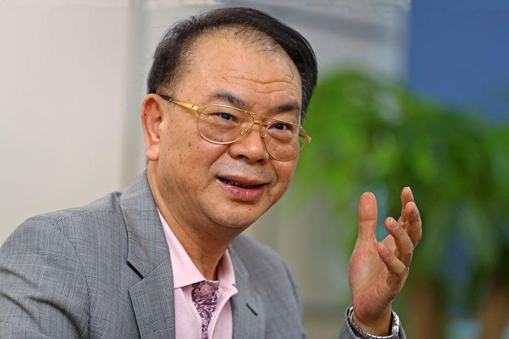
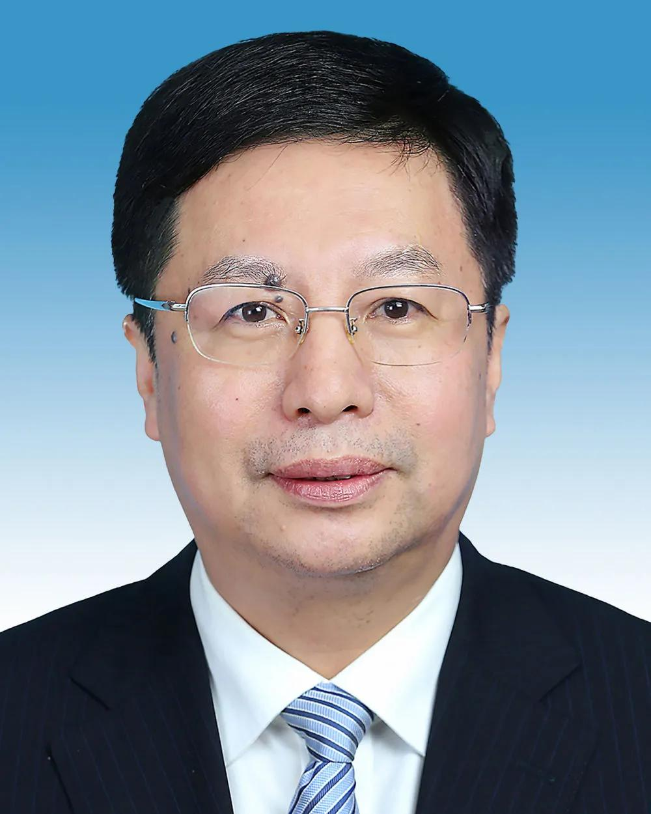

企业在融资或并购时，往往需要为尚未实现的未来收益确定一个今天的价格。融资方希望凭借未来的发展前景获得更高估值，投资者则担心这些预期无法兑现；并购交易中的矛盾更加突出，收购方需要立即支付价款，却可能要等到几年后才能判断被收购企业究竟值不值这个价格。

为了解决这种估值分歧，金融交易中逐渐形成了**对赌协议**，正式名称通常是**估值调整协议（Valuation Adjustment Mechanism，VAM）**。它通过事先约定未来的经营业绩、上市进度或者其他条件，将投资价格与未来结果联系起来。当约定条件未能实现时，投资者可能获得现金补偿、额外股权或者要求特定主体回购股份的权利。

这种制度最初具有合理的经济目的：在交易双方无法准确判断企业未来价值时，通过合同重新分配风险，从而促成原本难以达成的融资或并购。然而，近年来中国资本市场出现的大量纠纷表明，对赌协议也可能产生相反的效果。它不仅可能加重企业的融资压力，在某些并购交易中，甚至可能成为推高估值、操纵利润和进行资本运作的工具。

## 一、融资

### 估值与风险

企业融资时，首先面临的是信息不对称（Information Asymmetry）。创始人往往比外部投资者更加了解企业的技术水平、实际经营状况、订单质量和潜在风险。投资机构即使进行尽职调查，也很难完全掌握这些信息，更无法准确预测未来的市场环境。

假设一家企业融资前估值8亿元，投资机构准备投入2亿元。融资后企业估值达到10亿元，投资机构获得20%的股权。创始人认为，企业未来三年会快速成长，因此希望投资者接受这一估值；但投资者可能认为企业目前尚未具备与之相匹配的盈利能力。

双方于是可以约定，企业必须在三年后达到某个利润指标，或者在指定期限内完成上市。如果没有实现，原股东需要补偿投资者，或者按照约定价格回购其股权。

这一安排使双方能够暂时搁置估值分歧。企业获得了急需的资金，投资者则通过合同降低未来收益不及预期的风险。创始人愿意接受对赌，往往也是因为如果不作出这些承诺，投资者便不愿意按照较高估值提供资金。

常见的融资对赌包括业绩补偿、股权调整和股份回购。其中，股份回购尤其容易引发严重的财务风险。

假设投资机构投入2亿元，并约定企业三年内未能上市时，由创始人按照投资本金加年化8%复利收益的价格回购股份。那么三年后的回购价格为：

$$
R=2\times(1+8\%)^3\approx2.52\text{亿元}
$$

如果企业顺利上市，投资者可以通过资本市场实现退出，并获得股权升值收益；如果企业未能上市，投资者则可能依据协议要求回购义务人支付约2.52亿元。

这种结构使投资者在保留企业成长收益的同时，试图将部分失败风险转移给创始人、控股股东或者目标公司。

问题在于，**企业无法实现上市或业绩目标，往往正是因为其经营状况不佳、融资困难或资本市场环境恶化。此时触发的大额回购义务，可能进一步加重企业及其股东的财务压力。**

如果创始人没有足够现金，便可能质押股权、出售资产或者另行借债。一旦无法履约，投资者可能提起诉讼，相关股权甚至面临司法冻结和拍卖，最终影响企业的控制权。

在一些具有固定收益保障、强制回购等条款的交易中，股权投资因此呈现出债权融资的部分特征，这也是所谓的“明股实债”。不过，具体交易是否具有这种性质，仍取决于合同条款和实际风险分配。

### 宇树科技

宇树科技提供了一个相当有代表性的案例。

根据宇树科技首次公开发行股票招股说明书，企业在2025年6月融资时，与投资方签署了包含多项特殊股东权利的协议。这些权利包括股份回购、优先认购、反稀释、优先清算等，其中以公司作为回购义务主体的条款构成上市对赌安排。〔1〕

这些权利具有明确的投资保护功能。例如，反稀释权可以在后续融资价格低于此前融资价格时，通过约定机制调整投资者的经济利益；优先清算权则可能改变企业清算或特定退出交易中的财产分配顺序。回购权则使投资者在约定条件触发时，能够要求相关主体购买其股份。

这些安排能够帮助投资者应对企业成长过程中的不确定性，但同时会改变不同股东之间的权利结构。如果企业本身承担回购义务，还可能对企业的财务状况产生直接影响。

宇树科技准备首次公开募股（Initial Public Offering，IPO）时，便需要处理这些历史协议。

2025年9月，宇树科技与股东签署终止协议，约定回购权及可能影响控制权、与市值挂钩等特定条款，在上市申报审计报告出具日前一日起彻底终止、自始无效且不得恢复。2025年10月15日，相关审计报告出具，回购权因此按协议完成终止。2026年1月，公司又通过补充协议，终止其余特殊股东权利。

随后，宇树科技于2026年8月19日正式在上海证券交易所科创板上市。〔2〕

为什么一家企业在融资时能够接受这些条款，到了上市前却需要将其清理？

原因涉及私人股权融资与公开资本市场之间的制度差异。在私人融资阶段，投资者可以通过特殊合同取得额外保护；但进入公开证券市场后，公司的股权结构、实际控制权、财务核算以及公众投资者权益，都需要满足更加严格的监管要求。

简单来说，企业在上市前融资时，可以通过对赌协议给予早期投资者特殊保护，例如承诺在特定条件下回购股份。但上市后，企业开始面向公众投资者融资，如果这些特殊权利继续存在，就可能使公司承担额外的偿债义务，或者影响控制权和其他股东的利益。因此，监管要求企业在上市前清理不符合上市条件的对赌条款，以保障财务透明、控制权稳定和公众投资者权益。

中国证监会《监管规则适用指引——发行类第4号》要求重点核查发行人是否为对赌协议当事人、条款是否可能导致控制权变化、是否与市值挂钩，以及是否严重影响企业持续经营能力或投资者权益。不符合相应要求的协议原则上需要在申报前清理。监管并未一概禁止所有对赌安排，而是关注其对上市条件和投资者权益的实际影响。〔3〕

宇树科技的案例揭示出一种制度上的变化：企业在早期融资时，可以用特殊股东权利交换资本支持；但当企业进入公开市场，这些特殊权利便可能与上市公司所要求的股权稳定性和规范治理产生冲突。

### 三安光电

与宇树科技在上市前清理历史对赌条款的情况相比，三安光电控股股东所面临的融资纠纷，展示了另一种可能的结果：企业在扩张阶段依靠股权融资获得大量资金，但随着政治关系变化、经营压力增加和合同风险条款被触发，原先的投资者可能转而成为债权追偿方，最终影响企业的股权结构与控制权。

这起事件尤其值得关注，因为它涉及中国地方政府主导的产业投资模式，以及民营企业、地方国有资本和政治权力之间复杂的关系。

#### 产业扩张



三安光电实际控制人林秀成早年通过钢铁废料贸易积累资本，1992年与福建三明钢铁厂合作创办炼钢企业，此后逐步进入房地产、水电和电子产业。2000年前后，林秀成在厦门投资发光二极管（Light-Emitting Diode，LED）产业，2008年通过收购上市公司实现借壳上市，逐渐将三安光电发展为中国重要的LED芯片企业。

2014年前后，三安光电开始向碳化硅、氮化镓等化合物半导体领域转型。这一转型需要建设大量先进生产线，投入巨额固定资产，并经历较长时间的技术验证和产能释放。因此，企业开始更加深入地依赖地方政府的招商引资、产业基金和国有资本支持。

2019年，三安光电在湖北布局Mini/Micro LED产业项目，规划投资120亿元。同年，具有湖北地方国资背景的长江安芯产业投资基金向三安集团增资59.6亿元，取得22.28%的股权。长沙建芯产业投资基金则向三安电子增资70亿元，取得其相应股权。相关资金到2020年初已经到账。〔7〕

值得注意的是，这些地方产业资本并非全部直接投入上市公司的生产项目，其中相当一部分是通过增资三安集团或三安电子等上层控股主体进入三安系企业。

这种融资方式使地方产业资本可以通过持有企业集团股权，与企业形成较长期的利益联系；企业则能够获得大规模资金支持，为其产业扩张提供融资条件。地方政府获得的是大型产业项目落地的机会，而企业获得的则是地方资本及相关配套资源。

2020年7月，三安光电在湖南长沙启动第三代半导体制造基地建设，规划总投资160亿元，覆盖碳化硅衬底、外延、芯片制造及封装等环节。时任长沙市委书记胡衡华亲自宣布项目开工，林秀成也出席了开工仪式。〔8〕

2023年，三安光电又与国际半导体企业意法半导体（STMicroelectronics）合作，在重庆建设碳化硅功率芯片项目，合资项目规划总投资32亿美元，约合228亿元人民币。

而此时，胡衡华已经调任重庆市委副书记、市长。



据财新报道，胡衡华在长沙和重庆任职期间，都曾公开支持三安光电的大型半导体项目。多名消息人士称，三安光电是胡衡华通过招商引资引进湖南，后来又带到重庆的企业。〔4〕

这一联系具有特殊的制度意义。在中国地方经济发展体系中，地方领导干部不仅承担行政管理职责，也直接参与招商引资、产业规划与重大项目协调。大型产业项目能够带来固定资产投资、产业链建设、潜在就业和税收，也可能成为地方领导干部经济治理成绩的重要组成部分。

因此，企业投资与地方官员的政治活动可能形成相互支持的关系。企业需要地方政府协调资本和产业资源，地方政府则需要具有一定技术基础和产业规模的企业推动经济发展。当同一名官员在不同任职地区持续推动同一家企业的重大项目时，这种政商关系就可能超出单一地区的普通招商合作，表现出一定的个人政治联系。

#### 百亿元增资

2023年7月，三安集团与具有重庆地方国资背景的重庆高永企业管理合伙企业签订增资协议，约定重庆高永向三安电子增资100亿元。其中，约1.19亿元计入注册资本，其余约98.81亿元计入资本公积。交易完成后，重庆高永持有三安电子23.13%的股权。

根据当时的上市公司公告，三安电子已经收到全部增资款。与此同时，三安电子终止了此前长沙集芯投资合伙企业的一笔增资安排，将已经收到的37.5亿元退还长沙集芯。〔9〕

这一变化十分值得关注。三安系此前已经与湖南、湖北等地的国有产业资本建立融资关系，如今又获得重庆国资的百亿元投入。不同地方的产业资本通过复杂的股权安排参与企业扩张，而企业则在多个地区布局大型半导体项目。

但这里需要区分两种资金关系：重庆高永投入100亿元取得的是三安电子的股权，三安电子是上市公司三安光电的控股股东。因此，这笔百亿元融资并不意味着重庆半导体工厂直接收到100亿元，也不能将其与项目规划投资额简单相加。

这种安排涉及两个层面的经济活动：一方面，上市公司通过下属企业建设产业项目；另一方面，控制上市公司的上层企业集团通过增资获得融资。在这种结构中，地方产业资本的投资收益、退出安排与集团股权价值发生联系，上市公司的股票也可能成为相关债务纠纷中的重要资产。

财新2026年10月的报道指出，重庆高永与三安电子之间的百亿元增资协议包含对赌条款。如果触发重大违约条件，投资方可能依据协议收回投资，相应形成债务。〔4〕

这就使原先的股权投资附带了另一种风险分配机制。重庆高永通过增资成为股东，本应随着企业经营情况承担股权价值波动的风险；但合同中的特殊条款又可能使其在特定违约事件发生时，获得要求相关主体付款或回购的权利。

对于地方产业资本而言，这些条款有助于控制资金损失；对于获得融资的企业集团而言，一旦触发约定条件，原先用于支持扩张的资本就可能转化为沉重的付款压力。

#### 政商关系与司法追偿

2026年3月20日，时任重庆市市长胡衡华被宣布接受审查调查。次日，三安光电实际控制人林秀成被国家监察委员会留置并立案调查。

两起调查发生的时间高度接近，引起了外界对双方政商关系的关注。

此后，三安光电副董事长兼总经理、林秀成的女婿林科闯也被留置调查。2026年10月，林科闯获解除留置并恢复履职，而林秀成则在9月因涉嫌职务侵占、挪用资金罪被刑事拘留，并于10月被检察机关批准逮捕。〔4〕

与此同时，三安系的融资纠纷开始集中显现。

2026年3月24日，重庆市第一中级人民法院立案执行重庆高永与三安电子等主体之间的合同纠纷。根据法院执行文书，执行依据为重庆市国信公证处出具的《公证债权文书》，执行标的为偿还10亿元本金及相应利息。

这里涉及一种特殊的法律安排：具有强制执行效力的公证债权文书。对于符合条件的债权合同，当事人可以通过公证程序赋予其强制执行效力，发生违约后，债权人可以依法申请执行，而不必先经历完整的普通民事诉讼程序。

重庆高永的这笔追偿正是依据相关公证债权文书进入司法执行程序。

在执行过程中，法院冻结了三安电子持有的9300万股三安光电股票，并陆续裁定强制处置其中的部分股份。根据三安光电2026年半年度报告，相关案件中已有约8391万股股份被依法处置。〔10〕

这意味着融资纠纷已经从合同上的付款责任，实际影响到控股股东所持有的上市公司股份。

更严重的情况发生在2026年10月。

根据三安光电10月16日公告，湖北长江安芯产业投资基金和湖南麓谷发展集团作为债权人，向厦门市中级人民法院申请对三安电子进行破产重整；湖南麓谷发展集团同时申请对三安集团进行破产重整。公告时法院尚未裁定受理相关申请。

截至该公告披露日，三安电子和三安集团合计持有三安光电约13.12亿股，占总股本的26.30%，所持股份已全部被司法冻结。〔11〕

在这里，原先为企业提供产业资本支持的地方国资机构，已经成为采取司法手段追偿的债权人。融资风险进一步向企业集团的股权结构和控制权传导。

其中需要区分的是，遭遇债务追偿和破产重整申请的主体主要是三安电子、三安集团，而上市公司三安光电本身仍在经营。控股股东的债务不会自动转化为上市公司的债务，但如果控股股东持有的上市公司股份被拍卖、转让或在重整中重新分配，就可能改变上市公司的控制权结构。

目前公开资料尚未完整披露重庆高永百亿元增资协议中的违约条款，因此无法确定具体是哪一项条件触发了追偿。胡衡华和林秀成被查与司法执行在时间上高度接近，但这些事件之间的具体法律和因果联系，仍有待调查材料进一步说明。

#### 经营压力

三安系遭遇融资纠纷时，半导体业务本身也尚未形成与巨额投资相匹配的盈利能力。

根据三安光电2026年半年度报告，公司上半年实现营业收入64.68亿元，归母净利润亏损约0.98亿元。由于贵金属废料业务收入确认政策调整，报告期营收同比下降28%左右；剔除这部分影响后，营收实际有所增长。但企业整体仍然亏损，主要受到碳化硅等集成电路业务产能利用率偏低、设备折旧和固定成本较高等因素影响，原有LED业务则继续盈利。〔12〕

以重庆项目为例，三安光电与意法半导体的合资公司安意法，截至2026年上半年具有约10.4万片/年的8英寸碳化硅外延及芯片产能，已经送样验证39款产品，其中4款通过客户验证。原本规划在2025年第四季度实现批量生产的目标尚未达成。

这说明企业虽然投入巨额资本建设生产设施，但从产线建设、产品验证到大规模商业销售之间仍然存在较长的时间差。

半导体制造具有明显的固定成本特征。设备、厂房和生产线在正式投入运营以后，即使产能利用率较低，企业也需要持续承担折旧、维护和部分人员成本。因此，企业可能已经形成大规模生产能力，却尚未创造足够的现金流和利润。

当这种产业投资周期与融资合同中的回购、违约和追偿安排发生冲突时，财务风险就可能加剧。企业本来需要继续投入资金以实现量产和扩大销售，但控股股东却可能因为历史融资协议而面临债务偿付、股权冻结甚至破产重整。

这也揭示了资本密集型产业融资中一个重要的期限问题：**产业项目需要长期资本支持，而投资者的退出条件未必与项目真正形成商业回报的时间一致。**

#### 制度问题

三安光电案例的特殊性，在于它同时涉及地方招商引资、国有产业资本投资、民营企业融资以及官员与企业家的政治关系。

在中国地方经济治理中，地方政府往往具有多重角色。它既负责制定产业发展目标、吸引重大投资项目，也能够通过国有企业、政府投资基金和各类产业投资平台参与资本配置。

这种制度安排具有很强的资源动员能力。地方政府可以协调土地、基础设施、融资和产业配套，帮助企业在较短时间内完成大规模项目建设。对于半导体这样前期投入庞大、投资回收周期较长的行业，这种支持尤其重要。

但它也产生了几个相互关联的问题。

首先，地方政府的产业投资决策与行政目标之间可能存在紧密联系。大型项目能够迅速形成固定资产投资，并为地方政府提供可以展示的经济发展成果。因此，地方官员可能具有较强的招商引资动力，而项目的长期盈利能力却需要多年才能得到验证。

其次，地方国有资本既承担支持产业发展的任务，又必须考虑投资回报和资金安全。在项目落地时，地方资本可能通过股权投资帮助企业融资；而当企业出现重大违约、政治风险或经营困难时，投资机构又可能根据合同要求回购、补偿或偿还相关债务。

由此，地方国资的角色就可能从产业发展支持者转变为债务追偿者。对于企业而言，原先支持扩张的资本关系，可能在特定条件下转化为约束其继续经营和融资的债务关系。

最后，地方官员对重大项目的推动，还可能使企业的资本积累与特定政治关系发生联系。三安光电的大型项目先后落地长沙、重庆，与胡衡华的任职经历存在明显交集。此类关系有助于理解政治权力在地方产业资源配置中的实际作用，也使人有必要追问：具体投资决策由谁推动，投资机构在多大程度上独立评估风险，项目失败后又由谁承担责任？

从这个角度来看，三安光电的案例已经超出了普通的企业融资纠纷。

**它揭示了在地方政府深度参与产业投资的体制中，行政权力、国有资本和民营企业可能形成高度交织的利益关系。政治权力能够帮助企业调动资源，股权融资则为产业扩张提供资金；但当政治关系、经营状况或合同条件发生变化时，这种融资结构也可能成为风险集中暴露的渠道。**

对赌协议在其中发挥了特殊作用：它允许投资机构在支持企业扩张的同时，为未来的不确定性设置退出和追偿机制。然而，企业能否完成长期产业转型，与投资者何时有权收回资金，并不总是能够保持一致。

因此，三安光电事件最值得研究的制度问题，是地方政府如何决定产业资本的投入，企业如何凭借政商关系和融资协议获得扩张资源，以及当投资风险最终显现时，政治责任、金融责任和企业经营责任究竟如何分配。

## 二、并购

融资对赌主要发生在投资者向企业提供资本的过程中，而并购对赌则涉及已经存在的企业所有权转移。上市公司购买另一家企业时，往往需要立即支付收购价款，但标的企业未来的盈利能力仍存在不确定性。

在中国A股市场，这种交易尤其容易产生估值争议。

### 高估值与业绩承诺

并购价格一般需要通过资产评估确定。常见的方法包括资产基础法、市场法和收益法。

资产基础法主要根据企业的资产与负债估算价值，市场法参考可比企业和类似交易，而收益法则通过预测未来收益，计算企业今天的价值。

在收益法中，常见的现金流折现法（Discounted Cash Flow，DCF）可以表示为：

$$
V=\sum_{t=1}^{T}\frac{FCF_t}{(1+r)^t}+\frac{TV_T}{(1+r)^T}
$$

其中，$FCF_t$ 为第 $t$ 年的预期自由现金流，$r$ 为折现率，$TV_T$ 为预测期末的终值。

收益法特别适用于评估那些未来增长潜力较大、但当前净资产不足以反映全部经营价值的企业。然而，由于估值高度依赖未来收益预测，只要对增长率、利润率或者终值作出更乐观的假设，企业今天的估值就可能明显提高。

因此，A股并购中的业绩对赌逐渐成为一种常见安排：卖方既然要求按照较高估值出售企业，就需要承诺未来若干年的利润；如果实际利润低于承诺值，卖方应向上市公司支付相应补偿。

2008年的《上市公司重大资产重组管理办法》将相关业绩补偿要求纳入监管框架，试图通过原股东的补偿责任，保护上市公司和中小投资者。

2014年修订后，对于符合条件的非关联方资产收购，不再强制要求设置业绩补偿，交易双方可以自主协商。但此后，对赌协议仍然广泛存在。

根据江西财经大学会计学院教授刘启亮与大信会计师事务所的研究，2014年至2024年，上市公司作为收购方参与的1243起重大资产重组中，有913起涉及业绩承诺，占比73.45%。其中，发行股份支付对价的交易签订比例达到84.08%，跨行业并购的签订比例为82.97%。〔5〕

这一现象提出了一个问题：**当监管已经取消部分强制要求以后，为什么买卖双方仍然如此热衷于对赌？**

### 资本运作

按照通常的商业逻辑，收购方应当希望尽量降低购买价格，而卖方则希望获得更高报价。但在部分A股并购中，双方可能同时希望交易以较高估值完成。

对于卖方来说，高估值意味着能够获得更多现金或上市公司股份。对于买方上市公司的控制者来说，一笔具有高成长预期的并购，也可能成为改善资本市场估值的重要手段。

例如，一家传统制造业上市公司原有业务增长乏力，股价长期表现不佳。此时，它宣布以高价收购一家人工智能或半导体企业，并披露标的未来三年将实现持续高速的利润增长。

资本市场可能因此重新评估上市公司的成长前景，推动其股价上涨。对于持有大量上市公司股票的控股股东而言，股价变化本身就具有经济价值。

在这一过程中，卖方作出的高额业绩承诺，反而能够成为高价收购的依据。交易双方可以利用未来的利润承诺解释今天的估值，使并购更容易获得市场认可和股东大会支持。

由此，对赌协议的实际功能便可能发生变化：**原本用于限制高估值风险的合同安排，反而被用来支持高估值本身。**

这也解释了为什么一些高估值并购往往伴随高额业绩承诺。交易双方可能都希望收购顺利完成，却未必同样关心承诺未来能否兑现。

而由此产生的风险，最终可能由上市公司及其全体股东承担。

### 商誉

高价并购还会带来一个重要的会计问题：商誉（Goodwill）。

企业支付的收购价格，往往高于被收购企业可辨认净资产的公允价值。假设上市公司以10亿元收购另一家企业全部股权，而取得的可辨认净资产公允价值只有3亿元，在不考虑其他调整因素的简化情况下，就可能形成约7亿元商誉。

这7亿元反映的是收购方为企业未来盈利能力、协同效应及其他无法单独确认的价值支付的溢价。

但如果企业未来没有实现预期盈利，原先支撑收购价格的价值判断就可能发生变化。上市公司需要进行商誉减值测试，并可能确认大额减值损失，直接影响当期利润。

因此，高利润预测、高收购估值与高商誉之间存在紧密联系。对赌协议本来应该约束这种风险，但如果业绩承诺未能实现，卖方又没有能力补偿，上市公司就可能同时承受资产减值和追偿失败的损失。

## 三、并购后遗症

2026年10月，《财新周刊》发表《求解A股并购对赌后遗症》，集中讨论了这一制度在实践中产生的问题。

根据财新对上市公司公告的不完全统计，2024年以来，已经有超过110家上市公司披露涉及业绩补偿的诉讼纠纷，涉案金额合计超过360亿元。即使获得法院支持，实际追偿仍然可能相当困难。〔5〕

### 追偿困难

华映科技的案件具有代表性。

经过近七年的诉讼，最高人民法院于2025年12月作出终审判决，要求华映百慕大向华映科技支付30.29亿元业绩补偿款。

然而，截至2026年7月，华映科技累计收到的执行款仅为1.42亿元，约占判决补偿金额的4.7%。

这说明，即使投资者已经取得有效的合同权利和司法判决，仍然需要面对债务人财产不足、资产难以执行等现实问题。

而且，并购完成后的企业经营，未必始终由原股东控制。收购方可能调整企业的预算、人事和经营策略，甚至直接接管管理层，但原股东仍然需要为约定期间内的业绩承担补偿责任。

因此，当企业经营未达预期时，双方可能进一步争论业绩下降究竟源自原来的高估值、收购后的经营决策，还是不可预见的行业变化。

星徽股份收购深圳泽宝便体现了这种复杂性。

2018年，主营精密五金的星徽股份以15.3亿元收购跨境电商企业深圳泽宝，并约定三年业绩承诺。2020年，深圳泽宝最初披露的实际利润高于承诺值，但此后出现海外历史税务风险，双方又围绕业绩核算和补偿责任产生争议。2021年亚马逊加强对违规卖家店铺的治理，也进一步冲击了企业经营。

双方随后发生多起诉讼。2026年10月，法院作出一审判决，要求深圳泽宝原股东支付约1.02亿元业绩补偿及违约金，但实际执行仍存在不确定性。

这个案例表明，企业经营业绩既取决于原股东提供的信息和经营能力，也受到收购方的管理决策及外部市场环境影响。对赌协议试图预先分配这些风险，但实际经营过程可能远比合同设想复杂。

### 财务造假

与普通经营失败相比，更严重的问题是业绩对赌可能诱发财务造假。

如果卖方承诺企业未来三年每年实现1亿元利润，而实际经营只能实现7000万元，那么未完成承诺可能意味着需要支付巨额补偿。原股东及管理层由此面临强烈的短期利润压力。

在这种情况下，一些企业可能通过提前确认收入、延迟确认费用、虚构业务等方式提高账面利润。即使没有违法造假，管理层也可能为满足短期业绩指标而削减研发投入、推迟必要支出，损害企业长期发展。

康尼机电和东方通的案例展示了这种问题的严重后果。

2017年，康尼机电以34亿元收购龙昕科技，后来发现龙昕科技存在严重财务造假及违规担保问题，其相关高管廖良茂最终因合同诈骗罪被判处无期徒刑。

康尼机电2018年计提约22.71亿元商誉减值，2019年又以4亿元出售龙昕科技，公司测算相关交易损失接近30亿元。此后，康尼机电还因并购核查和信息披露问题受到监管处罚，并承担投资者索赔责任。

东方通的情况更加严重。2018年，东方通以6亿元收购泰策科技，双方约定四年累计实现2.272亿元净利润。此后，泰策科技连续四年披露完成业绩承诺。

然而，监管调查发现，泰策科技在2019年至2022年间通过虚构业务、提前确认收入等方式，累计虚增营业收入约4.32亿元、虚增利润约3.14亿元。东方通原实际控制人也被监管部门认定为组织、指使造假的主要责任人。

2026年1月，东方通被强制退市，大量中小投资者受到牵连。〔5〕

与普通卖方欺骗买方的情形不同，东方通案例还涉及上市公司控制者自身参与造假。当买卖双方的部分控制者都可能从高估值交易或虚假业绩中获得利益时，业绩承诺便很难继续发挥预期的监督作用。

### 逆向选择

上述问题最终指向一种更深层次的经济机制：逆向选择（Adverse Selection）。

在经济学中，逆向选择通常指交易双方掌握的信息不同，使得交易机制可能更容易吸引质量较差的参与者或标的。

将这一机制放到A股并购中，就可能出现这样的局面：真正具有产业整合能力、重视长期投资回报的买方，会认真审查企业价值，并且不愿意为不确定的未来利润支付过高价格；而一些缺乏并购能力、希望通过资本运作推动股价的买方，反而更加依赖卖方提供的高业绩承诺。

与此同时，愿意作出极高利润承诺的卖方，也未必是经营质量最好的企业。某些善于包装业绩、追求高价退出的卖方，可能比保守预测、重视持续经营的企业更容易促成交易。

因此，对赌协议原本试图降低估值风险，但如果市场将高额承诺作为高估值的支持依据，便可能使不合理的交易更容易完成。

财新援引的前华泰证券并购业务负责人劳志明认为，买方应当对自己的投资判断负责，不能过度依赖卖方作出的未来业绩保证。因为收购方一旦认可某个价格并完成交易，就需要承担相应的投资风险。

尤其值得注意的是，**上市公司作出并购决策的主体，与最终承担经济损失的主体，未必具有完全一致的利益。** 控股股东可能重视短期股价和资本运作，企业却需要长期承担收购资产的经营风险；如果发生商誉减值和重大赔偿，损失最终还可能传递给普通中小股东。

这也是并购对赌问题超出普通合同纠纷的原因。它实际涉及上市公司治理结构、资产定价制度、中介机构独立性和证券市场的投资者保护机制。

## 四、支付方式

既然传统对赌容易陷入事后补偿和司法追偿的困境，是否可以直接改变收购价款的支付方式？

欧美并购交易中存在一种常见安排，称为或有对价（Earn-out）。其基本逻辑是将部分收购价格与未来经营结果联系起来，只有当约定业绩真正实现时，买方才需要支付相应价款。

例如，一家公司最高愿意支付10亿元收购另一家企业，但其中3亿元依赖未来利润增长。

传统业绩对赌可以约定买方先支付10亿元，如果未来业绩不达标，再要求卖方补偿3亿元。

而Earn-out可以约定买方先支付7亿元，未来利润达到预定目标时再支付剩余3亿元。如果未达标，这3亿元就不需要支付。

两种安排都试图解决未来价值的不确定性，但资金流向存在明显区别。传统模式需要买方在风险发生后追偿，而或有对价通过延迟付款，降低了资金已经支付却无法追回的风险。

2024年9月，中国证监会发布“并购六条”，支持分期发行股份、可转债以及分期支付交易对价。2025年5月修订的《上市公司重大资产重组管理办法》进一步完善相关安排，为上市公司采取更加灵活的收购支付方式提供制度空间。〔6〕

2026年，A股已经出现一些采用类似结构的并购案例。

富淼科技收购沃特泰科的交易中，部分价款采取分期支付方式，后续付款与业绩考核挂钩。如果企业没有完成承诺，买方可以从尚未支付的价款中扣除应补偿金额。这种方式仍然保留传统业绩补偿责任，但提高了补偿的实际可执行性。

安洁科技收购苏州志烽51%股权，则采用固定基础价款与浮动对价结合的结构。基础价款为2.04亿元，另外设置最高5100万元的浮动对价。如果目标企业利润达到约定水平，卖方可以取得额外价款；如果未达标，相应对价便无需支付。

不过，或有对价同样存在新的激励问题。如果并购完成后由买方控制企业经营，而剩余收购价款又取决于企业利润，卖方就可能担心买方通过调整费用、推迟收入确认等方式降低后续付款。简单来说，或有对价也可能产生利益冲突。并购完成后，买方掌握企业的经营和财务控制权，却仍需根据企业未来利润向卖方支付剩余价款。因此，买方可能通过增加费用、转移利润等方式压低业绩，以减少付款。**传统业绩对赌可能诱使卖方虚增利润，而或有对价则可能诱使买方压低利润。** 因此，合同需要明确利润核算规则和经营控制权限，防止任何一方操纵业绩。

更重要的是，**支付方式的改变只能改善风险分配，不能替代合理的资产定价。**

如果一笔并购在交易之初就被严重高估，分期支付也未必能够消除损失。尤其当买卖双方首先商定交易价格，再由中介机构根据这个价格倒推盈利预测和估值依据时，资产评估原本应该发挥的独立判断作用就可能被削弱。

## 五、制度问题

将融资对赌与并购对赌放在一起，可以发现两者虽然都以未来结果作为合同条件，但在经济结构和风险承担上存在明显区别。

融资对赌主要涉及企业如何获得资本，以及投资者如何在企业尚未成熟时限制风险。它可能提高融资成功率，却也可能在企业经营困难时触发大额回购义务，进一步威胁企业资金链和控制权。并购对赌则涉及企业所有权转移和收购价格的合理性。它原本希望通过卖方的业绩承诺保护收购方，却可能成为高估值交易的支持工具，并进一步诱发财务操纵、商誉减值和法律纠纷。

两者共同涉及一个问题：**在资本交易中，谁能够决定交易价格，谁能够控制企业经营，谁能够获得交易收益，又由谁承担未来的经济损失？**

这里首先存在风险分配的问题。对赌协议无法消除未来经营的不确定性，只能将风险分配给不同主体。在融资过程中，投资者可能通过回购条款将部分损失转移给创始人或控股股东；在并购过程中，卖方可能通过高估值获得巨额交易对价，而上市公司及其中小股东则承担长期经营风险。尤其当交易决策者与最终风险承担者并不一致时，合同安排就可能产生新的利益冲突。

其次是激励机制的问题。融资方为了获得高估值，可能接受过于激进的业绩承诺；并购双方则可能共同利用高业绩承诺支持高价交易。承诺期内，卖方可能为了避免补偿而操纵利润；采用或有对价时，掌握经营控制权的买方又可能为了减少后续付款而压低利润。**原本用于约束估值风险的合同，反而可能改变参与者的行为，制造新的经营和财务风险。**

这一问题在中国A股市场尤为突出。部分上市公司控股股东可能通过跨界并购获得短期股价收益，而高估值形成的商誉减值、补偿纠纷乃至监管处罚，却最终由上市公司及普通投资者承担。如果资产评估和尽职调查又受到交易双方既定价格的影响，对赌协议就可能从风险控制工具转变为高估值交易的合理化依据。

近年来中国推动分期付款、浮动对价等改革，正是试图改善传统对赌依赖事后追偿的缺陷。但支付方式的改变只能调整风险分配，无法替代独立估值、有效监督和合理的公司治理。

**对赌协议最初是为了让交易双方能够在未来价值不确定的情况下完成今天的交易，但它无法消除不确定性，只能重新分配风险。更重要的是，这种风险分配本身又会改变参与者的经济激励。** 因此，理解对赌协议，最终需要从合同条款进入企业治理、资本配置和利益分配的制度结构。

## 参考资料

〔1〕宇树科技股份有限公司：《[首次公开发行股票并在科创板上市招股说明书](https://money.finance.sina.com.cn/corp/view/vCB_AllBulletinDetail.php?id=12492967&stockid=688836)》，2026年8月，重点参见“本次发行前涉及的对赌协议及其解除情况”。

〔2〕上海证券交易所：《[关于宇树科技股份有限公司人民币普通股股票科创板上市交易的公告](https://big5.sse.com.cn/site/cht/www.sse.com.cn/disclosure/announcement/listing/ipo/c/c_20260818_10829204.shtml)》，2026年8月18日。

〔3〕上海证券交易所：《[监管规则适用指引——发行类第4号](https://www.sse.com.cn/lawandrules/regulations/guidelines/c/c_20230301_5717204.shtml)》，2023年2月17日，重点参见“4-3 对赌协议”。

〔4〕程思炜：《[三安光电实控人林秀成因职务侵占、挪用资金罪被批捕](https://finance.caixin.com/2026-10-24/102496966.html)》，财新网，2026年10月24日。

〔5〕王娟娟：《[求解A股并购对赌后遗症](https://weekly.caixin.com/2026-10-24/102496750.html)》，《财新周刊》2026年第41期。

〔6〕中国证监会：《[中国证监会修改〈上市公司重大资产重组管理办法〉](https://www.csrc.gov.cn/shanghai/c105566/c7559109/content.shtml)》，2025年5月16日。

〔7〕三安光电：《[关于控股股东股权结构变动的进展公告](https://money.finance.sina.com.cn/corp/view/vCB_AllBulletinDetail.php?id=5861889&stockid=600703)》，2020年1月15日。

〔8〕湖南湘江新区：《[湖南三安第三代半导体项目开工，胡衡华宣布项目开工](https://xjxq.hunan.gov.cn/hnxjxq/sytpxw/202007/t20200721_12931164.html)》，2020年7月21日。

〔9〕每日经济新闻：《[重庆国资百亿增资三安光电控股股东，长沙国资此前付的37.5亿增资款已退](https://www.nbd.com.cn/articles/2023-07-03/2899406.html)》，2023年7月3日。

〔10〕三安光电：《[关于控股股东部分股份被司法强制执行的提示性公告](https://paper.cnstock.com/html/2026-04/29/content_2209579.htm)》，2026年4月29日；《[2026年半年度报告](https://static.cninfo.com.cn/finalpage/2026-08-26/1225501696.PDF)》，2026年8月26日。

〔11〕三安光电：《[关于控股股东被申请破产重整的提示公告](https://static.cninfo.com.cn/finalpage/2026-10-16/1225607346.PDF)》，2026年10月16日。

〔12〕三安光电：《[2026年半年度报告](https://static.cninfo.com.cn/finalpage/2026-08-26/1225501696.PDF)》，2026年8月26日。
