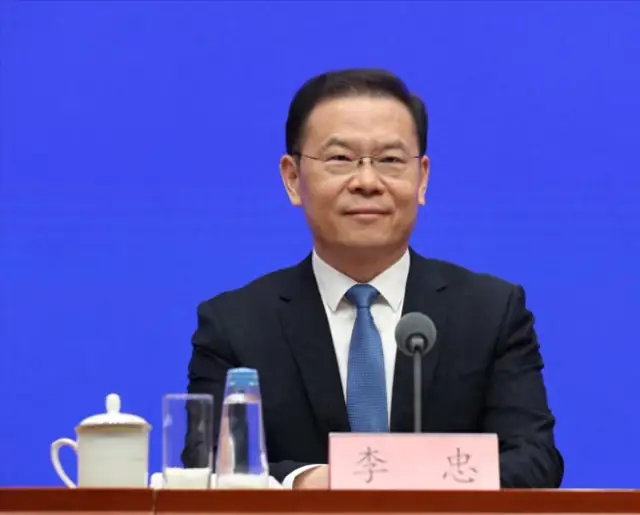

2026年10月23日，《财新》发表《人事观察｜人社部高官“空降”辽宁 57岁李忠任省委组织部长》，报道了人力资源和社会保障部副部长李忠转任辽宁省委常委、组织部部长的消息。10月22日，辽宁省委组织部召开机关干部大会，宣布中央及省委有关任职决定。中央批准李忠担任辽宁省委委员、常委，辽宁省委决定由其担任省委组织部部长。〔1〕

这原本只是一篇常规的人事调整报道，但其中有两处值得注意。

首先，李忠正是10月10日在国务院新闻办公室发布会上提出通过“数据找人”等措施动员参加社会保险的官员。这段表态此前在网络上引发了不少争议，尤其是有关灵活就业人员参加职工养老保险的问题。

<figure style="margin:24px auto;">

<figcaption style="text-align:center;font-size:0.85em;color:#888;margin-top:8px;">李忠出席新闻发布会及相关参保政策报道截图</figcaption></figure>

其次，李忠此次调任并非孤立的人事安排，而是发生在辽宁省委即将换届的背景下。2026年以来，全国已有16名省级党委组织部长履新，辽宁也将在12月召开新一届省党代会。

这两个问题分别涉及中国社会保障制度的运行，以及中国干部管理和政治领导机构的更新。将它们放回各自的制度背景，可以对这篇报道有更完整的理解。

## 一、李忠与10月10日的参保表态

李忠1969年2月出生于四川广安邻水，1991年毕业于兰州大学行政管理专业，随后进入原国家体改委工作。此后，他长期在中央人事和劳动保障系统任职，先后担任劳动保障部医疗保险司副司长、人社部政策研究司负责人、人社部办公厅主任等职务。2020年2月，李忠升任人社部副部长、党组成员。

李忠的职业经历主要集中在北京中央部委，仅在2011年至2013年以挂职方式担任过安徽省黄山市委常委、副市长。这也是他此次调任辽宁被媒体称为“空降”的原因。

2026年10月10日，李忠作为人社部副部长、新闻发言人出席国务院新闻办公室发布会，介绍“十五五”时期就业和社会保障政策。他表示，截至当年9月底，中国基本养老保险、失业保险和工伤保险参保人数分别达到10.79亿、2.51亿和3.27亿。下一步将继续扩大社会保险覆盖范围，通过政策优化、“数据找人”等方式寻找尚未参保的人员，并动员其参加社会保险。〔2〕

李忠特别提到，未来应鼓励和支持灵活就业人员、农民工以及新就业形态劳动者参加职工养老保险。他指出，目前这些群体中已有相当一部分人参加了养老保险，但参加的是城乡居民基本养老保险。未来政策希望尽可能推动他们参加职工基本养老保险，并逐步完善用工方、平台企业和劳动者共同筹资、合理分担的参保机制。

其中，“数据找人”成为网络讨论的焦点。李忠提出，需要通过各种方式识别尚未参保的人员，并进一步动员其参保。这段表态经过新闻标题、短视频和社交平台截图传播后，引发了部分公众对社保征缴范围进一步扩大的担忧。

## 二、两类养老保险及其缴费差异

中国基本养老保险主要由城镇职工基本养老保险和城乡居民基本养老保险组成。两者都属于国家基本养老保障体系，但缴费方式和待遇水平存在明显区别。

城乡居民基本养老保险主要面向未参加职工养老保险的城乡居民，通常允许个人按照不同年度缴费档次缴纳保险费，政府给予一定补贴。由于缴费水平较低，退休后领取的养老金通常也比较有限。

城镇职工基本养老保险则主要覆盖企业职工、机关事业单位工作人员以及以个人身份参保的灵活就业人员。其养老金待遇与缴费基数、缴费年限、退休时的相关计发参数等因素挂钩。职工养老保险通常需要承担更高的缴费成本，但退休后的待遇水平也明显高于居民养老保险。

官方公布的基本养老保险参保率已经超过95%。这一数字有明确统计依据，但不能理解为95%的中国人口都参加了职工养老保险。国家发展改革委对这一指标的解释是，参保人数包含职工和居民两类基本养老保险的参保人口，计算时所使用的应参保人口则为16周岁及以上人口扣除全日制在校学生和现役军人。〔3〕国家统计局公布的2025年数据表明，全国约有5.47亿人参加城镇职工基本养老保险，约5.29亿人参加城乡居民基本养老保险，两者规模相近。〔4〕

李忠所提出的政策方向，除了继续扩大总体参保范围，还包括推动部分灵活就业群体从居民养老保险转入职工养老保险。这种调整所涉及的缴费成本并不小。

以灵活就业人员参加职工养老保险为例，按照目前常见的20%缴费比例，如果某人选择每月5000元的缴费基数，仅养老保险一项，每月便需要缴纳1000元，一年合计12000元。相比之下，与单位存在劳动关系的职工，基本养老保险由单位和个人共同承担，个人缴费比例通常为8%。〔5〕

对于有稳定工资和正式劳动关系的职工，单位承担的缴费构成了重要的成本分担。但对于没有固定雇主、收入波动较大的灵活就业人员而言，全部费用需要由个人承担，因而缴费压力更加明显。

需要区分的是，现行制度并未规定所有灵活就业人员必须参加职工养老保险。存在法定劳动关系的用人单位和职工依法负有参保缴费义务；没有建立劳动关系、符合个人参保条件的灵活就业人员，则可以自愿参加职工基本养老保险。李忠在10月10日发布会上提出的是扩大覆盖、鼓励参加职工养老保险的政策方向，并非宣布对所有灵活就业人员实行强制参保。

## 三、民间围绕参保问题的主要争议

围绕此次表态，民间讨论大致集中在三个方面。

**首先是现实缴费负担。** 对部分收入较低、就业不稳定的人而言，每月数百元乃至上千元的养老保险费已经是一项不小的开支。未来养老金待遇可能提高，并不能直接缓解当前的生活压力。如果没有稳定雇主承担相应费用，扩大职工养老保险覆盖范围可能意味着劳动者需要独自承担更高的缴费成本。

**其次是养老金制度的长期可持续性。** 中国职工基本养老保险实行社会统筹与个人账户相结合的制度，其中社会统筹部分具有明显的现收现付性质，即当前劳动者缴纳的保险费在很大程度上用于支付现有退休人员的养老金。随着人口老龄化加深、退休人口规模扩大，社会对未来缴费人口、养老金收支和退休待遇的担忧也随之增加。2025年中国60周岁及以上人口已达到3.23亿，占总人口的23%；全年出生人口为792万。与此同时，渐进式延迟退休改革已经启动，职工养老保险最低缴费年限也将从2030年起逐步延长。〔6〕

**最后是养老金分配差距。** 中国不同群体之间的养老待遇存在显著差异。根据相关研究，2024年全国城镇退休职工人均养老金约为每月3825元，而城乡居民养老保险人均养老金约为246元。机关事业单位退休人员与企业退休人员之间，同样存在历史形成的待遇差距。虽然2014年已经启动机关事业单位养老保险制度改革，但原有待遇衔接、缴费年限和职业年金等安排，使不同群体之间的养老金差异仍然明显。〔7〕

养老金分配问题需要区分支出总额与人均待遇。从全国基金支出总额看，养老金并不是主要发放给机关事业单位退休人员。财政部公布的2024年决算数据显示，企业职工基本养老保险基金支出约4.99万亿元，机关事业单位基本养老保险基金支出约1.76万亿元，城乡居民基本养老保险基金支出约5283亿元。真正突出的矛盾在于，不同养老保障体系覆盖的人群规模和人均待遇存在巨大差别。〔8〕

由此看来，此次争议并不局限于是否扩大参保范围，而是涉及养老保险缴费负担、代际分配和不同群体之间的保障公平。国家希望进一步提高职工养老保险覆盖率，但社会公众同时关心现有制度的长期支付能力，以及自己未来能够获得怎样的退休待遇。

## 四、李忠调任的核心背景

10月10日，李忠还在北京介绍全国就业和社会保障政策；10月22日，他便被宣布调往辽宁，担任省委常委、组织部部长。两个事件相隔只有12天，很容易引发外界联想。但从目前公开的信息看，没有证据表明这次调任是对社保舆论争议的回应。高级干部跨部门、跨地区交流通常需要提前进行组织考察和人事协调，其安排不能仅根据新闻发布时间推断。

比起10月10日的参保争议，李忠调任更直接的背景是辽宁省委即将换届。

**所谓换届，是党组织或国家机关在任期届满后，依照相应制度产生新一届领导机构的过程。** 它并不只是个别干部的升职、退休或者岗位调整，也不限于省级领导。中国共产党从中央到省、市、县以及基层组织，都有相应的任期和换届制度；全国人大、地方人大和政协等机构也按照各自的制度进行换届。

根据《中国共产党章程》，党的全国代表大会原则上每五年举行一次，省、市、县等地方党的代表大会也原则上每五年举行一次。辽宁省第十三次党代会于2021年12月举行，第十四次党代会计划于2026年12月在沈阳召开。全国层面，2022年召开中共二十大，按照正常五年周期，预计2027年召开中共二十一大。地方党代会与全国党代会并不同步，但前后衔接，共同构成中国共产党领导机构周期性更新的重要制度安排。〔9〕

一次省级党委换届，通常需要产生新一届省委委员、候补委员和省纪委委员。省党代会召开后，新一届省委还会举行第一次全体会议，选举省委常委、省委书记和副书记。省委常委会作为省委的重要领导机构，其成员构成直接关系到未来一个任期内地方党委的运行。

换届并不是到了党代会正式开幕时才开始安排人选。党委委员、常委和书记、副书记等候选人，需要经过组织酝酿、推荐、考察、审核和上级党委审批等程序。《中国共产党地方组织选举工作条例》规定，有关候选人预备人选一般应在党代会召开一个月前报上一级党委审批。**因此换届期间的领导班子配置，通常在正式选举之前已经开始筹备。**〔10〕

从这一点看，2026年大量省级党委组织部长调整，就不再只是偶然的人事现象。组织部长负责干部队伍管理、领导班子建设相关具体工作，并参与换届所涉及的大量组织程序。对即将召开党代会的省份而言，组织部长是一个重要的工作岗位。

辽宁省委书记许昆林在宣布李忠任职的会议上，也明确要求全省组织系统做好换届工作。李忠在党代会召开前进入省委常委会并担任组织部长，意味着他将在辽宁换届准备和后续组织工作中承担相应职责。

## 五、中国官员的行政级别与职务体系

理解李忠的调任，还需要先掌握中国干部的行政级别体系。

中国党政机关的领导职务，通常从国家级正职、国家级副职开始，依次分为省部级正职和副职、厅局级正职和副职、县处级正职和副职，以及乡科级正职和副职。不同机关和地区的职务名称并不完全相同，但通常可以按照相应层级纳入统一的干部管理框架。

| 层级 | 常见职务 |
|---|---|
| 国家级正职 | 中共中央总书记、国务院总理等 |
| 国家级副职 | 国务院副总理、国务委员等 |
| 省部级正职 | 省委书记、省长、国务院部长 |
| 省部级副职 | 副省长、国务院副部长、省委常委 |
| 厅局级正职 | 省政府组成部门厅长、普通地级市市委书记、中央部委司长 |
| 厅局级副职 | 省政府组成部门副厅长、普通地级市副市长、中央部委副司长 |
| 县处级正职 | 县委书记、县长、省级机关处长 |
| 县处级副职 | 副县长、省级机关副处长 |
| 乡科级正职 | 乡镇党委书记、乡镇长 |
| 乡科级副职 | 副乡镇长等 |

上述为常见职务对应关系，副省级城市、直辖市所属区以及部分特殊岗位存在不同的级别安排。与此同时，公务员制度还实行职务与职级并行，领导职务的实际职责与用于确定有关待遇的职级也需要区分，不能把享受某一级别待遇直接等同于担任相应的领导岗位。〔11〕

从这套体系可以看到，中央部委与地方政府的职位在行政级别上具有对应关系。例如，国务院部长和省长一般都属于正省部级；国务院副部长和普通副省长一般都属于副省部级；中央部委司长和普通省级厅长一般都属于正厅局级。

这种对应关系解决的是干部级别问题，并不意味着同级官员拥有相同的权力。

中央部委副部长在全国性政策部门工作，主要按照部内分工管理特定政策领域；副省长则在地方政府体系中负责某些行政事务；省委常委可能兼任组织部长、纪委书记、宣传部长、统战部长、政法委书记或者常务副省长等职务。即使他们的行政级别相同，实际工作范围和参与决策的方式也存在明显区别。

这也是判断中国官员升迁时不能只看职务名称的原因。

## 六、省委常委与普通副省长的职权差异

中国政治制度中一个非常重要的特点，是党委与政府具有不同的组织职责。

以辽宁为例，省委书记和省长通常都属于正省部级，但省委与省政府并不是两个平行竞争的权力中心。省委在政治方向、重要干部任用和重大事项等方面发挥领导作用；省政府则按照法定职责负责行政管理和公共政策执行。

省委常委会是省委的重要领导机构。在省委全体会议闭会期间，常委会按照规定行使相应职权。省委常委通常包括省委书记、副书记，以及兼任省纪委书记、组织部长、宣传部长、统战部长、政法委书记、常务副省长等职务的领导干部。具体构成因省份及不同时期的安排而有所区别。

**因此，是否担任省委常委，是判断省级领导干部政治位置时很重要的因素。**

例如，普通副省长与常务副省长通常都是副省部级，但常务副省长往往兼任省委常委。所谓“常务副省长”，是指负责省政府常务工作的副省长，通常在副省长中排名第一。而省委常委除承担政府常务工作外，还具有参加省委常委会的组织身份。即使两者行政级别相同，其参与省委决策的制度位置也不完全相同。

省委组织部长同样如此。如果只看“部长”二字，容易将他与省政府部门厅长相混淆。但省委组织部属于党委工作部门，而省委组织部长通常兼任省委常委，其级别与普通厅局级部门负责人并不相同。

这也解释了为什么李忠从人社部副部长转任省委组织部长，不能简单按照中央部委到地方机关的方向判断其地位变化。

## 七、组织部长的地位

省委组织部长的政治重要性，主要来自中国共产党对干部选拔任用工作的组织领导。

中国干部体系实行党管干部原则。干部的培养、考察、选拔、任用、管理和监督，依照干部管理权限由相应党委及组织部门承担。党中央对高级干部和重要领导岗位具有相应管理权限，地方党委则按照分级分类管理的制度负责本地区有关干部工作。〔12〕

组织部是党委承担这些具体工作的职能部门。

省委组织部长无法凭个人意志决定所有人事任免，但组织部门在干部信息收集、组织考察、任用方案形成及后续干部管理中承担大量具体工作。因此，组织部长所负责的并不是一般意义上的单位人事行政，而是地方党委干部体系的重要组成部分。

相比之下，省人力资源和社会保障厅主要属于政府行政管理体系，负责就业、社会保险、劳动关系、事业单位人事管理等相关事务。虽然其名称同样包含“人事”，但干部管理权限和组织位置与省委组织部并不相同。

这一区别也体现在李忠的任职决定中。中央批准其担任辽宁省委委员、常委，辽宁省委决定任命其为组织部长。省委常委身份涉及省级党委领导班子的配置，组织部长则是具体的党内工作职务。两项安排虽然同时宣布，却体现了不同层级的任免权限。**也就是说，中央批准了李忠担任辽宁省委委员、常委，让他进入辽宁省委领导班子，取得省委常委身份。而辽宁省委则决定让李忠担任省委组织部部长，明确他在省委领导班子中的具体工作岗位。**

## 八、中国干部的升迁与跨地区交流

在判断官员升迁时，除了行政级别和具体职务，还需要观察其干部交流路径，以及任职岗位在整个政治体系中的位置。

中国干部的职业发展并不存在唯一的晋升路线。一个人在中央部委工作多年以后，可能进入地方党委或政府任职；地方领导干部也可能调往中央部委，或者在不同省份之间交流。部分干部还会在党委、政府、人大和政协等不同机构之间转换岗位。

这里涉及中国地方政治中经常提到的一个概念，即“四套班子”。**所谓四套班子，是指地方党委、人民代表大会、人民政府和政治协商会议**。以辽宁省为例，分别对应辽宁省委、辽宁省人大及其常委会、辽宁省人民政府和辽宁省政协。

党委负责政治领导，研究决定地方重大政治事项，并领导干部工作；人大是地方国家权力机关，依法行使地方立法、重大事项决定、选举任免和监督等职权；政府是地方国家行政机关，负责经济社会事务的具体管理和政策执行；政协则是政治协商机构，主要履行政治协商、民主监督和参政议政职能，其意见建议本身不具有国家权力机关决定的法律效力。

四套班子的主要负责人通常也都是同一级别的高级干部。例如，省委书记、省人大常委会主任、省长和省政协主席，一般均为正省部级。然而，行政级别相同，并不意味着实际政治地位和职权范围相同。省委书记通常处于地方政治领导体系的核心位置；省长负责省政府全面工作；人大常委会主任和政协主席则分别领导各自机构的工作。

同样的区别也存在于副省部级干部之间。省委常委、组织部长与普通副省长可能具有相同的行政级别，但前者作为省委常委，能够参与省委常委会的集体决策；普通副省长则主要按照省政府分工负责行政事务。常务副省长通常也兼任省委常委，因此既承担省政府常务工作的统筹协调职责，又具有参与省委重要决策的党内身份。

从这个角度看，一名干部由省委常委转任省政协主席，通常意味着行政级别由副省部级升至正省部级，但其工作重心也从党委领导班子的决策与执行转向政治协商。相反，一名干部由中央部委副职转任地方省委常委，虽然行政级别没有变化，却可能获得更直接参与地方政治决策和干部管理的机会。仅凭职务名称或行政级别，很难完整判断这种调整的实际意义。

***

除了不同机构之间的职务转换，中国干部的任职调整还经常涉及跨地区交流。一名干部可能从中央部委转往地方，也可能从一个省份调往另一个省份，或者在地方任职多年后重新进入中央机关。

对于从中央部委进入地方工作的干部来说，中央机关的职业经历通常侧重政策研究、制度制定、部门协调和全国性行政管理，地方岗位则更多涉及区域治理、地方经济社会事务和领导班子协作。

此前也有多名人社部副部长转往地方任职。《财新》报道中列举了游钧、张义珍、孔昌生等案例。其中，张义珍曾从人社部副部长转任广东省委常委、组织部长，后来担任江苏省政协主席；孔昌生也曾从人社部副部长转任河南省委常委、组织部长，后来担任河南省政协主席。这些经历说明，中央部委副职进入地方党委领导班子，可以成为干部职业发展中的一个重要阶段，但具体去向仍存在明显差异。〔1〕

李忠此次调任也应放在这一背景下理解。他从人社部副部长转任辽宁省委常委、组织部长，行政级别基本没有变化，但工作内容由中央行政部门的社会保障管理，转向地方党委的干部组织工作。同时，这次任职发生在辽宁省委换届前夕，其意义还涉及新一届省委领导班子的配置。

因此，**李忠此次调任在行政级别上属于平级交流，在具体职责上则是由中央行政管理岗位转向地方党委领导岗位。** 至于这一变化是否会成为其今后进一步晋升的基础，目前还无法仅凭此次任职决定作出判断。

对于个人仕途而言，同级调任可能意味着管理领域发生变化，也可能意味着未来任职方向有所调整。例如，一名长期担任国务院部门副职的干部，如果进一步转任地方重要领导岗位，其地方工作经历可能成为后续干部使用时需要考虑的因素。

此外，干部年龄也是判断任职调整的重要因素。李成、任欣源于2026年7月发表的《中国部级领导干部概览：年龄、任期与晋升路径》，对国务院26个组成部门的部级领导干部进行了统计。研究发现，副部级官员的平均年龄约为57岁，正部级官员则约为62岁；在149名具有年龄资料的副部级官员中，只有30人年龄在54岁及以下，约占20%。这一结果说明，57岁对于副部级干部而言属于较为常见的年龄，但如果在57岁就已经担任正部级职务，则属于相对年轻的情况。〔13〕

李忠出生于1969年2月，2020年以51岁的年龄升任人社部副部长时，属于比较年轻的副部级干部。到2026年调任辽宁省委常委、组织部长时，他已经57岁，大致处于同级干部的平均年龄水平。此次调任增加了他的地方党委工作经历，也涉及辽宁省委换届前的领导班子配置。至于这一变化是否会成为他今后进一步晋升的基础，目前还无法仅凭此次任职决定作出判断。

## 九、李忠此次调任的具体判断

回到李忠此次调任，至少可以作出三个判断。

首先，从行政级别看，他原任人社部副部长属于副部级，新任辽宁省委常委、组织部长通常也属于副省部级，因此属于平级交流，并不存在明确的级别升降。

其次，从职务性质看，他由国务院部门副职进入地方党委常委会，能够参与辽宁省委有关集体决策，同时负责省委组织工作。这是实际职责上的明显变化。组织部长岗位在地方干部管理体系中具有重要位置，特别是在换届前夕，其工作与新一届领导班子的形成密切相关。

最后，从政治周期看，此次调任发生在辽宁省第十四次党代会召开前约两个月，并且属于全国多个省份组织部长集中调整的一部分。考虑到换届涉及大量领导班子配置、干部考察和组织程序，这一时间背景比单独观察李忠的年龄或者工作地点更有解释力。

## 十、结语

李忠此次调任之所以值得关注，是因为一篇看似普通的人事新闻，涉及了两个不同的制度问题。

在社会保障领域，李忠10月10日关于扩大养老保险参保范围的表态，引出了灵活就业者的缴费负担、现收现付制度面临的人口老龄化压力，以及不同群体养老金待遇的分配差距。这些问题关系到中国养老保障体系未来的运行和调整。

在干部制度领域，李忠从中央部委副职转任辽宁省委常委、组织部长，则需要结合中国的行政级别、党委与政府的职权关系、干部管理制度以及五年换届周期加以理解。行政级别上的平级调动，可能伴随着工作职责和政治位置的实质变化，但无法仅凭职务名称判断个人未来的升迁。

理解这两套制度之后，李忠的调任就不再只是一个官员更换工作岗位的消息。它既反映了社会政策在执行过程中面临的现实矛盾，也提供了观察中国高级干部交流和地方党委换届的一个具体案例。

---

## 参考文献

〔1〕财新，林韵诗：《[人事观察｜人社部高官“空降”辽宁 57岁李忠任省委组织部长](https://china.caixin.com/m/2026-10-23/102496242.html)》，2026年10月23日。

〔2〕新华社：《[实施就业优先战略 织密社会保障网络——国新办发布会聚焦“十五五”就业和社保高质量发展](https://www1.xinhuanet.com/politics/20261010/6fe8792188c144f0ab661a10156d7eae/c.html)》，2026年10月10日。

〔3〕国家发展改革委：《[“十四五”规划〈纲要〉主要指标之11｜基本养老保险参保率](https://www.ndrc.gov.cn/fggz/fzzlgh/gjfzgh/202112/t20211225_1309658.html)》。

〔4〕国家统计局：《[中华人民共和国2025年国民经济和社会发展统计公报](https://www.stats.gov.cn/zwfwck/sjfb/202602/t20260228_1962662.html)》，2026年2月。

〔5〕深圳市社会保险基金管理局：《[灵活就业人员个人参保养老保险，和单位职工身份参保养老保险，两者之间有区别吗？](https://hrss.sz.gov.cn/szsi/gzfw/ywzsk/sbgx/jbgn/content/post_12703216.html)》，2026年3月26日。

〔6〕国家统计局：《[2025年经济发展向新向优 预期目标圆满实现](https://www.stats.gov.cn/sj/zxfb/202601/t20260119_1962330.html)》；全国人大常委会：《[关于实施渐进式延迟法定退休年龄的决定](https://rsj.sh.gov.cn/tgwyrsb_17088/20240913/t0035_1427711.html)》。

〔7〕复旦大学经济学院：《[阶梯式提升农民养老金的具体方案和财政可行性](https://econ.fudan.edu.cn/info/1025/41537.htm)》，2026年。

〔8〕财政部：《[2024年全国社会保险基金支出决算表](https://yss.mof.gov.cn/2024zyjs/202509/t20250904_3971476.htm)》。

〔9〕《[中国共产党章程](https://www.miit.gov.cn/xwdt/szyw/art/2022/art_870a5469839a4b5bb65857894642b2a0.html)》；辽宁省委第十三届委员会第十一次全体会议关于召开省第十四次党代会的决定。

〔10〕中共中央：《[中国共产党地方组织选举工作条例](https://www.beijing.gov.cn/zhengce/zhengcefagui/202101/t20210107_2200922.html)》，2020年修订。

〔11〕《[公务员职务、职级与级别管理办法](https://www.12371.cn/2020/03/13/ARTI1584068885714335.shtml)》；《[公务员职务与职级并行规定](https://www.moj.gov.cn/pub/sfbgw/jgsz/gjjwzsfbjjz/zyzsfbjjztzcfg/201903/t20190328_181415.html)》。

〔12〕中共中央：《[中国共产党组织工作条例](https://www.12371.cn/2021/06/02/ARTI1622638688535935.shtml)》，2021年。

〔13〕 李成、任欣源：《中国部级领导干部概览：年龄、任期与晋升路径》，香港大学当代中国与世界研究中心，2026年7月。[原文 PDF](https://cccw.hku.hk/wp-content/uploads/2026/07/Clean-Li-Ren_%E4%B8%AD%E5%9B%BD%E9%83%A8%E7%BA%A7%E9%A2%86%E5%AF%BC%E5%B9%B2%E9%83%A8.pdf)
