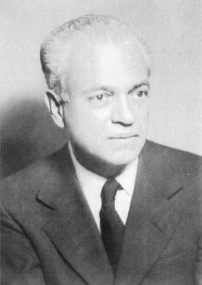
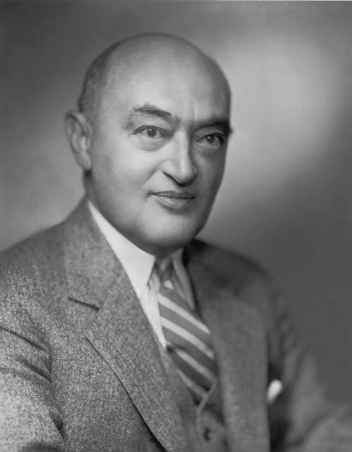

# 正文（1979年2月21日）

**讲座提要**

依据秩序自由主义者们的说法，“社会政策”的第二个方面是：在一个依照竞争型市场经济模式进行调控社会中的法律问题——回到瓦尔特•李普曼会议——基于路易斯 •鲁吉耶（Louis Rougier）的文本所做的思考——（1）法律一经济（juridico-economique）秩序的观念。经济活动和制度框架之间的相互关系-政治上的关键之处：资本主义的存活（survie）问题——两个补充性问题：竞争理论与对资本主义所进行的历史的和社会学的分析——（2）法律干预主义问题—历史追忆：在18世纪，与专制主义和管治国家相对立的法治国家（Etat dedroit）。19世纪对概念的重新界定：公民与国家公共权力（puissancepublique）之间的仲裁问题。行政法庭问题——新自由主义规划：将法治国家的原理引入经济秩序之中——法治国家与哈耶克认为的计划化——（3）法律诉求的增长——总的结论：新自由主义治理术在德国的独特性。秩序自由主义面对熊彼特的悲观主义

## 一、社会政策

### 1. 社会干预

上次课我已经设法向你们展现了秩序自由主义必然地暗含这一种 Gesellschaftspolitik，正如同他们所说：一种社会政策和一种积极的、多样的、警觉的、无所不在的社会干预主义（interventionnisme social）。因此一边是市场经济，另一边是社会政策积极地和激烈地干预。但是还应该再仔细地强调一下：秩序自由主义中的社会政策，其功能不是作为一种补偿机制用来吸收或消除自由经济可能对社会、对社会组织和基础网络所造成的破坏。事实上，如果说存在着永久的、形式多样的社会干预主义，它并不是对抗市场经济或者与市场经济逆流而动，而是相反，它是作市场经济在历史和社会方面的可能性条件，它是作为竞争这种形式机理得以运转的条件，以使得竞争型市场应有的调节功能可以正确地实施并且避免出现由于竞争缺失所导致的消极的社会后果。因此，Gesellschafispolitik 应该消除的不是竞争的诸多反社会（anti-sociaux）的后果，而是可能由社会引发的、无论什么条件下在社会中都可能会出现的诸多反竞争（anti-concurrentiels）机制。

### 2. 企业与法律

这就是我上次课所要强调的。而为了赋予 Gesellschaftspolitik以具体内容，我认存在着秩序自由主义者所坚持的两个重要方针：一方面，按照企业模式塑造社会，并且我已经指出了企业这个概念的重要性<a id="ref-1" href="#note-1">〔1〕</a>，下面我还会再谈到它！——可能要研究一下企业家和企业这两个概念在经济方面和社会方面的历史，以及自19世纪末期到20世纪中期，从一方到另一方的演变—因此第一个方针是按照企业模式塑造社会；第二个方针，就是今天我要对你们讲的，即对司法制度和法律条例的再定义，这些制度和条例在一个基于并依据竞争型市场经济得以调节的社会之中是必需的：总之，就是法律问题。

## 二、法律—经济秩序

### 1. 李普曼会议



为了确立以上问题，我想再回到瓦尔特•李普曼会议，我在8天还是15天前已经讲到过，我记不清楚了<a id="ref-2" href="#note-2">〔2〕</a>，此会议在新自由主义现当代历史中是相当重要的一个事件，因为在1939年战争开始的前夜，以下几类人相遇在这次会议上：传统的自由主义者，德国秩序自由主义者如罗普克、鲁斯图等人以及以哈耶克和米塞斯为代表的介于德国秩序自由主义和美国新自由主义之间的一类人，从后者中后来又产生出“芝加哥学派”<a id="ref-3" href="#note-3">〔3〕</a>的无政府自由主义和米尔顿•弗里德曼<a id="ref-4" href="#note-4">〔4〕</a>（Milton Friedman）等。以上所有这些人于1939年聚集在一起—某种程度上来说，是哈耶克和米塞斯而不是弗里德曼负责信息传递—而这次会议的主持人和组织者名叫路易斯•鲁吉耶<a id="ref-5" href="#note-5">〔5〕</a>，他是法国战后少有的几位优秀的知识论学者之一，并且在历史上，1940年夏，他曾作为贝当（Petain）和丘吉尔之间的中间人而尤为人所知<a id="ref-6" href="#note-6">〔6〕</a>。这个路易斯•鲁吉耶就是 1939年夏季，我想是5月份或是1939年6月<a id="ref-7" href="#note-7">〔7〕</a>举行的李普曼会议的组织者。他对会议的整体思想和各种不同发言都做了评述，并且我必须说他对新自由主义的普遍原则所做的阐发非常值得我们注意。

关于司法问题，他是这么说的：“自由主义制度不仅仅像18世纪《自然法典》（Codes de la nature）的作者所宣称的那样是一种自发的（spontane）自然秩序之结果；它同样也是一种以国家的司法干预前提的法律秩序之结果。其实，经济生活（实际上）是在司法框架内展开的，后者确定了所有权制度、合同制度、发明专利制度、破产制度、职业联合会和贸易公司的地位以及货币和银行。以上所有东西都不是如同经济平衡规律那样的自然事实，而是立法者的偶然创造。因而没有任何理由假设历史地存在于当前现实中的法律制度，确定地和永远地最适合保护交易的自由。传统经济学家所忽视的问题，即适合于市场最灵活、最有效、最公平的运转的法律框架问题，这个问题应该成为‘自由主义革新国际研究中心’（Centre International d'Etudes pour la Renovation du Libeenlisme）的研究对象。因此，成为自由主义者，这完全不是成为保守主义者，即那种优先维护以往法规所导致的事实之人。相反，自由主义者从根本上应该是进步者，这种进步指的是法律秩序不断地适应科学发现、适应经济组织结构和技术的进步、适应社会结构的变化、适应当代意识的要求。成为自由主义者，这不是成为像‘曼彻斯特人’（manchesterien），根据自己喜好任由汽车四处行驶，从而不断造成交通拥堵和事故；成为自由主义者，也不是成为像‘计划主义者’，规定每辆车的出行时间和路线，而是虽然规定一部《道路法》，但同时承认高速交通时代与马车时代的差别。对于真正是自由主义的经济在于什么，今天的我们比传统经典理解的更好。自由主义经济是一种服从于双重裁决的经济：一种是消费者自发的裁决，他们按照自己喜好通过价格的全民表决（plebiscite）来评判市场所提供的福利和服务；而（另一种）是国家的裁决，它保证了市场的自由、光明正大和效率。”<a id="ref-8" href="#note-8">〔8〕</a>

### 2. 法律秩序

在这段文字中，我认为我们能发现一些要点。让我们立刻把新自由主义者显然不会认同的几处放置一边。这涉及竞争机制的自然特征。当鲁吉耶说：自由主义制度不仅仅是自然秩序的结果，而且也是法律秩序的结果时，新自由主义者显然会说：不对，人们所理解的自然秩序、那些传统的经济学家或18世纪的人们所理解的自然秩序，只是某种法律秩序的结果。我们不要去管传统自由主义和新自由主义交汇处的那些要素，而是转向从这段文字中所能发现的更有意义的、更专属于新自由主义的那些要素。

### 3. 法律与经济

我认为首先要注意的是：对鲁吉耶来说，对秩序自由主义者们也一样，法律事务不属于上层建筑（superstructure）范围。也就是说，他们不认为法律事务仅仅是经济的单纯而简单的表达工具。经济并不简单地决定法律秩序，这样的法律秩序服务于、从属于经济。法律塑造（informe）经济，如没有法律，经济就不能成为其所是的那样。

这是什么意思？我想我们可以指出它的三层意义。第一是理论意义。理论意义，你们大家都已看出来，不好意思还要再重复一遍，是指不是把下层（infra-）的经济和上层（super-）的法律政治对立起来，而是实际上应该探讨一种经济—法律秩序。在这一点上，鲁吉耶和秩序自由主义者都明确地跟从一种重要路线，即马克斯•韦伯路线。也就是说，如同马克斯•韦伯那样，他们一开始就将自己定位于生产关系层面，而不是生产力层面。某种程度上来说，他们用一只手把历史和经济、法律和严格来讲的经济都囊括一起；由于他们将自己置于生产关系层面，他们并不认为经济是这样一种活动整体：法律将作为这个整体的补充，并且这个法律可能或多或少地适合这些活动或者或多或少地滞后于这些活动。

事实上，从一开始，经济就应该被理解为受到调控的活动整体，而调控这种活动整体的各种规则具有完全不同的等级、形式、起源、时期和年代。这些规则可以是社会习惯（habitus social），可以是宗教规定，可以是一种伦理，可以是行业公会条例，也同样可以是法律。不管怎样，经济不是一种机械活动或自然活动，不是一种人们可以摆脱的活动，除非通过后天的抽象活动和形式化的抽象活动”。经济从来就只能被看成一个活动整体，而一说到活动就必然是指受支配的活动。正是这个经济-法律的整体、这个受支配的活动整体，欧肯<a id="ref-9" href="#note-9">〔9〕</a>——在这里，更多的是从现象学的而不是韦伯的视角——称其“系统”<a id="ref-10" href="#note-10">〔10〕</a>。系统是什么？它就是包含了各种经济活动的一个复杂整体，虽然对这些活动的严格经济学分析实际上属于一个纯粹的理论和一种形式化（formalisation），比如可以是竞争机制的一种形式化；但只有在一种制度框架和有效规则已给出其可能性条件的情况下，这些经济活动才能在历史中真实地出现<a id="ref-11" href="#note-11">〔11〕</a>。历史地来看，这就是常见的对生产关系整体所做的分析所想表达的意思。

### 4. 经济-制度史

何谓历史地来看？它的意思是指应该避免想象地认为：在某个确定时期，单纯地或本义上（proprement）存在着资本主义的经济实在，或资本的经济实在或资本积累的经济实在，这种实在以其自身的必要性动摇了旧有的法律规则，比如长子继承权法律（droit de ainesse）和旧有的封建法律等；之后通过其逻辑和自身要求从底层产生出新的更适合的法律规则的萌芽，比如财产权法、股份公司制立法和专利权法等。

事实上，上述看待事情的方式是不应该的。而是应该这样认为：**历史地来看，存在一种特殊样式（figure），即经济活动和制度框架互相需要、互相依靠、互相修改，在不断的相互关系中成形**。总之，资本主义不是一个从底层动摇了比如长子继承权法的行为活动。事实上，只有考虑到长子继承权法在它的起源和形成中切实所起到的作用，我们才能理解资本主义的历史样式。**资本主义的历史只可能是一种经济-制度的（economico-institutionnelle）历史。由此而引出的一系列对经济史的研究、对法律-经济（juridico-economique）史的研究，它们在整个理论讨论中是非常重要的**；但从政治的角度来看，也同样如此重要（我会回到这一点），因为显而易见：关于资本主义的理论和历史分析，以及法律制度在其中所起的作用，所探讨的关键之处，当然都是属于政治层面的问题。

### 5. 资本主义的存活

这个政治方面的关键之处是指什么？很简单，就是指资本主义的存活问题，向资本主义敞开的可能性问题和可能性领域的问题。因为实际上，如果你们都同意：从宽泛意义上的马克思主义的视角来看，在资本主义的历史中，决定性因素是资本和资本积累的经济上的逻辑，那么，你们就明白了实际上只有一种资本主义，因为只有一个资本的逻辑。只有一个资本主义，而它是由其唯一的、必然的经济逻辑所界定的；对于这个资本主义，我们只能说这样的制度有利于它或那样的制度不利于它。不管是青春焕发的资本主义还是受束缚的资本主义，不管怎样都是这个资本主义（Le capitalisme）。我们所认识的西方的资本主义是短期的资本主义，它只是通过几个有利因素或不利因素来调整。因此，就资本和资本积累的逻辑最终决定了资本主义的现实死胡同而言，这些死胡同必然是历史上最终的死胡同。因而，换言之，当我们把资本主义的全部历史样式与资本和资本积累的逻辑联系在一起时，资本主义的终结就已经由当前所显现的历史死胡同显露出来了。

但是如果说从上述的反面来看，经济学家所称的“资本”，事实上只是属于一个纯粹经济理论的一种活动，而这个活动只在于并且只能在于一种经济-制度的资本主义之中才具有真实的历史，那么你们大家就会明白：我们所熟悉的历史中的资本主义，不是作为资本逻辑可能的和必然的唯一样式而推导出来的。事实上，历史地存在一种资本主义，一种具有其特殊性的资本主义，但是由于其特殊性，它可以引入一些制度上的改变以及由此而来的经济改变，而一些经济-制度上的改变为它开启了可能性领域。在第一种分析类型中，由于完全诉诸资本和资本积累的逻辑，资本主义便只有一个，并且接下来的是资本主义的完全消失。还有一种可能性：存在着经济-制度样式的历史特殊性，而一种可能性领域就敞开在该样式面前（如果人们至少会给出一点历史距离和经济的、政治的和制度的一点想象力）。也就是说，在这场关于资本主义历史，关于法律制度、规则在资本主义中所起作用的历史的争论，它的关键之处实际上是政治层面上的。

为了换个角度来看事情，如果你们同意，我们看一下秩序自由主义者如何看待这些事情的？如果进行一下粗略的分析，并且说其问题就是证明资本主义仍然是可能的，只要发明一种新形式，资本主义仍然可以存活，如果大家同意这就是秩序自由主义者的最终目标，那么可以说实际上要证明两个东西。第一，要证明资本主义自身的经济逻辑、竞争型市场的逻辑是可能的并且互相是不矛盾的。这就是他们设法要做的，也是我上次课向你们讲述的。其次，需要证明这种逻辑自身是不矛盾的并且因此是可以信任的；在资本主义各种具体的、真实的、历史的形式中，存在一组法律-经济的关系，并且人们通过发明一个新的制度功能，就能摆脱那些作为资本主义社会特征的后果——矛盾、死胡同和非理性——这些后果不是由于资本主义的逻辑所导致，而仅仅是由于经济-法律这个复杂体中的一种特殊的和确定的样式所致。

### 6. 竞争与经济社会学

因而，你们看到，在德国，支配着经济理论和经济史或者说经济社会学这两个重要问题完全联系到一起。一个问题就是：竞争理论。如果那个时代的经济学家们，瓦尔拉斯<a id="ref-12" href="#note-12">〔12〕</a>（Walras）、英国的马歇尔<a id="ref-13" href="#note-13">〔13〕</a>（Marshall）、瑞典的威克塞尔<a id="ref-14" href="#note-14">〔14〕</a>（Wicksell）以及他们的后继者都注重这个竞争理论，那么主要是为了确定竞争型市场的形式机制（mecanisme formel）是否是矛盾的，同样要弄明白在何种程度上，该竞争型市场是否会导致可能使其毁灭的那些现象，即垄断。这一揽子问题是经济理论上的问题。

还有一揽子历史的和经济社会学的问题，我们称之为韦伯的问题，它事实上只是第一类问题的另一面或者说反面。它要弄清楚在资本主义的历史中，是否可以找出一个经济的-制度的整体能够解释资本主义的独特性以及人们目前所见证的死胡同、矛盾、困难、合理性和非理性的混杂。因此既要研究新教伦理和与之相关的宗教规范的作用的历史，研究新教伦理的历史<a id="ref-15" href="#note-15">〔15〕</a>，又要研究竞争的纯粹理论；它们是以某种方式来提出和设法解决一个问题的两个不同方面或两个相互补充的方式：这个问题就是资本主义是否能够存活下去。我认为这些就是事情和鲁吉耶那个文本所包含的一个方面，他凭借（所有这些）提议，设法指出经济活动不能与一个制度整体和一个法律整体相脱节，这样的整体不仅仅是经济活动的结果，不仅仅是对经济活动多少不符或多少相符的表达，而是在经济系统的内部真正地与经济活动结为一体，也就是说大体与一组受调控的经济实践结为一体。

## 三、法律干预主义

### 1. 制度创新

我刚才给你们读过的那个文本所含的另一个方面，我称之为“法律干预主义”，它是第一个方面的结果。如果说人们实际上都认同：我们与之打交道的，并不是来源于那资本逻辑（la logique du capital）的那个资本主义（Le capitalisme），而是一个由经济-制度整体所构成的独特资本主义，那么人们必须能够干预这个整体并以创造出另一个资本主义的方式进行干预。我们不能继续那资本主义，那么我们就发明一个新的资本主义。但是哪里是、从哪里开始资本主义内部的革新？当然不是从市场规律方面开始，不是对市场自身改革，因为如同经济理论已经证明的那样，市场从定义上来看，它的运转必须使得它的那些纯粹机制本身就是整体的调节器。因此，不要去碰那些市场规律，而是差不多去使得制度成为这些市场规律，并且只有这些制度才是经济总调节之准则，并且相应也就是社会调节之准则。由此而带来的是非经济干预主义或经济干预的最小化和法律干预的最大化。

欧肯说过一句我认为是意味深长的话：必须“过渡到一种有意识的经济法”<a id="ref-16" href="#note-16">〔16〕</a>。我认为，应该将这句话与通常的马克思主义表述作逐一对比。按照通常的马克思主义表述，当历史学家进行历史分析时，经济领域总是脱离于他们的意识之外。欧肯认为，历史学家的无意识，不是经济领域，而是对制度领域无意识；或者说历史学家的无意识并不像经济学家的无意识那样。逃避经济理论、逃避经济学们的分析的是制度，我们应该过渡到一个有意识的经济法层面，既要通过历史分析来指出制度和法律规范何与经济是互为条件的关系以及这种关系是什么样的，同时又要意识到对这个经济—-法律整体所要引人的诸多改变。

接下来的问题是：在何处我们能够引入整套制度修正和制度革新以便最终建立一个依据市场经济来调节的社会秩序，怎样达到秩序自由主义者们所说的Wirtscha ftsordnung<a id="ref-17" href="#note-17">〔17〕</a>，“经济秩序”？秩序自由主义者们的回答是—这也是现在我要重点关注的——简单来说，现在必须实施的制度革新，就是把德国传统所称的 Rechtsstaat、英国人所称的 Rule of law，即法治国家或法律统治应用到经济之上。正是在这里，秩序自由主义的分析将不再属于这样的阵线：这是由瓦尔拉斯（Walras）、威克塞尔（Wicksell）、马歇尔（Marshall）所确定的竞争经济理论阵线，是由韦伯所确定的经济社会学史阵线；秩序自由主义的分析将属于法律理论这整个阵线，这种国家法理论在德国法律思想史和德国制度史上是非常重要的。

在这方面简单说两句。如何理解你们可能经常听到的，至少在去年的诸多报纸中所读到的 Rechtsstaat，法治国家<a id="ref-18" href="#note-18">〔18〕</a>？我认为先要概括式地说一下。因此请你们原谅我所说的只是些完全精要和构架的特征。在18世纪、18 世纪末到19世纪初，法治国家这个概念出现于德国的政治理论和法律理论之中<a id="ref-19" href="#note-19">〔19〕</a>。法治国家，它是指什么？在那个时期，它是通过与两个东西的对立而被定义出来的。第一，与专制主义的对立。那时候的专制主义是这样一个系统：它使君主的个人意志或普遍意志，反正就是最高权力者的意志成为了每个人和所有人服从于国家公共权力所依据的准则。专制主义把国家公共权力命令的强制形式特征与最高权力者的意志视为同一。

### 2. 管治国家

第二，与法治国家相对立的还有 Polizeistaat，即管治国家，它与专制主义有所不同，尽管具体来看，两者能够相互重叠，反正其中一个的某些方面能覆盖另一个的某些方面。我们怎样来理解Polizeistaat、管治国家？它是这样的系统：在该系统中，在以下两者之间没有性质的不同，没有根源上的不同，没有效用的不同，由此也无后果的不同：一方面是国家公共权力的永久性和一般性的规定（大体上，它们就是被称之法律的东西），另一方面是国家公共权力所做出的局势的、暂时的、区域的、个别的决策（这是规章条例层面上的东西）。管治国家建立了一个从一般性法律到具体措施的行政连续体（continuum），这个连续体使得国家公共权力及其指令成为唯一和同一的准则，并赋予其唯一和同一类型的强制性。专制主义把国家公共权力的所有可能的指令都转为或者确切说把它们的根源都归于唯一的最高权力者的意志。而管治国家在国家公共权力指令的所有可能形式之间建立起一个连续体，而不管该公共权力的强制性特征的根源是什么。

### 3. 法治国家

相对于专制主义和管治国家来说，法治国家将代表另一种有效选择。也就是说，首先，法治国家的定义是：在这种国家中，国家公共权力的行如果脱离了预先对其制约的法律框架，那就不会起作用。国家公共权力必须在并且只能在法律框架之中实施。因而，国家公共权力的强制性特征的根源不再是君主，不再是最高权力者的意志，而是法律程序。有法律程序的地方，在由法律程序所规定的空间内，国家公共权力可以正当地具有强制性。这是对法治国家的第一-个定义。其次，在法治国家中，在以下两者之间存在着性质的不同、结果的不同、起源的不同：一方面作为普遍有效的一般性措施并且其自身就是国家主权行为的法律，另一方面是国家公共权力的具体决策。换句话说，在法治国家中，在作为国家主权之表达的法律配置与行政措施之间，在准则上、结果上和有效性上都是不同的。大体来说，正是这种关于国家公共权力及国家公共权力法的理论，在18世纪末和19世纪初筹划了法治国家理论，以反对在18世纪运转的权力形式和公共法形式。

### 4. 司法仲裁

有关法治国家的双重理论，或者说法治国家的两方面，就是一方面与专制主义相对，另一方面与管治国家相对；你们在19世纪的所有一系列文本中都能发现这一点。其中最主要的，也是第一个建立（法治国家）理论的文本就是1813年维尔克（Welcker）的《法律、国家和刑罚的最终原理》<a id="ref-20" href="#note-20">〔20〕</a>。时间上我稍微往前进一步。在19世纪下半叶，你们会发现法治国家的另一种定义，或者说对法治国家这个概念之建立的进一步推动。在那时，法治国家的定义是：在其之中，每个公民都具有向国家公共权力索赔的诸多可能性，而这些可能性都是实在的、制度化的和有效的。也就是说法治国家不再仅仅根据法律和法律框架而活动，而是在国家中存在一种法律系统，即存在诸多法规，但还有诸多司法机构来对个人与国家公共权力之间的关系进行仲裁。这就只是行政法庭的问题了。

因此在19世纪下半叶，你们看到在德国的理论和政策中，展开了一系列讨论来弄清楚在法治国家中，公民是否能够并且应该上诉至负责仲裁的行政法庭之类的专业法庭上向国家公共权力索赔，或者与之相反，公民可以上诉于普通法庭向国家公共权力索赔。一部分理论家，比如格奈斯特<a id="ref-21" href="#note-21">〔21〕</a>（Gneist）认为：行政法庭作为国家与公民之间的仲裁机构，对法治国家的建立是必不可少的。对此，另一些人比如巴尔（Bahr）<a id="ref-22" href="#note-22">〔22〕</a>反对说，行政法庭来自于国家公共权力并且只是它的各种形式之一，在这种情况下，它不能成为国家和公民间的有效仲裁人；只有普通的司法机关，由于它真实地或虚构地独立于国家公共权力，才能够成为公民和国家间的仲裁人。不管怎样，这就是英国人的观点。19世纪末期，在英国人关于 Rule of law、法律统治的所有分析中，他们都清楚地给出了法治国家的定义<a id="ref-23" href="#note-23">〔23〕</a>：在法治国家中，并不是国家自己组织安排行政法庭来仲裁国家公共权力和公民间的关系，而是国家的公民可以上诉于普通司法机关向国家公共权力索赔。英国人说：如果出现行政法庭，人们立刻便不是在法治国家中了。对英国人来说，例证就是法国不是一个法治国家，因为法国既有行政法庭又有最高行政法院（Conseil d'Etat）<a id="ref-24" href="#note-24">〔24〕</a>。从英国理论来看，最高行政法院的存在排除了法治国家存在的可能性<a id="ref-25" href="#note-25">〔25〕</a>。总之，这就是法治国家的第二种定义，即通过一种或另一种机关对公民和国家公共权力之间进行司法仲裁的可能性。

### 5. 经济法治

正是从这一点出发，自由主义者试图界定出革新资本主义之路。这种革新资本主义之路，就是将法治国家的普遍原则引人到经济立法中。这种在经济中突出强调法治国家原则的想法是一种摈弃希特勒式国家的具体方式，但是在寻求经济法治国家过程中，首先的控诉对象可能并不是希特勒式国家；因说真的，在希特勒实践中，所引起争议的并且在事实上引起不满的是人民经济法治国家（1'Etat de droit economique du peuple），因为国家不再是法律主体，并且法律的来源是人民，而不是国家。国家只能是人民意志的工具化，这就完全排除了国家能够成为法律主体，即作为法律准则或者作为在任何一个法庭都可以被传唤的法律人格。事实上，这样在经济领域中寻求法治国家，它所针对的是经济领域中所有形式的合法干预，这是在那个时候民主国家还有其他类型的国家都实施过的干预，如在美国新政中以及在之后几年的英国式计划化中都实行过国家的合法经济干预。然而，把法治国家原则应用于经济领域，这到底是什么意思？我认为总体上这是说：经济领域中的国家合法干预只能采取形式准则（principes formels）引人之样式。只存在形式上的经济立法。这就是经济领域中的法治国家原则。

### 6. 计划化

合法干预应该成为形式上的，这又是什么意思？我认为，正是哈耶克在其《自由宪章》<a id="ref-26" href="#note-26">〔26〕</a>一书中较好地界定了应该如何理解法治国家原则或 Rule of law 原则在经济领域中的运用。哈耶克说，实际上这很简单。法治国家或形式上的经济立法仅仅就是计划的反面<a id="ref-27" href="#note-27">〔27〕</a>，是计划化的反面。而实际上，什么是计划？

（首先，）一个经济计划是某个具有目的性（finalite）的东西<a id="ref-28" href="#note-28">〔28〕</a>。比如人们明确地寻求经济增长，或者发展某种类型的消费、某种类型的投资。人们寻求减少社会不同阶层的收入差距。总之，人们给自己设定了诸多清楚和明确的经济目的。

其次，在计划中，人们总是依据所存在的上述目标，依据所寻求目标达到与否，总是有可能在恰当的时机进行矫正、更正、暂停措施和选择其他措施。

第三，在计划中，扮演经济决策者角色的国家公共权力，它或者取代个人成为决策之准则，因而它要求个人服从这个或那个，比如不要超出这种薪酬水平；或者它扮演决策者的角色：它自己就是经济行为主体（agent economique），比如对公共设施投资。因此，在计划中国家公共权力扮演决策者的角色<a id="ref-29" href="#note-29">〔29〕</a>。

最后，在计划中，人们假设国家公共权力能够构成一个掌控全部经济活动的主体。也就是说，国家作为重要决策者必须对经济活动整体具有清楚的或者最大可能清楚的意识。它是经济领域中普遍的知识主体<a id="ref-30" href="#note-30">〔30〕</a> （sujet universel de savoir）。好了，这就是计划。

### 7. 经济规则

然而，哈耶克却说，法治国家如果想在经济秩序中运转必须完全与以上所说相反。也就是说，法治国家有可能会提出一些具有普遍性特点的措施，但是这些措施必须完全是形式上的（formelles），即它们永远不应提出一个具体目的。不应该由国家去说：必须降低收人差距。不应该由国家去说：我想要增长这种类型的消费。经济领域中的法律应该完全是形式上的。它应该告诉人们应该做的和不应该做的；它不应该进人到经济的总体选择范围中。

第二点，一条法规，如果它在经济秩序中遵守法治国家的原则，就应该先天地被看作固定的条例，它永远不能根据导致的结果而被修改。

第三点，它应该界定出一个框架，在其之中，每个经济主体都可以自主决策，因它知道规范自已行为的法律框架是不变的。

第四点，一条形式法规对国家的束缚不比其他东西少，因而这条法规应该是这样的：它使每个人都准确地知道国家公共权力将要如何行动<a id="ref-31" href="#note-31">〔31〕</a>。

最后，通过这些你们可以看到，这种对经济秩序中的法治国家之理解，实际上排除了普遍的知识主体的存在：这样的主体差不多能够从高处来控制经济活动整体，确定它们的目的，取代这种或那种类别的经济主体采取这样或那样的行动。事实上，国家应该无视经济活动。我们不应该假设国家知道与经济有关的所有现象<a id="ref-32" href="#note-32">〔32〕</a>。

总之，对国家和个人来说都一样，经济应该是一个游戏：一组受到调控的活动——你们看到，我们又回到开头所说的——但是在游戏中，规范不是指某人为其他人所做出的决定。经济是一整套规范，限定每个人应该参与游戏的方式，说到底，没有人知道这场游戏的结局。经济是一场游戏，而框住经济的法律制度应该被认为是游戏的规则。Rule of law 和法治国家使得治理行为成为经济游戏规则的提供者，而经济游戏的唯一合作者，唯一的真实参与主体应该是个体，或者说企业。这是一个在由国家所保障的法律-制度框架内的受到调控的企业游戏：这就是一个革新后的资本主义中的制度框架所应有的普遍形式。它是经济游戏的规则而不是经济-社会方面有目的的操控。

在经济方面对法治国家或 Rule of law 下定义，关于这一点哈耶克在一个句子中描述得很清楚。他说，计划理所当然地与法治国家或 Rule of law 相对立，“计划表明的是如何有意识地引导社会资源以便达到所确定的目标。相反 Rule of law 在于勾勒出一种更合理的框架，在其中个体按照它们的个人计划从事自己的活动”<a id="ref-33" href="#note-33">〔33〕</a>。波兰尼（Polanyi）在《自由的逻辑》也写道：“法院系统的主要功能就是控制经济生活的自发的秩序。法律体系应当发展和强化生产与分配的竞争性机制据以运转的规范。”<a id="ref-34" href="#note-34">〔34〕</a>因此将会有一套作为游戏规则的法律体系，然后再会出现一种通过经济活动的自发性来体现某个具体秩序的游戏。

法律和秩序、law and order 这两个概念，我下次课还会谈到它们并且你们都已熟知它们在美国右派思想中的命运，对发源于美国中西部的顽固的极右势力来说，它们不仅仅是口号式的概念<a id="ref-35" href="#note-35">〔35〕</a>。Law and order，从本源上来看有很确切的意义，我们可以追溯到我所讲的这种自由主义之外。Law and order 是这样的意思：国家和国家公共权力只能以法律的形式参与经济秩序中，并且正是在法律之内，如果国家公共权力确实受制于这些法律干预，那么一个经济秩序才能出现，而这个经济秩序既是它自身的调节准则又是其结果。

以上就是关于我之前所引举的鲁吉耶那段文字，我想要强调的第二个方面。总结一下：第一，不存在这个（le）资本主义及它的逻辑、它的诸多矛盾、它的死胡同。存在一个（un）经济-制度、经济-法律的资本主义。第二，由此完全有可能创造出、想象出不同于第一类资本主义，不同于我们熟悉类型的另一种资本主义。这另一种资本主义根本上的原则就是根据法治国家原理来重新安排制度框架，因此它清除了所有在19世纪的经济保护主义中或是在20世纪的计划经济中，各国曾经有权强制实行的全部行政上的或法律上的干预主义。

## 四、司法社会

### 1. 诉讼增长

要强调的第三个方面，必然就是我们所称的法律诉讼的增长，因为事实上这样一个法律观念，即法律的普遍形式就是国家公共权力给游戏者强行制定的游戏规则的形式，而游戏者自己在他们的游戏中却仍然是自由的；这个法律观念当然导致了法律价值的提升和司法价值的提升。

我们说在18世纪，你们都知道自由主义的问题之一曾是最大限度地强化法律框架，其形式就是把普遍的法律体系以相同的方式强加于所有人。但是立刻，这个在18世纪思想中如此重要的关于法律首要地位的观念，由于认为司法机关在原则上只能纯粹地、简单地执行法律，从而导致了司法部门和司法判例（jurisprudentiel）的大量减少。如今正相反，如果说法律真的只能是游戏的规则：在游戏中每个人是自己的主人，那么这时候，司法不再归于执行法律的简单功能，而将获得一种自主性和一种新的重要性。

具体来看，在这样一种自由主义社会中：真正的经济行为主体不是交换者，不是消费者和生产者，而是企业；在这种经济和社会体制下，企业不仅仅是一个机构，而是经济领域中的某种行动方式——以竞争的形式并根据计划和规划，具有各种目标、各种策略，等等——在这个企业社会中，法律越是更多地给予个体以自由企业的形式来按其所愿地行动的可能性，在社会中就更多地发展出具有多种特征的、有活力的“企业”单元（unite “entreprise”）形式，同时不同单元间的摩擦层面就越会增多和增大，冲突机会和诉讼机会就越会倍增。当竞争的形式属性自发地带来了经济调节时，与之相反，社会调节——对各种冲突的社会调节、对各种不合规定的行为的社会调节、对一方给另一方造成的损害的社会调节等——却都将要求一个干预，一个司法干预，并且它在游戏规则框架内应当作为仲裁一方。企业成倍增加，摩擦就成倍增加，环境影响就成倍增加，因此随着放开经济行主体，放任它们自由地游戏，越是放开它们，同时就越使之脱离与那种计划束缚在一起的虚拟的（virtuel）的公职人员身份，审判员就必然地成倍增加。公职人员越少，或者说对计划经济活动越来越去公职化（defonctionnarisation），企业活力愈加倍减，同时司法诉讼的必要性或者不管怎样仲裁诉讼的必要性就会越来越多。

### 2. 司法需求

弄清楚——这又是关于组织结构的问题——是否这些仲裁应该切实地归属于预先存在（preexistant）的司法制度，还是与之相反，后者应该创造出另外一些：这是在司法裁决、诉讼和仲裁必要性都倍增的那些自由主义社会中提出的基本问题之一。在不同国家中，解决途径是不同的。下次课我会讲一下<a id="ref-36" href="#note-36">〔36〕</a>法国的情况以及目前法国司法制度中的问题，法官工会问题，等等<a id="ref-37" href="#note-37">〔37〕</a>。不管怎样，关于这种强烈的和倍增的司法需求的出现，我想简单地举出罗普克的这段话：“现在最好使法院的数量比过去的经济部门要多得多并授予它们的裁决一些使命，这些使命直至目前一直都是授予给行政当局的。”<a id="ref-38" href="#note-38">〔38〕</a>总之，法律越变得形式化，司法干预的数量就会越多。并且随着国家公共权力的治理干预更多地形式化，随着行政干预的衰退，在这种情况下司法就趋于成为并且应该成为一项无所不在的公共服务。

## 五、德国新自由主义

### 1. 熊彼特的问题



在这里，我停下来谈谈从 1930年开始一直到当代德国经济的建立和发展这一时期中德国人所提出的秩序自由主义之规划。我仍然想请求你们30秒，算了还是2分钟的额外时间吧，来指出——怎么说呢？——对这些问题的一种可能的阅读方式。秩序自由主义规划了一种竞争型市场经济，并伴随着一种社会干预，而后者导致了围绕着提升作为基本经济主体的“企业”单元的价值所展开的制度革新。我认为这并不是资本主义当前危机在意识形态上的，或经济理论上的，或所选政策上的简单结果和映射。我觉得这里诞生的是一个或短的或可能更长时期内的新治理术，或者总的说是自由主义治理术的某种革新。我认为这种治理术的特殊性、它自身所含的历史和政治上的关键之处，可以通过与熊彼特的对比而得到领会<a id="ref-39" href="#note-39">〔39〕</a>。——关于这一点我再讲一一会儿，之后你们就可以走了。——事实上，不管是熊彼特、罗普克还是欧肯，所有这些经济学家谈的都是韦伯问题，即资本主义的合理性与非合理性问题。熊彼特像秩序自由主义者一样，而秩序自由主义者像韦伯一样，他们认为马克思或马克思主义者们错误地从资本和资本积累的矛盾逻辑中寻找资本主义社会合理性/非合理性的特有原因和根本原因。熊彼特与秩序自由主义者认为资本和资本积累的逻辑里没有内在的矛盾，因此，从经济的角度以及单纯从经济的角度来看，资本主义是完全可行的。大体上以上就是熊彼特与秩序自由主义的全部共同观点。

### 2. 中央化

而在这里分歧出现了。因为在熊彼特看来，如果说在纯粹的经济活动（的层面上），资本主义确实完全是不矛盾的，并由此如果资本主义经济永远是可行的，那么熊彼特认为，实际上历史地来看，具体地来看，资本主义不能摆脱垄断趋势。这不是因为经济活动，而是由于经济活动所带来的社会后果，也就是说竞争的结构以及竞争的动力必然要求一个越来越垄断化的组织结构。因此对熊彼特来说，垄断现象是竞争动力带来的一个社会现象，但并不是竞争本身的经济活动所固有的。存在着中央化的趋势，存在着将经济越来越近地并人行政和国家决策中心的趋势<a id="ref-40" href="#note-40">〔40〕</a>。因此这是对资本主义的历史指责，而不是从矛盾方面，即历史宿命方面对其指责。熊彼特认为资本主义不能避免这种中央化，也就是说不能避免一种在资本主义发展的内部发生向社会主义的过渡，因为熊彼特对社会主义的定义是这样的：“它是一种系统，在其中，中央权力能够控制生产方式和生产本身。”<a id="ref-41" href="#note-41">〔41〕</a>因此，这种向社会主义的过渡属于资本主义的历史必然性，它不是由于资本主义经济自身的不合逻辑或者非合理性，而是由于一个竞争型市场所带来的组织结构上的和社会方面的必然。因此人们将会过渡到社会主义，并且熊彼特认为这可能要付出很沉重的政治成本，但他认为这并不是绝对无力负担的，也就是说这不是绝对无法承受和可改正的。因此人们会走向一个社会主义社会，而这个社会的政治结构必须受到高度监督和阐发，以避免付出某种大致是极权主义的代价<a id="ref-42" href="#note-42">〔42〕</a>。极权主义是可以避免的，但并不是不费丝毫力气就可以避免的。总之，我们说在熊彼特看来，这并不很可笑，这将会发生。它终将发生，但如果人们对其高度关注，情况可能不会如同人们所能想象的那么坏。

### 3. 秩序自由主义的回应

与熊彼特这个分析相比——既是一种对资本主义的分析又是历史—政治的预见——与这种悲观主义相比，总之与人们所称的熊彼特的悲观主义相比，秩序自由主义者们在回溯熊彼特的分析时反驳道：第一，熊彼特所说的，从人们进人社会主义体制那一刻起所要付出的政治成本，总之，这种自由的丧失，这种政治成本不应该像熊彼特所认为的那样是可以接受的。它是不可以接受的，为什么？因为实际上它不单单是与计划型经济相邻接的一些缺陷。事实上，计划经济不能避免它在政治上的高昂成本。也就是说要付出自由的代价。因此，不存在任何改正的可能。任何可能的布置将都不能避开计划化所带来的政治上的必然后果，即丧失自由。而为什么这种自由的完全丧失是计划化所不可避免的？很简单，因为计划化包含了一系列经济上的根本谬误并且必须不断地弥补这些错误；而对计划化错误的弥补、对计划化内在的非合理性的补救只能通过取消各种基本自由来取得。

然而，在秩序自由主义者们看来，我们将如何避免计划化的那种谬误？准确地说，就是通过一种社会干预来改正熊彼特在资本主义中所认识到的那个趋势，那个组织化趋势、中央化趋势，以及经济活动之合并在国家内部中的趋势，它不是经济活动的趋势而是经济活动所带来的社会后果。此时，社会干预、Gesellschaftspolitik，法律干预，为经济界定一种新的制度框架，受到像 Rechtsstaat 或Rule of law 那样专门意义上的形式立法的保护，正是这些消解和消除了确实内在于资本主义社会中而不是资本逻辑中的各种中央化趋势。正是它们维持了资本逻辑的纯粹性，并因此使得一个专门是竞争的市场得以运转，使其不会有跌人那些垄断现象、集中化现象之中的危险，不会有跌入在现代社会所出现的那些中央化现象的危险之中。

因此一下子，人们就能够把那些伟大的竞争经济理论家所定义的和问题化（problematiser）的一个竞争型经济与一个制度实践协调在一起，像韦伯那样的经济史和经济社会学家的重大工作已指出了这个制度实践的重要性。法律、由国家公共权力干预之专门的形式特征所界定的制度领域、受到纯粹竞争调控的经济活动的开展：这些在秩序自由主义者眼中大体就是自由主义当前的历史机遇。

### 4. 德国模式

因此我认为秩序自由主义者们的这种分析、这种政策规划、这种历史断言是非常重要的，因为正是它构成了当代德国政治的基础脉络。如果说真的存在使我的同胞们担惊受怕的一种德国模式，那么，这种德国模式并不是我们通常所说的强权国家、管治国家。德国模式、所传播开来的模式，并不是管治国家，而是法治国家。如果我为你们做这些分析，那不是单纯地是因为我乐意研究一点当代历史，而是为了设法向你们指出：德国模式如何能够一方面传播到当代法国的经济政策之中，另一方面又影响到在美国展现的某些自由主义问题、理论乌托邦。那么下次课，我一方面将给你们讲讲吉斯卡尔（Giscard）经济政策的某些方面，另一方面将再谈谈美国的各种自由主义乌托邦。

## 编者注释

<a id="note-1" href="#ref-1">〔1〕</a> 参见上文，第180—181 页。

<a id="note-2" href="#ref-2">〔2〕</a> 参见上文，1979年2月14日课程。

<a id="note-3" href="#ref-3">〔3〕</a> 参见下文，1979年3月21日和1979年3月28日课程。

<a id="note-4" href="#ref-4">〔4〕</a> 米尔顿•弗里德曼（生于1912年），美国新自由主义奠基人，1976年诺贝尔经济学奖得主。20世纪50年代末期，他通过重新振兴货币数量论（“货币主义”理论）而被人熟知。他是坚定的自由主义拥护者，并影响了20世纪70年代起美国的经济政策（他是尼克松和里根竞选总统时的经济顾问），其著作颇丰，在 Capitalismn and Freedom （The University of Chicago Press, 1962/《资本主义与自由》，巴黎，R.Laffont，1971年）一书中，他坚信市场机制就足以调节当前时代的大部分经济和社会问题。参见 H. Lepage：《明日资本主义》［Denain le capitalisme，同前书（上文，第159页，注23）］第373—412页：“米尔顿 •弗里德曼或凯恩斯的死亡。”

<a id="note-5" href="#ref-5">〔5〕</a> 路易斯•鲁吉耶（1889—1982），著有：《物质和能量：遵循相对论和量子论》（La Matiere et ！'Energie,suivant la theorie de la relativite et la theorie des quanta），Paris, Gauthier-Villars， （“Actualite scientifiques”），1919；《理性主义的谬误推理：论认识论》（Les Paralogismes du rationalisme. Essai Sur la theorie de la connaissance），Paris, F. Alcan,1920；《亨利•彭加勒的几何哲学》（La Philosophie geometriqe de Henri Poincare），Paris,F. Alcan,1920；《演绎理论的结构》（La Structure des theories deductives），Paris,F. Alcan,1921；《物质和能量》（La Matiere et ！'Energie），Paris: Gauthier-Villars, 1921。他是维也纳小组在法国的代表，曾负责组织了1935年在法国召开的科学哲学国际大会。在经济和政治方面，著有《民主的神秘：其起源、幻想》La Mystique democratigue :ses origines,ses illusions），Paris, Albatros,1983；《苏维埃的神秘》（La Mystigue sovietigue），Bruxelles,Equilibres, 1934；《经济的神秘》（Les Mystiques economiques），Paris，Librairie de Medicis,1938。在后一本书中，他试图指出“自由民主政体，如何通过不稳定的社会改革和国家公共权力的滥用，受到计划经济理论家的鼓舞，变成了极权体制”。这是“一种新的神话，它创造出有利于建立专制政治的思想氛围”（第8-9页）。参见 M. Allais：《路易斯•鲁吉耶：思想王子》（Louis Rougier,prince de la pensee），Fondation de Lourmarin, Lyon,Impr, Tixier et fils, 1990（书目，第55—71页），以及F.Denord：“新自由主义在法国的缘起：路易斯•鲁吉耶和1938年的李普曼会议”，载《社会运动》第195期，2001年4—6月，第9—34页。

<a id="note-6" href="#ref-6">〔6〕</a> 关于这个有争议的情节，参见R.O:Paxton,Vichy France: Old guard and nere order 1940-1944,New York,A. A. Knopf,1972/《维希法国：1940-1944》，C. Bertrand 翻译，巴黎，瑟伊，第92—93页：“英法会谈从1940年9月至1941年2月在马德里举行。法英双方的大使分别是 Robert de La Maume（后由Francois Pietri接替）和 Sir Samuel Hoare。会谈是维希和伦敦之间的真正联系。贝当政策方面中很少有东西在战后能如此多地被神秘化。两位官方中间人：路易斯•鲁吉耶（贝桑松大学教授）和雅克• 舍瓦里耶（国家教育部长，后于1940年和1941年任卫生部长）。他们都声称自己参与了丘吉尔与贝当之间的秘密谈判。如果鲁吉耶于1940年9月真的在伦敦，可是他所带回来的文件的旁注却不是像他所声称的那样由丘吉尔所加。”同样参见J.Lacouture: De Gaulle,Paris, Le Seuil，T.I, 1984，第453—455页。

<a id="note-7" href="#ref-7">〔7〕</a> 会议于1938年8月26-30日在国际知识分子合作学院举行（参见上文，第156页，注3）。

<a id="note-8" href="#ref-8">〔8〕</a> Colloque W. Lippmann，同前书，第16—17页。

<a id="note-9" href="#ref-9">〔9〕</a> 欧肯认为，“孤立的抽象”，作为经济形态学的条件，与韦伯在理想类型的成型中所运用的“普遍化的抽象”是不同的。参见F.Bilger：《当代德国自由主义经济思想》La Pensee economique liberale de l'Allemagne contemporaine），同前书，第52页。

<a id="note-10" href="#ref-10">〔10〕</a> 参见 F.Bilger，同上，第57—58页。

<a id="note-11" href="#ref-11">〔11〕</a> 参见 F.Bilger，同上，第58页：“瓦尔特•欧肯关于解决二律背反（历史与经济理论之间）的根本想法是，区分历史中的框架和借用L.Miksch 的表述：‘非历史的’活动。活动是一种永恒的重新开始，它具有内在时间。而框架、事实总和隶属于真实的、历史的时间，在某种意义上它是演变的。”

<a id="note-12" href="#ref-12">〔12〕</a> 莱昂•瓦尔拉斯（1834-1910），巴黎矿业学院毕业后成为一名记者，自1870年起，任洛桑大学政治经济学教授。关注于把自由竞争和社会公正相协调。他与杰文斯（Jevons,Theory of Political Economy,1871）和门格尔（Menger,Grundsatze der Volkrerrtschatslehre，1871）同时，建立了基于边际效用原则基础之上的一种新价值理论，但却是以特有的公理式的方式（1871-1874年的边际主义革命）。他建立了一种数学模型，假设所有经济行为主体的行为都是完全合理的，这个模型在一个纯粹竞争的系统中可以确定价格和交换之间的总体平衡。其主要著作有：《政治经济学与公正》（I.'Economie politigue et la Justice），Paris, Guillaumin,1860；《纯粹政治经济学基础知识或社会财富理论》（Elements d"economie politigue pure, ou Theorie de la richesse sociale）， Lausanne, 1874—1887；《社会财富的数学理论》（Theorie mathematique de la richesse sociale），Lausanne,1883；《社会经济研究》（Etudes d'economie sociale），Lausanne Paris, 1896；《应用经济研究》（Etudes d'economie appliquee）， Lausanne-Paris, 1898。

<a id="note-13" href="#ref-13">〔13〕</a> 阿尔弗雷德 •马歇尔（1842—1924），英国经济学家，剑桥大学教授，著有著名教程《经济学原理》（Principles of Econonics），Londres, Macmillan & Co，1890/《政治经济学原理》，第四版由 F. Sauvaire-Jourdan 译，巴黎，V. Giard 和 E.Briere,2卷，1906—1909年。寻求实现传统政治经济学与边际主义的综合，他着重强调时间作为平衡进程中（区分短期和长期）的资本要素的重要性。

<a id="note-14" href="#ref-14">〔14〕</a> J.威克塞尔（1851-1926），瑞典经济学家，隆德（Lund）大学经济学教授。通过对价格平均水平波动的研究，他致力于超越瓦尔拉斯的总体平衡理论。著有：《根据新国民经济学理论来看价值、资本和租金》（Uber Wert,Kapital und Rente nach den neueren nationalokonomischen Theorien）（Valeur, capital et rente...），Iena,G. Fischer, 1893；《利息和物品价格》（Geldzins und Griter preise）（Interet et prix），Iena,G. Fischer,1898；《基于边际原则的国民经济学之讲座》（Vorlesungen iiber Nationlokonomie auf Grundlage des Marginalprinzipes） （Cours d'economie sur la base du principe marginal），Iena,G. Fischer,1928（这些著作没有一本译成法文）。

<a id="note-15" href="#ref-15">〔15〕</a> 参见上文，1979年1月31日课程，第100 页，注25。

<a id="note-16" href="#ref-16">〔16〕</a> 这个表述似乎来自下面F.Bilger：《当代德国自由主义经济思想》（La Pensee iconomigue Liberale de l"Allemagne contemporaine），第65页，关于欧肯在经济形态学基础之上所提出的科学政策：“（••…••）在反驳了进化论哲学之后，欧肯提醒我们注意大多数生物群在历史中的形成不是通过技术必然性，而是由于真正经济权力的有意识的映乏。”

<a id="note-17" href="#ref-17">〔17〕</a> 关于 Wirtschaftsordnung 这个概念，参见W. 欧肯：《国民经济学基础》（Die Grundlagen der Nationalikonomie），同前书（第二版1941年），第57-58页。同见 Miller-Arack 著作的题目：《经济秩序和经济政策》（Wirtscha ftsordrung und Wirtschaftspolitik），同前书。

<a id="note-18" href="#ref-18">〔18〕</a> 暗指 Klaus Croissanl，巴德尔（Baader）团伙的辩护律师遭到驱逐，这一事件所引发的争论。这一事件在法国引起了巨大反响。参见《安全、领土与人又》，同上，1978年3月15 日课程，第287页，注28，以及“课程背景”第385页。参见O.Wormser, 1974年至1977年法国驻西德大使的文章“先认知后判断”（“Connaitre avant juger”），Le Monde,1977 年11月5日：“安德烈亚斯 •巴德尔（Andreas Baader）及其同党绑架 M. Schleyer 是为了什么”首先是以自己的自由交换资方联合会主席的自由，并且一下子让联邦政府颜面尽失；接下来，如果联邦政府容忍这个交换，那么它就是放弃了之前在西方国家协助下建立起来的‘法治国家’，又重新回到暴力代替法律的那种国家，总之，又回到那种类似纳粹主义的专制中。”

<a id="note-19" href="#ref-19">〔19〕</a> 参见 H. Mohnhaupt：“德国的法制国家：历史、功能概念”（“L'Etat de droit en Allemagne: histoire, notion fonction”），《政治和法律哲学读本》（Cahiers de philosophie politigue et juridigue），第24期，1993，“法治国家”，第75—76页：“在德国，法治国家之概念一方面用来反对管治国家，即那种神意一国家意义上的困家行政管理；另一方面用来反对专制主义的独裁国家。Droit 与Etat 这两个词的第一次结合出现在 1789年，德国人Johann Wilhelm Petersen那里，后者把康德哲学的法律学说称之为‘批判或法治国家学说派’，并用法治国家这一术语来表达其特征。”参见 M. Stolleis：《法治国家》（Rechtsstaat），in《德国法律史简明辞典》（Handreorterbuch zur deatschen Rechtsgeschichte），t. N,Berlin,E. Schmidt，1990，col. 367；Id.，《德国的公法史》（Geschichte des offentlichen Rechts in Deutschland），Munich, C. H. Beck,t. 1.，1988，第326页/《德国公法史：1600-1800》，M. Senellart 译，巴黎，PUF,1998，第490页。

<a id="note-20" href="#ref-20">〔20〕</a> 参见Th. 维尔克：《法律、国家和刑罚的最终原理》Die letaten Grunde von Recht, Staat und Strafe），Giessen Heyer,1813，第13—26页。参见上面提到的H. Mohnhaupt 的文章第78页：“（他描绘出）国家发展的下列阶段：专制主义是一种感受性国家，神权政治是一种信仰国家，以及发展的最高级阶段‘法治国家’是一种理性国家。”在手稿的第12贞，他补充了以下参考资料：“Von Mohl，《美国和联邦法研究》［etudes sur Les Etats-Unis et le droit federal（Bundesstaatsrecht）］［《美利坚合众国的联邦宪法》= Das Bundes-Staatsrecht der Vereinigten Staaten won Nord-Amerika），Stuttgart,1824］，《根据法治国家原则的管治科学》（Polizeivnssenscha ft nach den Grundsatzen des Rechtsstaates, Tubingen, Laupp）， 2vol.，1832（一1833）；F. J Stahl，《法哲学》（Philosophie des Rechts）［=《依据历史观的法哲学》（Die Philosophie des Rechts nich geschichtlicher Ansicht），Heidelberg,J. C. B.Mohr,2vol.，1830-—1837］。”

<a id="note-21" href="#ref-21">〔21〕</a> Rudolf von 格奈斯特：《法治国家》（Der Rechtsstaat），Berlin,J. Springer，1872；第二版题为《德国的法治国家和行政法庭》（Der Rechtsstaat und die Vercultungsgerichte in Deutschland），Berlin, J. Springer,1879。这里，福柯依据的是哈耶克的著作《自由宪章》（The Constitution of Liberty），同前书，上文，第26页，注3,1976 年版，第200页（第13 章"Liberalism and administration: The Rechtsstaat”）/法译引用，第200—201 页。

<a id="note-22" href="#ref-22">〔22〕</a> Otto巴尔：《法治国家：一个新闻缩写》（Der Rechtsstaat.Eine publixistische Skizze），Cassel, Wigand, 1864；重版，Aalen,Scientia Verlag,1961。参见F.A. Hayek，在上述引文中/法译引用，第200页，关于 Rechtsstaat 这个“司法主义”观点。关于这一点，请参见 M. Stolleis：《德国的公法史》（Geschichte des of fentlichen Rechts in Deuschland） t.2.，Munich,C. H. Beck,1992，第387页。

<a id="note-23" href="#ref-23">〔23〕</a> F. A. 哈耶克：《自由宪章》（The Constitution of Liberty），第203—204页/法译引用，第203页，他在该书中提到一部经典著作：A.V. Dicey，《宪法研究导读》（Lectures Introductory to the Study of the law of the Constitution），Londres，Macmillan & co.1886，哈耶克指责后者“完全没有理解 Rule of lave 这一术语对于欧洲大陆的应用”（同上，第484页，注 35/法译、引用，第477页）。

<a id="note-24" href="#ref-24">〔24〕</a> 继承自之前的国王顾问委员会（Conseil du roi），最高行政法院（Conseil d'Etat）于1799年12月15日根据宪法规定所设立。它是法国的最高司法机关。“自1953年的改革以来，它受理三种类型的上诉：第一种，控告某些重大的行政行为，比如政令等。接受所有对行政法院作出的判决的申诉，以及撤销行政机关的司法判决”（Encyclopaedia Universalis, t. 18, 1974,p.438）。

<a id="note-25" href="#ref-25">〔25〕</a> 在指出 Dicey 只知道法国体系，对德国行政法的演进的无知之后，哈耶克注意到，“对于Decey的严厉批评曾经可以是正当的，即使在这个时期，最高行政法院也早已开始了一个进展，（如同一位现代观察者所指出的）这个进展随着时间推进能成功地把政府部门的所有自由裁量权置于司法权力控制之下（M.A.Sieghart, Government by Decree, Londres, Stevens, 1950, p.221）”（The Constitution of Liberty,P. 204/法译引用，第203页）。另外他还补充道，Dicey 在其“现代法国法中的行政法”（“Droit administratif in Modern Frech Law"”）（Law QuarterLy Reviere, vol. XVI,1901）—-文中，部分地承认了自己的错误。

<a id="note-26" href="#ref-26">〔26〕</a> 哈耶克：《自由宪章》（The Constitution of Liberty）。实际上，福柯刚才所参考的不是这本书，而是《奴役之路》（The Roud to Ser fdom），同前书/《奴役之路》，法译、引用（同上，第130页，注33）；参见第6章“计划主义与律例规则”，第58—67页，我们可以将这一章与《自由宪章》（The Constitution of Liberty）的第15章“经济政策和法治国家”相对照。

<a id="note-27" href="#ref-27">〔27〕</a> 同上（第6章），第59页：“集体主义类型的经济计划自然会引入与法治（Rule of law）背道而驰的体系。”

<a id="note-28" href="#ref-28">〔28〕</a> 同上：“（在计划的情况下），政府管理生产资料以用于一定的目的。”

<a id="note-29" href="#ref-29">〔29〕</a> 同上：“（制订计划的当局）必须经常地决定哪些仅仅根据形式原则无法得到答案的问题，并在做出这些决定时，必须将不同的人们的需要区分出尊卑轻重。”

<a id="note-30" href="#ref-30">〔30〕</a> 同上，第42页：“（计划主义的支持者）所提出的是，掌握一个与经济活动总体相一致的概要越来越困难，因此求助于中央机关的协调是必不可少的，如果我们不想社会生活变得无秩序的话。”

<a id="note-31" href="#ref-31">〔31〕</a> 同上，第58页：“（••••政府在一切行动中都受到事先规定并宣布的规则的约束——这种规则使得一个人有可能十分肯定地预见到当局在某一情况中会怎样使用它的强制权力。”第59页：“（••••）在法治之下，刮防止了政府采取特别的行动来破坏个人的努力。”

<a id="note-32" href="#ref-32">〔32〕</a> 同上，第42页（不可能对经济活动总体拥有概要式的视角）：“去除集中化是必要的，因为没有人可以有意识地平衡如此众多的个体所做出的决定，很明显，协调不可能通过‘有意识地控制’而达到，只能通过一些部署传递给每个行为人诸多他们所需要的信息，以使得他们的决定有效地与别人的决定相匹配。”关于国家对经济活动的必要的盲目，参见福柯对亚当•斯密“看不见的手”之解读，下文，3月28日课程，第283—284页。

<a id="note-33" href="#ref-33">〔33〕</a> 手稿在此援引《奴役之路》（sic），但引用可能是对文本作了相当自由的改编。参见法译引用，第59页："在前者（le Rule of law），政府限于确定现存资源能被开采的种种条件。正是由个体们来决定出于何种目的而想要使用这些现存资源。在后者（中央化计划主义），正是政府为了一些确定的目的来安排生产资料的使用。”

<a id="note-34" href="#ref-34">〔34〕</a> 迈克尔• 波兰尼（1891—1976），匈牙利裔化学家，经济学家和哲学家（历史学家卡尔•波兰尼的哥哥）。1933年至1948年任曼彻斯特大学化学教授，后于1948—1958年任社会科学教授。引用出自《自由的逻辑：反思和驳斥》（The logic of Liberty : Reflections andl rejoinders），Londres, Chicago University Press，1951，P.185/《自由的逻辑》，法译引用（上文，第98页，注11），P. 229：“（••••••）法律的自发秩序的主要功能在于调节经济生活的自发秩序。法律的协商体系发展并保证了诸多规则，在后者中，生产和分配的竞争体系运行着。任何市场体系离开法律框架都不能运转，后者确保所有权以及对合同的遵守。”

<a id="note-35" href="#ref-35">〔35〕</a> 参见“柠檬与牛奶”（“Le citron et le lait”）（1978年10月），《言与文》第三卷（Dits et Ecrits 皿），第246篇，第698页：“L.aw and Order：这不简单地是美国保守主义的格言。它是一种杂交的怪物（…•••）就像我们说柠檬或牛奶，也应该说法律或秩序。为了将来，我们要从这种不相容中吸取一些教训。”

<a id="note-36" href="#ref-36">〔36〕</a> 在后面的课程中，福柯没有再回到这个主题上来。

<a id="note-37" href="#ref-37">〔37〕</a> 福柯于1977年5月参加了关于法官工会的研讨会，并且讨论了 R. Badinter 主编的《自由、诸自由》（Liberte，Libertes，1976）这本著作；福柯批评了“社会党赋予法官和司法权力一种扩大的角色，即把它们作为社会调节的工具”（D.Defert， “Chronologie”， Dits et Ecrits I, p. 51）。在福柯去世后，这篇文本发表于工会杂志，Justice，第115期，1984年6月，第36-39页（未收录于《言与文》中）。

<a id="note-38" href="#ref-38">〔38〕</a> W. Ropke：《我们时代的危机》La Crise de notre temps），法译引用（第128页，注21），第二部分，第2章，第253 页：“一个国家的法院是（••••••）国家权威和因家信任的最后大本营，并且只要大本营在，国家制度就仍不会解体。因此，要比过去更加强调使法院成为官方的经济政策机关，并且使目前交付给行政机关的那些任务服从于法院的判决。”罗普克认为，自从1890年7月2日的“Sherman 法案”以来，美国对于垄断的司法判决就是例子，可以“想象出一个类似的司法管辖的经济政策”。

<a id="note-39" href="#ref-39">〔39〕</a> 参见上文，1979年2月14日课程，第163页，注59。

<a id="note-40" href="#ref-40">〔40〕</a> 参见J.Schumpeter：《资本主义、社会主义和民主》（Capitalisme,Socialisme et Democratie），法译引用（上文，第163页，注59），第二部分：“资本主义还能存活下去吗？”，特别是第190—194页：“资本主义社会的制度框架的毁坏。”

<a id="note-41" href="#ref-41">〔41〕</a> 同上，第224页：“社会主义社会，我们将其定义为一种制度体系，在这个体系中，中央当局控制了生产工具和生产本身，或者我们还可以说，在这个体系中，社会的经济事务原则上隶属于公共领域，而不是私人领域。”

<a id="note-42" href="#ref-42">〔42〕</a> 参见同上，第四部分，第310--399页：“社会主义与民主”，特别参见第391页及以下诸页关于社会主义制度的民主问题所做的结论：“没有一个明智的人能够毫无忧虑地设想民主方法（也就是说‘政治’领域）扩展到所有经济事务的后果。如果一个明智的人相信民主社会主义恰恰是这样一种扩展的同义词，那么，他将自然地作出结论说，民主社会主义注定要失败。但不能说这是必然让人接受的结论（••••••）。国家公共管理范围的扩大并不蕴含着政治管理范围的相应扩大。我们可以设想，前者可以扩大到把国家的所有经济事务都吸收进去，而后者可以依旧保持在民主方法固有的界限所限定的界限之内。”（第394—395页）
