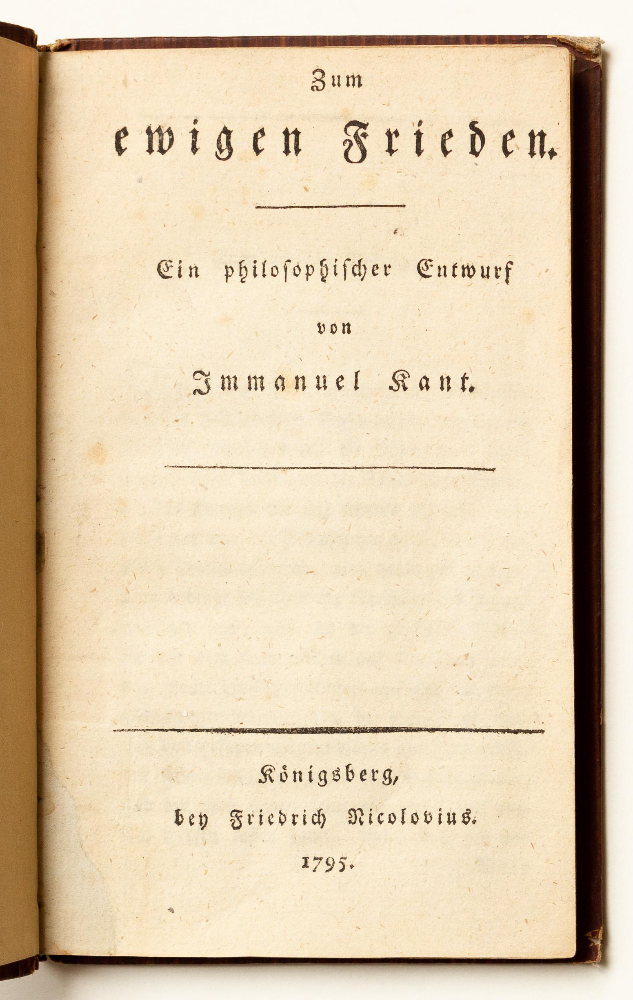
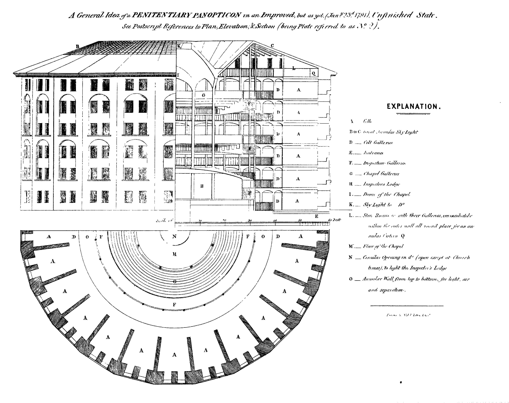

# 正文（1979年1月24日）

**讲座提要**

自由主义治理技艺的特点（II）：（3）欧洲平衡问题与国际关系问题——重商主义中的经济和政治考量。重农主义者们和亚当•斯密所认为的市场自由原则：一种新的欧洲模式的诞生———出现一种延伸到全球范围的治理理由。举例：海洋法问题；18世纪的永久和平之设想—新的自由主义治理技艺的若干原则：“治理的自然主义”；自由的生产—自由仲裁问题。其工具：（1）风险的管理与安全机制的运用；（2）训戒式（disciplinaires）监控（边沁的全景敞视主义）；（3）干预主义政策一对自由及其危机的管理

## 欧洲均势

上一课我已设法指出在我看来似乎是自由主义治理技艺的一些基本特征。首先我谈到了经济真理问题和市场的真言化问题，然后是效用（utilite）估算对治理术的限制问题。现在我要谈谈第三个方面，它也同样是根本的，即国家间的平衡问题，最终就是自由主义下的欧洲和国际领域之间的平衡问题。

你们都记得，上一学年在谈到国家理由〔1〕时，我曾向你们指出，在国家内部的无限定目标和外部的有限目标之间存在一个平衡重量的系统来维持两者的平衡。内部的无限定目标的建立是通过管治国家（Etat de police）机制，即一种总是更强迫、更突出、更细小、更微妙的治理术，一种并无先天明确界限的调控。内部是无限定目标，而外部则是有限目标，因为我们发现，在这个国家理由形成和管治国家组织起来的同时期，存在着一种我们称之为对欧洲平衡的某事的寻求和真实筹划，这种欧洲平衡的原则是：不让任何一国能完胜其他国家以在欧洲重建帝国式的统一体；因此没有任何一国能统治所有其他国，任何国家不能完胜其所有邻国从而支配它们等。

我们看到，我们很容易理解无限定目标、管治国家与有限目标、欧洲平衡这两种机制之间的关联：因为实际上，如果说管治国家或者说组织和发展管治国家至无限的内部机制，它们的存在理由、目的性和目的真的是强化国家自身的话，那么每个国家因此都以自身无限定的强化为目标，即把相对于他国的一种无限力量的增长作为目标。清楚地说，竞争游戏中竞相成为最好，这将会在欧洲导致一些不均衡，这些不均衡会不断增长，将通过人又的不平衡以及由此而来的军力的不平衡被得到认可，并因此最终导致著名的帝国状况的出现，从威斯特法伦和约（traite de Westphalie）以来，欧洲平衡想要把欧洲从这个帝国状况中解放出来。正是为了避免那种状况，人们才确立起平衡。

## 重商主义

以更确切的方式，在重商主义估算中以及它对军队在政治经济方面进行计算的方式中，我们可以看到，如果想阻止一种帝国布局配置重新形成，欧洲平衡实际上是不可避免的。实际上，对重商主义来说，国家间竞争假定了：所有使一国富足的东西都能够并且确实应该是从其他国家的财富中获取的。一方所得到的应该是从另一方那里所拿走的；一国只有损害其他国家才能致富。换句话说，对重商主义者们来说——我认为这一点很重要——经济游戏是一种零和游戏（jeu a somme nulle）。而且这种零和游戏仅仅是出于重商主义之货币主义的设想和实践。

世界上存在着一定数量的黄金。既然对黄金的界定、衡量构成每个国家的财富，那么理所当然—国财富的每一次增长都是从黄金的共同储备中所获取的并因此使得其他国家变得贫乏。因此，重商主义考量和政策之中的货币特征隐含着我们只能将竞争设想为一种零和游戏，其结果是损害一些国家来富足另一些国家〔2〕。正是为了严格按照经济学逻辑，避免在这种零和游戏中有一个并且只有一个赢家一正是为了避免此现象，避免这种如此明确的竞争带来的政治后果——，一种能够在某一时候、在某种程度上打断游戏的平衡才被建立起来。也就是说：当出现游戏者之间的差距变得具有巨大危险时，人们便停止这局游戏，而欧洲平衡正是这个意思。最终达到某种程度正是帕斯卡尔的问题〔3〕：当在零和游戏中，我们打断游戏并且重新分配参与者之间的利益，将会发生什么？通过欧洲平衡的外交手段来打断竞争游戏，这就是重商主义者的货币主义想法和实践所必然隐含的一切。好了，这就是起点。

## 相互富裕

然而，在我所讲到过的并尝试指出一种新治理理由之形成的18世纪中叶，将会发生什么？很自然，在这种新的国家理由或较少国家理由（la raison du moindre d'Etat）中—其真理化的基础在于市场，其事实的公正化在于效用，事情是完全不同的。

实际上，对重农主义者来说，对亚当·斯密来说也一样，市场自由可以并且应该以这样一种方式起作用：通过市场自由并且在其帮助之下，建立起自然价格或者低廉价格等。无论何种情况，这个自然价格或低廉价格总是对谁有利呢？对卖方但也对买方，即对买卖双方都有利。也就是说竞争的收益结果不会是不平等的，双方之间的分配也不必然地都是一方受损另一方得益。自然竞争的合法游戏，即自由状态下的竞争只会带来双方得利。我上次向你们指出的在重农主义者和亚当·斯密看来，由市场自由确保的围绕价值的价格波动，使得一种相互富足机制得以运转。对卖方来讲是利润的最大化，对买方来讲则是支出最小化。

因此，在自由主义经济学家所定义的经济游戏核心中，我们可以发现这样的观念：一国的富足，如同个人的富足，只能通过相互富足而实际地建立起来并且长期保持下去。我邻国的财富对我自身的富足很重要，这不是如重商主义者所认那样：邻国需要拥有黄金以便购买我国的产品，这样我国富足的同时会使得它贫穷。而是说，通过我国自身的贸易和我国与它的双边贸易，在我国富足的同时，我的邻国也应该是富裕的并变得富裕。因此这是一种相互关联的、整体的、区域的富足：要么整个欧洲变富，要么整个欧洲变穷。再没有蛋糕要分配。我们进入一个经济史实性的时代：这个时代受制于竞争游戏自身之即使未限定的但至少是互相的富裕。

我认为，在这里开始呈现出的东西很重要，你们知道，其结果远没有被仔细研究。这种重要的东西是关于欧洲的一种新观念，欧洲不再是那种或多或少继承自罗马帝国并且与一些特殊政治结构相关的帝国式的和加洛林式的（carolingienne）欧洲。它不再是、也已不再是平衡的传统欧洲，不再是以这样一种方式确立起来的诸力量之间平衡的欧洲，—即没有一国其力量能对另一国占对决定性的绝对优势。而是一个集体富足的欧洲，一个作为集体经济主体的欧洲。无论国与国之间如何竞争，或者不如说正是通过国家间的竞争，欧洲都前进在无穷尽的经济发展之路上。

## 世界市场

这种实为欧洲进步的进步观念，我认为是自由主义的一个基本论题，并且它从根基上完全动摇了有关欧洲平衡的诸论题，即使这些论题并没有完全消失。从重农主义和亚当·斯密的设想开始，我们摆脱了实为零和（somme nulle）的经济游戏的想法。但是，为了使经济游戏不再是一种零和游戏，还需要诸多经常不断的加入者。换句话说，如果这种市场自由必须保证所有欧洲国家或多或少同时达到一种互相的、相关联的富足，为了使这点起作用，为了这种市场自由能够因此以一种不再是零和的游戏的方式运行，还需要围绕欧洲和为了欧洲去召集一个越来越广阔的市场，直至包括世界上所有能被置入市场中的全体。或者说，当人们提出欧洲的富足不应是部分国家贫穷部分国家富裕，而应该是一种集体的富裕和无限制的富足，并将这种观念作为原则和目标的时候起，一种市场的全球化就被要求建立起来了。欧洲经济发展的无限制特点，以及由此而来的一种非零和游戏的存在，自然蕴涵着整个世界被召集到欧洲周围以便在将是欧洲的市场上去交换自己的产品和欧洲的产品。

当然，我并不是说这是欧洲第一次想到世界或第一次思考世界。我只想说，或许这是欧洲第一次作为经济统一体和经济主体出现在世界上，并且认为世界能够成为也应该成为它的经济领域。我认为这是第一次欧洲自我意识到应该把世界作为无限制的市场而拥有它。欧洲不再简单地觊觎那些在它梦想中或在它头脑中闪烁的所有世界财富。现在的欧洲凭借其自己的竞争处于连续的集体富足状态，条件是整个世界构成它的市场。总之，在重商主义时代、国家理由时代、管治国家时代等中，欧洲平衡的考量可以阻止被认为已经终结了的经济游戏所带来的种种后果。现在，世界市场的开放使得经济游戏不会终结，由此避免了有限市场具有的冲突性后果。但是，这种面向世界开放的经济游戏，很明显蕴涵了欧洲和世界其他地方在属性和地位上的不同。也就是说，一方是欧洲，欧洲人是玩家，而另一方世界将成为赌注。游戏在欧洲进行，而赌注是世界。

## 海洋法与永久和平

我觉得，我们获得了以市场和市场的真言化为参照指数的新治理技艺的一些基本特点。当然，在这种组织形式中，在这种无论如何对世界和欧洲交互地位的思考中，我们看不到殖民的开始。因为很久以前殖民就已经开始了。我也不认为这是现代或当代意义上的那种帝国主义的开始，因为很有可能之后、在19世纪我们会看到这个新帝困主义的形成。但我们认为这里是在欧洲治理实践中的一种新全球考量的开始。一种全球合理性新形式的出现，一个世界维度的新考量的出现，我认我们可以找到它的一些迹象。我简单地举出几处这样的迹象。

以18世纪的海洋法历史为例，人们依据国际法，设法把世界或者至少海洋看作是海上自由竞争领域和自由航行场所，因此，看作是组织全球市场的必要条件之一。所有关于海盗行为的历史—它同时被利用、鼓励、击败、消灭等的方式，同样显得是根据某些法律原则建立全球领域的方面之一。我们说出现了一种依据市场组织而加以被思考的一种关于世界的司法公正化。

这种以全球为视域的治理合理性的另一个例子，就是18世纪关于和平和国际组织结构的设想。如果看自从17世纪起就已经存在的那些和平构想，我们会发现它们根本上都与欧洲平衡联系在一起，即在不同国家之间、不同重要国之间、重要国家不同同盟之间、重要国家与小国同盟之间等来调节双方力量的精确平衡。我认为，从18世纪开始，永久和平的观念和国际组织结构的想法是以很不同的方式关联在一起的。永久和平的保障和基础不再是对每个国家内部力量的限制，而是对外部市场的无限制。外部市场越大，它的边界和限制就越少，我们就将愈能获得永久和平的保障。

## 康德



你们来看康德的一篇关于永久和平设想的论文，它写于1795年〔4〕，接近18 世纪末，你们会发现其中一章叫做“永久和平的保证”〔5〕。这个永久和平的保证，康德是如何认为的呢？他说：从根本上看，是什么贯彻历史保证永久和平，是什么向我们许诺确实有一天永久和平会在历史中实现？是人们的意愿，是人们相互之间的谅解，是拼凑起来的政治的和外交的联盟，还是人们之间形成的权利组织形式？这些都不是。而是自然〔6〕，就完全如同重农主义者所认为的那样，是自然保证了市场的适当调整。

那么自然如何保证永久和平？康德说这很简单。无论如何，自然已经创造出了非常绝妙的东西，比如它不仅使动物存活，而且使得在那些酷热的和冰冷的不可能居住之地也有人迹〔7〕。尽管如此仍有人在那里生活，这证明了世界上没有一处地方人类不能在那儿生存〔8〕。但是为了使人们活下去，他们就应该能够养活自己，可以生产自己的食物，他们之间能够形成社会组织结构，可以相互之间或者与其他地区的人交换他们的产品。自然想要的是整个世界以及它的每一处都服从于生产和交换的经济活动。从这时起，自然就规定给人类一些义务，后者对人类而言既是法律上的义务〔9〕，在一定程度上又是大自然秘密地授意给人类的，是自然标记于地理、气候等事物的配置（disposition）中的。而此种配置都有哪些呢？

首先，人们可以相互之间独自形成一些建立在所有权等之上的交换关系。人们将自然的规定、自然的准则重新表述成法律的义务，这就成了民法〔10〕（droit civil）。

其次，自然希望人们分布在世界的不同区域上，在其中的每个区域内部，人们之间的关系要优先于他们与其他区域居民的关系；人们把这种自然的准则重新表述为法律，通过建立诸多相互分隔的并且由若干法律关系所维系的国家。这就成了国际法〔11〕。但是另外，自然希望在这些国家之间不仅存在保证国家独立的司法关系，而且还要有一些跨越国界的商业关系，并因而使每个国家的法律独立多些透气孔〔12〕。就像自然希望在某种程度上人类住满整个世界那样，这些商业关系也贯穿整个世界，正是这点将构成世界法（droit cosmopolite）或商法。而这个建筑：民法、国际法、世界法仅仅是人们以义务的形式重新表述曾经是自然准则的那个东西〔13〕。（因而）我们可以说，就法律是对自然规定的重新表述而言，法律将可能会给人们类似永久和平之类的某种东西，而这种东西从自然让居民占据整个世界这第一个行为开始，在某种程度上就已经被勾勒出来了。永久和平，它由自然所保证并且这种保证的表现就是居住在全世界的人又以及延伸到整个世界的商业关系网。因此，永久和平的保证实际上就是商业的全球化。

## 维也纳会议

可能，还应该补充说明一下，但无论如何都要立刻回答一种反对意见。当我说过在重农主义者、亚当·斯密、康德和18世纪法学家的思想中，表现出一种从国际范围进行政治考量的新形式，我的意思完全不是说其他形式的反思、考量和分析、其他的治理实践就因此而消失。因为如果在这个时期确实出现了像世界市场和全球市场之类的东西，如果在这个时期在世界市场中欧洲的优先地位得到肯定，如果在这个时代欧洲国家之间的竞争是共同富裕的动因的观念同样也得到肯定———历史以所有方式证明了这一点—那这并不就因此意味着人们进入到一个欧洲和平和全球政治安宁的时期。毕竟19世纪是最糟糕的冲突时期，关税的、经济保护主义的、民族经济的和政治上民族主义的对抗等，这些都是世界从未出现过的巨大冲突。

我认为，也正是我想说明的是，在那个时候只是出现了某种反思、分析和考量形式，某种分析和考量形式在某种程度上与政治实践融合，而后者完全可以服从于另一种类型的考量，另一种思想结构，另一种权力实践。

比如我们只需看一下在1815年签订维也纳条约的那个时候发生了什么。〔14〕我们可以说维也纳条约最明显地表现了自17世纪和18世纪以来人们对一种欧洲平衡的长期寻求。实际上它指向的是什么？它要让拿破仑式的帝国观念不再死灰复燃。因为拿破仑的历史悖论是这样的：在国内政策层面上—这体现在他对国家议会的干预和他思考其治理实践的方式上〔15〕—很明显拿破仑对管治国家这一观念完全怀有敌意，并且他的问题实际上就是要明白如何从内部限制治理实践〔16〕，相反在他的国外政策层面上，就他想要重建自17世纪以来整个欧洲所反对的帝国构型而言，我们可以说拿破仑完全是守旧的。老实说，对拿破仑而言，帝国观念——尽管在这一论题上历史学家还是保持惊人的沉默，但只要我们能重构出这个帝国观念——似乎对应着三个目标。

第一（我想上一年我已经同你们讲过〔17〕），帝国，从国内政治的角度来看——如果我们根据18世纪的历史学家和法学家对加洛林帝国的看法来加以判断〔18〕——是对各种自由的保障。帝国制与君主制相比，不具有更多的权力，正相反，它具有更少的权力和更少的治理术。从另一方面来说，帝国是一种方式——很可能自从建立了无限制的革命目标即要让全世界发生变革的这一刻起——这种方式重拾起在1792—1793年间闯人法国的那种革命设想，并且在继承自加洛林样式的或神圣罗马帝国样式的帝国统治的古老想法中复述了那种革命设想。帝国在内部确保了各种自由，帝国是无限制革命设想的欧洲构型，最终帝国也是加洛林样式或德国样式或奥地利样式的重建，三种帝国的观念之间的结合已构成了类似大杂烩般的拿破仑的帝国政治策略。

维也纳会议要解决的问题，很自然是要在某种程度上再次阻止帝国的无限制扩张。显然这是要重建欧洲平衡，然而实际上是通过两种不同目标来达到。存在着奥地利目标和英国目标。

奥地利目标是什么？是重建17世纪和18世纪的旧有样式的一种欧洲平衡。在欧洲，任何一国都不能比其他国家有优势。奥地利完全抱有这种设想，因为它本身就是由一定数量的彼此不同国家所组成的，并且只是在管治国家的旧有样式下才将这些国家组织在一起，奥地利只有一个行政管理上的政府。欧洲内部中管治国家的这种多样性意味着实际上欧洲自身要与互相平衡的管治国家的多样性这种旧有范式保持一致。欧洲应该成为奥地利的翻版，以便奥地利自己可以像过去那样存在下去。在这种情况下，我们可以说，对梅特涅（Metternich）〔19〕来说，对欧洲平衡的考虑还仍然是并始终是18世纪的那种考量。

与之相反，对英国来说，它所寻求的并且在维也纳会议上与奥地利一起强制规定的欧洲平衡是什么呢？是一种使欧洲区域化，确实限制欧洲各国力量的一种手段，而且让英国扮演经济和政治上的一个角色，即在欧洲和全球市场之间的中间人角色，可以说是通过中介，通过英国经济力量的传递使欧洲经济全球化。所以，它是一种完全不一样的欧洲平衡的考虑，它建立在这样的欧洲原则基础之上：欧洲是面对世界的或是世界之内的一个特经济区域，而世界应该成为欧洲的市场。（奥地利）对欧洲平衡的考虑在同一个维也纳会议上是完全与之不同的。因此，你们看到，在唯一的历史现实中，你们可以很清楚地找到两个完全不同类型的合理性和政治考量。

对这一问题的思考就告一段落，现在，在开始分析当前德国的和美国的自由主义之前，我想总结一下所讲过的自由主义或者说18世纪具体表现出来的某种治理技艺的那些基本特征。

## 治理的自然主义

我曾指出过三个特征：市场的真言化，由治理的效用考量作出的限制，以及欧洲的位置，作为世界市场中一个无限制的发展经济区域。这些就是我所称的自由主义。

为什么要讲自由主义，为什么要谈论自由主义治理技艺，显然我所提及的事情，我设法表达的那些特征，实际上针对的是一种比单纯的经济学说或单纯的政治学说或严格意义所理解的自由主义之经济一政治上的选择更宽泛的现象。如果我们走的再远一点，从它们的起源来看，你们会看到我所谈论的新治理技艺的特征更多是自然主义而不是自由主义，因为事实上，重农主义者和亚当·斯密等人所谈到的自由，更多是经济过程的自发性的、内在的和固有的机理，而不是个体所承认的法律自由。甚至在康德那里（他更多的是法学家而不是经济学家），我们看到永久和平不是由法律而是由自然来保证。事实上，18世纪中期出现的是治理的自然主义。

然而，我认为我们可以谈论自由主义。我同样也可以对你们讲—我会再回到此问题上来〔20〕——这种自然主义是治理技艺所固有的和原初的，它在重农主义者所构想的开明专制（despotisme eclaire）中体现得更明显。我会更详细地再来看这个问题，但简单来说，当重农主义者发现实际上存在着诸多自发的经济机制，如果他们不想得到相反的结果，不想与自己的目标向左，那么所有治理都应该遵守这些经济机制。此时，重农主义者从中得出什么结论？应该赋予人们任其所愿的行动自由吗？治理应该承认个人自然的、基础的、根本的权利吗？治理应该尽可能少的独裁？这些都不是。重农主义者从中得出的是，治理应该认识到经济机制的内在复杂性质。治理一旦认识了这些机制，无疑就要遵守这些机制。但是遵守机制不意味着要给出一个尊重个体自由和个人基本权利的法律框架。而只是说认识到对于在社会、市场和经济流通中所发生之事，用准确的、持续的、清晰明白的认识来武装其政策，以至于对治理权力的制约不是通过尊重个人的自由，而只是通过它会加以遵守的经济学分析的明证性〔21〕。治理是通过明证性（evidence）而不是个体自由来自我制约的。

所以18世纪出现的更多的是自然主义，而不仅是自由主义。但是我认为，我们可以使用自由主义一词，因为自由仍然是实践的核心或是向这个实践提出的问题的中心。事实上，我认为应该做准确理解。如果我们把新的治理技艺称为自由主义，这并不意味着人们正从17世纪和18世纪初那种专制的治理过渡到更温和、更宽容、更灵活的治理。我不想说事实不是这样，但我也不想说它就是这样。我想说的是我不认为这样的命题具有更多的历史意义和政治意义。我不想要说18世纪初和19世纪之间，自由的数量增大了。我不这么说有两个原因：一个是事实上的，另一个是方法上的和原理上的。

从事实上来看，不这么说是因为，如果说17世纪和18世纪的法国所经历的君主制行政管理，带来了其所有沉重死板、无灵活性的巨大国家机器，带来了它必须要承认的法定特权，导致决定权随意地由一方或者另一方掌握，导致了手段上的各种缺陷，——那么，去说或只是寻思这种君主制行政管理要比一种自由主义体制给予更多或更少的自由，这有什么意义呢？这种自由主义制度的职责是持续有效地负责个人、负责他们的各种福利、健康、工作、生活方式、行方式甚至他们的死亡方式，等等。所以，我认为在两种体系之间衡量自由的多少，这实际上没有多少意义。我们也看不出我们可以适用什么类型的证明、什么类型的测量或评定。

这带来了第二个原因，我认为这是更深层的原因。这就是：不应当认为自由是一种普遍物，表示一定时间内的数量变化或残缺（arnputations）严重程度或遮掩（occultations）重要程度的一种逐步完成。它不是一种在时间和地理位置中变得特殊的普遍物。自由不是一个空白平面，这里或那里，时而不时，会或多或少带有黑色格子。自由仅仅只是但这已经不错了——-治理者和被治理者之间的现实关系，在这个关系中，衡量存在着“太少”自由的尺度是由被要求的“更多”自由所给出的。因而，当我说到“自由的”时，我指的并不是一种治理术形式，它归还更多的白色格子给自由。我想说的是另一回事。

## 自由的生产

如果我使用“自由的”一词，首先是因为正在实行中的治理实践，并不满足于遵守这种或那种自由，保证这种或那种自由。更深层的原因是，治理实践是自由的消耗者。它是自由的消耗者，因为它只能在实际存在某些自由的情况下运转：市场自由、买卖双方的自由，行使所有权的自由、讨论的自由、必要时的言论自由，等等。因此新的治理理由需要自由，新的治理艺术消耗自由。消耗自由，也就是说新治理艺术被迫要生产。新治理艺术要被迫将自由生产出来，被迫将自由组织起来。

因此，新的治理技艺表现为自由的管理者，这不是命令式意思上的“你是自由的”（sois libre），这个命令能立刻带来矛盾。自由主义的表述不是“你是自由的”。自由主义的表述只是这样的：我要为你产生出自由所凭借的东西。我将使你自由地成为自由的。因此如果这种自由主义不是命令自由而是管理和组织人们能够自由所依赖的条件，你们会发现，在这种自由主义实践的核心处确立起了以下两者之间这样一种永远不同的、动态的复杂关系：一方面产生出自由，另一方面这种行为在产生自由时又具有限制和摧毁自由的危险。我所理解的意义上的自由主义，这种人们可刻画为在18世纪所形成的新治理技艺的自由主义，在其核心处暗含着（与）自由的产生/毁灭关系（···）。人们一只手需要生产自由，但这一行为本身暗含着，人们另一只手，又要建立起基于威胁之上的诸多限制、控制、强制、束缚，等等。

关于这方面我们有很多事例。当然必须要有贸易自由，但如果不对必然导致限制和抑制贸易自由的霸权加以限制，如果不组织好一系列的事情、方法、预防措施等来避免一国具有对其他国家的霸权，贸易自由又如何能够切实地被实行？这正是自19世纪起所有欧洲国家以及美国所遇到的矛盾，它们的治理者听从18世纪末的那些经济学家们想要使贸易自由秩序占主导，却遇到了英国的霸权。为了拯救贸易自由，例如，美国政府们利用这一问题来反抗英国，在19世纪初建立了保护性关税以挽救被英国霸权所损害的贸易自由。国内市场的自由当然也一样，但是为了形成市场，不仅需要有卖方，还需要有买方。因此，需要时，通过一些辅助机制创造出买方使市场维持下去是非常必要的。为了国内市场的自由，不能出现垄断结果。反垄断的立法也是必需的。需要劳动力市场的自由，但是还要有劳动力，数量巨大并有劳动能力和资质的劳动力，他们在政治上要被缴械以使其不能压制劳动力市场。这里出现了一种对令人生畏的立法、对巨大数量的政府干预的呼唤，这些立法和干预保证了人们为治理所恰好需要的自由之产生。

总之，在自由主义体制下，在自由主义治理技艺下，行为自由是被蕴含的，是被要求的，人们需要它，它是为调节服务的，但它还应该是被创造出来的、被组织起来的。因此，自由主义体制下的自由不是既定（donnee），自由不是一块人们要加以遵守的已有区域，如果是这样，它也只是部分的、区域性的、在这样或那样情况下的，等等。自由是在每时每刻被制造出来的东西。自由主义不是接受自由。自由主义是每时每刻制造自由、激起自由并生产自由，当然还伴随着（一整套）约束和制造成本问题。

## 自由与安全

那么对自由的这个制造成本进行考量所依据的原则又是什么呢？考量的原则当然是我们所说的安全。也就是说自由主义，自由主义治理技艺发现很难准确确定在何种程度上、直到哪一点上，个体利益、不同利益、相互之间存在分歧并且有可能是敌对的诸个人不会对所有人的利益构成威胁。安全问题是这样的：保护集体利益反对个人利益。反之也一样：必须保护个人利益反对来自集体利益方面的侵犯。还必须使经济活动的自由不对企业构成危险，不对劳动者构成威胁。劳动者的自由不应该对企业和生产来说是危险。个人的变故以及生活中某个人身上所发生之事，不管是疾病还是必然出现的衰老，都不应该对个人和社会构成危险。总之，各种安全策略，在某种程度上作为自由主义的反面及其自身条件，都应当符合所有这个要求——利益的运转机理不该对个人和集体造成风险。自由和安全，自由和安全两者间的游戏，正是我刻画出其一般特征的新治理理由的核心。自由和安全，正是它们在内部推动着自由主义所特有的、我称之为权力结构的那些问题。

总而言之，我们可以这样说：在旧有的君权政治体系下，君主和臣民之间存在着一系列的法律关系和经济关系，这些关系促使甚至约束君主保护臣民。可是在某种程度上这种保护是外在的。在对抗外部敌人或内部敌人时，臣民可以向他的君主要求得到保护。但是在自由主义下，事情就完全不一样了。这不再简单地是对需要保障的个人本身实施的外在保护。自由主义在一个机制中运作，这个机制每时每刻都要围绕着这个风险概念来评判个人的自由和安全。实际上，如果从一方面来说（这是我上次讲过的），自由主义是一种从根本上操纵利益的一种治理技艺，那么它就不能—这就是纪念章的另一面—一在操纵利益的同时不成为风险的管理者和安全/自由机制、安全/自由游戏的管理者，这样的管理者应该确保个人或集体尽可能少地面对危险。

## 危险文化

这带来了诸多后果。毕竟我们可以说自由主义的信条是“危险地活着”。“危险地活着”意思是说个人永久地处于危险境遇之中，或者说他们被规定着去感受到他们的处境、他们的生活、他们的现在和将来充满着危险。我认为这种对危险的刺激是自由主义的主要内涵之一。实际上19世纪所出现的关于危险的整个教育、关于危险的整个文化完全不同于《启示录》中的瘟疫、死亡、战争这样一些幻想和巨大危险，这些幻想和危险给中世纪直至17世纪的政治想象力和宇宙论想象力提供了养料。《启示录》中的骑士们消失了，相反，日常危险开始侵入，在19世纪中我们称之为关于危险的政治文化的东西以及它的一系列样式永久地推动、更新和运转着这些日常危险。比如19世纪初的储蓄银行运动〔22〕；19世纪中期起出现了侦探文学和新闻对犯罪的关注；所有那些关涉到疾病和卫生的运动；再看看所有那些围绕着性和对退化的担忧所发生的事：个体的、家庭的、种群的、人种的退化（degenerescence）〔23〕。最后，到处都可以看到这种对恐惧危险的刺激，这种危险在某种程度上是自由主义的成立条件、心理关联项和内在文化。没有关于危险的文化，就没有自由主义。

## 纪律与监视



自然，这种自由主义和这种治理技艺所带来的第二个后果是控制、约束、强制手段的惊人扩张，这些手段将成为自由的对等物和抵消力（contrepoids）。我曾非常强调过那些著名的训诫技术（techniques disciplinaires），它们逐渐地重新掌控个人行为直至其最微小的细节之处，它们的发展和激增以及在社会中的扩散恰恰是与自由时代同时期的〔24〕。经济自由和我刚提到的训诫技术意义上的自由主义，这两种东西是完全联系在一起的。

边沁在其早年，最终在1792—1795年之间，提出这个著名的全方位环形敞视（panoptique）应当成为特定机构比如学校、车间、监狱从内部监视个人行为以提高个人活动的收益和生产能力的一种手段〔25〕；在其生命晚期，边沁在其计划将英国的法律条文编纂成法典时〔26〕，又认为全方位环形敞视应该成为全部治理的样式，并且声称：全方位环形敞视就是自由主义治理的程式〔27〕。

因为实际上，一个治理应当如何做？当然它要给自然机制、行为机制、生产机制让出空位。它应该给这些机制留出位子，除监视之外，不应该对其进行任何形式的干预，至少在起初是这样。因为治理首先仅限于监督功能，只是当治理看到事情的发展不像行为机制、交换机制、经济生活机制所希望的那样时，治理才进行干预。全方位环形敞视，不是一种区域性的机制，仅限于某些机构。对边沁来说，全方位环形敞视就是一种刻画某种治理类型的一个普遍政治程式。

## 干预主义

第三个结果是（第二个是训戒与自由主义之间的结合），在这个新治理技艺中出现了诸多机制，其功能是产生、激发和增加自由，是通过更多的控制和干预来引人更多的自由。这就是说，控制是自由的原动力了，而不再简单地是自由所必需的抵消力，就像全方位环形敞视情况那样。关于这一点，也有很多例子。比如20世纪的英国和美国，在经济危机蔓延的30年代，人们立刻察觉到这场经济危机所带来的后果不仅是经济上的，还有政治上的，人们发现这些后果会危及被认为是根本的那些自由。

例如，从1932年开始〔28〕，罗斯福实行的福利政策（Welfare）就是在失业的危险情况下来保障和产生劳动自由、消费自由、政治自由等更多自由的一种方式。而代价是什么？代价是所有这一系列干预，对市场的人为的、唯意志的、经济的直接干预，所有这些干预构成了福利政策重要措施，并且从1946年起——甚至从一开始——这些干预本身就被描绘成一种新专制主义的种种威胁。人们只能通过一种被揭发为对自由构成威胁的经济干预主义来保障各种民主自由。因此我们可以看到——这也是应该值得考虑的一点—这种自由主义治理术本身最终引入了我们称之为治理术的危机，或者成了治理术危机的内部受害者。这些危机，比如可以归因于实施各种自由所需的经济成本的增加。比如，看看（三边委员会〔29〕）（Trilaterale）在近几年的文章，我们会发现人们试图从经济成本层面来研究政治自由结果的形成。因此，基于对实施自由的经济成本的界定，出现了一种问题和危机或者说危机意识。

## 自由主义的危机

还有另一种危机样式，它可归因于自由的补偿机制的膨胀。也就是说为了实施某些自由，比如市场自由和反垄断立法的自由，我们可以形成一些立法约束，而这又会被市场伙伴们看成是过度的干预主义和过度的束缚和强制。于是，在一个极其局部的层面上出现了反抗和对训戒的不容忍。最终就出现了这样一些阻塞过程：这些过程使得产生自由的那些机制，那些我们召唤来确保并制造这种自由的机制，实际上却产生了毁掉其所产生之物这样的毁灭性结果。这就是所有那些我们称之为“自由发生”（liberogenes）装置所具有的两面性：被用来产生自由而却有可能恰恰产生相反的结果。

这就是自由主义的当前危机，也就是说自从1925年到1930年以来的所有这些机制企图提出各种经济和政治程式来确保国家以对抗共产主义、社会主义、民族社会主义、法西斯主义，这些机制作为自由的保障，被用来产生更多的自由或者抵抗影响这种自由的那些威胁；这些机制都属于经济干预范畴内，即对经济实践领域进行约束或者实行强制干预。不管是自1927—1930年起〔30〕的德国弗赖堡学派的自由主义者们，还是当前被称作自由意志主义者们〔31〕 （libertariens）的美国自由派们，在这两种情况中，他们分析的出发点和问题的基点是这样的：为了避免因过渡到社会主义、法西斯主义、民族社会主义而导致的自由的减少，人们设置出一些经济干预机制。

然而，这些经济干预机制，难道不正是它们偷偷摸摸地引入了各种类型的干预，难道它们引入的行为方式本身至少与那些人们想要避免的可见的、明显的政治形式不同样都是对自由的损害吗？换句话说，各种不同争论的中心问题正是凯恩斯（Keynes）〔32〕类型的干预政策。我们可以说，围绕着凯恩斯，围绕着在1930年到1960年之间，在第二次世界大战前和战后不久成为议论焦点的干预主义的经济政策，所有这些干预都已引发了我们称之为一种自由主义的危机，而在战前和战后不久的德国以及当前的美国，在治理技艺中的重新评价、重新估量和新的设想所体现的正是这个自由主义的危机。

总括一下，或者说做个小结，我想说：如果说在当代世界或者18世纪以来的近现代世界之中，不停地贯穿着人们所称资本主义危机的一些现象，难道我们不也可以说曾存在自由主义种种危机吗？这些危机当然并不独立于资本主义的那些危机。我刚才提及的30年代的那个问题就证明了这一点。但自由主义危机不是资本主义危机在政治领域中的简单、直接映照。你们可以发现自由主义危机与一些资本主义的经济危机联系在一起。你们会在时间间隔之中找到它们，不管怎样，这些自由主义危机的表现方式、管理方式、呼唤反应的方式、再作调整的方式，所有这些都不是直接可以推导自资本主义的危机。这是治理术总体配置的危机，而且我认为可以研究一下关于18世纪所设置的治理术的总体配置的那些危机的历史。

这就是今年我试图要做的，通过回顾以往的一些事情，也就是说通过分析最近三十年中人们如何提出和表达治理术配置的这个危机的各种要素，并且（通过试图）在19世纪的历史中重新找到一些要素，以便澄清当前人们以何种方式遭受、经历、实践和表达治理术的配置危机。

## 编者注释

〔1〕 参见《安全、领土与人口》，前书，1978年3月22日课程，第295页及以下诸页。

〔2〕 参见1720年4月一部法律文书在《法兰西信使》中关于国外贸易的记录：“通常只能一方赢另一方输”（由C.Larrere 引用于《18 世纪经济发现》，巴黎，法国大学出版社，“巨兽”，1992年，第102页，关于国外贸易的重商主义想法）。

〔3〕 M. 福柯暗指1654年帕斯卡所提出的关于偶然的合理计算方法，更确切地说，就是“最末局数或最初局数的比例”问题：“在一个n局的游戏中，如果我们就在游戏结束之前或就在赢得第一局之后停止游戏，那么何种规则可以确定出另一方应付给游戏者 A 的钱数”（C.Chevalley：《帕斯卡尔，偶然性与可能性》，巴黎，法国大学出版社，1995年，第88页）。参见B.帕斯卡尔《全集》中的“1654年7月29日和8月24日致 Fermat 的信”，L. Lafuma 主编，巴黎，Le Seuil,1963 年，第43一48页。

〔4〕 参见康德（I. Kant）：《论永久和平》（Zum ewigen Frieden,Konigsberg，Friedrich Nicolovius, 1795）；Akademie Ausgabe,Berlin, 1912，第VIII卷，第341—386页/法文版：《永久和平设想》，J.Gibelin 译，第五版，Paris, Vrin,1984（福柯使用的是此译本的第一版，出版于 1948年）。

〔5〕 同上，第一个补编：“论永久和平的保障”，引用译文，第35--48页。

〔6〕 同上，地35页：“提供这一保证（保障）的正是自然（Nature）这位伟大的创造者（kanstlerin）（natura daedala rerum），在它的机械进程中我们看到目的论在闪耀⋯⋯”

〔7〕 同上，第38--39页：“在沿北冰洋寒冷的荒野上仍然生长着苔藓，驯鹿把它们从雪底下刨出来，作为奥斯特雅克人或萨摩雅德人的食物并为他们挽撬；或者是盐碱的沙漠荒野还会有骆驼，它们仿佛被创造出来就是要在这里漫游的，以使得它们不至于无用：这些已经值得我们惊奇的了。”

〔8〕 同上，第38页：“（自然的第一个准备性的安排就在于）它已经留意到人类可以生活在地球的每个角落。”

〔9〕 同上，“（自然的第三个准备性的安排在于）迫使（人类）··…缔结或多或少是法律的关系。”M.福柯没有提及这样的手段，根据康德，自然凭借该手段达到其目的（荒凉地区的人又居住和法律关系的建立），该手段就是战争。

〔10〕 同上，第43-46页。

〔11〕 同上，第46—47 页：“国际法（droit desgens）的观念预先假定有许多互相独立的毗邻国家分别存在（Absonderung）.·”

〔12〕 同上，第47—48页：“正如大自然很聪明地分隔开了各个民族，而每一个特殊国家的意志却是诉诸国际法（droit des gens），也想很乐意地通过阴谋或者暴力而把它们都统一于自己统治之下；另一方面则同样的世界法的概念在抗拒暴力行为和战争方面所未能加以保障的各个民族，大自然也就通过它们互相的自利而把它们结合在一起。那就是与战争无法共处的商业精神，这种商业精神迟早会支配每一个民族。”

〔13〕 同上，第43页：“（大自然）保证人类通过大自然的强制确实将会做到他们根据自由法则所应该做但没做到的事情，而又不伤害这种自由并且在做到此事时还得符合公共法的三个方面：民法（droit civil）、国际法（droit des gens）和世界法（droit cosmopolitigue）。”

〔14〕 1814年9月至1815年6月举行的维也纳会议上，几个强大力国（俄国、英国、奥地利和普鲁士）联合起来反对法国。它旨在拿破仑战争之后建立起长久的和平并且重新划分欧洲的政治地图。参见CH. K. Webster：《维也纳会议：1814-1815》（The Congress of Viena: 1814-1815），Londres-New York,H. Milford，Oxford University Press, 1919；repr. Londres, Thames and Hudson,1963。

〔15〕 参见马基塞（A. Marquiset）：《在国家议会上被速记的拿破仑》（Napoleon stenographie au Conseil d'Etat），Paris,H. Champion,1913）；布尔东（J. Bourdon）：《拿破仑在国家议会》（Napoleon au Conseil d'Etat）；国家议会秘书长J.-G. Locre 之未出版的笔记和会议记录，Paris,Berger-Levrault,1963；迪朗（Ch. Durand）：《拿破仑国家议会研究》（Etudes sur le Conseil d'Etat napoleonien），Paris，PUF,1947;Id.，“拿破仑国家议会的运作”，《艾克斯—马赛大学丛书》第一系列，Cap,Impr. Louis Jean,1954；Id.，“帝国下半时期的拿破仑和国家议会”，《国家议会研究和文献》，第二十二号，1969年，第 269—285页。

〔16〕 参见1982年的访谈“空间、知识和权力”，译文，引用本（《言与文》，第四卷，第310篇，第272页），在该文中福柯解释说：“拿破仑处于 18 世纪旧有警察国家的组织形式和他发明的现代国家样式之间的分裂点”。但是在《监视与惩罚》中，福柯仍然把拿破仑这个人定位于“君主制运转与君权仪式的结合点以及等级制运转与无限定的永久训诫的结合点上”（第219页；参看J.B. Treilhard 的引用，《组成刑事诉讼法典的法律事由》，巴黎，1808年，＜S.n.＞，第14页）。

〔17〕 福柯没有在1978年的课程，而是在1976年的课程《必须保卫社会》，1976年3月3日课程（第179—181页）中着手研究这一点［基于J.-B.Dubos 的著作《法国君主制在高卢建立的批判史》（Histoire critigue de l'etablissemnent de la monarchie francaise dans Les Gaules）， Paris, 1734］。

〔18〕 例如，参见马布里（Mably）：《法兰西历史评论》（Observations sur l'histoire de France,Geneve，1765，第8卷，第7章：“（······我们中间会出现一个新的查理曼大帝吗？我们或许想要如此，但我们不能希望如此”（见 Mably，《论政治权力理论》，选本，巴黎，社会出版社，1975年，第194页）。

〔19〕 克莱门斯 ·梅特涅（Klemenz Wenzel Nepomuk Lotar），梅特一温尼堡（Metternich-Winneburg）公爵，绰号梅特涅（1773-1859），维也纳会议期间的奥地利外交事务大臣。

〔20〕 福柯在接下来的课程内容中没有再谈到这个主题。

〔21〕 关于作为治理的自我限制原则的这个明证性，参见《安全、领士与人又》，1978年4月5日课程，第361页。

〔22〕 第一家储蓄银行于1818年在巴黎成立，它被认为是对下等阶层的无预见性所作的一种预防补救措施。参见卡斯特尔（R. Castel）：《社会问题嬗变》（Les metamor phoses de la question sociale），Paris, Fayard, 1995;reed. Gallimard （“Folio Essais”），1999，p.402—403.

〔23〕 参见《不正常的人（法兰西学院课程，1974—1975）》，V. Marchetti &. A. Salomoni 编辑， Paris, Gallimard-Le Seuil （“Hautes Etudes ”），1999，1975 年3月19 日课程，第297—300页。

〔24〕 我们记得福柯在上一年曾如何修正了之前对训戒技术与个人自由之间关系所作的分析（参见《安全、领土与人又》，1978年1月18日课程，第49—50页）。当前的阐发是对这个观点的延续：自由成为“诸多安全配置的关系项”。

〔25〕 应该想到环形敞视监狱或检查所（maison d'inspection） 不仅仅是一种监狱的组织结构模式，而是一种“新的建筑原理之观念”，可应用于各类机构。参见第一版的完整标题 Panopticon,or the Inspection-House : containing the idea of a new principle of construction applicable to any sort of establishment,in which persons of any description are to be kept under inspection;and in particular to penitentiary-houses,prisons,housesof industry,weork-houses,poor-houses,manufactories, madhouses, lazarettos, hospitals and schools ; with a plan of management adapted to the principle,Dublin, Thomas Byrne,1971（《边沁著作集》，J. Bowring,Edimbourg，W. Tait 编辑，第3卷，1843，第37—66页）。参见1791年发表于都柏林和伦敦的21封信的法文版，由M. Sissung 翻译，这些信组成了边沁著作《环形敞视监狱》的第一部分，见了.边沁：《环形敞视监狱》，Paris,Belfond，1977，P.97-168（尤请参见第16—21封信）。1791 年法译本（并不包含21 封信）的标题不太清楚：《环形敞视监狱，论构建检查所，尤其是改造所得新原则》（巴黎，国家印刷厂）。参见《精神病学的权力（法兰西学院课程，1973-1974）》，J.Lagrange 主编，Paris, Gallimard-l.e Seuil（“Hautes Etudes”），2003,1973年11月28日课程，第75—76页。

〔26〕 福柯可能参考了《宪法典》（Constitutional Code），见《边沁著作集》第4卷，Bowring 主编，1849年（由 F. Rosen & J. H.Burns 重编，Oxford, Clarendon Press，1983），尽管严格地来说，后者不是对英国立法的法典化。但实际上正是在此书中，其最初写作可以追溯到1820年［参见《致信奉自由意见的所有国家的法典编纂建议》（Codification Proposal, Addressed to All Nations Professing Liberal Opinions），Londres,J. M'Creery,1822］，其第一卷出版于1830年［《可供信奉自由意见的所有国家和政府所使用的宪法典》（Constitutional Code for Use of All Nations and Gouvernments Professing Liberal Opinions），Londres, R. Heward］，边沁阐发了他的自由主义政府理论。

〔27〕 这个句子似乎并不是边沁所说，而是福柯对边沁1811年（全景敞视规划失败时间）之后的政治经济思想所作的充分自由的阐释。这里福柯似乎在agenda/non agenda 的区分（本年度课程中曾多次提到该区分：1979年1月10日课程，本书上文，第14页，2月14日课程，本书下文，第139页和3月7日课程，本书下文，第200页）与适用于政府的检查（例如监督原则）做了直接关联。在《宪法典》（Constitutional Code）中，正是政府自己成为”公众意见法庭”的检查对象。（参见《精神病学的权力》1973年11 月28日课程，第78页，关于全景敞视系统配置下的权力的民主化运作：强调对可见性而不是“公众性”的控制。）另外，边沁在其经济著作和《宪法典》（Constitutional Code）中并不肯定就像福柯在这里所暗示的那样支持经济上的放任自由［参见1.J.Hume，“杰里米· 边沁和19世纪的政府治理革命”（“Jeremy Bentham and the nineteenth-century revolution in government”），The Historical Journal, vol. 10（3），1967，第361—375页。还是比照在1801-1804年文本中被定义的 sponte acta（参见上文，1月10日课程，第27页，注9）。

〔28〕 当然就是指用来对抗危机而进行斗争的经济和社会规划，即富兰克林·罗斯福在1932年11 月当选美国总统不久所颁布的新政（New Deal）。

〔29〕 福柯称“三洲”（Tricontinentale）。三边委员会（Trilateral Commission），成立于1973年，会聚了北美（美国和加拿大）、欧洲和日本的代表。其目标是加强这三个重要区域的合作，应对世纪末新出现的挑战。而“三洲”是1965年12月至1966年1月期间，卡斯特罗（Fidel Castro）在哈瓦那所召开的会议名称，旨在建立起旧世界和新世界之间的革命组织的交锋。

〔30〕 参见本书下文，1979年1月31日、2月7日、2月14日和2月21 日课程。

〔31〕 参见本书下文，1979年3月14日和3月21日课程。

〔32〕 参见本书下文，1979年1月31日课程，第97页，注10。

# 笔记

## 1.自由主义的危机

20世纪30年代，自由主义面临的不仅是1929年大萧条引发的经济危机，还有更广泛的政治制度危机。大规模失业、企业破产和金融体系的崩溃，使传统自由放任的经济政策受到质疑。与此同时，苏联社会主义制度、意大利法西斯主义以及德国国家社会主义的兴起，也使资本主义市场经济与自由民主制度面临不同政治方案的挑战。如何在避免经济与政治秩序瓦解的同时维持自由，成为当时的重要问题。

在这一背景下，国家经济干预逐渐获得新的合理性。1933年罗斯福就任美国总统后推行新政（New Deal），通过公共工程、金融改革、就业政策和社会保障等措施应对经济危机。凯恩斯主义（Keynesianism）则进一步为宏观经济干预提供理论依据，认为当私人投资和总需求不足、市场无法迅速恢复充分就业时，政府可以通过财政支出等政策稳定经济活动。这些措施并不以取消资本主义市场经济为目的，而是试图通过国家干预恢复市场运行，并维护劳动、消费和政治生活的基本条件。

然而，这种通过国家干预保障自由的方式，又引发了自由主义内部的新争论。政府为了克服经济危机而扩大经济管理权限，可能使市场活动越来越依赖行政决策，并使国家掌握更多经济权力。由此出现了一种特殊的矛盾：**原本用于保护自由主义制度的干预措施，是否可能反过来损害这一制度所要保障的自由？**

德国弗赖堡学派（Freiburg School）和后来形成的美国新自由主义，分别从不同方向回应了这一问题。以瓦尔特·欧肯（Walter Eucken）等人为代表的德国秩序自由主义（Ordoliberalism）形成于20世纪30年代，强调自由竞争并不是国家完全退出以后就能自动维持的状态。私人垄断、卡特尔和经济权力集中同样可能破坏竞争，因此国家需要建立稳定的法律和制度秩序，保障市场的竞争结构，同时避免对具体经济过程进行任意的行政指挥。美国新自由主义则在不同程度上强调市场协调、个人选择和经济自由，并重新审视国家干预的范围及其后果。两者都重视市场，但对于国家应当怎样组织市场秩序，存在不同的理论安排。

福柯将这些争论放在自由主义治理技艺的历史中加以理解。他此前已经指出，自由主义并不是单纯接受既有的自由，而是需要通过法律、制度、安全机制和经济政策不断创造自由得以运作的条件。然而，这些用于生产自由的机制又可能逐渐形成新的约束，甚至破坏原本希望保障的自由。福柯将这种具有双重效果的机制称为**自由发生装置（dispositifs libérogènes）**。

福柯所说的自由主义危机，主要是自由主义治理方式本身发生的危机。国家应当通过什么制度组织市场，怎样保障自由，又应当在什么程度上限制自身的干预，这些问题不断要求自由主义重新调整自己的治理原则。20世纪德国和美国的新自由主义，正是在这种历史背景下，对自由主义治理技艺进行重新构想的不同尝试。
