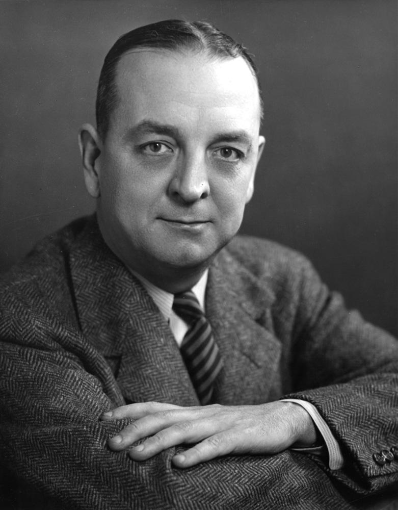
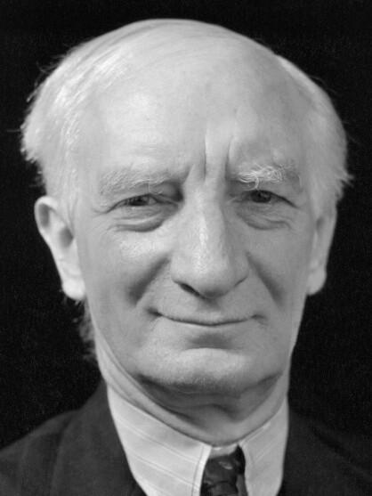
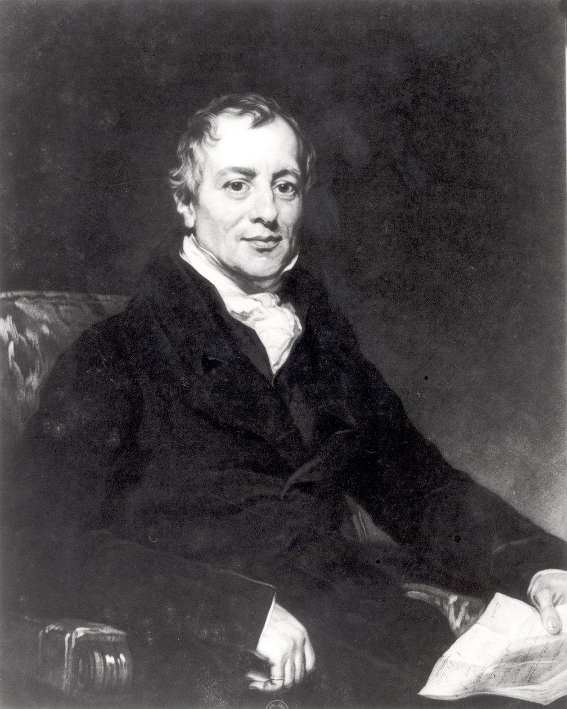
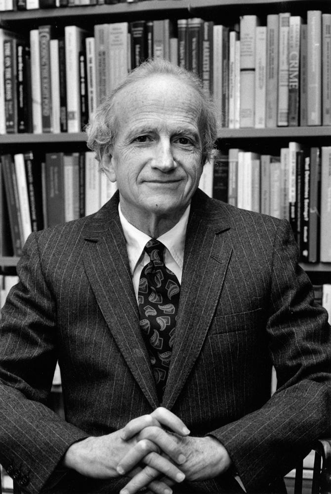
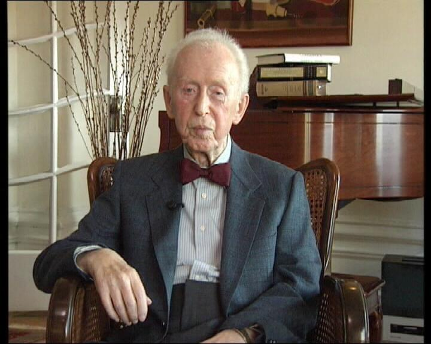
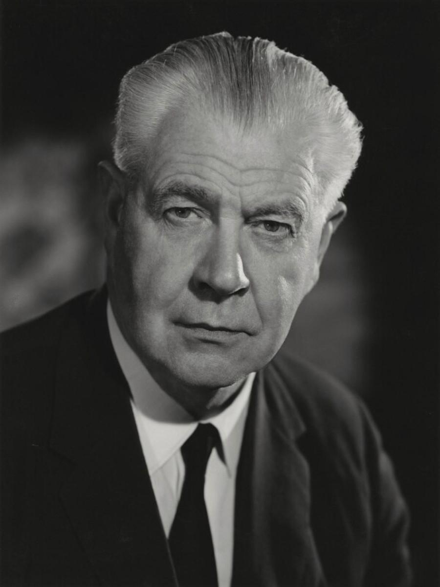
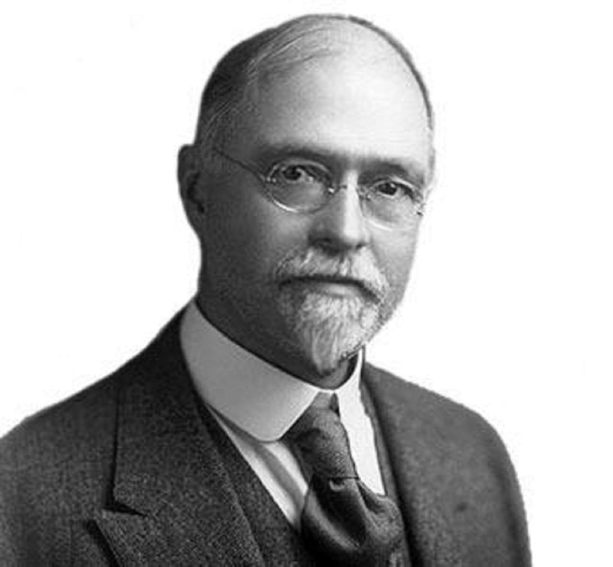

# 正文（1979年3月14日）

**讲座提要**

美国新自由主义（I）。其背景——美国新自由主义与欧洲新自由主义的区别——作为全球性主张、乌托邦家园和思考方法的美国新自由主义——美国新自由主义的几个方面（1）：人力资本理论。它所体现的两种活动：（a）在自身领域内部做进一步的经济学分析：就时间因素对传统劳动分析提出的批评；（b）经济学分析延伸至之前被认为是非经济的领域——由新自由主义分析所导致的认识论转变：从经济活动分析转为对人类行为的内在合理性分析——劳动作为经济操行（conduite）它分为资本-能力与收入——把经济人（homo oeconomicus）重新定义为自己的企业家——“人力资本”概念。它的构成要素：（a）先天要素与原生人力资本的改善问题；（b）后天要素与人力资本的构成问题（教育、健康等）——这些分析的旨趣：重提社会和经济的创新问题（熊彼特）。对经济增长政策的一种新构想

## 一、历史背景

今天，我想开始讲一个在法国正在变成普遍适用的口头禅[〔1〕](#note-1)，即美国新自由主义。当然，我只是取其几个方面来考察，对于我所建议的分析风格来说，这些方面可能是恰当的[〔2〕](#note-2)。

### 1. 新政与凯恩斯主义



当然，开头再讲一些老生常谈的东西。美国新自由主义的发展背景与德国新自由主义以及我们所称的法国新自由主义的发展背景没有什么太大不同。也就是说，美国新自由主义有三个主要的背景因素，首先就是：新政的出现、对新政的批评以及对1933—1934年起由罗斯福所铺开的那种大致是凯恩斯式政策的批评；并且美国新自由主义的首要的基础文本是由芝加哥学派之父西蒙斯[〔3〕](#note-3)（Simons）在1934年写的一篇文章，题目叫做“放任自由的积极纲领”[〔4〕](#note-4)。

### 2. 战争契约



第二个背景因素，当然就是贝弗里奇计划，以及所有那些战争期间建立起来的经济干预计划和社会干预计划[〔5〕](#note-5)。所有这些重要东西，我们可以将其称为战争契约。通过这些战争契约的内容，一些政府——主要是英国政府，以及在某种程度上还包括美国政府——告诉人们，他们刚刚经历了一场严重的社会和经济危机：现在我们要求你们献身，但是我们保证：如果你们这样做了，你们将会保留住工作直到你们生命终结。所有这些文献、所有这些分析、规划和研究，它们自身都非常值得研究，因为在我看来，如果我没搞错的话，这终究是第一次全体国民在一个契约系统的基础之上作战，它不仅仅是一些军事力量之间的国际联盟协定，而且是一种社会契约，其内容许诺了——对那些被要求参战并且为此献身之人——某种经济组织类型和社会组织类型，在这种组织中，安全（就业的安全、患病的安全、各种意外事件的安全、退休的安全）会得到保障。这是一种在要求参战之时所作出的安全契约。来自政府一方的参战要求逐渐地并且很早——在英国，从1940年开始，这方面有据可查—就夹杂着两个方面：社会契约和安全契约。正是为了反对这一整套社会规划，西蒙斯撰写了诸多文本和批评性文章，最值得关注的可能就是这篇文章：“贝弗里奇计划：一个不友好的解释”[〔6〕](#note-6)，无需说明，题目本身就清楚地表明了这种批评意味。

### 3. 联邦政府的扩张

第三个背景因素，显而易见，就是在美国，从杜鲁门政府[〔7〕](#note-7)开始了，一直到约翰逊政府[〔8〕](#note-8)所阐发的关于贫困、教育以及种族隔离的所有计划，并且通过这些计划，出现了国家干预主义以及联邦政府的发展壮大等。

我认为这三个背景因素：凯恩斯政策、战争期间的社会契约以及通过经济和社会规划而出现的联邦政府的发展壮大，正是它们构成了新自由主义思想的对手和靶子，后者通过背靠着它们或与之对立从而形成和发展起来。你们看到，这个现实背景显然与法国所处的背景是同一种类型，在法国，新自由主义同样通过与人民阵线[〔9〕](#note-9)、战后凯恩斯主义政策以及计划化的对立而被确定下来。

## 二、欧美差异

### 1. 奠基原则

然而我认为，在欧洲式新自由主义与美国式新自由主义之间，存在某些重要差异。这些差异同样也是显而易见、众所周知的。我简单地重提一下。首先，美国自由主义，当它很早地在历史上形成时，即18世纪开始，它不是像在法国所表现的那样，不是作为对之前已存在的国家理由的调解原则，而是正相反，正是一些自由主义类型的要求，一些基本的经济要求成为了美国形成独立的历史起点[〔10〕](#note-10)。也就是说，自由主义在美国独立战争期间的角色，与1948年自由主义在德国所起到的作用有点相同，或者说相对地类似。自由主义被要求以国家的奠基原则与正当性原则的名义出现。国家并不是通过自由主义来限制自身的，而是要求自由主义成为国家的奠基者。我想这是美国自由主义的特征之一。

### 2. 政治争论

第二点，当然在两个世纪中，美国自由主义一直是美国政治争论的核心，它涉及经济政策、保护主义、黄金和货币问题、双本位货币制（bimetallisme）；它涉及农奴问题；它涉及司法机关的地位和功能问题；它涉及个人和各州之间，各州与联邦国家之间的关系问题。我们可以说，自由主义问题曾是美国所有政治争论和决策中不断重现的一个要素。在欧洲，民族统一和民族独立，或者法治国家才是19世纪政治争论中不断重现的要素，而在美国则是自由主义。

### 3. 非自由主义批判

最后，第三点，与自由主义争论中那个不变的根基相比，非自由主义（non-liberalisme）———我是指那些干预主义政策，或者是凯恩斯类型的经济政策，或者是计划经济、经济和社会规划—在20世纪中期，它是作为一个额外添加的东西、一个危险要素而出现的，这是由于它与一些所谓的社会主义化目标关系密切，同样还由于它根植于帝国主义国家和军事国家之中，以致对这种非自由主义的批评就能够找到它的两个基点：在右边，以一种在历史上和经济上对所有吹响社会主义号角的东西都怀有敌意的自由主义传统的名义；在左边，不仅仅要开展批评而且要进行日常生活斗争来反对帝国主义国家和军事国家的发展。你们在美国新自由主义中看到的那种模糊性正是源于此，因为这种模糊性既在右边又在左边被运用和重新激活。

### 4. 思想风格

不管怎样，我想我们可以这样说：由于我刚刚提到的所有那些完全普通的历史原因，美国自由主义不简单地是—就像目前法国的情况，就像德国在战后紧接着的那段时间的情况一样——一种由执政者或在政界所形成和做出的经济与政治选择。在美国，自由主义是一种存在方式和思考方式。它更多地是治理者和被治理者之间的一种关系类型，而不只是对被治理者实施的一种治理技术。我们说，在像法国这样的国家中，个人对国家的争执是围绕着服务与公共事业问题，而在美国，个人与政府间的争执是一种自主权问题。这就是为什么，在我看来，美国自由主义在当前不是仅仅地、如此地表现为一种政治上的选择，而是一种全面的、多种形式的、含糊的主张，它具有左和右两个立足点。它同样是一种总是被激活的乌托邦家园。它也是一种思考方法、一种经济和社会的分析构架。

我将会提到一位并非严格来说的美国人，因为这是一位我们已多次提到过的奥地利人，但是他接下来去过英国和美国，之后回到德国。他就是哈耶克，在几年前他说过：我们所需要的，是一种作为鲜活思想的自由主义。自由主义一直留给社会主义者们去用心建造乌托邦，社会主义很多的活力以及历史生机应归功于这种乌托邦的活动或者乌托邦化的活动。而自由主义同样也需要乌托邦。我们要建造自由主义的乌托邦，我们要思考自由主义的模式，而不只是把自由主义看作另外一种治理技术的选择[〔11〕](#note-11)。自由主义要作为一般的思想风格、分析风格和想象风格。

好了，以上就是几处总体线条，它们可能会帮助我们稍微区分一下美国新自由主义和德国与法国所实行的新自由主义。我正是想就思考模式、分析风格、历史和社会的解密构架这几个方面，来展现一下美国新自由主义的一些特征，因我没有丝毫意愿和可能性去研究它的所有方面。我尤其要以两个要素为例，它们既是一些分析方法又是规划类型，并且对我来说，它们也是美国新自由主义中值得关注的东西：首先就是人力资本理论；其次，自然你们能猜到，就是对犯罪行为（criminalite）和违法行为（delinquance）问题的分析。

## 三、人力资本理论

### 1. 分析范围

首先来看人力资本理论[〔12〕](#note-12)。我认为，人力资本理论值得关注的原因是它体现了两种活动：其一，我们可以称之为：对一个之前未研究过的领域做进一步的经济学分析；其二，前种活动和进一步分析带来一种可能性，即用经济术语并且是严格的经济术语来重新解释一整个至今能够被认为是并且事实上已经被认为是非经济的领域。

### 2. 古典经济学的劳动分析






首先，差不多在经济自身领域之内出现了一种经济学分析，但在某个点上这种分析却曾一直是被阻隔的，或者说被悬置的。实际上，美国新自由主义者这样说：这仍然很奇，古典政治经济学总是并且郑重地指出财富的生产取决于三个因素：土地、资本、劳动。然而，劳动一直未被研究过。在某种程度上，它还是一张经济学家们未曾书写的白纸。

当然，人们可以说亚当·斯密的经济学正是以对劳动的思考而开始的，这是由于在亚当·斯密看来，劳动分工及其规定构成了一把钥匙，通过这把钥匙，他能够建立起自己的经济学分析[〔13〕](#note-13)。

但是除了这种第一次进展、第一次开启之外，并且从那时起，古典政治经济学再也没有分析过劳动本身，或者说它被用来不停地抵消劳动，它通过专门将劳动化约到时间因素上来抵消劳动。这正是李嘉图（Ricardo）所做的，当他分析何谓劳动的增加，何谓劳动要素的时候，他只是以量的方式，并且根据时间变量来界定劳动的增加。也就是说他认为劳动的增加或变化，劳动要素的增长只能是额外的劳动者数量进入到市场，也就是说有可能使用更多的劳动时间可供资本支配[〔14〕](#note-14)。因此，用工作小时和劳动时间的数量变化来抵消劳动自身的本质属性，这种李嘉图式的将劳动问题简化为时间变量的简单分析，从根本上来说，古典经济学从未走出这条老路[〔15〕](#note-15)。

毕竟，在凯恩斯那里，也有对劳动的分析，或者说劳动的非分析（non-analytique），它与李嘉图的非分析并非有什么大的不同，或者不比它更完善，因为在凯恩斯看来，何谓劳动？它是一种生产要素，一种生产者要素，但它自身是被动的，只能在某种投资率下，而且条件是在这种投资率非常高的情况下，它才能找到工作并获得能动性[〔16〕](#note-16)。







新自由主义者们的问题是，通过他们对古典经济学的批评，对古典经济学的劳动分析的批评，试图把劳动重新引入到经济学分析领域中；他们中的某些人就是设法这么做的，第一位叫舒茨[〔17〕](#note-17)（Theodore Schultz），他在1950—1960年间发表了一些文章，并在1971年出版的《人力资本投资》[〔18〕](#note-18) （Investment in Human Capital）一书中做了总结。加里· 贝克尔[〔19〕](#note-19)（Gary Becker），差不多在同一时期，出版了一本同样名字的书[〔20〕](#note-20)，还有第三个文本，与其他的相比，它是非常根本的并且更加具体、更加确切，这就是明塞尔[〔21〕](#note-21)（Mincer）出版于 1975年的关于学校教育与工资的那本著作[〔22〕](#note-22)。

### 3. 劳动抽象化

说实话，新自由主义指责古典经济学遗忘了劳动并且从未对其做过经济学分析，但这种指责显得有点奇怪，我们毕竟会想到，即使李嘉图真的将劳动分析完全简化为时间量变的分析，仍然还有一位叫马克思的人以及等等叫……的人。实际上，新自由主义者从未与马克思探讨过，原因可能是人们所说的经济时髦主义（snobisme），我们不去管它。但是在我看来，如果说他们与马克思探讨有困难，可能我们很清楚地知道他们对马克思的分析会说些什么。

他们会说：确实，马克思把劳动作为其分析的几个基准点之一。但是当马克思分析劳动时，他是怎么做的？他表明工人出卖的是什么？不是他的劳动，而是劳动力。他出卖一段时间的劳动力来换取工资，工资建立的基础是与劳动力供给与需求之间的平衡相对应的某种市场状况。工人所付出的劳动创造了价值，而该价值的一部分是从他们那里榨取的。显然，马克思在这个过程中看到了资本主义自身的机制或者逻辑，这种逻辑是什么？它就是通过所有这些活动，劳动变成“抽象的”，也就是说具体劳动被转换成了劳动力，这个那个劳动力由时间来衡量，被置入市场中，以工资的形式被付给报酬，这不再是具体劳动；相反，这种劳动所具有的所有人类的实在性、所有质变都被消除了，并且——因而这就是马克思所表明的——资本主义的经济机制、资本的逻辑，只保留了劳动中的力和时间。它使劳动成为一种商品并且只保留其被产生的价值作用。

然而，新自由主义者说正是在这里，他们的分析与马克思的批判分道扬镳——在马克思看来，这种“抽象化”是谁之过错？它是资本主义自身的过错。它是资本逻辑及其历史实在性的过错。而新自由主义者们认为：劳动的抽象化只有通过时间变量才会出现，它不是资本主义的现实行为，而是一种我们关于资本主义生产所做的一种经济理论行为。抽象化不是来自经济过程的现实配置，它来自于人们在古典经济学角度下的思考方式。正是因为古典经济学未曾有能力从劳动的具体特殊性及性质的变化（modulation qualitative）上来对它分析，正是因为它留下了这张白纸、这个理论上的缺漏和空白，所以整个哲学、整个人类学、以马克思为代表的整个政治学都急忙向着劳动涌过去。

因此所应该做的，完全不是延续马克思的现实主义意义上的批判，指责现实的资本主义使劳动的现实性抽象化了；而是应该针对经济话语中把劳动自身抽象化的那种态度展开理论批判。而且，新自由主义者们说，如果经济学家们以如此抽象的方式来看待劳动，如果他们忽视了劳动的具体规定、质的变化以及这些质变带来的经济结果，那么从根本上来说，这是因为古典经济学家们向来认为经济学的对象只是资本过程、投资过程、机器过程、产品过程，等等。

## 四、认识论转变

### 1. 稀缺资源与选择



然而，在我看来，这里应该将新自由主义的种种分析重新置于其总体背景下来看。这些新自由主义分析的根本认识论转变是，它们主张改变事实上已经形成的经济学分析的对象、对象领域以及一般的指称域（champ de reference）。实际上看，直到20世纪初，亚当·斯密经济学的分析对象，大体上来说，还是研究生产和交换的各种机制、在既定社会结构内部的消费行为以及这三个机制的相互影响。可是，对新自由主义者来说，经济学分析不应该研究这些机制，而是研究他们所谓的可替代选择所具有的性质以及结果，也就是说要研究和分析该如何把稀缺资源划拨给互相存在竞争的各种目的，也就是两者选其一、相互之间不能重叠的那些目的[〔23〕](#note-23)。换句话说，我们具有一些稀缺资源，利用这些资源的可能性，不是只有一个目的或各种重合目的，而是要在各种目的之间必须做出选择，经济学分析的起点及其所指对象构架是研究个人如何把这些稀缺资源分配给那些二选一的目的。

这里，新自由主义者们回到了，更确切地说实践了，大约在1930年或1932年，我记不清了，由罗宾斯（Robbins）[〔24〕](#note-24)所做的对经济学对象的界定，至少从这一点来看，罗宾斯也可以被认为是新自由主义经济学说的奠基者之一。他说：“经济学，是关于人类行为的科学，关于作为各种目的与相互排斥加以使用的稀缺手段之间关系的人类行为科学。”[〔25〕](#note-25)你们看到，这种经济学定义提出经济学的任务不是分析资本、投资、生产等方面各种事物之间或者各种过程之间的关系机制，因为实际上在这个时候，劳动在某种程度上只是作为机件（rouage）被置入到关系机制上；经济学的任务是要分析人类行为以及这种人类行为的内在合理性。经济学分析所应该指出的是何种的考量（它可以是不合理的，可以是盲目的，可以是不充分的）使得个体或者个体们，鉴于资源的稀缺，来决定出于这个目的而不是那个目的来分配这些资源。因此，经济学分析的不再是过程，而是行为活动。它不再是分析过程的历史逻辑，而是分析人类活动的内在合理性、策略规划。

### 2. 劳动者的经济行为

那么这样一来，对劳动进行经济学分析就是什么意思？把劳动重新引入经济学分析范围中，这是什么意思？这并不是去弄明白劳动在资本与生产之间的所处地位。把劳动重新引入到经济学分析范围中，问题不在于探寻劳动的价格，或者劳动在技术上产生了什么，或者劳动增加了何种价值。从人们想要以经济学术语来分析劳动这一刻起，基本的、本质的、首要的问题将是弄明白劳动者如何使用他所拥有的资源。也就是说，为了重新把劳动引入于经济学分析领域之中，我们必须将自己置于劳动者的角度，必须把劳动当作经济行为，当作被实践的、被运作的、合理化的、被劳动者所考量过的经济行为来研究。对劳动者来说，何谓劳动？这种劳动活动遵循的是何种选择系统，何种合理性系统？这样—来，一种构架为劳动活动规划了一个策略上的合理性原则，在此构架基础之上，我们将看到劳动的质的差别在何处，以及各种差别如何产生经济类型的影响。因此，我们将自己置于劳动者的角度，并且这是第一次劳动者在经济学分析中不是作为客体，不是以劳动力的形式作为供给与需求的对象，而是作为主动的经济主体。

## 五、资本与收入

### 1. 工资与资本



那么，新自由主义者如何开始这项任务？舒茨、贝克尔这些人说：根本上来看，人们为何工作？当然，工作是为了工资。然而，何谓工资？很简单，工资就是一种收益。从劳动者的角度看，工资不是其劳动力的卖出价格，它是一种收益。接下来，美国的新自由主义者们参考了完全是在 20 世纪初出现的、由费雪[〔26〕](#note-26) （Irving Fisher）所给出的那个过时定义。费雪说，收益是什么？如何定义一种收益？收益就只是资本的产出或回报率。反之，我们可以把“资本”称为未来收益的一种方式或者一种其他来源[〔27〕](#note-27)。因此，由此看来，如果我们同意工资就是收益，那么工资就是资本的收益。然而，作为工资收益来源的资本，它又是什么？它是所有身体因素、心理因素的总和，它们使得某个人能够获得这样或那样的工资，因而，从劳动者角度看，劳动不是通过抽象化而化约成劳动力和劳动期间劳动者所使用的时间这样的一件商品。从劳动者的角度，用经济学观点将劳动分解，劳动包括一种资本，即一种本领、一种能力；如同他们所说：这是一种“机器”[〔28〕](#note-28)；另一方面，这是一种收益，即工资，更准确地说工资总和；如同他们所说：这是一种工资流[〔29〕](#note-29)。

### 2. 技能与收益流

这种把劳动分解为资本与收益的做法，无疑引发了一系列非常重要的结果。首先，资本被定义为使未来收益成为可能的东西，并且它的收益就是工资，你们可以看到这样的资本在实践中，不可能与它的持有人分离开来。在这种情况下，它是一种与其他资本不同的资本。劳动的本领、技能，做某事的能力，所有这些都不能与拥有做这件事的技能之人分割开来。

换言之，劳动者的技能就是一台机器，但它是一台不能与劳动者自身分离的机器，这不是像传统的经济学批判、社会学批判、心理学批判所说的那个意思：资本主义把劳动者转变为机器，并因此使劳动者异化。而应该这样认为，与劳动者结为一体的技能差不多就是劳动者作为机器的那一面，但这是一个从正面意义上来理解的机器，因为它是将会产生收益流的一台机器。产生的是收益流，而不是收益，因为由劳动者技能所构成的这台机器，在某种程度上，不是经常在劳动市场上出卖以换取某些工资。事实上，这台机器，它有自己的生命期限和可用期限，它有自己的陈旧和老化。因而应该认为由劳动者技能所构成的机器，或者说由劳动技能与劳动者互相联系在一起所构成的这台机器，在整个时间周期过程中将会得到一系列的工资回报。以最简单的情况为例，在这台机器刚开始被使用时，工资相对较低，之后将会提高，之后随着机器自身的陈旧或者作为机器的劳动者自身的衰老，工资又会降低。

因此，应该把这一整体看成一个机器/流变（machine/flux）复合体，新经济学家们说——以上这些，不就是舒茨所认为的吗[〔30〕](#note-30)——这是一个机器-流变（machine-flux）集合体，你们看到它完全与这种劳动力概念相反，即认为劳动力应该以市场价格出卖给某一资本，后者将被投资到企业中。这个集合体不是一种劳动力概念，它是资本一技能（capital-competence）概念，后者根据各种可变因素获得某种收益，即一种工资、一种收益-工资（revenu salaire），因而，劳动者本身，对它自己来说，就表现为一个企业。推到极限来看，在这里你们会发现我在德国新自由主义之中，并且直到某一程度的法国新自由主义之中曾经所指出过的那个观念，即经济学分析应该找回的，作为这些解密的基础要素的东西不是个人，不是各种过程或各种机制，而是各种企业。由各种企业-单元（unites-entreprise）造就的经济，由企业一单元造就的社会，这既是解密新自由主义的原理，又是它为了使经济和社会合理化而做的规划。

## 六、经济人

### 1. 交换伙伴

我想说，并且这也是传统所认为的，从某种意义上来看，在上述那些条件之下，新自由主义呈现为一种向 homo oeconomicus（经济人）的回归。这是对的，但是你们看到，其中的改变也是很大的，因为在homo oeconomicus 的传统概念那里，这个经济人是什么意思？它是指交换的人，是指伙伴，是指交换过程两个伙伴中的一方。这种作为交换伙伴的homo oeconomicus，当然暗含了对经济人是什么的分析，暗含了一种根据效用来拆分它的行及做事方式，这些自然都涉及一个需求问题，因为正是在这些需求的基础上，一个导致交换过程的效用才能得到刻画或界定，或者说才能被奠基。作为交换伙伴的 homo oeconomicus和基于需求问题的效用理论：它们刻画了 homo oeconomicus 传统概念的特点。

### 2. 自身的企业家

在新自由主义中—它没有隐瞒这一点，它宣告了这一点——我们同样会找到一种homo oeconomicus 的理论，但是这里的 homo oeconomicus，完全不是指交换伙伴。L'homo oeconomicus，是指企业家（entrepreneur），自身的企业家。这件事达到如此真实的程度：从实践上来看，它将成为新自由主义者所有分析的关键点，作为自己的企业家，其自身是自己的资本，是自己的生产者，是自己收入的来源，这种 homo oeconomicus 连续不断地代替了作为交换伙伴的 homo oeconomicus。这里我不会展开，因为这将会很冗长，但是在G.贝克尔那里，有一种消费理论非常值得注意[〔31〕](#note-31)。

贝克尔说：消费，完全不应该认为它仅仅是指在交换过程中有人购买，并且通过货币交换来获取一定数量的产品。消费者不是交换条件之一。消费者，从他消费这个层面来说，是一名生产者。它生产什么？它生产自身的满足[〔32〕](#note-32)。因而应该把消费当作一种企业活动，通过它，个人在他所持有某种资本的基础之上，将生产出自身的满足。因而，传统理论无数次地反复分析既是消费者也是生产者的个人，但在这种情况下，它一边作为生产者，另一边作为消费者，在某种程度上可以说，它自己被分裂开来；因而，所有对大众消费、对消费社会的社会学分析等（因为它们一直不是经济学上的分析），相对新自由主义生产活动角度下的消费分析而言，就是站不住脚的而且毫无价值。因此，这是—种对 homo oeconomicus 概念的完全改变，即使确实存在向 homo oeconomicus 这一观念的回归，把该观念当作分析经济活动的构架。

## 七、人力资本的构成

### 1. 人力资本的积累

于是，我们得到这样一种观念：工资只是某种资本的报酬或收益，这种资本我们将称其为人力资本，因为它是技能一机器（competence-machine）的收益，而技能一机器不能与具有人力资本的人类个体相脱离[〔33〕](#note-33)。那么，这个资本是由什么组成的？在这里，将劳动重新引入经济学分析领域中，通过某种加速或扩展，它使得我们现在可以对某些要素进行经济学分析，而在此之前，这些要素是完全位于经济学分析之外的。换言之，新自由主义者们说：劳动，有充分的理由隶属于经济学分析的一部分，但是古典经济学所引领的分析之路，没有能力处理劳动这个要素。那么，好，我们来处理。从他们处理的那一刻起，而且从他们是在我刚才讲过的那些情形下进行处理时起，他们马上就会被引导去研究人力资本据以构成的方式和积累的方式，而且这使得他们能够将各种经济学分析运用到诸多全新的范围和领域中。

### 2. 先天因素与遗传

人力资本是由什么构成的？新自由主义者们认为，人力资本是由先天因素与后天因素组成的[〔34〕](#note-34)。我们先讲先天因素。有一些因素我们称之为遗传因素，而另一些只是先天因素。对所有具有模糊的生物学知识的人来说，两者的区别是显而易见的。关于人力资本的遗传因素问题，我认为目前还没有出现这方面的研究，但是我们很清楚人们将会以何种形式去研究，尤其我们很清楚，经过一些担心、烦恼和疑问等，那些依你所愿而引人注目或者令人担忧的东西以何种形式正在诞生着。事实上，在新自由主义的—我正要说经典的——分析中，比如在舒茨或者贝克尔的分析中说得很清楚：资本通过使用稀缺资源而形成并且稀缺资源的使用是一种具有明确目标的二选一，只有在这种情况下，资本的构成才会引起经济学家的兴趣，才会与他们的问题直接相关。然而，很显然，我们不需要付钱以拥有我们的身体，或者说我们不需要付钱以获取我们自身的基因配备。它一文不值。是的，它一文不值——终究，还要走着瞧……我们很容易想象某种东西会出现（这里，我几乎要研究科学幻想了，它是当下变得很流行的一类问题）。

事实上，如今的遗传学清楚地表明，（比目前我们所能想象的）还要多的因素是由我们从祖先那里继承而来的基因配备所决定的。对任何一个特定的个人来说，基因配置尤其可以使得他们，在某个特定年龄、在某个特定的生命周期内，或者在生命的任意一个时刻，确立起患上这类或那类疾病的可能性。换句话说，将遗传学应用到人又的现实旨趣，是为了识别出那些危险个体以及这些个体在存在期间所面临的风险类型。你们可能会说，在这一点上，我们无能为力，父母把我们生成这样。当然是这样的，但是只要我们能够确定哪些是危险个体，以及这些危险是什么（这些危险个体的结合会产生出一个具有这种或那种特征的、与他身上的危险有关的个人），我们就完全能够想象：优秀的基因配置——也就是（那些）能够产生出低风险的个体的基因配置，或者风险率对个体自身、对他们亲属、对社会是无害的基因配置——将变成某种稀有物，在它成为稀有物的情况下，那么它可以完全进入到（这也是完全正常的）经济流通或经济考量之中，即二选一的决策中。

清楚地来说，它的意思是说，考虑到我所被给予的基因配置，如果我想拥有基因配置至少与我的同样优秀或者尽可能优于我的一个后代，那么我就还需要嫁娶一个自身基因配置优秀之人。你们可以清楚地看到，个体的繁育机制，子女的繁育机制是如何通过优秀基因配置的稀缺性问题成为经济学和社会学问题。如果你想拥有一个孩子，让他的人力资本（仅从先天因素与遗传因素上来理解）将能提高的话，就需要来自你这一方的投资，也就是说要有足够的工作，足够的薪水，要具有某种社会地位，它们可以使你获得一名拥有巨大人力资本的配偶或未来人力资本的共同制造者。我对你们讲这些，完全不是把它当成玩笑；它就是一种思想样式或者在目前现实中呈乳胶状的一种问题域形式[〔35〕](#note-35)。

我想说的是，如果遗传学问题在目前引起如此多的焦虑，那么，我并不认为，用种族主义的传统术语重新转译对遗传学的焦虑会有什么用处和益处。如果我们想抓住当前遗传学发展中与政治相关的东西，那么，这就是要试图抓住它在现实层面上的各种牵连，以及它所提出的现实问题。只要社会给自己提出了改善总体人力资本的问题，那么对个体人力资本的控制、检查和改善（当然要以联姻以及随之而来的生育为依据）就不可避免地得到实施，或者无论如何也会被要求实施。因此，正是从人力资本的构建、增长、积累以及改善这几个方面，关于遗传学利用的政治问题才被提出来。我们说，遗传学的种族主义后果肯定是需要十分担心的东西，并且它们远没有消失。对我来说，这不是当前主要的政治关键点。

### 3. 教育、家庭与健康

好，让我们暂不去考虑这个投资问题以及遗传人力资本之构建的代价巨大的选择问题。当然，所有这些问题以及新自由主义者们提出的新分析类型，更多地是在后天层面，即个体生命过程中或多或少有意愿地去构建人力资本这个层面上提出来的。培养（former）人力资本，因而培养能产生收益并且最终也会获得收益作为报酬的一种技能-机器，这意味着什么？当然，这意味着实行我们所谓的教育投资[〔36〕](#note-36)。说实话，我们不必等待新自由主义者们计算出教育投资的某些效果，不管是涉及学校教育，还是职业培训等。

但是新自由主义者们提请我们注意（实际上，应该被称为）教育投资，或者说建立人力资本所包含的那些要素，它们在广度上，在数量上，要比简单的学校学习或简单的职业学习更多[〔37〕](#note-37)。用来培养技能-机器的投资是由什么构成的？人们通过经验和观察得知，例如，它由在严格意义上的教育活动之外父母为其子女所付出的时间所构成的。人们清楚地知道，当孩子还在摇篮里的时候，一位母亲陪伴他所度过的小时数将会对技能-机器的构建，或者说对人类资本的构建非常重要；并且如果父母或母亲为孩子花费的时间越多，与付出时间少的情况相比，孩子的适应性就会越强。也就是说父母为孩子付出的喂养时间、情感时间应该能够可以作为对人力资本的投资而被分析。花费的时间、给予的照顾、父母的文化层次——因为我们知道在时间花费相同的情况下，同样文化的父母与文化层次不同的父母相比，将会给子女塑造一个更高的人力资本——以及孩子所受到的这些文化刺激的集合，所有这些将构成培养人力资本的诸多要素。

也就是说，这样就会出现美国人所说的儿童生活环境分析；我们将可以衡量，或在某种程度上，可以计算出儿童生活环境，至少我们将能够以人力资本投资的各种可能性来对其衡量。在儿童的家庭生活中，会是什么产生出人力资本？何种刺激，何种生活形式，与父母、成年人、其他人的何种关系，能够凝聚成人力资本？我进行得快一点，因为还有其他东西要讲。我们可以用同样的方式来分析医疗，或者普遍地扩展到分析所有与个体健康相关的活动，这样的话，这些活动就被当作如此众多的因素，在这些要素的基础上，人力资本将首先能够得到改善，其次能够最长时间地被保存与使用。因此，必须重新思考所有这些问题，或者从那些是否能够成为改善人力资本的要素出发，来重新思考所有关于健康保护的问题，所有关于公共卫生的问题。

### 4. 移民与流动

在人力资本的构成要素中，同样应该考虑到流动性（mobilite），即个体迁移的能力，尤其是移居[〔38〕](#note-38)（migration）。因为，一方面，移居当然体现一种成本，既然迁移的人在其迁移的那段时间中不会有收入，因此将会有一种物质成本，但同样还有一种个人安置于新环境所付出的心理成本。至少会出现收入的缺失，这是因为个体对环境的适应期将会使他无法获得之前拥有的报酬，或者当他适应之后会得到这些报酬。

总之，所有这些消极因素清楚地表明，移居是一种成本，那么它的作用是什么？用来获取地位的改善、报酬的改善，等等，也就是说这是一种投资。移居是一种投资，移民是一位投资人。他是自己的企业家，他付出一定数量的投资支出以获得某种改善。人口的流动性，以及人口有能力为了获得收益的改善而做出流动选择，这两点不是把上述那些现象当作凌驾于个体之上的并且在某种程度上把个体束缚在其无法控制的巨大机器之上的经济机制所带来的结果而重新引入；而是使我们可以从个人企业家，顾及投资与收益的自身企业家之角度来分析所有这些行为。

## 八、创新与经济增长

### 1. 熊彼特的创新问题

你们要问：所有这些分析的旨趣是什么？你们会感觉到其中的直接政治含义，大概没必要对此做太多的强调。如果只有这一种单边的政治产物，无疑我们可以清除这种分析样式，或者至少去单纯地揭露它。但是我认为这既是错误的，又是危险的。

因为，这种分析样式首先可以纠正某些现象，这些现象自一段时间以来，自19世纪末起，就被确认出来，但人们没有给予其足够的地位。这就是技术进步问题，或者就是熊彼特所称的“创新”[〔39〕](#note-39)（innovation）问题。熊彼特——此外，他不是第一人，我们只是把事情都向他靠拢——已经观察到，这与马克思或者普遍地说，与古典经济学所做的预言相反，利润率下降趋势已经切实地或不断地被纠正，你们都知道，罗莎·卢森堡[〔40〕](#note-40)关于帝国主义的理论，为这种利润率下降趋势的改正提供了一种解释。

熊彼特的分析在于指出，这种收益率趋势的未降低，或者说对降低趋势的纠正不应该简单地归咎于帝国主义现象。以一种普遍的方式，利润率的未降低或降低的这种纠正，其原因在于创新，即新技术的发现，新资源的发现、新生产方式的发现，同样还有新市场或者新人力资源的发现[〔41〕](#note-41)。总之，熊彼特认为这种新发现和革新与资本主义的运作是完全同体的（consubstantielle），他正是从这个方面来寻找对这个帝国主义现象的解释。

### 2. 人力资本与经济增长

（新自由主义者们重新提出的）正是这个创新问题，终究也就是利润率降低趋势问题，但他们不是把这个问题当作资本主义的某种伦理-心理特征，或者说伦理-经济-心理特征，就像在熊彼特那里，后者的问题域与马克斯·韦伯的相差不是很大，但是新自由主义者们说：我们不能停留在创新问题并在某种程度上去相信用资本主义的果敢或者竞争的不断刺激来解释创新这一现象。如果说出现了创新，也就是说，如果我们找到了一些新的东西，如果我们发现了新的生产力形式，如果我们做出了一些技术发明，所有这些都只是某种资本的收益，即人力资本的收益，也就是我们在人自身这个层面做出的投资总和。

因此，通过人力资源的一般理论重新提出创新问题，通过重新过滤1930年以来的西方国家和日本的经济历史，新自由主义者试图表明，在近四五十年间所发生的这些国家其经济的巨大增长，我们绝对不能简单地通过传统分析中的那些变量来对其认识，这些变量即土地、资本以及被理解为劳动者数与劳动小时数的劳动。只有细致地分析人力资本的构成、人力资本的增长方式，人力资本增长的所在区域以及以投资名义而被转入到人力资本之中的各种要素，才能使我们理解这些国家的实际经济增长之原因[〔42〕](#note-42)。

### 3. 经济增长政策

从这种理论分析与历史分析出发，我们可以得出一种经济增长政策的一些原理：这种经济增长政策不是简单地一方面以物质资本（capital physique）的物质投资问题、另一方面以劳动者的数量问题为计算指标，而恰恰是以西方国家能够最容易修改的东西，即人力资本的投资水平与投资形式为中心。

事实上，我们清楚地看到发达国家中的各种经济政策，还有各种社会政策、各种文化政策和教育政策都朝这个方面转变。基于人力资本这个问题，我们以同样的方式可以重新思考第三世界国家的经济问题。你们知道，如今人们正在试图重新思考第三世界国家的经济的未起飞（non-demarrage），但是不是从经济机制的堵塞方面，而是从人力资本的投资不足方面来思考。

这里，人们又重新采取了一系列的历史分析。那个关于16 世纪到17世纪西方经济起飞的著名问题归功于什么呢？它归功于物质资本的积累吗？历史学家们越来越怀疑这个假设。它是否归功于人力资本积累的出现以及它的加速积累？因此，人们被要求重新采取一种历史图式，但同时它也是经济发展的政策规划，后者可能会实际地转向这些新的道路。当然，这不是要消除我之前谈到的那些要素和政治涵义（connotations politiques），而是清楚地表明，政治涵义的重要性、厚重性或者说危险系数要归于我正在谈论的分析和规划活动的有效性。

## 注释

[〔1〕](#ref-1) 关于70年代末法国之接受美国新自由主义观念，除了已引用的书籍，H Lepage 的《明日资本主义》外，请参见由J.-J.Rosa &. F. Aftalion 编撰的合辑《重现经济：旧批评和新分析》，巴黎，Economica，1977年。前者的问世引发了一些报刊评论，其中有J.-F.Revel 的“衣冠楚楚的国王”，《快报》，1978年2月27日；G. Suffert 的“经济学家们：新时尚”，《视点》，1978年3月13日；R. Priouret 的“丛林万岁”，《新观察家》，1978年4月11日（这最后一篇在停留于市场框架内的社会纠正中提到了负所得税，并援引了1.Stoleru：由此及彼，参见上文，1979年3月7日课程）；B.Cazes 的“世界的醒悟在继续·…·”，《文学半月刊》1978年5月16日；P.Drouin 的“Feux croises sur 1'Etat”，《世界报》，1978年5月13日等。其中几篇表述了这些观念在法国的飞速发展，以回应J.Attali &.M.Guillaume 的著作《反经济》巴黎，PUF，1972年），该书又回应了美国《新左派》的论点（参见 H. Lepage，同前书，第9—12页）。同样参见访谈“新经济学家们想要什么？《快报》与J.一J.Rosa一起走得更远”，《快报》，1978年6月5日。

[〔2〕](#ref-2) 除了下面注释中所提到的著作和文章之外，关于这一主题，福柯还阅读了H. J. Silverman编辑的文选：《美国激进思想：自由主义传统》（American Radical Thought: The Libertarian tradition）， Lexington, Mass, D. C Heath and Co.，1970 和 H.L.Miller，“论芝加哥经济学派”（“On the Chicago School of Economics”），Journal of Political Economy,70卷（1），1962年2月，第64-69页。

[〔3〕](#ref-3) 亨利·西蒙斯（1889-1946），著有《自由社会的经济政策》（Economic Policy for a Free Society），University of Chicago Press, 1948。

[〔4〕](#ref-4) 指的是这本书：《放任自由的实证纲领：自由主义经济社会的某些提议》（A Positive Programm for laissex-faire : Some proposals for a liberal economic policy？），University of Chicago Press, 1934 ；重版于 Economic Policy for a Free Society。

[〔5〕](#ref-5) 参见上文，1979年2月7日课程，第131 页，注38。

[〔6〕](#ref-6) H.C. Simons，“贝弗里奇计划：一个不友好的解释”（“The Beveridge Program: an unsympathetic interpretation”），Journal of Political Economy，第53卷（3），1945年9月，第212--233页；重版于 Economic Policy for a Free Society 第13章。

[〔7〕](#ref-7) 参见上文，1979年1月31 日课程，第97页，注7。

[〔8〕](#ref-8) 同上，注9。

[〔9〕](#ref-9) 1936年6月至1938年4月，掌握法国政权的左派政党联盟。在莱昂·布鲁姆（Leon Blum）的领导下，这个政府提出了多项社会改革措施（每周40小时工作制、带薪休假、铁路国有化，等等）。

[〔10〕](#ref-10) 暗指那些成为美国独立战争（1775—1783）导火索的事件，尤其是“波士顿倾茶事件”（“Boston Tea Party”）（1773年12月16日），几名殖民地移民伪装成印度人，将来自印度公司的一货船茶叶投入大海，英国议会刚刚凭借这次贸易打开了美国市场的大门。对此事件，英国政府颁布了一系列法规予以回复（“intolerable acts”），而这导致了1774年9月第一次大陆会议在费城召开。

[〔11〕](#ref-11) 这里可能对哈耶克在《自由宪章》（The Constitution of Liberty，同前书，上文，第26 页，注3）的附言部分中所阐发的思考做了非常自由的重新表述：“为何我不是一位保守主义者”（“Why I am not a Conservative”），第398-399页/法译引用本，第394--395页。

[〔12〕](#ref-12) 参见 H.Lepage：《明日资本主义》（Denain le capitalisme），第21-28页；第326—327页（关于贝克尔之部分）。这本书的很多章节已经在1977年发表于Realite杂志的专栏中。关于贝克尔一章，作者參考了 Jean-Jacqgues Rosa 的课程：“微观经济理论”（“Theorie micro-economique”），IEP,1977。同参见M. Riboud& F. Hernandez Iglesias， “人力资本理论：回到古典”（“La Theorie du capital humain: un retour aux classiques”），见J.-J.Rosa & F.Aftalion 编撰的《重现经济》，同前书，第226—249 页；M.Riboud，《人力资本积累》（Accumulation du capital huemain），Paris, Economica, 1978（这两本书陈列在福柯的书架上）。

[〔13〕](#ref-13) 参见 A. Smith：《国富之性质和成因探究》（Recherches sur la nature et les causes de la richesse des nations），第一卷，第1—3章，ed.GF，第71—89页。关于亚当 ·斯密对劳动的分析，参见《词与物》，同前书，第233—238页。

[〔14〕](#ref-14) 大卫·李嘉图（1772—1823）：《政治经济学原理与税收原理》（Des principes de l'conomie politigue et de l'impot,1817），第一章，第二部分，由 M. Constancio & A. Fonteyraud 翻译，载《全集》（s.1.，S. n.）（“主要经济学家丛书”）1847，第14—16页。参见 M. Riboud & F. Hernandez Iglesias：“人力资本理论：回到古典”（La Theorie du capital humain: un retour aux classiques），同前书，第227页：“（在古典经济学家的分析中，）劳动要素的增长必然表达了劳动人数或劳动小时的追加，即数量的增长。”另参见J.Mincer 为M.Riboud 的博士论文《人力资本积累》（Accumulation du capital hmain）所写的序言：“李嘉图所做的劳动要素同质性的简单假设，产生出一个空隙，这使得*制度主义’探讨（研究存在于劳动者与企业引领之间的关系类型）的坚持者、经济波动分析家和统计学家们（描述统计学）去研究工资结构和就业结构。”

[〔15〕](#ref-15) 对于李嘉图理论中的时间与劳动的关系，参见《词与物》第265—270页。

[〔16〕](#ref-16) 参见 M. Riboud & F. Hernandez Iglesias：“人力资本理论：回到古典”（La Theorie du capital humain: un retour aux classiques），第231页：“对于人力资本投人的想法，凯恩斯更加远离那些传统经济学家。对前者来说，劳动要素从根本上来看是一种被动的生产要素，只有当身体资本投人达到足够高的比率时，它才能就业”（在其保存的著作样本中，福柯划线标出了上述最后一句话；见上文，注12）。

[〔17〕](#ref-17) 西奥多·舒茨（1902—1998），1946—1974年任芝加哥大学经济学教授。1979年获诺贝尔经济学奖。通过其文章“涌现的经济舞台及其与高中教育的关系”“The emerging economic scene and its relation to High School Education”（收录于 The High School in a New Era,University of Chicago Press, 1958），他开辟了人力资本研究领域。参见 M. Beaud & G. Dostaler：《自凯恩斯以来的经济思想》（La Pensee economigue depuis Keymes），Paris,Le Seuil（“经济视点”），1996，P. 387-390。法文版著作，参见 Th.Schultz：《人是最大财富：人力投资与人口素质》（Il n'est de richesse gue d'hommes. Investissement humain et qualite de la popwlation），J. Challali 翻译，Paris,Bonnel,1983。

[〔18〕](#ref-18) 参见 T. W. Schultz：“教育塑成资本”（“Capital formation by education）”，Journal of Political Economy,vol. 68,1960，P. 571—583；Id.，“非人力资本投资”（“Investment inhuman capital”），Americon Economic Reriew, vol. 51,mars1961,p. 1—17［再次发表于命名著作（下文所引）］；Id.，“人力投资反思”（“Reflection on investment in man”），Journal of Political Economy,vol. 70（5），第二部242分，1962年10月，p.1-8;Id.，“人力资本投资：教育和研究的作用”（Investment in Human Capital: The role of education and of research），New York, The Free Press,1971。

[〔19〕](#ref-19) 加里·贝克尔（生于1930年），经济学博士（芝加哥大学，1925年），执教于哥伦比亚大学直到1968年，随后回到芝加哥大学。1989年任朝圣山学社副主席。1992年获诺贝尔奖。参见 H.Lepage，《明日资本主义》（Demain le capitalisme），第323页。

[〔20〕](#ref-20) 参见G. Becker：“人力资本投资：一个理论分析”（“Investment in human capital: a theoretical analysis”），Journal of Political Economy, vol. 70（5），第二部分，1962年10月，第9—49页；该文的扩展版载《人力资本：一个特别参照教育的理论和经验分析》Human Capital: A theoretical and empirical analysis vrth special reference to education），New York, National Bureau of Economic Research,1964；第三版，Chicago-Londres,The University of Chicago Press, 1993，p.29—158（“人力资本投资：对收入的影响”，第29—58页，以及“人力资本投资：回报率”，第59-158页）。

[〔21〕](#ref-21) 雅各布·明塞尔，1922年生于波兰，哥伦比亚大学教授。

[〔22〕](#ref-22) 参见J. Mincer：《教育、经验和收入》（Schooling,Experience and Eamings），New York, National Bureau of Economic Research, Columbia University Press,1974；同见“人力资本投资与个人收入分配”（“Investment in human capital and personal income distribution”）（Journal of Political Economy ,vol. 66,1958年8月，第281—302页）。正是在这篇文章中，“人力资本”这一表述第一次出现（参见 M. Beaud & G. Dostaler 自凯恩斯以来的经济思想》（La Pensee economique depuis Keynes），同前书，第184页）。

[〔23〕](#ref-23) 参见G. Becker：《人类行力的经济探讨》（The Economic Approach to Human Behavior），Chicago-Londres,University of Chicago Press, 1976，第4页：他拒绝“依据物资”而支持“依据稀缺手段和竞争目的来定义经济”（il recuse“the difinition of economics in terms of material goods" au profit de la definition "in terms of scarce means and competing ends. ”）。

[〔24〕](#ref-24) 莱昂内尔·罗宾斯（Lord.1898—1984），英国经济学家，伦敦经济学院教授，著有一本关于经济学方法论的书：《论经济科学的性质和意义》（Essay on the Nature and Signifcance of Economic Science），重版，Londres, Macmillan,1962（首版1932年）。在30年代经济危机时期，他与凯恩斯的立场相左。在成为战时英国政府经济顾问之后，其立场发生了改变。

[〔25〕](#ref-25) 同上，第16页：“经济学是这样的科学，它研究作为目的与可供选择的稀缺手段之间关系的人类行为”（由Gi. Becker 引用于 The Economic Approach..，同前书，第1页，注3）。

[〔26〕](#ref-26) 欧文 ·费雪（1867—1947），培训教育数学家1898年任耶鲁大学教授直到职业生涯结束。著有 The Nature of Capital and Income, New York-Londres, Macmillan,1906年《资本和收入的性质》，S Bouyssy 翻译，巴黎，Giard,1911 年（参见J.A. Schumpeter, Histoire de l'analyse economigue，法译引用本t.I，p.172—173）。

[〔27〕](#ref-27) 这一表述出自 M. Riboud & F. Hernandez Iglesias 在其文章“人力资本理论：回到古典”（La Theorie du capital hurain: un retour aux classiques）第228页中已经引用过的文章：“在这里，应该根据费雪所阐发的市场构想来理解资本：所有未来收益的来源都可以称为资本，反过来说，收益（所有类别的收益）是资本（各种不同形式的资本）的产品和产出。”参见J.A. Schumpeter，在上述引文中，P.207--208页以及 K. Pribram：《经济推理史》（A History of Economic Reasoning），同前书（上文，第161 页，注45），第333页：“（对费雪说），资本是个人或社会在某一时期所拥有之物的总和，后者可以成为债权或购买力，并且能够产生利息。”

[〔28〕](#ref-28) “机器”（machine）一词似乎出自福柯自己［可能暗示德勒兹与瓜塔里的Anti-Oedipe（Paris, Minuit, 1972）？］。关于机器/流变（machine/flux） 这个对子，参见这本书的第43-44页。关于劳动能力（ability）问题，贝克尔和舒茨都没有使用过这个词。不过后者提出过把人的天生能力（the innate abilities of man）纳入到“an all inclusive concept of technology”之中（“Investment in Human Capital”，第11页）。

[〔29〕](#ref-29) “收益流”（“Earnings stream”）或“收入流”（streamn H）。参见 T. W.Schultz：《人力资本理论》（Investment in Human Capital），第75页：“并非所有人力资本投资都只为了未来的收入。其中某些投资是为了形成未来的福祉，而这样的福祉在被投资的个人的收入流中是获取不了的。”

[〔30〕](#ref-30) T.W. Schultz，同上。

[〔31〕](#ref-31) 参见G. Becker，“论消费行为新理论”（“On the new Theory of Consumer Behavior”），Steedish Joural of Economics,vol. 75,1973，p. 378—395，收录于《···…的经济探讨》（The Econemic Approach··），P. 130—149。參见 H. Lepage：《明日资本主义》（Demain le cupitalisme），第八章：“新消费者理论（G. Becker 的革命）”。

[〔32〕](#ref-32) 参见G.Becker：《人类行为的经济学探讨》（The Economic Approach to Human Behavior），第134页：“（···）这个探讨把称作商品的各种物品看作消费的首要对象，效用直接取之于这些商品。这些商品是消费单元本身通过把所购买的货物和服务与某些家庭自己的时间结合而生产出来的（this approach views as the primary objects of consumer choice various entities, called commodities,from which utility is directly obtained. These commodities are produced by the consumer unit itself through the productive activity of combining purchased market goods and services with some of the households own time. ”）在其文章“时间分配理论”（“A Theory of the Allocation of Time”），Economic Journal,75，229期，1965年9月，第493-517页中（重版于 The Economic Approach..第90-114页），贝克尔第一次提出了对消费活动的生产功能的分析［参见 M. Riboud & F. Hernandez Iglesias， “人力资本理论：回到古典”（“La Theorie du capital humain: un retour aux classiques”），第241—242页］。参见 H. Lepage，同前书，第327页：“在这种视野下，消费者不仅仅是消费的人，它是进行‘生产’的经济行为主体，生产什么？作为消费者自身的满足。”

[〔33〕](#ref-33) 参见 T.w. Schultz：《人力资本投资》（Investment in Human Capital），第148页：“人力资本的显著标记是它是人的一部分。它是人的，这是因为它体现在人身上，它是资本，这是因为它是未来满足或未来收入的源头或兼有两者的源泉”（"The distinctive mark of human capital is that it is a part of man. It is human because it is embodied in man, and capital because it is a source of future satisfactions,or of future earnings, or of both”）（第161页重述这句话，有关作为人力资本形式的教育）。

[〔34〕](#ref-34) 参见 M. Riboud &. F. Hernandez Iglesias：“人力资本理论：回到古典”（“La Theorie du capital humain: un retour aux classiques”），第235页：“如果就像人力资本理论所提出的假设那样，个体的生产力一部分取决于与生俱来的能力，一部分（更重要）来自通过投入而获得的能力，那么他每个生命阶段的工作水平直接随着那时他拥有的人力资本存量的变化而变化。”

[〔35〕](#ref-35) 关于这个问题，参见 G.Becker《人类行为的经济学探讨》（The Economic Approach to Human Behavior）一书的第六节，第169--250页：“婚姻、生育和家庭”（“Marriage,fertility,and the family”）；T. W. Schultz，“对生育能力的新经济学探讨”（“New economic approach to fertility”），Journal of Political Economy，vol. 81（2），第二部分，1973年3—4月。A. Leibowitz，“儿童的家庭投资”（“Home investments in children”），Journal of Political Economy, vol.82（2），第二部分，1974年3-4月。参见M.Riboud &. F. Hernandez Iglesias， “人力资本理论：回到古典”（“La Theorie du capital humain: un retour aux classiques”），第240—241页（从父母想要传递给子女的人力资本之角度来考虑，对子女“数量”和“质量”的选择）；H.Lepage：《明日资本主义》（Demain le capitalisme），第344 页（“人口学经济理论”）。

[〔36〕](#ref-36) 参见 H. Lepage，同上，第337—343页：“‘人力资本’投入与工资差距”。

[〔37〕](#ref-37) 参见 T. W. Schulz所建立的投人形式表，《人力资本投资》（Investment in Human Capital）第8页：“（···在过去的十年，对人力资本的经济思考取得了重要进展。这组投资被分类成这样：学校教育和高等教育、在职培训、移民、健康和经济 （during the past decade, there have been important advances in economic thinking with respect to humam capital. This set of investments is classified as follows: schooling and higher education, on-the-job training,migration,health, and economic information. ”）

[〔38〕](#ref-38) 关于这个主题，参见T.W. Schlulz所引用的劳动表，同上，第191页。

[〔39〕](#ref-39) 参见上文，1979年2月14日课程，第163页，注59。

[〔40〕](#ref-40) 参见 Rosa Luxemburg：《资本积累：有助于对帝国主义作经济说明》（Die Akkumulation des Kapitals. Ein Beitrag zur okonomischen Erklarung des Imperialismus），Berlin,B. Singer,1913/《资本积累：有助于对帝国主义作经济说明》，第1卷，由 M, Olivier 翻译，巴黎，Librairie du travail, 1935年；该书第1卷新译本，Petit，巴黎，F. Maspero,1976年，2卷本。

[〔41〕](#ref-41) 作为经济发展（与“循环”相对照）的发动机、革新，在熊彼特看来，不是简单地等同于技术知识的进步。可以区分出五种革新类别：（1）制造新的物资；（2）引人新的生产方法；（3）打开新的销路；（4）夺取新的原料物资来源；（5）运用新的生产组织方法。参见法文版J.Schumpeter：《经济发展理论》（La Theorie de V'ewolution economique，上文，第163页，注59），重版1999年，第2章，第95页。资本的集中化带来了革新被官僚主义化的趋势，因此企业丧失了其根本的正当性，这样，资本主义的存活就成问题了（参见前1979年2月21日课程，第182—183页）。

[〔42〕](#ref-42) 关于传统的三分法——土地、劳动和资本—在经济增长分析中的界限以及它无法解开“现代富裕之谜”，参见T. W. Schlulz：《人力资本投资》（Investment in Human Capital），第2—4页。
