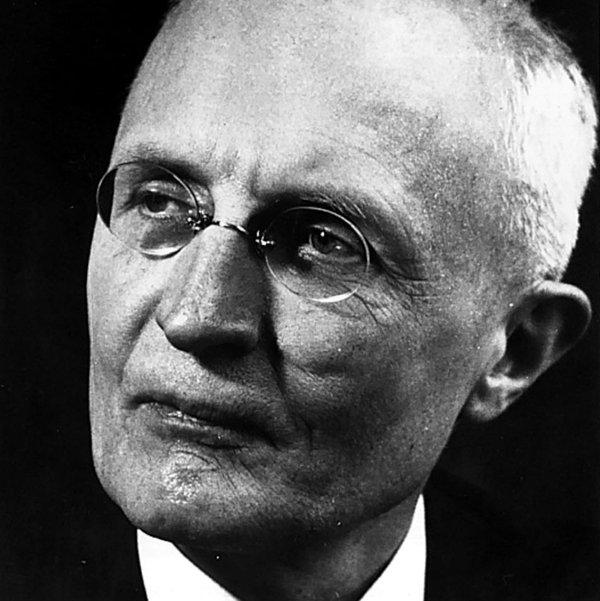
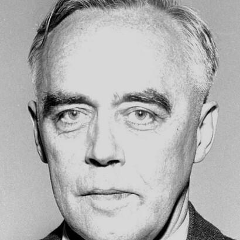
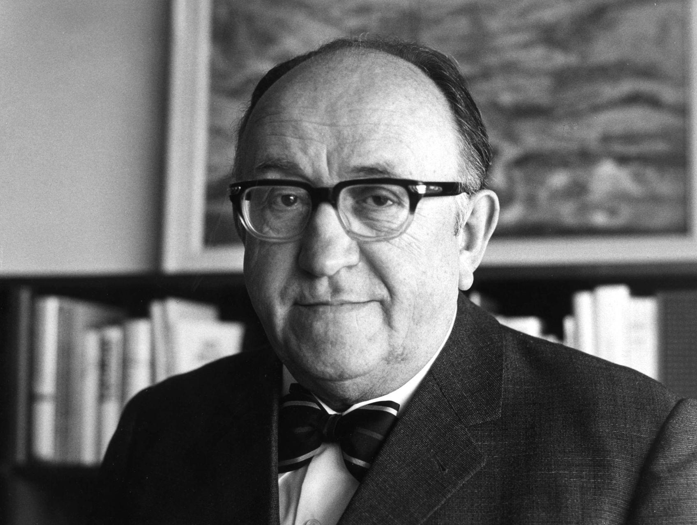
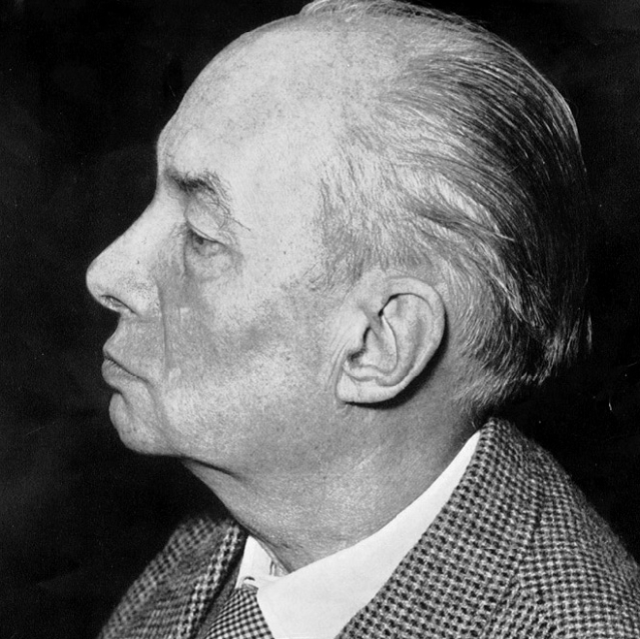
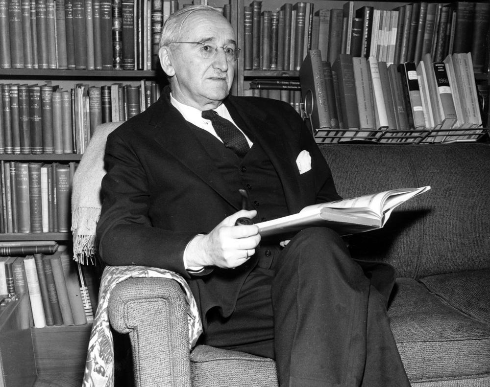
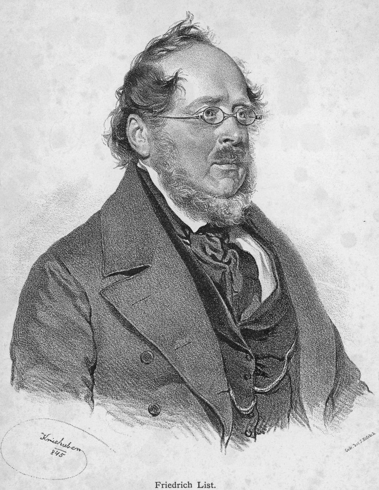
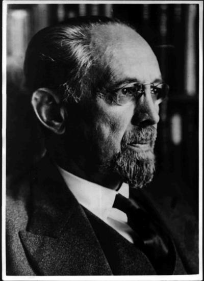
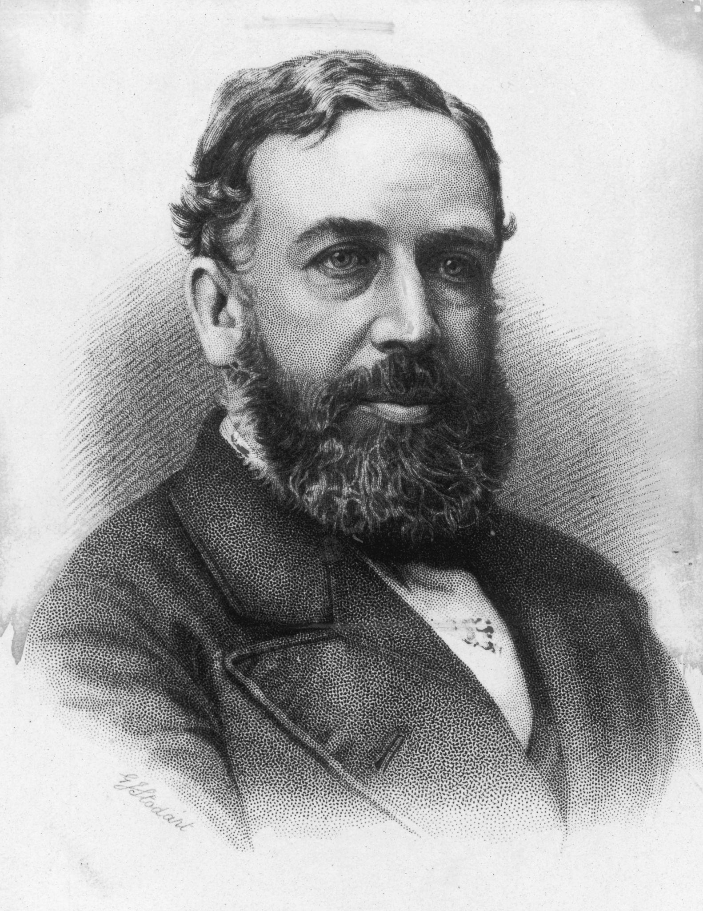
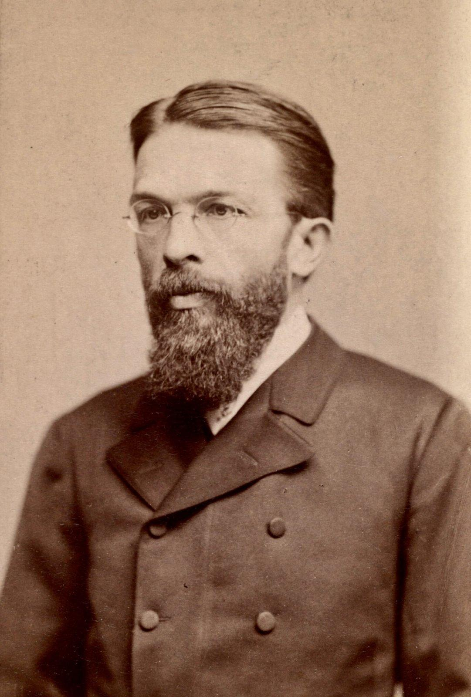

# 正文（1979年2月7日）

**讲座提要**

德国新自由主义（II）——其问题：经济自由如何既能奠基又能制约国家——新自由主义理论家们：W. 欧肯、F.伯姆、A. 穆勒—阿尔马克、F.冯 · 哈耶克——马克斯·韦伯与资本主义之非理性的合理性（rationalite irrationelle）问题。法兰克福学派与弗赖堡学派的回应——纳粹主义作为界定新自由主义目标所必需的灾难场（champ d'adversite）——19世纪以来自由主义政策在德国所遇到的阻碍：（a）李斯特的贸易保护主义经济；（b）俾斯麦国家社会主义；（c）一战期间所实施的计划经济；（d）凯恩斯类型的经济统制论（dirigisme）；（e）民族社会主义的经济政策—新自由主义从德国历史的各个方面来对民族社会主义进行批判—理论上的结果：延伸对新政和贝弗里奇（Beveridge） 计划的批判；经济统制论与国家权力的增长；大众化（massification） 与统一化（uniformisation），国家干预主义（etatisme）的影响——新自由主义的关键之处：相比传统自由主义而言的新颖性。纯粹竞争理论

## 一、经济自由与国家

### 1. 古典自由主义的出发点

今天这一讲我想要结束我所谈到过的、与我们同时代且实际上与我们有牵连的战后德国新自由主义。

我已经说明，你们都记得吧，18世纪中由市场问题所带来的问题域（problematique）。这个问题域其实就是：在一个已有的并且其正当性不容怀疑的国家内部（至少要具备这个条件），如何并且有可能给市场自由让出空间？市场自由从历史上和法律上来看，都是某种新生事物，因为在管治国家运转的18世纪，自由只被定义为特权自由、保留自由，自由与社会地位、职业和权力让与等相关。而经济自由作为一 种放任（laisser faire）的自由，如何在一个管治国家的内部成为可能？这就是问题，而你们都记得18世纪对此的回答最终很简单：使市场自由得到空间、市场自由在国家理由及管治国家的内部得以立足的原因，正是由于这个放任自由的市场、这个在不干涉主义管理下的市场将成为国家富足、经济增长以及由此而来的国力增强之本。以较少的治理来追求更多的国家利益：大体上这就是18世纪的答案。

### 2. 德国问题的逆转

而在1945年，如果我们考虑到上次我讲过的那些文本和决策，那么确切地说应该是在1948年，德国所面临的问题域是很不一样的并且是相反的（这也是上次课我设法要给你们解释清楚的）。这个问题就是：我敢说国家不存在，而任务是使得一个国家存在。如何在某种程度上预先使得将来的国家获得正当性？在既能确保对国家的制约又能使其存在的一种经济自由的基础之上，如何使国家可被接受呢？这就是我上次课所试图勾勒出来的问题，并且从历史上和政治上来看，这个问题构成为新自由主义的第一目标。现在需要来仔细研究一下答案。经济自由如何同时成为国家的奠基者和制约者、保证人和担保人？显而易见，这需要对自由主义学说中的一些基础原理再做研究——对于自由主义经济理论，我不会像谈作为治理术或是治理学说的自由主义那样说得那么多。

## 二、弗赖堡学派

### 1. 瓦尔特·欧肯



我要改变一下习惯，也就是先简略谈一下未来的总理艾哈德身边的那些人，是他们规划出这种新的经济政策，新的经济与政治衔接方式，这种衔接方式成为当代德意志联邦共和国的特征。这些人是谁？在我讲过1948年艾哈德所召集的专家委员会之中，第一个主要人物就是瓦尔特·欧肯（W.Eucken）〔1〕，专职经济学家，在20世纪早期曾是阿尔弗雷德·韦伯（Alfred Weber）即马克斯·韦伯弟弟的学生。在1927年曾担任过弗赖堡大学政治经济学教授并在那里结识胡塞尔〔2〕，接触到现象学，他还结识了一批法学家，后者对20世纪德国的法律理论影响很深，而这些法学家本身也接触到现象学，他们试图重建一套法律理论能够摆脱19世纪历史主义以及凯尔森（Kelsen）〔3〕的形式主义，规范主义和国家理论的束缚。欧肯在1930年或是1933年，我记不清楚了，写了一篇在当时引起很大反响的文章〔4〕来反对德国可能采取凯恩斯主义以解决危机。你们知道，那个时期的德国，像劳滕巴赫（Lautenbach）〔5〕或是沙赫特（Schacht）〔6〕博士之流都在宣扬凯恩斯方法。在纳粹主义时期，欧肯深居简出，一直在弗赖堡做教授〔7〕。1936年，他创办了一本叫做《秩序年鉴》（Ordo）〔8〕的刊物。1940年出版了一本题目与内容相矛盾的书叫做 Grundlagen der Nationalokonomie〔9〕（《国民经济学基础》），事实上这本书的问题不是国民经济学，而恰恰是从根本上、理论上和政治上来谈与国民经济学相反的东西。正是他围绕着他所领导的《秩序年鉴》刊物，形成了这个经济学家学派，我们称之为弗赖堡学派或秩序自由主义学派（ordoliberaux）。毫无疑问，他是1948年艾哈德所召集的专家委员会〔10〕的主要参谋之一。因此，我们说在这个委员会中有欧肯。

### 2. 伯姆与穆勒-阿尔马克






还有弗兰茨·伯姆（F.Böhm）〔11〕。他是弗赖堡的那些法学家其中之一，受过训练的现象学家，某种程度上也算是胡塞尔的学生。后来当上了联邦议院（Bundestag）的议员，直到70年代他还对德国的经济政治产生决定性影响。在这个委员会中，还有一个人叫穆勒—阿尔马克（A. Müller-Armack）〔12〕，经济史家，我想也是在弗赖堡当教授〔13〕（但不是很确定）。他于1941年完成一本很有意思的书，名字有点怪，叫《经济式样的谱系》〔14〕。在此书中，他试图在纯粹的经济理论和纯粹的经济政策之外，界定出一种经济治理技艺，一种以经济方式来治理的技艺，并称之为经济式样〔15〕。当艾哈德担任经济部部长期间，穆勒—阿尔马克后来成为艾哈德的国务秘书。他也是罗马条约的起草人之一。好了，这些人就是专家委员会人员中的几位。

### 3. 罗普克、鲁斯图与哈耶克








事实上除他们之外，还应该举出其他一些对自由主义和自由主义治理术的这个新定义（起过重要作用）之人。他们不属于那个委员会，但是至少他们当中的一些可以称得上是鼓动者（inspirateur），其中主要人物就是威廉·罗普克（Wilhelm Röpke）〔16〕。他是魏玛共和国时期的经济学家，曾是施莱歇尔（Schleicher）〔17〕的顾问之一。如果不是因为在1933年后者被希特勒赶下台，他应该会当上部长。这位罗普克也是反凯恩斯主义者，并于1933年被迫流亡。他曾到过伊斯坦布尔〔18〕、在日内瓦也逗留过〔19〕，并在那里结束了自己的职业生涯。1950年他出版了一本小书，叫做《德国经济政策的转向》〔20〕，由阿登纳（Adenauer）作序，此书在某种程度上最清晰、最简单、最坚决地表明了这种新的经济政策。关于罗普克，还需要做一些补充。在战争期间及战争刚结束的时候，他完成一套大部头三卷本，此书与《国民经济学原理》一起成为秩序自由主义和新自由主义的圣经。第一卷的名字叫Gesellschaftskrisis（《社会的危机》）〔21〕，你们都很熟悉这个词在当代政治术语中的悲惨命运，当然该卷也很明显地参照了胡塞尔的《欧洲科学的危机》〔22〕。

显然，有一些人不属于专家委员会，但其职业生涯经历对当代新自由主义的形成产生过重要影响。拉斯特罗（Rüstow）也是如此〔23〕。还有一个人，来自奥地利、一个奥地利人，冯·哈耶克（von Hayek）〔24〕。他来自新自由主义派别，在 Anschluss（德奥合并）时或在那之前就移民了。他去了英国，也到过美国。他无可争议地成为当代美国自由主义或无政府资本主义（anarcho capitalisme）的鼓动者，之后，于1962年回到德国担任弗赖堡大学教授，这样弗赖堡小组就形成了。

### 4. 人物史的意义

我之所以谈到这些人物生平的小细节，是因为以下几个原因。首先，1948年德国面临的问题，即如何成功地把国家的正当性和经济伙伴的自由衔接到一起，同时承认后者是前者的基础，或者说后者是前者的担保人。对那时候已涉及并着手尝试解决此难题的人来说，他们之前显然对该难题早已有过类似经历。从魏玛共和国起〔25〕，国家的正当性就不停地被质疑。在魏玛共和国时代和共和国内部，围绕着经济问题就已经有过争论。上述难题也已经产生了。正是围绕着该难题，从1925—1930年间起，欧肯、伯姆、罗普克等人展开争论。

## 三、韦伯与两个学派

我举出一些人物生平的标志事件，同样是为了向你们展示一些可能值得仔细研究的东西（对那些当代德国感兴趣之人来说）。我们所称的弗赖堡学派或秩序自由派与法兰克福学派之间，有一种奇怪的邻近关系，如同平行、类似（parallelisme）一样。年代相似，命运同样相似，因为至少弗赖堡学派中的一部分人，如同法兰克福学派一样，遭到过驱逐和被迫流亡。他们具有相同类型的政治经历，而且出发点也相同。因为在我看来，弗赖堡学派和法兰克福学派，双方大体上是从一个问题出发的，我称之为大学一政治（politico-universitaire）问题。这个问题在20世纪初期的德国占主导地位，某种程度上我们可以称之为韦伯主义。总之，我想说的是，马克斯·韦伯〔26〕 是两者的共同出发点。如果以极端的方式概括韦伯的立场，我们可以说，在20世纪初的德国，大体上来说，韦伯转移了马克思的问题〔27〕。如果说马克思试图要定义和分析的，用一个词来说，是资本的逻辑矛盾，那么马克斯·韦伯给德国的社会问题思考、经济思考、政治思考所带来的不是资本的逻辑矛盾问题，而是资本主义社会非理性的合理性问题。从资本过渡到资本主义，从逻辑矛盾过渡到区分合理性的和非理性的，仍旧以非常概括的方式来说，我认为这就是马克斯·韦伯问题的特征。

总体上我们可以说，法兰克福学派和弗赖堡学派，霍克海默（Horkheimer）〔28〕和欧肯只是从两种不同意思上，两种不同方向上重拾这一问题，因为还是概括地来讲，法兰克福学派的问题是确定如何定义和形成一种新的社会合理性以便消解经济的非理性。反之，破解这种资本主义非理性的合理性，同样也是弗赖堡学派的问题。欧肯、罗普克等人试图以另外一种方式来解决它，不是重新找回、发明和定义出社会合理性的新形式，而是定义或重新定义、重新发现将能够消解资本主义之社会非理性的经济合理性。因此，出现了两条相反的道路来解决同一个问题。资本主义是合理的还是不合理的，我不知道。结果总是这样的：双方在流亡之后于1945年、1947年都回到德国（当然我指的是曾被迫流亡的那些人），并且历史使得法兰克福最后几位追随者在1968年与受弗赖堡学派影响的政府管治产生摩擦，并由此被布置成对立的双方，因为最终这就是韦伯主义在德国的双重命运，既相似、交错又对立。

## 四、纳粹主义与灾难场

如果我提及曾影响德国新自由主义政策规划的那些人的职业生涯细节，这同样是因为第三个原因，这显然也是最重要的原因。这就是纳粹经历曾是他们思考的核心。但在我看来，我们可以说对弗赖堡学派来讲，纳粹主义某种程度上是认识上的和政治上的“通往大马士革之路”；也就是说，纳粹主义使得他们能够界定出我所称的“灾难场”，而为了达到其目标，他们需要定义并且经历后者。简单地对他们的主张进行战略上的、不完全详尽的分析，我认为从根本上来讲，他们有三件事要做：

### 1. 灾难场

首先，定义一个目标。我们看到，这个目标，我们上次课已经分析过〔29〕，就是在经济伙伴之自由的空间基础之上来奠基国家的正当性。这就是目标。这是1948年的目标。实际上在1925—1930年间它已经成为目标，只不过那时还不紧急、不清楚，不明晰罢了。

其次，他们要做的不仅是定义出为到达这个目标所可能遭遇的一系列对手，而实际上是要定义出与这个目标和寻求目标相抵触的总系统是什么，也就是包括从障碍到对手的整体，该整体大体上构成他们要与之打交道的灾难场。

第三个活动当然就是，为了穿越这个灾难场并且达到他们的目标：怎样分配或重新分配他们所拥有的概念资源和技术资源。这一“战略”分析的这后两点，就是今天我想要做些阐发的。

他们如何构建其灾难场？也就是说，他们如何找到这一整套他们所要处理的敌对障碍或对手的总逻辑？在这一点上，我认为纳粹主义经历是很重要的。当然，德国的自由主义思想不是伴随着弗赖堡学派而出现的，即使它曾经相对很审慎。之前很长时间和很多人—比如布伦塔诺（Lujo Brentano）〔30〕想要在一个不十分有利的氛围中去支撑和维护传统自由主义的一些论题。概括地来看，我们可以说实际上在德国从 19世纪中期开始，一些对自由主义和自由主义政策的重要批评与阻碍接连地登上历史舞台。这里，仍很概括地总结如下：

### 2. 李斯特与保护主义



第一，从1840年起，李斯特（List）〔31〕就在实践中提出了一条原则：国有政策和自由主义经济不能并存，至少对德国来说是这样。在某种程度上，关税同盟（Zollverein）〔32〕从经济自由主义出发来构建德国的失败就是明证。并且李斯特及其后继者们原则上又提出：自由主义经济远不是普遍适用于所有经济政策的一般样式，它从来只是并且只能是某些国家所掌握的一种战术工具或是战略，用来获得该国对世界其他国家在经济上的霸权主义和政治上的帝国主义地位。简单明白地说，自由主义不是所有经济政策都应该采用的一般样式。自由主义，只是英国的政策，它是英国统治的政策。一般来讲，它是适用于一个沿海国家的政策。从这个层面上来讲，德国的历史、地理位置以及它承受的所有约束条件，不能赋予德国一种自由主义经济政策。它需要的是保护主义经济政策。

### 3. 俾斯麦与国家社会主义

第二，德国自由主义在19世纪末所遇到的第二个既是理论上又是政治上的阻碍是：俾斯麦国家社会主义。为了维持德国统一，不应该只通过保护主义政策来抵御外部，还应该从内部控制和遏制所有危害民族统一的东西。一般来讲，无产阶级作为对民族和国家统一的威胁，应该实际地被纳入社会共识和政治共识的内部之中。大体来说，这就是俾斯麦国家社会主义的议题。因此，它成为自由主义政策的第二个阻碍。

### 4. 战争经济与计划化

第三个阻碍，当然就是自战争以来的一种计划经济的发展。德国受到战争期间形势制约所采用的这种技艺，是指以行政机关为中心来组织经济，行政机关在经济领域中做出重要决策来分配稀缺资源、确定价格水平并保障充分就业。至战争结束，德国仍未走出这种计划经济，因为之后它要么被社会党政府，要么被非社会党政府所继续采用。实际上从拉特瑙（Rathenau）〔33〕一直到1933年，德国一直处于一种经济之中，这种经济无论如何都具有的计划化和中央集权化，如果说不是一成不变的，至少也是反复出现的一种经济样式。

### 5. 凯恩斯主义与经济统制

最后，第四个阻碍，它较晚一点出现在德国的历史舞台上，这就是凯恩斯类型的经济统制主义。从1925 开始，（……），大约在1930年，德国的凯恩斯主义者例如劳滕巴赫（Lautenbach）〔34〕对自由主义提出了一般凯恩斯主义者都会提出的那类批评，他们建议对经济总体平衡实行诸多国家干预。因此，在纳粹掌握权力之前，已经出现四种要素：保护经济、国家社会主义、计划经济、凯恩斯型干预；这四种要素构成了对自由主义政策的阻碍，正是围绕着这四种防守要素（verrous），德国的一些自由主义支持者从19世纪末起展开了一系列探讨。在某种程度上，这些探讨作为一种散落的遗产由德国新自由主义者继承下来。

## 五、纳粹主义的解释

我知道我夸张描绘了情况，并且事实上，这些不同要素之间并不是间断的，而是一种连续的转换和连续的网络。人们很自然地从保护经济过渡到国家辅助式经济。比如，拉特瑙类型的计划化，在20世纪20年代末和30年代，又重新被凯恩斯观点所采纳。当然，这些都互相牵连，但是没有形成一个体系。然而最终纳粹主义所带来的，就是把这些不同要素严密地结合到一起，也就是说，组织起一套经济体系，在其中，保护主义经济、辅助经济、计划经济、凯恩斯经济形成一个牢固的整体，其中每个部分都通过所设立的经济管理部门牢固地维系在一起。1936年沙赫特（Schacht）〔35〕博士的凯恩斯式计划，被戈林（Goring）所负责的四年经济计划〔36〕所接替，后者身边的一些人都曾是拉特瑙的顾问〔37〕。戈林计划具有双重目标：一方面确保德国经济的自给自足，即绝对的保护主义；另一方面确保一种国家辅助政策，当然这导致了通货膨胀的后果，而战争筹备（或者叫一种军事化经济）将为此买单。所有这些形成一个整体。

我说德国新自由主义者所掀起的对纳粹体系理论上和思想上的打击，不是就像那时候大多数人（当然尤其是凯恩斯主义者们）所说的那样，是说纳粹所设立的经济体系是一个畸形。他们正在将各种异质的要素合并到一起来框住德国经济，但框架内的要素却是一些互相对立的、不协调的要素。

秩序自由主义的攻击不是宣称纳粹主义是国家极端危机的一个产物，经济和政治不能克服自身矛盾而达到的一个终点，况且，作为极端解决方法的纳粹主义不能充当模式用来分析普遍历史，或者无论如何也不能用来分析欧洲资本主义的以往历史。秩序自由主义者们在纳粹主义中看不到一种畸形、一种经济的不协调、一种极端危机的最后解决方法。他们说：纳粹主义是一种真理；或者不如这样说：纳粹主义只是揭露出各种不同要素之间所存在的一个必然关系系统。新自由主义者们说：任意拿出这些要素中的一个，比如保护主义经济或者凯恩斯干预。当然这些看起来是一些不同类的东西，但是我们展开一个要素必然会以这样或那样的方式触及另一个。也就是说，德国的经济和政治历史使得这四个要素相继地出现在治理行为舞台之上，新自由主义者认为，这四种要素在经济上是联系在一起的，即使你给出了其中一个，那你也不能摆脱掉其他三个。

### 1. 不同干预形式的结合

沿着这个纲要和原则，他们相继研究了不同类型的经济，比如苏维埃的计划化。他们中熟悉美国的那些人，比如哈耶克，以新政为例，另一些人则以英国，尤其是战争期间实施的凯恩斯政策和贝弗里奇（Beveridge）计划为例〔38〕。他们重新提起所有这些并且宣称：大家看，一开始都是同样的原则在起作用，接下来这些要素的其中一个将引发出其他三个。正是由此，罗普克在1943年或是1944年（我记不清楚了），发表了——非常有勇气和胆量——一个对战争期间英国所实行的贝弗里奇计划的分析，他告诉英国人：可你们，凭你们的贝弗里奇计划正在准备的一切完全只是纳粹主义。一方面，你们在军事上同德国人作战，但（另一方面）经济上，因而在政治上，你们正在重走他们的老路。英国工党主义将会把你们领向德国类型的纳粹主义。贝弗里奇计划会把你们带到1936年的戈林计划和四年经济计划那里去〔39〕。

因此，新自由主义者试图指出一种经济——政治常量，人们可以在各种不同的政治体制中找到它，比如在纳粹主义、议会制的英国、苏联、新政的美国中。他们试图在这些不同的体制和政治形势中标明这种常量关系。他们已提出了原则，认为根本的区别不是介于社会主义和资本主义之间，根本区别也不是这种宪法结构和那种宪法结构的不同。真正的问题在于一种自由主义政策与任何一种形式的经济干预主义之间的区别，不管后者采取相对温和的凯恩斯主义的形式，还是采取德国式的、极端的自给自足计划形式。因此，存在着一种常量，我们可称之为逆自由（anti-liberal）常量，它有自己的逻辑和内在必然性。它正是秩序自由主义们在纳粹主义经历中所要破解出来的。

### 2. 从纳粹德国到英国福利国家

他们从纳粹主义中获取的第二个教训是以下这个。他们说道，纳粹主义是什么呢？根本上看，首先它是国家权力无限制的增长。确实，这种观点—现在看起来是一种共识——呈现出一种悖论并且同样体现了理论或分析层面的打击；因为当我们来看德国民族社会主义的运转方式，我认为至少我们可以说它是第一次最系统地企图使国家处于弱势。从很多原因可以看出纳粹主义就是国家的衰弱。第一，德国民族社会主义的司法结构可以体现出这一点，因为你们知道，在德国民族社会主义中，国家已经丧失其法律人格地位，既然国家在法律上只能被定义为某种东西的工具，这个某种东西才是法律的真正基础，即人民，Volk〔40〕。作为共同体（communaute）组织形式的Volk，作为 Gemeinschaft（共同社会）的人民，它既是法律原则，又是所有组织、所有司法制度，包括国家在内的终极目的。国家可以很好地表达Volk，可以很好地表达Gemeinschaft，它可以很好地成为这种 Gemeinschaft 自我表现和产生效力的形式，但是国家只能是一种形式，或者说工具。

### 3. 国家衰弱与权力扩张

第二，在纳粹主义中，在某种程度上，国家从内部被剥夺了权利，因为你们知道，在纳粹主义中，所有国家机器的内部运作原则不是一种行政管理类型的等级结构以及权威（autorite）和责任之间的游戏，这种游戏自 19世纪是欧洲行政管理的特征，而是一种 Fihrertum（元首身份）原则，一种引导原则，与之相匹配的应该是忠诚和服从，也就是说，在国家结构形式下，在关于这个 Gemeinschaft 的、Volk 的不同要素之间的垂直交流（自下而上或自上而下）方面上，不应有所保留。

第三点，政党的存在以及调节行政管理机关和政党关系的所有立法机关，以损害国家为代价来赋予政党根本的权威。国家系统地被毁灭，无论如何国家都被降格为人民共同体、元首身份原则及政党存在的纯粹而简单的工具。国家的这种（降格）很好地表明了国家所具有的从属地位。

对这个形势破解之后，秩序自由主义者就此回答说：你们不要被欺骗了。事实上，看起来国家消失了，国家成为了附属、被抛弃。这只是说，如果国家是从属的，那么这仅仅是因为19世纪传统的国家形式不能让人面对由第三帝国所选择的经济政策所提出的新的国家化要求。

实际上，如果你们给自己设立了我刚才所说的那种经济体系，为了使其运转，那么，你们就需要某种超一国家（sur-Etat）、国家补充（supplement d'Etat），而现在我们知道的组织形式和制度形式却不能保证这样的国家。正是由此这个新的国家，与人们熟悉的那些形式相比，才必须要超出自身范围并且创造出各种国家补充、各种国家权力的增强器，后者通过Gemeinschaft 的原则、服从元首之原则、政党的存在所体现出来。

因此，实际上纳粹们用来摧毁资产阶级和资本主义国家的那些东西，它们所体现的是对国家、对一个差不多正在诞生的国家的一些补充，是正在国家化的一些制度。因此这使得他们可以得出的另一个结论就是，在我刚才所说的这种经济组织形式和国家增长之间存在一种必然联系，这使得该经济系统中的任何一个要素都不能产生，除非其他三个要素接下来一步一步地出现；并且每个要素为了得以实施和运转，恰恰都会要求国家权力的增强。一边是经济的常量，另一边是国家权力的增强，即使与传统国家相比是畸形的国家形式中，这两者也是绝对联系在一起的。



最后，纳粹主义促使新自由主义者对他们所要解决的问题做出第三次打击。关于纳粹对资本主义社会、资产阶级社会、功利主义社会、个人主义社会所做的分析，我们可以以桑巴特（Sombart）〔41〕为参考依据，因为他的人生轨迹是介于准马克思主义（quasi-marxisme）和准纳粹主义（quasi-nazisme）之间，他在1900—1930年期间表达和总结了…………最好的总结是在他的那本 Der deutsche Sozialismus（《德国社会主义》）〔42〕中。资产阶级和资本主义的经济和国家的产物是什么？它们产生出一种社会，在其中，个体们被迫与他们的自然的共同体割裂并且在某种程度上一起集中到一种平庸的、无名的形式之中，即大众（mass）之形式。资本主义产生出大众。因此资本主义产生出单向度（unidimensionalite），桑巴特没有确切地使用这一名称〔43〕，但对它作了明确定义。资本主义和资产阶级社会剥夺了个体相互之间直接的、当下的交流，它们迫使个体只能通过行政和中央机关来交流。因此它们使个体化约为原子状态，这些原子都服从于一种权威、一种抽象权威，在这种抽象权威之中，个体无法认出自己。资本主义社会同样强迫个体成为具有统一化和规范化功能的大众消费类型。

总之，这种资产阶级和资本主义经济使得个体相互之间根本上只能通过符号游戏和景观游戏〔44〕等来交流。你们看到，事实上自1900年起〔45〕，在桑巴特那里已经出现了大家所熟悉的对大众社会、单向度人的社会、权威社会、消费社会、景观社会等的批判〔46〕，这种批判现如今已经成为一种思潮的共同之处，但我们无法确切知道这种思潮的关节和骨架。好了，这就是桑巴特所说的。而且，这就是被纳粹纳入到其考虑之中的东西。正是出于反对（资本主义的）国家以及经济对社会的这种摧毁，纳粹者们提出要实行他们自己的想法。

### 4. 桑巴特与大众社会

但是新自由主义者却说，事实上如果我们来看纳粹者用他们的组织结构、政党和元首制原则，那么它们都做了什么呢？实际上，他们的所作所为只是强化了大众社会、统一化和规范化的消费社会、这种符号和景观社会。让我们来看一下运转中的纳粹社会是什么样的。人们完全陷人这样一系列指令中：纽伦堡大众、纽伦堡景观、所有人统一消费、大众汽车之理念，等等。所有这些都只是桑巴特所揭露的、纳粹声称所要反对的资产阶级和资本主义社会所有特征的延续与强化。为什么会是这样？为什么他们只是延续了他们所要揭露的？要不正是因为所有这些要素不是像桑巴特和他之后的纳粹者们所声称的那样，它们是资产阶级和资本主义社会的结果和产物吗？正相反，这些要素是一个在经济上不接纳自由主义的社会的产物，或者说是国家的产物：这个国家已采取保护主义政策、计划化政策，在这样的政策中，市场没有发挥作用，而是国家的或类国家的（para-etatique）行政管理负责个体的日常生存（existence）。大众现象、统一化现象、景观现象，所有这些现象都是与国家主义联系在一起的，它们与反自由主义而不是与一种商品经济相联。

### 5. 纳粹主义与大众化

总结一下所有说过的内容，纳粹经历对弗赖堡的自由主义者来说最重要的一点是，后者相信能够确定—他们这是在选择对手，或者说为了定义他们的战略而建立必要的灾难场—一首先，纳粹主义属于一种经济常量，后者对社会主义与资本主义的对立和国家的宪政结构漠不关心（indifferent），不为这种对立所动；其次，他们认为能够确定民族社会主义也是一种常量，它完全与国家权力的无限增长相连，既是后者的原因也是其结果；最后，这种与国家权力相连的常量所带来的重大的、首要的、可见的后果就是摧毁了社会共同体的网络和组织，正是这种毁坏通过某种连锁反应和循环反应又要求保护主义、统制经济和国家权力的增长。

总之，所有与自由主义相对立的东西，所有声称要国家化地管理经济的东西，因而都构成一个常量。通过欧洲社会的发展，我们可以认清这种常量的历史。这个发展从19世纪末或更准确的说从20世纪初开始，也就是说自从自由主义治理技艺差不多在其自己所导致的后果面前感到害怕，并试图制约这些本该借此发展自己的后果时起。它通过什么来制约这些后果呢？就是通过一种干预技术，它将人们认为如同在自然科学中那样有效的合理性应用于社会和经济。大体上来说，这就是我们所称的技术。管理国家的技术化、控制经济的技术化，分析经济现象的技术化：这就是秩序自由主义者所称的“永恒的圣西门主义”（eternel saint-simonisme）〔47〕，他们认为圣西门〔48〕带来了自由主义治理技艺所采取的此种眩晕（vertige），这种眩晕使他在将专属于自然的合理性范式之应用于社会中去寻求一个制约原则和组织原则，这个原则最终导致了纳粹主义。因此，从圣西门到纳粹主义，存在这样一种循环：一种合理性引发出诸多干预，这些干预引发国家权力的增长，国家权力的增长引发出根据各种技术的合理性来运转自身的行政管理之实施，正是这些技术合理性构成了资本主义之全部两个世纪，无论如何也有一个半世纪历史中的纳粹主义的起源。

## 六、圣西门主义与技术治理

通过这种剖析，你们清楚地看到秩序自由主义者——当然，我对他们在1935年至1945年或1950年间的全部所言都做了概括——通过剖析政治思考的边界，通过分析经济学和社会学的边界，他们发起了一场漂亮的攻击，因为正是通过这种类型的剖析，我们所熟悉的整个话语和分析类型才得到迅速扩展：对资产阶级社会的传统批判、对官僚政治（bureaucratie）的分析；人们头脑中关于纳粹主义的论题，即认为纳粹主义是资本主义之差不多是自然地、历史地发展的揭示和终点；把国家当作绝对的恶的否定神学（theologie negative）；用在同一种批判中可以扫除苏联所发生的情况和美国所发生的情况之可能性，扫除纳粹集中营和社会保障记录等的可能性。这些都是我们所熟悉的。我认为正是在秩序自由主义所进行的一系列理论和分析的攻击之中，能找到所有这一切的根源。

但是对于我来说，我想告诉你们的是，根本之处不在这里。而是在于秩序自由主义者们从这一系列的分析中所得出的结论：既然存在着向市场经济指责的缺陷，既然存在着人们根据传统来反对市场经济的那些毁灭性后果，既然纳粹主义表明完全不应该把这些缺陷和破坏性后果归于市场经济，那么与此相反，就要让国家来为此负责，负责国家的内在缺陷及其自身合理性的不足，那么，就因此应该完全将分析倒转。不是去问：一种市场经济是相对自由的，国家应该如何制约它以使其有害结果尽可能地少？应该换一种方式思考。应该去说：什么也无法证明市场经济有缺点，什么也无法证明它有内在缺陷，因为应该将所有的缺点及其缺陷的后果都归于国家。因此人们倒转了情况并且比起18世纪人们对市场经济的要求，如今要求的更多。

18世纪人们向市场经济要求什么？要求它告诉国家：从这个界限开始，当涉及这个问题的时候，超出这个领域边界，并且你不要再进行干预。但是秩序自由主义者认为这还不够。既然已证实是国家具有内在缺陷，同时什么也无法证明市场经济有缺陷，那么我们就要求市场经济自身不是作为国家的制约原则，而是对国家自始至终的存在和行动进行内部调控的原则。换言之，不是接受一种由国家所界定的、差不多在国家的监督下所维持的一种市场自由——某种程度上，自由主义起初的做法是这样：建立经济自由空间并且让监督它的国家为其划定范围——秩序自由主义者认为应该完全倒转这一最初的做法，从国家出现开始一直到其最终的干预形式，市场自由都是国家的组织和调控原则。或者说，国家受市场的监督而不是市场受国家的监督。

## 七、国家与市场的逆转

对秩序自由主义者来说，这种倒转只有基于他们对纳粹主义的分析的基础之上才有可能。我认为正是在这里，他们才能够于1948年切实地尝试解决向他们所提出的问题：国家还不存在，应该给予其正当性，应该让那些不信任它的人接纳它。那么我们便实行市场自由，并且将会出现一种机制既能奠基国家又能通过控制国家而会给予有理由对其不信任的那些人所要求的保障。因此，我认为这就是倒转（renversement）所含之义。

在这里，我们可以对当前新自由主义中的重要之处和关键之处进行定位。因为我们不应当被迷惑，当前的新自由主义完全不是人们通常所认为的那样：它是形成于18世纪和19世纪的自由经济之旧有形式的复苏和复发；资本主义当前使其复活，是由于自己的无力、所经历的危机和一些或多或少是局部的和有限的政治目标等这样一些原因。

事实上，我们以现在所探讨的德国形式或美国的无政府自由主义（anarcho-liberalisme）形式为例来看，当前这种新自由主义的问题之所在是某种更重要的东西。目前，所有人不管是左派还是右派，由于这样还是那样的原因都不信任这样有缺陷（的）国家，那么问题确实就是要弄清楚一种市场经济是否可以充当后者的原则、样式和范式。所有人都认可要对国家进行批判，要探测国家的破坏性和有害结果。但是在这种普遍的批判内部，既然出现过混杂的批判，从桑巴特到马尔库塞，并没有什么大的不同；那么自由主义是否能够切实地带来自己真正的目标，**即在一种市场经济的基础之上使国家的权力和社会的组织形式得以普遍形式化？市场是否切实有能力为国家和社会带来形式化？这才是当前自由主义的重要和关键问题**，并且正是从这方面来讲，相对于18世纪所出现的传统自由主义的规划，它代表了一种绝对重要的转变。后者不是指简单地放任经济自由，而是要知道市场经济在政治和社会方面的资讯能力（les pouvoirs d'information）能延伸至何处。这才是关键。对上述问题的回答是肯定的。市场经济能够切实地为国家提供资讯和改造社会，或者改造国家和为社会提供资讯。秩序自由主义者对传统的自由主义理论做了一些转移、转变和翻转。现在我就解释一下这些转变。

第一种转移是交换的转换，就是市场原则从交换转变为竞争。笼统地讲，在18世纪的自由主义中，市场是根据什么来界定的，或者是基于什么来描述的？市场是基于交换，基于交易双方之间的自由交换。交易双方通过交换本身建立起两种价值之间的对等。市场的范式及原则是交换。为了市场变得有效，为了使等价是真正的等价，要实行市场自由以及第三方的不干预，任何一种权威都不得干预，更不要说国家权威。况且还要要求国家监督市场的良好运行，也就是说使交换双方的自由得到遵守。因此，国家并不介入到市场中。与此相反，人们对国家的要求是介入到生产中。意思是说：18世纪中期的自由主义经济学家认为，从根本上来看，当人们进行生产时，也就是当人们付出劳动于某物之中时，人们所需要的，（就）是对被生产物的个人所有权要得到所有人的尊重。正是在这里，即尊重生产活动所必须的个人所有权，人们才需要国家权威。而市场应该成差不多干净的、自由的场所。

## 八、交换与竞争

### 1. 交换原则

然而对于新自由主义者来说，市场的根本不在于交换，不在于18世纪的自由主义经济学家所给出的那种原始的、虚构的情境。它在别处。市场的根本在于竞争。从这一点来说，新自由主义者只是遵循了19世纪的自由主义思想、学说和理论的整个演变。实际地来看，自19世纪末起，几乎全部的自由主义理论都同意市场的根本在于竞争，也就是说不在于对等，而是相反，即在于不平等〔49〕。竞争与垄断问题，远甚于价值与等价问题，将构成市场理论的本质基础。因此在这方面，秩序自由主义者完全与自由主义思想的历史演变一致。他们重拾起这个传统想法，重拾起只有竞争才能确保经济的合理性这一原则。竞争通过什么来确保经济的合理性？就是通过形成一种价格，这种价格在充分和完全竞争的范围内，可以衡量经济数量并据此来调控各种选择。

### 2. 竞争原则

正是在这个方面，相对于那种以竞争问题为中心的自由主义、以竞争为中心议题的市场理论来讲，秩序自由主义者们才引入了我认为是独特的某物。事实上，按照19世纪和20世纪关于市场经济的边际主义和新边际主义的想法，我们可以这样认为：既然市场只能通过自由竞争和完全竞争来运转，那么国家也就应该自我克制不去改变已存在的竞争状态并且提防凭借垄断现象和操控现象等引入一些因素以改变这个竞争状态。除此之外，国家应该介入以阻止使竞争变质的这样或那样的现象，例如垄断现象。因此，他们继续从市场经济原则中所得出的结论与从18世纪被定义为交换的市场经济中所得出的结论是一样的，即放任自由。换言之，对18世纪的自由主义者来说就如同对19世纪的自由主义者而言，他们都从市场经济原则中得出放任自由的必要性。一方是从交换推导出来，而另一方是从竞争得出这一结论；但是不管怎样，市场经济的逻辑结果和政治结果都是放任自由。

而正是在这里，秩序自由主义者与18世纪和19世纪传统的自由主义分道扬镳。他们认为：从竞争作为市场的组织结构形式这个原则中，我们不能也不应该得出放任自由的结论。为什么？因为他们认为，当你们从市场经济中得出放任自由原则时，根本上来说，你们仍然陷入我们称之为“自然主义者的天真”（naivete naturaliste）之中，也就是说你们认为市场不管它被定义为交换还是竞争，仍旧是一种自然背景（donnee），并因此它是某种国家应该尊重的、自发产生的事物。但是秩序自由主义者认为这里人们很容易看出来自胡塞尔的影响〔50〕——这就是自然主义者的天真。因为事实上，竞争是什么？它绝对不是一种自然的呈现。竞争游戏、竞争机制以及它所被发现并看重的积极作用，都完全不是自然现象，都不是欲念、本能、行为等之间的自然游戏的结果。实际上，竞争的效果只能归于竞争所具有的本质，这种本质刻画了竞争并构成了竞争。竞争的有益效果不能归功于它所具有的一种自然的在先和自然的呈现，而应该归功于一种形式上（formel）的优先。竞争是一种本质（essence）。竞争是一种eidos〔51〕。竞争是一种形式化（formalisation）原则〔52〕。竞争具有内在逻辑，它有自己的结构。只有在这种逻辑得到尊重时，竞争的效果才能产生。某种程度上来说，竞争是各种不平等之间的一种形式游戏。竞争不是个体之间和行之间的一种自然游戏。

### 3. 自然主义的天真

这完全如同胡塞尔所认为的那样，一个形式结构不能呈现给直观，除非具备某些条件。同样的道理，作为本质属性的经济逻辑，竞争只有在某处出现并产生其作用，且这些条件都要经过人为地仔细布置。**也就是说，纯粹竞争不是一种原初背景。它只是长期努力的结果，不过说实话，纯粹竞争将永远无法达到。纯粹竞争只应该是并且只能够是一个目标，因此这个目标必须以一种无定限的积极的政策为前提。因而竞争是治理技艺的历史目标，不是一种要加以遵守的自然呈现。**

在这里，除了可以看出胡塞尔类型的分析及其影响之外，无疑，还可以找到将历史与经济衔接起来的可能性，这种连接有点像韦伯的方式〔53〕。秩序自由主义者认为，对作为形式机制的这种竞争进行分析，找出其最佳作用，这是经济理论所要做的事情。但是永远不能基于此种我们能（加以分析的）竞争理论之上来分析我们所知道的在社会中所真实发生的事情。对后者的分析只能通过那些真实的历史系统来进行，各种形式上的经济进程在那些系统中运转着、被形成或变形。因此有必要对系统进行历史分析，在某种程度上这种分析会与经济活动的形式分析相交错，就像水平线与垂直线相交。经济学分析形式活动，历史学将分析使这些形式活动的运作变得可能或不可能的各种系统〔54〕。

## 九、经济形式与历史制度

一下子这是他们从中得出的第三个结论，经济竞争与国家之间的关系不再能是不同领域的互相限界。**它们的关系不再是有一个放任自由的市场游戏，然后有一个国家开始进行干预的领域；因为市场，或者不如说作市场本质的纯粹竞争只能在被产生出来时才可出现，并且只能由一种积极的治理产生出来**。因此，人们完全重新获得一种以竞争和治理政策为标志的市场机制。治理从头到尾都必须伴随着市场经济。市场经济没有从治理中减去什么东西，相反它指出并构建了一般指标，应该把那个将要限定所有治理行为的规则置于此指标之下。应该为了市场去治理，而不是因为市场去治理。在这种情况下，我们可以看到，由18世纪自由主义者所定义的那种关系完全被倒转了。接下来的问题是：将以何种方式对遵循以下总原则的治理术进行限制，这个总原则就是必须成功地在治理中产生出市场，或者说，这个总原则对治理术产生的结果会是什么？这就像是在一出精彩的连续剧中。我下次课要对此做讲解。

## 注释

〔1〕 瓦尔特·欧肯（1891—1950）：德国新自由主义学派（弗赖堡学派）领袖，其地位通过《秩序年鉴》杂志所展现出来（参见下文，注8）。在波恩和柏林学习完经济之后，在柏林时，曾作为历史学派对手——海因里希 · ⻬策尔（Heinrich Dietzel）的学生，以及历史学派最后几个代表人物之一哈曼 ·舒马赫（Hermann Schumacher）的学生，后者是古斯塔夫 ·舒默勒（Gustav Schmoller）在柏林大学的后继者，他成为舒默勒的助手，从1923年起，认识到历史主义无法解决通货膨胀问题，他与前者分道扬镳；1925年被任命图宾根大学教授，1927年成为弗赖堡大学教授直至去世。参见F.Bilger：《当代德国的自由主义经济思想》，同前书，第39—70页。

〔2〕 关于欧肯与胡塞尔的关系，参见 F.Bilger，同上，第47页［“一来到城市，欧肯就同在精神上与鲁多夫·欧肯（Rudolf Eucken）相通的胡塞尔结下了深厚的友谊。他们交往频繁，但不幸的是，这一切被哲学家的离去所中断。瓦尔特·欧肯在著作中承认现象学对他的经济方法的形成产生了根本影响。尤其是他经常参考胡塞尔的著作《逻辑研究》（Die logische Untersuchungen），Halle, S. Niemeyer，1928，此书的批判式和肯定式风貌被他转用于政治经济学之上”。更细致的分析，参见 R. Klump，“论德国秩序理论的现象学根源：瓦特·欧肯有什么归功于埃特蒙德 · 胡塞尔”（“On the phenomenological roots of German Ordnungstheorie：what Walter Eucken owes to Edmund Husser！”），载于 P. Commun 编著的《德国秩序自由主义：社会市场经济之源》（L'Ordoliberalisme allemand: auz sources de V'economie sociale de marche）， Universite de Cergy-Pontoise, CIRAC/CICC, 2003，P.149—162。

〔3〕 其中包括 Hans Grossmann-Doerth 和 Franz Bohm（关于后者，参见下文，注11），参见F.Bilger，同前书，第47--48页和第71—74页。关于凯尔森，参见《安全、领土与人又》，同前书，1978年1月25日的课程，第81页，注1。

〔4〕 W. 欧肯：《国家结构的变迁与资本主义危机》（Staatliche Strukturveundlcngen und die Krisis des Kapitalismus），Welrvrrtschaftliches Archiv,Iena, 36 卷（2），1932，第297—321页。

〔5〕 W. 劳滕巴赫（1891—1948），参见他的文章：“直接创造就业机会的影响”（“Auswirkungen der unmittelbaren Arbeitsbeschaffung”），《经济与统计》（Wirtschaft und Statistik），13 卷，第21期，1933年，重版于G.Bombach 等编著的《凯恩斯主义》（Der Keynesianisius），Berlin, Springer,1981，P.302—308，以及他的遗著《利率、信贷和生产》（Zins,Kredit und Produktion），Tubingen,J. C. B. Mohr,1952。

〔6〕 Hjalmar Greely Horace·沙赫特（1877--1970），1923年11月至1930年3月任帝国银行主席，1934年7月至1937年11月任经济部长。他反对戈林和军备支出（参见下文，注36），却保留了没有部长职务的部长头衔直至1943年。参见J.弗朗索瓦-Poncet：《西德的经济政策》，同前书，第21—22页。

〔7〕 正相反，1933年末欧肯参加的是由经济学家狄尔（Karl Diehl）组织的研讨班，研讨班汇集了来自各个学院的反纳粹主义者［其中有格哈特 ·里特尔（Gethard Ritter）和神学家克莱蒙·鲍尔（Clemens Bauer）］。他坚决反对由弗赖堡大学校长海德格尔所提出的政策。并与多名天主教和新教神学家一起创办了 Friburger Konzil，后者无疑成为1938年犹太人大屠杀之后唯一的由大学人员组成的反纳粹组织。在战争期间，他参加了“国民经济学协会”（Arbeitsgemeinschaft Volkreirtschaftslehre）的讨论，后者由贝克哈特（Erwin von Beckerath）在 Akademie fiir Deutsche Recht（德意志法研究院，由纳粹成立于1933--1934年，目标为使法律日耳曼民族化）中的负责经济问题的第四组（Giruppe JV）内部中所主持召开的。Gruppe I成立于1940年1月，其组织者延森（Jens Jessen）成为激烈的反民族社会主义者，由于参加了1944年7月的谋杀希特勒行动，在11月被处死。Gruppe 1自身是一个地下的抵抗研讨会，它于1943年3月被取消，但是经济学家们的讨论（尤其是对于战后时期的经济转变问题）在私人的“贝克哈特圈子”中持续着。在这期间，欧肯发表了多篇文章。参见 H. Rieter 和 M. Schmolz，“1938—1945年间德国秩序自由主义的理念：为一个新经济秩序指明道路”（“The ideas of German Ordoliberalism 1938—1945:pointing the way to a new economic order”），《欧洲经济思想史杂志》（The European Journal of the History of Economic Thought），I（1），1993年秋，第87-页；R. Klump，“德国秩序理论的现象学根源…………”（“On the phenomenological roots of German Ordnungstheorie. ..”），同前书，第158—160页。

〔8〕 福柯这里弄错了题为“我们的任务”这篇文章的发表日期。后者作为伯姆、欧肯和汉斯·格罗斯曼-德尔特（Hans Grossmann-Doerth）所负责的《经济秩序》（Die Ordnung der Wirtschaft）第一卷的序言，由三人共同署名发表（见这篇文章的英文翻译，题为：“The Ordo Manifesto of 1936”，A. Peacock and H. Willgerodt，《德国的社会市场经济：起源和发展》（Germany’s Social Market Economy: Origins and Evolution），Londres, Macmillan, 1989，第14—16页），以及《秩序年鉴》（Ordo）杂志1948年第1期。后者以年卷的形式，在1948年至1974年期间，由Helmut Küpper出版于杜塞尔多夫，自1975年起由Gustav Fischer于斯图加特出版。

〔9〕 W. 欧肯：《国民经济学基础知识》（Die Grundlagen der Nationalikonomie），Iena,G. Fischer,1940，再版于1942/英文版：《经济学基础：经济现实分析中的历史和理论》（The Foundations of Economics : History and theory in the analysis of economic reality）， T. W. Hutchison 译，Londre, William Hodge,1950。

〔10〕 参见上文，第99页，注19。

〔11〕 弗兰茨 ·伯姆（1895—1977），1925—1932 年任经济部的法律顾问，在弗赖堡大学教授法律，1933-1938年任教于耶拿大学，但由于他对反犹政策持反对态度，便辞去职务。1945—1946年间担任过黑森州的文化事务大臣，随后成为法兰克福大学民法和经济学教授。1953年至1965年任联邦议院基民盟代表，并且从1948年至1977年，他在法兰克福的“联合经济区经济管理部”（Verwaltung fur Wirtschaft des Vereinigten Wirtschaftsgebietes）下属的专家委员会中起到过积极作用。1965年，成为德国驻以色列大使。主要著作：《竞争与垄断斗争》（Wettbeveerb und Monopolkampf），Berlin, C, Heymann,1933；《作为历史任务的经济秩序与创新成就》（Die Ordmung der Wirtschaft als geschichtliche Aufgabe und rechtsschopferische Leistung），Stuttgart-Berlin,Kohlhammer,1937；《经济体制和国家宪法》（Wirtschaftsordnung und Staatsverfassung），Tubingen, J. C. B Mohr，1950。还请参见他的著作 Reden und Schriften,Karlsruhe,C. F. Muiller,1960。他与 W.Eucken 和 H.Grossmann-Doerth一起是1936年“秩序自由主义宣言”的共同联署人（参见上文，注8）。

〔12〕 阿尔弗雷德·穆勒—阿尔马克（1901-1978），从1926年起任科隆大学经济学助教，1940年取得明斯特大学教授席位，1950年重新回到科隆。1933年加入国家社会主义党，但一直批判其种族主义学说［参见其著作《新帝国的国家理念和经济秩序》（Staatsidee und Wirtscha ftsordnung im neuen Reich），Berlin, Junker& Dinnhaupt，1933］，然后以宗教信仰的名义逐渐与该党保持距离。1952年至1963年，被任命为经济部负责人以及欧洲问题国务秘书。以后一种头衔，他参加了罗马条例的起草。1963年，他辞去职务以便担任多个大型企业的管理顾问。另外，他还是1947成立于瑞士的朝圣山学社（groupe de Mont Pelerin）成员，后者由哈耶克发起，旨在捍卫自由企业，会社成员还有米塞斯、罗普克和弗里德曼。参见F. Bilger，《··自由主义经济思想》（La Pensee economique liberale··）第111—页。阿尔马克的主要著作有［除《经济式样谱系》（Genealogie der Wirtschaftsstile）之外，参见下文，注14］：《经济管理和市场经济》（Wirtscha ftslenkung und Marktrer'rtscha ft），Disseldorf, Verlag Wirtschaft und Finanzen,1946，第2版，1948年；《对我们当下的诊断：探测我们的思想史》（Diagnose unserer Gegenourt. Zur Bestimmung unseres geistesgeschichtlichen Standortes），Guitersloh,Bertelsmann，1949；《宗教和经济：我们欧洲生活方式的精神史背景》（Religion und Wirtschaft.Geistesgeschichtliche Hintergrinde unserer europaischen Lebensform），Stuttgart，Kohlhammer，1959。

〔13〕 实际上是在科隆（参见前一个注释）。

〔14〕 阿尔马克：《经济式样谱系》（Genealogie der Wirtschaftsstile:die geistesgeschichtlichen Urspringe der Staats-und Wirtschaftsformen bis zum Ausgang des 18. Jahrhunderts），Stuttgart, Alfred Kohlhammer, 1941，第三版，1944。作者“试图指出一个时期的经济组织结构是 Weltanschauung（世界观）在经济上的反映”，并且“从中得出：在战争之后，建立一种与德国人所想要选择的那种新生活式样相符合的经济是必要的”［参见F.Bilger：《···自由主义经济思想》（La Pensee economigue liberale···），第109-页］。

〔15〕 “经济式样”（Wirtschaftsstil）这个概念指某一既定时期中的社会的经济社会形式。这个概念由 A. Spiethoff创造出来［“作为历史理论的普通经济学。经济式样”（“Die allgemeine Volkswirtschaftslehre als geschichtliche Theorie. Die Wirtschaftsstile”）， Schmollers Jahrbuch fiir Gesetzgebung, Verltungwnd Wirtscha ft im Deutschen Reich，56，I，1932，以用来加深和明确“经济体系”（Wirtschaftssystem）概念，后者是由桑巴特在20世纪20年代所提出来的［《经济生活秩序》（Die Ordrung des Wirtscha ftslebens ），Berlin,Julius Springer,1927；Die drei Nationalokonomien-Geschichte und System der Lehre von der Wirtschaft，Berlin,Duncker & Humblot, 1930］。因此，这个概念部分地一直隶属于德国历史学派的问题域，它反映了一种对更加严格的类型学分析的关注。在《国民经济学基础知识》（Die Grundlagen der Nationalokonomie，同前书）第71—74页中，欧肯对这个概念做了批判式考察。参见 H. Moller， “Wirtschaftsordnung,Wirtschaftssystem und Wirtschaftsstil: ein Vergleich der Auffassungen von W. Eucken, W. Sombart und A. Spiethoff”，载 Schmollers Jahrbuch fir Geserzgebung,Verrealtung und Volksrrtschaft , Berlin, Duncker & Humblot, 64,1940, p. 75—98。在1950--1960年间的文章中，阿尔马克经常使用式样概念来定义社会市场经济的行为计划［例如参见“社会主义市场经济的式样与秩序”（“Stil und Ordnung der sozialen Marktwirtschaft”），1952，载 A. Muiller-Arack，《经济秩序和经济政策》（Wirtscha.ftsordnmng und Wirtschaftspolitik），Fribourg-en-Brisgau, Rombach,1966，第 231—242页］。参见 S. Broyer，“秩序理论和秩序自由主义：翻译课程”（“Ordnungstheorie et ordoliberalisme: les lecons de la traduction”），载 P.Commun 遍的《德国秩序自由主义······》，同前书，第90--95页。

〔16〕 威廉·罗普克（1899—1966），马堡大学经济学教授，直到由于政治原因被撒职。作为新边界主义专家，他于1930—1931年被任命为官方失业研究委员会成员。参见：F. Bilger（···自由主义经济思想》（La Pensee ecomomique liberale. ..），第90-103 页；J. Francois-Poncet：《··经济政策》（La politique economique...），第56-57页。

〔17〕 库尔特 ·冯· 施莱歇尔（1882—1934），国防军（Reichswehr）将军（1932年6 月），1932年12月接替辞职的冯·巴本（Von Papen）出任总理，但1933年1月让位于希特勒。次年，被纳粹暗杀。福柯在这里似乎混淆了罗普克与鲁斯图（见下文，注23）。事实上，在1933年1月，施莱歇尔正是想要委任后者以经济事务部长一职。

〔18〕 ···那里他结识了流亡的社会学家亚历山大·鲁斯图（参见，同上）。

〔19〕 在1937年，他任教于国际高等研究院。同时从 1960年至1962年兼任朝圣山学会主席（参见上文，注12）。

〔20〕 W. 罗普克：《德国经济政策正确吗？分析与批评》（Ist die deutsche Wirtschaftspolitik richtig? Analyse und Kritik），Stuttgart,Kohlhammer,1950（参见 F. Bilger, La Pensee economique Liberale.， 第97页）；重版于 W. Stiitzel 等编的《社会市场经济基础文本》（Grundtezte zur sozialen Marktverirtschaft ），同前书，（上文，第99页，注21），第49—62页。

〔21〕 W. 罗普克：《当代社会危机》（Die Gesellscha ftskrisis der Gegenrnrt），Erlanbach-Zurich,E. Rentsch,1942,1945第四版/《我们时代的危机》，由 H. Faesi& Ch. Reichard 翻译，La Crise de notre temps Neuchatel, Ed. de la Baconniere，1945（这个版本少掉了一些注解和索引）；重版“Petite Bibliotheque Payot”，1962.。此书在出版后不久在德国被查禁（参见 le Volkische Beobachter,1942 年7月11日）。作为此书的补充的其他著作有：《城市人：经济和社会改革基本问题》（Civitas Humana: Grundfragen der Ciesellschafts-und Wirtschaftsreformn），ErlenbachZurich,E. Rentsch,1944/《城市人或经济和社会改革基本问题：资本主义、集体主义、经济人道主义、国家、社会、经济》（Civitas Humana,ou les Qrestions fondamentales de la Reforme econonique et sociale:capitalisme,collectivisme,humanisme economique,Etat,societe, economie），trad. P. Bastier,Paris, Librairie de Medicis,1946；以及《国际秩序》（Internationale Ordnung），Erlenbach-Zurich, E.Rentsch, 1945/《国际共同体》（La Communaute internationale），trad. （anon.），Geneve, C. Bourquin（“Bibliotheque du cheval aile”），1947。1945年罗普克出版了一本论“德国问题”的著作《德国问题》（Die deutsche Frage）（Erlenbach-Zurich E.Rentsch）；在书中他建议把君主立宪制作为建立法治国家（Rechtsstaat）的手段。

〔22〕 E. 胡塞尔：《欧洲科学的危机与先验现象学》（Die Krisis der europaischen Wissenschaften und die transzendentale Phanomenologie），W.Biemel, 1954/《欧洲科学的危机与先验现象学》，由G.Granel 翻译，巴黎，伽利玛，1976年。如果从最终版本来看，此书属于胡塞尔的遗著，但是其第一部分作为1935年维也纳和布拉格两次会议的发言稿已经于1936年，在贝尔格莱德发表于 Arthur Liebert 的杂志Philosophia。因此很可能罗普克已经读过这个文本。不过却没有任何清楚的参考资料能证明。他的根源或隐含的参照更多是宗教上的而不是哲学上的。参见Civitas Humana，法译本，同上，第12页：“·····）通过对著名的却被低估的教皇通谕 Qwadragesimo Anno （1931）的仔细阅读，从中发现一种社会哲学和经济哲学，后者从根本上来看与另一本书（《我们时代的危机》）的结论是一致的。关于这篇通谕，参见上文，第101页，注31。

〔23〕 亚历山大·鲁斯图（1885—1963），普鲁士将军的儿子。作为激进社会主义的信徒，他属于第一批青年运动（Jugendbeegung）成员。一战后进人经济部工作。1924年成为 Verein deuscher Maschinenbouanstalten（VDMA 德国机械制造联合会）的专家顾问。狂热的社会自由主义立场使其成为其产党和国家社会主义者的攻击目标。1933年流亡后，在罗普克的帮助下，在伊斯坦布尔得到经济和社会史教授席位，他在那里一直呆到1947年。1950年，接替了阿尔弗雷德·韦伯的经济社会学席位。其主要著作有：《经济自由主义的失败，宗教和历史问题》（Das Versagen des Wirtschaftsliberalismus als religionsgeschichtliches Problem），Istanbul,1945，以及里碑式的三部曲：《现时代的确定》（Ortsbestimmung der Gegenwuart），Erlenbach-Zurich,E. Rentsch，第一部：《奴役的起源》（Ursprung der Herrschaft），1950；第二部：《自由之路》（Weg der Freiheit）；第三部：《奴役还是自由》（Herrscha ft oder Freiheit），1955［参见 C.J. Friedrich 的点评“新自由主义政治思想”（“The political thought of Neo-liberalism”），《美国政治科学评论》（The Americain Political Sciences Review），49（2），juin 1955,p. 514—525］。

〔24〕 弗里德里希·冯·哈耶克：1899年5月8日生于维也纳，在维也纳大学学习法律和政治学并且参加过在路德维希·冯·米塞斯办公室里举行的非正式的研讨班，接下来成为贸易商会的公务人员。仍然保持着对费边（Fabien）社会主义思想的兴趣，他立刻赞同米塞斯在其《社会主义》（1922）一书中所捍卫的超自由主义（ultraliberalisme）观点，同前书（第98页，注11），后担任维也纳经济研究院院长（副院长为米塞斯），1931年离开奥地利前往伦敦。1952年被任命芝加哥大学社会与道德科学教授，1962年返回德国，在弗赖堡大学结束其职业生涯。除注释中所提到的著作之外（上文，第26页，注3和下文注33），哈耶克还著有：《价格与生产》（Prices and Production），Londres, George Routledge &. Sons, 1931/《价格与生产》，TRADECOM 翻译，巴黎，Calmann-Levy,1975,Presses- Pocket 重版（“Agora”）1985；《个体主义和经济秩序》（Individualism and Economic Order），Chicago-Londre, University of Chicago Press-Routledge &. Kegan Paul, 1949；《科学之反革命：研究理性的滥用》（The Counter- Revolution of Science : Studies of the abuse of reason），Glencoe,I 11,Free Press,1952/《科学主义与社会科学：论理性的滥用》，部分由 R. Barre 翻译，巴黎，普隆，1953年，Presses-Pocket 重版（“Agora”）1986；《法律、立法和自由》Lav,Legislation and Liberty），第一卷：《规则和秩序》（Rules and Order），第二卷：《社会正义的环境》（The Mirage of Social Justice）；第三卷：《自由人的政治秩序》（The Political Order of a Free People），Chicago- Londre，University of Chicago Press-Routledg &. Kegan Paul, 1973-1979/《法律、立法与自由》，R. Audouin 翻译，巴黎，PUF，三卷本，1980—1983年。

〔25〕 1918年11月9日，纪尧姆二世（Guillaume 及）宣布退位，1919年颁布宪法，魏玛共和国（1919—1933）成立。它面临着诸多严重的经济困难，尤其是由战争赔款说加剧的通货膨胀和1929年经济危机的打击所导致的经济困难，这种情况促使了极端主义运动的⻜速发展。

〔26〕 马克斯·韦伯（1864—1920）。福柯在这里参考的似乎并不是韦伯的那本重要著作：《经济与社会》［（Wirtschaft und Gesellschaft,Tubingen,C. B. Mohr，1922）；第四版，J.Winckelmann,1956/《经济与社会I》，J.Chavy & E. De. Dampierre 作了部分翻译，巴黎，普隆，1971］，而是前面已提到过的《新教伦理与资本主义精神》（参见上文，第100页，注25）。

〔27〕 关于讨论韦伯与马克思关系的丰富文献，以及我们在其中所能发现的相互矛盾的观点，参见C.Colliot-Thelene，“马克斯·韦伯与唯物史观的遗产”（“Max Weber et I'heritage de la conception materialiste de I'histoire”），载于《韦伯研究》（Etudes reveberiennes），Paris,PUF（“理论实践”）2001，第103-132页。

〔28〕 马克斯 ·霍克海默（1895—1973），1923年创立于法兰克福的“社会研究所”（“Institut fur Sozialforschung”）的共同奠基人之一。1931年起，霍克海默对其重组。1933年研究所被取缔后，他领导着研究所的日内瓦分部，之后于1934年定居美国。1948年4月重回德国。

〔29〕 参见上文，1979年1月31日课程，第84—85页。

〔30〕 路德维希·约瑟夫·布伦塔诺（1844—1931），舒默勒（1838-1917）领导下的青年历史学派成员。参见J.A. Schumpeter：《经济分析史》（Histoire de l'analyse economique），法译引用，第三卷，第87-88页。F. Bilger（在 La Penste economique··一书第25—26页中）称其“德国自由主义的奠基人”：“他宣扬这样一种自由主义：与英国自由主义不同，不仅具有消极规划，还要有积极规划，特别是在社会领域。因此，他同意国家应该干预，并且他是由国家社会主义者所成立‘Verein fur Sozialpolitik’（社会政策协会）的成员。他支持帝国所实行的社会政策，赞同建立工会以便建立劳动力市场的力量平衡。”

〔31〕 弗里德里希·李斯特（1789—1846）：《政治经济学国民体系》（Das nationale System der politischen Ohonomie），Stuttgart-Tubingen,Cotta, 1841/《政治经济学国民体系》，H.Richelot 翻译，巴黎，Capelle,1857年；重版于“Te！”，1998年。关于李斯特在“幼稚工业保护主义学说”的起源中所起作用，参见 W.Röpke：《我们时代的危机》La Crise de notre temps），翻译引用（上文，注21），1945年版，第78-87页。

〔32〕 德意志关税同盟：德意志各邦国在普鲁士领导下于19世纪所成立的关税联盟。1818年首次实行，到1854年几乎囊括了整个德国，它为德国转变为重要的经济势力做出了贡献。关于这一主题，参见福柯在手稿最后几页处的注释（前文，第96页）。

〔33〕 瓦尔特 ·拉特瑙（1867—1922），犹太企业家，从1915年起，负责德国战时经济的组织。1922年任外交事务大臣，被两名极右的国家主义分子所暗杀。参见W. Röpke, Civitas Humana，法译引用，第144页及第页注1：“继承自圣西门的专制计划主义思想的永恒圣西门主义，体现在拉特瑙身上。自身遭受着痛苦的分裂，最终成为一个分裂时代的受害者。他同样也是人们后来所称的‘技术专家治国论者””（technocrate）。同见哈耶克：《奴役之路》（The Road to Serfdom），Chicago, University of Chicago Press-Londre,Routledge,1944/《奴役之路》，G.Blumberg 翻译，巴黎，Librairie de Medicis, 1946 年；重版，巴黎，PUF（“Quadrige”），1993年，第126页，在书中哈耶克强调了其思想对纳粹体制的经济观点的影响。

〔34〕 参见上文，注5。

〔35〕 参见上文，注6。

〔36〕 四年计划肯定了重整军备的优先地位。关于戈林领导的四年计划办公室的角色与组织情况，参见 F. Neuman,Behemoth：《民族社会主义的结构与实践》（The structure and practice of National Socialism），Oxford, Oxford University Press,1944/Behemoth：《民族社会主义的结构与实践》，G. Dauve &. J. -L. Boireau翻译，巴黎，Payot（“政治批评”），1987年，第239—242页（图标，第244页）。关于对德国经济政策的最新综合性研究，参见I.Kershaw：《纳粹独裁：解释的问题和视角》Naxi Dictatorship:Problems and perspectives of interpretation），Londre&. New York E. Arnold, 1996/《何谓纳粹主义？解释的问题与视角》，J.Carnaud翻译，巴黎，伽利玛（“Folio Histoire”），1997，第113-页。同见 H. James：《德国崩塌：政治与经济，1924-1936》（The German Slump: Politics and economics，1924—1936），Oxford, Clarendon Press, New York,Oxford University Press, 1986。

〔37〕 参见哈耶克：《奴役之路》（The Road to Ser fdom），在上述引文中（上文，注33）：“研究拉特瑙的著作与其他著作相比，对于造就战争中及战后成长起来的那一代德国人的经济观点贡献更大。他最亲密的几位同事，之后成为戈林（Goering）四年计划管理部的领导班子成员。”

〔38〕 威廉·贝弗里奇（1879-1963），1940年被丘吉尔任命为部门间委员会主席，负责改善英国的社会保障体系。1942年，发表第一篇报告：《社会保险和相关服务》（Social Insurance and Allied Servces）（New York, Agathon Press, 1969）。在报告中，他主张创立一种全面化、统一化和中央化的社保体系，以及建立全民免费的医疗服务。第二篇报告发表于1944年：《自由社会里的充分就业》（Full Employment in a Free Society）/《自由社会里的充分就业》，H. Laufenburger &. J.Domarchi 翻译，Domat-Montchrestien,1945，报告促进了凯恩斯观点的大面积普及。第一篇报告从未完整译成法语（40年代期间以法文发表的综述、评论和分析，参见 N.Kerschen 的“贝弗里奇报告对1945年法国社会保障计划的影响”，《法兰西政治科学评论》，第45 卷之第4册，1995年8月，第571页）。参见 R. Servoise：《贝弗里奇的第一个五年计划、第二个五年计划》（Le Premier Plan Beveridge,Ie Second Plan Beveridge），Paris,Domat-Montchrestien,1946。福柯在多次会议和访谈中提到过贝弗里奇计划。特别参见“医学的危机还是反医学的危机？”（1976），收录于《言与文》第三卷，第170篇，第40-42页；“面对无限要求的有限系统”（1983），收录于《言与文》第四卷，第325篇，第373页。

〔39〕 W. Röpke： “贝弗里奇计划”（“Das Beveridgeplan”），Schweizerische Monatshefte fiir Politik und Kultur, 1943年6—7月。罗普克把这个对贝弗里奇计划的批判总结于 Civitas Humana 一书中，法译引用，第226—243页（参见下文，1979年3月7日课程，第214页，注5）。如同 K. Tribe 所指出的，他在《经济秩序策略，德国经济话语 1750-1950》（Strategies of Economic Order, German Economic Discourse 1750—1950）（Cambridge University Press, 1995,p. 240）中提及该课程的这个段落：“There is some artistic licence at work here: for Röpke does not seem to have committed himself in so many words.”

〔40〕 关于民族社会主义国家的法律组织结构问题，福柯特别阅读了 M.Cot 的《希特勒的法权观》（La Conception hitlerienne du droit），博士论文，Toulouse,Impr. du Commerce, 1938，以及 R. Bonnard 的《民族社会主义学说中的法权与国家》（Le Droit et I'Etat dans la doctrine national-socialiste）， Paris, Librairie Generale de Droit et de Jurisprudence, 1936，第2版，1939年。

〔41〕 维尔纳·桑巴特（1863-1941），与施比托福（Spiethoof）、韦伯一起成为德国历史学派最后一代的主要代表之一。1917年起任柏林大学经济学教授。其第一本著作：《现代资本主义》（Der moderne Kapitalismus Leipzig, Duncker & Humblot,1902），延续了马克思的观点，并且使他得到了社会主义者名声。1924年，转为支持保守派的革命计划并在1933年成为德国法律科学院（Akademie fiir deutsches Recht）成员。尽管拥护元首制，但他却不赞同民族社会主义的种族理论。他最后几本著作，包括《德国社会主义》（Deutscher Sozialismus），受到纳粹制度的不公对待。

〔42〕 《德国社会主义》（Deuscher Sozialismaus），Berlin-Charlottenburg,Buchholz und Weisswange, 1934/《新社会哲学》（A New Social Philosophy），由 K. F.Geiser 翻译，Princeton-Londre,Princeton University Press, 1934/《德国社会主义：一种崭新的社会理论》（Le Socialisme allemand :une theorie nouvelle de la societe），由G.Welter 翻译，Paris,Payot,1938；重版，且由 A. De. Benoist 写序，Pardes（“保守革命”），1990年。

〔43〕 参见马尔库塞（H. Marcuse）：《单向度的人：发达工业社会意识形态研究》（Onedimenslonal Man: Studies in the ideology of advanced industrial societies），Boston,Beacon Press, 1964/《单向度的人》，M. Wittig 翻译，巴黎，子夜，1968年；瑟伊出版社重版（“Points”），1970年。

〔44〕 W. 桑巴特：《德国社会主义》（Le Socialisme allemand），法译引用，第一部分“经济时代”第二章“社会和国家的转变”以及第三章“精神生活”，1990年版，第30—60页。

〔45〕 参见桑巴特：《现代资本主义》（Der moderne Kapitalismus）/《资本主义的极点》，由S. Jankelevitch 翻译，Paris,Payot, 1932年，第三部分，第53章；以及《无产阶级》（Das Proletariat），Frankfurt/M.， Riitter und Loening,1906。在后一本书中，他揭鐸了“经济时代”所产生的工人的孤独和背井离乡。

〔46〕 参见G. Debord：《景观社会》（La societe spectacle），Paris,Buchet-Chastel,1967。福柯在这里所提到的马尔库塞和德波尔（Debord）的书，成为60年代末开始的情境主义（situationaliste）批判的重要参考文献（参见上一年《安全、领土与人口》最后一课、1978年4月5日课程，第346页以及第368页，注15）。

〔47〕 参见W.Röpke, Civitas Humana，法译引用，第页和第页：“这个学派（圣西门学派）的成功来自以下事实：人们从唯科学主义中得出社会生活和政治的最终结果，并且因此人们达到了这条路上不可避免的目的地：集产主义，它将唯科学主义的消除人类转移到经济和政治实践中。它身上的急剧争议的荣耀就是创造出一种对世界和社会的理解模式，我们称后者为永恒的圣西门主义：机械的一量化的心灵状态，夹杂着科学傲慢以及工程师心理，具有这些心灵状态的那些人把对巨人的崇拜与彰显自身价值的需要结合起来；他们根据所谓的科学规律以及指南针与标尺来建立和组织经济、国家、社会；并且通过这种做法，他们维系了自己在政府机构中的首要地位。”

〔48〕 克劳德·亨利·德·鲁弗鲁瓦 伯爵圣西门（1760--1825），法国哲学家、经济学家和社会改革家。为了补救法国大革命带来的危机，在其著作《工业体系》Du systeme industriel 中（1821年，再版，Paris,Anthropos，1966年），提出了“社会体系的总体再造”计划（第11页），以一种基于实业家和科学家支配之上的“工业体系”并且为了“工业目标”（第19页）来组织社会，以便取代旧有的“封建和军事体系”（第12页）。同样参见《企业家教理书》（Catechisne des indestriels），Paris, Imnpr. de Setier, 4cahiers, 1824- 1825，其中一部分（第三部）由孔德负责编辑。其门徒—罗德里格（Rodrigues）、安凡丹（enfantin）、巴扎尔（Bazard）—围绕着《生产者》杂志（Le Producteur）成立了协会。他们的活动对七月王朝的殖民政策，铁路的首次建造以及苏伊士运河的开通都产生过重要影响。

〔49〕 参见下文，1979年2月21日课程，第171页，更详细地提到瓦尔拉斯（Walras）、马歇尔（Marshall）、威克塞尔（Wicksell）。

〔50〕 从1934年起，欧肯对胡塞尔本质还原的参考体现在“什么国民经济理论？”（“Was leistet die nationalokonomische Theorie？”）—文中，后者作为《资本的理论研究》（Kapitaltheoretische Untersuchungen,Iena, Fischer）一书的导言发表，在文中，他第一次理论阐述了其方法，即通过“将事实因素还原为纯粹事件”（“Reducktion des tatsachlich Gegebenen auf reine Falle”）而进行的一种抽象化方法（第21页）。

〔51〕 关于本质（或eidos）直观与经验直观的不同，参见胡塞尔的《现象学的指导性观念》（Idees directrices pour une phenominologie），P. Ricoeur 译，Paris,Gallimard,1950年，第19—24页。

〔52〕 参见F. Bilger 的《··自由主义的经济思想》（La Pensee economigue liberale...），第155页：“自由主义者认为完全竞争理论不是一种实证理论，而是一种规范理论，一种必须努力达到的理想类型。”

〔53〕 参见上文，第页。

〔54〕 参见 F. Bilger 的《···自由主义的经济思想》（La Pensee economigue liberale...），第52页：“经济形态学（也就是经济体系的类型学分析），在W.欧肯看来，提供了‘历史事件的经验视角与理解关系所必须的总体理论分析之间的可靠关联’。”关于形态学分析框架与经济活动的理论分析之间的衔接，参见，同上，第54—55页。

# 笔记

## 一、大学-政治问题

福柯在1979年2月7日的《生命政治的诞生》讲座中，将弗赖堡学派与法兰克福学派的共同理论起点追溯到马克斯·韦伯（Max Weber，1864—1920），并称其为20世纪初德国的“大学—政治问题”（problématique politico-universitaire）。这里的“大学—政治”并非韦伯提出的某个固定理论概念，而是福柯对当时德国大学知识界所面对的政治经济问题的概括。

韦伯接受过法律、历史和经济学训练，1894年出任弗赖堡大学政治经济学教授，此后也积极参与德国的公共政策与政治制度讨论。他生活的年代，正值德意志帝国工业化、工人运动发展、国家官僚机构不断扩张，以及第一次世界大战爆发的时期。现代资本主义正在改变德国的经济结构和社会组织方式，也使大学知识分子不得不面对一系列现实问题：工业资本主义的发展如何改变社会关系？现代官僚制为什么不断扩大？经济理性化是否必然使社会生活更加合理？学术研究又应当如何处理自身与国家政治之间的关系？

1895年，韦伯在弗赖堡大学发表就职演讲《民族国家与经济政策》（Der Nationalstaat und die Volkswirtschaftspolitik）。他以德国东部农业劳动、人口流动及民族关系等问题为出发点，讨论经济政策与民族国家利益之间的联系。这篇演讲体现了韦伯早期研究中鲜明的政治关怀：经济学研究无法完全脱离其所处的国家与历史环境，而具体的经济政策判断又不可避免地涉及政治目标和价值选择。

到了晚年，韦伯进一步思考学术与政治活动各自的性质。1917年的《以学术为业》（Wissenschaft als Beruf）讨论现代大学制度、学术研究的职业条件，以及科学知识与价值判断之间的关系。1919年的《以政治为业》（Politik als Beruf）则讨论现代国家、政治权力的正当性和政治家的责任。后者提出了著名的现代国家定义，即国家是在特定领土内成功要求合法使用物理强制力之垄断地位的人类共同体，并区分了信念伦理与责任伦理。

这两篇演讲进一步体现了韦伯对于现代社会分化的认识。科学研究可以帮助人们认识事实、分析行动手段及其可能后果，却不能仅凭科学知识决定人们最终应当追求什么价值；政治活动则不可避免地涉及价值选择、权力斗争以及对行动后果的责任。因此，韦伯强调学术研究与政治立场表达之间应有区别，反对教授利用课堂权威向学生灌输政治信念。但这并不意味着学者不能参与公共政治，韦伯本人便积极介入过德国的政治制度讨论。

韦伯关于现代资本主义的研究主要涉及两条相互联系的理论线索。首先是《新教伦理与资本主义精神》中对资本主义精神的历史解释。他认为，某些新教伦理，特别是入世禁欲主义，促使人们将职业劳动视为宗教责任，通过自我约束、持续劳动和财富积累，形成一种高度规律化的经济生活方式。这种伦理与现代资本主义精神的发展具有历史联系，但并不能被理解为资本主义产生的唯一原因。

其次是韦伯对于现代社会理性化（Rationalization）的研究。现代资本主义通过成本计算、劳动纪律、企业组织和制度化管理，使经济活动具有越来越高的可计算性和可预测性。类似的变化也发生在国家行政与法律制度中。现代官僚制通过明确的职权划分、等级结构和程序规则提高行政效率，却也使个人越来越受到非人格化制度的约束。

由此产生了韦伯著名的“铁笼”问题。现代社会在经济和行政组织上不断提高效率，却可能同时限制个人自主性，使人们越来越难以摆脱自己创造的制度。原先具有宗教意义的职业责任，逐渐转化为现代资本主义经济所施加的外部纪律。

这一现象也涉及形式合理性（Formal Rationality）与实质合理性（Substantive Rationality）的区别。某种经济或行政制度即使能够按照明确的规则高效运转，也不意味着其运行结果必然符合自由、公正或其他社会价值。经济活动和官僚管理在各自领域中的合理化，可能同时产生社会整体层面的非理性后果。

福柯因此将韦伯的问题概括为“资本主义社会的非理性的合理性”（*rationalité irrationnelle*）。在他的解释中，马克思主要研究资本运动的内在矛盾，而韦伯则把问题扩展到资本主义社会的理性化及其非理性后果。这是一种概括性的思想史区分，二者的研究实际上存在交叉。

法兰克福学派与弗赖堡学派正是在这一问题上走向了不同方向。

以霍克海默、阿多诺为代表的法兰克福学派，关注资本主义经济理性与现代工具理性如何产生新的社会支配。**他们试图通过批判既有的经济和社会组织形式，寻找能够克服经济非理性的社会合理性**。后来关于文化工业、大众社会和工具理性的批判，都可以放在这一思想脉络中理解。

以欧肯、伯姆为代表的弗赖堡学派，则将许多社会非理性现象与经济竞争秩序受到破坏联系起来。他们认为，垄断、国家统制和不适当的经济干预可能破坏市场协调机制，**因此希望通过建立稳定的法律制度与竞争秩序，重新确立经济合理性，并借此克服资本主义社会中的部分非理性现象**。

福柯所谓的“大学—政治问题”，正可以放在这一历史背景中理解。20世纪初德国的大学经济学家、社会学家、法学家和哲学家，一方面从事理论研究，另一方面又必须回应工业资本主义的发展、国家权力的扩张和社会秩序的危机。韦伯对于资本主义、官僚制和理性化的分析，为不同思想传统提供了共同的问题意识。而弗赖堡学派与法兰克福学派最终形成了两种不同的回答，分别成为战后德国经济治理理论与社会批判理论的重要来源。

## 二、边际主义







边际主义（Marginalism）是19世纪70年代兴起的一种经济分析方法，也是现代新古典经济学的重要理论基础。其主要代表人物包括英国经济学家威廉·斯坦利·杰文斯（William Stanley Jevons）、奥地利经济学家卡尔·门格尔（Carl Menger）和法国经济学家莱昂·瓦尔拉斯（Léon Walras）。三人在1870年代分别发展了以边际分析为核心的经济理论，这一转变通常被称为“边际革命”（Marginal Revolution）。

边际主义的兴起，与古典政治经济学的价值理论所面临的问题有关。传统经济学主要从劳动、生产成本等角度解释商品价值，但这些理论难以单独说明消费者对不同数量商品的评价，以及稀缺性如何影响具体的经济选择。边际主义由此将研究重点转向经济主体在既定条件下的选择，尤其关注额外增加一个单位商品、劳动或其他资源所产生的效用、成本与收益。

其中，边际效用（Marginal Utility，MU） 指消费者额外增加一个单位商品所获得的效用增量；边际成本（Marginal Cost，MC） 指生产者额外增加一个单位产品所需要付出的成本；边际收益（Marginal Revenue，MR） 则指额外销售一个单位产品所获得的收入增量。

设消费数量为 $q$，总效用函数为 $U(q)$，总成本函数为 $C(q)$，总收益函数为 $R(q)$。在连续、可微的经济模型中，三个边际量分别表示为：

$$
MU(q)=\frac{dU(q)}{dq}
$$

$$
MC(q)=\frac{dC(q)}{dq}
$$

$$
MR(q)=\frac{dR(q)}{dq}
$$

边际量在数学上表现为总量函数的一阶导数，即总量相对于数量变化的瞬时变化率。如果商品只能按整数单位增加，也可以直接使用差分，例如边际成本为 $C(q+1)-C(q)$。

边际分析的重要应用之一，是解释企业如何决定最优产量。假设企业利润为总收益减去总成本：

$$
\pi(q)=R(q)-C(q)
$$

如果利润函数可微，且最优产量位于可行区间内部，那么利润最大化的一阶必要条件为：

$$
\frac{d\pi(q)}{dq}
=\frac{dR(q)}{dq}-\frac{dC(q)}{dq}
=MR(q)-MC(q)=0
$$

即：

$$
\boxed{MR(q^*)=MC(q^*)}
$$

其中 $q^*$ 表示最优产量。这意味着，在其他条件不变时，如果额外生产一单位商品所带来的收益大于成本，企业仍有扩大生产的激励；反之则有减少生产的激励。边际收益等于边际成本是内部利润最大化的必要条件，还需要结合二阶条件或利润函数的整体性质判断是否真正达到最大值。

随着边际分析的发展，经济学逐渐形成了一套研究消费者选择、企业生产、资源配置和市场均衡的数学方法。19世纪末至20世纪初，马歇尔（Alfred Marshall）、瓦尔拉斯以及维克塞尔（Knut Wicksell）等人进一步发展了价格、竞争、一般均衡和资本利息理论。福柯在讲座中提到的“新边际主义”，可以放在这一理论演变中理解。

这一理论传统与计量经济学（Econometrics）存在联系，但两者的研究任务有所不同。边际分析主要通过数学模型解释经济行为与最优选择，计量经济学则通过统计方法和实际数据估计经济关系、检验理论假设。现代微观经济学中的最优化和均衡分析，很大程度上继承了边际主义的理论方法。

福柯在《生命政治的诞生》中提及边际主义，主要是为了说明19世纪以来市场理论的变化。在他的概括中，18世纪古典自由主义主要围绕交换和等价关系理解市场，而后来的经济理论逐渐将竞争、价格形成和市场均衡置于更加核心的位置。在充分竞争的理论条件下，价格能够协调不同经济主体的选择，使资源配置具有一定的经济合理性。

但是，德国秩序自由主义者进一步指出，经济理论能够说明充分竞争的运行效果，并不意味着这种竞争在现实历史中能够自然形成。垄断、卡特尔和市场准入限制，都可能破坏竞争条件。因此，国家必须通过法律和制度安排，积极建立并维护竞争秩序。

这也是福柯所强调的理论转折：边际主义及后来的新古典经济学为竞争机制提供了形式化的经济分析，而德国秩序自由主义则进一步追问，这种竞争机制需要怎样的历史与制度条件才能实际运转。由此，竞争从一种被假定为自然存在的市场过程，转变成需要国家通过积极治理持续实现的制度目标。
