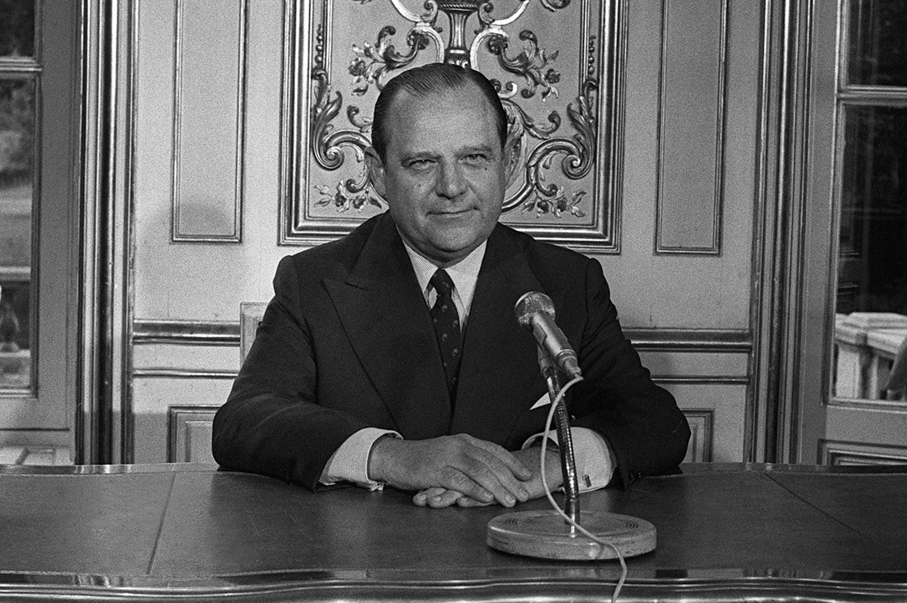

# 正文（1979年3月7日）

**讲座提要**

总的评论：（1）微观权力（micro-pouvoir）分析的方法论意义。（2）国家恐惧症的膨胀。它与秩序自由主义批判之间的联系—两种论点来看极权国家和20 世纪国家治理术（gouvernementalite d'Etat）的衰退—关于德国模式在法国和美国的传播的几点说明—德国的新自由主义模式与法国的“社会市场经济”规划——法国过渡到新自由主义经济的时代背景——法国的社会政策：以社会保障体系（securite sociale）为例—吉斯卡尔·德斯坦（Giscard d'Estaing）所认为的经济与社会之间的脱节—“负所得税”计划及其社会和政治重要性。“相对”贫困与“绝对”贫困。对充分就业政策的抛弃

## 一、方法论
### 1. 微观权力

请你们放心，不管怎样，我开始时真的打算给你们讲解生命政治，然后再讲一讲事情原原本本的样子；好了，我结束长时间地、可能过长时间地对自由主义以及德国形式的新自由主义的探讨。我这门课的定位发生了变化，仍然需要对此说明一下<a id="ref-1" href="#note-1">〔1〕</a>。如果我如此长时间地谈论新自由主义，或者说德国形式的新自由主义，很显然，原因并不是我想要描绘出德国基督教民主的历史的或理论的“背景”。如果说即使我就是这样做，也不是因为要揭露在勃兰特（Willy Brandt）或施密特（Helmut Schmidt）的政府中没有社会主义者。

如果我在新自由主义问题上停留的时间长了一点，首先是因方法原因，因为我想接上去年我曾讲过的，看一看我们能够给权力关系分析附上什么样的具体内容——当然，我再重复一遍，权力在任何情况下都不能被认为是一种自在原理，它也不能被看作一个一开始就起作用的说明性价值。权力这个词本身只是指各种全部要加以分析的关系（领域），而这些有待分析的全部关系就是我所称的治理术（gouvernementalite），也就是说，人们据以引导人类行为的方式只是为权力的这些关系提供一个具有分析框架的命题。

### 2. 治理术的分析尺度

因此，重要的是先要试用一下治理术这个概念，其次要弄清楚，我们设想的这个治理术的分析框架，在分析对疯人行为、病人行为、犯人行为和儿童行为的引导方式时，它何以是有效的；当涉及另一范围（echelle）的现象，比如政治经济，比如对社会整体等的管理时，这个治理术的分析框架是否同样有效。我所要做的——这就是分析的关键点——就是要弄明白在何种情况下，我们可以承认，对微观权力的分析或者对治理术各工序的分析，不是限于某个由范围区间所限定的领域，而是应该被当作一种对全部范围，不管其重要性如何，都能有效的观点（point de vue）和解读方法。换句话说，对微观权力的分析不是一个范围问题，不是区间问题，它是一个观点问题。好了，这就是我所说的方法原因。

## 二、国家恐惧症
### 1. 国家扩张

我之所以关注新自由主义的这些问题，还有第二个原因，我称之为一个具有道德批判的原因。实际上，从各种论题的循环来看，我们可以说，在当前被质疑的，并且基于极多境域被质疑的，几乎总是国家；国家及其不确定的发展，国家及其无所不在，国家及其官僚作风的增长，国家及其所包含的法西斯主义萌芽，国家及其符合神意的家长主义（paternalisme providentiel）形式下所固有的暴力……我认为在批判国家这整个论题中，有两个要素非常重要并且不断地出现。

首先是这样的一种观点：由于其特有的活力，国家自身具有一种扩张能力，一种寻求增长的内在趋势，一种内生的（endogene）帝国主义促使其不停地在面积上、在广度上、在深度上、在细度上扩展，直到完全控制住既是其他者、外部又是目标和对象的市民社会（societe civile）。因此，我觉得实际上贯穿于整个关于国家恐惧症的论题中的第一个要素，就是与其对象一目标即市民社会相比，国家所具有的这个内在固有的力量。

### 2. 国家形式的连续性

在我看来，在关于国家恐惧症的一般性论题中，我们所能不断发现的第二个要素就是，在不同的国家形式之间存在一种亲缘关系，一种遗传连续性、一种进化上的连带；行政国家、神权国家、官僚国家、法西斯国家、极权国家，所有这些形式在一些分析看来，都是同一棵树相继长出的具有连续性和统一性的各种分叉，而主千就是巨大的国家之树。以上两种观点是相近的，并且相互支撑———也就是说，首先，与其对象一目标即市民社会相比，国家具有无边无际的扩张力；其次，在国家特有活力的基础上，各种国家形式相继产生——这两种观点就是我们当前所经常看到的一类老生常谈的批判。然而在我看来，这些论题把某个批判性价值、某个批判性货币投人流通之中，我们可以称其膨胀主义的（inflationniste）。为什么是膨胀主义的呢？

### 3. 膨胀式批判

首先是因为我认为这种主题不停地迅速增大了各类分析的互换性。既然事实上人们同意国家的各种形式之间存在着连续性和遗传关系，既然我们认为国家具有稳定的进化动力，此时各种分析就不仅有可能相互支撑而且可以相互参照，因而每一种分析都失去了它的独特性。最终，比如，对社会保障体系和行政机构的分析，将通过几处变动以及玩弄几个词汇，而诉诸对集中营的分析上来。从社会保障体系到集中营，分析所必需的独特性被淡化了<a id="ref-2" href="#note-2">〔2〕</a>。因此，膨胀就是在这个意义上来说的：各种分析之间的互换性加大并且丧失了它们的独特性。

这个批判在我看来同样是膨胀主义的，还有第二个原因。第二个原因就是它可以使我们进行一种活动：我称之为一种用最坏的情况来进行普遍的贬低（disqualification generale par le pire），即在这样的意义上说，不顾分析对象是什么，不顾分析对象的细小差别和微妙之处，不顾分析对象的现实运转情况如何，在这样的意义上即人们总是能够以国家内在动力以及此种动力最终所采取的各种形式之名义，将国家归于最坏的东西；人们可以用更多来贬低更少，用最坏来贬低最好。当然我举的例子不是最好的，但是我们想象一下，比如在我们目前的体系中，一个倒霉蛋由于砸坏了电影院的玻璃窗而被起诉，并且受到了有点严重的判罚：我们总是会发现有些人声称此次判罚是国家法西斯化的表现，就好像在法西斯国家出现之前，甚至没有比这更坏的判罚一样。

在我看来，体现此类分析特点的第三个要素、第三个膨胀主义的机制，就是这些分析可以避免人们付出事实的和现实的代价，这实际上是在这样的意义上说的，即在国家的活力机制的名义下，人们总能找到亲缘关系或危险，总能找到某种类似于贪婪和妄想国家的巨大幻觉的东西。在这样的情况下，如何抓住现实，事实所呈现的现实性是什么样子，这些最终都不重要。只需要通过猜想的方式，或者如艾华德（Francoise Ewald）所说，通过“揭露”<a id="ref-3" href="#note-3">〔3〕</a>（denonciation）的方式，来发现国家的幻觉侧影，以便人们不再需要分析现实性。在我看来，现实性的省略（就是）人们在此类批判中所发现的第三个膨胀主义机制。

### 4. 批判的历史来源

最后，我要说，这种膨胀式的批判，这种从国家机制方面进行的批判，这种对国家活力机制的批判，并没有实施它自己的批判，也没有分析它自己。也就是说人们不去弄清楚此类反国家的猜疑、现在流传在我们各种思想形式中的国家恐惧症，它们真正是从何而来？然而在我看来这种类型的分析——正因为如此，我对1930—1950年间的新自由主义有所强调——这种对国家的批判，对无法抑制的国家内在活力机制的批判，对互相嵌人、互相要求、互相支撑、互相生成的各种国家形式的批判，在1930-1945年间就已经切实地、完全地、极其清晰地被表述出来并且具有非常确切的定位。在那个时代，此种批判还没有像如今一样具有流传力，它仅仅局限于当时正在明确表述的那些自由主义选择内部。你们看到在那些岁月里，对自由主义，或者新自由主义来说，或者更准确地说，对德国秩序自由主义来说，对多面的、无所不在的、万能的国家进行批判，其宗旨是既要摆脱凯恩斯式批判，又要展开对统制经济政策和干预主义政策的批判，比如像罗斯福新政和人民阵线（Front populaire），既要展开对民族社会主义经济和政治的批判，又要展开对苏联的经济和政治措施的批判，从一般意义上来说，也就是对社会主义的批判。正是在这种背景下，并且从最狭小形式或者最琐碎形式来看待事物，我们在德国新自由主义学派那里会发现对国家的不同形式之间必然的，甚至说不可避免的亲缘关系的分析，以及这样一种观念：国家自身所特有的活力机制使其永远不能停止其扩张和对整个市民社会的控制。

### 5. 罗普克与哈耶克

我只想举出两个文本来证明以上两个对我们来说是同时代的、鲜活的和现实的观念其实是早熟的。首先我将举出1943年6月—7月罗普克在一份瑞士杂志<a id="ref-4" href="#note-4">〔4〕</a>上发表的一篇回应，他在该文中批评了那时刚公布的贝弗里奇计划。他这样说：贝弗里奇计划总是会导致“更多的社会担保，更多的社会政府官员，更多的收入动荡，更多的票据要粘贴和印章要去盖，更多的分摊金和缴费，更多的权力集中化，更多的国民收入和责任落入国家手中，而后者不管怎样都总揽一切，指导一切，集中和控制一切，所带来的唯一确定的结果就是对社会施加一种更加集中化的作用，摧毁中产阶级，对社会实施一种无产阶级化和国家化”<a id="ref-5" href="#note-5">〔5〕</a>。

而正是在同一时期，也还是作为对英美，特别是对英国人那时正在建立的战后计划的回应，哈耶克于1943年用英语这样写道：“我们正面临着经历德国命运的危险。”<a id="ref-6" href="#note-6">〔6〕</a>他这样说不是由于英国面临德国人人侵的那些危险，那些危险在那个时候已经明确的不可能发生。在哈耶克看来，1943年经历德国的命运是指进入贝弗里奇体系当中，进入到社会化、统制经济、计划化和社会保障的体系之中。另外他还补充更正道：确切地说，我们不是接近于希特勒的德国，而是接近于另一场战争的德国<a id="ref-7" href="#note-7">〔7〕</a>。在后者中，人们想要“（保留）为了国家防御而建立起来的组织机构的诸多生产性目的”。人们拒绝“承认法西斯主义和纳粹主义的兴起不是对前个时期社会主义倾向的反击，而是社会主义倾向的必然结果”<a id="ref-8" href="#note-8">〔8〕</a>。因此，在谈到贝弗里奇计划时，哈耶克认为我们正接近德国——诚然，他指的是威廉时期的德国，也就是1914年战争时代的德国——但是实际上，正是德国以及它的统制经济实践，它的计划手段，它的社会主义选择才实际上产生了纳粹主义，因而我们接近1914-1918年的德国，也就同样接近了纳粹德国。德国入侵的各种危险远没有确切地避免。英国社会主义者、工党（Labour）、贝弗里奇计划：经由国家化的补充和增强，它们将成为英国纳粹化的真正动因。因此，你们看到所有这些议题都是旧有的、有确定位置的，我从它们在1945年形成的角度来提出这些议题。而它们早在1939年就出现了，在1933年甚至更早就出现了<a id="ref-9" href="#note-9">〔9〕</a>。

### 6. 极权国家与政党治理术

反对对国家所作膨胀主义的批判，反对这种类型的放纵主义，我想要提出几个论点，它们大致已经贯穿在我先前所说的一切之中，但是我想要明确一下。第一点，在我看来，神意国家、福利国家与极权国家、法西斯纳粹国家或斯大林国家既没有相同的形式也没有相同的根源。我同样要提示你们，人们所说的极权国家，其特征远不是国家机制内生的强化和扩张，所说的极权国家完全不是国家的狂热（exaltation），相反，它是对国家的自主性、特殊性及其自身功能的一种制约、弱化和控制——这与什么有关？与另外一种东西有关，即政党有关。

换言之，极权体制的本源，不应该从国家的内在发展及其机制方面来寻找；也就是说，极权国家不是18世纪的行政化国家和达到极致的19世纪的管治国家（Polizeistaat），它不是行政化国家，也不是达到极致的19世纪官僚化国家。极权国家是另外一种东西。不应该从17—18世纪出现的进行国家化（etatisant）或被国家化（etatise）的治理术中去寻找它的本源，而是应该从非国家的治理术方面，从我们可称之为政党的治理术方面来寻找。正是政党，正是这种非同寻常的、非常奇的、非常新颖的组织形式，正是在欧洲19世纪末期出现的非常新颖的政党治理术——不管怎样这也是明年我可能要讲的内容，如果我脑袋里一直装着一些相关想法的话<a id="ref-10" href="#note-10">〔10〕</a>——正是这种政党治理术才很可能是极权体制、纳粹主义、法西斯主义、斯大林主义这些东西的历史起源。

### 7. 国家治理术的弱化

我要提出的另一个观点（它与我刚才所言是互逆的）就是，我们当前的现实问题，不是国家和国家理性如此迅猛的强化，而是国家的弱化，这种弱化在我们20世纪的社会中以两种形式显现出来：其一，政党治理术的强化导致的国家治理术的弱化；其二，另一种形式的弱化就是人们在一些体制中，比如我们自己的体制中就能看到，人们在寻求一种自由主义治理术。

这里我很快要补充一下，我这样说并没有任何价值上的判断。谈论自由主义治理术，使用“自由主义的”一词，我并不想一开始就把这种类型的治理术神圣化或提高其价值。我也不是说，敌视国家就是不正当的。但是我认为所不应该做的就是，当我们指责国家化或法西斯化和国家暴力的创立时候，想当然地认为我们描绘了一个与我们相关的、真实的现实的活动。所有那些对国家怀有巨大恐惧之人，应该清楚地知道他们处在顺风方向中，并且实际上长久以来处处都表明了国家和国家化的实际弱化，以及进行国家化和被国家化的治理术的弱化。我完全不是说，当人们说“这很坏”或者“这很好”时，他们对国家的功绩或过错抱有幻想。这不是我的问题。

我要说的是，不应该错误地认为法西斯化进程是包含在国家内部的，法西斯化进程对国家而言是外生的<a id="ref-11" href="#note-11">〔11〕</a>（exogene），甚至它属于国家的弱化和解体。我同样想说的是不应该错误地认识那种如今使国家如此不堪容忍并且成为问题的历史进程的性质。正是出于以上原因，我想要进一步研究一下我们所称的德国模式的组织形式及其传播。当然现在我所要描述的以及向你们展示其传播形式的德国模式，并不是经常遭到贬低，排挤、羞辱和唾弃的、之后又转变为希特勒式的俾斯麦式国家。所传播的德国模式、所成问题的德国模式、属于我们现实性的一部分并构造出其结构和真实轮廓的德国模式，就是新自由主义治理术的可能性。

## 三、德国模式
### 1. 法国的传播

我们可以以两种方式来理解此种德国模式的传播。今天我试着从法国方面来看，如果我不改变主意的话，下次课可能将会从美国方面来看。在法国，我们所说的德国模式的传播是以缓慢、潜伏、刺耳的方式进行的，并且具有三种特征。

第一，不要忘记此种德国模式在法国传播的起点是我们可以称之为一种强烈地国家化的、统制化的和行政化的治理术，并伴随着所涉及的各种问题。

第二，德国的新自由主义模式是在危机背景下被引入法国并实施的，起初经济危机是相对有限的，而如今它变得尖锐；并且经济危机既是德国模式引入和实施的动机、借又和理由，同时又是制约它的动机、借又和理由。

最后，第三——由于我刚刚说过的那些原因，第三个特征就在那里——成为德国模式的传播和实施之人，确切地来说，就是国家的管理者和在危机背景下治理国家的人。那么，由于以上所有这些原因，德国模式在法国的实施包含着众多困难，并且就像一种混杂着虚假成分的沉闷，你们会看到它的一些相关例子。

### 2. 美国的传播

德国模式在美国的传播呈现出完全不同的风貌。首先，我们是否真正可以探讨德国模式在美国的传播？因为毕竟，自由主义、自由主义传统、自由主义政策的不断革新在美国一直都是存在的，这使得如今所出现的，或者曾经出现的对罗斯福新政的反击，并不必然就是德国模式的传播。人们同样可以将其归为一种完全美国自生的现象。关于诸多德国移民对美国的影响，比如像哈耶克这样的人对美国所产生的影响，还需要更多具体的研究要做。在围绕着弗赖堡那些人所形成的德国新自由主义模式和美国新自由主义之间，存在着众多可能难以理清的历史关联。

德国模式在美国的传播的第二个特征，就是前者同样在危机背景下发展起来，但是此危机与我们所熟悉的法国危机完全不同，因为虽然它也与经济危机有关，但却具有不同的形式并且无疑它没有法国那么尖锐。相反，在美国的德国模式是在政治危机中发展起来的，即与联邦政府的影响、行为和干预问题以及政治信誉度等问题有关，这些问题自罗斯福新政起已经出现了，更何况约翰逊、尼克松<a id="ref-12" href="#note-12">〔12〕</a>、卡特<a id="ref-13" href="#note-13">〔13〕</a>时期。

最后，新自由主义在美国的传播的第三个特征是，新自由主义治理术并不是像法国的情况那样——某种程度上它几乎是政府内阁成员及其顾问的专利，而是至少部分地呈现出类似一种经济-政治的巨大交替，后者在某一特殊时刻表现为政治上的对立运动，而它如果不是全部那至少也是大面积地散播到美国社会之中。所有这些使得把德国模式在法国和在美国的传播相提并论是完全不可能的。两种现象并不相互包含、相互重叠，即使从一方到另一方自然存在着一个相互交流和支持的系统也是如此。

### 3. 社会市场经济






因此，今天我想讲一下德国模式的新自由主义在法国的情况。说实话，我曾经很长时间感到为难，因为坦率地说，如果没有很明白地理解而只是简单地直觉到介于吉斯卡尔、巴尔（Barre）<a id="ref-14" href="#note-14">〔14〕</a>或其顾问们的所言与德国模式、德国秩序自由主义、罗普克观点、阿尔马克观点之间的一种亲缘关系，我觉得就不可能恰当地读懂（因为必须去读）吉斯卡尔或者巴尔的文章、著作和讲演。然而，难以简单地找到识别行使我们可以宣称：看，他们所做的就是这样并且他们懂得他们的所作所为。这是非常困难的，一直到最近，几乎是最近几个星期，一直如此。

就在1978年底，我想是在1978年的12月，史多法艾斯（Christian Stoffaes）出版了一本书叫做《巨大的工业威胁》<a id="ref-15" href="#note-15">〔15〕</a>（La Grande Menace industrielle）。史多法艾斯是与当今政府关系最亲密的顾问之一、专长于工业问题的经济顾问<a id="ref-16" href="#note-16">〔16〕</a>。我对自己说，在书中我可能最终会找到所要的东西，然而我立刻感到失望，因为在书背面的介绍中这样写道：“作者抛弃了过早地转移到德国模式和日本模式的尝试，提出一种原创性的工业政策的基础。”<a id="ref-17" href="#note-17">〔17〕</a>我告诉自己，这一次我又没能找到所想要的。如果说一些东西没有讲出来的原因出现在书的封底是很有趣、很有含义的话，那么相反，在书中总结全部分析的结论部分中，我想应该是最后一段或者倒数第二段，作者这样概括书中之前所述：“最终这有点涉及社会市场经济（I'economie sociale de marche）的模式”一终于说出了这个词——作者又补充道，“只需比德国更多一点改革的勇气。”<a id="ref-18" href="#note-18">〔18〕</a>实际上，重要的是，一方面既要建立一种有效的、向世界开放的市场经济，另一方面又要建立一个超前的社会规划<a id="ref-19" href="#note-19">〔19〕</a>。

## 四、法国经济政策
### 1. 政策目标

我的问题不是要对吉斯卡尔的政策<a id="ref-20" href="#note-20">〔20〕</a>或者说吉斯卡尔-巴尔（Giscard-Barre）的政策做全面的、整体的分析，一方面因为我无法胜任，第二是因为你们可能对此也没有兴趣。我只是想拿出某几个方面来看。

首先，为了将事情重新归于其背景当中，我要讲一下关于经济背景的情况，这个背景加速了德国模式的引入和实施。让我们很粗略地来看一下。我们说在20世纪30年代的大危机之后，不管何种类型的政府，不管所做选择的本质是什么，不管这些决策的目标是什么，他们都清楚地知道必须要重视的一些经济因素就是充分就业、价格稳定、收支平衡、PNB（国内生产总值）的增长、收益和财富的再分配以及提供社会福利。边沁用他自己的语言将上述一览表称之为政府的经济议程（agenda economiques），它就是政府所要操心的东西，而不管操心的方式如何<a id="ref-21" href="#note-21">〔21〕</a>。

我们说，在这一系列的目标中，德国新自由主义或秩序自由主义所做的选择是把价格稳定和收支平衡列为首要目标，从某种程度来说，经济增长以及所有其他因素都是这两个首要和绝对目标的结果。英国和法国也都做出了相应的选择——法国的选择是在人民阵线时期以及解放（Liberation）之后做出的，而英国是在贝弗里奇计划和1945年工党胜利那段时间里做出了选择——与德国相反，法国和英国所选择的首要和绝对的目标不是稳定价格而是充分就业，不是收支平衡而是提供社会福利；因此，为了使提供社会福利和充分就业这两者得到保证，这明显包含了一种唯意愿的（volontariste）经济增长，一种被推动的经济增长，一种强有力的和持续的经济增长。

### 2. 危机与市场化

让我们把这个问题放到一边：即为什么英国所实施的目标在1955年—1975年间失败了，或者说显露出严重的局限性；为什么相反在法国，同样的政策却带来了正面结果，这并不重要。我们说它构成了以下最初形势的原因：即使在戴高乐体制下，伴随着诸多自由主义类型的缓和措施，大体上我们仍维持着以充分就业和社会福利的分配为中心的统制主义目标、计划主义方法及计划主义程序，第五个计划（Ve Plan）最清晰地表明了这一状况<a id="ref-22" href="#note-22">〔22〕</a>。

简单地说，正是在1970一1975年间，也就是最近十年，法国才出现了对这些目标和经济-政治优先形式的最终清算。正是在这十年中，才出现了全面过渡到新自由主义经济、追赶德国以及德国模式的植入等问题。经济上的各种理由和借口以及当下采取的经济刺激，无疑都说明了这样一场危机，大体上可以说它就是1973年之前出现的那场前期危机（pre- crise），其表现特征为：从1969年开始，出现了失业人数的不断增长，收支平衡中贷方差额的波动以及通货膨胀的增长：所有这些迹象，在经济学家看来，表明的不是一种凯恩斯式的危机，即消费不足，而是一种现实中的投资机制的危机。这就是说，大体上人们认为这场前期危机应该归于错误的投资政策，归于不够合理以及不够有计划性的投资决策。

在这场前期危机的基础之上，出现了1973年的那场危机，即我们所称的石油危机，后者实际上就是能源价格的飞涨，而能源价格的飞涨完全不是由于卖方成立卡特尔联合企业并强加一个过高的价格，相反，它只是削弱了买方卡特尔联合企业在经济和政治上的影响并且建立起石油的市场价格，即能源的市场价格，或者说归根结底只是把能源价格趋势与市场价格连接起来。

因而，我们可以清楚地看到，在这一背景下（请原谅我的这些完全概括式的说明），经济自由主义为什么能成并且已切实有效地成为解决这场前期危机以及能源价格飞涨带来的危机加剧的唯一可能途径。自由主义，就是要把法国经济全部地、无条件地纳入国内的、欧洲的、世界的市场经济当中：这个决策，首先成为了唯一方法能纠正先前一个时期由于一系列的统制目标、统制手段等而做出的错误的投资决策；于是，这个决策便成为能够纠正投资错误并顾及能源价格昂贵新情况的唯一途径，而能源价格的昂贵只不过是要建立起能源的市场价格。因而，一方面为了纠正投资错误，另一方面为了调整法国经济以适应新的能源价格，法国经济全面地进入到市场中就显得是顺理成章了。

### 3. 政策转向

你们会同我说，毕竟，第一次世界大战之后起，或者说从1920年起，在法国存在着以下两方面之间各种经常性的、有时是很短暂的变动：一边是一种干预主义、统制主义、保护主义的政策，关心总体平衡以及充分就业；另一边是一种向外部世界敞开的自由主义政策，关心市场交换和货币；而以上所言只是其中的一种情况。在1951—1952年间的皮奈（Pinay）政府<a id="ref-23" href="#note-23">〔23〕</a>中和在1958年吕埃夫（Rueff）改革<a id="ref-24" href="#note-24">〔24〕</a>中所表现出来的各种变动，同样也反映了向自由主义的转变。

然而，在我看来，当下的问题以及利用经济危机（我已经简短地分析过后者的各个方面）充当其借口的那个东西，并不简单地是这些变动中的一个趋向于多一点的自由主义以反对少一点的统制主义。事实上，我认为，当下成问题的就是全面新自由主义政策的整个关键点。由于这一次仍然不打算从各个方面来对这一政策做说明，我只想取其中一个方面，它与严格意义上的经济无关，与法国经济直接和迅速地进入到全球市场经济之问题无关。

我想从另外一个方面来看（这个政策），即社会政策方面。当前，吉斯卡尔的上台及其政策都潜在地暗含了一种现时的治理术，在当前这种治理术下，在目前的政府下，社会政策是什么样的，可能是什么样的，它会朝什么方向转变？这是我现在要对你们讲的。

## 五、社会保障
### 1. 充分就业与国家连带责任

这里，再简短地讲两句历史：在战争期间已经规划出来、解放后不久被界定下来的那种社会政策，在法国和英国，是通过两个问题和一种模式显现出来的。

这两个问题是：首先，保持把充分就业作为经济和社会的优先目标，因为人们把1929年的经济危机归于没有实现充分就业。人们同样将在德国和欧洲出现的所有政治后果都归于后者。因此，出于经济的、社会的以及由此而来的政策上的原因，必须要保持充分就业。

其次，避免因经济增长政策所必然导致的货币贬值之结果。正是为了保持充分就业，为了减轻货币贬值使储蓄和个人积蓄无用，人们才认为应该实施一种风险的社会担保政策。

实现这两个目标的手段就是一种战争模式，即国家连带责任（solidarite nationale）的模式，其意思是，不去问事情为何会发生在他们身上，也不问他们隶属于哪一个经济阶层。发生在个人身上的亏损（deficit）、事故和不测风云，无论如何应该由整个集体以国家连带责任的名义对此负责。

正是这两个目标和一个模式，解释了为什么英国的和法国的各种社会政策是集体消费政策，这些政策通过收益的不断再分配来确保；不断再分配以及集体消费应该涵盖全部人口，只是优先考虑几个方面罢了。在法国，由于鼓励生育政策，家庭被认为是更应该特别优先考虑的方面之一，但总体来看，人们认为整个集体应该对个人的不测进行补偿。从人们确定了这些目标，选择了这种运作模式这一刻起，问题就出现了：要弄清楚这样一种社会政策是否同时不成为一种经济政策。换句话说，人们是否将有意或无意地带来一系列经济后果，这些后果可能给经济自身造成意料之外的和一些反常的后果，并由此破坏了经济系统和社会系统自身的规则？

### 2. 社会保障的经济作用

关于这个问题，出现过多种回答。

一些人回答是肯定的。那样一种政策当然会产生诸多经济后果，但是人们所寻找的正是这些结果。也就是说，收益再分配，以及收益和消费的平等正是我们所寻求的，并且社会政策在经济体制内部引入了一些修正和均等，而这些是自由主义政策本身以及各种经济机制自身所无法确保的，只有在这种情况下，社会政策才具有真正的意义。



另一些人则做出否定的回答：我们打算实施的，或者从 1945年起已经实施的那种社会政策<a id="ref-25" href="#note-25">〔25〕</a>对经济没有任何直接影响，或者它只是与各种经济机制相配合、相一致而没有能力扰乱它们。非常有意思的是，我们看到拉罗格<a id="ref-26" href="#note-26">〔26〕</a>（Laroque），他不是法国社会保障体系的发明者，却构想出了它的组织形式和机制，1947年还是1948年<a id="ref-27" href="#note-27">〔27〕</a>，我记不清了，他在一篇文章中解释了社会保障体系并证明了其合理性。

在社会保障体系被付诸实施的时候，他说：大家不要担心，实施社会保障体系不是为了具有经济后果，并且它也不能具有经济后果，它只能具有有益的结果<a id="ref-28" href="#note-28">〔28〕</a>。他这样来定义社会保障体系：它只是一种手段以使得“任何状况下，每个人以及由他所负担的那些人的生计得到保障”<a id="ref-29" href="#note-29">〔29〕</a>。确保他的生计以及他所负担之人的生计，这是什么意思？这只是说，将会建立起这样一种机制：仅仅从工资中抽取一部分社会开支，换句话说，人们在以现金货币支付的真实工资之中增加一种虚拟工资，真正地来看，它不是一种增加，而事实上是把全部工资分成两部分：一部分被认为是严格意义上的工资，另一部分则是社会保障金。换言之，正是工资自身和工资总量（masse salariale）支付了社会开支，而不是任何其他东西。这不是为了领工资者而向无工资者征收的一种连带税，这是为了他们自己的好处，用拉罗格的话说，“这是为了他们的子女和老人的好处而向全体领工资者所征收的连带税”<a id="ref-30" href="#note-30">〔30〕</a>。

由此我们不能说社会保障体系会加重经济负担，会拖累经济，会提高经济成本。事实上，社会保障只是某种支付某物的方式，这个某物就是工资，社会保障不会加重经济的负担。更好地是，从根本上，它不会导致工资的提升，因而会减轻经济开支、平息社会冲突，并且它使得对工资的要求不那么尖锐、不那么凸显。这些就是在1947年、1948年拉罗格对由他自己制定的社会保障机制作出的解释<a id="ref-31" href="#note-31">〔31〕</a>。

### 3. 1976年的评估

三十年之后，也就是1976 年，《法国社会事务杂志》（Reue francaise des affaires sociales）发表了一篇值得关注的报告，因为它是由ENA的学生们完成的，内容是对三十年社会保障体系的研究进行总结<a id="ref-32" href="#note-32">〔32〕</a>。

这些 ENA学生的看法是这样的：第一，他们认，社会保障体系具有重大的经济影响，这些影响与分摊金（cotisation）基数得以确定的方式相联系。其实，这是因为对劳动成本产生了影响。由于社会保障体系，劳动变得更昂贵。劳动成本越高，很显然它对就业会产生限制影响，因而劳动成本的提升直接会带来失业率的增长<a id="ref-33" href="#note-33">〔33〕</a>。它（同样）对国际竞争产生影响，因为不同国家的保障体制的差异会使得国际竞争走样，并且会损坏到社会保障更完善的那些国家，也就是说这又会加速失业率的增长<a id="ref-34" href="#note-34">〔34〕</a>。反正，总是由于劳动成本的提升，使得工业集中、垄断形式的发展以及多国公司的发展都将会加速。因此，他们认为保障政策产生了明显的经济影响。

第二，由于劳动成本的变化，不仅仅出现了以上各种经济后果并且导致了失业率的增长，而且还出现了分摊金得以封顶的方式，也就是说分摊金的各种比例之间得以区别的方式，这种差别会影响到收益的分配<a id="ref-35" href="#note-35">〔35〕</a>。根据已经做过的诸多调查，ENA的学生们证明了从青年人到老年人，从单身之人到有家庭负担之人，从身体健康之人到患有疾病之人（并不是以相同的报酬来重新分配）；而实际上，由于分摊金的封顶，会允许一种真实收入的幅度差，这使得最富之人受益，最穷之人受损。因此，他们说社会保障体系，其三十年的运转带来了某些严格意义上的经济之影响。然而，“社会保障体系的目标不具有也不应该具有经济性质。它的各种筹资方式不应该成为经济政策的某种因素从而破坏市场规律。社会保障体系在经济上应该保持中立客观”<a id="ref-36" href="#note-36">〔36〕</a>。这里，你们会发现几乎与我上次课（或者是半个月前，我记不清了）所讲内容逐字对应的东西，即德国秩序自由主义者所理解的那种社会政策<a id="ref-37" href="#note-37">〔37〕</a>。

### 4. 经济与社会的分离

然而，从经济视角看社会政策的效果完全中立这个想法，在新自由主义模式植入法国的初期，也就是1972年，就已经由当时的财政部长吉斯卡尔·德斯坦明确提出来了<a id="ref-38" href="#note-38">〔38〕</a>。在1972年的谈话中［在由史多雷鲁（Stoleru）组织的一次会议上］<a id="ref-39" href="#note-39">〔39〕</a>，他这样说：所有现代国家的经济功能是什么？首先是收入的相对再分配；其次，以产生集体福利的形式进行补助；第三，调节经济活动确保经济增长和充分就业<a id="ref-40" href="#note-40">〔40〕</a>。这些都是法国经济政策的传统目标，在那个时期还没有人对此有异议。然而，他所提出异议的是，国家以三种经济功能作关联：再分配、补助、调节。

他强调说，事实上法国财政预算以这样一种方式构成，即用于建设高速公路的数额与用于单纯的社会补助的数额最终能够完全相等<a id="ref-41" href="#note-41">〔41〕</a>。可是他认为，这是无法容忍的。“在一项健全的政策中，与经济发展需要相对应的东西与相互支援（solidarite）和社会公平的关切相对应的东西应该完全分离。”<a id="ref-42" href="#note-42">〔42〕</a>换句话说，应该存在两个尽可能互不渗透的系统，与这两个系统相对应，同样应该有两种完全不同的税，即经济税收和社会税收<a id="ref-43" href="#note-43">〔43〕</a>。在这种原则断言之下，你们再一次会发现以下重要观念：经济应该具有自己的规则，社会应该具有属于它的目标，应该以以下的方式使两者脱节，即经济活动不被社会机制扰乱或损害，而且社会机制要保持一种限制性，差不多一种单纯性，就好像它永远不会作为扰乱介入到经济活动自身中去。

### 5. 经济游戏与非排除规则

接下来的问题是：我们如何能够在经济和社会之间实施同样的分离？我们如何使它们脱节？这里，根据吉斯卡尔的文本，可以清楚地看出他想说的。他求助于我之前讲到过的一个原则，那个在德国秩序自由主义、美国新自由主义和法国新自由主义中都能找到的共同原则，即经济从本质上来看是一场游戏，经济的发展就像搭档之间的游戏，并且这个经济游戏应该完全贯穿于社会之中，国家的根本功能是界定这些经济游戏规则并且保证这些规则得到切实有效地应用。这些规则是什么样的？它们应该使经济游戏尽可能地活跃，因而使尽可能多的人受益，并且只通过——经济和社会的接触面正是在这里，但两者又不真正互相渗透——一条规则，在某种程度上，它是一条在游戏中几乎是附加的和无条件的规则，即不可能出现经济游戏搭档的一方完全输光并因此无法再继续游戏。这个保证游戏者安全的条款，这个限制性规则不会改变游戏的任何进展，但却防止某个人完全跌倒并最终出局。

这是一种反向的社会契约，也就是说，在社会契约中，那些潜在地或现实地愿意签署社会契约之人，都属于社会的一分子，直到他们退出契约。**在经济游戏观念中有这样的意思：没有人一开始就一心想要加入经济游戏中，因此，正是社会以及国家所规定的游戏规则使得每个人都不被排除在游戏之外，每个人被游戏捕获却从未明确地想要加入进去。**

这样的想法，即经济是一场游戏，存在着各种由国家保证的经济游戏规则，经济和社会之间唯一的接触点就是不排除任何游戏者这个安全规则，吉斯卡尔用有点隐含的方式表达了这些想法，但不管怎样，在我看来，他在1972年的文章中足够清晰地表达：“市场经济的特征是，存在着各种游戏规则使得可以采取一些权力下放、分散布局的决策并且这些规则对所有人都是一样的。”<a id="ref-44" href="#note-44">〔44〕</a>在生产竞争规则和个人保护规则之间必须设立一种“特殊游戏”以使得每个游戏者不会输得精光<a id="ref-45" href="#note-45">〔45〕</a>。他所说的“特殊游戏”也许称为“特殊规则”更好些。然而，必须存在一种不排除（non-exclusion）规则，并且社会规范功能、社会调节功能、广泛意义上的社会保障功能应该纯粹简单地来确保一个非排除的经济游戏（该游戏除此之外应该凭自身展开）的想法，正被应用到了一系列或多或少明晰的措施中，或者无论如何在那些措施中被勾勒出来了。

## 六、负所得税
### 1. 计划与机制

我想简单地（既因时间有限，也是因为不想引起你们的厌倦）向你们说明一下上面所述的含义，不是（始于）那些所切实采取的措施，况且这些措施由于危机加剧的原因也没能贯彻到底，没能构成一个结构紧密的整体；（而是以）一个从1974年以来多次出现的计划为例，这就是负所得税（impot negative）计划。

事实上，当吉斯卡尔在1972年的那篇文章中说，应该使每个人都不会输得精光，这时候他脑袋里已经有了负所得税这个想法。负所得税，不是法国新自由主义的一个想法，它是美国新自由主义的想法（下次课我可能会给你们讲一下），这一想法得到了吉斯卡尔周围一些人的重新采纳，比如史多雷鲁<a id="ref-46" href="#note-46">〔46〕</a>和史多法艾斯（Stoffaes）（我刚才已谈到过他们），并且在1974年或 1975年<a id="ref-47" href="#note-47">〔47〕</a>，关于第七个计划（MIePlan）的预备性讨论中，史多法艾斯对负所得税有整个报告<a id="ref-48" href="#note-48">〔48〕</a>。

负所得税是什么？概括地、简单地来说，负所得税是一种社会救助金，为了在社会层面变得有效并且不会扰乱经济层面，它应该尽最大可能地不采取集体消费的形式，因为负所得税的支持者说，集体消费的经验证实那些最富有之人通过更少地出资最终从中受益。由此，如果想要社会救助金行之有效并且不对经济产生消极影响，只需要通过一种现金补助方式来代替所有这些全局出资，代替所有这些多少是局部的补助，现金补助确保了不管是永久达不到还是暂时达不到必要基准（seuil）的那些人拥有一些额外收入。清楚一点说，没有必要让最富有之人有可能性加入到卫生健康的集体消费中，他们完全能够确保自己的卫生健康。相反，在社会中有一类人群，要么永久地——因为他们是老年人或残疾人；要么暂时地因为他们没有工作，他们是失业者，不能达到社会所认为的一个合适的消费基准。因此，正是对这些人，并且只为了他们的利益而分配具有社会政策特征的补偿金和保险金。因此，低于某种收入水平，我们将支付一个补充部分，当然我们哪怕抛弃了这种想法，即每个成员要对社会的卫生健康服务或教育服务做出贡献；同样也就——毫无疑问这一点最重要——哪怕在穷人与富人之间、在接受救济者与不接受救济者之间重新引入一种失衡。

### 2. 工作激励

显然，这个负所得税计划没有我刚才所说的那个严重方面，特别是在法国，它的表现形式也没有你们想象的那么简单。事实上，负所得税作给那些收入不足以确保某种消费水平之人的补助，史多雷鲁和史多法艾斯把它看得相对复杂一些，尤其它应该使得人们不会把这笔额外的补助金当作生活的手段而使得他们逃避去寻找工作，逃避重新进入经济游戏当中。那么，所有一系列的调节和渐进，使得个体通过负所得税，一方面能确保某一消费水准，另一方面，又有足够的动机，或者可以说足够的失落感使得他仍然怀有工作的意愿，使得他更愿意工作而不是接受补助<a id="ref-49" href="#note-49">〔49〕</a>。

### 3. 贫困的原因与后果

让我们撇开所有这些细节，尽管它们很重要。我想要简单地说明一些事情。首先，负所得税构想清楚地以追求缓和为目的，它所要缓和的是什么？是缓和贫困的后果并且只是缓和这个结果。也就是说，负所得税的目标不是去寻求改变贫困的这样或那样的原因，负所得税从来不是在贫困的规定性层面上运转，而只是在它的结果层面上运转。这就是史多雷鲁说“对一部分人来说，贫困的原因（causes）应当成为他们被社会救助的理由”这句话时所要表达的意思。因此，救助所要补偿和应对的是：疾病、意外、无能力工作和不可能找到工作。也就是说，在这种传统视角下，我们给予某人以救助就必须要询问他为什么需要救助并因而寻求改变他为何需要救助的原因。“对另一部分人来说”，即享受负所得税的那些人来说，“贫困的结果（effets）才是他们被社会救助的唯一理由：史多雷鲁说，是人都有一些基本需要，如果他不能通过自己而得到，那么社会应当帮助他得到”<a id="ref-50" href="#note-50">〔50〕</a>。

这样看来，西方治理术如此长时间所寻求建立的那种众所周知的区分：好穷人与坏穷人的区分、自愿不工作之人与出于非自愿原因无工作之人的区分，几乎不太重要了。毕竟，我们不在乎并且也应该不在乎知道为什么人们跌落到社会游戏水平之下，不管他们是瘾君子还是故意失业者，人们对此完全不在乎。唯一要弄明白的问题就是，不管由于何种原因，他们处于基准之上还是基准之下。唯一重要的事情就是个体已经跌落到某种水平之下，在这个时候不要去管下一步，不要去展开官僚主义的、治安的、法官审理的调查，而是要给予其补助，通过补助机制，我们仍然激励他重新越过基准并且通过接受救助，他有足够的意愿无论如何要超越到基准之上。但是如果他无此意愿，反正也没有关系，他仍会处于救助中。这就是第一点，在我看来，与几个世纪以来由西方社会政策所制定的一切相比，这第一点是非常重要的。

### 4. 相对贫困与绝对贫困

第二点，你们看到，负所得税是用来绝对避免社会政策中所能具有的收入总体再分配后果的一种方法，也就是避免大致受到社会主义政策影响的所有东西的一种方法。如果我们把社会主义政策称为“相对”贫困政策，即倾向于改变不同收入之间的差距的一种政策；如果我们把社会主义政策理解为，试图减轻由最富之人与最穷之人的收入差距所导致的相对贫困的后果的一种政策，那么很显然，负所得税所隐含的这种政策是完全与社会主义政策相反的。相对贫困完全不在社会政策的目标之列。唯一的问题就是“绝对”贫困，也就是说，人们认为在该基准之下的那些人没有适当的收入能够确保他们足够的消费。<a id="ref-51" href="#note-51">〔51〕</a>

这里我想要做一两点说明，我们自然不应该把绝对贫困理解为一种对全人类都有效的基准。这种绝对贫困是相对于社会来说的，有一些社会的绝对贫困基准相对地高一些，而对另一些全盘贫困的社会来说，它的绝对贫困基准就要更低一些。因此，绝对贫困是一种相对基准。第二点，你们看到——这是一个重要结果——人们又重新引入了穷人和贫困这样的范畴，而后者正是二战后，所有社会政策，准确地说，所有福利政策，所有19世纪末起出现的或多或少带有社会主义化倾向或被社会主义化的政策都试图将其消除的东西。德国的社会主义类型的国家政策、庇古（Pigou）所规划的福利政策<a id="ref-52" href="#note-52">〔52〕</a>、罗斯福新政、二战后的法国和英国的社会政策：所有这些政策都不想确认穷人范畴，都想要通过经济干预以确保在人口内部不会出现穷人与不太穷之人的区分。政策总是在相对贫困的扇面（eventail）中，总是在他们之间收入的再分配中，总是在最富之人与最穷之人间的差距中确定自己的位置。但是与之相反，这里，将会出现一种政策界定出的某种基准，它仍然是相对的，但对某个社会来说，它是一种绝对基准，它把穷人和非穷人，把接受救济之人与不接受救济之人区分开来。

### 5. 最低保障与人口储备

这种负所得税的第三个特征是，在某种程度上它保证了总体安全，但是在最低层面上的安全，也就是说在社会的整个其余部分，我们任由经济游戏机制、竞争机制、企业机制去运转。在基准之上，每个人为他自己也好，为其家庭也好，在某种程度上他必须成为一个企业。在基准之上，一个以企业或竞争性企业为模式的社会是有可能形成的，并且将会有一种最低安全，即通过始于在底层设置某个基准来抵消一定数量的风险。

这就是说，从经济下限来看，我们将看到一种人口，将会在以下两种援助之间出现一种永久流动的人口：如果发生一些不测风云或者跌入基准以下，那就作出援助，如果相反，经济需要使之必须并且经济可能性又为之提供机遇，那就会作出既已被利用又是可利用的援助。因此，这是一种摇摆于起始之下与起始之上之间的人口，一种起始人口（population liminaire），对一种已放弃充分就业目标的经济来说，这种起始人口构成人力资源的永久储备，如果需要的话，可以取出它们，但如果同样需要的话，也可以重新将其退回到接受救济的地位中去。

### 6. 充分就业政策的放弃

因此，凭着上述体系——再说一遍，由于某种原因它并没有被应用，但是在某种程度上，你们可以清楚地从中看出目前吉斯卡尔与巴尔的时局政策的轮廓——就可构建出一种经济政策，它不再以充分就业为中心，并且如果它要想融入全面的市场经济之中，它只有放弃这个充分就业目标，放弃它作为一种唯意愿的经济增长的主要工具。因此，人们为了融入一种市场经济中去，人们就必须抛弃所有这些。但是这还包含一个流动人口的储备（fonds）、一个起始的、起始之上的或起始之下的人又的储备；在该储备中，保险机制使得每个人以某种方式生存下去，以这样的方式生存下去，即如果市场条件要求他的话，他总是可以作为可能出现的求职者。这与18世纪和19世纪的资本主义在把农村人又变成人力资源的永久储备时所建立和发展起来的体系完全不同。如今经济的运转不同了，农村人口不再能保证一种人力资源的永久储备，从这时候起，必须依据另外一种模式来建立储备。这种完全不同的模式，就是被救济人口的储备，这是依据一个实际上很自由的模式而被救济，与以充分就业为中心并且实行社会保障机制的体系相比，它的官僚作风与惩戒性质要少得多。最终，我们给予人们想工作或不想工作的可能性。如果我们无意让他们去工作，就要提供可能性让他们不去工作。我们只是保证他们在某一基准上的最低生存可能，而且也正是这样，这个新自由主义政策才能够运作。

然而，这样一个计划只是我关于秩序自由主义所已讲过的那些一般性议题的极端化表现，而那时德国秩序自由主义者们已经这样进行了解释：一种社会政策的主要目标一定不是重新顾及可能发生在全体人口身上的意外事件，一种真正的社会政策应该不去触碰经济游戏，并且因此任由社会像一种企业社会那样去发展，设置一些干预机制以便在他们需要之时，并且只在需要之时去救济他们。

## 编者注释

<a id="note-1" href="#ref-1">〔1〕</a> 参见上文，1979年1月10 日课程，第28页，注17。

<a id="note-2" href="#ref-2">〔2〕</a> 在1977年11月与勒福尔（R. Lefort）的一次访谈中，福柯已经用相近的词语表达了对于这一主题的想法（参见《安全、领土与人口》，“课程概要”，第385页），把国家的法西斯化这个论据与“安全社会”所提出的现实问题的分析进行比较（参见“米歇尔·福柯：安全与国家”，《言与文》，第3卷，第213篇，第387 页）。

<a id="note-3" href="#ref-3">〔3〕</a> 在一次会谈中，艾华德（Ewald），福柯在法兰西学院的助手，把揭露（denonciation）与控诉（accusation）区分开来，前者离不开所揭露的原则，因此注定仍然是抽象的，而后者指明道姓地针对个人，因此它不仅仅涉及进行控诉之人（艾华德所告知的信息）。

<a id="note-4" href="#ref-4">〔4〕</a> 参见 W.Ropke：《贝弗里奇计划》（“Das Beveridgeplan”），引文（上文，第131页，注39）。

<a id="note-5" href="#ref-5">〔5〕</a> 事实上，这句话出自 Civitas Humana，法译、引用（上文，第128页，注21），第239页。在笔记中，福柯注意到上述文章中所阐发的一种“更详细的批判”，但是没有直接参阅此文章。在其著作中，从第226—243页，罗普克致力于对贝弗里奇计划的批判，并且在第245页的注释中特别指出：“关于这个主题，我已经扩展了很多，但是对于这个问题，首先我们还应该参考一下天主教社会学家的优秀著作（从前在德国、现今在美国公开表述）：Goetz Briefs：《无产阶级》（The Proletariat），New York, 1937。”

<a id="note-6" href="#ref-6">〔6〕</a> F.哈耶克：《奴役之路》（The Road to Serfdom），同前书/法译、引用，导言，第10页。

<a id="note-7" href="#ref-7">〔7〕</a> 法译、引用，同上，“我们的国家并非与希特勒德国，也就是目前这场战争中的德国有任何相似之处。但是，研究思潮的人们很难对此视而不见，即在上一次战争期间及战后的德国思潮与目前我们国家的思潮之间存在着并非只是表面上的相似性。现今，在英国，如同在不久以前的德国，肯定存在着同样的决断，要把出于国家防卫目的而建立的国家体制保留下来用于生产创造。”

<a id="note-8" href="#ref-8">〔8〕</a> 同上，第11页：“很少有人倾向于承认法西斯主义和纳粹主义的成长不是一种对先前时期的社会主义趋势的对抗，而是这些趋势不可避免的结果。”

<a id="note-9" href="#ref-9">〔9〕</a> 参见上文，1979年2月7日课程，第114页，罗普克在1943年所提出的相同论据。

<a id="note-10" href="#ref-10">〔10〕</a> 在1980年，福柯事实上转到另外一个方向，因为想要重新与1978年的课程主题联系起来，1980年的课程（《对活人的治理》）致力于探讨原始基督教主义中反省问题和忏悔问题。参见“课程概要”，《言与文》，第4卷，第289篇，第125—129页。

<a id="note-11" href="#ref-11">〔11〕</a> 这曾是无产阶级左派活动分子所主张的论点。参见《现代》310号乙：《新法西斯主义，新民主》（Les Temps Modernes 310 bis: Nouveau fascisme,Nouwelle Dernocratie, 1972）。但是福柯所特别注意到的是正在发生的对德国恐怖主义的争论。在德国资方联合会主席施莱尔（Schleyer）被刺杀之后，警察对“红军支队”（RAF）的镇压更加严酷。几天之后，巴德尔（Baader）以及几个一同关押的人死在斯图加特的施塔海姆监狱的牢房内。官方所称的死亡原因——自杀引起了巨大争议。红军支队的律师克劳斯·可桑（Klaus Croissant）被威胁从法国引渡回国。福柯在对可桑予以坚决支持的同时［参见“我们要引渡可桑吗？”（“Va-t-on extrader Klaus Croissant？”）］，（《言与文》第3卷，第210篇，第361—365页，在这篇文章中，）他可能第一次从理论上探讨了“被治理者的权利，（后者）比人权更明确，更具有历史确定性”（第362页），又与认为施密特的德是法西斯国家，支持恐怖主义斗争的那些人撇清关系。关于福柯对“德国问题”的态度，参见《安全、领士与人口》，“课程概要”，第386—387页。

<a id="note-12" href="#ref-12">〔12〕</a> 理查德·尼克松（1913—1994），1968年至1974年任美国总统。

<a id="note-13" href="#ref-13">〔13〕</a> 詹姆斯 ·厄尔（又称杰米）·卡特（生于1924年），1976年至1980年任美国总统。

<a id="note-14" href="#ref-14">〔14〕</a> 雷蒙·巴尔（生于1924年），经济学教授，曾任工业部（部长为Jean-Marcel Jeanneney）办公室主任，1967年7月至1972年任布鲁塞尔欧盟委员会专员。1976年8月至1981年5月任国务总理，并兼任经济和财政部长（1976年8月至1978年4月）。1976年9月22日，他提出了一个紧缩计划，又称“巴尔计划”，来对抗随着1974年经济危机所出现的滞涨现象（经济增长缓慢，而通货膨胀加剧）。关于影响这个计划的各种要素，参见 R. 巴尔：《未来政策》（Une politigue pour l'avenir），Paris,Plon,1981,p.24—27；同见发表于1978年9月1'Expansion 杂志上的巴尔与Jean Boissonnat 的访谈“对话自由主义”，在摒弃了将自由主义与干预主义对立起来的过时看法之后，巴尔宣称：“如果你们理解的经济自由主义就是‘放任自由’（laissez faire- laissez passer），那么我肯定不是自由派。如果你们把经济自由主义理解为一种对现代经济的去集中化管理，既保证与义务相匹配的个人决策的自由又有国家调节干预，那么你们可以把我当成自由主义者。”（第105—106页）接下来，他又谈到现代经济管理所应参考的要素：经济行为主体的自由选择，国家有责任对经济活动进行总体调节，维护竞争、市场对就业计划的修正以及更公平的收入分配。最后，他总结道：“这就是我的自由主义。它与现在的社会民主政府所做的没有多大区别”（第107页）。他还提到了“社会市场经济”，并且面对芝加哥学派的批评，仍为其辩护：“（···）芝加哥学派的那种激烈的自由主义不能带来一种有效的政策”（第108页）。

<a id="note-15" href="#ref-15">〔15〕</a> C. Stoffaes，《巨大的工业威胁》（La Grande Menace industrielle），Paris，Calmann-Levy（“经济视角”），1978；重版增补，袖珍本（“Pluriel”），1979（我引用的是该第二版）。这本书引起了巨大反响，并促成了L.Stoleru的著作：《迫切的工业需要》L'Imperatif industriel），Paris, Le Seuil, 1969［只有一个新的工业上的迫切需要，作为对十年前实施的工业化迫切需要的回应，才能使我们面对（第三世界发展中国家和超工业化国家）这种巨大威胁］。

<a id="note-16" href="#ref-16">〔16〕</a> 克里斯汀·史多法艾斯，生于1947年，巴黎高等矿业工程师学校毕业，后获得哈佛大学文凭。曾任巴黎政治学院产业经济学教授，自1978年起，任工业部长 Andre Giraud所设立的研究及预测中心主任。

<a id="note-17" href="#ref-17">〔17〕</a> 参见C·史多法艾斯《巨大的工业威胁》La Grande Menace industrielle）一书的封底：“拒绝草率地引入德国模式和日本模式，作者提出一种具有原创性的产业政策，后者能够重振我们国家目前所面临的挑战，即法国经济的未来。”

<a id="note-18" href="#ref-18">〔18〕</a> 同上，第742—743页（史多法艾斯着重强调这些词）。

<a id="note-19" href="#ref-19">〔19〕</a> 同上，第743页（紧接着上述引用）：“如果我们想要市场规律重新为经济注入活力，就要发挥一下集体的创造力。与我们通常所认为的不同的是，面向世界开放的市场经济和一个比其先行一步的社会规划之间并没有什么不兼容，后者可以减少财富、收入和机会的不平等，尤其是它可以重新分配企业和公共生活中的权力。”

<a id="note-20" href="#ref-20">〔20〕</a> 瓦莱里·吉斯卡尔· 德斯坦，1962年至1966年任戴高乐总统下的经济与财政部部长，1969年至 1974年任蓬皮杜总统下的同一职位。1974年5月起任法兰西共和国总统。

<a id="note-21" href="#ref-21">〔21〕</a> 参见上文，1979年1月10日课程，第14页。

<a id="note-22" href="#ref-22">〔22〕</a> 关于第五个计划（1965-1970），参见《经济和社会发展第五个计划主要抉择的报告》，巴黎，法国档案 1964年。参见 A.Gauron：《第五共和国的经济社会史》（Histoire economique et sociale de la Ve Republique）第一卷《现时代（1958-1969）》［Le Temps des modernistes（1958--1969）］，Paris, La Decouverte/Maspero，1983，p.85-94：“第五个计划或集中化的迫切需要”。“第五个计划报告指出，在以计划为导向的市场经济中，产业发展的首要责任在于企业领导人。政策的成功与否（计划中以规定好其目标和手段）取决于他们的积极性。”但是，特派员又对计划补充道：“这将与放任经济自由的谨慎做法背道而驰，我们不会寻求去估算，或者在可能的情况下，改变上述那种做法的结果。”［《第五个计划主要抉择的报告》，第72页，由A. Gauron 引用，同前书，第87页，Gauron评论道：“因此，负责计划的特派员并不主张一种新的混合经济样式，经济与政策之间的互补性承认市场规律优于计划目标，资本家的决策优于政府政策。他的话的隐藏含义是，要以国家干预模式的深层改变为前提（······）”，同上］关于战争结束以来前四个计划的经济和社会目标，参见 P.Masse：《计划或反风险》（Le Plan,ou！'Anti-hasard），Paris，Gallimard（Idees”），1965,P. 146--151；P. Bauchet：《从法国的第一个五年计划到第六个五年计划》（La Plunification fransaise du premier au sixieme plan），Paris, Le Seuil, 5e ed. 1970。

<a id="note-23" href="#ref-23">〔23〕</a> 安东尼·皮奈（1891--1994），1952年3月至12月，任经济委员会主席和财政部长之职。在这个短暂任期内，他成功地稳定住法郎，并且通过各种稳定措施来应对社会困难。

<a id="note-24" href="#ref-24">〔24〕</a> 1958年6月10日，吕埃夫（Jacques Rueff）发给皮奈（被戴高乐总统任命为财政与经济事务部长）一件公函，名为“经济和金融改革计划要点”，在公函中，他主张根据其金融秩序思想，重建一种法国货币以对抗通货膨胀。尽管皮奈对这一想法有保留意见，但在这份公函基础之上，于1958年9月至12月还是成立了一个以吕埃夫为主席的专家委员会，并且提出了由戴高乐支持的庞大紧缩计划。这个计划包括三个重要决策：“坚决实行货币贬值，加重税收负担，放开国外货币兑换。”（J. Lacouture, De Gaulle, Paris, Le Seuil, 1. 2, 1985,p. 672）

<a id="note-25" href="#ref-25">〔25〕</a> 在民族抵抗运动委员会（简称 CNR，1945年的劳动部长 Parodi 就是该组织成员）的介人下，法兰西共和国临时政府创立了（1945年10月4日令）社会保障体系（Securite sociale），其使命是“把劳动者从不确定的明天，以及后者所引起的卑微感和阶级差别的底层解脱出来”。从政府令颁布一直到 1946年5月又出台了一系列法规。关于法国社会保障计划，参见 H. C Galant：《社会保险政策史》（Histoire politique de la Securite sociale: 1945--1952），P. Laroque 作序，Paris,Hachette，1974（该版重印：巴黎，A. Colin，“国家政治科学基金书帖”，1955年第76号）；N. Kerschen：“贝弗里奇报告对1945年法国社会保障规划的影响”（“L'influence du rapport Beveridge sur le plan francais de securite sociale de 1945”），所引文章（上文，第130页，注38）。关于 CNR 的社会规划，参见上文，第98页，注15。

<a id="note-26" href="#ref-26">〔26〕</a> 皮埃尔·拉罗格（1907—1997），法学家，劳动法专家，国家顾问，劳动部社会保险事务总指挥。在A.Parodi 的安排下，1944年9月他负责建立社会保障计划。1973年至1989年任社会保障委员会主席。参见《法国社会事务杂志》，特刊《社会保险四十年》，1985年7-9月。他于1964年至1980年任最高行政法院社会部门主席。

<a id="note-27" href="#ref-27">〔27〕</a> P.Laroque：“法国经济中的社会保障体系”（“La Securite sociale dans［'economie francaise”）（1948年11月6日周六在“Echos”俱乐部上宣读的报告），Paris，“法国社会保障机构全国联合会”（Federation nationale des organismes de securite sociale）， （s. d.）p.3--22。

<a id="note-28" href="#ref-28">〔28〕</a> 同上，第15—16页：“我们谈论社会保障体系的费用，但是很少谈到社会保障体系对经济的贡献。这个贡献是不能被忽略的。所有工厂主都认为从其收入中抽取一部分来维护硬件设施是正常的和必要的。然而，社会保障体系是在更广的范围上来维护一个国家的人力资本。（····我们的经济需要它，并且越来越依靠它。（······）这些就是社会保障体系的根本任务：为法国经济提供人力。因此，社.会保障体系是劳动力维护和发展的重要要素：从这一点来看，它对于法国的经济，具有一种不可否认的重要性。”

<a id="note-29" href="#ref-29">〔29〕</a> 同上，第6页：“因此，对于我们来说，社会保障体系就是确保每个人在适当条件下的生计以及他所要负担的哪些人的生计。”拉罗格于1946年提出这一原则（“法国社会保险计划”，《法国劳动杂志》，第1卷，1946年，第9页），1948年他又重新提及［“从社会保险到社会保障：法国经验”，《国际劳动杂志》，56（6），1948年，第621页］。参见 N.Kerschen：“贝弗里奇报告对1945年法国社会保障规划的影响”（“L'infiuence du rapport Beveridge sur le plan francais de securite sociale de1945”），第577页。

<a id="note-30" href="#ref-30">〔30〕</a> P. Laroque： “法国经济中的社会保险体系”（La Securite sociale dans1'economie francaise），所引报告，第17页：“（··…·）社会负担的增长全部是从工资中提取的，并且（······）它自身不会拖累市场价格。实际上，社会保障体系限于收入阶层的一部分收益的再分配。（···…·）这是一种强加于收入群体的连带责任，有利于他们的孩子和老人。”

<a id="note-31" href="#ref-31">〔31〕</a> 同上：“我们可以更进一步，可以不矛盾地说，社会保障体系可以通过避免工资的增长来减轻国家的经济负担，如果没有社会保障体系，工资的增长曾是相当大的并且难以避免。”

<a id="note-32" href="#ref-32">〔32〕</a> 《法国社会事务杂志》（Reve francaise des affaires sociales），1976年7-9月特刊：《社会保障体系透视》。其内容是 ENA 的学生（promotion GUERNICA）为其研讨班所撰写的报告。每次研讨课被认为是“对行政问题的多学科研究以便找到一种‘可操作的’解决途径”（G. Dupuis，同上，p.iv）。在这个段落中，福柯依据的是第一篇报告：“一般社会保障体系的资金筹措。”由 P. Begault, A. Bodon，B. Bonnet,J. -c. Bugeat, G. chabost, D. Demangel, J. -M. Grabarsky,P. Masseron,B. Pommies, D. Postel-vinay,E. Rigal 和C. Vallet 编写。

<a id="note-33" href="#ref-33">〔33〕</a> 通过去除其全部技术性，福柯在这里总结了前面提到的那篇报告展开分析的第一部分（“改革的必要性和方针”）第二篇（“目前的资金筹措模式相对于经济活动并不是中性的”），第21—27页。第2.3小节（“缴费负担对就业的影响”）最后这样总结：“工资基数和缴费上限看起来对短期的就业是不利的。”

<a id="note-34" href="#ref-34">〔34〕</a> 同上，第2.4小节，第24—27页：“缴费负担对国际竞争的影响”。如果报告强调：“社会开支的不同资金筹措体系带来了国际竞争的失衡，这些失衡会损害法国工业的竞争力”（第26页），但报告又明确指出：“如果通过这两个要素（社会开支的相对减少和法国工资水平的底下）对其补偿，那么失衡会比补偿更大。”最后这样总结道：“最终来看，法国企业的竞争力因而看起来并没有由于负担社会开支过重而降低；并且在国际竞争中达到的平衡，是产生于社会保障体系的当前资金筹措体系，这些平衡得到充分补偿使得这些平衡自身不能成为改革这个体系的理由。”

<a id="note-35" href="#ref-35">〔35〕</a> 同上，第3小节，第28—34页：“一般社保制度的当前资金筹措模式加重了收入者不同阶层之间的收入不平等。”

<a id="note-36" href="#ref-36">〔36〕</a> 同上，第21页：“为当前社保制度的资金筹措所采取的提留超过了P. L.B.的12%，并且带来一些经济影响。然而，社会保障体系的目标其本质不是经济的，并且由于违背市场规律，其资金筹措方式不应该成为经济政策的一个组成部分，在这一点上，社会保障体系应该是中立的。”

<a id="note-37" href="#ref-37">〔37〕</a> 参见上文，1979年1月14日课程。

<a id="note-38" href="#ref-38">〔38〕</a> 参见上文，注20

<a id="note-39" href="#ref-39">〔39〕</a> 《经济与人类社会：经济财政部的国际会晤（1972年6月20—22日，巴黎）》「Economie et societe humaine. Rencontres internationales du ministere de I'Economie et des Finances （Paris, 20--22 juin 1972］， V. Giscard d'Estaing 作序，L. Stoleru 的介绍，Paris,Denoel， 1972。L.史多雷鲁（生于1937年）曾任德斯坦内阁的技术顾问。福柯曾多次有机会与其会面。

<a id="note-40" href="#ref-40">〔40〕</a> 同上，第445页：“长期以来，经济学家把国家的各种功能划分为三个范畴：（1）再分配功能：国家从最富到最穷转移。（2） 补助功能：国家产生集体福利：教育、医疗、高速公路。（3）调节功能：国家通过其形势政策来调节和保持经济增长和充分就业。

<a id="note-41" href="#ref-41">〔41〕</a> 同上（紧接着上面的引用）：“然而，如果这三个功能，从理论层面来说，是不同的，它们在实践中却没有不同：相同的税既为高速公路提供资金又补贴社保赤字，相同的开支既用于提升国家铁路网络（S. N. C.F），同时也资助乘火车出行的多子女家庭。”

<a id="note-42" href="#ref-42">〔42〕</a> 同上（紧接着上面的引用）：“我自问，是否这个种类的混杂符合于社会公 219正，并且在这里我恳请大家思考一下我的个人见解：难道不应该把属于经济扩展需要的东西与出于团结互助和社会公正考虑范围的东西分离开来吗？”

<a id="note-43" href="#ref-43">〔43〕</a> 同上（紧接着上面的引用）：“我们能想象一个体系，在该体系中，每个公民以经济税和社会税这两种不同的形式纳税吗？”

<a id="note-44" href="#ref-44">〔44〕</a> 同上，第439页：“市场经济的特征尤其是：—存在着一些游戏规则使去集中化决策成为可能。—这些规则对所有人都一样。”

<a id="note-45" href="#ref-45">〔45〕</a> 同上，第444页：“（···⋯·）在很多年内，仍然会存在产生机制和个人保障机制之间的冲突：这意味着一个国家可以独自在这种机制之间进行调解，并且它会越来越多地干预，不是以滥用行政管理权力的方式，而是为了确定某一特殊游戏的规则，因为每一个游戏者，每一个合作者都不应该有出局的危险。”

<a id="note-46" href="#ref-46">〔46〕</a> L.史多雷鲁，1969年至1974年曾任经济与财政部技术顾问一职（参见上文，注39），之后，1974—1976年，任爱丽舍宫的经济顾问。从1978年开始，任劳动和保障部（体力劳动和移民）国务秘书。

<a id="note-47" href="#ref-47">〔47〕</a> 第七个计划（MPlan）对应的是1976—1980年。

<a id="note-48" href="#ref-48">〔48〕</a> 参见C.史多法艾斯：“负所得税研究小组报告。计划专署”（“Rapport du groupe d'etude de l'impot negatif. Commissariat du Plan”， Paris, 1973—1974；Id.，“负所得税”（“De l'impot negatif”），Contrepoint,11,1973；L. 史多雷鲁：“负所得税的成本和效率”（“Cout efficacite de l'impot negatif”），Ree econonigue，octobre,1974；Id.，《控制富裕国家中的贫穷》（Vaincre la pauvrete dans les pays riches），Paris, Flammarion（“Champs”），1977，第二部分，第117—209页：“负所得税，简单的药方或灵丹妙药？”关于这个主题，参见 H.Lepage：《明日资本主义》（Denain Le capitalisme），同前书，（上文，第159页，注23），第280—283页：“收入的负所得税理论很简单：根据年收入和家庭规模（单身还是夫妻加子女）定义一个贫困门槛，并且对贫困线以下的家庭提供补助，来填补它们之间的差距。换句话说，这是一个由集体来提供保障的最低收入系统”（第280页，注1）。2000年至2001年间，在L.若斯潘政府中，负所得税又重新成为新的争论对象。参见，如 D.Cohen：“负所得税：词与物”（“L'impot negatif: le mot et la chose”），Le Monde，2001年2月6日。

<a id="note-49" href="#ref-49">〔49〕</a> L. 史多雷鲁：《战胜富裕国家中的贫困》（Vaincre la pauurete dans les pays riches），第138—146页：“激励劳动：如何阻止游手好闲？”以及第206页：“不考虑所有其他的行政增益，负所得税体系关心的是通过征税税率来阻止游手好闲，激励起所有人的劳动兴趣，并且使他们愿意劳动得更多，以便改善自己的最终收入，即劳动所得与所受补助的总和。当劳动所得提高，补助减少得越慢，也就是说征税税率越低，在这种情况下，激励就越大。”

<a id="note-50" href="#ref-50">〔50〕</a> L. 史多雷鲁：《战胜富裕国家中的贫困》（Vaincre la pauurete dans les pays riches），第242页；同见第205—206页：“负所得税是（····）完全与这种社会想法不相容的：想知道为什么会有贫困，然后再去施以援手。（······）因此，同意负所得税，就是同意一种普遍性的贫困想法，这个想法的基础是认为对那些贫困之人提供救助是必要的，而不去问是谁的错，也就是说它的基础是形势而不是本源。”

<a id="note-51" href="#ref-51">〔51〕</a> 参见，同上，第23—24页：“在第一种情况下（注：绝对贫困），我们谈的是‘生命最低限度’（minimum vital）、生存门槛、基本预算、基础需要（·· · 在第二种情况中（注：相对贫困），我们谈的是最富与最穷之间的差距，收入的扇形开只，工资等级，获取集体福利的差异性，我们将测算出收入分配的各种不平等系数。”参见第241—242页、第292页：“绝对贫穷与相对贫穷的边界就是资本主义与社会主义之间的边界。”

<a id="note-52" href="#ref-52">〔52〕</a> 参见上文，1979年2月14日课程，第161页，注45。
