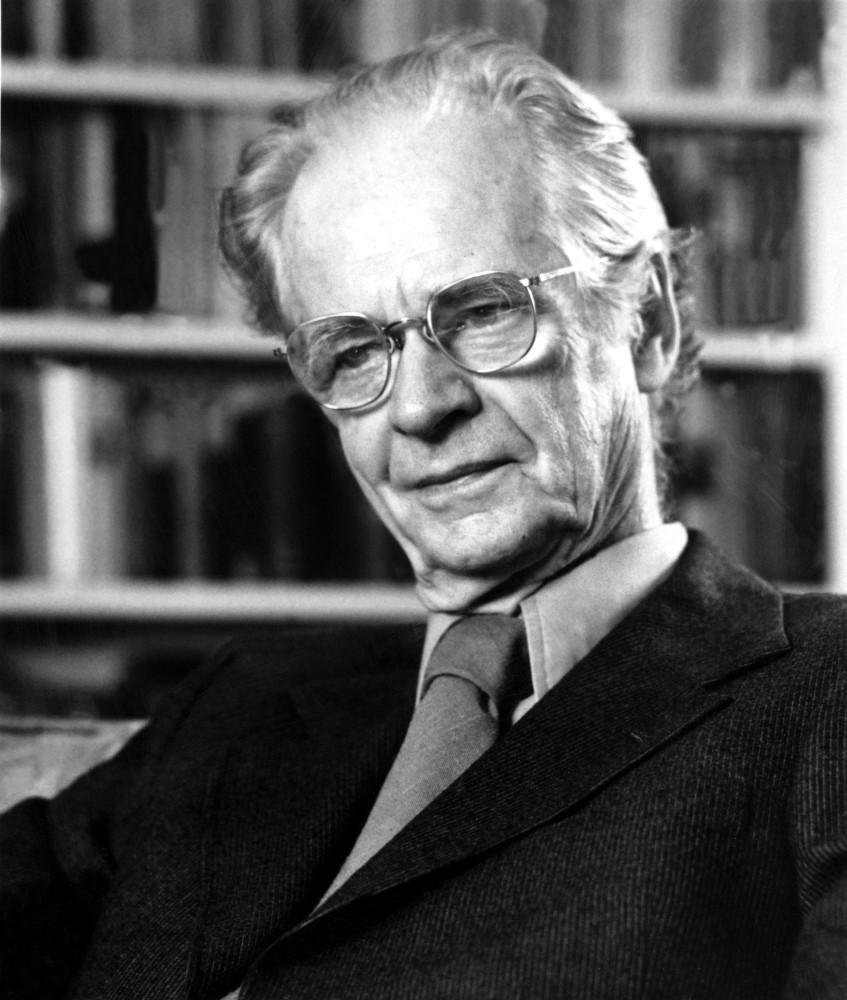
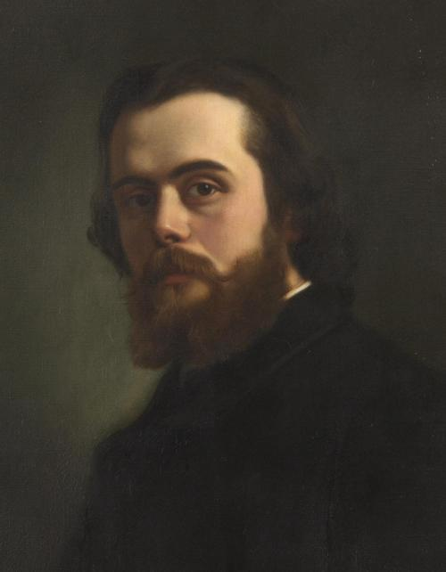
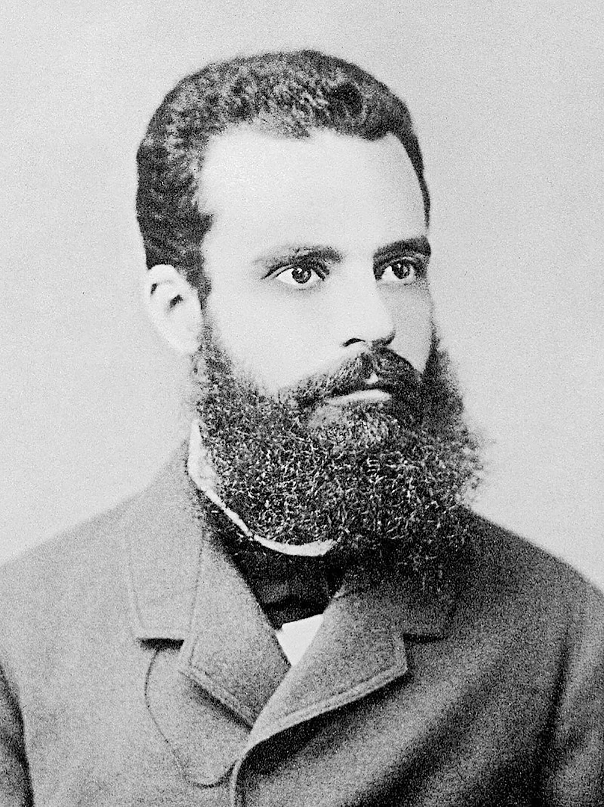
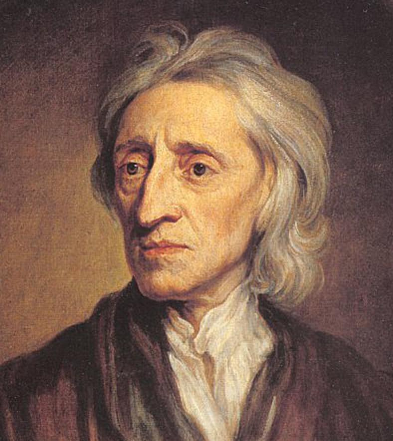
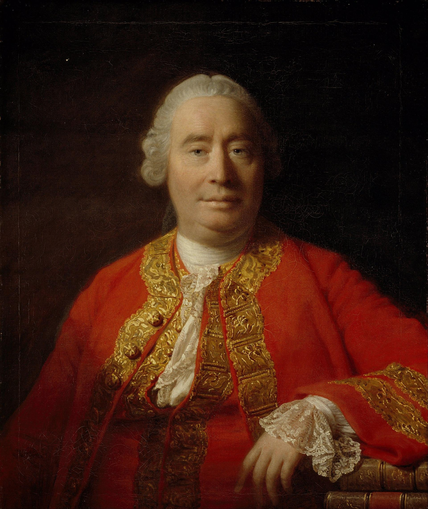
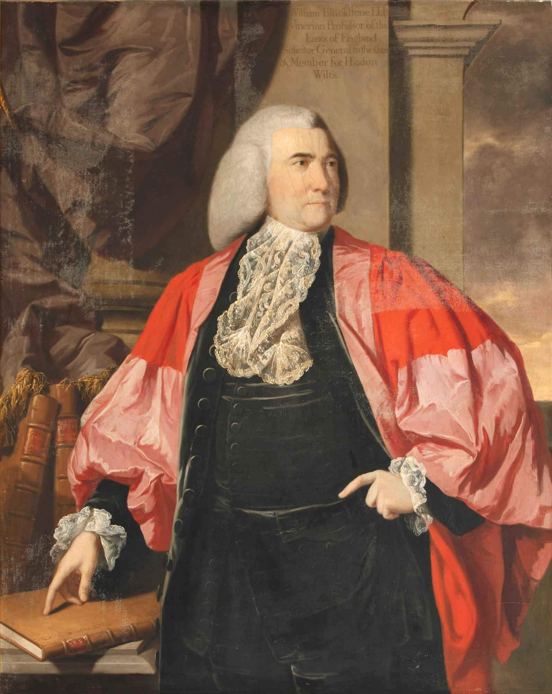
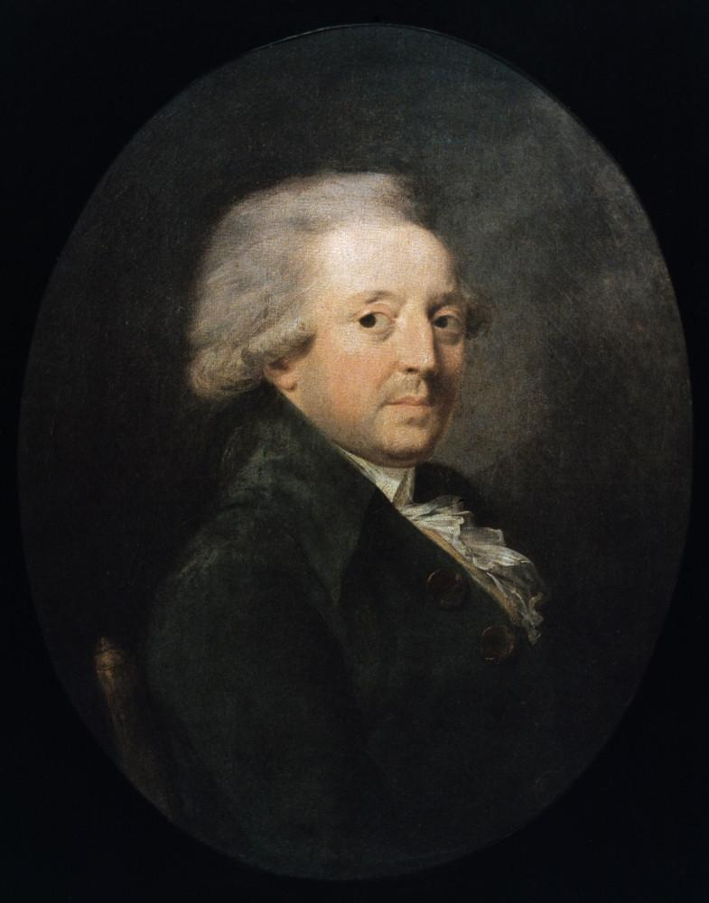
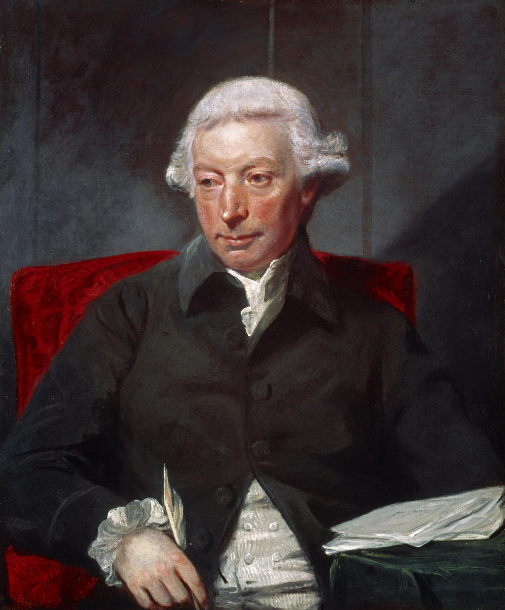

# 正文（1979年3月28日）

**讲座提要**

homo oeconomicus 模型——在美国新自由主义中，这一模型普遍化为所有行为模式—经济学分析与行为技术——homo oeconomicus 作为18世纪出现的新治理理由的基础原理——瓦尔拉斯（Walras）和帕累托（Pareto）之前的homo oeconomicus 概念史的几个要点——英国经验论哲学中的利益主体（休谟）——利益主体与权利主体之间的异质性：（1）与法律意志相比，利益的不可化约的（irreductible）特征。（2）市场与合同的逆向逻辑——法律模式的第二次革新：经济主体与政治权力的关系。孔多塞、亚当 •斯密的“看不见的手”：追求个人利益与集体财富增长之间的不可见关系。经济世界的不可总计特点。君主必然无知—经济政治学作为对治理理由的批判：取消经济君主的可能性，从重商主义和重农主义两种形式来看——政治经济学，相对于治理技艺来说的一门边缘科学

## 一、经济人

### 1. 模型的普遍化

今天，我打算在前几个星期所讲过内容的基础上开始，并且追溯至年初我谈到过的起点。上节课我向你们表明了美国新自由主义者如何把经济学家的分析应用于或者可以说尝试应用于一系列非市场表现或市场行方式的对象及领域：比如，尝试把经济学分析应用于婚姻、子女教育和犯罪活动。当然，这样带来了理论和方法上的问题，应用一种相同的经济学模型的正当性问题，以及关于这种模型的启发性（heuristique）价值的实践问题，等等。所有这些问题都围绕着一个主题或一个概念：这当然就是 homo oeconomicus，经济人。把 homo oeconomicus 框架、范式和模型应用于所有不仅仅作为经济行为人，而且也是社会行为人之上：比如结婚之人，犯罪之人，抚养子女之人，为孩子付出情感和时间之人；在何种情况下这种做法是正当的，在何种情况下它是卓有成效的？因此，这是关于 homo oeconomicus 的框架之应用的有效性问题。

事实上，homo oeconomicus 的应用问题在美国如今成为了新自由主义者讨论的经典问题之一。这种讨论的“背景”（background），也是最初文本，就是米塞斯的《人类行为》（Human Action）[〔1〕](#note-1)一书，并且你们会发现在1960—1970年间，也就是上个十年间，特别是在1962年[〔2〕](#note-2)，在《政治经济学杂志》上出现了一系列的文章：Becker[〔3〕](#note-3)的文章、Kirzner[〔4〕](#note-4) 的文章，等等。

### 2. 合理行为

homo oeconomicus 及其应用性问题对我来说值得关注，因为在homo oeconomicus 框架推广到并非当下地和直接地属于经济领域的那些领域中，我认为这里面有两个重要的关键点。最重要的关键点，可能就是把经济学分析对象认定为所有行为方式，这当然意味着将稀缺资源最优地分配给各种可选目的，而后者大体上就是新古典主义学派对经济学分析对象的一般定义[〔5〕](#note-5)。

但是把经济学的分析对象认定为把资源最优地分配给诸多可选目的各种行为方式，在这种做法的背后，我们发现了一种可能性，即把经济学对象一直涵盖到所有利用有限手段实现各种目的之一的行为方式。这样人们得出：经济学分析的对象或许应该认定为所有目的化的行方式，后者大体上暗含着一种对手段、途径和工具的策略选择，总之得出：经济学的分析对象就是整个所有合理行为方式。毕竟，经济学不就是对合理行为方式的分析？所有合理的行为方式，不管是哪一类，它们不都是属于经济学分析的范围吗？

一种形式上遵守推理的行为方式，它不就是我们刚才所定义的那种经济行为方式，即把稀缺资源最优地分配给各种可选目的吗？因为一种形式上的推理是：我们持有的一些资源是稀缺资源——这些稀缺资源将会成为一种符号系统，将会成为一种公理游戏（jeu d'axiomes），将会成为一些建筑规则，但不是完全的建筑规则，也不是任何一种符号系统，而仅仅是某种符号系统-我们将会最优地利用这些稀缺资源以实现一种已确定和被选择的目的，在这种情况下，我们根据对稀缺资源的最好的可能分配所做出的结论就是正确的而不是错误的。因此，退一万步来讲，我们也不明白为什么不把整个合理行为方式都定义为经济学分析的可能对象，而不管它是何种合理行为。

### 3. 非理性行为

说实话，这种定义的外延已经相当广，但它还不是唯一的，像贝克尔——美国新自由主义中最激进的那些人——他说这还不够，毕竟经济学分析对象能够延伸到我刚才介绍过的人们所定义和所理解的那些合理行方式之外，并且经济规律和经济学分析完全能够应用于那些非合理的行为方式，也就是那些完全不寻求或不单单寻求稀缺资源之于确定目的的最优化分配之人[〔6〕](#note-6)。贝克尔说：从根本上来看，经济学分析完全能够获得其立足点及有效性，只要个人的行方式符合这一个条款就够了，即相对于现实，这种行为方式的反应不是偶然随意的。也就是说：所有行为方式将会以系统的方式回应环境变量中的变化，它将能够隶属于经济学分析的范围，换言之，如贝克尔所说，所有行为方式都“接受现实"[〔7〕](#note-7)。homo oeconomicus 是接受现实之人。合理行为方式，就是对环境变量的变化敏感的行为方式，并且不是以随意的方式，而是以系统的方式做出回应，因此经济学能够被定义为关于应对环境变量的系统性之科学。

### 4. 行为技术



经济学家们自然并不负责作出庞大定义，而是该定义表现出一些旨趣。一种实践旨趣，因为当你们把经济学分析的对象定义为个人对环境变量所做的各种系统回应整体，你们看到完全可以把一系列的技术整合到经济学之中。这些技术在美国正被应用并且目前很流行，人们称之为行为技术（techniques comportementales）。在斯金纳[〔8〕](#note-8)（Skinner）那里，你们能找到具有最纯粹、最严密、最精确或最异常之形式的研究方法，它们完全不是旨在分析各种行为方式的意义，而只是要弄明白刺激活动通过强化机制如何能够带来各种反应并且后者的系统性能够被觉察到，借助这种系统性，我们可以引入其他的行为变量—所有这些行为技术清楚地表明了，以这种方式所理解的心理学如何在事实上能够完全被纳入到贝克尔对经济学所作的定义之中。在法国，关于行为技术的文献很少。在卡斯特（Castel）的最近一本著作《发达的精神病社会》中，有一章节是关于行为技术的，你们会看到在一种特定情境中——具体地说，一家医院，一家精神病诊所—这些关于行为的既是实验性方法又是蕴含着确切的经济学分析的方法是如何运作的？[〔9〕](#note-9)

### 5. 治理的悖论

今天，我更想强调的是另外一个方面：贝克尔的定义——仍旧没得到一半经济学家和大多数人的认可——尽管无人喝彩，但仍然可以让我们指出一种悖论，因为实际上，18世纪出现的 homo oeconomicus，我还会再回到这上面来，相对于权力的实施来说是一个不可触犯的要素。homo oeconomicus 服从于自己的利益，其利益自发地趋同于其他人的利益。从治理理论的角度来看，homo oeconomicus 是不应该被触碰的。homo oeconomicus，我们对其放任自由。它是放任自由的主体或对象。不管怎样，它是治理的合作者，而治理的规则就是放任自由。

**而在我所讲的贝克尔的定义中，homo oeconomicus，即接受现实之人或者系统地回应环境变量的变化之人，却正是可被操控之人，它系统地回应系统的变化，而后者将会被人为地引入到环境中。homo oeconomicus是极其可被治理者**。之前作为被放任自由和不可侵犯的合作者，现在homo oeconomicus 却作为是一种作用于环境以及系统地修改环境变量的治理术的相关项。我认为这个悖论可以使我们发现一个问题，我想稍微讲一下，它就是：自18世纪以来，伴随着 homo oeconomicus，是否要在所有可能的治理面前树立一种对治理来说本质上以及无条件地不可化约的要素？通过定义 homo oeconomicus，是否要指出何种地方是治理行为不可进入的？在所有条件、所有企业、所有法规、所有可能的治理禁令面前，homo oeconomicus 是否是一个自由原子，或者说 homo oeconomicus 难道不已经是某种主体吗？它使得治理技艺能够根据经济原则来自我调节——这里的经济一词有两种含义：政治经济学中的经济之义以及治理的约束、自我限制和节制意义上的经济。你们可以看出，我提问的方式就已经给出了答案，不过这就是我所想要讲的，也就是作为合作方、作对立方、作在18世纪新的治理理由形成之基础要素的homo oeconomicus。

## 二、概念史

### 1. 瓦尔拉斯与帕累托






说实话，事实上不存在关于 homo oeconomicus 的理论，甚至也没有关于这个概念历史的理论[〔10〕](#note-10)。实际上要等到所谓的新古典主义者瓦尔拉斯（Walras）[〔11〕](#note-11) 和帕累托（Pareto）[〔12〕](#note-12)，才能清楚一点看到我们所理解的 homo oeconomicus 的出现。

但是，事实上，在瓦尔拉斯与帕累托之前，homo oeconomicus 这一观念已经在运转了，即使其概念化的方式还不是很严密。我们如何来看待homo oeconomicus 及其出现？为了使问题简单化并且以有点武断的方式，我将从事实出发，从英国经验主义出发，从英国经验论哲学中切实运转的主体理论出发，并且认为—这里，我再次有点武断地作出一种分割—英国经验主义的主体理论中似乎存在着一种理论转变，它属于自中世纪以来的西方思想所发生的那些最重要的理论转变和理论变化之一。

## 三、利益主体






### 1. 不可化约的选择

英国经验主义——大体上是与洛克[〔13〕](#note-13)同时出现的英国经验主义—所带来的正是一种主体，无疑在西方哲学中这是第一次将主体既不是通过其自由来定义的，不是通过灵魂与身体的对立，也不是通过以原罪或罪恶为特征的欲念（concupiscence）之中心或发源地来定义的，而是作为各种既不可化约又不可转让的个人选择之主体。

（首先，）不可化约，这是什么意思？我举一个很简单的例子，它也是休谟[〔14〕](#note-14)经常所提到的，他这样说：当我们分析个人选择时，当我们思考为什么它作出这样的而不是那样的选择时，我们能够提出何种类型的问题？我们可以得到何种不可化约的要素？他又说：“如果我们询问一个人：你为什么锻炼身体？他会回答：我锻炼身体是因为我渴望健康。我们再问他：你为什么渴望健康？他会回答：因为我宁愿健康而不是疾病。这时我们再问：你为什么宁愿健康而不是疾病？他会说：因为疾病是很痛苦的，因此我不想往坏的方向发展。如果我们再问为什么疾病是痛苦的，这时他理所当然地不做回答，因为这个问题没有意义。”事情是痛苦的还是不痛苦的，这自身构成了一种选择理由，我们不能跨越这个理由。痛苦与不痛苦之间的选择，构成了一种不可化约，它不涉及任何判断、推理或考量。它是分析中的一种逆退式（regressive）的基石。

### 2. 不可转让的选择

其次，这种类型的选择是不可转让的。我所说的不可转让，意思不是说我们不能以另一种选择来代替这种选择。我们完全可以说：如果我们宁愿健康而不是疾病，同样我们宁愿疾病而不是死亡，并且在这种情况下会选择疾病。很显然，同样，我们完全可以说：我宁愿自己得病，另外一个人不得病。但是，不管怎样，一种选择对另一种选择的替代，是基于什么而做出的？基于我对自己的偏爱（preference）以及这种事实：得知他人得病比自己得病的感受更痛苦。我对自己的痛苦或非痛苦、痛苦或惬意的感受，最终才是我的选择之原则。这就是休谟的那句著名的箴言，他说：当人们让我在割断我的手指与他人的死亡之间做出选择时，即使人们强行割断我的手指，什么也不能迫使我认为割断我的手指应该比他人的死亡更可取[〔15〕](#note-15)。

### 3. 利益的定义

因此，对主体来说，这就是那些不可化约的选择与不可转让的选择。而这种不可化约的、不可转让的选择之原则，这种原子式的、无条件的指向主体自身的选择之原则，我们称之内利益（interet）。

### 4. 英国经验主义

在我看来，在英国经验论哲学中最根本的——我是以完全粗略的方式来看，不是吗—是产生出之前从未有过的东西：利益主体的观念，即作为利益原则的主体，作为利益的出发点或者各种利益机制的场所。当然，关于谁能启动利益本身的机制存在着一系列的讨论：是自我维系吗？是身体或灵魂吗？是同情（sympathie）吗？这些不重要。重要的是，利益第一次显现为一种意志形式，既是当下的又是完全主体的意志形式。

## 四、利益与权利

### 1. 契约的基础



我认为带动所有homo oeconomicus 问题域的，是要弄明白我们称之为利益的意志形式的利益主体，它是否可以被当作与法律意志相同的类型，前者是否能够衔接到后者上。第一眼来看，我们可以说，利益与法律意志，即使不是完全相似，至少也是可以完美地调和在一起。

事实上，从17世纪末一直到18世纪中期，一直到法学家布菜克斯通（Blackstone）[〔16〕](#note-16)，我们才能看到一种法学分析与利益层面分析的混合。比如，当布菜克斯通提出原初契约（contrat primitif）、社会契约之问题时，他说：为什么个体们订立契约？他们订立契约是因为他们都有利益。每一个体都有它的利益，但是在自然状态中以及在契约出现之前，这些利益是受到威胁的。于是，为了至少保护其利益中的某些利益，他们不得不放弃另外一些。人们当下就会考虑到最重要的利益，也有可能不一样[〔17〕](#note-17)。总之，在这里，利益是契约的一个经验原则。因此，通过契约来构成法律主体的法律意志，根本上它就是利益主体，但其利益是经过提炼的、变成考量过的、合理化的利益。然而，对于有点调和主义（laxisite）类型的分析，即法律意志与利益相互混合、相互交织、相互激发。

休谟却指出事情并不是这样，事情并非如此简单。休谟说，你们为什么订立契约？因为出于利益。你们出于利益订立契约，因为你们觉察到如果你们是单一的，如果你们与其他人没有联系，你们的利益将会受到损害。但是一旦订立契约，你们为什么遵守契约？法学家们认为，特别是布菜克斯通在那个时代认为：人们遵守契约是因为一旦个体们、利益主体们认可订立契约是有益的，契约义务就具有了超越性（transcendance），相对于它，主体处于服从和受约束的地位，因此主体成了权利主体并服从于契约。对此，休谟反驳说：事情完全不是这样，因为事实上，如果人们服从契约，不是因为这是一个契约，不是因契约义务束缚了你们，或换句话说，不是因为你们停止作为利益主体而一下子就变成了权利主体。如果你们继续遵守契约，是因为你们的推理方式是这样的：“与同伴的交易使我们获得如此多的好处，如果我们不履行我们的约定，这种交易将没有任何安全可靠性。”[〔18〕](#note-18)也就是说，如果人们遵守契约，不是因为存在契约，而是因为存在契约是有利益的。也就是说，契约的产生和显现并没有把利益主体替换为权利主体。在利益考量中，契约成为继续表现某种利益的一种形式和要素。此外，如果契约不再表现利益，什么也不能约束我继续服从契约[〔19〕](#note-19)。

因此，利益与法律意志不是相互替换的。权利主体并不接替利益主体的位置。只要存在法律结构，只要存在契约，利益主体就一直保持下去，继续存在下去。利益主体与法律同时存在下去，前者永久地超出权利主体范围。因此对权利主体来说，利益主体是不可化约的。它不会被权利主体所吸收。它超出后者之范围，它围绕后者，是后者永久运转的条件。因此，对法律意志来说，利益构成了一种不可化约的东西。这是第一点。

### 2. 权利主体的否定性

第二点，权利主体与利益主体绝对不服从于同一种逻辑。权利主体的特征是什么？当然，起初它具有一些自然权利。但是当它至少接受了对自然权利的出让和放弃，当它同意限制这些权利，当它接受了转让原则，在这个时候，它就成为了权利主体。也就是说，权利主体从其定义上来看就是一种接受否定性（negativite）的主体，接受放弃自己的主体；在某个层面上，它自我分裂并且成为某些自然权利和当下权利的持有者，在另一层面上，它放弃自然权利原则，并且成为叠加在第一种主体之上的另一种权利主体。主体的分裂，相对于第一种主体而出现的第二种主体的超越性，两者之间的否定、放弃以及限制关系，这些就是权利主体的辩证法或机制的特征，并且正是在这里，正是在这种运动过程中才产生了法律和禁令。

### 3. 市场与契约

与之相反——在这里经济学家的分析将重新回到利益主体之主题，并且赋予其某种经验的内容——利益主体完全不服从于这种相同的逻辑。比如，市场分析所表明的，法国的重农主义者，或英国经济学家，或像孟德维尔（Mendeville）[〔20〕](#note-20)这类的理论家所表明的是：利益机制从来不要求个体放弃他的利益。比如，看一下粮食丰收国家和缺粮困家中的粮食市场情况，你们记得之前我们谈到过[〔21〕](#note-21)这种情况。大多数国家通常都立法禁止人们从富足国家无限制地出口小麦到缺粮国家以便使有储备粮之国家不会出现饥荒。对此，经济学家们回复到：这荒谬！因此，让利益机制自己去运转，让粮食的卖家把商品涌入到缺粮国家，在缺粮国家粮食很昂贵，很容易出售，并且你们会看到，卖家越追逐自己的利益，事情就会变得越好。在利益最大化的基础上，将会建立一种普遍收益。每个人不仅仅能够追逐自己的利益，而且每个人必须追逐自己的利益，一直追逐到底，寻求把它推向最大化，并且在这个时候，人们将会得到一些要素，在这些要素基础之上，其他人的利益不仅仅会被保留而且会得到增加。

因此，这些经济学家所运转的利益主体具有与权利主体的辩证法完全不同的机制，因为它是一种利己主义机制，它是一种即时增速机制，一种没有任何超越性的机制，在这种机制中，每个人的意志将自发地无意地（involontairerent）符合于其他人的意志和利益。这与那种弃权论证、超越论证，与契约法学理论所说的意志纽带（lien volontaire）相差甚远。市场与契约正好是逆向运行的，事实上，两者的结构是相互异质的。

作一下概括，我们可以说，18世纪中所有的利益分析一开始看起来，无须费多大力，总的说来都能够衔接上契约理论。事实上，当我们近距离来看，这种分析实际上显露出在我看来是一种全新的问题域，一种与契约学说和权利主体学说完全异质的特征要素 。差不多在利益主体的经验理解和经济学家分析的交汇点上，我们能够定义出一个主体，一个利益主体，其活动将既有增速价值，又有通过对利益的强化所带来的效益价值。这就是 homo oeconomicus 的特征。我认为，在18世纪，它与我们所称的 homo juridicus 或homo legalis 是完全异质的和不可重叠的。

## 五、经济人与政治权力

### 1. 孔多塞



由于这种异质性已经建立，我想应该再进一步来看，并且首先想说的是：由于我之前说过的原因，经济主体与权利主体之间不仅仅存在着形式上的异质性，而且在我看来直到某一点上，权利主体与经济主体之间，在它们与政治权力的关系方面，两者之间存在一种本质的差别。或者说，经济人之问题域从完全不同的角度提出了权力的基础与权力的实施问题，这是法律人、法律主体的人物和要素所不能做到的。

为了从权力及权力的合法实施视角来理解经济人中全新的东西，我想一开始就引证一篇能很清楚说明问题的孔多塞的文本。在《人类精神进步》（Les Progres de l'esprit humain）的第九个时代部分中，孔多塞说：个人利益脱离于社会的一般体系——他想说的不是个人相对于社会是孤立的（也就是说，他所看的不是一个孤立的个体），而是一个处在社会中的个体，但是要考虑到他自身以及他自己的利益—因而，他继续说，不是处于一个社会而是多个社会之中的某个人，他的完全个人化的利益呈现出两个特征。

第一，它是取决于无数东西的一种利益。这个人的利益取决于自然的各种偶然，对于后者他无能力也无法预见。这种利益也取决于或近或远的政治事件。总之，这个人其利益的享有是与世界的进程联系在一起的，后者超出了它的限度并且从各方面都摆脱它。

第二个特征就是，尽管如此，孔多塞说：“但转而在这个表面的混沌之中，通过道德世界的普遍律，人人尽力为自己而有益于所有人。”[〔22〕](#note-22)这就是说，一方面，每个人从属于一个整体，后者是不可控制的、无法规定的，它是事物的进程和世界的进程。在某种程度上可以说，发生在地球另一边的最远的事件可以影响我的利益，而我对其无能为力。每个人的意志、每个人的利益以及利益实现与否，所有这些都与大量个人之外的要素有关。同时，在个人不知道、不愿意、不能操控的情况下，个人利益将会与一系列的正面结果相关联，即所有对他来说有利的东西将对其他人也有利。

因而，经济人就处于一个我们所称的无限定的内在性场域（champs d'immanence）中，后者一方面使经济人从属地与一系列偶然联系在一起，另一方面，后者把它的产出与其他人的收益联系在一起，或者将它的收益与其他人的产出联系在一起。因此，各种利益的汇聚就增加和包含了各种偶然之事的不明确的不一致。

### 2. 双重的不自主

因此，homo oeconomicus 就处于人们所说的双重的不由自主（involontaire）中：诸多偶然不由自由地降临它身上，以及自己并未寻求，它却不由自主地为其他人产生出收益。它同样处于双重不明确中，因为一方面，其利益所依赖的那些偶然属于一个我们既不能贯穿也不能总计（totaliser）的领域，另一方面，通过产出自己的收益而给其他人带来的收益，对它来说同样也是一种未明确，一种无法总计的不明确。因此，它处于双重的不自主、双重的未明确、双重的无法总计中。

然后，这些未明确、不自主、无法控制、无法总计并不因此使利益无效，使那些为了最好地达到利益而做的考量失效。相反，这些未明确在某种程度上奠基了个体的自身考量，赋予其稳定性，使其产生效果，将其纳人现实之中，使其以尽可能最好的方式与世界的其余部分联系在一起。因此，出现了这样一种系统，在其中，homo oeconomicus 正是从考量范围之外那里获得了其考量的有效性。

在这里，当然我们不可避免地想到亚当•斯密的文本，在第四篇第二章那段著名的文本中，他说这是在《国富论》中唯一谈到众所周知的事情之处——：“由于商人偏好国内产业的成功甚于国外产业的成功，商人只盘算亲自获得他自己最大的安全；由于商人管理该产业的方式目的在于使其产品的价值能有最大可能的价值，商人所盘算的也只是他自己的利益；在这种场合，像在其他许多（场合）一样，商人受一只看不见的手的引导，去实现一个并非他想要达到的目的。”[〔23〕](#note-23)因此这里，我们的核心问题正是这只看不见的手，它是 homo oeconomicus 的关联项，或者确切说，它是一种奇怪的机制，使homo oeconomicus 作单独的利益主体在一个总体的内部中运转，而这个总体却逃避利益主体，但同时又奠基了其利己主义选择的合理性。

## 六、看不见的手

这只看不见的手是什么？当然，人们习惯说，在亚当•斯密的思想中，看不见的手表示一种考虑周到与否的经济乐观主义。人们同样习惯说，应该将看不见的手看作自然秩序中一种神学思想的残余。通过看不见的手这个概念，不管如何隐蔽地考虑，亚当•斯密也还是或多或少隐含地规定出天意之神在经济进程中所处的一个真空地带，有点像马勒布朗士的上帝，它通过对一种理智广延之展开的完全掌控来负责整个世界并且直至每个人最细微的动作[〔24〕](#note-24)。

亚当•斯密的看不见的手，有点像马勒布朗士的上帝，但是前者的理智广延中不是充满着诸多线、面、体，而是充满着商人，市场、船舶、马车、公路。因此，出现了这样一种观念：这个经济世界中有一种本质的透明性，并且如果整个经济进程脱离于每个经济人之外，那么，相反，在某个点上，对一种目光来说、对看不见的手之目光来说，总体是完全透明的，看不见的手按照其目光之逻辑，按照其目光所见，把所有这些分散的利益线条系扎在一起。因此，需要至少假定一种整体透明的经济世界。

然而，我们看接下来的文本，亚当•斯密又说了什么？他刚才说到了这样一些人，他们既不知道为什么也不知道追逐自己的利益如何最终会使所有人收益。人们只盘算自己的好处，最终整个产业会从中受益。他说，这些人只考虑自己的收益而不考虑大家的收益。但他又补充说：所有人的利益这个目标不在商人这类人的忧虑之列，这并不总是最坏的[〔25〕](#note-25)。“我从来没有看到过，那些假装为公众幸福而从事贸易的人做了多少好事。确实，这种装模作样的神态在商人中间并不很普遍。”[〔26〕](#note-26)总之，我们可以说：感谢上天，这些人只关心他们自己的利益，感谢上天，商人是完美的利己主义者，他们当中忧虑公众幸福之人是很稀少的，因为当他们开始忧虑公众幸福时，正是在这时候，一些事情就开始无法运转了。

因而，换句话说，有两种要素是绝对成对联系在一起的。为了确保集体的收益，为了确保最多数的人得到最大的幸福，这是可能的，每个行为人必须对这个整体视而不见。对每个人来说，集体结果必须是不确定的，这样才能切实地达到正面的集体结果。对所有经济行为人来说，模糊和盲目是绝对必须的[〔27〕](#note-27)。集体利益不应该成为目标。它不应该成为目标，因为至少在经济部署中它不能被估算到。这就是这条看不见性原理之核心。

换言之，在亚当•斯密的看不见的手这个著名理论中，人们总是习惯强调“手”之方面，即某种好像有神意的东西把所有分散的线条编织在一起。但是我觉得另一个要素——不可见性，至少也是同样重要的。不可见性不仅仅是这样一种事实：由于人类理智的不完美，人们无法意识到在他们背后有一只手把每个人在它面前的所作所为安排或联系在一起。不可见性是绝对必不可少的。正是不可见性使得每个经济行为人不应该也不能去寻求集体幸福。

## 七、君主的无知

### 1. 弗格森



任何经济行为人都不应也不能如此，但可能还需更进一步。不仅仅任何经济行为人，而且任何政治行为人也是如此。换句话说，经济世界对君主必须是并且只能是不透明的，而这通过两种方式做到。一种方式是我们已经熟知的，没有必要强调太多，即因为经济机制要求每个人追求自己的利益，因此就应该任其自由而为。对于政治权力而言，它不应该干预人类身上所包含的自然动力。因此禁止政府为个人利益设置阻碍。这就是亚当•斯密所要说，当他写道：共同利益要求每个人熟知自己的利益，并且能够无阻碍地追求它[〔28〕](#note-28)。换句话说，权力、政府不能阻碍个人利益游戏。不仅仅政府不该成为个人利益的障碍，而且君主也不可能将总体化经济机制的每一种要素人为地或有意识地使之组合在一起。看不见的手自发地组合各种利益，同时它禁止所有形式的干预，甚至所有形式的、总体化经济进程的高瞻远瞩。

关于这一点，弗格森（Ferguson）说得很清楚。在《论市民社会的历史》[〔29〕](#note-29)一书中，他说：“个人自己赚得越多，他就越增加了国家财富的总量……每当行政管理深人细致地去触及这个对象，它就只是打断了事情的运转，并且使抱怨的人成倍增长。每当商人忘记了自己的利益而致力于各种国家规划，幻觉和妄想就不远了。”[〔30〕](#note-30)弗格森以法国和英国在美洲的机构部署为例，在分析法国和英国的殖民模式时，他说：法国人带来了他们的规划、行政管理、他们所定义的对其美洲殖民地最好的东西。他们建立了诸多“庞大规划”（vastes projets），而这些庞大规划却“只能在理念中实现”，法国的美洲殖民地瓦解了。与此相反，英国人，他们通过什么来殖民美洲？通过一些巨大规划？完全不是。而是一些“短期打算”（vues courtes）。除了关注每个人的当下收益，他们没有任何其他的规划，或者说，每个人只考虑其规划的短期打算。一下子，各种产业就活跃起来，商行林立[〔31〕](#note-31)。因此，经济，即作为实践而言的经济和作为政府的干预形式、作为国家行为或君主行为而言的经济，它只能具有短期打算，如果哪位君主想要具有长期打算、全方位和整体化的眼光，那么这位君主只能看到一些幻象。18世纪中期的政治经济学揭露出对经济进程进行政治总体化所具有的逻辑谬误推理（paralogisme）。

### 2. 知识的界限

君主可以是无知的，君主应该是无知的，这就是亚当•斯密在《国富论》第四篇第九章中通过看不见的手以及“不可见的”这个形容词的重要性所要表达的意思。他这样说：“每一个人，只要他不违反正义的法律，都应听其完全自由，让他采用自己的方法，追求自己的利益和资产。”[〔32〕](#note-32)因而，这就是放任自由的原则，不管怎样每个人都必须追求自已的利益。立刻，以一种虚伪的方式——总之是我说这是虚伪的一君主只会感到很轻松，因这样“君主就被解除了一项监督所有经济进程这一他如果并不必然地、不停地屡次出错就不可能设法履行的职责。”[〔33〕](#note-33)我说这是一句“虚伪的话”，因为我们也可以这样理解：君主是单独的个人，他身边聚集着一些忠诚或不忠诚的顾问，如果他着手监管经济的总体进程，可能他会被一些不忠诚的行政官更或大臣所欺骗。但这句话同样也是说，君主的错误不仅仅由于大臣们的不忠或行政管理无法掌控的复杂性。某种程度上来说，他犯错误是由于一个根本和基础的原因。他不能不犯错，并且这就是亚当•斯密在谈到君主应该卸下监管经济的总体进程之义务、职责时，最后所要说的：“要恰当地履行这种职责，既没有人类智慧，也无充分的知识可做到这一点。”[〔34〕](#note-34)

### 3. 经济世界的不可总计性

经济合理性不仅仅被经济进程的总体性的不可知性所环绕着，而且也是由它所奠基的。homo oeconomicus 是经济进程内部中可能的合理性之唯一小岛，经济进程的不可掌控的特征并没有质疑而是奠基了homo oeconomicus 之原子式孤立行为的合理性。因此，经济世界在本质上是不透明的。它在本质上是无法总体化的。从本质上和定义上来说，它是由一种视角的多样性所构成，这种多样性由于能自发地确保并且最终使各视角会聚，它就更加是不可化约。

经济学是一门无神论学科；经济学是一门无上帝的学科；经济学是一门无总体性的学科；经济学开始表明以君主视角来看待其所要治理的国家之总体性，这是无用的也是不可能的。经济学悄悄地偷走了君主在一个经济进程正成为社会生活的本质的国家之中行使其君权的法律程式。恰恰当这种介于利益主体的无法总体化的多样性特征与法律君主的总体化的统一性之间本质的不相容被阐发时，自由主义的现代根基就开始稳固了。

## 八、法权与经济

18世纪的法律-政治思想努力要证明，在单一的权利主体、在自然权利主体的基础之上，人们如何能够构建一个政治统一性，后者是不是由个体君主确定的这并不重要，而是它一方面是个体权利整体的持有者，同时又是限制这些权利的原则；经济学的问题域完全没有解决这个重要问题。经济学的问题域、经济利益的问题域从属于另外一种配置、另外一种逻辑、另外一种类型的推理以及另外一种类型的合理性。

事实上，从18世纪起，政治-法律世界与经济世界成为两种异质的、不相容的世界。经济-法律学这个想法，严格来说是不可能的，此外，它也从未实际地建立起来过。面对法律君主，面对权利的持有者以及个人自然权利的奠基者，homo oeconomicus 可以说：你必须不，不是因为我拥有一些你不能触碰的权利——这是权利人（homme de droit）所说的话，homo juridicus 这样对君主说：我有诸多权利，我把其中一部分交付与你，你必须不去触碰其他的权利，或者为了这样或那样的目的，我把我的权利交付与你。homo oeconomicus 不这样说。它同样对君主说你必须不，但是它对君主说，为什么你必须不？你必须不是因为你不能。你不能的意思是“你无能”，为什么你无能，为什么你不能？你不能是因为你不知道，你不知道是因为你不能知道。

### 1. 对治理理性的批判

也就是说，这里出现了一个我认为非常重要的时刻：那时政治经济学可以表现为对治理理由的批判。“批判”一词，我使用的是它的本义和哲学意义[〔35〕](#note-35)。毕竟，康德在晚些时候告诉人类不能认识世界的总体。而在前几十年，政治经济学已经告诉君主，你也一样，你不能认识经济进程的总体。经济学中没有君主。不存在经济君主（Souverain economique）。

我认为这是经济史上，当然也是在治理理由的历史上非常关键的几点之一。后来在整个欧洲、整个现代世界中，由治理实践、经济问题、社会主义、计划化、福利经济所提出的问题，就是经济君主的缺失或不可能的问题。在19世纪和20世纪中，自由主义思想和新自由主义思想的所有反复和循环，仍旧以某种方式提出经济君主存在的不可能性问题。与之相反，计划化、统制经济、社会主义、国家社会主义的问题是：如果我们不能在某种程度上克服由政治经济学从其建立始就明确提出的，同时又作为政治经济学存在条件的这种对经济君主的咒骂，那么，尽管如此，能否找到一个点，人们通过它可以定义一种经济主权（souverainete economique）？

## 九、经济君主

### 1. 重商主义

从更小范围的等级来看，我觉得看不见的手的理论，其根本功能和作用是取消政治君主。如果我们不再把它置于前两个世纪的自由主义历史之中，很明显这种看不见的手理论，作为对经济君主可能性的取消，就是拒绝我去年所谈到[〔36〕](#note-36)的管治国家。

管治国家，或者说由国家理由所治理的国家及其重商主义政策，从17世纪开始，就以一种完全明朗的态度试图建立一种君主：它不再是一种权利君主或是依照权利的君主，而是它不仅可以管理它所对其行使主权的臣民们，而且同样可以管理个人之间、团体之间、国家之间所进行的经济进程。管治国家，在君主们的或者像17世纪和18世纪的某些君主们（如法国君主）的唯意志论和重商主义政策下运转起来的国家，所有这些都依赖于这样一种公设：国家必须有一位经济君主。政治经济学并不是简单地对重商主义理论或实践的驳斥。亚当•斯密的政治经济学并不简单地表明重商主义构成了一个技术错误或理论错误。亚当•斯密的政治经济学，经济自由主义，取消了全部的政治规划，更根本地说，取消了一种与国家及其主权相挂靠的政治理由。

### 2. 重农主义

另外，再更确切地看一下看不见的手之理论所反对的是什么，这也是很有意思的。准确地说，它反对的正是在同一时代或者之前几年的重农主义者所提倡的，因为重农主义者的地位是很有意思的也是很矛盾的。在法国，重农主义者对市场和市场机制已经做过分析，我曾多次谈到过[〔37〕](#note-37)这些分析，他们证明了政府、国家、君主绝对不应该干预利益机制，后者使得商品流通到更容易找到买家和最好价格的地方去。因此，重农主义严厉批判所有行政规范，君主权力利用行政规范来影响经济。但是重农主义者们马上补充说：应该对经济行为主体放任自由，但是首先要考虑的事实是：国家的全部领土根本上是君主的所有物，或者无论如何君主都是国家所有土地的共同所有者（coproprietaire），因而也就是共同生产者（coproducteur）。这使得关税正当化。因此，在重农主义的构想中，在某种程度上，君主作为土地的共同所有者和产品的共同生产者，他在原则、权利和事实上与一个国家的整个生产、整个经济活动都是完全适合的。

其次，重农主义者说，经济图表（Tableau economique）的存在可以准确地跟踪生产的流通以及租金的构成，使得君主有可能准确地了解国家内部发生了什么，因而有能力去掌控经济进程。也就是说，经济图表将会提供给君主一个分析原理和一种对于经济进程总体而言的透明性。因此，如果君主对经济行为主体放任自由，这是因为他知道，鉴于经济图表，他既知道发生了什么，又知道应该如何发生。因此，以整体的名义，君主将会自由地并且理性地接受经济行为主体的自由，或者说由于理性、知识以及真理的必然性，他必须接受经济行为主体的自由。这样一来，介于君主的知识与个人的自由之间，将会出现第二种适合。

最后，第三点，一个好的政府——通过经济图表，君主能准确地知道经济进程中发生了什么——应该向不同的经济行为主体、向不同主体解释事情是如何发生的，为什么发生，他们应该怎样做才能使自己的收益最大化。应该出现一种经济知识，尽可能广泛地、尽可能一致地散播到所有主体之间，而且这种经济知识，其起源（principe）仍然是重农主义者所建立的经济图表，后者对有经济素养的主体与承认经济基本规律的君主而言将是共同的。

因此，在知识层面，在对真理的意识层面，君主与经济进程，至少与经济行为主体之间将会有第三种适合。因此，你们看到，在重农主义者那里，放任自由原则、经济行为主体的必要自由原则与君主的存在是吻合的，这个君主由于其唯一的法则就是明证性（evidence）以及一种被树立和建造起来的、由君主和经济行为主体所共享的知识，因而他就更加的专制，更少的受传统、习俗、规则、基本规律的束缚。正是在这里，只有在这里，实际上出现了经济与政治的相互透明观念。正是在这里，只有在这里，既能找到必须对经济行为主体放任自由的观念，又能找到一种政治主权的观念，这种政治主权差不多在自明性的统一光芒之下，将能扫视整个经济进程。

## 十、政治经济学

### 1. 边缘科学

亚当•斯密的看不见的手，则与此完全相反。它批判了整体经济自由这个矛盾观念，以及重商主义者在经济自明理论中所试图维护的绝对专制主义的观念。相反，看不见的手原则上假定：那是不可能的，不可能有重商主义者意义上所说的君主，不可能有重商主义者意义上所说的专制主义，因为不可能存在经济的自明性。

因而，你们看到，一开始——如果我们把亚当•斯密的理论和自由主义理论称为政治经济学的开端的话——经济学从未声称要引导治理合理性，从未声称要对治理合理性进行完全规划。政治经济学确实是一门科学，它就是一种知识类型（type de savoir），就是进行治理之人所应该重视的一个认识模式（mode de connaissance）。但是，经济学不能成为一门治理的科学，治理不能把经济当作原则、规律、行为规范或内在合理性。经济学对治理技艺来说是一门边缘科学。我们应该利用经济学来治理，应该与经济学家一起来治理，我们应该听取经济学家的建议来治理，但是不应该，问题不是，也不可能是：经济学就是治理合理性本身。

### 2. 市民社会

我想我们就可以这样来评论有关看不见的手理论及其与治理合理性问题或治理技艺问题的关系。接下来，出现一个问题：如果经济过程和整个经济过程理所当然地并不构成为治理的对象的话，那么治理所关心的是什么，其对象是什么？我想这就是我下次课所要讲的市民社会理论。

## 注释

[〔1〕](#ref-1) 参见Ludwig von Mises：《人的行为：经济学论文》（Human Action:A treatise on economics），同前书，法译引用本（上文，第98页，注11）。

[〔2〕](#ref-2) 参见《政治经济学杂志》Journal of Political Economy），vol. 70（5），1962年10月，第二部分，由 TH. Schulz统编，充分讨论的是“人的投资”（“investment in human being”）问题。

[〔3〕](#ref-3) 参见 G. Becker： “人力资本投资：一个理论分析”（“Investment in human capital: a theoretical analysis”），同前文（上文，第241页，注18）。

[〔4〕](#ref-4) 参见 1.M. Kirzner：“理性活动和经济理论”（“Rational action and economic theory”），Joumal of Political Economy,vol.70（4），1962年8月，第380-385页。

[〔5〕](#ref-5) 参见上文，1979年3月14日课程，第242页，注23和注25。

[〔6〕](#ref-6) 参见 G. Becker：“非理性行为和经济理论”（“Irrational behavior and economic theory”），Journal of Political Economy，vol. 70（1），1962年2月，第1—13页；再版于《人类行为的经济学探讨》（The Economic Approach to Human Behavior），同前书（上文，第242页，注23），第153-168页。

[〔7〕](#ref-7) 同上，第167页：“即使不合理的决策单元也必须接受现实，如不能坚持一个不再处于其机遇集合内的选择。这些集合不是由不稳定的变量确定或支配的，而是系统地被不同经济变量所改变（•.）”（“Even irrational decision units must accept reality and could not, for example, maintain a choice that was no longer within their opportunity set. And these sets are not fixed or dominated by erratic variation, but are systematically changed by different economic variables （..）”）。

[〔8〕](#ref-8) 伯尔赫斯•弗雷德里克•斯金纳（1904—1990），美国心理学家及心理语言学家。行为主义学派的主要代表之一。1947年起任哈佛大学教授。出版的主要著作有：《科学和人类行为》（Science and Human Behavior），Londres, Coller-Macmillan,1953；《言语行为》（Verbal Behavior ），Englewood Cliffs, NJ,Prentice Hall,1957；《超越自由和尊严》（Beyond Freedom and Dignity）， New York, A.A. Knopf,1971/《超自由和尊严》，A.-M.&M, Richelle 翻译，巴黎，R.Laffont（“Libertes 2000”），1972年。对统计法的使用没有好感，他认为应该研究个体行为。“这一做法的前提是我们控制了主体所处的环境，并且我们界定出对富含信息的条件反射的衡量。（•••••）当一个主体处于其环境之中，他的某些行为导致了环境的某些可探测到的改变（条件性强化）。操作性条件反射是这样一种类别的条件反射：它们是主体在某一特定情境中所具有的并且表达出来的反应所产生的后果，这种反应在因果关系上不取决于情境的刺激。”（Encyclopaedia Universalis，Thesaurus,1975,vol.20,P. 1797）因此，要达到的目标是“通过操控强化程序来筛选相关行为”（同上）。

[〔9〕](#ref-9) 参见 F. Castel,R. Castel & A. Lovell：《高级精神病学协会：美国模式》（La societe psychiatrigue avancee : le modele americain）， Paris, Grasset, 1979， 第4章，第138—139页。关于受到条件反射原理（Pavlov）和行为主义（Thorndike，Skinner）影响的、在精神病学领域中运用的行为治疗法［行为矫正（behavior modification）］，参见第8章，第299—302页。

[〔10〕](#ref-10) 参见 P. Dreulenaere：《经济人：对范型构建的调查》（Homo ceconomicus.Enquete sur la constitution d'un paradigme）， Paris, PUF（“Sociologies”），1996。

[〔11〕](#ref-11) 参见上文，1979年2月21 日课程，第186页，注12。

[〔12〕](#ref-12) 维尔弗里多 •帕累托（1848—1932），意大利社会学家及经济学家，瓦尔拉斯在洛桑大学的继任者。《政治经济学手册》（Manel d'economie politique），载《全集》（CEuures completes），t. VI.Geneve,Droz,1981，第7--18页。参见J.Freund：《帕雷托：均衡理论》（Pareto, la theorie de l'equilibre）， Paris, Seghers, 1974，第26—27页（1'homo oeconomiques selon Paleto）福柯阅读过此书。

[〔13〕](#ref-13) 约翰•洛克（1632—1704），著有《人类理解论》（Essa.y concerning Human Understanding），Londres,printed by E. Holt for Th. Bassett, 1690/《人类理解论》，P. Coste 译，第5版，1755年；巴黎，Vrin，重印，1972年。

[〔14〕](#ref-14) 大卫•休谟（1711—1776）：《道德原理探究》（An Inquiry concerning the Principles of Morals） （1751），Chicago, Open Court Pub. Co.，1921，附录1：“关涉道德情感”/《道德原理探究》，A. Leroy 翻译，巴黎，Aubier,1947年，第154页。下面的引用是基于E. Halevy 在《哲学激进主义的形成》（La Formation du radicalisme philosophigue）（同前书，第一卷，1995年版）第15页中的翻译：“问一个人你为什么进行锻炼？他将回答，因为他希望保持健康；那么，如果你再问他为什么希望健康，他毫不犹豫地回答，因为得病很痛苦。如果再进一步询问并且要弄清楚由于什么原因他害怕痛苦，他不会给出一个原因。这里就是终点，永远不会再牵涉到其他对象。”

[〔15〕](#ref-15) 参见D. 休谟：《人性论》（A Treatise of Human Nature） （1939—1940），L.A. Selby-Bigge, Oxford, Clarendon Press, 1896，第2卷，第3章，第3节：“哪里情感（passion）并不基于虚假假定之上，也没有选择对达到目的来说是不充分的手段，哪里的知性（understanding）就既不能验证情感，也不能谴责情感。人宁愿整个世界毁灭，也不愿伤害自己一个手指头，这并不违反理性”（“Where a passion is neither founded on false suppositions, nor chuses means insufficient for the end，the understanding can neither justify nor condemn it. 'Tis not contrary to reason to prefer the destruction of the whole world to the scratching of my finger. ”）/《人性论》，A. Leroy 翻译，巴黎，Aubier,1946 年，第2卷，第525页：“（•••••）人宁愿毁灭整个世界而不愿伤害自己一个指头，这并不违反理性。”

[〔16〕](#ref-16) 威廉•布莱克斯通（1723—1780），保守派法学家，牛津大学教授。1763一1764年当过边沁的老师［后者从《政府片论》（Fragment on Government）（1776）开始，成为“反布菜克斯通者”（Halevy）］。菁有《英国法评论》（Commentaries on the Law of England），Oxford,Clarendon Press, 1765—1769，4卷本/《英国法评论》，N.M. Champre 翻译，巴黎，F. Didot,1822年，6卷本。参见E. Halevy：《哲学激进主义的形成》（La Formation du radicalisme philosophique），第1卷，1995 年版，第55--56 页；Mohamed El Shakankiri，《杰里米 • 边沁的法律哲学》（La philosophie juridigue de Jeremy Bentham），Paris,LGDJ,1970，第223-237页。

[〔17〕](#ref-17) 参见《英国法评论》（Cormentaries on the Lav of England），法译引用本，第1卷，第210-214页（摘要见 M.El Shakankiri，同前书，第236—238页）。关于布莱克斯通将法律原则和功利原则混杂用于证明惩罚的正当性，参见E. Halevy（同前书，第1卷，1995年版，第101页），对他来说，布莱克斯通的论证缺乏严密性。

[〔18〕](#ref-18) 参见D.休谟：“原初契约”（“Of the original contract”）：“据说我们被迫服从我们的君主，因为我们已默默地承诺了这个目的。但我们为何被迫遵守我们的承诺呢？在此必须加以断定的是，当人们无视其承诺时，具有如此重大益处的贸易和人际交往就不会有安全保障。”（“We are bound to obey our sovereign,it is said, because we have given a tacit promise to that purpose. But why are we bound to observe our promise? It must here be asserted, that the commerce and intercourse of mankind, which are of such mighty advantage, can have no security when men pay no regard to their engagerents. ”）［见D.休谟：《四篇政论》Qhatre Essais politigues），texte anglais et trad. Franc. En regard, ed. s.dir. G. Granel, Toulouse, Trans-Europ-Repress，1981，第17页］/“原初契约”，载《政治论文》，1752年的译本（s.n. ），巴黎，1972年，第343页：“据说我们被迫服从我们的君主，因为我们已默默地承诺了这个目的。但我们为何被迫遵守我们的承诺呢？在此必须加以断定的是，当人们无视其承诺时，具有如此重大益处的贸易和人际交往就不会有安全保障。”同见《人性论》，同前书，第3卷，第2章，第8节/法译引用，第660-672页。

[〔19〕](#ref-19) 同上，法译引用，第3卷，第2章，第9节，第676页：“（••••• 如果利益首先产生了对政府的服从，那么那个利益什么时候在很大程度上并在大多数情况下停止时，服从的义务也就必须停止。”

[〔20〕](#ref-20) 贝尔纳 • 孟德维尔（1670--1733），著有《蜜蜂的寓言，或私人邪恶，公共福利》（Fable of the Bees, Or Privte Vices,Publick Benefits）（1714）， Londres，Wishart &Co.，1934/《蜜蜂奇闻或私人缺憾造就公众福利》，L.& P. Carrive 翻译，巴黎，Vrin，1990。

[〔21〕](#ref-21) 福柯想说的是“上一年”，参见《安全、领土与人口》，同前书，1978年1月18日及4月5日课程。

[〔22〕](#ref-22) 孔多塞（1743—1794）：《人类精神进步史图表概要》（Esquisse d'un tableaz historique des progres de l'esprit humain）， Neuvieme epoque, Paris, GarnierFlammarion, ed. 1988, p. 219：“在劳动与产品、需求与资源的惊人变化中，在把一个孤立的个人的生计和福祉与诸社会的一般体系联系起来的各种利益的可怕的复杂性之中—这种复杂性使得他要依赖自然的全部偶然性，依赖全部的政治事件，差不多把他体验欢乐或困苦的能力扩展至整个地球——在这种明显的混乱之下，我们又怎么能够通过道德世界的一条普遍规律而看到每个人为着自身而努力会有助于全体的福祉；而且尽管有着各种相反的利益的外部碰撞，但共同的利益却要求每个人都懂得去理解自己的本分并能够毫无障碍地去服从共同利益呢？”

[〔23〕](#ref-23) A. 斯密：《国民财富之性质和原因研究》（Recherches sur la nature et les causes de la richesse des nations），同前书，第4卷，第2章，edGF，第1卷，第42—43页。

[〔24〕](#ref-24) 尼古拉 •马勒布朗士（16381715），哲学家与神学家，Oratoire 成员。这里福柯暗指的是偶因主义观点，或者偶因论。马勒布朗士在多部著作中坚持这一观点［《论真理的探求》（De la Recherche de la werite） （1674），“第十五条解释”，（Euvres, t. I，Paris, Gallimard， “Bibliotheque de la Pleiade”，1979，p. 969-1014；《关于形而上学和宗教的谈话》（Entretiens sur la metaphysigue et la religion）（1688），“第七条解释”，（Euvres，t.II，1992，p.777—800；等等］。偶因论认为：“上帝才是唯一的、真正的原因。人们所说的自然原因根本不是真正的、真实的原因，而只是一种偶然原因，后者作普遍规律规定上帝以此种唯一有效的方式来显现自己的行动。”［V. Delbos：“马勒布朗士和德比朗”（“Malbranche et Maine de Biran”），Revue de metaphysique et de morale, 1916，第147—-148 页］。这个无处不在的上帝，尽管是隐藏的，但仍然是所有运动和积极偏好的源泉：“唯一能作用于我们的上帝现在隐藏起来；它的操作没有任何的可感性，尽管它产生了并维系着所有存在物。那些热切想寻找所有事物原因的心灵不会认出上帝，尽管它每时每刻都与上帝相遇”［《论真理的探求》（De la recherche de la verite），“第十五条解释”，同前书，第969页］。关于斯密的“不可见的手”概念的神学来源，参见J.Viner：《天命在社会秩序中的作用》（The Role of Prowidence in Social Order），Philadelphie,Independance Square, 1972，第3章："The invisible hand and the economic order”。

[〔25〕](#ref-25) A. 斯密：《国民财富之性质和原因研究》（Recherches str la nature et les causes de la richesse des nations），第43页：“对社会来说，这也不总是最坏：这个目的并不进入其意图（即每个个人的意图）。”

[〔26〕](#ref-26) 同上。亚当•斯密补充道：“治愈它们，不需要长篇大论。”

[〔27〕](#ref-27) 关于这个必要的“盲目”，参见上文，1979年2月21课程，对法治国家的分析以及哈耶克对计划主义的批判。

[〔28〕](#ref-28) 参见 A. 斯密，同前书，第43页：“所有人寻求其个人利益的同时，通常每个人的劳动方式比他们真的知道为社会而劳动时更加有效。”

[〔29〕](#ref-29) A. 弗格森：《论市民社会的历史》An Essay on the Histoire of Civil Society），Edimbourg,A. Kincaid &. J.Bell,1767；第2版修订版，Londres,A. Millar& T. Cadell,1768。法文版：《论市民社会的历史》（Essai sur I'histoire de la societe civile），due a M. Bergier,Librairie Mme Yves Desaint, 1783，尽管此书在5年前已经印刷完毕。另外，1992年 PUF（“Leviathan”）出版了重新校对和编辑过的新版本，并由 C.Gautier 撰写了重要的导读。为了方便读者，我们参考的是后两个版本。

[〔30〕](#ref-30) 同前书，Desaint 译本第2卷，第3部，第4章，第26-27页（最后一句话这样结尾：“贸易的坚实基础也就丧失了”）；Gautier 译本第240页。

[〔31〕](#ref-31) 同上，Desaint 译本，第2卷，第3部，第4章，第27-28页：“特殊利益较之国家的精心安排更能确实地保护商业和繁荣。有一个国家为开拓北美大陆制定了计划，而很少信任商人和只重眼前利益的人的行为，且动用了其国人的全部资源。另一个国家放手让人们到一个自由的国度寻找自己的位置，为自己着想。一个国家的个人见识短浅却其产业活跃，建立了一个繁荣的殖民地；而另一个国家那些人的宏大计划至今仍只是个想法而已”；Gautier 译本，第241页。

[〔32〕](#ref-32) A. 弗格森：《国民财富之性质和原因研究》（Recherches sur la nature et les causes de la richesse des nations）， N, 9, ed. GF, t.2,p. 308。

[〔33〕](#ref-33) 同上。

[〔34〕](#ref-34) 同上。

[〔35〕](#ref-35) 关于这一时期福柯对康德批判主义的解释方式，参见他上一年（1978年5月27日）在“法国哲学协会会议”上的发言：“什么是批判？”，《法国哲学学会公报》（Bulletin de la societe francaise de philosophie），n02, 1990年4—6月，第38-39页（未收录于《言与文》中）。

[〔36〕](#ref-36) 参见《安全、领土与人口》1978年3月29日及4月5日课程。

[〔37〕](#ref-37) 参见上文，1979年1月17日课程，以及《安全、领土与人口》1978年1月18日及4月5日课程。
