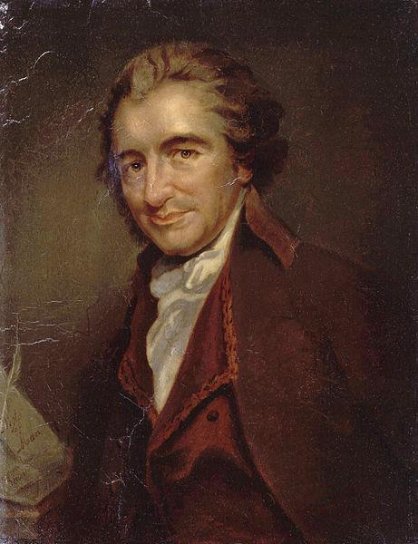

# 正文（1979年4月4日）

**讲座提要**

homo oeconomicus 概念史的几个要素（II）——回到经济活动对君主权力的限制问题—作为自由主义治理技艺相关项的一个新领域：市民社会的出现—homo oeconomicus 与市民社会：自由主义的治理技术学之密不可分的要素—对“市民社会”概念的分析：从洛克到弗格森的演变。弗格森（Ferguson）的《论市民社会的历史》（1787）。弗格森所认为的市民社会的四个本质特征：（1）它是一种历史一自然的恒量；（2）它确保个体间的自发综合；经济纽带的悖论；（3）它是政治权力永恒的母体；（4）它是历史的发动机—一个新的政治思想体系的出现—理论后果：（a）国家与社会之间的关系问题；德国、英国和法国的问题域；（b）对权力实施作的调整：从君王（prince）的智慧到被治理者的理性考量——总的结论

## 一、经济人与君权

### 1. 利益主体

上一课我已经稍微提到过贯穿于所有经济思想之中，特别是从大约18世纪中期起的自由主义思想之中的 homo oeconomicus 主题。我设法向你们指出了 homo oeconomicus 如何成一种不可替代的、不可化约的利益原子（atome d'interet）。我设法向你们指出了，这种利益原子如何既不能被视为、不能被还原为法律思想所构造的权利主体，也不能与之重叠；因此，homo oeconomicus 与权利主体是无法重合的，并且最终，通过放弃自身的权利或者把这些权利转让给另外一人，权利主体融合到其他主体之中依据的是这样一种辦证法（dialectique），而 homo oeconomicus 则并不以与此相同的辩证法融合到其所属整体中；homo oeconomicus 融合到其所属整体，融合到经济整体，不是通过一种转让、（一种）减法、（一种）放弃的辩证法，而是通过一种自发增速的辩证法（une dialectique de la multiplication spontanee）。

### 2. 君主的无知

homo oeconomicus 与权利主体的差别，以及它之不可还原为权利主体，这导致了—同样也是上次课我向你们表明的——君主问题以及君主权力实施问题的重大变化。因为，君主在 homo oeconomicus 面前的所处地位与它面对权利主体时的地位是不一样的。至少在某些设想和分析中，权利主体能够制约君主权力的实施。与之相反，homo oeconomicus 不满足于制约君主权力。达到某一点时，它会使之丧失。它以什么名义使君主权力失效？以君主不应该触碰的自然权利？不是。它使之失效是通过使君主产生一种根本的无能力，一种重要的、核心的无能力，无能力掌控经济领域的整体。面对整个经济领域，面对经济场（champs economique），君主不能不是失明的。经济进程的整体不能不脱离于集中的、整体的、居高临下式的目光。我们说，在中世纪和17世纪人们对君主概念的传统理解中，君主之上有一种难以识透的东西，这就是上帝的意图。尽管君主作为上帝的代理人在地球上是绝对的、突出的，但仍有一种东西在它之外，这就是神意。君主被天命所包含。现在，在君主之下仍然有一种东西在它之外，这不再是神意或上帝的律法，而是经济场的迷宫和曲折。在这种情况下，我认为homo oeconomicus 概念的出现，在政治上是对传统和法律把君主作绝对化理解的一种挑战。

### 3. 两种解决途径

关于这一点，我认为——总之很抽象地、很概括地来看——存在两种可能的解决途径。我们实际上可以说：如果 homo oeconomicus、经济实践、经济行为、总体的生产和交换过程是在君主之外的，那么，在某种程度上，我们将从地域上来限制君主的君权，我们为其权力的实施划定一个边界：它可以触碰所有东西，除了市场。市场在君权的整个空间内，就像无拘束的港又、无拘束的自由空间。这是第一种可能。

第二种可能，就是由重农主义者们所具体提出和主张的。他们认为：事实上，君主必须尊重市场，但是尊重市场并不是说在君权空间内有一处地方不能被触碰，不能被渗透。更确切说，面对市场，君主应该运用一种权力有别于目前一直所使用的政治权力。面对市场、面对经济进程，它不应该通过某一权利成为绝对决策权力的拥有者。面对市场，它应当作为一名面对真实几何图形的测量员，也就是说它应该认可对方：认可的获得是通过一种明证性，这种明证性使君主相对于经济活动的内在必然而言，处于一种被动，同时它又是对经济活动的监管和某种程度上的控制，或者说在整体上对其进行不断确认。换言之，在重农主义的观点中，面对经济，君主应该从政治上的主动过渡到理论上的被动。他应该成为其君权范围内的经济领域的测量员。

第一种解决办法，在于把君主的活动限制在除市场之外的范围内，通过做一种减法，减去市场对象，减去市场领域，或减去经济领域，来维持治理理由的样式，维持国家理由的形式。第二种方法，重农主义者的做法在于维持治理术活动范围的广度，但是必须从基础上改变治理活动的性质，因为它的系数和指数已经变换了，它从治理的主动性变成了理论的被动性，或者说它变成了明证性。

### 4. 治理的困境

事实上，这两种途径都只是一种虚拟的理论和规划，在历史上没有任何真实的后续。这就是基于 homo oeconomicus 问题，基于homo oeconomicus 的特殊性，基于其不可还原为权利领域，治理理由所做出的（一种重新调整）、重新安排。更确切地来看，我们说：由市场、价格机制、homo oeconomicus 问题域所带来的相关问题是：治理技艺必须在君权范围内运作，——国家法律表达的也是这个意思——但是麻烦和问题是：君权空间内占据着、充满着诸多经济主体。

然而，如果我们仔细地来看经济主体，从它们对权利主体的不可还原性来看，它们要求的是要么君主的放弃，要么君主合理性、君主的治理技艺隶属于一种科学的、思辨的理性。如何做才能使君主不放弃任何一寸活动区域，或者说不使君主转变成经济的测量员——法学理论没有能力重新考察并且也不能解决这个如何做的问题：在一个被经济主体所占据的君权空间内应该如何治理？这是因为法学理论——权利主体理论、自然权利理论、契约下的权利转让理论、授权（delegation）理论——所有这些都不与也不能与（正如上一次我所指出的）homo oeconomicus 的机理、称呼及特征相匹配。

因此，市场自身的机理、魁奈的科学图表（Tableau scientifique）、法学的契约概念都不能定义出和限定出占据君权领域的经济主体们在何种方面以及如何是可以被统治的。作为既是占据君权空间的权利主体，又是君权空间范围内的经济人，这些个体们的可统治性（gouvernabilite）或者它们的可治理性（gouvernementabilite）——请原谅我的这些不规范用语——只能在这种情况下得到保证：出现一种作为治理技艺的相关项的新对象、新领域、新场所，而在此时，治理技艺正在按照权利主体-经济主体之问题要求而建立起来。

需要一个新的参照面，这种新的参照面显然既不是权利主体的集合也不是一些商人或经济主体或经济参与者。这些个体们一直就是权利主体，但同时也是经济参与者，从这两种身份的其中一种来看，它们都不能是“可治理的”，只有在这种情况下它们才能是可被统治的：我们能够定义出一种新的集合体，涵盖个体们的权利主体和经济参与者两种身份，但是新的集合不是单纯的把两种要素联系或组合在一起，而是产生出其他的要素，相对于这些要素而言，权利主体或经济主体就其隶属于一个复杂的集合体而言，它们成为部分的、可被并入的。我认为，这个新的复杂的集合体正是自由主义治理技艺的特征。

## 二、市民社会

### 1. 新的治理对象

我们说：为了使治理术能够保持对君权空间整体的全面覆盖，为了使它不再服从于一种科学的和经济的理性，这种理性使君主必须要么成为经济的测量员，要么成为经济学的官吏，为了不再把治理技艺分裂为两个分支：经济方式的治理技艺和法律方式的治理技艺，总之，为了既维持治理技艺的统一性又维持它在君权领域整体的普遍性，为了使治理技艺保持其特殊性以及它相对于经济学的自主性，为了回答这三个问题，应该赋予治理技艺一种参照域、一种新的参照场，一种新的实在，治理技艺将作用于其上，这种新的参照场，我认为它就是市民社会。

### 2. 治理技术学

什么是市民社会？我认为，市民社会的概念，关于市民社会的分析，以及在市民社会概念框架下所出现的那组对象或要素，所有这些都是试图回答我刚才提到的问题：如何根据权利法则来治理有幸或不幸被经济主体所占据的君权空间？如何找到一种理性，如何找到一种合理性原则，不是通过权利方式，不是通过经济学掌控之方式，来限制将要承载经济和法律的异质性的治理实践？

因此，市民社会不是一个哲学观念。我认为，市民社会是一个治理技术学概念，确切说它是治理技术学的相关项，而治理技术学的合理措施应该以法律的方式与一种生产和交换过程意义上的经济相挂钩。治理术的法学结构与经济学结构相挂钩：这就是市民社会的问题，而且我认为，市民社会，以及后来人们称其为社会，18世纪末期人们称其为国民（nation），所有这些使得治理实践、治理技艺以及对该治理技艺的反思，使治理技术获得一种自我限制，这种自我限制既不违背经济规律也不违背权利原则，既满足治理的普遍性要求也满足治理无所不在的必要性。一种无所不在的治理，一种无所不包的治理，一种既服从权利法规又尊重经济特殊性的治理，它将是一种管理市民社会、管理国民、管理社会、管理社会事务的治理。

### 3. 经济人与市民社会

homo oeconomicus 与市民社会是两个不可分割的要素。homo oeconomicus 是抽象的、理想的、纯粹经济学上的点，它填满了市民社会之深厚的、完整的、复杂的实在性。或者说，市民社会是一种具体的集合体，在其内部之中，这些理想的点、这些经济人应当重新归位以便对其管理。因此，homo oeconomicus 与市民社会属于同一个集合体，即自由主义治理术的技术学集合体。

### 4. 和解协议的实在

你们都知道人们是多么频繁地提到市民社会，而并不只是在最近几年。从19世纪起，在哲学话语中、在政治话语中也一样，市民社会总是作为对抗、反对、摆脱政府、国家或国家机器和制度的一种实在。

我认为，在关于人们所认同的市民社会的实在性程度之问题上，还是应该相当谨慎。市民社会不是历史-自然事实，以便差不多来充当反对国家或政治制度的基石和原则。市民社会不是一种原初的和直接当下的实在。市民社会是属于现代治理技术学。说它属于后者，并不意味着它单纯是后者的产物，或者也并不意味着它不具有实在性。市民社会，就像疯狂、性一样，我称其为和解协议的实在（realite de transaction），也就是说，从权力与不断摆脱权力之间的关系中，从这两者之间的游戏中，在治理者与被治理者的接触面上，产生出一些和解协议的和暂时的形态，它们不会一直存在下去，但仍是实在的，在这种情况下，人们可以称其为市民社会、疯癫，等等。

因此，市民社会是治理技术学历史中的一种和解协议的实在之要素，在我看来，这种和解协议的实在与我们所称的自由主义治理技术学形式是完全相关联的，也就是说，治理技术学的目标就是对自身的自我限制，就它与经济进程的特殊性挂靠在一起而言。

## 三、概念史

### 1. 洛克



现在，简单地说一下市民社会及其特征。我想要向你们表明，至少在原则上，因为课程现在快要结束了，市民社会的概念如何能够很好地解决我之前所说的那些问题。

关于市民社会，第一个可悲可叹的老生常谈的说明就是，市民社会的概念在18世纪完全改变了。实际地来看，到18世纪下半叶初，市民社会一词所指的经常与随后所指很不一样。比如在洛克那里，市民社会的特征是一个法律政治结构。它是社会，是通过法律纽带和政治纽带联结在一起的个体的集合体。从这个意义上来看，市民社会概念完全不能区别于政治社会。洛克的《政府论》下篇第七章的题目就叫“论政治社会或论市民社会”[〔1〕](#note-1)。因此直到这时候，市民社会的特征始终是法律和政治纽带。正是从18世纪下半叶起，也就是与出现政治经济学问题以及经济活动和经济主体的治理术问题的同一时期，市民社会的概念如果不是完全发生变化，至少也是以相当大的方式发生了变化，它将彻底被修改。

### 2. 弗格森



事实上，当然，在18世纪下半叶中，伴随着不同的变化，市民社会概念呈现出不同的角度。为了将事情简单化，我将用一个最重要的文本例，它几乎是关于市民社会特征的法定文本。这就是弗格森在1783年出版的、法文译作《论市民社会的历史》[〔2〕](#note-2)一书，它距离亚当•斯密的《国富论》的出版时间很近，而且在亚当•斯密那里，国民（nation）一词与弗格森的市民社会意思很近[〔3〕](#note-3)。这里出现了一种政治上的、市民社会领域的、亚当•斯密在纯粹经济学领域内所研究的相关项。

因此，弗格森的市民社会是一种具体的要素，一种具体的完整性，而亚当•斯密所试图研究的经济人在市民社会中运转着。关于弗格森的市民社会，我想要揭示出它的三个或四个本质特征：第一，它被理解一种历史-自然的恒量；第二，市民社会作为自发综合的原则；第三，市民社会作为政治权力的永恒母体；第四，市民社会作为历史的动力要素。

## 四、历史—自然

### 1. 社会的原初性

首先，市民社会作为历史-自然的恒量。对弗格森来说，市民社会是一种背景（donne），在它之外什么也没有。在市民社会之前，什么也不存在或者说，如果某种东西存在，弗格森说，它对我们来说绝对是无法认识的，回到年代的最初，回到人类的人性产生之前，也不可能知道会产生什么，也不可能知道在市民社会之前能够发生什么。

换言之，提出非社会（non-societe）的问题是毫无用处的。要么，这种无社会被描述为孤立和隔绝，就好像真的在自然中存在那么一些分散的人，没有任何种类的聚集，没有任何沟通的手段；要么，这种非社会被描述为永久战争或一切人反对一切人的战争，就像在霍布斯那里；不管是孤立还是一切人反对一切人的战争，它们都被置身于一种虛构的深处，这种深处对于分析与我们相关的现象毫无用处。

弗格森在《论市民社会的历史》第1卷第9页中说，人类历史总是“以群体（groupe）的形式”存在[〔4〕](#note-4)。在第20页说：“社会与个人同样古老”，要想象出一些互不交流的人，想象出一些无手无脚的人，这是徒劳的[〔5〕](#note-5)。语言、沟通以及由此而来的人类之间的某种永恒关系，绝对就是个人和社会的特征，因为个人和社会不能脱离对方而存在。总之，从未有一个时刻，或者试图想象出一个时刻，人们从自然过渡到历史，从非社会过渡到社会，这种做法是无用的。人类自然状态的本质是历史的存在，因为人类自然状态的本质是社会的存在。不存在与社会相脱离的人类自然状态。

弗格森谈到一类在18世纪经常被重新提及的神话和方法上的乌托邦：他说，如果我们把一群孩子置于所有其他形式的社会之外，让他们自己培养自己。假设从很小的时候起，我们就把他们置于人迹罕至地区，让他们自己应付，让他们自己成长，而不去训练，不去引导，那么五年、十年、十五年之后，重回到这片人迹罕至地区，我们会看到什么？当然，前提是他们还活着。“我们会看到这个小社会的成员们在吃饭、睡觉、组团、共同玩耍、形成一种语言、互相不和、互相争吵，”团结友爱，为他人付出[〔6〕](#note-6)。因此，社会纽带是自发地形成的。没有什么特别的活动能建立或奠基社会纽带。不需要去建立或自主建立社会。无论如何，人们总是在社会中。社会纽带没有史前历史。说它没有史前历史，意思是，它既是永恒的又是必然的。它是永恒的，这就是说，不管人们在人类历史中前进得有多远，不仅社会一直存在而且自然也存在。也就是说，哲学家们在原始现实或神话中所寻找的自然状态，不需要离开我们自身（就能找到），就在这里我们就能找到它。

弗格森说，在法国，在好望角，我们都能发现自然状态，因为正是自然状态想要人们处于社会状态[〔7〕](#note-7)。即使形式最复杂的社会，即使最发达的社会，即使处于最大深度状态的社会，它们总是告诉我们什么是自然状态，因为自然状态想要人们生活在社会中。因此，自然状态永恒地处于社会状态中，同样社会状态是自然的必然特征，也就是说，自然状态从来不能呈现出赤裸和简单的状态。

弗格森说：“在文明状态以及野蛮状态，我们在每一步都可以找到人类发明的标记。”[〔8〕](#note-8)随后，他补充了一句很有代表性的话，因为它不是作为开端，而是提示了一种人类学的理论可能：“如果宫殿远离自然，那么窝棚也同样远离自然。”[〔9〕](#note-9)也就是说，窝棚，不再是某种自然的和前社会的表达。窝棚不比宫殿更接近于自然。它只是社会（social）和自然（naturel）的必然交错在一起的另一种布局和样式，因为社会属于自然，而自然总是由社会来传递。因此，得出这样一个原理：市民社会对人类来说，是一种历史一自然的恒量。

## 五、自发综合

### 1. 社会纽带

第二，市民社会确保了个体们的自发综合（synthese spontanee）。自发综合又回到我们刚才所说的，意思就是：不存在明晰的合同，不存在有意愿的结合，不存在对一些权利的放弃，不存在把一个人的自然权利委托于他人；总之，不存在通过一种束缚合同来构建君权。

事实上，如果市民社会切实地实施一种综合，那么这仅仅是通过处于社会纽带本身中的个体们的满意度的累计。弗格森说，“如果组成公众的成员们自己不是幸福的，如何设想一个幸福的公众？”[〔10〕](#note-10)换言之，这是各种要素和整体之间的一种互逆性。事实上，我们不能说，我们不能想象，我们不能设想一个个体是幸福的，如果它所属的整体不是幸福的话。进一步说，如果我们不在互逆性关系中对其考察，或者说，如果我们不根据它在鏊体中所处位置，所起到的作用、所带来的结果来对其考察，我们甚至不能准确地评价个体的品质、价值和德性，那么我们就不能使个体带有善恶系数。对市民社会的每一个要素的评估是根据它为整体所生产出或带来的好处。我们可以说一个人是好人，是善人，有价值，唯一的条件就是他在自己所处位置上做得很好，用弗格森的话说，“它产生了他应该产生的效果”[〔11〕](#note-11)。但是，反之，整体的价值不是一种绝对，整体的价值不仅仅与整体有关，而是与整体中的每个成员相关：“个人的幸福是市民社会的伟大目标，这同样也是正确的。”[〔12〕](#note-12)

### 2. 无私的利益

因此，你们看到我们是怎样并不处于权利交换的机制或系统中。我们是处于一种即时的增多机制（mecanisme de la multiplication）中，其形式与纯粹的经济利益机制中收益的即时增多完全一样。两者形式是相同的，但是要素和内容是不同的。因为市民社会既可以成为经济活动和经济纽带的载体，同时又超出其范围，不能被化约为后者。

在市民社会中，使人们相互结合的机制就是与利益机制类似的一种机制，但是它不是严格意义上的利益，不是指经济利益。市民社会不只是各种经济主体间的联合，尽管纽带的形式好像经济主体可以在市民社会中占有一席之地，经济的利己主义在其中可以发挥作用。

事实上，市民社会中个体间的纽带不是交换中的收益最大化，而是我们可称其为“无私的利益”（interets desinteresses）。这是什么意思？弗格森说，市民社会中个体间的纽带是本能、情感、同感，是一些个体对另一些个体的施善，是同情，同样也是对另一些个体的厌恶，对个体不幸的厌恶，但也有可能是因为摆脱他人的不幸而得到的快乐[〔13〕](#note-13)。因此，这就是经济主体间的纽带与市民社会中的个体间的纽带之区别：在后者中存在一种非利己的利益，一种非利己利益的游戏，一种比利己主义本身更宽泛的无私利益的游戏。

### 3. 地域性

通过运用我刚刚所谈到的那些要素，所能发现的第二个同样重要的区别是：经济主体间的纽带是非区域性的。市场分析证明，利己主义的自发的综合带来了在全世界增长的收益。在市场的整体空间内，不存在区域化，不存在地域性，不存在单一的集中。相反，在市民社会中，这些同情的纽带，这些友善的纽带，是与对另外一些人的厌恶、不亲近、不友善相关联的，也就是说市民社会总是表现为有限的集合体，表现为其他集合体中的一种单一的集合体。

市民社会不是普遍的人类，它是一些同一等级上的集合体，或不同等级上的集合体，它们将把个体重组为一定数量的核心力量。弗格森说，正是市民社会使得个体“加入部落或社群的一方。”[〔14〕](#note-14)市民社会不是全人类式的，而是社群式的。事实上，家庭、村落、行会，甚至其最高级别—国民，亚当•斯密意义上的国民（在人们赋予其意义上）也是同一时期法国人所使用的含义上的，这些都是市民社会的表现形式。而国民（nation）正是市民社会的主要形式之一，但它只是市民社会的可能形式之一。

### 4. 经济纽带的悖论

根据以上所说，你们看到与这些纽带相比—即那些具有不同区域单元和不同等级表现形式的无私的利益纽带——经济利益纽带处于一种模糊的位置中。你们看到，一方面，经济纽带、经济进程把经济主体互相联系在一起，它将能处于即时增多的形式中，而不是处于放弃权利的形式中。因此，从形式上看，市民社会将是经济纽带的载体。但是经济纽带在它占有一席之地的市民社会中的角色是很奇怪的，因为一方面，通过利益间自发地汇集，它把个体们联系起来，但同时它又是分解原则。因为相对于那些积极的纽带来说，即同情、友善、爱邻人，个体互相之间的社群感，经济纽带——差不多通过对个体的利己利益的强调、加重和凸显—倾向于永久地拆解市民社会的自发纽带将要编织的一切。换句话说，只有通过某种方式的收紧，然后从另一头再将其拆解，经济纽带才可能在市民社会中占有位置。

因此，在《论市民社会的历史》第1卷第50页，弗格森这样说：当个体在纽带中没有发现直接的利益，个人间的纽带就不会更紧密，比如当个体要牺牲自己去帮助朋友，或者更愿意呆在部落中而不是出去寻找财富和安全，这时，个体间的纽带就不会更紧密[〔15〕](#note-15)。这非常引人注目，就是通过它，我们定义出经济合理性。

经济主体只要看到买进加拿大的小麦，然后到德国卖出能获得收益，它就会去做。它这样做是因为自己的收益，另外也会使所有人受益。相反，市民社会的那些纽带使得人们更愿意呆在自己的社群中，即使在别处发现了财富和安全。因此，“在这样一种经商的状态下，个体们被认为能够通过经验认识到它们所具有的对维护自己地区的关心，在这种情况下，应当承认人类有时显得孤立和孤单。它发现一个目标，后者使它与它的同类处于竞争状态中。”[〔16〕](#note-16)。

因此，人们越朝经济状态发展，市民社会的构成纽带就越矛盾地瓦解，并且由于它与所有人、任何人保持经济纽带，人类就越孤立。好了，这就是市民社会的第二个特征：它是一种自发的综合，经济纽带处于其中，却不停地威胁到它。

## 六、政治权力

### 1. 权力先于法律

市民社会的第三个特征：它是政治权力的永恒母体。事实上，在扮演自发的社会契约、pactum unionis 之角色的市民社会中，权力如何能渗透到市民社会之中，法学家们所称的、迫使个体服从另外一些人的 pactum subjectionis、约束合同，它的对等物是什么？因为在市民社会中不需要pactum unionis 来维系个体，那么为了使政治权力在市民社会中出现并且运转，就不需要 pactum subjectionis，不需要放弃某些权利来接受其他某个人的君权。存在一种权力的自发形成—这种自发形成是如何进行的？很简单，通过一种事实纽带把具体的、不同的个体们联系在一起。

事实上，个体之间的不同，当然体现在他们在社会中所扮演的角色不同、所承担的任务不同。这些自发的不同立刻促使劳动分工的出现，不仅仅是生产中的劳动分工，而且也是在群体做集体决策过程中的分工。一些人给出自己的建议，另一些下达命令。一些人思考，另一些人服从。

弗格森说：“在所有政治制度之前，人们就已经具有各种无数的才能。如果你们把他们聚集到一起，每个人都会找到自己的位置。因此，他们将共同批准或处分或决策，但是按照所选取的比例来研究、磋商、审议；作为个体，他们持有优势或服从于优势。”[〔17〕](#note-17)也就是说，市民社会中的群体决策表现整个群体的决策，但是当我们更细致地看一下经过时会发现，用弗格森的话说，事情是通过“所选取的比例”而进行的。作为个体，一些人持有优势，而另一些人服从于他们的优势。因此，权力先于权利，后者将设立、限制或强化前者并使之正当。在权力被规范之前，在权力被委派之前，在权力从法律上被建立之前，它已经存在。“在我们弄清领导者的意图，调整选举领导的方式之前，我们就追随他了。人类只有在作为执政者（或）臣民的身份时犯下许多错误之后才最终想到使政府本身服从法规。”[〔18〕](#note-18)权力的法律结构总是迟于权力事实本身。因此，我们不能认为：人们是孤立的，他们决定构建一种权力，因而这样就进入社会状态。

大体上来说，17世纪或18世纪初人们就是这样分析问题的。我们也不能认为：人们重新组成社会，一组成社会后，他们就认为建立权力以及规范它的形态是多么合适和有用。事实上，从起源处，市民社会就永恒地渗透出一种权力，后者既不是前者的条件也不是它的补充。弗格森说：“某种方式的等级制度对人和社会自身都是有必要的。”[〔19〕](#note-19)然而，你们都记得弗格森说过：我们不能设想一个社会之外的人。我们不能设想一个没有语言、不与他人交流的人，就像我们不能设想一个无手无脚的人。因此，人、人的本性、人的手脚、语言、他人、交流、社会、权力，所有这些构成一个协同的整体，这个整体恰恰刻画了市民社会。

## 七、历史的发动机

### 1. 自发的平衡

第四个特征，市民社会成为（用一个更晚时代的词，而且目前在某个方面这词已经失效，但我认为这里是其应用的首要之处，我们称之为）：历史的发动机。市民社会是历史的发动机，因为如果我们重新来看刚才所讲过的两个要素——一方面，市民社会是一种自发的综合和自发的服从，而（另一方面），在这种自发的综合、自发的服从之中，有一种要素很自然地占有一席之地并且该要素也是其分解原则，它就是利益、homo oeconomicus 的利己主义、经济过程—从市民社会是自发的综合和服从的观念中，我们得出这样一种原理或者主题，或观念，或假设：市民社会是一个稳定的平衡体。

毕竟，既然人们通过友善纽带自发地结合，既然他们形成各种社群，既然在社群中人们立刻同意建立起各种服从，那么这一切都不应当改变，因而所有东西都应当保持原位。实际上，在这个原初方面出现了某些社群，我认为这是整体的一个功能性平衡。在同部书第237页，在描述北美的原始人，或讲述对他的北美原始人的观察时，弗格森这样说：“这样，没有任何固定形式的政府，没有任何清晰的纽带，并且他们更受本能而不是理性的影响，（这些北美原始人的家庭成员们的）行完全充满了理智、和谐和民族活力。外来人无法准确地知道谁是高官，…••••）却总能找到一个顾问委员会来与之商谈……没有警察，没有强制的法规，它们的家庭社会却有秩序运行着。”[〔20〕](#note-20)因此，这是一种自发的纽带和自发的平衡。

### 2. 分解与历史变迁

但是，在自发的纽带内部，有一种纽带同样也是自发的，但它又是分解的；立刻，经济机制的运作将会带来失衡或自发地引入不平衡，自发地创设不平衡。这时，弗格森援引纯粹的利己主义。他说：“例如，第一个服从于领袖的人不会料到他成为永久服从的榜样，而这给了狂妄之徒一个借口向他要求好处，也给了贪婪之徒一个借口去强占他的财产。”[〔21〕](#note-21)因此，这种分解机制只是由于权力的利己主义。但是更多的时候，弗格森把作为经济利己主义表现形式的经济利益当作市民社会自发平衡的分解原则。

正是如此请你们参考那些著名文本弗格森说明了市民社会如何有规律地分为三个时期：原始时期、野蛮时期和文明时期[〔22〕](#note-22)。原始时代的特征是什么？首要就是利益或经济利己主义的形成和运行。原始社会是指什么？是渔猎社会，是自然生产的社会，没有农业，没有严格意义上的畜牧。因此这是一种无所有权的社会，我们能从中找到服从和治理的端倪[〔23〕](#note-23)。再接下来经济利己主义、经济利益运作起来，每个人想要得到自己的那一份，人们从原始社会过渡到野蛮社会。一下子，出现——我想说这一种新的生产关系——各种经济-政治制度：一些家畜属于一些个人，一些牧场要么属于一些社群，要么属于一些个人。私有社会开始建立，但是这种私有社会还没有受到法律保护，这个阶段它所采取的形式是厂主与顾客的关系，主人与仆人的关系，家人与奴隶的关系，等等[〔24〕](#note-24)。

这里你们看到，有一种纯粹的经济机制向我们展示了从市民社会起，从经济游戏起（市民社会使其成为可能或其庇护），人们如何过渡到一系列的历史转变中。分解性的结合原则同样也是历史转变原则。编织出社会统一性的东西同时就是发生历史转变的原则和不断地撕裂社会的原则。

### 3. 意外后果

在上一课我所讲的homo oeconomicus 理论中，你们记得集体利益如何产生于各种不同利己利益之间的必然盲目的运转。这种由个人的盲目带来的整体性图式，由个人的盲目带来的全面性图式，现在在历史中也能找到。具有全球效应、具有连续性、具有原始、野蛮、文明等普遍形式的人类历史，只是一种可破译、可识别的完全是逻辑的形式，只是一系列形式，它们来自于利己利益的盲目主动性，来自于个体只为自己考量。

伴随着这些考量在时间中的递增和运转，经济学家们将会说：整个集体的收益越来越大；弗格森以市民社会的名义将会说：市民社会不断的变化。我的意思不是说市民社会登上了历史舞台，因为它一直存在，而是说：历史的发动机在市民社会中。因此，利己利益、经济游戏为市民社会带来了一种维度，通过这种维度，历史永远呈现在市民社会中；它们也带来了各种进程，通过这些进程，市民社会不可避免地、必然地进入到历史中。

在第1卷的第366 页上，弗格森说：“跟随当下的冲动，试图纠正他们所感到的缺陷，或者谋求眼前的好处，这样，人类达到了一些他们所无法预见的结局……就像其他动物一样，它们完成了自然状态下的一生而不知结局……就像一阵不知从何而来并且任意吹刮的微风，市民社会的各种形态来自于一个模糊的、远去的起点。”[〔25〕](#note-25)总之，永恒地构造出市民社会的各种机制与那些永恒地生成历史及其各种普遍形式的机制是一样的。

## 八、新的政治思想

### 1. 社会关系与历史

通过上述类型的分析-它只是18世纪后50年，或者说18世纪末至19世纪初期中，众多关于市民社会的分析中的其中一例——这里出现了一种重要的交叉。

因为首先，我们看到这里敞开了一种社会关系领域，个体间的纽带在纯粹的经济纽带之外构造出诸多集体单元和政治单元，但这种关系纽带并不因此就成为法律纽带：它既非纯粹经济上的，也非纯粹法律上的，既不与契约结构形式、不与权利的出让、委托、让与活动一致，在本质和形式上，也与经济游戏不同，这就是市民社会的特征。

其次，市民社会把历史衔接到社会纽带之上。历史并不是作为一种纯粹而简单的逻辑扩展，延续着起初既定的法律结构。它也不是一种相对于自然状态或一种既定的状况的退化，产生出一些消极现象使最初的透明性变得模糊。历史存在着一种非退化的历史的永久生成（generation），这种生成不是法律一逻辑结果，而是不断地形成新的社会组织、新的社会关系、新的经济结构，以及由此而来的新的治理类型。

第三，市民社会可以指明并表现出社会纽带与政府形式的权力机关（autorite）联系之间的一种内在的、复杂（关系）。






这三个要点：非法律上的社会关系领域之敞开，非退化形式下的历史与社会纽带的衔接，政府作为社会纽带的有机组成部分并且社会纽带有机地属于权力机关的形式，这些与霍布斯（1）、卢梭（2）、孟德斯鸠（3）的市民社会概念有所区别。在我看来，这里出现了一种完全不一样的政治思想体系。我认为它是一种思考，或者总的来说是一种政治学反思，内在于新的治理技术学的政治反思，或者是内在于由经济问题的出现给各种治理技术或治理技术学所提出新问题的政治反思。

### 2. 国家与社会

现在我想快一点进行，以便总结，或者不如说为了开启一系列的问题。一方面，你们看到从市民社会概念中，我们能获得一整套问题、问题域、概念和可能的分析，它们可以排除社会之原初构成的法律问题和理论问题。当然，这并不是说在市民社会内部关于权力实施的法律问题不会被提出，而是说在某种程度上它将从反面被提出。

17世纪和18世纪的问题是要弄清楚如何能够找到一种法律形式预先制约社会的起源，如何在社会的起源找到权力的实施。而这里正相反，涉及与服从现象，也就是与权力现象共存的社会，其问题将只是要弄清楚如何调控权力，如何在服从已经发生的社会内部对权力进行制约。

因此，从18世纪末一直到如今，一直萦绕在政治思想心头的市民社会与国家的关系问题出现了。很显然，在18世纪下半叶之前，问题的表述方式不可能是这样的，而现在问题的表现形式将是这样的：有某种东西已经是既定的，它就是社会。在国家的法律结构中，在国家的制度机器中，国家能做什么并且国家如何能相较于社会而运转？

### 3. 德国的理论

关于这一点，存在一系列可能的解决途径，我简单地提一下[〔26〕](#note-26)。

或者，国家将作市民社会的维度和形式之一。这是施蒂林（Jung Stilling）在18世纪末所详述的观点，他认：社会有三个轴，家庭、家族或领地、国家[〔27〕](#note-27)。

或者还有一种遗传学和历史学分析，比如本森（Bensen）说：应该把市民社会的发展看作三个连续的阶段，家庭社会阶段，严格意义上的市民社会阶段以及国家社会阶段，或国家控制下的社会（la societe etatique）[〔28〕](#note-28)。

或者还有施罗泽（Schlozer）的拓扑学分析，他说：我们可以找到多种类型的社会。有一种绝对共同的类型，在整个时间长河中，尤其是在所有空间下，在世界的所有地理范围内都是一样的，也就是说，没有家庭社会就不会有社会。然后他说，当前存在一种类型的社会，就是市民社会。市民社会表现在我们现在所知的所有人类聚集样式之中。关于国家，它将是我们所知的某些市民社会样式的特征[〔29〕](#note-29)。

你们知道在黑格尔那里，这里我不再多讲，国家作为市民社会的自我意识和伦理实现[〔30〕](#note-30)。

### 4. 德英法问题域

我没有时间强调所有这些。我们说，在德国，由于我们很容易猜到的众多原因，对市民社会的分析正是从市民社会与国家之间的对立和关联方面进行的。人们总是依据市民社会支撑国家的能力来对其考察，或者说人们只是从以下方面对其考察：对于市民社会来说，国家要么是矛盾因素，要么是最终实现真理的揭示因素（element revelateur）。



在英国，同样由于你们容易猜到的原因，人们不是从国家角度而是从政府角度来分析市民社会的，因为对英国来说，国家从来就不是一个问题。也就是说，英国的问题将会是：如果说市民社会完全是既定的，如果它确保了自身的综合，如果市民社会有一种内在的治理术，那么还需要一个附加的政府吗？对市民社会来说，是否真的需要政府？这个由潘恩（Paine）在18世纪末提出来的问题一直萦绕着英国政治至少到20世纪：没有政府，或者说除了自发产生的政府之外没有其他的政府，没有那些控制市民社会并对其强加诸多无法接受的束缚的制度，社会是否就不能存在？潘恩的问题是：“不应该混淆社会和政府。社会是由我们的需要而产生的，而政府是由于我们的弱小所产生。（……）社会促进关联，而政府制造差别。社会是主人（patron）（按这个词在英语中的意思来理解，即保护人；福柯），而政府是惩罚者。社会是一种恩宠。政府在最好的情况下也只是一种必要的恶，而在最坏的情况下它就是不可忍受的。”[〔31〕](#note-31)

在法国，提出问题的角度既与英国不同也与德国不一样。所提出的不是“政府相对于市民社会”的问题，或者“国家相对于市民社会”的问题，而是到19世纪中期，一直作为政治问题、理论问题和历史问题的第三等级问题：资产阶级从中世纪以来直到19世纪[〔32〕](#note-32)，曾一直是法国历史的媒介和载体，这个观念从根本上来说是以另一种方式提出市民社会与政府之问题、权力相对于市民社会之问题。在德国哲学家，英国政治分析家和法国历史学家那里，你们总能发现同样的问题，即市民社会作为重大的政治问题和理论问题。

## 九、治理理性

### 1. 君主的智慧

另一个方面——在这个问题上我将结束今年的课程——当然是，伴随着市民社会观念，出现了一种我去年所讲的治理理由的再分配，或者说这种治理理由的集中/分散（recentrement/decentrement）。让我们从总体上来看问题。

在我看来，从16 世纪起所出现的，或者在中世纪已经出现的是这样一种问题：权力实施运用于实践活动是非常单一的（singulier），人们无法逃脱，或者只能在一段时间、在片刻逃脱，只能通过单一过程和个体或集体行而逃脱；这给法学家，历史学家提出了一系列问题，人们如何调管和衡量治理者对权力的实施？

普遍地来说，大体上来看，长久以来，人们都是从治理者的智慧（sagesse）来寻求对权力实施进行规范、衡量以及接下来的制约。智慧，这是古老的回答。智慧意味着根据事物的秩序来治理。它意味着根据对人律和神律的认识来治理。它意味着根据上帝的规定来治理。它意味着根据神的普遍秩序和人的普遍秩序对人们的规定来治理。换句话说，当人们试图找出君主应该具有智慧的依据时，当人们寻求弄明白君主的智慧应该体现在何处时，从根本上来说，这是人们在试图用真理来调管治理。宗教文本的真理、神启的真理、世界秩序的真理，这些应该成为管理确切说调管权力实施的原则。

### 2. 国家理由与自由主义

从16世纪至17世纪起——这就是我去年曾对你们讲过的在我看来，对权力实施的调管不是根据智慧，而是根据考量，对军力的考量，对关系的考量，对财富的考量，对实力因素的考量。也就是说，人们不再寻求以真理来调管治理，而是寻求以合理性来调管治理。

以合理性调管治理，在这里，我认为可以称之为治理技术学的现代样式。然而，这种以合理性调管治理——仍然是很概括地说明——相继采取两种样式。调管权力所依据的合理性可以是君主个体意义上的国家合理性。治理合理性，在这时期——国家理由时期——就是君主自身的合理性，可以声称“我就是国家”那个人的合理性。

这显然带来了一系列的问题。首先，这个“我（moi）”是谁，或者这个把治理合理性归于最大化自身实力的君主合理性的“我”（je）是谁？这是一个关于契约的法学问题。同样也是一个事实问题：当涉及市场问题，或者一般地说，涉及经济活动问题时，在后者中，合理性不仅完全逃脱了统一样式，而且还与统一样式和居高临下绝对相排斥，在这时，人们如何运用这个自称“我”（je）的君主合理性？由此，出现了新的问题，过渡到一种新样式的合理性来作为治理调管的参数。

如今不再是根据声称“我就是国家”的君主个人的合理性来调管治理，而是根据被治理者的合理性，根据作为经济主体被治理之人的合理性，更一般地说，作为利益主体——最宽泛意义上的利益——被治理之人的合理性，根据利用某种方法并且按其所愿地利用这些方法来满足自己的利益的个体们的合理性：正是这种被治理者的合理性，应该成为治理合理性的调管原则。我认为，这就是自由主义合理性的特征：如何调管治理，如何调管治理技艺，如何把治理技艺的合理化原则奠基于被治理者的合理行为之上。

### 3. 三种治理理性

在我看来，这里就是分水岭，就是我试图定位出的重大转变，可是这远不是意味着说，能够声称“我就是国家”的国家-个体（Etat-individu）的合理性或君主个体的合理性由此而被抛弃。

一般地来看，总体来看，我们甚至可以说所有国家主义政策、所有国家政策等，将是这样的政策，它们的合理性原则都将挂靠于构成君主个体性的国家的合理性，或者换句话说，挂靠于个体君主的利益和利益部署。同样的方式，我们可以说真理调管下的治理也不是已消失的东西。毕竟，像马克思主义之类的东西终究是什么呢？不就是寻找另一种类型的治理术，后者当然也挂靠于一种合理性，但不是个人利益的合理性，更多地是一种逐步显露为真理的历史的合理性。

由此，你们看到，在我们所熟悉的从19世纪以来的现代世界中，存在着一系列的治理合理性，它们互相交错、互相支撑、互相争论、互相斗争。**以真理为准则的治理技艺，以君主国家的合理性为准则的治理技艺**，以经济行为主体，或更宽泛地说，**以被治理者自身的合理性为准则的治理技艺**，这些相互交错的不同治理技艺，这些不同类型的考量、合理化和规范治理技艺的方式，大体上说，它们就是从19世纪以来的政治争论的对象。

政治是什么？不就是这些不同治理技艺间的游戏，加上不同的参照以及这些治理技艺所引发的争论吗？在我看来，政治正是由此而诞生的。好了，就到这里了，谢谢大家。

## 注释

[〔1〕](#ref-1) 约翰•洛克：《政府论》下篇（The Second Treatise of Governent）（1690），第7章：“论政治或市民社会”（“政治或市民社会，ond Treatise of Governm”）/《政府论》下册，J.-F. Spitz 译，巴黎，PUF（“Epimethee”），1994，第56页（参见上文，第103页，注48）。

[〔2〕](#ref-2) 参见上文，1979年3月28日课程，第293页，注29。就像 C. Gautier 所指出的那样，法译引用本（同上），第99页，《论市民社会的历史》（An Essay on the Histoire of Civil Society）实际上是写于1755—1756年一本著作的增补版，后者的题目为《论精炼》（Treatise on Refinement），但未曾出版过。

[〔3〕](#ref-3) 关于这一点，参见 P.Rosanvallon，《乌托邦资本主义：经济意识形态批判》（Le Capitalisme utopique. Critique de l'ideologie economique）， Paris, Le Seuil，1979，第68—69页（以《经济自由主义：市场观念史》为题重版，Paris,Le Seuil，“Points Essais”，1989）。福柯在“课程概要”（参见下文，第326页）中赞扬了这本出版于1979年春天的“重要著作”，并且很有可能在授课期间，他已经了解这本书的内容。

[〔4〕](#ref-4) A. 弗格森：《论市民社会的历史》（An Essay on the Histoire of Civil Society），Desaint 译本（引用，上文，第293页，注29），t. I，I，1，p.9；“我们应当从群体中去看人类，因为他们总是生活在群体中”；参见 Gautier 译本，第109页。

[〔5〕](#ref-5) 同上。Desaint 译本，t. 1，I，1，第20页，Gautier 译本，第111 页：“对人类而言，社会似乎显得和个人一样古老，语言的使用和手足的使用一样普遍。”

[〔6〕](#ref-6) 同上。Desaint 译本，t.I，I，1，第9--10页：“个人的历史只不过是其相关于人类的思想和感情的细节而已：所有与本问题有关的经验应针对整个社会，而不是针对分离的个人。可是，假定做这样一个实验，即从幼儿园分出一群孩子，放任他们去形成一个独立的社会，没人管教，也没有引导。我们完全有理由相信，在这种对小孩的实验中，我们只会让世界上许许多多不同的地方人们已经做过的相同事情重演。我们这个小小社会的成员要吃要睡，要一起玩耍，要有一种自己的语言，会争吵，会分裂，彼此之间可能成对方喜欢的对象，并且在友情和竞争的狂热驱使下，会忽视个人安危，会把自我保存搁到一边”；参见 Gautier 译本，第110页。

[〔7〕](#ref-7) 同上，Desaint 译本，t.1，I，1，第20页：“如果有人问我们，我们在哪里才能找到自然状态呢？我们会答道，就在这儿。无论别人认为我们说的究竟是大不列颠岛、好望角还是麦哲伦海峡，都无关紧要。虽然这个充满生机的生灵总是在不断地运用自己的天赋，影响周围的一切，可所有的情况都一样的自然”；参见Gautier 译本，第113页。

[〔8〕](#ref-8) 同上，Desaint 译本，t. I，I，1，第21页；Gautier 译本，第113页。

[〔9〕](#ref-9) 同上 Desaint 译本，同上引：“如果说宫殿不是自然的，窝棚也大抵如此。”

[〔10〕](#ref-10) 同上，Desaint 译本，t I，I，9，第157—-158页：“如果公共利益是个人的主要目标，那么个人的幸福是文明社会的伟大目标同样也是正确的；因为，如果我们逐个地考虑，社会成员是不快乐的，那么公众还有什么快乐可言呢？”Gautier译本，第158页：“（••••••）假如其成员被分开来看是不幸的，那么如何设想民众能达到善呢？”

[〔11〕](#ref-11) 同上，Desaint 译本，t.I，I，9，第157页：“当他的幸福和自由与社会利益相矛盾时，他必须放弃个人幸福和自由；他只是整体的—部分，在这个品质上，我们认为对他美德的颂扬，只不过是我们对于整体的一分子，一个组织或一部机器的一部分的更为笼统的颂扬的一个分支而已，因为人们说适合它们的位置并能产生应有的效果”；参见 Gautier 译本，第158页。

[〔12〕](#ref-12) 同上，Desaint 译本，t. 1，I，9，第157页（参加上文，注10）。

[〔13〕](#ref-13) 参见第1章第3节“人类联盟的缘由”，第4节：“斗争和分歧的缘由”。

[〔14〕](#ref-14) 同上，Desaint译本，t.I，I，2，第28页“（人）的性情中有一种保存肉体、使种族繁衍的倾向，他还有一种社交的倾向，自愿加人一个部落或群体的一边，使自己通常与其他人发生敌对，进行冲突”；参见 Gautier 译本，第116页。

[〔15〕](#ref-15) 同上，Desaint 译本，t.I，I，3，第50页“人们还远远很少会仅仅以外在便利为理由来衡量一个社会，故而他们在最缺乏便利的地方往往最紧密地团结在一起。并且，当他们为忠诚付出血的代价后，他们的忠诚会变得最为坚定不移。”；参见 Gautier 详本，第123页。

[〔16〕](#ref-16) 同上，Desaint 译本，t.I，I，3，第51页（最后一句这样结尾“他就会为了利益，不惜像对待牲口，对待土地一样地对待他人”）；参见Gautier 译本，第123页。

[〔17〕](#ref-17) 同上，Desaint译本，t.I，I，10，第172—173页：“早在任何政治机构出现以前，人们凭借着自己的大量各种才华和品质、不同精神境界和热情起着大量不同的作用。把他们聚集在一起，每个人都会找到自己的位置；他们以一个整体去谴责或赞扬，更有见识地聚在一起断然商议讨论问题；作为个人，他们占据一种支配地位，或让他人占据一种支配地位（⋯•⋯•）”；参见Gautier 译本，第163页。

[〔18〕](#ref-18) 同上，Desaint 译本，t. 1，I，10，第174 页；Gautier 译本，第163页。

[〔19〕](#ref-19) 同上，Desaint 译本，第172页，；Gautier 译本，第162—163页。

[〔20〕](#ref-20) 同上，Desaint 译本，t.I，II，3，第237—238页：“没有任何固定的政府形式，没有任何的联盟纽带，并且通过看起来比理性发挥更大效果的本能，他们的行为都很理智、协调并具有民族活力。外族人不会发现法官是谁或参议院的会址，但却总能找到可以与之商谈的议事者和准备战斗的士兵。没有警察，没有强制的法规，他们的家庭社会有秩序地运转着；摈除了有害性情的风俗比那些最好的公共机关能更确实地防止犯罪”；参见，Gautier 译本，第186—187页。

[〔21〕](#ref-21) 同上，Desaint 译本，t.1，皿，2，第336页：“第一个将自己置身于他人领导的人，并不知道自己在为一种永久的服从树立榜样。骄横跋扈的人可以拿这个当幌子要求他受奴役，而贪婪之人则夺得他的财产”；参见Gautier 译本，第221页。

[〔22〕](#ref-22) 参见第2章和第3章。关于社会发展的四个阶段，福柯特别阅读了 R. L.Meek 的《经济学和意识形态以及其他论文》（Economics and Ideology,and others essa.ys），Londres, Chapman & Hall, 1967，第34—40页。

[〔23〕](#ref-23) Desaint译本，t.I，II，2、第224页：“居住在这些地方或地球上任何一个不很开化的地方的民族，有些主要依靠打猎、捕鱼或采集野果生。他们对于财产几乎很少操心，而且几乎还没有服从和政府的萌芽”；参见 Gautier 译本，第182页。

[〔24〕](#ref-24) 同上。Desaint 译本，第224—225页：“另外一些（民族）有自己的牲畜，靠畜牧为生，知道贫富之分。他们知道老板和顾客、主人和仆人之间的关系，也知道按财富程度来区分他们的地位”；参见 Gautier 译本，第182页。

[〔25〕](#ref-25) 同上，Desaint 译本，t. I，皿，2，第336—337页：“人们在按照眼前的想法行事，努力纠正不便或努力想获得那些明摆着的一个接一个的有利条件时，实现了他们想都未曾预想和想到过的目标。并且，像其他动物一样，人类遵循着自身的天性，茫无目标地继续前进。（••••••）正如我们并不知道风来自何方，又吹向何方一样，社会形态相关于一个模糊而遥远的起源；远在有哲学以前，社会形态就是人出于本能而形成的，并非人类思辨的结果”；参见 Gautier译本，第220—221页。

[〔26〕](#ref-26) 参见福柯曾采用过的 M.Riedel 的文章：“社会、公民”（“Gesellschaft，birgerliche”），in O. Brunner, W. Conze, R. Koselleck, eds.，《历史基本概念》（Geschichtliche Grundbegriffe）， t. 2, Stuttgart, E. Klett, 1975，P.719-800。

[〔27〕](#ref-27) 参见施蒂林（Johann Heinrich Jung-Stilling,1740--1817）：《政治经济学基本理论》（Die Grundlehre der Staatsvrirthschaft），Marbourg，（s. n. ，） 1792（最新版：Konigstein/Ts,Scriptor-Verlag,1978），第680页：“社会生活是三个方面：1）它是指家庭或国内关系，2）指族群共同生活或民间社会，以及3）指的是与执政权力及其法律的关系，即指的是社会国家”（“Das gesellschaftliche Leben ist dreifach：1） bezieht es sich auf die Familie oder auf das hausliche Verhaltnis, 2） auf das Zusammenwohnen der Hausvater oder auf die birgerliche Gesellschaft, und 3） auf das Verhaltnis gegen die regierende Gewalt und ihre Gesetze, das ist: auf die Staatsgeselischaft”）；由M. Riedel 引用，同上引，第753页。

[〔28〕](#ref-28) 参见本森（Carl Daniel Heinrich Bensen,1761-1805）：《对律师和官房学家而言的纯粹的和应用的国家理论体系》（System der reinen und angewxndten Staatslehre fiir Juristen und Kameralisten），t. I,Erlangen,Palm,1804：“Unsere Staaten und ihre Bewohner haben nur allmahlich ihre jetzige Form erhalten.Von der hauslichen Gesellschaft rickte namlich das Menschengeschlecht zur birgerlichen und von dieser zur Staatsgesellschaft fort”；由M. Riedel 引用，同上引，第754页。

[〔29〕](#ref-29) 参见施罗泽（August Ludwig von Schlozer,1735—1809）：《统计探查》（Stats Anzeigen）， Gottingen, t. 17,1792, p. 354：“ Alle bisher bekannt gewordene Menschenhaufen alter, mittler und neuer Zeiten, leben in den 3 Arten hauslicher Gesellschaft. Alle ohne Ausnahme leben in birgerlicher Gesellschaft. Und bei weitem die allermeisten, wenngleich nicht alle,leben in Staats-Gesellschaft, oder unter Obrigkeit”；由 M. Riedel 引用，同上引，第754页。同样参见G. Gurvitch：《社会学论著》，巴黎，PUF，1958 年，第31—32页，被福柯查看：“莱布尼茨的弟子们       一首先是 Nettelbladt—通过简化其思想，就把 regimen societatis 或有经济偏好的各种各样的整组活动对立于regimen civitatis 或在国家中臻于顶峰的区域性团体。这就是市民和经济社.会（birgeeliche Gesellschaft）与国家之间产生对立的根源。德国历史学家和统计学家 A.L.施罗泽首次作了这样的表述，这个对立在18世纪下半叶至 19世纪上半叶成了许多德国、法国和英国思想家们沉思的对象。”

[〔30〕](#ref-30) 参见 G.W. F. 黑格尔：《法哲学原理》（Grundlinien der Philosophie des Rechts），第3篇，第2章，第182--256 节，Berlin,Librairie Nicolai, 1821/《法哲学原理》，R. Dewrathe 翻译，巴黎，Vrin,1975 年，第215—257页。另见M. Riedel：“社会、公民”（“Gesellschaft, burgerliche”），第779--783 页，还有J.Hyppolite：“黑格尔的国家观”（“La conception hegelienne de I'Etat”），《国际社会学读本》（Cahiers internationaux de sociologie），t. I，1974，第146页以及 B. Quelquejeu：《黑格尔哲学中的意志》（La Volonte dans la philsophie de Hegel），Paris, Le Seuil （L'Ordre philosophique），1973，福柯的注释参考了这些书。

[〔31〕](#ref-31) Th. 潘恩：《致美国人的常识》（Common Sense Addressed to the Inhabitants of America...），Philadelphie, W. & T. Bradford, 1776/《致美国人的常识》（先于《人权的理论与实践》），F.-X. Lanthenas 翻译，Rennes,R. Vatan,1793年，第165页。参见福柯在准备该课程时读过的一本书：H.K.Girvetz：《从财富到福利》（From Wealth to Welfare）（Stanford, Cal.， Stanford University Press, 1950，P.44）以及 P. Rosanvallon：《乌托邦资本主义：经济意识形态批判》（Le Capitalisme utopique. Critique de l'ideologie econoique），同前书，第144页。如果托马斯•潘恩（1737-1809）原本就是英国人，那么需要指出的是《致美国人的常识》（Common Sense Addressed to the Inhubitants of America）是在其定居美国14个月之后才出版的。这本应富兰克林要求所写成的书，反映了独立战争初期美国人民的愿望。

[〔32〕](#ref-32) 参见《必须保卫社会》，同前书，1976年3月10日课程，第193--212页。

# 笔记

## 1.本讲的意义

《生命政治的诞生》的最后一讲之所以重新回到18世纪，讨论市民社会，并不是因为此前德国秩序自由主义和美国新自由主义的分析尚不充分。实际上，两者已经相当完整地展示了现代新自由主义的治理技术：**德国秩序自由主义强调通过法律和制度框架建立、维护市场竞争；美国新自由主义则进一步将经济学分析扩展至家庭、教育、犯罪等非经济领域，通过改变行为的成本、收益和环境条件来影响个人选择**。因此，如果研究目的仅仅是说明新自由主义如何实施治理，那么此前的分析已经提供了相当充分的答案。

但福柯真正研究的并不只是治理技术，而是**治理活动为什么具有必要性，以及政府应当依据什么原则限制和规范自身的治理**。这一问题与自由主义的历史形成直接相关。在国家理由的框架中，治理主要以国家自身的生存、力量和发展为依据，因而倾向于不断扩大行政管理的范围；自由主义却引入了相反的怀疑：政府是否已经治理得过多？既然经济活动和社会关系具有自身的运行规律，政府为什么还需要额外干预？因此，自由主义不仅提供有效治理的方法，更构成一种对治理本身的持续批判。

市民社会正是在这一问题中获得意义。经济人虽然能够说明个人如何依据利益和环境条件作出选择，却不能单独界定政府对这些同时具有法律主体和经济主体身份的人究竟如何实施整体治理。政府既不能凭借政治主权宣称自己能够完整掌握经济过程，也不能简单地把治理活动化约为经济学知识。因此，它需要一个能够同时容纳经济活动、法律关系、社会纽带与既有权力关系的参照领域。福柯将这一领域称为市民社会。**市民社会并不是用来弥补经济人模型对于现实生活解释得不够充分，而是使经济理性与法律关系能够共同进入治理问题的一种历史形成的对象。**

更重要的是，市民社会在自由主义治理术中具有双重作用。一方面，社会具有自身的组织关系、行为规律和历史动力，并不完全依赖政府的直接安排，因此能够成为限制国家过度治理的依据。政府必须不断追问自己的介入是否必要，以及这种介入是否破坏了社会原有的运行机制。另一方面，为了使市场竞争、个人自由和社会活动能够实际运行，政府又需要通过法律、制度和环境安排创造并维持相应条件。于是，市民社会既是政府自我限制的根据，又成为政府持续干预的对象。正如《授课情况简介》所概括的，它既代表自由主义较少治理的条件，也代表治理活动的“转移表面”。**自由主义并不意味着治理活动单纯减少，而是某些直接控制受到限制的同时，治理逐渐转向对社会运行条件的组织和调节。**

这也解释了福柯为什么在完成20世纪新自由主义的分析后，重新追溯18世纪的经济人和市民社会。德国与美国新自由主义展示了这种治理理性在现代能够发展出怎样的制度和技术，而18世纪政治经济学与市民社会思想的形成，则揭示了它最初如何成为可能：经济活动使政府认识到自身权力与知识的限度，市民社会进一步使社会自身的运行成为评价政府治理必要性的依据。由此，福柯最终关注的不是某种最完善的新自由主义制度，而是一种现代治理理性的形成及其内在张力：**政府既必须尊重被治理者自身的行动规律，又不断通过干预社会条件来组织这些行动。**

因此，最后一讲的意义，并不是补完德国或美国新自由主义的政策理论，而是将此前关于市场、竞争、人力资本和环境治理的讨论，重新纳入自由主义治理术的历史形成过程。它揭示了自由主义最重要的特征：不仅要回答如何治理，还必须不断追问为什么治理、治理到什么程度，以及治理是否已经过度。这也使《生命政治的诞生》最终没有停留在新自由主义经济学内部，而是回到了现代政治的根本问题——不同的治理理性究竟如何规定政府与被治理者之间的关系。
