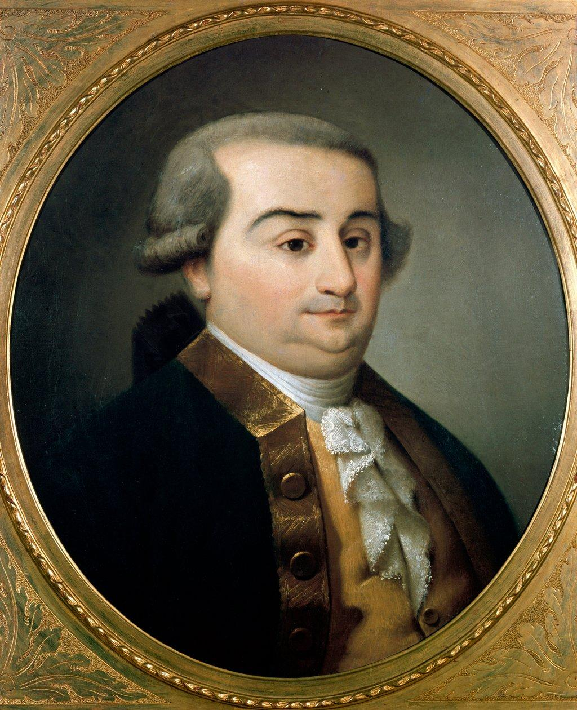
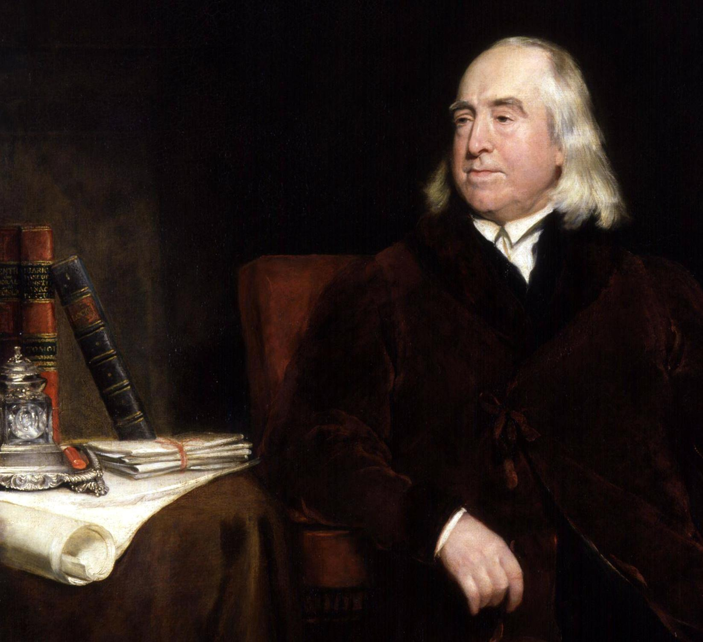
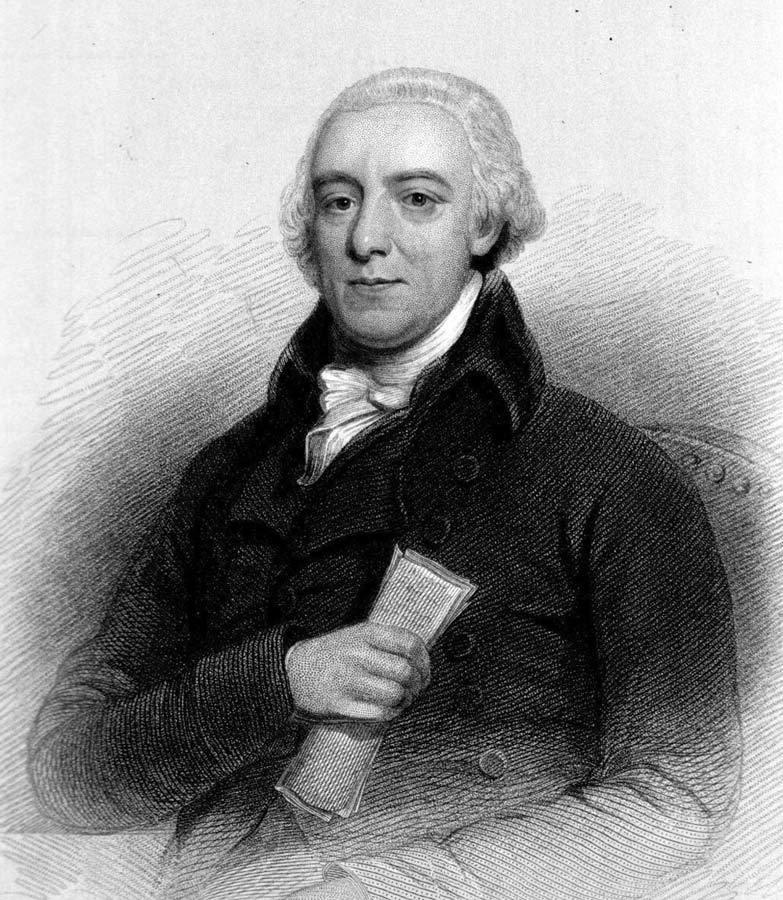
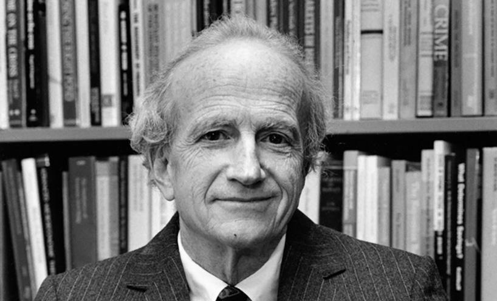

# 正文（1979年3月21日）

**讲座提要**

美国新自由主义（II）——把经济构架运用于各种社会现象——回到秩序自由主义的问题域上面：Gesellschaftspolitik 的歧义性。“企业”模式在社会领域中的普遍化。经济政策与生命政策（Vitalpolitik）：一个面向市场与背向市场的社会——美国新自由主义中市场经济形式无限制的普遍化：个人行为的可知原则与政府干预的批评原则——美国新自由主义的几个方面（2）：违法与刑罚政策——历史回顾：18世纪末刑法的改革问题。经济考量与合法性原则。在19世纪中，规范（norme）对法律的干扰及一门犯罪人类学的诞生——新自由主义的分析：（1）对罪行的定义；（2）把犯罪主体表征为经济人；（3）惩罚的地位是作为“强化”法律的工具。以毒品市场为例——这种分析的结果：（a）从人类学上消除罪犯；（b）训戒模式（modèle disciplinaire）退出游戏。

## 一、社会与经济

### 1. 问题的提出

今天，我想谈一下美国新自由主义的一个方面，即（美国新自由主义者们）如何试图利用市场经济，以及如何把具有市场经济特点的分析用于破解各种非商品关系，用于破解那些非严格意义和原有意义上的经济现象，我们称后者为社会现象。换个词语来表述，就是说把经济框架运用到这样的领域：根本地来看，自19世纪起或者我们可以说可能已经从18世纪末开始，这个领域的定义就是与经济相对照，至少可以说是作为经济的补充，作为一种不隶属于经济的自在（en soi），具有自己的结构以及自己的进程，即使在当经济自身位于这个领域之内的时候也是如此。换句话说，在我看来，美国新自由主义分析类型的关键之处，就是社会与经济关系的倒置问题。

## 二、秩序自由主义

### 1. 社会政策

我们重新来看一下德国自由主义或者秩序自由主义的主题。你们都记得，在欧肯、罗普克、穆勒一阿尔马克等人的理解中，市场被定义为一种经济调节原则：它对价格的形成，以及接下来的经济活动恰当的进行是必不可少。相应于作为经济必不可少的调节功能的市场来说，政府的任务是什么？就是组织起一个社会，实行人们所说的Gesellschaftspolitik，就如脆弱的市场机制、脆弱的竞争机制能够充分运转并且根据它们自己的结构来运转[〔1〕](#note-1)。

因此，Gesellschaftspolitik 就是一种以建立市场为导向的Gesellschaftspolitik。这种政策应该承担并考虑社会进程，以便在社会进程的内部之中，给予市场机制一席之地。但是为了构建出一种市场空间—在其中尽管各种竞争性机制具有内在的脆弱性但它们仍可以真正地运转；这种关于社会的政策，这种 Gesellschaftspolitik，它是由什么组成的？它是由我讲过的某些目标组成，比如避免集中化，促进中等企业发展，支持他们所谓的非无产阶级企业（这些企业大体上就是指手工业和小商业等），增加拥有财产的途径，以风险的社会担保代替个人保险，解决所有各种各样的环境问题。

### 2. 企业社会的歧义

这种Gesellschaftspolitik，很明显，它包含歧义并且产生出一些问题。比如，与难以管理的、另一种真实的经济过程相比，它具有纯粹祈愿式的特征以及“简便”特征。它同样牵涉到一种干预、一种承重、一个领域，一些极其多的干预数量，人们可以自问这些干预是否确实符合了这一原则：不是对经济过程干预而是为了经济过程干预。

总之，在所有这一系列的问题和歧义中，我想要强调的是：在Gesellschaftspolitik 观念中，围绕着企业概念，有一种我称之为经济-伦理歧义性的东西，因为罗普克、鲁斯图和穆勒-阿尔马克意义上的Gesellschaftspolitik 的意思是，一方面，在社会机体或社会组织（tissue social）内部实际上使“企业”形式普遍化；也就是重新拿出社会组织，使之能够被分配、被分割、被加强，但不是根据个人细小单位，而是根据企业细小单位。个人的生命应该不是作为个体生命进人大型企业的框架之中，后者可能是工厂，或者最坏的情况，是国家；而是个人生命能够进入到各种相嵌与混合在一起的企业多样性框架之中，这些企业在某种程度上，对个人来说，非常容易操控，它们的规模非常有限以便于个人的行动、决定以及选择能够产生一些值得注意的和可察觉到的效果，它们的数量众多同样是为了不依赖于其中唯一一个，最后还需要个人的生命本身——加上他与其私有财产的关系，与其家庭的关系，与其丈夫或妻子的关系，与其保险金的关系，与其退休金的关系——使这个人成为一种永久的和多样化的企业。因此，根据企业模式，根据诸多企业模式来重新塑造社会，并且一直到它的最细小的颗粒处，这正是德国秩序自由主义的Gesellschaftspolitik 的一个方面[〔2〕](#note-2)。

### 3. 生命政策

然而，“企业”形式的普遍化具有何种功能？一方面，它当然增强了经济模式、供给与需求模式、投资-成本-利润（investissement-coût-profit）模式，以便使之成为一种社会关系模式，一种自身生存模式，一种个人与自身、与时间、与周边、与将来、与团体、与家庭之间的关系形式。

因此，一方面企业模式增强了经济模式。另一方面，秩序自由主义者们的想法——使企业成为一种全面地普遍化的社会模式，在他们的分析与规划中，这个想法支撑了他们所谓的一系列道德和文化价值的重建，后者我们可以称之为一些“暖”（chaudes）价值，它们的表现正好与“冷”（froid）的竞争机制形成对照。因为，通过企业图式要做到的是：用既是传统的又在秩序自由主义者那个时代很流行的话来说，使个人在与工作环境的关系中，与其生命时间的关系中，与夫妻关系中，与家庭关系中，与自然环境的关系中，不再会被异化。要围绕个体重建一些具体的感情根基，后者构成了鲁斯图所说的 Vitalpolitik[〔3〕](#note-3)。因此，回到企业，这既是一种经济政策或者说一种使全部社会领域经济化，从全部社会领域转到经济上的一种政策，同时又是表现为并且想要成为Vitalpolitik 的一种政策，其功能是对经济自身竞争游戏中冰冷的、冷漠的、考量的、理性的、机械的东西进行补偿。

### 4. 面向市场与背向市场

秩序自由主义者们所梦想的企业社会是一种面向市场的社会，也是一种背向市场的社会，一种朝市场转向的社会，也是这样一种社会：对市场带来的价值影响与生活影响进行补偿。在前些时候我提到过的那个李普曼会议上[〔4〕](#note-4)，鲁斯图这样说过：“根据市场经济规律来组织社会机体（corps social）的结构，这是应该做的。但是剩下还要做的是应该满足增长的、新的融入化（integration）需要。”[〔5〕](#note-5)这就是 Vitalpolitik。接下来，罗普克这样说：“竞争在市场经济领域中是一种秩序原则，但不能在其之上建立全部的社会原则。从道德以及社会学上来看，竞争更多的是一种具有消解力而不是具有团结力的原则。”因此，罗普克说[〔6〕](#note-6)，在实行一种政策使经济竞争能够运转起来的同时，还应该组织起“一种政治和道德框架”，这个政治和道德框架包括什么？首先，国家能够在不同的竞争集团和不同的竞争企业的底部维持着。这种政治和道德框架必须确保一种“不瓦解的共同体”，并且最终，它保证了“自然地扎根和社会地融合在一起”的人类之间的相互合作。[〔7〕](#note-7)

## 三、市场形式的普遍化

### 1. 社会行为的可知性

与德国秩序自由主义的歧义性相比，美国新自由主义很明显地表现出另一种严密的彻底性或不一样的完整和详尽。因此，美国新自由主义总是普及市场经济形式，把后者普及到整个社会机体中，普及到所有在起源上并非贯穿着货币交换或者并非受货币交换裁决的那些社会系统中。这种市场经济形式绝对的、无边界的普及带来一些结果或者说包含着一些方面，下面我想说说其中两个。

首先，在美国新自由主义中，市场经济形式的普及，除了作为货币交换关系之外，它还充当社会关系和个人行为的可知性原则和解密原则。这就是说，根据市场经济进行的分析，或者说依据供给与需求进行的分析，可以作为范式应用到所有非经济领域。由于这个分析范式、这种可知性构架，人们可以使非经济活动、非经济关系、非经济行为呈现出一些可知关系，因而这些可知关系本身并不是像经济学家对非经济东西所作的分析那样。这就是（新自由主义者们）对某些领域的所作所为。

上次课，关于人力资本投资方面，我谈到了其中的几个问题。你们都记得，在他们对人力资本所进行的分析中，比如，新自由主义者试图解释母亲与子女的关系如何具体的体现为母亲陪伴子女的时间、给予子女的照顾、所付出的情感、对子女今后发展、教育、学业和身体进步、喂养子女的方式以及母亲与孩子之间的喂养关系这些方面的关注；所有这些，对新自由主义者来说，都是一种可用时间来衡量的投资，这种投资将构成什么？一种人力资本，一种子女人力资本，这种资本将会带来收益[〔8〕](#note-8)。这个收益将是什么？就是子女成人后子女的工资。对于已投资的母亲来说，她的收益是什么？新自由主义者认为，是一种心理收益。对子女付出照顾并且看到这些照顾取得成效，母亲将会获得满足。因此，从投资角度、人力资本成本、从投资资本的经济收益和心理收益之角度，我们可以分析母亲与子女之间的宽泛意义上的培养关系或教育关系。

### 2. 生育与人力资本

同样的方式，通过研究出生率问题以及富裕家庭特征，或者说比较富裕的家庭比贫困家庭或者比较贫困的家庭更纯粹是马尔萨斯主义的——也就是说，收入越高，家庭人数越少，这是所有人都知道的古老定律——新自由主义者们试图重新表述该定律并加以分析，他们这样说：但是，这仍然是矛盾的，因为严格的从马尔萨斯观点来看，较多的收入可以允许有更多的孩子。对此，他们（的回答是）：事实上，这些富人的马尔萨斯式行为，是否是一种经济悖论，是否应该将其归于非经济的道德范畴、伦理范畴和文化范畴内的一些因素？完全不是。这里，仍然是并且一直就是经济因素在起作用，因为高收入者是那些具有高人力资本之人，正如同他们的高收人所证明的那样。对这些人来说，他们的问题是传递给子女非传统意义上的遗产。这个不一样的要素使他们代代相连，但不是以传统继承遗产的模式，而是以传递人力资本的模式。我们已经知道，人力资本的传递和培养暗含着父母一方的时间、教育关心，等等。一个富裕家庭，即一个高收入家庭，即由高人力资本要素所组成的家庭，就会直接合理地作出经济计划，至少要把同样高的人力资本传递给子女，而这牵涉着—系列的投资：来自父母一方的金钱投人和时间投入。然而，如果家庭人数众多，这些投入则是不可能的。因此，美国新自由主义者认，必须把与父母所持有的至少同样多的人力资本传递给子女，正是这个必要性解释了富裕家庭与贫困家庭相比在人数上的限制。

### 3. 婚姻与交易成本

设想仍然还是从经济角度分析各种社会关系——到目前为止，后者涉及了人口统计学、社会学、心理学、社会心理学，仍然还是在这一视角下，新自由主义者试图分析婚姻现象以及夫妻生活中所发生之事，也就是说单纯从经济方面使个体共存关系中的婚姻合理化。

对于这个问题，加拿大经济学家米格[〔9〕](#note-9)（Jean-Luc Migue）做了一些工作和推广，并且写过一篇值得一读的文章[〔10〕](#note-10)。我不准备谈其文章的分析部分，但是他说过这句话：“近年来经济分析的巨大贡献之一（他指的是新自由主义的分析）是，把传统上只用于企业和消费者的分析构架完整地用于家庭领域。（•••••）旨在把夫妻生活变成一种生产单元，就像传统的企业。（•••••）因此，夫妻生活难道不就是双方的一种合同约定以提供特殊的投入并且按既定的比例分享家庭单位的产出（output）吗？”介于以家庭单位和夫妻关系形式共同生活在一起的人之间，建立起一种长期合同，这种合同的意义何在？经济上来看，是什么使其正当，其基础又是什么？夫妻间的长期合同可以避免每时每刻无休止地商议那些不计其数的合同条款，后者必须被略过以便家庭生活运转起来[〔11〕](#note-11)。你把盐递给我，我传给你胡椒粉。某种程度上，婚姻这种长期合同完全解决了这种类型的交易，前者使得新自由主义者所说的不过，我想并非只有他们这样说——节约交易成本成为可能。如果每一个动作都需要交易，那么会有一种时间成本，因此就会有个体绝对无法跨越的经济成本。而这个成本通过婚姻合同就解决了。

下面这个可能显得很可笑，但是你们之中有人可能读过皮埃尔•里维埃（Pierre Riviere）在去世前留下的文本，在其中，他描述了其父母是如何生活的[〔12〕](#note-12)，你们会觉察到在19世纪初，一对农民的夫妻生活不停地被一系列交易所交织和网罗着。男人对女人说，我去帮你耕田，但条件是我可以和你上床。女人说：你不喂好我的母鸡，你就别想和我上床。在这个过程中，我们可以看到一种不停地交易，通过后者，

婚姻合同应当构建出一种总体经济样式以使无须每时每刻都讨价还价。从某种方式上来说，父母之间的关系，男女之间的关系，只是共同生活的合同化活动的日常展开。这样，所有的冲突就只是合同的实现；但是同时合同并没有发挥其作用：它没有在事实上（做到）它本该确保的交易之节约成本。总之，我们说新自由主义者的经济学分析尝试用经济的词语去辨读那些传统上并非经济的社会行为。

### 4. 政府行为的经济批判

新自由主义者们的分析的第二个值得注意的用途是，经济网络构建（grille economique）将能够并且必须能够验证政府行为，评定其有效性，能够反对国家公共权力行为的滥用、过度、无效以及超额支出等。总之，经济构架的适用，其目的这一次不再是使得社会进程能够被理解并且使它们变成可知的，而是要使不断地对政治活动以及政府活动进行政治批判的做法得以立足并且使之正当化，也就是说要依据供给与需求，依据供给与需求的既定条件的有效性，依据国家公共权力对市场领域的干预所牵涉的成本来审查所有国家公共权力行为。总之，要构建一种对已经实际地运转的治理术的批判，这不仅仅是一种政治批判，不仅仅是一种法律批判，这还是一种商业批判，一种与国家公共权力行为相对立的非道德的商业批判。这些并不仅仅是一个空中楼阁式的规划或只是理论家的想法。

在美国，这种类型的批判不断地在运行着，特别在一个机构中得到发展，而这个机构并不是以批判为宗旨的，因为它早在新自由主义学派、在芝加哥学派的发展之前就已经创立了。这个机构叫做 American Enterprise Institute[〔13〕](#note-13)（美国企业研究所），其目前的基本功能就是以成本和利润来评定所有公共活动。比如1960-1970年十年间由肯尼迪政府和约翰逊政府所提出的关于教育、卫生、种族隔离方面的著名的大型社会规划。同样，在上述类型的批判中也要对各种联邦机构的活动进行评定，后者是从罗斯福新政起，特别是从二战结束后开始被建立起来的，比如食品和健康部，Federal Trade Commission（联邦贸易委员会）[〔14〕](#note-14)，等等。因此，出现了一种我们所称的“经济实证主义”（positivisme economique）形式的批判，一种对政府政策的永久批判。

看着此种类型的批判的事实，我们不能不想到一种相似的类比：它就是日常语言学派的实证主义批判。当你们去看一下美国人如何利用逻辑、如何利用维也纳学派的逻辑实证主义应用于话语，不管是科学话语、哲学话语还是日常话语，你们会发现一种审查（filtrage），从矛盾、缺乏连贯、无意义方面来审查整个陈述[〔15〕](#note-15)（enonce）。在某种程度上，我们可以说，新自由主义者们试图把一种经济学批判应用于政府政策之上，这种批判同样也是从矛盾、缺乏连贯、无意义方面来审查所有的国家公共权力活动。在与行政管理部门的争论中，市场的一般形式变成了偏向的手段和工具。换句话说，在传统自由主义那里，人们要求政府尊重市场形式并且对其放任自由。而在这里，人们把放任自由转变成不要对政府放任自由，要以市场规律的名义来评定和评估每一个政府行为。放任自由转变了，并且市场不再是政府自我制约的原则，它是一种转而与之对立的原则。它就像一个树立在政府面前的永久的经济法庭。在19世纪，为了反对政府行为的过度，人们曾经寻求建立一种行政法庭，使得可以从法律方面来评定国家公共权力行为，而在这里出现了一种经济法庭试图严格地从经济和市场方面来评定政府行为。

## 四、刑罚改革

### 1. 十八世纪的刑罚经济学







这两个方面——通过经济学可知性的构架来分析非经济行为，从市场方面来批判和评估国家公共权力行为在某些新自由主义者所做的对犯罪行的分析中、对刑事司法机关的功能分析中，我们能再次找到它们，并且现在，我正是想要以经济学分析的这两种应用（刚才所说的），来讲一下在埃里希（Ehrlich） [〔16〕](#note-16)、施蒂格勒（Stigler）[〔17〕](#note-17)和贝克尔（Becker）[〔18〕](#note-18)的一系列文章中是如何重新提出犯罪行为问题的。起初，他们对犯罪行为的分析看起来就像尽可能简单地回归到18世纪的改良派，回归到贝卡利亚[〔19〕](#note-19)，尤其是回归到边沁[〔20〕](#note-20)。确实，当我们重提18世纪末期的刑法改革问题时，我们觉得改良者们所提出的问题正是一个政治经济学问题，在此意义上，它涉及对政治或者权力行使进行经济学分析或是进行一种无论怎样都具有经济学风格的思考。它涉及从经济学上来考量，或者无论怎样都以逻辑和经济合理性的名义来批判刑事司法机关的功能，就像我们在18世纪所见证到和观察到的那样。我们在一些文本中看到，在边沁那里比在贝卡利亚那里看得更清楚，同样在一些人，比如科克豪恩（Colquhoun）[〔21〕](#note-21)那里也能很清楚地看到对违法成本的大体计算：盗贼们随心所欲地流窜到某个国家或城市的成本是多少；司法实践自身以及运行中的司法机关的成本问题；同样对惩罚系统的有效性不足进行批判；比如，肉刑（supplices）和流刑（bannissement）对犯罪率的降低起不到任何明显作用—在那个时代人们所能做出的估算的范围内—但是，总之，在18世纪改良者的批判性推理之下有一种经济学构架。对此，我已经强调过[〔22〕](#note-22)，我不再去谈它。

### 2. 法律与惩罚

这样，根据效用来审查所有的刑罚实践，通过这一活动，改良者所要寻求的正是这样一种刑罚系统：其成本在我刚才所提到的所有那些意义上来说，都是尽可能最低的。我想我们可以说，由贝卡利亚所起草的、边沁所支持的，最终被18世纪末和19世纪初的立法者以及法典编纂者所采用的解决办法是什么样的呢？它是一种严守法规的（legaliste）解决方法。这种对法律的巨大关切，这个原则不停地提醒我们：为了使一种刑罚系统良好地运转，必须有或者最多几乎只需要一种好的法律就够了；这与有意愿地从经济方面寻求我们所谓的交易成本的降低是一回事。为了较好地惩罚人们并且为了使这种惩罚有效，法律是最经济的解决途径。

第一，我们把罪行（crime）定义为是对已成文法律的违反；因此，只要没有法律，就从来没有罪行并且也不可能控诉某一行为。

第二，刑罚必须由法律确定下来并且一劳永逸地确定下来。

第三，这些刑罚在法律自身中应该按照罪行的严重性的等级程度而被确定下来。

第四，刑事法庭因此只有一件事要做，就是把根据其罪行的严重性预先确定好罪犯所应遭受的刑罚的法律，应用于已经确定和被证实的罪行[〔23〕](#note-23)。

这种绝对简单的机制，这种看起来完全理所当然的机制就是最经济的样式，也就是说，为了惩罚并且消除被认为是对社会有害的行为，这种机制的成本最少，效果最确实无疑。

我认为在18世纪末，在惩罚权力中，法律和法律机制被当作经济原则——在经济这词最宽泛和最严格的意义上。L'homo penalis，即可以被惩罚的人，面临法律威胁并且可能被法律惩罚的人，严格意义上来说就是 homo oeconomicus。正是法律把刑罚问题与经济问题衔接起来。

### 3. 犯罪人类学

在19世纪中，事实是这种布局导致了一个矛盾结果。这个矛盾的结果，其缘由是什么？其原因是什么？这种模糊性的原因在于事实，即法律（loi）自身，作刑罚结构的普遍形式，显然是与违法行为挂钩的。当然，法律只制裁行为。但是，从另一方面来说，刑律存在的各种原因，换言之，惩罚的必要性、惩罚的等第分级，刑律的切实适用，这些当然只有在我们不去惩罚某一行为的情况下才有意义——因为惩罚一个行为是毫无意义的——只有在对个人，对违反法律的个人进行惩罚、改造，让其他可能违法者引以为戒，在这样的情况下，惩罚才有意义。

因而，在一种相关于行为的法律形式与只能针对个人的法律实际适用这两者之间有一种模糊性，在罪行和罪犯之间的模糊性中，我们看到一条内在于整个系统的趋势线（linge de pente） 是如何勾勒出来的。内在于整个系统的趋势线，它的走向如何？它朝着法律的适用越来越个人化的趋势发展，并且作为结果，它交互地趋向于在心理学、社会学、人类学上对法律所应用之人进行问题化。

也就是说，在整个19世纪过程中，homo penalis 正在转变为我们可称之为homo criminalis。而且，当犯罪学在19世纪末建立起来的时候，准确地说正是在贝卡利亚所倡导、边沁所范式化的改革一个世纪之后，homo criminalis 被建立起来的时候，最终出现了一种模糊，而且 homo legalis、homo penalis 重新被提出来，通过一套完整的人类学，一套完整的犯罪人类学，后者用全面的膨胀取代了很严格、很节省的法律机制；全面的膨胀即知识膨胀、认识膨胀、话语膨胀，机构、机关、决策因素的成倍增长，以及以法律名义通过个人化的规范措施来干扰判决。因此，法律的节省原则以及法律的纯粹机制，导致了一整套膨胀，从19世纪末开始，刑罚系统就不停地陷入到后者之中。好了，无论如何，这就是在最贴近于新自由主义者们对这一演变的可能想法的同时，我所要说的。

## 五、犯罪经济学

### 1. 回到经济人







新自由主义者们的分析不关心这些历史问题，因此，新自由主义者加里•贝克尔的分析——-一篇发表于1968年的《政治经济学杂志》（Journal of Political Economy）上，名为《罪行与惩罚》的文章[〔24〕](#note-24)——在于从根本上重拾贝卡利亚和边沁的效用审查，试图在所有可能的情况下（避免）之前出现的从 homo oeconomicus 滑向 homo legalis 和homo penalis，并最终滑向 homo criminalis：在所有可能的情况下，通过一种纯粹的经济学分析，要尽可能地停留在homo oeconomicus 层面上，并且弄清楚罪行、可能犯罪性（criminalite）是如何能基于此而被分析；换言之，要试图抵消所有当我们想要——就像贝卡利亚和边沁的情况——重新思考一些经济问题并且在绝对相符的法律框架内部使其显现时所产生的后果。

换言之——这里，我讲的仍然不是新自由主义者们所认为的，因为（他们的问题不是历史）——我认为这些新自由主义者可能会这样认为：18世纪的刑罚变动，其错误和原因来自于贝卡利亚和边沁的想法，即效用考量可以适当地体现在法律结构内。然而根本上来看，这正是18世纪末期所有政治批判和规划的梦想和关键点之一：效用体现在法律中并且法律完全建立在效用考量的基础之上。刑法的历史表明这种—致是不能实现的。**因此要保留homo oeconomicus 之问题**，不要企图立刻从法律结构方面，以法律结构形式来表达这个问题域。

### 2. 罪行的定义

那么，他们如何在一个经济问题域之中来分析或保留对罪行问题的分析？首先，对罪行下定义。贝克尔在他的《罪行与惩罚》（sic）一文中给出了罪行的定义：我把所有使个人面临被处以一种刑罚危险的行为称作罪行[〔25〕](#note-25)。（笑声）你们的笑使我感到意外，因毕竟大体上这就是法国刑法典对罪行的定义，事实上，所有的法典都从中借鉴过，你们都很清楚，刑法典是如何定义违法行为（delit），它是受到轻罪处罚（peine correctionnelle）的行为。什么是罪行（crime）？你们的那部刑法典里说，它是指受到身体处罚以及剥夺公民权利处罚的行为[〔26〕](#note-26)。换句话说，刑法典没有给出对罪行的任何实质的（substantielle）定义、任何性质的定义、任何道德上的定义。

罪行是受到法律处罚的行为，就这一点。因此你们看到，新自由主义者的定义与之非常相近：罪行是使个人面临被处以刑罚危险的行为。这很相近，但是你们看到还有区别，一种视角的不同，因为法典在避免给出罪行的实质定义的同时，它站在行为的角度上看问题并且询问行为是什么，总之就是如何赋予一种犯罪行以具体特征，即恰恰作为罪行而受到处罚的犯罪行为的特征是什么。这是一种行为视角，一种可供法官利用的可操作性的特征化。我们必须认为所有受到法律处罚的行为都是罪行。这是一种从法官视角而做出的客观和可操作性的定义。当新自由主义者们说，罪行是所有使个人面临被处罚危险的行为的时候，很简单，你们可以看到定义是相同的，但仅仅只是视角有所改变。**它是站在犯罪之人或将要犯罪之人的视角上看问题**，而定义的内容保持不变。问题就来了：对行为主体来说，对举止或行为主体来说，什么是罪行？罪行就是使该主体面临被处罚危险的那个东西。

### 3. 犯罪主体与可治理性

你们发现这种视角的转移事实上与关于人力资本和劳动所做的转移是同一种类型。上节课我试图向你们展现新自由主义者是如何重提劳动问题，并试图不再从资本的角度或经济机制和经济过程的视角，而是通过劳动者的视角来思考问题。同样，这里我们也过渡到单个主体的角度，但是在过渡到单个主体层面上来时，我们并不因此急于获得一种心理学知识，一种人类学涵义；就好像当我们从劳动者的视角谈论劳动时，却不对劳动作人类学分析。我们只有在下面这种情况下才能过渡到主体层面上来——后面我还会再讲到这个，因为它非常重要（这里我只是很粗略地谈一下此事），即我们能够通过使自身成为一种经济行为的行可知性网络（reseau d'intelligibilite）之方面、种类来把握主体本身。

我们只能把主体当作为 homo oeconomicus，这不意味着整个主体被当作 homo oeconomicus。换句话说，将主体理解homo oeconomicus 并不涉及一种对所有行为的人类学同化（assimilation），而不考虑到经济行为。它的意思只是说，经济行为就是我们所赋予新个体之行为的一个可知性构架。它同样意味着，通过经济行为这个可知性构架，个体将变得是可被治理的（gouvernementalisable） ，当个体成为homo oeconomicus的情况下，并且只有在这种情况下，我们才将能够把握住它。这就是说个体与作用于它之上的权力之间的接触面，因而权力对个人的调节原理，就只会是这种 homo oeconomicus构架。homo oeconomicus，是治理与个人的接触面。但这完全不意味着整个个人，整个主体都是一名经济人。

通过把个体主体当作 homo oeconomicus，我们过渡到单一主体层面上来，并因此我们把罪行定义为使其面临受法律处罚危险的个人行为，那么你们看到，一个违反交通法的行为与一个谋杀行为没有任何区别。这也同样就是说，在这种视角下，不会基于任何道德和人类学行特征来标记或审问犯人。任何人绝对就是犯人，所有人都是犯人，不管是谁只要他投入行动，期待从中获利并承受失败的风险，都被当作犯人。从这种观点来看，犯人只是这样并且应该只能是这样。在这种情况下，你们看到刑罚体系所要关心的，不再是那种二分为罪行和罪犯的实在（realite）。它关心的是一种行方式（conduite），后者产生出行为人期待从中获利的那些行为，并且行为人面临着一种特殊的风险—不是经济损失而是面临刑罚危险或者由刑罚体系而遭受的经济损失的危险。因此，刑罚体系本身不再与各种犯人而是与做出上述那种行为之人打交道。换言之，它将要对罪行的供给（offre）做出回应。

### 4. 惩罚与消极外部效应

那么，在上述这些条件下，惩罚将会是什么样的？这里，我仍然参考贝克尔的定义，惩罚是为了限制某些行为的消极外部效应[〔27〕](#note-27)（externalite negative）而使用的手段[〔28〕](#note-28)。这里，你们仍然会看到这与贝卡利亚或边沁、与18世纪的问题域非常接近，在后者的问题域中，你们知道，惩罚的正当性基于这个事实，即被惩罚的行为是有害的并且正是由于这一点人们才制定法律。这个相同的效用原则同样也适用于惩罚尺度。我们必须以这样的方式惩罚，即以便于消除或预防行为的那些有害影响。因此，我们一直非常接近于18世纪的问题域，但是在这里，同样有点重要的变化。

传统理论只是试图把人们对惩罚所期待的各种不同的、异质的结果都互相衔接到一起，也就是说对损害的赔偿问题是种民事问题，是对个体的改造问题，是对其他个体的警示问题，等等，而新自由主义者对惩罚做出一种不一样的衔接或不一样的脱节。他们区分两种东西，最终他们从根本上只是重拾起在英国思想或法律思考中很常见的一种问题域。他们说：一方面，存在着法律，但什么是法律？法律就只是一种禁令，是禁止的一种成文表述；从另一方面来说，它又是一种客观实在，一种制度实在。参照另一种问题域，我们可以这样说：它是一种具有某些效果的speech act （言语行为）[〔29〕](#note-29)。另外，这种行为自身具有一定成本，因为法律的成文牵涉到议会讨论以及做出决定。因而它是一种实在，但它只是那样一种实在。然后，另一方面还存在着一些工具，通过它们我们将赋予禁令一种现实的“强力”（force）。

这种关于法律强力的观念，你们知道，它是由我们经常见到的一个词enforcement 表达出来的，我们通常把后者翻译为法律的“强化”（renforcement）。但这是不对的。enforcement of law 不只是法律的适用，因为它涉及所有一系列使法律得以适用的现实工具。但是它也不是律例的强化，它够不上律例的强化，因为强化意思是说法律太薄弱了，应该对其加以补充或者使其更严厉一些。enforcement of law 是为了赋予法律所表述的禁止行为以社会实在性和政治实在性等而运用的一整套工具。

### 5. 法律施行

法律施行（enforcement）的工具——请原谅我这种旧词新译的转写—-它们会是什么？它们会是对每一个罪行所能预见的惩罚数量。它们会是负责侦察罪行的机关的权势、活动、热情和权限之所在。它们将会是负责使犯人们承认罪行并且切实地提供各种犯罪证据的机关的权势和资质之所在。它们会是法官做出裁决的迅速程度大小，在法律规定的幅度内做出裁决的严厉程度大小。它们同样将会是惩罚的有效程度大小，是被适用的刑罚的固定程度大小，这种固定程度可能被监狱机关修改、减轻或加重。所有这一整套东西构成了法律施行，因此，将出现一种我们所称的负需求（demande negative）来应对我之前谈到的作为行方式的犯罪供给。法律施行是一整套作用于犯罪市场的工具，该市场用负需求来对抗犯罪供给。然而，法律施行当然既不是中立的也不是无限定地扩展，这由于以下两个相关原因。

第一，当然就是因为犯罪供给并不是一种无限定的、均匀的弹性供给，也就是说它不是以相同的方式回应与其相对的负需求的所有形式和所有等级。总之，简单地说：存在着犯罪的某些形式，或者犯罪行为方式的某种阶段，它们很容易屈从于负需求的变化或轻微的增强。

拿最平常的例子来说：一个大卖场，其20%的营业额被偷窃侵占，我很随意地说个数据。既不需要在监管上也不需要在多余的法律施行上花费太多，就很容易使数据降到 10%。降到5%—10%之间也相对比较容易，但要降到5%以下、2%以下等就非常困难。

同样的道理，可以肯定的是，通过使离婚更方便，我们可以相对地在激情犯罪的初级阶段就使之消失。之后，仍然存在着、个激情犯罪的核心部分，法律层面对离婚的宽容并不会改变它。因此，根据被考察行为的阶段不同以及类型不同，相对于负需求结果的供给的弹性变化并不是均质的。

### 6. 执法成本与犯罪供给

第二，这点与第一点完全相连，这种施行自身有成本和消极外部效应。它有成本，就是说它要求一种另类回报（remuneration alternative）。所有投入到法律施行机关中的东西，你们不能在别处使用。另类回报是理所当然的。它有成本就是说它包括诸多政策缺陷、诸多社会缺陷，等等。因此，当18世纪改良者聚焦于普遍的法制系统来完全消除犯罪的时候，一种刑罚政策不能把他们的目标和靶子当作自己的目标。刑律以及边沁所梦想的所有刑事机制应当最终使得不再有犯罪，即使现实不能实现。关于敞视（panoptique）的观念，关于透明（transparence）的观念，关于注视每一个个体的观念，关于刑罚等级足够细致的观念，使每个人在其考量中，在其内心深处，在其经济考量中能够这样告诉自己：不，无论如何，如果我犯了这个罪，我遭受的刑罚是极度严重的，因此我不去犯罪。在18世纪改良者的头脑中，普遍地消除犯罪的目标就是合理性原则和刑罚考量的组织原则。

而这里，正相反，刑罚政策绝对应该放弃消灭犯罪或彻底地消除犯罪之目标。刑罚政策要以调节为原则，它只是对犯罪市场的一种干预并且要考虑到犯罪供给。它是一种限制犯罪供给的干预并且通过负需求来对其限制，当然对其制约所需的成本从来不能超过要限制其供给的犯罪的成本。这就是施蒂格勒对刑罚政策之目标的定义。他说：“法律的施行，其目标在于与社会所规定的行为规范达成某种一致性，而后者是社会在考虑到施行成本的时候所相信能够做到的。”这句话出自1970年的《政治经济学杂志》[〔30〕](#note-30)。你们看到，在这时，社会表现为循规蹈矩的行为（comportements conformes）的消费者，根据新自由主义的消费理论，也就是说社会生产出那些借助于某种投资来满足社会的循规蹈矩的行为。

由此，好的刑罚政策根本不是为了消灭犯罪，而是为了达到犯罪供给曲线与负需求曲线的平衡。或者说：社会不是无限制地需要循规蹈矩。社会根本不需要服从于一种彻底的惩戒系统。社会保持着某一程度的违法率并且它非常不愿意无限制地降低这个违法率。这就又重新提出刑罚政策的根本问题，不是问：如何惩罚犯罪？也不是问：何种行为应该被认为是犯罪？而是问：应该容忍何种犯罪？或者问：何种不容忍是不能容忍的？这就是贝克尔在“犯罪与惩罚”中的定义。他提出两个问题：“多少轻罪应该被允许？第二，多少轻罪犯人应该不受到处罚？”[〔31〕](#note-31)这就是刑罚（penalite）问题。

## 六、毒品市场

### 1. 缉毒政策

具体地来看，这导致了什么？这种风格的分析并不多见。在对死刑的分析中，埃里希（Ehrlich）总结出，最终来看，死刑仍然是非常有用的[〔32〕](#note-32)。但是我们终究还是不要去管它。这种类型的分析在我看来，与所研究的对象相比，它既不是最值得关注的也不是最有效的。相反，确定无疑的是，在其他领域，特别是在犯罪活动较好地涉及市场现象的领域中所产生的结果仍然还是值得探讨的。

很显然，本质上来看，毒品问题自身就是一种市场现象，属于一种经济学分析，属于一种更易于理解、更直接的犯罪经济学[〔33〕](#note-33)。因此，毒品表现为市场，我们说一直到大约20世纪70年代左右，对于毒品的法律施行政策仍然根本上是针对减少毒品的供给。减少毒品的供给、毒品犯罪的供给以及毒品违法行为的供给——减少供给，这是什么意思？当然这是指减少流入市场中的毒品数量，那么减少流入市场中的毒品数量，这又是什么意思？首先，控制和摧毁制毒网络；其次，控制和摧毁贩毒网络。

然而，关于60年代的这项政策，大家很清楚它导致了何种结果。它从未彻底地摧毁——由于一些我们无法讨论的原因，不是吗？——而只是部分地摧毁了制造和分销网络，这带来了什么结果？第一，它提高了毒品的单价。第二，它便利了和强化了垄断地位或一些大卖主、大贩卖商、大制造和分销网络，因此，受到垄断和卖方市场的影响，毒品的卖方市场出现了价格上涨，在某种程度上人们不去遵守市场规律和竞争规律。第三，在严格意义上的犯罪活动层面上出现的另一种更重要的现象是：毒品的消费，至少对严重的毒瘾者以及某些毒品来说，毒品的需求绝对是刚性的，也就是说不管价格如何，吸毒者都想要得到他的商品并且准备支付任何价格。正是毒品需求曲线的刚性使得犯罪活动增长——清楚一点说，在大街上我们碰上某人从他身上抢10美元来购买我们所需要的毒品。因此，从这个观点来看，在60年代发展起来的立法、立法风格或者说法律施行的风格被证实是一场耸人听闻的失败。

### 2. 价格与需求弹性



关于这个问题，1973年瑟利（Eatherly） 和莫尔（Moore）依据自由主义经济提出了第二种解决方法[〔34〕](#note-34)。他们说：想要限制毒品的供给是完全不理智的。我们应该给毒品供给让出道路，也就是大体上说，非常粗略地来说，要使得毒品更易获得并且比较便宜，但接下来要伴随着幅度和精确度。事实上，现实的毒品市场是何种情况？根本上来看，存在着两种类别的买家和需求方：刚开始消费毒品之人，其需求是弹性的，也就是说他们就是这样一些人：受到高价格的阻碍而放弃毒品消费必定带给他们的许多快感，他们支付不起这样一种消费。还有一种刚性需求，也就是无论价格如何都会去购买的那些人。

那么贩毒商的态度又如何？提供相对较低的市场价格给那些弹性需求的消费者，也就是那些毒品初食者，那些小消费者，并且一旦——只有一旦—他们成常规消费，也就是说一旦他们的需求变成刚性的，这时候人们就提高价格，人们提供给他的价格就是非常高的垄断价格，后者因此导致了犯罪现象的出现。

那么，那些掌握法律施行政策方向的人，他们的态度又如何？对他们来说，正相反，应该使人们所谓的准入价格，也就是给新进消费者的价格变得尽可能最高，以至于价格本身就是一种武力威慑，那些小消费者和潜在消费者由于经济门槛的问题，无法跨越消费门槛。相反，对具有刚性需求的那些人来说，也就是那些愿意支付任何价格之人，给予他们一个最好的毒品价格，也就是尽可能低的价格，因为无论如何，他们为了购买毒品会不择手段地谋取钱财，换言之，为了使他们的毒品消费行为尽可能少地利于犯罪发生。

因此，应该给吸毒者低的毒品价格，给非吸毒者很高的毒品价格。有一整个政策被一种（态度）所表达，该态度是：不去寻求区分人们所说的软毒品和硬毒品，而是区分具有诱导价值（valeur inductive）的毒品和无诱导价值的毒品，并且特别是区分出两种类型的消费，毒品的弹性消费和刚性消费。由此，法律施行政策转到了新进消费者、潜在消费者、小毒贩以及街角的小交易这样的层面上来；法律施行政策服从于一种经济合理性，这种经济合理性就是市场合理性以及我所讲过的那些已分化的要素。

## 七、治理技术

### 1. 犯罪人的消除

从所有这些之中，我们能得出什么结论？首先，在人类学上抹去罪犯。在人类学上抹去罪犯，应该讲清楚这不是指省略个体等级（echelle individuelle），而是指假定一种要素，一个领域，一种行层面，该层面既可以被解释为经济行为又可以以经济行为的名义而被控制。

埃里希在一篇关于死刑惩罚的文章中这样说道：“犯罪所具有的恐怖、残忍或者反常特征，这些根本都不重要。没有理由认为那些深爱他人或憎恨他人的人是‘不敏感的’（moins ‘responsive’），是不容易接近的，是比那些对他人幸福漠不关心之人更不容易面对自己行为的得失变化。”[〔35〕](#note-35)换言之，之前所做的关于天生犯罪人、机会犯罪人、变态犯罪与非变态犯罪和惯犯的区分没有任何重要性。

我们必须能够接受：无论如何，不管主体在某种等级上或从某种角度上看是多么病态的（pathologique），在某一点上，在某种程度上，主体对得与失之中的这些变化“是敏感的”，也就是说惩罚活动应该是一种作用于可能的得失游戏之活动，即一种环境活动。应该作用于的正是这样一种市场环境：个人在其中供给犯罪并且遭遇到—种正需求或负需求。这样就将带来关于技术的问题和新技术学的问题，即在美国的环境技术学或环境心理学问题，这一点我下节课会讲，我想这种新技术是与新自由主义联系在一起的。

### 2. 训戒模式的退出

其次，你们看到（这一点同样在后面会讲到[〔36〕](#note-36)），在上述那种分析视野中所出现的，完全不是构想或规划一个彻底的惩戒性社会——在该社会内部，各种规范机制从内部接续或延伸了束缚个人的法律网络。也不是这样一个社会：在其中，一般规范化机制以及驱逐不可被规范者之机制都是必要的。与此相反，在那种视野下，我们具有关于一个社会的图景或观念或主题-规划：在该社会中，各种差异系统要处于最优状态；在该社会中，要给予震荡过程以自由空间；在该社会中，要容忍那些少数个体和少数实践活动；在该社会中，作用的对象不是游戏的参与者，而是游戏的规则；最后，在该社会中，干预的类型不是对个人进行内部约束，而是一种环境类型的干预。差不多这些就是下周我所要展开的内容[〔37〕](#note-37)。

## 注释

[〔1〕](#ref-1) 参见上文，1979年2月14日课程，第151页。

[〔2〕](#ref-2) 参见F.Bilger：《当代德国的自由主义经济思想》（La Pensee economigue liberale de l'Allemagne contemporaine），第186页：“社会政策由多个不同的特殊政策组成，但贯穿其中的几个原则是：开辟经济空间，鼓励中小企业，并且尤其是通过发展个人储蓄以及在所有公民之间进行尽可能广泛的国家资本的再分配，以便使社会去除无产阶级化（deproletarisation）。通过使所有个人成为资本家，通过建立人民的资本主义，消除了资本主义社会的所有缺陷，而这与经济的工薪化的增长这一事实无关。一个同样作为资本家的工薪族不再是一个无产者。”

[〔3〕](#ref-3) 参见上文，1979年2月14日课程，第153—154页。

[〔4〕](#ref-4) 参见上文，1979年2月14日课程及1979年2月21日课程。

[〔5〕](#ref-5) 参见 A.Riistow：《李普曼会议》（Colloque Walter Lippmann），第83页：“如果关注于集体的最优生产力以及个体的最大独立性，我们根据市场经济的规律来组织社会机体的结构，那么还需要满足增长的、新的一体化需要。”

[〔6〕](#ref-6) W. Ropke：《我们时代的危机》La Crise de notre temps），法译引用本，第2部，第2章，第236页：“不去对竞争过高地要求它所能给予的东西。竞争是市场经济的特领域中的秩序原则和指导原则，而不是我们可以据此来建立整个社会的原则。从道德和社会来看，它是危险的，更多的是消解而不是团结。如果竞争不应该成为社会的定时炸弹，并且同时也不会是社会退化，那么它的前提就是要有一个经济领域之外的坚固框架，在政治上和道德上都很坚固的框架。”

[〔7〕](#ref-7) 同上：“（••••••）在一个强大的国家中，在各种饥饿的利益集团底部，竖立着一种很高的经济道德性，一种不瓦解的共同体，在后者中，人们自然地根植在一起，社会地融合在一起，并且相互合作。”

[〔8〕](#ref-8) 参见前一次课程（3月14日），第235—236页。

[〔9〕](#ref-9) 米格（Jean-Luc Migue）那时为魁北克国家行政管理学院教授。

[〔10〕](#ref-10) “经济方法论与非商品经济”，法语世界经济学家大会（1976年5月魁北克）递交报告，其中一部分重发表于 1977年7—8月《政治经济学杂志》（参见H.Lepage, Denain le capitalisme，同前书，第224页）。

[〔11〕](#ref-11) 参见J.-L.米格，同上，H. Lepage，同前书，第346页的引用：“近年来经济分析的巨大贡献之一（他指的是新自由主义的分析）是，把传统上只用于企业和消费者的分析构架完整地用于家庭领域。通过把夫妻生活变成像传统企业一样的生产单位，人们发现其分析基础是与企业的完全一样的。就像在企业中那样，由于一份长期合同，夫妻双方避免了交易成本以及随时发生的夫妻共同投人和产出的缺失之风险。夫妻生活难道不就是双方的一种合同约定以提供特殊的投人并且按既定的比例分享家庭单位的产出吗？因此，不是去进行一种高成本的活动—无休止地商议和监督不计其数的合同条款，后者包含在每天所发生的夫妻间交换之中；而是夫妻双方订立一种含有普遍交换条款的长期合同。”

[〔12〕](#ref-12) 参见《我，皮埃尔•里维埃谋杀了我的母亲、姐姐和兄弟》（Moi,Pierre Riviere, ayant egorge ma mere, ma soeur et mon frere...）， presente par M. Foucault, Paris, Julliard（“Archives”），1973。

[〔13〕](#ref-13) “研究公共政策之美国企业研究所”（American Enter prise Institute for Public Policy Research ）（AEI）成立于1943年，总部位于华盛顿。通过各种出版物（书籍、文章、报告），它坚决地同违规行为做斗争，到今天仍然是美国新保守主义的“思想库”（think tanks）。

[〔14〕](#ref-14) 这些“机关”还有：“消费者产品安全委员会”（Consumer Safety Product Commission），“职业安全与健康委员会"（Orcupational Safety and Health Commission），“民用航空委员会"（Civil Aeromautics Board），“联邦通讯委员会”（Federal Commnications Commission），“证券交易委员会"（Security Ezchange Comnisssion）［参见H.Lepage：《明日资本主义》（Demnain le capitali.sme），第221—222页］。

[〔15〕](#ref-15) 既然这里提到了言语行为理论（speech acts），下面的部分（第259页），可能福柯参考了美国分析哲学代表人之一塞尔的著作。参见后第页，注29。前一年，福柯在东京会议上所作的发言“关于政治的分析哲学”（“la philosophie analytique de la politique”）（《言与文》第3卷，第232篇，第534—551页），见证了这几年中福柯对英美分析哲学的另一种关注：“毕竟，英语世界的分析哲学，其任务不是思考语言的存在或者思考语言的深层结构；它思考的是语言在这种类型的话语之中的日常使用。英语世界的分析哲学要通过人们言说事物的方式来对思想（pensee） 进行批判式分析。”（第514页）

[〔16〕](#ref-16) 参见1.埃里希：“死刑的威慑作用：生死问题”（“The deterrent effect of capital punishment: a question of life and death”），American Economic Revier，vol. 65 （3），1975年6月，第397—417页。

[〔17〕](#ref-17) 乔治• 施蒂格勒（1911-1991），1958年至1981年任芝加哥大学经济学教授，从1941年至1976年任国家经济研究所研究员，从1973年领导《政治经济学杂志》（Journal of Political Economy）直到去世。1982年诺贝尔经济学奖得主。福柯这里参考的是“法律的最佳实施”（“The optimum enforcement of laws”），Journal of Political Economy,vol. 78（3），1970年5—6月，第526—536页。

[〔18〕](#ref-18) 参见G.贝克尔：“犯罪与惩罚：一个经济方法”（“Crime and punishment：an economic approach”），Journal of Political Economy, vol. 76（2），1968年3-4月，第196—217页。关于上述三位学者，参见F.Jenny：“有关犯罪的经济理论：文献查核”（“La theorie economique du crimne: une revue de la litterature”），J. -J.Rosa & F. Aftalion：《恢复的经济》（I'Economique retrouree），同前书，第296—324页；同样参见G.Radnitsky &. P. Bernholz 编纂：《经济帝国主义：在经济学领域之外应用的经济方法》（Economic Imperialism: The Economic Approach applied outside the field of economics）， New York, Paragon House, 1987。

[〔19〕](#ref-19) 参见上文，1979年1月17日课程，第50—51页，注10。

[〔20〕](#ref-20) 边沁（参见上文，1979年1月10日课程，第14页）；尤其是《论民事和刑事立法》（Traites de legislation （ivile et penale），Paris, Boussange, Masson &.Besson,1802 和《惩罚与奖赏理论》（Theorie des peines et des recompenses），E. Dumont编辑，Londres,B. Dulau,1811,2vol。这两本书是 Dumont 基于边沁手稿所编写和翻译的，在19世纪初它们让人们认识了边沁。关于基于边沁手稿所编的《论民事和刑事立法》一书的起源，参见E.Halevy的重版，《哲学激进主义的形成》La Formation du radicalisme philosophigue，第1卷，巴黎，F. Alcan,1901年），Paris, PUF,1995，附录1第281-285页。第一本著作的英文版本出版于1864年［《立法理论》（Theory of Legislation），Londres, Kegan Paul, Trench，Tibner］；第二本著作的英文版出版于1825年［《奖赏的理由》（The Rationale of Revard），由 R. Smith 基于法文本翻译，Londres, J. & H. Hunt］和 1830年［《惩罚的理由》（The Rationale of Punaishment），由 R. Smith 基于法文本翻译，Londres,R.Heward］。

[〔21〕](#ref-21) 参见 Patrick Colquhoun： 《论伦敦的管治》（A Treatise on the Police of the Metropolis），Londres, C. Dilly，第5版，1797/《论伦敦的管治》，Le Coigneux de Belabre 翻译，巴黎，ICollin,1807年。

[〔22〕](#ref-22) 参见《监视与惩罚》（Surveiller et Punir），同前书，第77—84页。

[〔23〕](#ref-23) 关于这几个不同点，参见“真相与司法形式”（“La verite et les formes juridiques”）（1974），《言与文》第2卷，第139篇，第589—590页。

[〔24〕](#ref-24) 参见上文，第页，注18。

[〔25〕](#ref-25) 在G.贝克尔的文章中没有找到这个句子。福柯依据的是F. Jenny 在“有关犯罪的经济理论：文献查核”（“La theorie economique du crime: une revue de la litterature”）一文中，同前书第298页对贝克尔和施蒂格勒著作所作的综述：“拒绝经济理论所有领域中的道德判断，经济学家根据所招致的风险这个唯一基础，区分出了犯罪行为与合法行为。犯罪行为指的是那些给个体带来一类特殊风险的行为：被逮捕并且遭受处罚（罚款、人狱、处决）。”

[〔26〕](#ref-26) 1810年刑法第一条（一直通用至1994年），依据所规定的惩罚性质将违法分为三种类型：违章、轻罪、犯罪。而“犯罪”专指“那些处以身受刑和剥夺公民权利处罚的违反行为”。

[〔27〕](#ref-27) 庇古于 1920年在其著作《福利经济学》（Economics fo weel fare），同前书（参见上文，第161页，注45）第一次提出这个概念。参见 P. Rosanvallon：《福利国家的危机》La Crise de l'Etat-providence，同前书（上文，第27页，注9），1984年版，第59—60页；同见Y.Simon：“市场和资源的分配” （“Le marche et l'allocation des ressources”），载J.J.Rosa &.F. Aftalion 编纂《恢复的经济》（U'Economigue retrouvee），第页：“外部效应是一些货币的，或者来自于社会相互依存现象的一些非货币的成本和收益。（••••••）对福利经济学理论家来说，（••••）外部效应反映了市场在资源分配活动中的失灵，因此公共干预是必要的，以便减少社会成本与私人成本之间的不一致。”

[〔28〕](#ref-28) 参见 F.Jenny：“有关犯罪的经济学理论：文献核查”（“la theorie economique du crime: une revue de la litterature”），第298页：“如果犯罪之人可以通过其犯罪活动使其自身效用最大化，那么在集体层面上，他导致了消极的外部效应。应该限制这种行为或技巧的总体层面。限制由犯罪活动所导致的这些消极外部效应的方式之一就是逮捕这些罪犯并且对其加以惩罚（••⋯）”

[〔29〕](#ref-29) 福柯这里指的是由奥斯汀、斯特劳森、塞尔等人在维特根斯坦的语用学框架下所阐发出来的言语行为理论［参见J.L.奥斯汀：《如何以言行事》（How To Do Things rerith Words），Londres, Oxford University Press,1962/《说，即做》，G.Lane 翻译，巴黎，瑟伊，1970年；P.F.斯特劳森：“言语行为中的意向和约定”（“Intention and convention in speech-acts”），载《语言学一逻辑学论文集》（Logico Linguistic Papers），Londres,Methuen, 1971;J. R. Searle，《言语行：语言哲学评论》（Speech acts :An essay in the philosophy of language），Londres, Cambridge University Press, 1969/《言语行为：语言哲学评论》，法译本〈s.n.〉，巴黎，Hermann（Savoir:Lettres），1972年，0. Ducrot 作了一篇重要的序言“从索绪尔到语言哲学”］。福柯在里约热内卢的圆桌会议上简短地提到了这四位学者（《言与文》，第2卷，第139篇，第631页）。关于言语行为理论，同见《知识考古学》，Paris,Gallimard（人文科学丛书），1969，第110-111 页，以及课程结束的几星期后，福柯对塞尔书信的回复：“对于语言行为的分析，我完全同意您的几点说明。（在《知识考古学》中，）我错误地认为陈述不是语言行为，但是之所以这样说我想强调的是我与您的考虑角度不同。”（1979年5月15日信，引用于H.Dreyfus & P. Rabinow的著作《米歇尔•福柯：超越结构主义与解释学》（Michel Foucault : Beyond stucturalisme and hermeneutics）， Chicago, University of Chicago Press/《米歇尔• 福柯：哲学之旅》，F.Durand-Bogaert 翻译，巴黎，伽里玛，“人文科学丛书”，第73页，注1）。

[〔30〕](#ref-30) 参见G.J. 施蒂格勒：“法律的最佳实施”（“The optimum enforcement of laws”），同前书，第526—527页：“让我们假定，法律实施的目标是达到对社会认为自己所能提供的被规定（或被禁）行为之规则的那种遵守度。为何社会必须放弃‘完整的’规则实施，其决定性原因是法律实施成本高”（“The goal of enforcement，let us assume, is to achieve that degree of compliance with the rule of prescribed（or proscribed） behavior that the society believes it can afford. There is one decisive reason why the society must forego ‘complete'enforcement of the rule: enforcement is costly”）。

[〔31〕](#ref-31) 参见G. 贝克尔：“犯罪与惩罚”（“Crime and punishment”》，同前书，第40页：“（••••••）多少罪行应被允许，多少罪犯应免于惩处？”（“（⋯How many offenses should be permitted, and how many offenders should go impunished ？”）

[〔32〕](#ref-32) 参见1.埃里希：“死刑的威慑作用：生死问题”（“The deterrent effect of capital punishment: a question of life and death”），同前书，第416页：“考虑到在此出现的新证据，人们不能拒绝假说，即普遍而言的法律实施活动和特殊而言的处决确实在谋杀活动上起了威慑作用。从早先进行的调查得出的与此相反的强大推论似乎已为时过早。”（“In view of the new evidence presented here, one cannot reject the hypothesis that law enforcement activities in general and executions in particular do exert a deterrent effect on acts of murder. Strong inferences to the contrary drawn from earlier investigations appear to have been premature..”）［埃里希这里针对的是 T. Sellin 在其著作《死刑：美国法律研究院关于范型性刑典计划的报告》（The Death Penalty: A report for the model penal code project of the American Lar Institute）<Philadelphie, Executive Office, American Law Institute，1959〉中支持反对死刑观点所提出的论据。］

[〔33〕](#ref-33) 关于毒品问题，参见 F.Jenny，“有关犯罪的经济学理论：文献核查”（“La theorie economique du crime: une revue de la literature”），第315—316页。

[〔34〕](#ref-34) 参见B.J.瑟利：“缉毒法实施：我们该逮捕贩毒者或吸毒者吗？”（“Drug law enforcement: should we arrest pushers or users？"）；Joumal of Political Economy,vol. 82（1），1974，p. 210—214;M. 莫尔：“以实现对海洛因有效价格歧视的政策”（“Policies to achieve discrimination on the effective price of heroin”）， American Economic Review, vol. 63（2），mai 1973,p. -278。这里福柯参考的是F.Jenny 的著作，同前书，第316页，F.Jenny 在该著作中对这几篇文章作了综述。

[〔35〕](#ref-35) 参见1.埃里希：“死刑的威慑作用：生死问题”（“The deterrent effect of capital punishment: a question of life and death”），第399页：“尽管谋杀具有令人发指的、残忍的和偶尔病态的性质，但现有的证据至少并非与这样一些基本命题不相一致：［1. 犯下（谋杀和其他反人类的罪行）很大程度上是憎恨、妒忌和其他涉及金钱或非金钱上的动机之人际冲突的结果，或作为针对财产的犯罪的副产品；2.犯下这些罪行的倾向都受到与其钱权相联系的未来得失的影响］。（••••••）并无先天理由可期望那些憎恨或热爱其他人的人要比那些漠视其他人之福祉的人更不敏感于与他们想要追寻的活动相联系的得失变化。”（“The abhorrent, cruel and occasiona_y pathologic nature of murder notwithstanding, available evidence is at least not inconsistent with these basic propositions ［（1） that （murder and other crimes against the person］ are committed largely as a result of hate, jealousy, and other interpersonal conflicts involving pecuniary and non pecuniary motives or as a by-product of crimes against property; and. （2） that the propensity to perpetrate such crimes is influenced by the prospective gains and losses associated with their commissions）. （. ） There is no reason a priori to expect that persons who hate or love others are less responsive to changes in costs and gains associated with activities they may wish to pursue than persons indifferent toward the well-being of others.”）

[〔36〕](#ref-36) 在后面那些课程中，福柯没有再谈到这一点。

[〔37〕](#ref-37) 下堂课的内容仍然没有信守这个预告。
