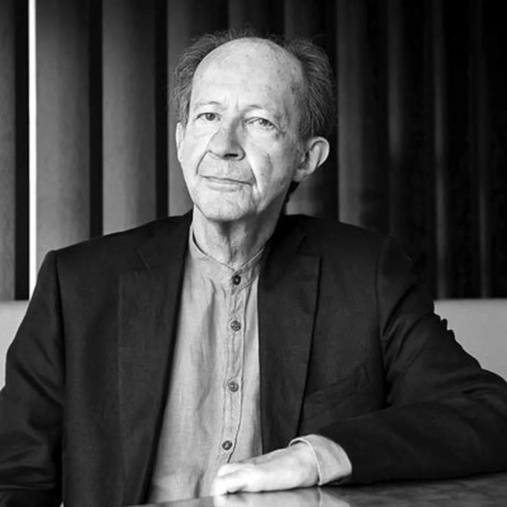

本文的讨论基于公众号「实践与文本」2026年10月28日转载的一篇政治哲学论文，题为《生命政治的开端——历史事件的现实性与潜在性》，作者是芬兰学者谢尔盖·普罗佐罗夫（Sergei Prozorov），英文原文发表于2022年的 European Journal of Social Theory。

***

## 前言

现代国家为什么需要持续统计人口、干预健康、安排教育，并通过一系列制度管理人的身体与生活？传统政治理论主要围绕主权、法律与服从来理解国家权力，却难以充分解释现代治理为什么如此关心出生率、死亡率、疾病和劳动能力。米歇尔·福柯（Michel Foucault）由此提出生命政治（Biopolitics）的问题：人的生命不再仅仅是政治权力所保护或惩罚的对象，其自身的过程也进入了知识、计算和干预的范围。

围绕这一概念，政治哲学中形成了一个持续的争论：生命政治究竟是17—19世纪出现的现代现象，还是从古希腊以来就伴随着政治权力？谢尔盖·普罗佐罗夫（Sergei Prozorov）在《生命政治的开端——历史事件的现实性与潜在性》中，借助保罗·维尔诺（Paolo Virno）的历史时间性理论重新讨论这一问题。文章的结论还将争论进一步推进到资本主义内部：劳动力究竟是资本主义预先找到并加以使用的自然能力，还是人的生命经过历史性的组织与治理之后形成的社会现实？

所以文章表面上讨论的是生命政治究竟起源于古代还是现代，但真正有价值的地方在于三个问题：

1. 福柯、阿甘本等人究竟如何理解现代政治权力，以及他们的分歧在哪里。
2. 我们应当怎样理解一个政治现象的历史起源，尤其是历史中的连续性与断裂。
3. 资本主义为什么需要将人的生命组织成劳动力，以及生命政治和资本主义之间究竟谁是前提。

## 一、生命政治究竟要解释什么？

传统政治理论很重视国家主权、法律、政府组织和统治者的权力。但是，到了近代，政治权力开始越来越深入地干预人口的出生、死亡、疾病、健康、卫生和劳动能力。

这就产生了一个旧的政治权力框架难以充分解释的问题：为什么现代国家不仅要统治一个社会，还要不断测量、管理和改善这个社会中人口的生命过程？

福柯据此提出了生命政治（Biopolitics）和生命权力（Biopower）的分析。

例如，现代国家通过人口统计了解出生率，通过公共卫生体系控制传染病，通过教育、医疗和劳动管理改善人口的身体状况与生产能力。这些措施共同构成一种以生命过程为对象的权力形式。

福柯还区分了两个层面：一方面，纪律权力（Disciplinary Power）通过学校、军营、工厂等机构训练个体身体；另一方面，生命政治通过人口统计、公共卫生、出生率等机制调节整体人口。

这与传统的主权权力（Sovereign Power）有所不同。主权权力的经典问题是统治者如何通过法律、命令和惩罚行使权力；生命政治则强调对人口生命过程的持续管理。

但有一个重要问题：古代国家同样管理人口、战争、婚姻和生育。既然如此，生命政治为什么要被称为现代现象？

## 二、福柯与阿甘本的分歧

两个人的分歧其实涉及一个很深刻的问题。福柯特别强调历史的断裂。他希望解释现代社会出现了哪些新的权力技术，以及这些技术如何使现代国家能够管理整个人口。因此，他需要证明现代政治与古代政治存在实质性差异。



阿甘本则强调政治权力的连续性。在他看来，当政治权力能够决定一个人的生命是否受到正常法律保护时，生命就已经进入了政治权力的核心。这种结构在古代就已经出现，现代性只是让它更加充分地暴露出来。

阿甘本为此提出了赤裸生命（Bare Life）的概念。它涉及一种失去正常政治和法律保障、却仍受到主权权力支配的生命状态。《神圣人》尤其关注主权者如何通过例外状态，把某些生命排除在正常法律秩序之外，同时又将它们置于权力控制之下。

所以，两个人实际上关注了不同的对象。福柯更关心现代国家如何管理生命，阿甘本更关心政治权力如何通过纳入与排除来决定生命的地位。

论文还介绍了埃斯波西托（Roberto Esposito）和奥加康格斯（Mika Ojakangas）的观点。前者通过“免疫”机制理解现代社会怎样以保护生命为名建立限制机制；后者则认为，古希腊政治思想中的人口、生育和公共卫生治理已经具有生命政治的实际内容。

尤其是奥加康格斯，他的观点比阿甘本更直接：如果古希腊已经存在对人口与生命的具体治理，那么生命政治为什么不能被认为实际起源于古希腊？

## 三、维尔诺的历史时间性理论



通常，我们讨论一个历史现象的起源，会沿着时间向前寻找。例如，工业资本主义形成于18—19世纪，之前存在商业资本主义，再之前存在其他生产与交换形式。

但这种方法有一个困难：我们能否仅仅因为某个时代已经出现了与后来相似的思想，就宣称后来的制度已经在那个时代诞生？

维尔诺的历史时间性（Historical Temporality）理论，为作者提供了另一种理解途径。

他区分现实性（Actuality）和潜在性（Potentiality），并认为一个事件具有双重的过去（Double Past）。

第一种过去，是时间上实际发生过的历史。例如，现代人口统计制度的出现，有此前国家行政、科学知识和城市治理的发展作为历史前提。这些过程可以通过史料研究。

第二种过去，则涉及潜在性。它不是某个已经发生、却尚未被发现的历史事件，而是当下现实活动本身所包含、却没有被现实活动穷尽的可能能力。

文章引用维尔诺讨论语言的例子。一个人说出一句话，固然实现了一次具体的语言行为，但他的语言能力并没有因此被耗尽。语言能力始终超过某一次具体的表达。

维尔诺甚至进一步提出：具体行为会否定潜能，因为它确定了一种现实活动，排除了其他尚未实现的可能；但潜能并不会因此消失。他由此提出一个看似矛盾的结论：潜能与现实同时存在，但潜能在逻辑上又先于现实行为。这里的“先于”不是时间上的先后，而是结构上的前提关系。

于是，作者把这个思路应用于生命政治：现代生命政治在17—19世纪形成，这是可以进行历史考证的；但政治权力与生命之间的潜在联系，可以通过回溯古代哲学而得到揭示。

## 四、生命政治与资本主义

### 1. 维尔诺为什么强调劳动力？

在马克思的政治经济学中，劳动力（Labor Power）与劳动（Labor）是两个不同概念。劳动力是一个人从事劳动的能力，劳动则是这种能力在生产过程中的实际运用。在资本主义制度下，劳动者将一定时间内劳动力的使用权出售给资本家，资本家通过组织生产获得商品及其价值。

维尔诺认为，这个过程非常特殊：资本主义将一种潜在能力转变成可以在市场上交易的商品。资本家购买劳动力时，具体劳动尚未发生。他购买的是未来能够从劳动者身上获得的生产能力。而这种能力又无法与劳动者的身体和生命分离。于是，资本主义对劳动力的依赖，使人的身体、健康、生活状态乃至各种潜在能力成为权力的管理对象。而生命政治正是在这里获得了资本主义生产方式中的经济基础。

### 2. 福柯为什么不满意这种解释？

论文作者借助福柯提出了一个很重要的反驳。

维尔诺的分析容易让人觉得，人的劳动力始终作为一种已经存在的潜能，等待资本主义来购买、使用和管理。

可是，一个活着的人，为什么就必然是一个能够被资本主义持续使用的劳动者？

人天然具有活动能力，可以游戏、休息、娱乐、交往，也可以劳动。但是，资本主义所需要的劳动者必须服从一定的时间安排、生产纪律、工作规范和劳动组织。

这种符合资本主义生产需要的劳动力，本身需要通过历史性的社会机制不断塑造。

福柯在《惩罚的社会》中对此有一段非常重要的讨论。论文也引用了它：

> 人类的时间和生活在本质上并不是劳动，而是乐趣、快乐、休息、需求、瞬间、偶然、暴力等。

福柯接着指出，要把这些活动转化为连续的生产力，使其能够持续进入市场，就需要一系列组织和强制机制。**人具有劳动能力是一回事，现代社会把人的生命时间组织成持续供应的劳动力，则是另一回事**。学校的时间纪律、工厂的生产制度、劳动合同、工资制度，以及各种管理和监督机制，都参与塑造了现代劳动者。

也正是在这个意义上，生命政治不只是资本主义生产之后才出现的治理方式。对人口、身体和劳动时间的管理，本身就是资本主义生产得以持续进行的重要条件。

作者最终倾向于福柯的解释：生命进入知识与权力的管理范围，是资本主义得以发展的前提之一；劳动力作为现代资本主义所需要的社会对象，是被具体的治理实践不断塑造出来的。

这不要求生命政治在时间上完全先于资本主义。两者可以在历史上相互促进。关键在于，不能把生命政治完全还原为资本主义经济结构的附属物。
