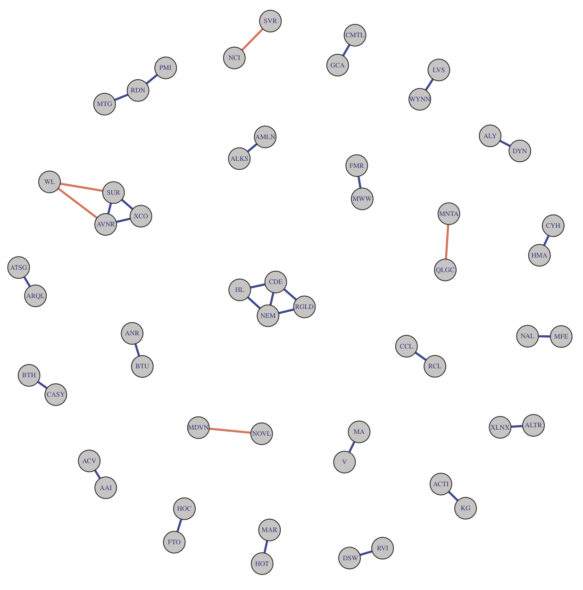
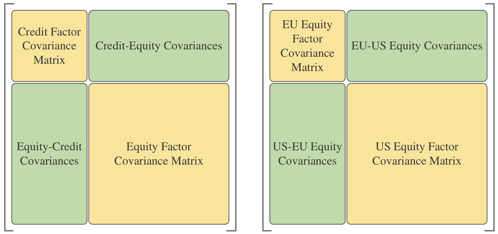

## 本章问题

1. 估计基本面因子模型需要哪些步骤？
2. 如何处理收益率的异方差性？
3. 当载荷矩阵中存在“冗余”的证券特征时，能否估计模型？
4. 估计因子协方差矩阵时应注意什么？
5. 能否使模型对波动率的突变更加敏感？
6. 如何估计特质协方差矩阵的非对角元素？
7. 如何将不同的因子模型连接为一个一致的模型？
8. 如何在模型中对货币建模，以及如何改变基准货币？

***

基本面（或基于特征的）因子模型（Fundamental Factor Models / Characteristic-based Factor Models）以 $r_t$ 和 $B_t$ 为输入，对式（4.1）进行估计。模型的输出是因子收益率与特质收益率 $f_t,\epsilon_t$ 的估计值，以及它们的协方差矩阵 $\Omega_f,\Omega_\epsilon$。基本面因子模型或许是从业者最常使用的模型，其流行的原因包括：

- **良好的表现。** 商业模型是长期不断改进的产物。最早的模型可以追溯到 20 世纪 70 年代中期。因此，一些重要因子已经被识别出来。
- **可解释性。** 公司特征概括了单个公司的情况，基于这些特征的暴露则概括了投资组合的情况。
- **与学术研究的联系。** 在资产定价文献中，多因子模型起源于 Ross（1976）的套利定价理论（Arbitrage Pricing Theory, APT），学术研究者识别定价异象所使用的基准模型则是 Fama 和 French（1993）的三因子模型。
- **Alpha 研究。** 基本面模型是 Alpha 研究的主要工具，因为它使投资组合经理能够纳入几乎任何数据来源，分析规模极大的数据集，解释分析结果，并将结果输入投资组合构建系统。

## 6.1 输入与流程

识别一个因子模型需要五个主要步骤。其中一些需要可靠的定量方法，另一些则更接近艺术而非科学。在描述这些步骤之前，我们首先应关注输入。

### 6.1.1 输入

基本面模型的输入包括：

1. 按资产和日期组织的一组收益率，即 $r_t$。
2. 按资产、日期和特征标识符组织的一组原始特征；由这些输入生成矩阵 $B_t$。

**资产收益率。** 收益率通常按照等长的时间区间报告。这些区间决定模型的时间频率。日收益率可以基于收盘价到收盘价计算。日内收益率可以基于该日内区间观察到的最后一笔成交价格计算。区间长度可以从 30 分钟到不足一分钟。收益率似乎有一个明确的定义，但事实并非如此。“某个时间段的最终价格是什么？”这个问题既不容易回答，也没有唯一答案。归根结底，收益率模型应当帮助投资组合经理制定能够在现实中获利的策略。如果我们无法可靠地按照报价完成交易，那么因子模型就不可靠，基于该模型构建的策略也是如此。

考虑收盘价。它来自哪里？在许多证券交易所，交易日结束时，限价订单簿（Limit Order Book, LOB）会被收盘集合竞价（Closing Auction, CA）取代。无须深入讨论收盘集合竞价的细节，只需知道，它是一个流动性非常高的事件，一只股票约 7% 的日成交量在其中完成。[^1] 因此，对于流动性较好的股票，收盘价是有意义的：投资组合经理可以在不可忽略的交易规模下利用它。现在，将这种情形与另一种情形比较：我们希望对罗素 2000 指数中的一只小盘股票建模。这样的股票很可能有资格成为风险模型估计样本池的成员，但它的成交量可能很低。此外，如果对日内收益率建模，就必须格外谨慎。一个 10 分钟区间结束时价格为 6.93，这究竟意味着什么？也许该股票在这段时间根本没有成交，期间收益率为零。也许只发生了寥寥几笔交易。那么正确的价格是什么？成交价吗？这并不显然。也许这笔交易发生在卖价，而上一笔交易发生在买价。或者，我们应当使用买卖报价之间的中间价？我们的策略在现实中能否可靠地以其中任何一个价格成交？

这些只是构建日内收益率模型时应该提出的众多问题中的一部分，而且并不局限于日内模型。对于许多资产类别，确定良好的每日收盘价是一项极具挑战性、十分重要却不讨好的工作。其细节过于依赖特定资产和数据供应商，无法逐一讨论；此外，这也是交易员积累对其成功至关重要的知识产权的领域。以下几条经验法则或许有帮助。第一，时间区间越短，问题越困难。我们在第 2.2.4 节已经看到这一点。你必须确定应该采用什么价格（买价、卖价、中间价），是否显式地对价格观测噪声建模，日内时段的非平稳性是否重要，以及是否分别对收盘到开盘的收益率和日内收益率建模。第二，明确考虑资产流动性与模型频率之间的关系。就我们的目的而言，可以使用固定时间区间内的成交量作为流动性的代理变量。通常可以获得日均成交量。流动性与价格发现（Price Discovery）相关。高流动性股票的价格更不容易受到观测误差的影响，也比低流动性股票更容易交易。因此，模型样本池和模型时间频率的选择彼此相关。除非你打算显式地对市场微观结构建模，否则，如果想依赖每个区间的收盘价，那么更短的区间意味着更小的模型样本池。

**原始特征数据。** 这是建模任务中的“艺术”，或者更准确地说，是“黑暗艺术”的部分。“原始数据”几乎可以指任何东西。一种可能的分类是结构化数据（Structured Data）与非结构化数据（Unstructured Data）。前者包括可以与某只证券和某个估计期间关联起来的数值型数据和类别型数据。类别数据只取有限个值，这些值不一定存在顺序关系。例如股票所属的国家和行业部门。一个稍不常见的例子是公司的信用评级，它确实存在顺序。非结构化数据包括所有不能直接以这种表格形式提供的数据。例如公司的财报电话会议记录、监管申报文件（10-K、10-Q、8-Q 表格），通过网页抓取获得的公司产品信息、消费者与公司的信用卡交易记录，甚至访问公司门店的消费者位置数据。

这几个例子只是展示了模型可能输入的数据有多么庞大。为了对资产收益率建模，我们从海量另类数据（Alternative Data）中提取一些具有代表性的统计量，使其可以被视为结构化数据。例如，从交易数据中可以提取水平量（消费品公司网站一个季度内的美元交易金额）及其趋势（水平量的季度变化），还可以提取地理分散程度的度量。一些操作可以自动化；另一些可能需要使用分类、聚类等机器学习任务。然而，所有这些操作的一个重要共同点是，它们需要某种形式的人类专业知识。实际上，从非结构化信息中提取结构化数据的任务，可能是最需要人类智慧的任务。关于特征数据已经发表了大量论文。也许未来我们能够将这些彼此迥异的信息源输入一个黑箱，直接预测价格，甚至推荐交易。到那时，我会很乐意写这本书的第二版。

[^1]: 截至 2024 年 10 月，指北美市场。在指数成分调整的日期，该比例更高。

### 6.1.2 流程

基于特征的模型的估计步骤如下：

1. **数据接入。** 这一步包括从供应商接收数据集、检查数据完整性，以及执行必要的数据检查，包括：
   - 确保数据类型正确且数据没有损坏。数据损坏是以正概率发生的。
   - 确保证券集合与前一个期间相比没有发生重大变化。
   - 确保每项资产及每项特征的缺失数据比例没有发生重大变化。
   - 识别并报告数据异常值。
2. **选择估计样本池。** 本章前面已经介绍了与该集合相关的问题。纳入标准包括：
   - 可交易性。资产必须具有足够的流动性，因为因子模拟投资组合（Factor-Mimicking Portfolio, FMP）包含所有这些资产。
   - 数据质量。这与资产流动性密切相关，但目的不同。我们需要价格经过充分发现、接近经济基本价值的证券，因为我们使用这些价格计算收益率并估计模型。
   - 与投资的相关性。估计样本池应当在某种程度上与策略的投资样本池重叠。这更接近艺术；据我所知，尚无关于这一问题的严格理论处理。
3. **缩尾处理。** 识别估计样本池中收益率的异常值，并对其进行缩尾处理（Winsorization）。
4. **生成载荷。** 通过变换和组合生成特征矩阵 $B_t$。
5. **横截面回归。** 对每个 $t=1,\ldots,T$，将资产收益率 $r_t$ 对载荷 $B_t$ 进行横截面回归（Cross-Sectional Regression）。[^2] 这一步的输出为向量 $\hat f_t$ 和 $\hat\epsilon_t$。
6. **时间序列估计。** 利用上一步得到的时间序列，估计：（a）因子协方差矩阵 $\hat\Omega_{f,t}$；（b）特质协方差矩阵 $\hat\Omega_{\epsilon,t}$；（c）因子收益率经风险调整后的表现。

接下来的三节讨论因子模型的核心：回归和协方差估计。随后，第 6.5 节讨论缩尾处理。下一节介绍一个高级主题，即如何将多个因子模型一致地连接起来，同时讨论投资组合中以多种货币计价的资产。最后，我们对因子特征的识别作一个初步介绍。

[^2]: 提醒一下，正如第 4.6 节所解释的，我们用 $B_t$ 表示在期间 $t-1$ 结束时可获得的载荷。

## 6.2 横截面回归

第一步是横截面回归：

$$
r_t=B_tf_t+\epsilon_t,\qquad t\in\mathbb N.
$$

式（6.1）

待估计的参数为 $f_t$ 和 $\epsilon_t$。这属于随机设计（Random Design）的情形：元组 $(r_t,B_t,f_t,\epsilon_t)$ 可以视为从共同分布中独立抽取的样本。我们观测到 $(r_t,B_t)$，并估计 $(f_t,\epsilon_t)$。

有多种回归方法可供选择。其中一种是最小化平方损失 $\|r_t-B_tf_t\|^2$。这一步背后的假设是：

1. 矩阵 $B_t\in\mathbb R^{n\times m}$ 满秩。其必要但不充分的条件是 $m\le n$。
2. 残差收益率 $\epsilon_{t,i}$ 的均值为零，具有同方差性（Homoskedasticity，即方差相同），且彼此独立。
3. 因子收益率与残差收益率相互独立。
4. 因子收益率与残差收益率具有良好的性质，即至少存在有限的四阶矩。

这些假设可以放宽。如果矩阵秩亏，最小范数问题存在解但不唯一，因子收益率无法被识别。本节后面将介绍处理秩亏矩阵、从而获得唯一解的方法。同方差性也不是必要假设。如果不同资产的残差具有不同方差，我们可以对每项资产的损失赋予不同权重。直觉是，如果某项资产的残差收益率方差很大，就应该降低该项资产损失的权重，以免这一项主导损失之和，对参数估计产生过大的影响。

我们通过最小化损失函数 $L:\mathbb R^n\to\mathbb R_+$ 来估计模型（6.1）：

$$
\min L(r_t-B_tf_t).
$$

本节选择最小化残差平方的加权和。已知一个对角正定矩阵 $W$，其对角元素可解释为赋予第 $i$ 个观测（即资产）的权重。我们求使以下损失最小的 $f$：

$$
L(r_t-B_tf_t):=(r_t-B_tf_t)'W(r_t-B_tf_t).
$$

式（6.2）

这种选择有充分的理由。如果假设模型（6.1）是真实的收益率模型，那么最小二乘法（Least Squares）在所有线性估计量中给出方差最小的无偏估计（Hansen，2022）。无偏性对业绩归因（Performance Attribution）和 Alpha 识别很重要。即使因子收益率估计（进而残差收益率估计）存在很小的偏差，在多期间业绩归因过程中也会不断积累，从而扭曲分析结果及其洞见。加权最小二乘（Weighted Least Squares, WLS）回归的另一个优点是，其估计值可以通过因子模拟投资组合自然地解释。我们将在后文详细讨论这些组合。现在，只需要知道它们是可投资的投资组合，其收益率尽可能贴近真实但不可观测的因子收益率。因此，我们建议至少将这种损失函数作为起点，并进行全面的诊断，以识别其可能的不足。

为明确讨论，假设模型为 $r_t=Bf_t+\epsilon_t$，其中 $f_t\sim N(0,\Omega_f)$，$\epsilon_t\sim N(0,\Omega_\epsilon)$。我们通过在等式 $r_t=B_tf_t+\epsilon_t$ 两侧左乘矩阵 $\Omega_\epsilon^{-1/2}$ 来处理异方差性。此时特质收益率具有同方差性。我们使用普通最小二乘（Ordinary Least Squares, OLS）的损失函数 $\|\Omega_\epsilon^{-1/2}(r_t-Bf_t)\|^2$，它等价于式（6.2）中的损失函数，其中权重矩阵 $W=\Omega_\epsilon^{-1}$。

假设因子载荷不随时间变化。这简化了下面的公式，但也可以通过直接将收益率对时变载荷进行回归来放宽该假设。给定 $B,\Omega_\epsilon$，高斯似然（Gaussian Likelihood）为：

$$
\prod_{t=1}^T\frac{1}{(2\pi)^{n/2}|\Omega_\epsilon|^{1/2}}\exp\left[-\frac12(r_t-Bf_t)^T\Omega_\epsilon^{-1}(r_t-Bf_t)\right].
$$

如果用 $R\in\mathbb R^{n\times T}$ 表示收益率矩阵，则对数似然等价于 $-\|R-BF\|_{\Omega_\epsilon^{-1}}^2$。我们将优化问题写为：

$$
\min_{F\in\mathbb R^{m\times T}}\|\Omega_\epsilon^{-1/2}(R-BF)\|^2.
$$

首先考虑单个期间。在这种情形中，$R$ 和 $F$ 都是列向量。解为普通最小二乘解：$F=(B^T\Omega_\epsilon^{-1}B)^{-1}B^T\Omega_\epsilon^{-1}R$。在多个期间的情形中，问题是各个单期间问题之和：

$$
\|R-BF\|_{\Omega_\epsilon^{-1}}^2=\sum_t\|\Omega_\epsilon^{-1/2}(r_t-Bf_t)\|^2.
$$

每一项可以独立地最小化。因此有：

$$
\hat f_t=(B^T\Omega_\epsilon^{-1}B)^{-1}B^T\Omega_\epsilon^{-1}r_t.
$$

式（6.3）

作为上述公式在矩阵形式下的直接推广，最小化 $\|A-BX\|_F^2$ 的问题具有闭式解：

$$
\arg\min_X\|A-BX\|_F^2=(B^TB)^{-1}B^TA.
$$

式（6.4）

**洞见 6.1：应使用哪个特质协方差矩阵？**

在横截面回归过程中，我们将协方差矩阵 $\Omega_\epsilon$ 作为输入。然而，该矩阵又是因子估计过程的输出。如何解决这个僵局？我们有两个选择，其共同思想是需要一个协方差矩阵的代理。这个代理不会是最好的协方差矩阵，但比对应于 OLS 的单位矩阵更好。第一种、也是最简单的选择，是利用 MSCI Barra 或 Axioma 等供应商提供的既有因子模型。第二种方法是执行两阶段流程。在第一阶段，使用单位矩阵作为横截面回归中的代理，按照第 6.4 节所述的方法估计特质协方差矩阵。随后，使用该矩阵重新执行整个模型估计流程，从横截面回归开始，到获得最终的特质协方差矩阵为止。第二种方法还有一个变体：仅在历史数据最开始的一些期间执行第一阶段估计。例如，如果有 20 年的历史数据，可以只在第一年执行两阶段流程。第一年之后的每一天，都可以使用前一天最终估计得到的特质协方差矩阵作为代理。

### 6.2.1 秩亏载荷矩阵

在某些情况下，载荷矩阵是秩亏的（Rank-Deficient）：即使有 $m$ 个因子，线性无关的列数也只有 $p<m$。考虑以下具体且十分常见的例子。

- 存在一个因子，其对每项资产的载荷均为 1。它有时被称为“国家”“地区”或“样本池”因子，因为这个因子的变动对所有资产产生相同影响。它可以解释为回归的截距项。然而，同一载荷矩阵至少还包含行业载荷，这些载荷可解释为总和为 1 的非负权重。为简单起见，假设第一个因子是国家因子，其余 $m-1$ 个是行业因子。那么向量 $v=(1,-1,-1,\ldots,-1)^T$ 满足 $Bv=0$，矩阵因此秩亏。
- 大多数多国家模型同时具有行业载荷和国家载荷。设前 $m_{\mathrm{ind}}$ 列为行业载荷，随后 $m_{\mathrm{ctry}}$ 列为国家载荷。向量 $v=(1,1,\ldots,1,-1,-1,\ldots,-1)^T$，其中前 $m_{\mathrm{ind}}$ 项为 1，剩余 $m_{\mathrm{ctry}}$ 项为 -1，同样满足 $Bv=0$。

将其推广至存在 $m-p$ 个线性无关向量 $v_i$ 满足 $Bv_i=0$ 的情形。由于这一秩亏，$B^TB$ 不可逆，因而无法使用通常的回归公式估计 $\hat f$。至少有三种方法可以处理这个问题。

- 第一种是消除冗余。例如删除一个行业和/或一个国家和/或国家因子。其优点是可以重新使用熟悉的横截面回归公式；缺点是原始载荷矩阵更容易解释。我们希望知道投资组合对国家及所有行业的暴露。国家暴露告诉我们投资组合是净多头还是净空头，而这一信息不能由单个行业暴露直接传达。当然，所有行业都是有用的。问问其主要覆盖行业恰好被从模型中删除的投资组合经理就知道了。
- 第二种是在 $\|r-Bf\|^2$ 中加入一个小的二次惩罚项，即 $\delta\|f\|^2$。这消除了退化性。在线性模型中，因子估计值不再无偏，因此在使用这种方法之前需要仔细分析。在 $\delta\to0$ 的极限下，回归问题的解就是无岭回归（Ridgeless Regression）的解：$\hat f=(B^T\Omega_\epsilon^{-1}B)^\dagger B^T\Omega_\epsilon^{-1}r_t$，其中 $\dagger$ 表示 Moore–Penrose 伪逆算子。
- 最后，可以加入 $m-p$ 个形式为 $C^Tf=a$ 的附加约束（Heston 和 Rouwenhorst，1994，1995），并求解约束线性回归问题。这使估计流程略微复杂，但保持甚至增强了因子收益率的可解释性。例如，可以要求行业因子收益率的市值加权和为零，写成 $w^TB_{\mathrm{ind}}f_{\mathrm{ind}}=0$，其中 $B_{\mathrm{ind}}$ 是行业因子列的子集，$f_{\mathrm{ind}}$ 是行业因子收益率的子集，$w$ 是每项资产的市值权重向量。该约束意味着“所有资产的市值加权行业收益率之和必须为零”。如果将 $w$ 选为基准投资组合的权重，那么也可以解释为“基准投资组合必须没有行业收益率”。

## 6.3 估计因子协方差矩阵

我们已经获得因子收益率的随机向量 $\hat f_t$，希望据此估计 $\Omega_f$。假设 $f_{t,i}$ 存在四阶矩，但与接下来的第 7 章不同，我们不能假设 $\Omega_f$ 具有某种特殊结构。根据模型的构造方式，我们不预期该矩阵具有尖峰结构（Spiked Structure）。用于估计协方差矩阵的样本数量可以大于因子数量，例如，可以使用 500 天的数据估计一个包含 10 个因子的模型。因而，$m$ 保持不变而 $T\to\infty$ 的假设似乎是适当的。

令 $\Omega_{\mathrm{emp}}^T:=T^{-1}\sum_{t=1}^T\hat f_t\hat f_t^T$。根据大数定律，$\Omega_{\mathrm{emp}}^T\to\Omega_f$ 几乎必然成立。特征值与特征向量都收敛到总体协方差矩阵中相应的对象（见第 7.6.2 节附录）。因子波动率收敛到真实的（也称为总体的）波动率，相对标准误为 $\sqrt{2/T}$。只要各因子的波动率充分分离，因子协方差矩阵的主成分也收敛到对应的总体主成分。这似乎解决了协方差估计问题：直接使用经验协方差矩阵即可。然而，还有几个问题：

- 因子数量往往并不远小于观测数量。在这种情况下，收缩（Shrinkage）可以提高估计质量。
- 我们将看到，估计过程会使因子收益率的方差估计偏大。这是支持收缩的另一个理由。
- 因子收益率具有非平稳性，在危机开始时有时表现得尤为剧烈。我们必须考虑这一点。
- 因子收益率具有轻微的自相关性。我们需要对其进行修正。

### 6.3.1 因子协方差矩阵收缩

第一个问题在于，因子收益率估计值 $\hat f_t$ 终究只是估计值。它们是 WLS 线性回归估计的结果，见式（4.16）。估计值 $\hat f_t$ 的估计误差协方差矩阵为 $(B^T\Omega_\epsilon^{-1}B)^{-1}$。[^3] 这意味着以 $\operatorname{var}(\hat f_t)$ 估计真实因子协方差矩阵是有偏的：

$$
\operatorname{var}(\hat f_t)=\Omega_f+(B^T\Omega_\epsilon^{-1}B)^{-1}.
$$

式（6.5）

**洞见 6.2：因子协方差收缩的 FMP 解释**

解释式（6.5）的另一个视角是因子模拟投资组合。FMP $w_i$ 的收益率为 $\hat f_i=f_i+\epsilon^Tw_i$。利用式（9.12），FMP $i$ 与 $j$ 的收益率协方差为 $\operatorname{cov}(\hat f_i,\hat f_j)=\operatorname{cov}(f_i,f_j)+[(B^T\Omega_\epsilon^{-1}B)^{-1}]_{i,j}$，这就是式（6.5）。

这意味着应当对经验协方差矩阵进行收缩，以获得无偏估计：

$$
\hat\Omega_f=\operatorname{var}(\hat f_t)-(B^T\Omega_\epsilon^{-1}B)^{-1}.
$$

式（6.6）

修正量有多大？在一个更简单但富有启发性的情形中，$B^TB=I_m$ 且 $\Omega_\epsilon=I_n$，估计的因子收益率为 $\hat f_t=B^Tr_t$，并且 $\operatorname{var}(\hat f_t)=T^{-1}\sum_t\hat f_t\hat f_t^T=B^T\hat\Omega_r B$，因此：

$$
\hat\Omega_f=B^T\hat\Omega_rB-I_m.
$$

式（6.7）

在实际应用中，因子数量介于 1 与 100 之间，期间数量介于 126（日收益率的六个月数据）与 500（日收益率的两年数据）之间。因此，我们并不总是处于 $p\ll T$ 的情形，第 7.6.2 节的渐近结果并不适用，尖峰协方差矩阵的结果同样不适用。一种常用的协方差矩阵收缩方法是 Ledoit–Wolf 收缩（Ledoit 和 Wolf，2003a、b，2004）。它的优点是容易实现、容易调节，并且表现良好。收缩后的协方差矩阵为：

$$
\Omega_{f,\mathrm{shrink}}(\rho)=(1-\rho)\hat\Omega_f+\rho\frac{\operatorname{tr}(\hat\Omega_f)}{m}I_m.
$$

将其与式（6.6）结合：

$$
\Omega_{f,\mathrm{shrink}}(\rho)=(1-\rho)[\operatorname{var}(\hat f_t)-(B^T\Omega_\epsilon^{-1}B)^{-1}]+\rho\frac{\operatorname{tr}[\operatorname{var}(\hat f_t)-(B^T\Omega_\epsilon^{-1}B)^{-1}]}{m}I_m,
$$

其中 $\rho\in(0,1)$ 是可调参数。

[^3]: 见式（4.17）。

### 6.3.2 动态条件相关性

另一种常用的估计经验协方差矩阵 $\operatorname{var}(\hat f_t)$ 的方法，是分别对因子波动率与相关性进行建模。具体而言，将总体协方差矩阵分解为相关矩阵 $C$ 与包含因子波动率的对角矩阵 $V$ 的乘积：

$$
\Omega_f=VCV.
$$

Bollerslev（1990）将波动率建模为时变的，并将相关矩阵视为常数。从业者使用具有不同半衰期的指数加权平均来估计经验相关矩阵和波动率向量：

$$
\operatorname{diag}(V_t^2)=\kappa\sum_{s=0}^T e^{-s/\tau}\hat f_{t-s}\circ\hat f_{t-s},
$$

$$
C:=\kappa_C\sum_{s=0}^T e^{-s/\tau_C}V_{t-s}^{-1}\hat f_{t-s}\hat f_{t-s}^TV_{t-s}^{-1},
$$

其中 $\tau_C>\tau$ 分别是因子相关性与方差的半衰期，$\kappa,\kappa_C$ 是归一化常数。在许多使用日收益率估计的股票模型中，半衰期设置在三个月（对于反应极为灵敏的方差估计）到两年之间。

### 6.3.3 短期波动率更新

估计得到的因子收益率经常出现意料之外的较大数值。根据经验，它们的波动率并非平滑变化，而是发生不连续的变化，经历高波动率状态之后又迅速转入低波动率状态。这给建模者带来两个挑战。第一，简单的指数加权估计量对波动率突然增加的反应过慢。其非常具体的后果是：在投资者最需要准确估计的时候，他们却严重低估了系统性风险。第二，估计值对波动率降低的反应也过慢。由加权机制的性质决定，波动率最多只能按指数速度衰减，半衰期长达数个月。

已有多种方法被提出以解决这一问题。这里介绍一种表现良好且易于实现的方法：短期波动率更新（Short-Term Volatility Updating, STVU）。首先，对多元因子收益率建模，使其受潜在状态变量 $x_t$ 调节：

$$
\begin{cases}f_t=e^{x_t/2}V_tC_t^{1/2}\eta_t,\\\eta_t\sim N(0,I_m),\\x_{t+1}=\phi x_t+\sigma\gamma_t.\end{cases}
$$

式（6.8）

在所有 $t$ 都满足 $x_t=0$ 的退化情形中，该模型退化为因子协方差矩阵为 $\Omega_f$ 的模型。定义 $u_t:=C_t^{-1/2}V_t^{-1}f_t$，则 $x_t=\log\|u_t\|^2-\log\|\eta_t\|^2$。这是一个线性状态空间模型（Linear State-Space Model）。定义：

$$
\kappa:=\mathbb E(\log\|\eta_t\|^2),\qquad\epsilon_t:=\log\|\eta_t\|^2-\kappa,
$$

$$
x_t:=\xi_t,\qquad y_t:=\log\|u_t\|^2-\kappa.
$$

状态空间方程为：

$$
\begin{cases}y_t=x_t+\epsilon_t,\\x_{t+1}=\phi x_t+\sigma\gamma_t.\end{cases}
$$

状态的估计值具有如下形式：[^4]

$$
e^{\hat x_t/2}=\exp\left[\frac{1-e^{-1/\tau_0}}{2}\sum_{s=0}^\infty e^{-s/\tau_0}(\log\|u_{t-s}\|^2-\kappa)\right].
$$

根据模型（6.8）的第一个方程，因子协方差矩阵随后乘以因子 $e^{\hat x_t}$ 进行调整。

一些实现使用这个公式的线性近似，以及近似等式 $\kappa=\log m+\mathbb E\log(\|\eta_t\|^2/m)\simeq\log m$，因为当 $m\to\infty$ 时，$\|\eta_t\|^2/m\to1$ 几乎必然成立。

$$
e^{\hat x_t/2}\simeq\exp\left[(1-e^{-1/\tau_0})\sum_{s=0}^\infty e^{-s/\tau_0}\left(\frac{\|u_{t-s}\|}{\sqrt m}-1\right)\right].
$$

式（6.9）

$$
\simeq\exp\left[(1-e^{-1/\tau_0})\left(\sum_{s=0}^\infty e^{-s/\tau_0}\frac{\|u_{t-s}\|}{\sqrt m}\right)-1\right].
$$

式（6.10）

$$
\simeq(1-e^{-1/\tau_0})\sum_{s=0}^\infty e^{-s/\tau_0}\frac{\|u_{t-s}\|}{\sqrt m}.
$$

式（6.11）

在因子收益率彼此不相关的特殊情形中，公式的解释最为清楚。此时 $u_t$ 是经过 Z 分数标准化的收益率向量。如果 $x_t=1$（原文如此），它们具有单位方差。如果将随机变量 $u_i$ 视为一个随机变量的独立同分布样本，那么 $\|u_{t-s}\|/\sqrt m$ 给出了其标准差的估计值。如果这一估计值超过 1，就需要向上修正原先的因子标准差估计。这正是该模型所做的事情。对于日频风险模型，半衰期 $\tau_0$ 通常在 10 到 20 天之间，以反映冲击的迅速到来。

[^4]: 见第 2.4.2 节。

### 6.3.4 修正因子收益率的自相关

日频因子收益率和资产收益率通常具有轻微但非零的短期自相关。如果在更短的时间区间上估计因子协方差矩阵，自相关可能更加明显。在这些情况下，修正自相关可以改善模型的表现。Cohen 等（1983）在 Scholes 和 Williams（1977）先前工作的基础上，假设观察到的收益率遵循一个由潜在的不相关收益率决定的 $l_{\max}$ 阶自回归过程。$\operatorname{AR}(l_{\max})$ 方程的系数是随机的，但其总和为 1。定义滞后协方差矩阵 $C_l$：

$$
[C_l]_{i,j}:=\operatorname{cov}(f_{t,i},f_{t-l,j}).
$$

考虑自相关的相容估计量为：

$$
\hat\Omega_f=C_0+\frac12\sum_{l=1}^{l_{\max}}(C_l+C_l^T).
$$

另一种方法是 Newey 和 West（1987）的估计量（Newey–West Estimator），它在 $T\to\infty$ 的极限下具有渐近相容性：

$$
\hat\Omega_f=C_0+\sum_{l=1}^{l_{\max}}\left(1-\frac{l}{1+l_{\max}}\right)(C_l+C_l^T).
$$

## 6.4 估计特质协方差矩阵

接下来，我们需要根据每个期间估计得到的特质收益率 $\hat\epsilon_t$，估计协方差矩阵 $\Omega_\epsilon$。

### 6.4.1 指数加权

与因子波动率的情形一样，我们对特质波动率估计采用指数加权。令 $E\in\mathbb R^{n\times T}$ 为估计的特质收益率矩阵，其中 $[E]_{i,t}:=\epsilon_{i,t}$。指数加权参数为半衰期 $\tau$。权重矩阵是对角正定矩阵 $W\in\mathbb R^{T\times T}$。对角元素的一种常见选择是指数权重 $[W_\tau]_{t,t}=\kappa\exp(-t/\tau)$，其中正数 $\kappa$ 使对角元素之和为 $T$。指数加权移动平均（Exponentially Weighted Moving Average, EWMA）的经验特质协方差矩阵为 $\hat\Omega_\epsilon:=EWE^T$。

### 6.4.2 可视化检查

该矩阵应当是对角矩阵，或者至少是稀疏矩阵。然而，基于估计收益率得到的样本协方差矩阵并不满足这些要求。样本协方差矩阵 $\hat\Omega_\epsilon$ 既不稀疏也不正定，因为 $T<n$。作为建模者，我们可以把所有非对角元素设为零，这实际上等于对特质相关矩阵实施极端的收缩。然而，这一步并不合理。

作为合理性检查，我建议对经验协方差矩阵进行可视化检查。我们常常可以看到非常明显的模式，它们可以解释为应当纳入模型的因子。例如，一些中国证券同时在中国内地（A 股和 B 股）与香港（H 股）上市。这些证券的收益率高度相关但并不完全相同，其相关性会在特质协方差矩阵中显现出来。在这样的情况下，与其假设 A 股、B 股、H 股完全相同（事实上并非如此），不如在模型中加入一个“股份类别”因子。

### 6.4.3 短期特质波动率更新

与因子收益率一样，特质收益率也会出现波动率突变，而使用较长半衰期 $\tau$ 的指数加权方法无法很好地捕捉这些变化。一个反应非常灵敏的日收益率模型，其 $\tau=126$ 个交易日，而冲击可能在 10 个交易日内发生。作为补救，我们重新使用第 6.3.3 节的 STVU 方法，但作一项虽小却重要的修改。这里以股票为例，尽管该技术也很容易应用于其他资产类别。

股票往往会在财报公布日期附近遭遇较大的冲击，原因可能是新的信息在财报公布之前或当天被披露，也可能是这些信息在随后的几天内才被充分反映到价格中。我们引入帐篷形变量 $a_{i,t}$。令 $T_{\mathrm{earn},i}$ 为财报公布日期，$\tau_{\mathrm{earn}}$ 为接收财报信息的时间范围。定义函数：

$$
a_{i,t}=\begin{cases}1-|t-T_{\mathrm{earn},i}|/\tau_{\mathrm{earn}},&|t-T_{\mathrm{earn},i}|\le\tau_{\mathrm{earn}},\\0,&\text{其他情况}.\end{cases}
$$

当 $t$ 与财报公布日期 $t_{i,\mathrm{earn}}$ 的距离在 $\tau_{\mathrm{earn}}$ 天以内时，$a_{i,t}$ 在 0 与 1 之间变化。我们使用模型（6.8），但将更新限制于财报公布窗口内的股票。由于相关矩阵近似为对角矩阵，STVU 模型有所简化。这里只考虑线性近似：修正项为

$$
e^{\hat x_t/2}=\kappa_0\sum_{s=0}^\infty e^{-s/\tau_0}\sqrt{\frac{\sum_i a_{i,t}(\epsilon_{i,t}/\hat\sigma_{i,t})^2}{\sum_i a_{i,t}}},
$$

并且仅适用于受到财报影响的资产：

$$
\hat\sigma_{i,t}^2\leftarrow[(1-a_{i,t})+a_{i,t}e^{\hat x_t}]\hat\sigma_{i,t}^2.
$$

### 6.4.4 非对角元素聚类

最后，我们需要识别那些特质收益率高度相关的资产。有两种重要的情形。

第一种情形是不同证券对应同一底层资产。例如，一些股票以不同的股份类别上市；伯克希尔·哈撒韦公司的股票就分别以 BRK.A 和 BRK.B 交易，代表不同份额价值。两只证券的流动性不同，但其收益率高度相关。是否将两只证券同时纳入因子模型，取决于使用模型的交易策略的性质。如果策略旨在利用两项资产之间暂时性的微小定价错误，那么我们应将两者都纳入。如果仅打算基于基本面信息投资公司，就应该只纳入一只能够代表底层资产的证券；通常选择流动性最高的证券。

第二种情形涉及那些依赖关系未被因子描述的股票。为了能够被识别，因子必须具有普遍性。一个仅影响少数资产的因子并不是这里所说的因子，无法在大规模资产横截面中被识别出来。不过，这些股票之间的依赖关系仍然可以通过它们的特质收益率之间的相关性检测出来。为了识别它们，我们使用相关性阈值处理（Correlation Thresholding）。通过一个简单的截断算子变换相关矩阵元素：

$$
\operatorname{thres}_\lambda(\rho_{i,j}):=\rho_{i,j}\mathbf 1_{\{|\rho_{i,j}|>\lambda\}}.
$$

最优阈值 $\lambda$ 为 $C\sqrt{\log n/T}$（Cai 等，2016），其中 $C$ 是某个正常数。

然而，在实践中，更有启发性的做法是探索不同阈值 $\lambda$ 下出现的聚类。对于某些 $\lambda$，这些聚类具有以下性质：（a）稳定，即阈值略有变化时，聚类不会发生太大变化；（b）可解释。它们由“相似”的股票组成，例如属于同一部门或行业的股票，有时这些股票也具有相似的风格因子载荷。[^5] 对每个阈值水平，都必须检查相关矩阵是否对称正定（且条件良好）。

作为例子，我们使用商业因子模型（Axioma US V.4，短期模型，AXUS4SH）的残差收益率。



我们使用 2010 年的残差收益率，计算罗素 3000 指数持续成分股的等权相关系数，并将相关系数绝对值的阈值设置为 0.55。图 6.1 显示所得聚类。涉及的股票数量很少：在近 2,900 只股票中不足 90 只，约为 3%。表 6.1 列出了股票代码及对应公司名称。这些配对非常符合直觉：Visa 与 MasterCard；永利度假村与拉斯维加斯金沙集团；皮博迪能源与阿尔法自然资源；以及由 HL、NEM、CDE、RGLD 构成的矿业聚类。

**表 6.1 图 6.1 中聚类成员的股票代码与公司名称**

| 股票代码 | 公司名称 | 股票代码 | 公司名称 |
| --- | --- | --- | --- |
| AAI | AirTran Holdings | HOT | Starwood Hotels & Resorts Worldwide |
| ACTI | ActivIdentity Corp | KG | King Pharmaceuticals |
| ACV | Alberto-Culver Co | LVS | Las Vegas Sands |
| ALKS | Alkermes Inc | MA | MasterCard Inc |
| ALTR | Altera Corp | MAR | Marriott International Inc |
| ALY | Allis-Chalmers Energy Inc | MDVN | Medivation Inc |
| AMLN | Amylin Pharmaceuticals Inc | MFE | McAfee Inc |
| ANR | Alpha Natural Resources | MNTA | Momenta Pharmaceuticals Inc |
| ARQL | ArQule | MTG | MGIC Investment Corp |
| ATSG | Air Transport Services Group Inc | MWW | Monster Worldwide Inc |
| AVNR | Avanir Pharmaceuticals Inc | NAL | NewAlliance Bancshares Inc |
| BTH | Blyth Inc | NCI | Navigant Consulting Inc |
| BTU | Peabody Energy | NEM | Newmont Mining Corp |
| CASY | Casey's General Stores Inc | NOVL | Novell Inc |
| CCL | Carnival Corp | PMI | PMI Group Inc |
| CDE | Coeur d'Alene Mines Corp | QLGC | QLogic Corp |
| RCL | Royal Caribbean Cruises Ltd | RDN | Radian Group Inc |
| CMTL | Comtech Telecommunications Corp | RGLD | Royal Gold Inc |
| CYH | Community Health Systems Inc | RVI | Retail Ventures Inc |
| DSW | DSW-A | SUR | CNA Surety Corp |
| DYN | Dynegy Inc | SVR | Syniverse Holdings Inc |
| FMR | First Mercury Financial | V | Visa Inc |
| FTO | Frontier Oil Corp | WL | Wilmington Trust Corp |
| GCA | GCA Holdings | WYNN | Wynn Resorts |
| HL | Hecla Mining Co | XCO | EXCO Resources Inc |
| HMA | Health Management Associates Inc | XLNX | Xilinx Inc |
| HOC | Holly Corp | | |

[^5]: 我们可以更严格地将聚类内部的这种相似性刻画为因子载荷之间的距离，并根据这一相似性度量提出更系统的阈值处理程序，但这超出了本书的范围。

### 6.4.5 特质协方差矩阵收缩

与第 6.3.1 节中的因子协方差收缩类似，我们建议将特质方差向单位矩阵收缩：

$$
\Omega_{\epsilon,\mathrm{shrink}}(\rho)=(1-\rho)\hat\Omega_\epsilon+\rho\frac{\operatorname{tr}(\hat\Omega_\epsilon)}{m}I_n.
$$

对于对角形式的特质协方差矩阵，这相当于将特质方差向经验方差均值收缩。

## 6.5 收益率的缩尾处理

异常值检测即便不是风险建模与 Alpha 研究的核心问题，也至少是两者中十分重要的问题。收益率数据中的异常值存在许多种情形，其中任何一种都可能毁掉一名金融研究者的职业生涯。在提出改善研究过程并挽救若干职业生涯的补救措施之前，让我们先讨论它们的来源以及可能造成的影响。

异常值主要有两个来源。第一，数据供应商提供的数据总体质量较低。遗憾的是，这非常常见。优秀的研究者将很大一部分时间花在评估与比较数据上，并向供应商询问数据收集方法及其适用性。误差的来源多到无法一一列举。最糟糕的情况下，价格没有按照股票拆分或反向拆分正确调整。数据收集可能不是同步进行的；收益率的最终来源可能是一家位于新西兰农业村庄的经纪商，甚至可能出现更加难以置信的情形。糟糕的数据供应商是异常值的完美滋生地。第二，真正的异常值确实存在。其情形包括：

- 流动性较高的股票偶尔出现偏离正常价格的成交。[^6]
- 流动性很差的股票表现出较高的波动率，偶尔甚至在日内出现很大的收益率。
- 正在退市、进入或退出破产程序的股票，通常通过场外交易（Over-the-Counter, OTC），也表现出非常大的收益率。
- 市场中的新信息导致真正的大幅跳跃：财报与未来业绩指引的意外变化、竞争对手宣布进入市场、并购公告与并购失败消息、事故或可能出现的新的意外负债，以及对证券价格产生重大影响的宏观经济因素。

对于这些情形，第一种可以通过仔细检查价格数据处理，即不只使用 5 分钟区间的最后价格，而是检查整个价格轨迹。第二种和第三种可以通过仔细选择估计样本池和投资样本池来避免。流动性很差的微型市值股票应当被排除。

然而，最后一类异常值无论多大，都不应从估计过程中排除。主要理由是，排除它们会使分析的输出变得不那么可靠。如果我们对绝对值很大的收益率进行缩尾，就会影响横截面回归估计出的因子收益率。因子的收益率就是其模拟投资组合的收益率，而在横截面回归中对收益率缩尾，实际上意味着使用缩尾后的数据计算投资组合收益率。遗憾的是，真实的投资组合收益率基于历史实际收益率。这会影响对因子收益率和特质收益率的评估。由此可以得到两条简单的定性建议：

1. 无论采用何种缩尾方法，都应确保在回测或生产环境中报告所有被缩尾的数据，并逐一检查。
2. 确保投资样本池只包含流动性充足、可交易的资产。

对于其余资产，使用稳健的异常值检测策略。不存在完美且具有完全理论依据的方法。一种表现足够良好的方法是在证券层面计算收益率的稳健 Z 分数：

$$
d_{i,t}=\frac{|\log(1+r_{i,t})|}{\operatorname{median}(|\log(1+r_{i,t-1})|,\ldots,|\log(1+r_{i,t-T})|)},
$$

然后对超过阈值 $d_{\max}$ 的收益率进行缩尾。阈值取决于资产类别、地区及其他属性，通过反复试验设定在 5 到 10 之间。

[^6]: 容我回忆一件个人经历：2000 年夏天，我在安然公司（Enron）工作。有一天，在收盘集合竞价时，安然股票在全天围绕 86 美元波动后突然跳至 90 美元。安然交易大厅里的人公开讨论：“我们现在是不是应该做空安然？”第二天股价回落至 85 美元上下。教训是：如果交易员想做空自己所在的公司，那么这很可能是某种异常值。

## 6.6 ★ 高级模型主题

### 6.6.1 模型连接

在某些应用中，投资样本池由属于不同国家的证券组成。例如，大型对冲基金至少在北美、欧洲和亚洲进行投资。在其他应用中，样本池由属于不同资产类别的证券组成。例如美国股票与公司信用债，但可能的组合不胜枚举。由于接下来的数学处理较为枯燥和艰难，也许值得先问一个问题：为什么要这样做？整合模型（Integrated Model）的用途是什么？

比较主观地说，我认为有两种主要用途。第一种，也是最常见的一种，是公司整体（或某个大型业务整体）的风险管理。我们需要尽可能准确地衡量公司整体的波动率。如果对公司波动率的估计高估或低估了 50%，那么前一种情况会损害收益，因为我们以为自己承担的波动率比实际更多；后一种情况则可能是致命的，因为我们承担了大量不希望承担的波动率，以及不希望承担的大幅回撤风险。第二种用途当然是：我们的策略从根本上利用异质投资样本池的联合性质。我们需要一个因子模型来进行 Alpha 研究和投资组合优化。根据我的个人经验，连接模型通常是你最不需要担心的问题，除非它成了你唯一的问题。

原则上，可以构建一个跨资产类别、跨地理区域的“万物模型”；图 6.2 给出了地理区域模型与资产类别模型的简化实例。然而，实践中建模者面临三种选择。它们之间的界限并不完全清晰，下面的描述仅针对理想化的情形。

1. 可以对所有资产进行联合建模。这与在股票模型中对属于不同行业部门的资产联合建模没有什么不同。可以在模型中包含国家因子，然后照常开展工作。
2. 可以针对属于不同地理区域的资产分别建立模型（称为局部模型，Local Models），随后在第二阶段将这些模型结合起来。这种方法的区别在于，我们希望确保，当整合模型应用于完全包含在某个局部模型样本池内的投资组合时，结果应与该局部模型完全相同。



3. 可以在第一阶段对资产联合建模，随后在第二阶段使用不同的模型对第一阶段得到的残差收益率建模。

下面讨论这三种方法及其优缺点。

**1. 整合建模（Integrated Modeling）。** 这种方法在概念上非常直接，其优点是赋予模型最大的灵活性来描述证券之间的关系。例如，在股票与公司信用债模型中，我们可能希望创建一个描述投资级（Investment Grade, IG）与高收益（High-Yield, HY）分类的因子。该因子可以同时影响投资级债券以及发行投资级债券的公司的股票。这类具体的领域知识最适合纳入整合模型。此外，如果模型用于交易，就应当针对合并后的投资样本池开发和检验 Alpha 及因子模拟投资组合。

不过，这里有一些复杂性。一方面，证券位于多个国家时，不同时区导致收益率不同步（Asynchronicity）。另一方面，不同市场和资产类别的交易日历并不一致。各国交易假期不同，因此在横截面回归中必须处理成对不完整的观测，这使得某些日期的国家因子估计值缺失，进而可能导致因子协方差矩阵非正定。以下概述处理其中一些问题的策略。

- 处理日频模型中不同步问题的一种方法，是将收益率在多个交易日上进行聚合，聚合长度为两到五天。这样，收益率所涵盖的时间区间在很大程度上重叠。给定时间窗口内的观测数量相应减少，而特质波动率大致按照聚合窗口长度的平方根进行缩放。
- 不同步会在因子收益率中引入交叉自相关。一种部分解决该问题的方法是对协方差矩阵应用 Newey–West 估计量。
- 还可以在状态空间框架中显式地对收益率建模，以处理不同步问题。这种处理超出了本书的范围。有关这种方法的一个例子，见 Burns 等（1998）。
- 对于缺失收益率，一种可能的方法是使用所有局部模型均有完整观测的日期估计协方差矩阵。所有局部模型在同一日期拥有数据，将保证因子协方差矩阵的正定性。也可以使用不完整的观测来估计因子收益率（例如用于业绩归因）。这种方法的缺点是：某些局部模型因收益率缺失而导致估计样本池发生变化时，因子模拟投资组合在这些日期可能出现较高的换手率。另一种方法是不在数据不可用的日期删除局部模型，而是对其资产收益率进行插补（Imputation）。本书不讨论它。[^7]
- 对于缺失收益率，也可以（尽管略有些不合正统）在所有日期估计因子收益率，然后使用成对完整的观测分别估计每对因子的协方差。所得因子协方差矩阵未必正定，但可以通过收缩两个局部模型之间的非对角块协方差，使其变成正定矩阵。我们进入了未知领域：HIC SVNT LEONES（此处有狮子）。[^8]

**2. 分离建模（Separate Modeling）。** 根据前面一项，我们知道详细的整合建模既可能非常强大，也可能非常危险。在接下来的方法中，我们试图保留整合方法的大部分优点，同时保留局部模型带来的全部优点。在下面的分析中，以局部模型的数据为起点。将局部因子协方差模型记为 $\hat\Omega_f^{(1)},\ldots,\hat\Omega_f^{(q)}$。此外，我们还有一个整合模型，其因子协方差矩阵 $\hat\Omega_f^{(I)}$（I 表示 Integrated）使用联合因子收益率 $f^{(1)},\ldots,f^{(q)}$ 进行估计。将其分块，使得 $V_{i,i}$ 为市场 $i$ 样本池的估计协方差矩阵，而 $V_{i,j}$ 为市场 $i$ 与市场 $j$ 中证券之间的协方差矩阵。特质协方差矩阵是块对角矩阵：

$$
\hat\Omega_f^{(I)}=\begin{bmatrix}V_{1,1}&\cdots&V_{1,q}\\\vdots&\ddots&\vdots\\V_{q,1}&\cdots&V_{q,q}\end{bmatrix},\qquad\hat\Omega_\epsilon^{(I)}=\begin{bmatrix}\hat\Omega_\epsilon^{(1)}&\cdots&0\\\vdots&\ddots&\vdots\\0&\cdots&\hat\Omega_\epsilon^{(q)}\end{bmatrix}.
$$

整合模型的形式为：

$$
\begin{bmatrix}r^{(1)}\\r^{(2)}\\\vdots\\r^{(q)}\end{bmatrix}=\begin{bmatrix}B^{(1)}&0&\cdots&0\\0&B^{(2)}&\cdots&0\\\vdots&\vdots&\ddots&\vdots\\0&0&\cdots&B^{(q)}\end{bmatrix}\begin{bmatrix}f^{(1)}\\f^{(2)}\\\vdots\\f^{(q)}\end{bmatrix}+\begin{bmatrix}\epsilon^{(1)}\\\epsilon^{(2)}\\\vdots\\\epsilon^{(q)}\end{bmatrix}.
$$

式（6.12）

整合模型的协方差矩阵为：

$$
\hat\Omega_r^{(I)}=B^{(I)}\hat\Omega_f^{(I)}(B^{(I)})^T+\hat\Omega_\epsilon^{(I)}.
$$

回到我们的挑战。局部模型之所以有价值，是因为它们利用了我们所掌握的全部信息（例如每个市场的全部交易日）以及所有因子特有的信息进行估计。然而，跨市场协方差对于量化联合风险也很有价值，这正是构建连接模型的目的。其思想是构造一个“最小旋转” $C$，将 $\hat\Omega_f^{(I)}$ 变换为一个矩阵，使其主对角块协方差为局部模型的协方差 $\hat\Omega_f^{(i)}$。

只需要求旋转矩阵为块对角矩阵 $C:=\operatorname{diag}(C^{(1)},\ldots,C^{(q)})$，其中（这是巧妙之处）：

$$
C^{(i)}=V_{i,i}^{-1/2}(\hat\Omega_f^{(i)})^{1/2}.
$$

注意，$C^{(i)}$ 应当接近单位矩阵，因为我们预期 $V_{i,i}$ 与 $\hat\Omega_f^{(i)}$ 十分相似。将旋转写出来（上标 IR 表示 Integrated Rotated，即整合后旋转）：

$$
\hat\Omega_f^{(IR)}=C^T\hat\Omega_f^{(I)}C=\begin{bmatrix}\hat\Omega_f^{(1)}&\cdots&\tilde V_{1,q}\\\tilde V_{2,1}&\cdots&\tilde V_{2,q}\\\vdots&\ddots&\vdots\\\tilde V_{q,1}&\cdots&\hat\Omega_f^{(q)}\end{bmatrix},
$$

其中 $\tilde V_{i,j}:=(C^{(i)})^TV_{i,j}C^{(j)}$。注意，我们并没有通过右乘 $C^{-1}$ 来变换 $B^{(I)}$。如果这样做，就会改变局部市场载荷，因而无法保留局部市场模型。换言之，我们实际上没有旋转整个模型，而只是为了使矩阵对齐，对因子协方差矩阵施加一个小扰动。由此在 $\tilde V_{i,j}$ 中产生的误差很小，应当可以容忍。最后，该过程中经常执行的一步是块收缩（Block Shrinkage），使得对于某个参数 $\rho>0$，最终协方差矩阵具有如下形式（上标 IRS 表示 Integrated Rotated Shrunken，即整合、旋转并收缩）：

$$
\hat\Omega_f^{(IRS)}=\begin{bmatrix}\hat\Omega_f^{(1)}&\cdots&\rho\tilde V_{1,q}\\\rho\tilde V_{2,1}&\cdots&\rho\tilde V_{2,q}\\\vdots&\ddots&\vdots\\\rho\tilde V_{q,1}&\cdots&\hat\Omega_f^{(q)}\end{bmatrix}.
$$

**3. 多阶段建模（Multistage Modeling）。** 在某些应用中，我们希望同时拥有“全局”因子与“局部”因子。全局因子描述所有局部市场中证券之间的共同变动，而局部因子只影响各自市场中的证券。这种方法的吸引力在于，全局因子描述市场之间的全部依赖关系，因此在给定这些因子收益率的条件下，各局部市场相互独立。下面描述获得此类模型的一种方法。作为基础，我们需要一个整合模型 $\hat\Omega_f^{(I)}$，或者一个经过整合和旋转的模型 $\hat\Omega_f^{(IR)}$。此外，还需要全局特征 $B^{(G)}\in\mathbb R^{n\times m_G}$（G 表示 Global）。这些特征的例子包括：

- 一个全局“国家”因子（所有载荷均为 1）；
- 一个全局市场因子；
- 全局风格因子，即动量、波动率和价值。

第一步，在整合后的样本池上执行横截面回归：

$$
\begin{bmatrix}r_t^{(1)}\\r_t^{(2)}\\\vdots\\r_t^{(q)}\end{bmatrix}=B^{(G)}g_t.
$$

作为输出，获得全局因子收益率 $g_t$。将全局因子收益率排列成矩阵 $G\in\mathbb R^{m_G\times T}$，其列为 $g_t$。

第二步，将局部因子对全局因子进行回归：

$$
f_t^{(i)}=C^{(i)}g_t+\tilde f_t^{(i)}.
$$

这个回归的解由式（6.4）给出：[^9]

$$
C^{(i)}=(G^TG)^{-1}G^TF^{(i)}.
$$

第三步，将这些公式代入整合因子模型的式（6.12）：

$$
\begin{bmatrix}r^{(1)}\\r^{(2)}\\\vdots\\r^{(q)}\end{bmatrix}=\begin{bmatrix}B^{(1)}C^{(1)}\\B^{(2)}C^{(2)}\\\vdots\\B^{(q)}C^{(q)}\end{bmatrix}g+\begin{bmatrix}B^{(1)}&0&\cdots&0\\0&B^{(2)}&\cdots&0\\\vdots&\vdots&\ddots&\vdots\\0&0&\cdots&B^{(q)}\end{bmatrix}\begin{bmatrix}\tilde f^{(1)}\\\tilde f^{(2)}\\\vdots\\\tilde f^{(q)}\end{bmatrix}+\begin{bmatrix}\epsilon^{(1)}\\\epsilon^{(2)}\\\vdots\\\epsilon^{(q)}\end{bmatrix}.
$$

必须检查收益率向量 $g_t,\tilde f_t^{(1)},\ldots,\tilde f_t^{(q)}$ 是否近似两两不相关。在这种情况下，因子协方差矩阵为：

$$
\operatorname{diag}(\operatorname{cov}(g_t),\operatorname{cov}(\tilde f_t^{(1)}),\ldots,\operatorname{cov}(\tilde f_t^{(q)})).
$$

如果情况并非如此，那么我们有三个选择。第一，在保持 $m_G$ 不变的情况下找到“更好的”全局因子。第二，加入全局因子以实现我们的目标。第三，彻底放弃金融行业。

[^7]: 作为选择不讨论这一主题的理由，我指出，缺失数据插补所涉及的技术复杂性很高，而在这一情形中，付出努力的回报相对较低。
[^8]: 这是中世纪地图绘制者用来标记未知区域边界的短语。
[^9]: 注意，这里假设局部因子收益率 $f_{t,j}^{(i)}$ 具有同方差性。通常事实并非如此。不过，可以进一步改进模型以允许异方差性。层层递归，永无止境。

### 6.6.2 货币基准转换

在多国家因子模型中，资产收益率通常使用不同于资产交易货币的货币来表示。考虑一个位于美国的经理交易以欧元计价的证券的情形。美元/欧元构成一个货币对（Currency Pair）。为了购买以欧元计价的证券，我们买入证券交易所使用的货币（欧元），也称为基础货币（Base Currency），并卖出美元，即报价货币（Quote Currency）。直接汇率是购买一欧元所需的美元金额。

关于惯例的更多细节：提及货币对时，排列顺序为基础货币在前、报价货币在后。在这个例子中为 EURUSD。[^10] 以 $p_{\mathrm{EURUSD}}(t)$ 表示期间 $t$ 的直接汇率。间接汇率是反向货币对的汇率，等于直接汇率的倒数。汇率收益率被定义为持有基础货币一个期间所获得的收益率，等于：

$$
g_{\mathrm{EURUSD}}(t)=\frac{p_{\mathrm{EURUSD}}(t)-p_{\mathrm{EURUSD}}(t-1)}{p_{\mathrm{EURUSD}}(t-1)}.
$$

当基础货币和报价货币相同时，定义货币收益率 $g_{i,i}$ 为零。

首先分析一个简单交易中持有 EUR 的已实现收益率，其中在连续两天买入和卖出该货币。用 $r_{\mathrm{USD}}^f,r_{\mathrm{EUR}}^f$ 表示两种货币在两次交易之间的无风险收益率。

- 在第 0 天，借入 1 美元，购买 $1/p_{\mathrm{EURUSD}}(0)$ 欧元。
- 在第 1 天，持有的欧元价值为 $(1+r_{\mathrm{EUR}}^f)/p_{\mathrm{EURUSD}}(0)$。我们按价格 $p_{\mathrm{EURUSD}}(1)$ 换回美元。最后获得的美元金额为：

$$
(1+r_{\mathrm{EUR}}^f)\frac{p_{\mathrm{EURUSD}}(1)}{p_{\mathrm{EURUSD}}(0)}=(1+r_{\mathrm{EUR}}^f)(1+g_{\mathrm{EURUSD}}).
$$

- 随后偿还美元贷款，金额为 $-1-r_{\mathrm{USD}}^f$。剩余金额为：

$$
(1+r_{\mathrm{EUR}}^f)(1+g_{\mathrm{EURUSD}})-1-r_{\mathrm{USD}}^f\simeq g_{\mathrm{EURUSD}}+r_{\mathrm{EUR}}^f-r_{\mathrm{USD}}^f=:r_{\mathrm{EURUSD}}^{cf}.
$$

收益率 $r_{\mathrm{EURUSD}}^{cf}$ 是经过无风险利率之差调整的货币收益率。进一步推广这一结果：不再将 EUR 持有在现金账户中，而是投资于本地收益率（以 EUR 表示）为 $r^l$ 的证券。按照相同计算，收益率为：

$$
r^l+g_{\mathrm{EURUSD}}-r_{\mathrm{USD}}^f=\underbrace{r^l-r_{\mathrm{EUR}}^f}_{r^e}+r_{\mathrm{EURUSD}}^{cf}.
$$

该收益率是两个组成部分之和：本地超额收益率（Local Excess Return）与调整后的货币收益率。

还有另一个值得关注的恒等式，它将三种（或更多）货币的货币收益率联系起来。沿用上述思路的无套利论证给出 $r_{j,\ell}^{cf}=r_{j,k}^{cf}+r_{k,\ell}^{cf}$，由此得到：

$$
r_{j,k}^{cf}:=r_{j,\ell}^{cf}-r_{k,\ell}^{cf}.
$$

式（6.13）

以矩阵形式写出该恒等式：

$$
r_{\cdot,k}^{cf}:=(I-A^{(k)})r_{\cdot,\ell}^{cf}.
$$

式（6.14）

$$
[A^{(k)}]_{m,n}:=\begin{cases}0,&n\ne k,\\1,&n=k.\end{cases}
$$

式（6.15）

现在考虑改变计价基准（Numeraire）的问题。例如，希望将计价基准由 USD 改为 GBP：

$$
r^e+r_{\mathrm{EURGBP}}^{cf}=r^e+r_{\mathrm{EURUSD}}^{cf}-r_{\mathrm{GBPUSD}}^{cf}.
$$

式（6.16）

假设因子模型包含以 $q$ 种货币交易的证券。资产以基准货币 $k$ 表示的总收益率，可以分解为本地超额收益率与汇率收益率之和：

$$
r=\underbrace{Bf+\epsilon}_{\text{本地因子结构}}+\underbrace{Cr_{\cdot,k}^{cf}}_{\text{货币因子结构}}.
$$

矩阵 $C\in\mathbb R^{n\times q}$ 的元素取 0 或 1。如果资产 $i$ 的参考货币为 $j$，那么 $[C]_{i,j}=1$；否则为 0。使用式（6.13）变换货币收益率，从货币 $k$ 转换到货币 $\ell$：

$$
\Rightarrow r=Bf+\epsilon+C(I-A^{(k)})r_{\cdot,\ell}^{cf}.
$$

在结束本节之前，就建模的扩展与实际实现提出几点评论：

- 我们忽略了对即期货币收益率 $g^{k_0}$ 的联合分布进行建模的问题。一种自然的途径是使用基本面或统计因子模型进行建模，使其可以表示为 $g^{k_0}=H\xi+\eta$。我们只需要相对于一种报价货币对这种关系建模。
- 为简单起见，我们也忽略了 $f$ 与 $g$ 之间的协方差。完整模型为：

$$
r=\begin{bmatrix}B&C_{f,g}\\C_{g,g}&C\end{bmatrix}\begin{bmatrix}f\\g^{k_0}\end{bmatrix}+\epsilon.
$$

- 货币风险在很大程度上取决于投资策略的制度安排。例如，投资公司可能在另一个国家存放固定资本，并仅使用这些资本作为抵押品进行交易。净暴露是固定的。在这种情况下，外汇暴露由资本水平决定，通常通过货币远期合约（Currency Forward Contracts）进行对冲。

[^10]: 货币代码由三个字母标识。最常见的货币有 USD（美元）、EUR（欧元）、GBP（英镑）、AUD（澳元）、CAD（加元）、CNY（人民币元）、JPY（日元）。

## 6.7 因子概览

如果没有对基本面因子至少进行简要描述，本章就不算完整。由于因子应当能够解释横截面收益率，因此在探索收益率异象以及对资本资产定价模型（Capital Asset Pricing Model, CAPM）或标准 Fama–French 三因子模型进行扩展的金融文献中，因子占据重要地位。关于因子异象的文献数量庞大。有关这一主题有若干综述和入门书籍，部分书目包括 Singal（2004）、Ilmanen（2011）、Zack（2011）、Berkin 和 Swedroe（2016）、Harvey 和 Liu（2020a）。Cochrane（2011）引入了“因子动物园”（Factor Zoo）这一术语，用来指截至 2011 年已发表的大量因子异象；此后这一集合又大幅扩张。这些因子是否代表真实、可交易的异象，仍然存在争论。

Harvey 及其合作者开发了相关方法并开展实证研究，得到的结论是，大多数因子异象都是假阳性（Harvey 和 Liu，2019，2020b）。另一方面，Jensen 等（2023）认为大多数异象都是真实的。Chen（2024）调和了这两篇论文的结论。

一些论文对大量因子进行了综述，并试图将其归入数量较少的聚类，例如 Jacobs（2015）、Freyberger 等（2020）、Jensen 等（2023）、Swade 等（2024）。下面的列表不仅基于这些分类，也考虑了商业模型中所包含的因子。

**市场（Market）。** 这是模型中迄今最具普遍性的因子。它通常是全 1 向量 $e$，或者是资产总收益率对“市场”因子收益率（例如美国的 SPY 或 RUA）回归所得的系数向量 $\beta$。在第一种情况下，其解释是市场对每项资产收益率的影响都相同，其他因子则负责捕捉对 $\beta$ 的依赖关系。

**国家与行业（Countries and Industries）。** 国家与行业通常表示为 0/1 变量，对于每项资产，各自的取值总和为 1，尽管也可能采用非整数载荷。我们将这些因子视为同一类，不仅因为相关信息在因子载荷中以相同方式编码，还因为这两者的相对重要性一直是金融经济学家与宏观经济学家深入研究的主题。除了前面引用的 Heston 与 Rouwenhorst 的论文，还可参见 Cavaglia 等（2000）、Berben 和 Jansen（2005）、Brooks 和 Del Negro（2005）、Puchkov 等（2005）、Miralles Marcelo 等（2013）。

**动量（Momentum）。** 在给定日期之前 3 至 12 个月内表现优于（劣于）同类股票的股票，在未来仍会表现优于（劣于）同类股票。Jegadeesh 和 Titman（1993）在学术文献中记录了这一异象。他们在 Jegadeesh 和 Titman（2011）中回顾了 20 年的文献；更新的综述见 Wiest（2023）。

**反转（Reversal）。** 在最近一段时间内（通常为一个月或更短时间）表现优异的股票，之后表现不佳。越近期的优异表现预测能力越强，所以过去一周表现优异的股票，其反转效应强于过去一个月表现优异的股票。见 Jegadeesh（1990）、Lehmann（1990）。

**基本面估值（Fundamental Valuation）。** 基于基本面数据，有许多特征可以描述公司的定价过高或过低。一个早期例子是账面市值比（Book-to-Price；Fama 和 French，1993）。其他与价值相关的因子包括盈利能力（Profitability；Novy-Marx，2013）、质量（Quality；Frazzini 等，2018），以及各种盈利增长度量，后者往往使用针对公司所属行业部门定制的指标。

**低 Beta / 低波动率（Low Beta / Low Volatility）。** 高 Beta 股票经风险调整后的表现低于低 Beta 股票（Baker 等，2011；Frazzini 和 Pedersen，2014）；这一异象有时称为反 Beta 投资（Betting Against Beta）。类似地，高波动率股票经风险调整后的表现低于低波动率股票（Black，1972；Haugen 和 Heins，1972，1975）。这两种效应存在关联，因为股票相对于基准的 Beta 为 $\beta_i=(\rho_{b,i}/\sigma_b)\sigma_i$。有关这一异象的可能解释，见 Baker 等（2011）、Blitz 等（2014）、Li 等（2016）、Traut（2023）。

**流动性（Liquidity）。** 最近期间流动性较低的股票表现优于流动性较高的股票（Amihud 和 Mendelson，1986；Amihud，2002）。一种描述非流动性的特征是 Amihud 度量：

$$
\operatorname{ILLIQ}_{t,i}:=\frac1T\sum_{s=0}^{T-1}\frac{|r_{t,i}|}{\operatorname{VOLD}_{i,t}},
$$

其中 $r_{i,t}$ 是股票 $i$ 在第 $t$ 天的日收益率，$\operatorname{VOLD}_{i,t}$ 是股票 $i$ 在同一天的美元成交额。对于流动性（或非流动性）在股票收益率（以及债券收益率，见 Chen 等，2007）中所发挥的作用，一种可能的解释是，超额收益率是对投资者承担风险的补偿，尤其是在发生“流动性螺旋”（Liquidity Spirals）时。流动性螺旋是指市场参与者由于亏损而被迫平仓的短暂时期，而这些亏损又由于他们自身的平仓行为而继续扩散；见 Mitchell 等（2007）、Brunnermeier 和 Pedersen（2009）。Amihud 等（2012）的著作汇集了截至 2012 年的相关文献。

**拥挤度（Crowding）。** 当某些头寸过于拥挤，即许多具有相似交易特征的公司持有这些头寸时，被迫平仓的可能性更高。当一个头寸（或更广泛地说，一个投资组合）过于拥挤时，其中一名持有者的平仓会造成不利的价格变动，负面影响其他持有者的损益（Profit and Loss, PnL）。如果损失足够大，其他持有者就会减仓或平仓。通过衡量投资组合和头寸之间的重叠程度，我们可以量化平仓所引起的负收益的规模。由于股票做空通常由知情交易者进行，空头持仓量（Short Interest）数据是对冲基金拥挤度信息的来源（Boehmer 等，2010；Jiang 等，2020）。对于多头方面，机构投资者按照证券与持有者层级报告主动管理人持仓（Active Manager Holdings；SEC，1934）。

**规模（Size）。** 小公司的表现优于大公司。该异象最早由 Banz（1981）提出。如果这一异象真实存在，那么投资此类公司面临的更高风险或许可以解释它。小公司比大公司更年轻，没有同样的历史业绩记录；它们具有更高的杠杆率以及更大的盈利波动。也存在一种行为金融学解释：小公司的股票是“彩票”（Barberis 和 Huang，2008）。投资者偏好具有正偏度的高风险股票，这会导致股票定价过高、未来收益率下降。知情投资者难以轻易纠正这种定价错误，或者是因为投资授权不允许其做空股票，或者是因为借券成本很高，做空股票代价昂贵。

我以关于因子文献的一些主观评论结束本节。

- 第一，这一分类虽然宽泛，却并不完整。例如，我没有纳入情绪因子与收益率偏度因子。研究者不断发表新因子，有时基于现有因子之间的相互作用，有时基于越来越复杂的特征。目前还不清楚，这些因子是否描述了真实的异象，还是仅仅是上述列表中因子的变体。
- 这引出了第二个问题。因子通常被孤立地提出和检验。它们的解释能力通常只相对于一个基本模型进行检验，即 Fama–French 三因子模型（Fama 和 French，1993），或者该模型的某种改进版本，例如 Fama 和 French（2015、2016）。结果，不同因子产生的收益率高度相关。甚至存在一整个文献子类型，其标题模板是“因子 X 可以由因子 Y 和 Z 解释”；相互解释的网络足够稠密，以至于让人相信万物皆有关联，正如某些新时代自助读物所言。
- 大部分学术文献所采用的投资组合构建过程是简化的。它们使用排序分组得到的投资组合，忽略换手率、空头头寸的借券成本和交易成本。
- 最后，为了获得正面结果，作者可能尝试了同一特征的许多变体。同一份历史数据被反复使用。这通常被称为 P 值操纵（p-hacking；Simmons 等，2013）。

核心问题在于，已发表的异象是否是可交易、可盈利的因子。我的主观答案并非一概而论。首先，由于上述考虑，许多已发表的异象原本就不存在、不可交易，或者在发表之后被套利消除（McLean 和 Pontiff，2016）。其次，实现细节很重要。就我的个人经历而言，我的一位熟人在退休前是一位极其成功的信号研究员。用他自己的话说：“我排名前二十的信号贡献了我绝大部分的损益。每个信号都可以用四行来描述。重要的是细节。”在我看来，他所指的是信号设计、投资组合构建问题的形式化、市场冲击模型的参数估计，以及进一步实时调整参数。所有这些限定条件，仍然为某些因子成为可交易且可盈利的因子留下了空间。

## 本章要点

1. 基本面因子模型依靠资产收益率与特征数据生成因子收益率和特质收益率的估计值。
2. 主要优点包括可解释性、与学术模型的联系，以及在 Alpha 研究中的实用性。
3. 模型识别包含六个主要步骤：
   - 数据接入与完整性检查。
   - 选择可交易、具有流动性的资产组成估计样本池。
   - 对收益率进行缩尾处理，以处理异常值。
   - 根据资产特征生成因子载荷。
   - 对因子收益率进行横截面回归。
   - 估计因子收益率与特质收益率的协方差。
4. 使用加权最小二乘法处理异方差性，可以提高模型的可靠性。
5. 因子协方差矩阵需要进行收缩或动态条件相关性调整，以考虑估计误差和自相关。
6. 特质协方差矩阵估计可以通过短期更新和聚类得到改进，从而捕捉残差之间的相关性。
7. 对模型实施货币基准转换，可以确保它适用于不同地理区域。
8. 连接不同的因子模型，可以实现跨地区或跨资产类别的整合。
