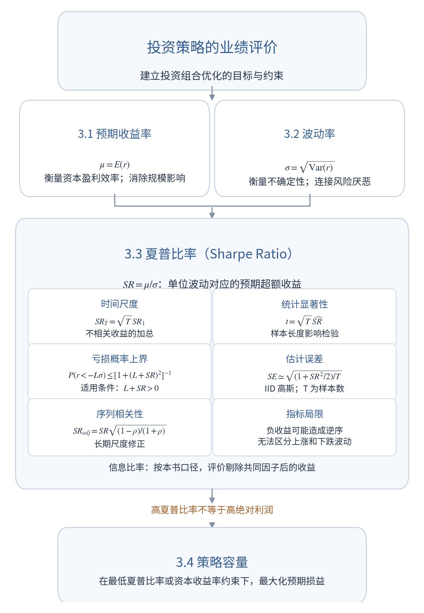
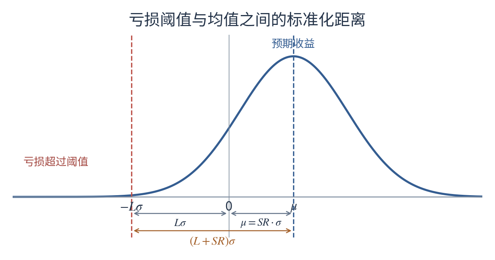

## 本章的问题

1. 投资组合管理人的主要业绩指标有哪些？
2. 这些指标之间有何关系？

***

主观投资组合管理人（Discretionary Portfolio Manager）追求满意解（Satisficing）；量化投资组合管理人（Quantitative Portfolio Manager）则进行优化（Optimization）。也许这样的说法对主观投资组合管理人并不完全公平：他们也会本能地进行优化，就像虎鲨优化其食物摄入量，或者迁徙的莺鸟尽量缩短飞往古巴的距离一样。另一方面，优化本身就是量化投资者的工作职责之一。

本章将介绍后续章节中出现的投资指标，并说明采用这些指标的理由。在某些情况下，这些指标作为目标（Objectives）进入优化问题；在另一些情况下，它们则作为约束（Constraints）。在某种程度上，目标与约束所扮演的角色可以互换。

总体而言，投资组合管理人的业绩指标包括：

- 策略的预期收益率（Expected Return）。
- 策略的波动率（Volatility）。
- 夏普比率（Sharpe Ratio）和信息比率（Information Ratio）。
- 策略容量（Capacity）。

第二章研究如何刻画收益率及其波动率，本章则研究如何利用这些统计量评价和优化投资策略。预期收益率衡量盈利效率，波动率衡量收益的不确定性，夏普比率将二者统一为风险调整后的收益指标。但盈利效率并不能回答策略能够容纳多少资金、产生多少绝对利润的问题，因此最后引入策略容量。

## 3.1 预期收益率

策略的预期收益率（Expected Return）定义为预期损益（Profit and Loss，PnL）与管理资产规模（Assets under Management，AuM）之比。除了特蕾莎修女可能是个例外，人们总是更喜欢拥有更多的钱，而收益率是描述这一点的一种适当方式。

设投资期初的管理资产规模为 $A$，该期随机损益为 $\operatorname{PnL}$，则收益率为 $r=\operatorname{PnL}/A$，预期收益率为

$$
\mu=E(r)=\frac{E(\operatorname{PnL})}{A}.
$$

之所以采用收益率而非实际货币金额，是因为归一化使这一指标更适合进行平稳性（Stationarity）建模，即在不同投资时期具有（近似）相同的分布；同时，它还是一个**强度量（Intensive Quantity，与广延量 Extensive Quantity 相对）**，即在收益率不受资金规模影响的情况下与投资金额无关。这使得不同时期和不同基金之间的比较更加容易。

既可以在一个投资期内对收益率进行优化，也可以在策略的整个生命周期内对其进行优化。实践中，这两个问题是可以分离的：我们求解一系列单期问题（Single-Period Problems），再将它们嵌入一个更大的多期问题（Multi-Period Problem）之中。

## 3.2 波动率

我们在第二章中介绍了收益率的波动率（Volatility）。波动率在投资领域得到了广泛使用，但这并不意味着其使用就是合理的。不过，确实有若干理由支持使用波动率。

第一个理由来自经验研究。Cont（2001）指出，股票收益率的尾指数（Tail Index）大于 2 而小于 5；收益率的矩可能至多只有四阶矩是有限的。因此，波动率是有限的，并且可以进行估计，[^1] 但无法保证偏度（Skewness）或峰度（Kurtosis）可以被估计。第二个理由与投资组合优化有关，下面我们将对此进行说明。

仅根据预期收益率进行优化，无法反映投资者对收益不确定性的厌恶。为了把这种风险偏好纳入优化问题，需要引入效用函数（Utility Function）。假设投资者求解一个如下形式的单期效用优化问题：

$$
\max_{\mathbf{w}} E\left[u\left(\mathbf{w}^{\mathrm{T}}\mathbf{R}\right)\right].
$$

效用函数描述投资者的偏好，并且是递增的凹函数。递增意味着投资者偏好更多的收益，凹性意味着随着收益增加，额外收益带来的效用增量逐渐减小。因此，在预期收益相同的情况下，投资者偏好不确定性较小的结果。由此可以通过不同的假设来说明使用波动率的合理性（Huang 和 Litzenberger，1988）：

1. 效用函数可以由以预期收益为中心的二阶泰勒展开（Second-Order Taylor Expansion）很好地近似。令 $X=\mathbf{w}^{\mathrm{T}}\mathbf{R}$、$m=E(X)$，则

   $$
   u(X)\simeq u(m)+u'(m)(X-m)+\frac12u''(m)(X-m)^2.
   $$

   两边取期望，由于 $E(X-m)=0$，得到

   $$
   E[u(X)]\simeq u(m)+\frac12u''(m)\operatorname{Var}(X).
   $$

   凹性意味着 $u''(m)\leq0$，所以方差项对期望效用产生负贡献。在局部采用固定系数近似后，优化目标可以写成

   $$
   aE(\mathbf{w}^{\mathrm{T}}\mathbf{R})-bE\left[\left(\mathbf{w}^{\mathrm{T}}\mathbf{R}-E(\mathbf{w}^{\mathrm{T}}\mathbf{R})\right)^2\right],\qquad a,b>0.
   $$

   这里收益率可以服从任意具有有限方差的分布，前提是上述局部近似足够准确。

2. 效用函数采取某种特定形式（除了上述二次效用函数之外），包括指数效用、幂效用和对数效用：

   $$
   u(X)\equiv
   \begin{cases}
   -\exp(-X),\\[6pt]
   \dfrac{X^{1-\gamma}}{1-\gamma}, & \gamma\in(0,1),\\[6pt]
   \log X.
   \end{cases}
   $$

   幂效用和对数效用要求 $X>0$，通常将 $X$ 理解为期末财富。在相应的分布假设或局部近似下，这些效用函数也可以导出均值与方差之间的权衡。

3. 最后，也可以假设效用函数是任意的（仍满足递增和凹性），而收益率服从正态分布。正态分布由均值与方差完全决定，因此期望效用也由这两个统计量决定。

正如我们在第二章中讨论的，人们普遍认同许多证券的收益率具有有限方差。假设可以用二次函数近似效用函数并非不切实际，因为量化投资中的优化时间跨度较短，收益也较小。从全局来看，效用函数并不是二次函数，而这一点可以通过效用近似公式中使用的参数来体现。

比值 $b/a$ 越大，可以理解为相对于收益的期望值，对收益不确定性施加的惩罚越大，即投资者具有更强的风险厌恶（Risk Aversion）。我不再进一步讨论这一主题，因为它已经在教科书中得到充分论述，例如 Huang 和 Litzenberger（1988），而且对于本书其余部分而言并非必不可少。

这里实际上已经给出了**均值—方差优化（Mean–Variance Optimization）**的动机。设资产收益率向量的均值为 $\boldsymbol\mu$，协方差矩阵为 $\Sigma$，则组合的预期收益率与方差分别为 $\mathbf w^{\mathrm T}\boldsymbol\mu$ 和 $\mathbf w^{\mathrm T}\Sigma\mathbf w$。将其代入上面的效用近似，就得到后续投资组合优化的基本目标：

$$
\max_{\mathbf w}\left\{\mathbf w^{\mathrm T}\boldsymbol\mu-\frac ba\mathbf w^{\mathrm T}\Sigma\mathbf w\right\}.
$$

## 3.3 夏普比率

预期收益率与波动率分别衡量盈利能力和风险，但二者可能同时增加，使策略之间难以直接比较。**夏普比率（Sharpe Ratio，SR）** 将前面两个量结合起来，用波动率作为单位来衡量某一时期内的预期超额收益率：

$$
\mathrm{SR}=\frac{\mu}{\sigma},\qquad \mu=E(r),\quad \sigma=\sqrt{\operatorname{Var}(r)}.
$$

这里的 $r$ 采用第二章定义的超额收益率。夏普比率衡量单位波动率所对应的预期超额收益，也可以理解为预期超额收益距离零点的标准化距离。

**信息比率（Information Ratio，IR）** 的定义与夏普比率类似，但按照本书的定义，使用了另一种类型的收益率：策略的特异性收益率（Idiosyncratic Returns）。

这些收益率将在第四章中介绍；目前只需知道，资产的特异性收益率描述了资产的“内在”收益率，即总收益率中不受同时影响所有收益率的共同因子（Common Factors）驱动的部分。因此，信息比率衡量的是剔除共同因子影响后的单位特异性风险所获得的预期收益。

如果假设某一策略的收益率[^2] 独立同分布（Independent and Identically Distributed，IID），那么样本夏普比率就与收益率分布均值的 $t$ 统计量（$t$-Statistic）直接相关。记 $s$ 为采用 $T-1$ 作分母的样本标准差，则在检验总体均值是否为零时，

$$
t=\frac{\widehat\mu}{s/\sqrt T}=\sqrt T\frac{\widehat\mu}{s}.
$$

若夏普比率估计采用后文以 $T$ 作分母的标准差 $\widehat\sigma$，则 $t=\sqrt{T-1}\widehat{\mathrm{SR}}\simeq\sqrt T\widehat{\mathrm{SR}}$。这意味着收益率的统计显著性不仅取决于夏普比率，还取决于样本容量：相同的样本夏普比率，若来自更多独立观测，就能够为总体均值非零提供更充分的统计证据。

在金融领域，夏普比率以 William F. Sharpe 的名字命名，他是资本资产定价模型（Capital Asset Pricing Model，CAPM）的提出者之一。

夏普比率既有缺点，也有优点。它有两个缺点。首先，作为对不确定结果进行排序的指标，它的合理性并不十分充分。除了决策理论方面的考虑之外，[^3] 一个预期收益率为 −5%、波动率为 5% 的投资组合，其夏普比率低于另一个具有相同负收益率、但波动率为 10% 的投资组合的夏普比率。这种结果往轻了说有违直觉，往重了说就是错误的。其次，它继承了波动率作为风险度量的局限性。可以将分母替换为自己偏好的风险度量（Risk Measure），而这类度量几乎数不胜数。[^4]

不过，夏普比率也有优点。首先，夏普比率具有直观性：它是以“风险”为单位衡量的收益率。其次，围绕它已经建立了丰富的理论成果。我们拥有关于它的置信区间（Confidence Intervals）、对其经验性质的刻画，以及诸如横截面回归（Cross-Sectional Regressions）与夏普比率之间关系这样的理论结果。

夏普比率还隐含着发生一定损失的概率上界。这可以由坎泰利不等式（Cantelli's Inequality）得到。对于均值为 $\mu$、标准差为 $\sigma$ 的随机变量 $\xi$，该不等式表明，当 $\lambda>0$ 时：

$$
P(\xi<\mu-\lambda)\leq\frac{\sigma^2}{\sigma^2+\lambda^2}.
$$

如果希望研究收益率低于 $-\lambda$ 的概率，只需将均值与亏损阈值之间的距离 $\mu+\lambda$ 代入坎泰利不等式：

$$
P(\xi<-\lambda)=P(\xi-\mu<-(\lambda+\mu))\leq\frac{\sigma^2}{\sigma^2+(\lambda+\mu)^2},\qquad \lambda+\mu>0.
$$

如果 $\xi$ 是策略的年度收益率，$\mathrm{SR}$ 是策略的年化夏普比率（Annualized Sharpe Ratio），并且按照实践工作者通常采用的方式，将损失表示为标准差的倍数 $-L\sigma$，那么该不等式为

$$
P(\xi<-L\sigma)\leq\frac{\sigma^2}{\sigma^2+(L\sigma+\mu)^2}=\frac{1}{1+(L+\mu/\sigma)^2}=\frac{1}{1+(L+\mathrm{SR})^2},\qquad L+\mathrm{SR}>0.
$$

这里的亏损阈值 $-L\sigma$ 是人为选择的风险衡量方式。由于不同策略的波动规模不同，使用各自的波动率作为衡量单位，可以比较相对于策略自身风险水平的亏损程度。$L$ 表示所关注的亏损幅度相当于多少倍标准差。

亏损阈值与收益率均值之间的距离为 $\mu-(-L\sigma)=\mu+L\sigma$。以标准差为单位衡量这段距离，只需除以 $\sigma$，得到 $\mu/\sigma+L=\mathrm{SR}+L$。因此，在亏损阈值位于均值左侧时，夏普比率越高，均值与亏损阈值之间的标准化距离越大，亏损概率的上界就越低。

这一不等式对于具有有限方差、夏普比率为 $\mathrm{SR}$ 且满足上述阈值条件的**任意收益率分布**都成立。例如，考虑年化夏普比率为 3、以美元计的年化波动率为 5000 万美元的情形。发生 1 亿美元损失（即两个标准差）的概率不超过 3.9%。这一数值远高于假设收益率服从正态分布时得到的数值。在后一种情况下，发生这一损失的概率将为 $2.9\times10^{-7}$。

### 常见问题 3.1：夏普比率的量纲

收益率、波动率和夏普比率都取决于衡量它们时所采用的时间跨度。日收益率 $r$ 是每日损益与资本之比；年化收益率则采用每日收益率的算术加总约定，假设一年中的 $T$ 个交易日具有相同的预期每日损益，因此为 $rT$。按照单位时间的收益率进行表述，我们说收益率具有量纲 $[\mathrm{time}]^{-1}$。

例如，某策略的收益率为

$$
\frac{10\%}{1\text{ 年}}\equiv\frac{10\%}{T\text{ 天}}\equiv\frac{10\%/T}{\text{天}}.
$$

如果收益率不存在序列相关性（Serial Correlation）（见第 2.1.5 节），方差也与时间呈线性关系，因为一年内加总收益率的方差是 $T$ 个每日方差之和，因此按单位时间计量的方差具有量纲 $[\mathrm{time}]^{-1}$。波动率是方差的平方根，其量纲为 $[\mathrm{time}]^{-1/2}$。夏普比率的量纲为

$$
[\mathrm{return}]/[\mathrm{volatility}]=[\mathrm{time}]^{-1}/[\mathrm{time}]^{-1/2}=[\mathrm{time}]^{-1/2}.
$$

具体而言，若单期收益率均值为 $\mu_1$、标准差为 $\sigma_1$，各期收益率不相关且均值、方差相同，则 $T$ 期加总收益率的均值为 $T\mu_1$，标准差为 $\sqrt T\sigma_1$。因此

$$
\mathrm{SR}_T=\frac{\mu_T}{\sigma_T}=\frac{T\mu_1}{\sqrt T\sigma_1}=\sqrt T\,\mathrm{SR}_1.
$$

预期收益随期数线性累积，而不相关的随机波动只能按期数的平方根累积，这就是夏普比率随时间跨度的平方根增长的原因。

对于股票策略，将夏普比率的时间跨度从日度转换为月度时，我们将日度夏普比率乘以 $\sqrt{21}$，其中 21 是一个月内的交易日数量。在美国，转换为年化夏普比率的系数为 $\sqrt{251}$。[^faq-a]

### 常见问题 3.2：夏普比率的置信区间

假设你观察到了连续 $T$ 个收益率（或损益），并利用这些数据估计夏普比率。这一估计量的置信区间是什么？首先，夏普比率的估计量为

$$
\widehat{\mu}:=\frac{1}{T}\sum_{t=1}^{T}r_t,\qquad \widehat{\sigma}:=\sqrt{\frac{1}{T}\sum_{t=1}^{T}(r_t-\widehat{\mu})^2}
$$

$$
\widehat{\mathrm{SR}}:=\frac{\widehat{\mu}}{\widehat{\sigma}}.
$$

总体夏普比率 $\mathrm{SR}=\mu/\sigma$ 是未知参数，而样本夏普比率 $\widehat{\mathrm{SR}}$ 是由历史收益率计算出来的随机估计量。不同样本会产生不同的估计结果，因此需要用标准误（Standard Error，SE）衡量估计量自身的波动程度。对于独立同分布的高斯超额收益率 $r_t$，在 $T\to\infty$ 时，样本夏普比率具有渐近正态分布：

$$
\sqrt T(\widehat{\mathrm{SR}}-\mathrm{SR})\xrightarrow{d}N(0,1+\mathrm{SR}^2/2).
$$

相应的渐近标准误为

$$
\mathrm{SE}(\widehat{\mathrm{SR}})\simeq\sqrt{\frac{1+\mathrm{SR}^2/2}{T}}.
$$

其中 $T$ 是样本容量（Sample Size），即参与估计的收益率观测值数量，而不是物理时间的长度。对于日频数据，它是观测到的交易日数量；对于分钟频数据，它是分钟收益率的数量。这里的 $T\to\infty$ 指统计学中的大样本极限。标准误按 $1/\sqrt T$ 的速度下降，意味着独立样本越多，夏普比率的估计越稳定。

由于总体夏普比率未知，实际计算标准误时，需要将它替换为样本夏普比率。由此可以构造近似的 95% 置信区间：

$$
\widehat{\mathrm{SR}}\pm1.96\sqrt{\frac{1+\widehat{\mathrm{SR}}^{\,2}/2}{T}}.
$$

将这一结果与我们预先知道收益率标准差的情形进行比较。此时，夏普比率的估计量为 $\widehat{\mathrm{SR}}:=\widehat{\mu}/\sigma$，标准误为 $\sqrt{1/T}$。与之相比，未知标准差情形中的 $\mathrm{SR}^2/2$ 项来自波动率估计引入的额外不确定性。

前面的时间尺度转换假设收益率不存在序列相关性。但如果收益率具有自相关，跨期方差就不仅包含每一期收益率的方差，还包含不同时期收益率之间的协方差。设 $\gamma(h)$ 为收益率的自协方差函数，则

$$
\operatorname{Var}\left(\sum_{t=1}^{T}r_t\right)=T\gamma(0)+2\sum_{h=1}^{T-1}(T-h)\gamma(h).
$$

对于存在自相关的收益率，若 $\operatorname{cor}(r_s,r_t)=\rho^{|t-s|}$ 且 $|\rho|<1$，其长期方差（Long-Run Variance）为

$$
\sigma_\infty^2=\gamma(0)+2\sum_{h=1}^{\infty}\gamma(h)=\sigma^2\left(1+2\sum_{h=1}^{\infty}\rho^h\right)=\sigma^2\frac{1+\rho}{1-\rho}.
$$

因此，以长期方差进行标准化的夏普比率估计量为

$$
\widehat{\mathrm{SR}}_{\mathrm{adj}}:=\frac{\widehat{\mu}}{\widehat{\sigma}}\sqrt{\frac{1-\rho}{1+\rho}}\simeq\frac{\widehat{\mu}}{\widehat{\sigma}}(1-\rho),\qquad |\rho|\ll1.
$$

对于正的预期超额收益，正自相关会使累计收益率的方差增大，因而直接按照平方根规则转换得到的长期夏普比率偏高；负自相关则相反。这与时间序列分析中的长期方差直接相关。上式是长期尺度的每期标准化修正，转换为 $T$ 期夏普比率还需乘以 $\sqrt T$；有限期的精确计算使用前面的累计方差公式。

## 3.4 策略容量

与收益率和夏普比率不同，策略容量（Capacity）没有统一明确的定义。一种非正式的定义是：“**一项策略在一定时间跨度内能够产生的最高预期损益**”。

此前的收益率和夏普比率主要衡量资金的使用效率，却没有考虑一项策略能够容纳多少资金。即使某个策略具有很高的收益率，如果只能投入少量资金，其实际创造的利润也可能十分有限。因此，我们还需要研究投资资金规模与预期利润之间的关系。

设投入的资金为 $V$，策略的预期超额收益率为 $\mu$，收益率波动率为 $\sigma$，则预期损益为

$$
E(\operatorname{PnL})=V\mu=V\sigma\frac{\mu}{\sigma}=V\sigma\cdot\mathrm{SR}.
$$

其中，$V\sigma$ 称为**货币波动率（Dollar Volatility）**，即以实际金额衡量的损益标准差。记作

$$
v:=\operatorname{SD}(\operatorname{PnL})=V\sigma.
$$

于是，

$$
E(\operatorname{PnL})=v\cdot\mathrm{SR}.
$$

如果夏普比率不随资金规模变化，那么只要不断增加投资资金，就可以不断提高预期利润。然而，实际交易受到市场流动性、交易成本和市场冲击（Market Impact）的制约。随着投入资金增加，交易行为本身会影响成交价格，侵蚀原有的盈利空间。因此，夏普比率通常会随着资金规模的扩大而下降。

这里存在两个相互竞争的因素：

- 投入资金增加，使策略能够获得更多的绝对利润。
- 投入资金增加，也会使交易成本和市场冲击增大，降低策略的盈利效率。

因此，预期利润可能随着资金规模的扩大先增加、后减少。当新增资金所带来的收益不足以抵消扩大交易规模产生的额外成本时，继续投入资金反而会降低整体利润。

设 $\mu(V)$ 和 $\mathrm{SR}(V)$ 分别为投入资金 $V$ 时的预期超额收益率和夏普比率。若基金管理人要求夏普比率不得低于 $\mathrm{SR}_{\min}$，则策略容量可以表示为以下约束优化问题：

$$
C=\max_{V\geq0}\left\{V\mu(V):\mathrm{SR}(V)\geq\mathrm{SR}_{\min}\right\}.
$$

这里需要区分三个概念：

- **最大可接受投资规模**：满足最低夏普比率要求时，最多可以投入多少资金。
- **最优投资规模**：在满足约束的前提下，使预期利润最大化的资金投入量。
- **策略容量**：在最优投资规模下能够获得的最大预期利润。

如果预期利润曲线的最高点位于可接受的资金规模范围内，就直接选择该最高点；如果最高点超出了允许的资金规模，则需要在约束范围内重新寻找最优点。

因此，最低可接受夏普比率只是约束条件，最大化预期利润才是优化目标。

策略容量对于对冲基金管理人和投资组合管理人十分重要。一项策略在投入少量资金时，可能具有很高的收益率和夏普比率，但如果无法扩大投资规模，就难以创造足够大的绝对利润。策略容量衡量的正是这种经济意义上的可扩展性。

## 本章要点

1. **预期收益率（Expected Return）**：表示相对于管理资产规模的预期利润；归一化使不同时期和不同基金之间的比较更加容易。
2. **波动率（Volatility）**：投资组合优化中的一种标准度量，对于具有有限方差的资产，它得到了经验研究的支持；在关于投资者效用函数的特定假设下使用。
3. **夏普比率（Sharpe Ratio）**：表示单位波动率对应的预期超额收益率。它与统计显著性、亏损概率上界、时间尺度和估计误差有关，但也具有局限性，例如依赖风险度量的选择，并且在负收益率下会产生有违直觉的结果。
4. **策略容量（Capacity）**：指在策略可接受的夏普比率阈值等约束下能够实现的最大预期损益（PnL）。它对于评估一项策略在经济上的可行性至关重要。

[^1]: 在独立同分布情形下，四阶矩有限可以保证常规样本方差估计的中心极限定理；样本方差的一致性只需要有限二阶矩。

[^2]: 或者，更常见的是超额收益率（Excess Returns），即策略收益率超过无风险利率的部分；无风险利率通常为三个月期国债收益率。这是持有一项自融资证券（Self-Financed Security）的收益率：在第一期，我们以无风险利率借入一美元，并买入价值一美元的证券；在第二期，我们获得证券收益，并偿还贷款。

[^3]: 关于这些问题，见 Huang 和 Litzenberger（1988）。

[^4]: 例如，见 Bacon（2005），其中列出了各种风险度量，包括具有理论依据的度量和启发式度量。

[^faq-a]: 交易日的数量取决于国家、资产类别和年份。截至 2024 年，美国股票市场每年开放 251 个交易日。
