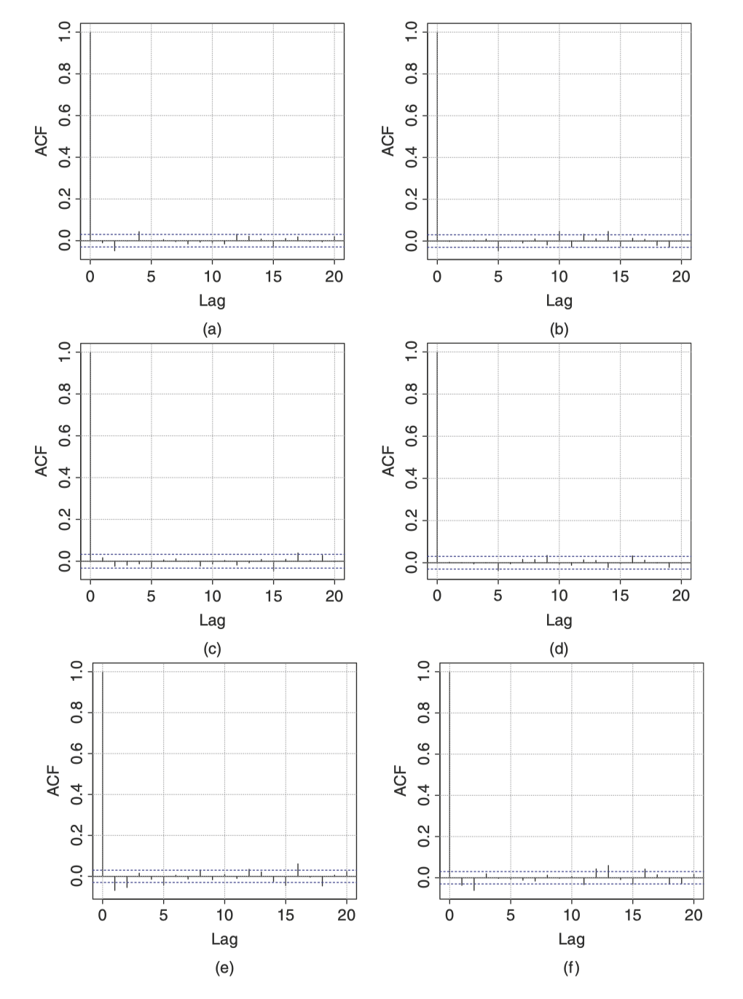
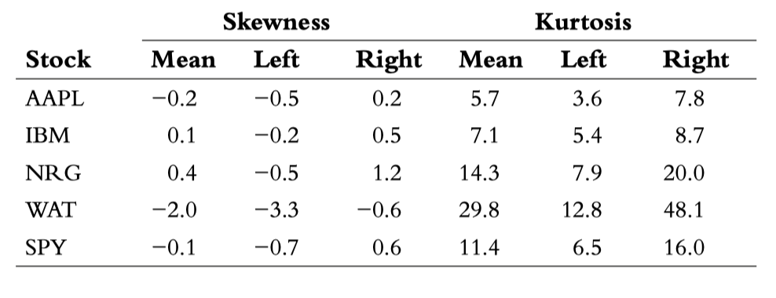
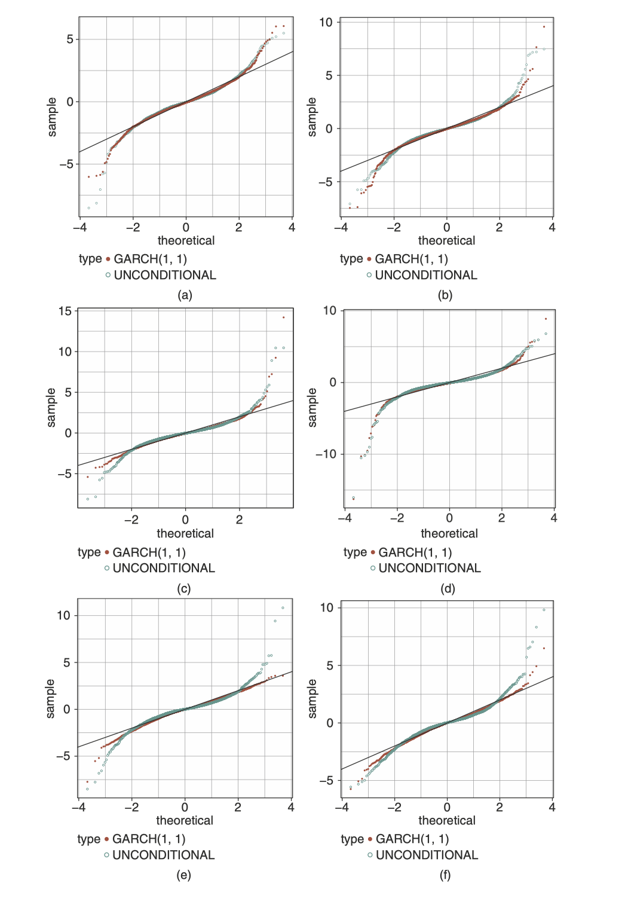
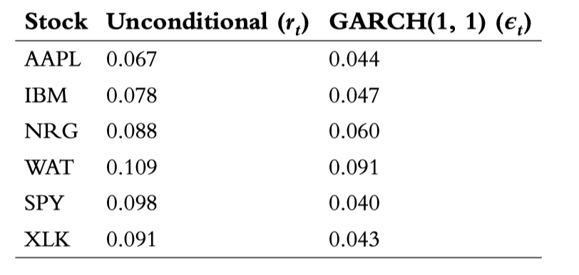
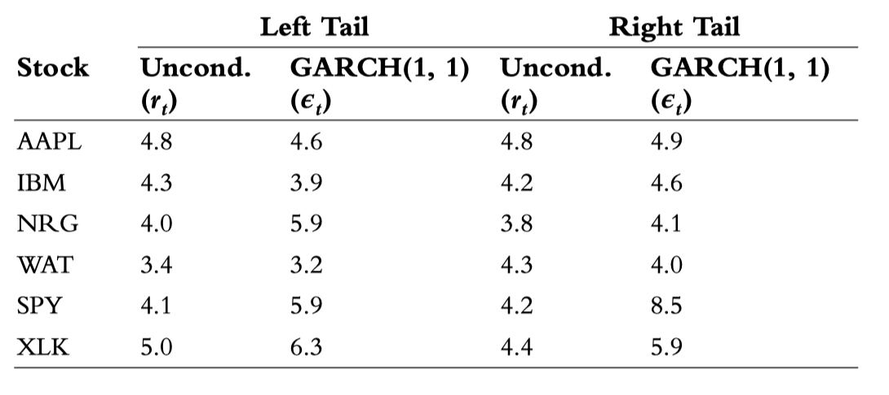
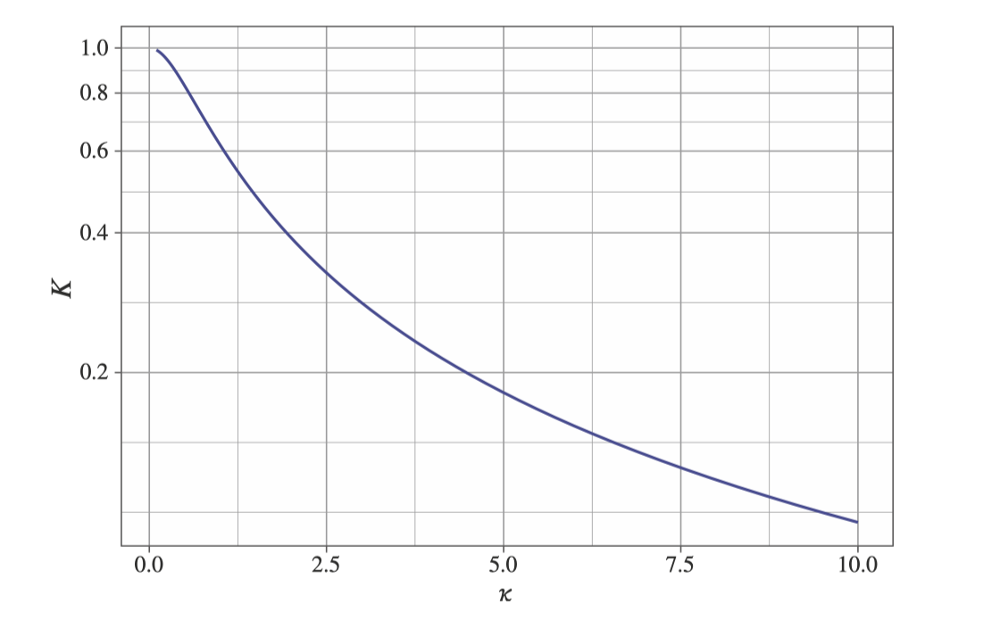

## 本章的问题

1. 收益率有哪些定义和类型，包括股息调整收益率和超额收益率？
2. 股票收益率有哪些典型事实，它们为什么重要？
3. 在考虑市场微观结构效应时，我们如何估计价格与收益率？
4. 条件异方差模型（Conditional Heteroskedastic Models）是什么，它们如何对波动率建模？
5. GARCH(1, 1) 模型如何刻画收益率的典型事实？
6. 什么是已实现波动率（Realized Volatility），如何利用高频数据估计它？
7. 如何使用状态空间模型（State-Space Models）和卡尔曼滤波器（Kalman Filter）估计方差？
8. GARCH(1, 1) 与波动率估计中的指数加权移动平均（Exponentially Weighted Moving Averages，EWMAs）有何关系？

我们从单变量收益率（Univariate Returns）的模型开始，原因有两个。首先，单一资产收益率是投资组合的基本组成部分。如果不能扎实地理解这些基本组成部分，就不可能理解投资组合的行为。因此，有必要概括股票收益率最突出的经验性质，以及最常用来描述收益率的随机过程，特别是那些能够有效刻画波动率的模型。其次，这些模型具有广泛的适用性；当它们与其他多变量收益率模型结合使用时，作用甚至更大。GARCH 和指数移动平均是实际建模工作者必不可少的工具。在介绍过程中，我也将说明使用这些工具的模型依据：指数移动平均可以从线性状态空间模型得到解释，而 GARCH 则是非线性状态空间模型的一个实例。这些模型将成为你终生的伙伴。

本章分为四个部分。首先给出收益率的定义；其次总结一些**典型事实（Stylized Facts）**，即收益率中普遍存在、对风险管理具有重要意义的经验特征。作为波动率建模的基础，我们将介绍 GARCH 模型和已实现波动率模型。由于这些主题已经在教科书中得到充分讨论，这里的目标是呈现核心内容及其相关见解，并为读者提供进一步学习的起点。最后，我将简要介绍用于方差估计的状态空间模型。

## 2.1 收益率

### 2.1.1 定义

我们有一组 $n$ 项资产和一种货币，后者也称为**计价基准（Numeraire）**。[^1] 本书始终以美元为基础货币。通常假设这些资产都可以无限分割。今天，我们以一个货币单位的价值买入资产 $i$；明天（或未来某个时期），它的价值为 $1+r_i$。

定义收益率的另一种等价方式，是利用证券 $i$ 在第 0 天和第 1 天的收盘价，分别记为 $P_i(0)$ 和 $P_i(1)$。**收益率（Return）**[^2] 定义为

$$
r_i(1):=\frac{P_i(1)-P_i(0)}{P_i(0)}.
$$

我们将这个定义扩展到证券支付股息的情况。资产持有人收到金额为 $D_i(1)$ 的股息。**股息调整收益率（Dividend-Adjusted Return）**定义为

$$
r_i(1):=\frac{P_i(1)+D_i(1)-P_i(0)}{P_i(0)}.
$$

在一个包含 $n$ 项资产的投资范围内，时点 $t-1$ 与 $t$ 之间的日收益率向量记为

$$
\mathbf r(t):=(r_1(t),\ldots,r_n(t)).
$$

对于投资组合 $\mathbf w\in\mathbb R^n$，其中 $w_i$ 是投资于资产 $i$ 的货币金额，单期的**损益（Profit and Loss，PnL）**由投资组合价值的变化给出。持有的资产 $i$ 股数为 $w_i/P_i(0)$。在第 1 期，投资组合价值是 $\sum_i [w_i/P_i(0)]P_i(1)$，因而其价值变化为

$$
\sum_i\frac{w_i}{P_i(0)}P_i(1)-\sum_i w_i.
$$

用向量形式表示，这等于 $\mathbf w^{\mathsf T}\mathbf r$。随机收益率的**波动率（Volatility）**是它的标准差：

$$
\sigma:=\sqrt{E[(r-E(r))^2]}.
$$

方差是波动率的平方。有时，如果 $E(r^2)\gg E^2(r)$ 这一近似条件成立，我们会用收益率的二阶矩近似方差：$\sigma^2\simeq E(r^2)$。

**复合收益率（Compounded Return）**定义为：如果一个计价货币单位在连续 $T$ 个时期内投资于收益率为 $r(t)$ 的证券，那么 $T$ 期后相对于初始金额的净收益率为

$$
\begin{aligned}
r(1:T)&:=\frac{P(T)}{P_i(0)}-1\\
&=\frac{P(T)}{P(T-1)}\frac{P(T-1)}{P(T-2)}\cdots\frac{P(1)}{P(0)}-1\\
&=\prod_{t=1}^{T}(1+r(t))-1.
\end{aligned}
$$

### 2.1.2 超额收益率

在本书余下的部分，我们使用的并非证券的原始收益率，而是**扣除无风险利率后的收益率**。例如，如果我们对日收益率建模，那么无风险利率 $r_f$ 就是投资者在同一时期借入现金需要支付的利率，或者现金存放在账户中时投资者收到的利率。[^3] 如果我们持有一项证券，就要为与该证券头寸对应的现金支付利息；如果我们做空，就会收到利息。现金实际上也是一种证券，只是它比较特殊：与其他风险资产相比，它的波动率低得多，在建模时可以忽略。

我们借入或贷出的金额等于投资组合的**净市值（Net Market Value，NMV）**，即各个头寸价值的总和。投资组合的收益为

$$
\sum_i w_i r_i-\sum_i w_i r_f=\sum_i w_i(r_i-r_f).
$$

这一公式使我们能够从投资组合中消去无风险资产，同时也自然地把证券收益率理解为：相对于不进行风险投资时可以获得的利率，额外获得的收益。在美国，参考利率通常是某种隔夜拆借基准利率，例如**担保隔夜融资利率（Secured Overnight Financing Rate，SOFR）**。[^4]

### 2.1.3 对数收益率

如果收益率向量 $\mathbf r$ 服从多元高斯分布，那么投资组合的 PnL 也服从高斯分布。只需要两项信息，即投资组合权重和收益率的协方差矩阵，就可以计算投资组合的方差。

净收益率是否服从高斯分布，是一个经验问题。至少我们知道，如果净收益率是高斯的，那么在单个时点上，它们很容易进行数学分析。然而，在时间序列分析中，情况就不那么简单。例如，考虑第 $1,\ldots,T$ 期的复合收益率。即使 $r_i(t)$ 服从正态分布，累计总收益率也不服从正态分布，而且其分布会迅速偏离正态分布。累计收益率的方差，也不能简单地由单期方差表示。

另一方面，**对数收益率（Log Returns）**在跨期复合时具有可加性。设

$$
\widetilde r_i(t):=\log(1+r_i(t)).
$$

那么，复合总收益因子的对数就等于相应期间内对数收益率之和。如果对数收益率服从正态分布，复合总收益因子的对数也服从正态分布。如果收益率相互独立，对数收益率之和的方差就等于各期方差之和。

当近似式

$$
\log x=x-1+o(|x-1|^2)
$$

足够准确，也就是净收益率较小时，我们可以协调原始收益率与对数收益率这两种表示方式。在收益率不太大的条件下，近似 $r_i\simeq\widetilde r_i$ 足够准确。

一个常见做法是近似资产随时间复合的净收益率：

$$
\begin{aligned}
\prod_t(1+r(t))-1
&=\exp\left(\sum_t\widetilde r(t)\right)-1\\
&\simeq 1+\sum_t\widetilde r(t)-1\\
&=\sum_t\widetilde r(t).
\end{aligned}
$$

始终应该验证这种近似的准确性，例如比较使用 $r$ 和 $\widetilde r$ 开发的模型得到的估计。一般而言，这种近似偏于乐观（见练习 2.1）。对于股票而言，在日频或更短时间间隔下，它通常被认为足够准确；对于较长的时间间隔（例如一年），或者波动幅度很大的收益率，这种近似就较差。

### 2.1.4 价格与收益率的估计

为了估计收益率，我们需要价格。然而，价格在很大程度上取决于市场的设计方式。**场外交易市场（Over-the-Counter，OTC）**（Harris，2003）与使用**限价订单簿（Limit-Order Book）**的交易所（Bouchaud 等，2018）不同。即使在同一家交易所，交易机制也可能在一天内发生变化，例如交易日开盘和收盘时经常采用竞价交易。因此，市场设计会使观测到的价格带有测量误差。

这类误差最明显的例子是**买卖价差（Bid–Ask Spread）**。在限价订单簿中，买入订单具有价格属性（买方愿意为每股支付的买入报价）和数量属性；卖出订单同样具有卖出报价和数量。卖出报价高于买入报价，两者之差就是买卖价差。价差是最小报价单位（Tick Size）的整数倍。[^5] 要发生交易，买单或卖单就必须跨越买卖价差；这两种情况都可能出现。因此，成交价格会落在买卖价差区间的上端或下端。由于买卖交易随机交替出现，连续成交的价格标记也会有所不同。

买卖价差反弹（Bid–Ask Spread Bounce）并不是测量误差的唯一来源。例如，不同交易所的价格可能不同；在某个时间戳上选择哪一个价格，取决于数据整合的方法。此外，还可能存在直接的数据测量错误。从一开始就应该考虑价格只能被不完美地观测这一事实，而不是忽视它及其影响，直到产生意料之外的后果。

也许最简单的资产价格模型是 **Roll 模型**（Roll，1984）。[^6] 在这一模型中，资产的“真实”价格 $m_t$ 按算术随机游走演化，而我们只能不完美地观测到价格 $p_t$。写成公式就是

$$
\begin{aligned}
m_{t+1}&=m_t+\sigma_\epsilon\epsilon_{t+1} &&\text{（演化）},\\
p_{t+1}&=m_{t+1}+\sigma_\eta\eta_{t+1} &&\text{（观测）},
\end{aligned}
$$

其中，随机变量 $\epsilon_t$ 与 $\eta_t$ 在时间上及彼此之间均独立，并都服从标准正态分布。

在尝试估计价格之前，这个模型就直接给出了一项可以检验的推论：**连续的价格差分具有负相关性**。价格差分是

$$
\Delta p_{t+1}:=p_{t+1}-p_t
=\sigma_\epsilon\epsilon_{t+1}+\sigma_\eta(\eta_{t+1}-\eta_t),
$$

其期望为零。然而，

$$
E(\Delta p_{t+1}\Delta p_t)=-\sigma_\eta^2.\tag{2.1}
$$

$$
E(\Delta p_{t+1}\Delta p_s)=0,\qquad s<t.\tag{2.2}
$$

一阶滞后自协方差，即式（2.1），也可以用来估计测量误差。如果在一阶滞后之外还存在较大的非零自相关，就可能表明模型不够适合，因为真实价格过程 $m_t$ 中可能具有实际的长期依赖关系。这个模型可以扩展到任意滞后阶数。

**卡尔曼滤波器（Kalman Filter）**为 $m_t$ 提供了一个最优估计量。滤波器将在附录 2.4.1 节介绍，特别是在 2.4.2 节的例 2.1 中。估计量为

$$
\widehat m_{t+1\mid t}=(1-K)\widehat m_{t\mid t-1}+Kp_t,
$$

其中 $K\in(0,1)$ 的显式公式见附录。比值 $\sigma_\eta/\sigma_\epsilon$ 越小，$K$ 就越大。这很合理：如果价格观测足够准确，我们便不需要对观测值进行平均。这个模型的核心含义是，**与直接取测量区间的最后一个价格相比，对价格进行指数移动平均更好**。例如，如果我们要获得日收盘价，就可能希望对收盘前若干个五分钟区间的价格进行加权平均。

不过有一个问题。假设我们已经得到估计 $\widehat m_t$，并用它们来计算相邻区间的收益率，即 $r:=\widehat m_n/\widehat m_{n-1}-1$。由于 $\widehat m_{n-1}$ 和 $\widehat m_n$ 使用了相同的价格观测 $p$，这两个估计量是正相关的。应该始终检查 $(1-K)\ll1$ 是否成立，以减轻这种虚假相关性。

### 2.1.5 典型事实

在建造房屋之前，我们需要先看看砖块，也就是单只股票收益率的统计性质。下面列出股票收益率的一些**典型事实（Stylized Facts）**，并讨论它们与风险建模和管理的关系。

收益率有一个下界 $-1$。我们通常刻画对数收益率 $\widetilde r(t):=\log(1+r(t))$ 的性质。我们不仅关注 $\widetilde r(t)$ 本身，还关注 $|\widetilde r(t)|$ 和 $\widetilde r^2(t)$，即对数收益率未经中心化的波动幅度。以下是其中一些性质。参见 Cont（2001）、Taylor（2007）、Zivot（2009）、Ratliff-Crain 等（2023）。

1. **缺乏自相关**。除非你在市场微观结构变得重要的时间尺度（例如日内）观察价格与收益率，否则滞后自相关通常很小。见图 2.1。
2. **厚尾（Heavy Tails）**。收益率的无条件分布表现出厚尾性质。下一节会给出更加准确的刻画，但基本含义是，大幅收益变动出现的概率，高于任何具有全部有限矩的“薄尾”分布所预示的概率。表 2.1 给出了样本峰度的例子。收益率的条件分布（例如以时点 $t$ 之前全部收益率历史为条件）也可能表现出厚尾性质，但其尾部通常比无条件分布更薄。
3. **绝对收益率及二阶矩的自相关**。时间序列 $|\widetilde r_i(t)|$ 和 $\widetilde r_i^2(t)$ 显示很强的正自相关（Autocorrelation Function，ACF）。绝对值序列的自相关最大，文献中将此称为“泰勒效应（Taylor Effect）”（Taylor，1986；Granger 和 Ding，1995）。因此，已经发生的大幅收益变动往往在一段时间内持续出现，小幅收益变动也是如此。这一现象有时称为**波动率聚集**。
4. **聚合高斯性**。在较长时间尺度（例如周收益率或月收益率，而不是日收益率或日内收益率）上，对数收益率分布会更加接近高斯分布。



现实情况[^7]与简单的单变量价格动态模型形成了鲜明对比，例如简单衍生品定价模型核心的几何扩散过程：

$$
\underbrace{\frac{dP(t)}{P(t)}}_{\text{价格变化}}
=\underbrace{\mu\,dt}_{\text{漂移}}+
\underbrace{\sigma\,dW(t)}_{\text{噪声}}.\tag{2.3}
$$

这一模型预测对数收益率服从高斯分布并相互独立，与经验事实不符。首先，收益率几乎不表现出序列自相关，但这并不意味着收益率彼此独立，也不意味着不能根据过去的收益率或其他解释变量预测收益率。对于前一点，零自相关不意味着独立；对于后一点，收益率确实具有可预测性。这不仅仅是主动投资者的一种信念——他们通常在预测方面做得很糟糕——也是学术界相对没有争议的实证发现。[^8] 尽管如此，收益率并非那么容易预测。



关于厚尾：对于资产收益率，我们只关注**幂律尾分布**。这类分布的累积分布函数的补函数满足幂律：

$$
\overline F(x):=P(r>x)=Cx^{-\alpha},\qquad \alpha>0,
$$

其中 $\alpha$ 是**尾指数（Tail Index）**。将它与高斯收益率比较：设 $F$ 是标准高斯分布的累积分布函数，那么尾概率有一个常见的近似界（Wasserman，2004）：

$$
\frac{1}{\sqrt{2\pi}}e^{-x^2/2}
\left(\frac1{|x|}-\frac1{|x|^3}\right)
\le F(x)\le
\frac{1}{\sqrt{2\pi}}e^{-x^2/2}\frac1{|x|},\qquad x\le-2.\tag{2.4}
$$

利用右侧不等式，可以对左尾分位数给出界；右尾也有对称的不等式。对于 $0\le\delta\le0.025$：

$$
\overline F(x)\le\frac{e^{-x^2/2}}{\sqrt{2\pi}}
\quad\Longrightarrow\quad
\overline F^{-1}(1-\delta)\le
\sqrt{2\log[(2\sqrt{2\pi}(1-\delta))^{-1}]}.\tag{2.5}
$$

$$
F(x)\ge\frac{e^{-x^2/2}}{\sqrt{2\pi}}
\quad\Longrightarrow\quad
F^{-1}(\delta)\ge
-\sqrt{2\log[(2\sqrt{2\pi}\delta)^{-1}]}.\tag{2.6}
$$

这种近似相当准确。设累积分布函数 $F(x)=1-\overline F(x)$，则有

$$
-\sqrt{2\log\left[\frac1{2\sqrt{2\pi}\delta}\right]}
\le F^{-1}(\delta)\le
-0.948\sqrt{2\log\left[\frac1{2\sqrt{2\pi}\delta}\right]},
\quad 0<\delta<0.025.
$$

高斯随机变量的任意阶矩都是有限的。尾指数为 $\alpha$ 的幂律尾随机变量，则只有低于 $\alpha$ 阶的矩才是有限的。高斯随机变量的分位数在常数倍意义下受 $\sqrt{\log(1/\delta)}$ 控制，而幂律尾随机变量的分位数具有 $-(1/\delta)^{1/\alpha}$ 的形式。

无条件对数收益率具有厚尾，这一点没有争议；尚未确定的是，该分布对应的指数 $\alpha$ 究竟是多少。不过，它似乎接近 $4$。这对估计问题十分重要。要使收益率波动率能够得到估计，一个充分条件是其四阶矩有限。为了理解这一点，回顾中心极限定理：如果 $x_t$ 是具有均值 $\mu$ 和方差 $\sigma^2$ 的独立同分布随机变量，那么

$$
T^{-1/2}\sum_{t=1}^{T}x_t
$$

依分布收敛到均值为 $\sqrt{T}\mu$、方差为 $\sigma^2$ 的高斯随机变量。该定理使我们能够为 $E(r^2)$ 建立渐近结果。假设 $r_t$ 独立同分布，令 $x_t:=r_t^2$。如果希望利用中心极限定理估计 $E(r_t^2)$，就要求估计量的方差有限，即需要 $E(r_t^4)$ 有限。看来实际情况确实如此。

不过，另一个相关问题是：收益率的**条件分布**是否也具有厚尾？我们完全可以构造一个过程，使条件收益率服从高斯分布，而无条件收益率具有厚尾。这一模型家族就是**条件异方差模型**，也是下一小节的主题。

我们不会讨论具有长程依赖或条件厚尾收益率的模型，例如莱维过程（Lévy Processes）和 FARIMA 模型。没有任何模型能够覆盖股票收益率观测到的全部经验特征。GARCH 模型（以及一般的混合模型）的优点，是容易解释、模拟和估计。

## 2.2 条件异方差模型

这类模型最早由 Engle（1982）以及 Engle 和 Bollerslev（1986）于 20 世纪 80 年代初提出。到了下一个十年，这些模型已经得到推广，并应用于多个经济学领域。[^9] 几乎所有计量经济学教科书都对此进行了广泛介绍。

这一家族中最流行、研究也最充分的是 **GARCH(1, 1) 模型**，即广义自回归条件异方差（Generalized Autoregressive Conditional Heteroskedasticity）模型。它具有良好的经验性质，其理论性质已经得到刻画，而且可以高效估计。这个模型也体现了该类大量模型的核心思想。

这一模型的根本洞见，是使模型中的参数成为随机过程状态的一部分。GARCH(1, 1) 的规律为

$$
r_t=h_t\epsilon_t,\tag{2.7}
$$

$$
h_t^2=\alpha_0+\alpha_1r_{t-1}^2+\beta_1h_{t-1}^2,\tag{2.8}
$$

$$
\epsilon_t\sim N(0,1).\tag{2.9}
$$

在上式中，$h_t$ 是时点 $t$ 的波动率（$h_t^2$ 则为方差），并通过式（2.7）决定收益率的大小。参数 $\alpha_0,\alpha_1,\beta_1$ 均假定非负。过程 $h_t$ 的演化由式（2.8）决定。

为了获得一些直观认识，我们去掉 GARCH 过程第二个方程中的 $\alpha_1r_{t-1}^2$ 项，得到

$$
h_t^2=\alpha_0+\beta_1h_{t-1}^2.\tag{2.10}
$$

它可以改写为

$$
h_t^2-\overline h^2=\beta_1(h_{t-1}^2-\overline h^2),
\qquad
\overline h^2:=\frac{\alpha_0}{1-\beta_1}.
$$

只要 $0<\beta_1<1$，$h_t^2$ 就会以几何速度收敛到 $\overline h^2$。如果 $\alpha_1>0$，较高的收益率平方 $r_t^2$ 就会向上冲击波动率。这又提高了下一时期出现较大收益率平方的概率，从而产生丰富的动态行为。

波动率的增加不可能无限持续，因为 $\beta_1(h_{t-1}^2-\overline h^2)$ 项会抑制那些远高于“均衡水平”$\overline h^2$ 的方差。将模型第二个方程反复代入，可以看出这一点：

$$
h_t^2=\overline h^2+\alpha_1\sum_{i=1}^{\infty}\beta_1^{i-1}r_{t-i}^2.\tag{2.11}
$$

我们可以用 $\alpha_0,\alpha_1,\beta_1$ 的估计值替代其真实值，并据此解释这个公式：方差估计量是**非独立同分布的收益率平方的指数移动平均**，因为根据式（2.7），这些收益率平方还受到 $h_t$ 的调节。

### 2.2.1 GARCH(1, 1) 与收益率的典型事实

GARCH 模型改善了条件收益率 $r_t$ 的分布性质，使它们更接近高斯分布；见图 2.2。GARCH(1, 1) 模型与前面列出的典型事实符合得如何？

1. **缺乏自相关。** 模型满足这一性质（直接验证并不困难）。
2. **厚尾。** 无条件收益率具有高峰度（Leptokurtic）（Cont，2001）。在 GARCH 模型中（Mikosch 和 Stărică，2000），无条件收益率的分布具有厚尾。对经验数据估计的 GARCH(1, 1) 模型中，式（2.7）的 $\epsilon_t$ 的分布更接近高斯分布，见表 2.2。$\epsilon_t$ 的尾指数也高于 $r_t$ 的尾指数，见表 2.3。这些都是 GARCH 过程所期望具有的性质。
3. **绝对收益率和收益率平方的自相关。** GARCH(1, 1) 的绝对收益率与收益率平方的自相关函数均为正。对于收益率平方，其形式为（He 和 Teräsvirta，1999；Ruppert 和 Matteson，2015）

   $$
   \rho_n=\begin{cases}
   \dfrac{\alpha_1(1-\alpha_1\beta_1-\beta_1^2)}{1-2\alpha_1\beta_1-\beta_1^2}, & n=1,\\[8pt]
   \rho_1(\alpha_1+\beta_1)^{n-1}, & n>1.
   \end{cases}
   $$

   然而，如果考察常见股票指数的峰度与一阶滞后自相关，就会发现：在给定观测峰度水平时，模型预测的自相关相比实际观测值**过高**。参见 Teräsvirta（2009a）。
4. **聚合高斯性。** 将 GARCH 过程聚合到更长的时间跨度后，得到的仍是 GARCH 过程（但参数不同），而不是高斯过程；参见 Drost 和 Nijman（1993）、Christoffersen 等（1998）。这与前面关于自相关的问题相一致：粗略地说，GARCH 的“长期记忆”过长，并不完全符合经验数据。

总之，GARCH(1, 1) 能够刻画对数收益率的某些典型事实，但不能刻画全部事实。





{{< figure src="image-6.png" alt="image" class="bw-image-caption" caption="表 2&#46;3　估计概率密度函数 &#36;p&#40;x&#41;&#92;propto x^&#123;&#45;&#92;alpha&#125;&#36; 的左右尾指数 &#36;&#92;alpha&#36;。使用最大似然估计量（Maximum Likelihood Estimator，MLE）&#42; &#36;&#36; &#92;widehat&#92;alpha=1&#43;n&#92;left&#91;&#92;sum&#95;i&#92;log&#92;left&#40;&#92;frac&#123;x&#95;i&#125;&#123;x&#95;&#123;&#92;min&#125;&#125;&#92;right&#41;&#92;right&#93;^&#123;&#45;1&#125;, &#36;&#36; &#42;其中 &#36;n&#36; 是超过截断值 &#36;x&#95;&#123;&#92;min&#125;&#36; 的观测数；参见 Clauset 等（2009）。左尾和右尾的 &#36;x&#95;&#123;&#92;min&#125;&#36; 分别设为 &#36;&#45;2&#46;5&#92;%&#36; 和 &#36;2&#46;5&#92;%&#36;。对于 SPY 和 XLK 两个指数，估计的 &#36;&#92;alpha&#36; 显著提高。&#42;" original="" >}}

### 2.2.2 作为随机递推方程的 GARCH

现在从不同的建模方法来看 GARCH(1, 1)。首先，我们可以把它重新表述为随机迭代函数。将式（2.8）改写为

$$
h_t^2=\alpha_0+\alpha_1h_{t-1}^2\epsilon_{t-1}^2+\beta_1h_{t-1}^2.\tag{2.12}
$$

令

$$
a_t:=\beta_1+\alpha_1\epsilon_{t-1}^2.
$$

随机变量序列 $(a_t)_{t=1}^\infty$ 独立同分布。于是

$$
h_t^2=a_th_{t-1}^2+\alpha_0.
$$

这一表述说明，方差过程具有马尔可夫性（Markovian），并且服从随机系数 $a_t$ 的自回归方程。通过递推（Lindner，2009），我们可以将方程改写为

$$
h_t^2=\left(\prod_{i=0}^{k}a_{t-i}\right)h_{t-k}^2
+\alpha_0\left(1+\sum_{i=0}^{k}\prod_{j=0}^{i-1}a_{t-j}\right).
$$

这样就能够使用**随机递推方程（Random Recursive Equations，RREs）**的工具研究这一过程。[^10]

$a_i$ 的分布在过程收敛性方面起着根本作用。Nelson（1990）给出了收敛条件。对于 $\alpha_0=0$：

1. 如果 $E(\log a_t)>0$，那么 $h_t^2\to\infty$，几乎必然成立（Almost Surely，a.s.）。
2. 如果 $E(\log a_t)<0$，那么 $h_t^2\to0$，几乎必然成立。
3. 如果 $E(\log a_t)=0$，那么 $h_t^2$ 是无漂移的随机游走。

对于 $\alpha_0>0$：

1. 如果 $E(\log a_t)\ge0$，那么 $h_t^2\to\infty$，几乎必然成立。
2. 如果 $E(\log a_t)<0$，那么 $h_t$ 收敛到一个非退化分布，其支撑集为 $[\alpha_0/(1-\beta_1),\infty)$。

该过程的峰度为

$$
\begin{aligned}
k
&=\frac{3(1+\alpha_1+\beta_1)(1-\alpha_1-\beta_1)}{1-\beta_1^2-2\alpha_1\beta_1-3\alpha_1^2}\\
&=3\frac{1-(\alpha_1+\beta_1)^2}{1-(\alpha_1+\beta_1)^2-2\alpha_1^2}>3,
\end{aligned}
$$

只要 $\alpha_1>0$，该过程就具有高峰度。那么偏度呢？无条件收益率没有偏斜，因为

$$
E[(r_\infty-E(r_\infty))^3]
=E(h_\infty^3)E(\epsilon_t^3)=0.
$$

最后指出，只要过程是平稳的，无条件收益率不仅具有高峰度，其尾部实际上还服从帕累托型（Pareto）分布：对于某个 $\alpha>0$，

$$
P(r_t>x)\sim x^{-\alpha}.
$$

参见 Mikosch 和 Stărică（2000）、Buraczewski 等（2016）。

### 2.2.3 ★ GARCH(1, 1) 的估计

虽然 GARCH 模型具有很强的普遍性，但绝大多数 CHM 应用实际上采用 GARCH(1, 1)。为简单起见，我们将分析限制在这个情形。推广到有限阶过程是直接的。定义 $\boldsymbol\theta:=(\alpha_0,\alpha_1,\beta_1)$，并令 $f$ 为标准正态分布的对数密度函数：

$$
r_t=h_t\epsilon_t,
\qquad
h_t^2=\phi(h_{t-1}^2,r_{t-1}^2,\boldsymbol\theta),
$$

其中 $\phi$ 由式（2.12）的右侧定义。通过反复代入，可以将不可观测的方差 $h_t^2$ 表示成序列 $r_1,\ldots,r_{t-1}$、$h_1$ 和 $\boldsymbol\theta$ 的函数。序列 $\epsilon_t=r_t/h_t$ 的对数似然为

$$
L(\boldsymbol\theta)
=\sum_{t=1}^{T}f\left(\frac{r_t}{h_t(r_1,\ldots,r_{t-1},\boldsymbol\theta)}\right).
$$

然后可以通过最大化对数似然来估计模型参数 $\boldsymbol\theta$。以 GARCH(1, 1) 为例，$h_t^2$ 的递推方程由式（2.11）给出，因此我们求解

$$
\min\sum_{t=1}^{T}\left(\log h_t^2+\frac{r_t^2}{h_t^2}\right)
$$

满足约束

$$
h_t=\left(\alpha_0\frac{1-\beta_1^{t-1}}{1-\beta_1}
+\alpha_1\sum_{i=1}^{t-1}\beta_1^{i-1}r_{t-i}^2\right)^{1/2},
\quad t=1,\ldots,T.
$$

### 2.2.4 已实现波动率

条件异方差模型将资产波动率看作收益率随机过程的一个不可观测状态。只要得到了时点 $t$ 的波动率估计，其余步骤就很直接。另一种路线，是直接从数据估计波动率，例如使用简单的滑动窗口来估计经验波动率。如果需要估计的区间是一天，而我们只有日频数据，这种方法就行不通。

近年来，逐笔（Tick-Level）价格数据已经广泛可得；实际上，订单簿级别的数据也能够获得，其中包括订单到达、成交和撤销的整个过程。现在可以计算一分钟收益率，从而利用这些高频数据，为日频预测估计收益率的波动率。下面回顾**已实现波动率（Realized Volatility，RV）**测量的一些统计性质。

我们的出发点是式（2.3），也就是对数价格 $p(t)=\log P(t)$ 的扩散过程：

$$
dp=\alpha\,dt+\sigma\,dW,
$$

其中 $W(t)$ 是布朗过程。标量 $\alpha\in\mathbb R$（漂移）与 $\sigma>0$（波动率）都是常数。在所有感兴趣的应用中，漂移都远小于波动率：$|\alpha|\ll\sigma$。比率 $\alpha/\sigma$ 称为**夏普比率（Sharpe Ratio）**，它将在本书后续部分反复出现。[^11]

我们在区间 $[0,1]$ 上观察该过程，并以长度为 $1/n$ 的时间间隔测量状态变量 $p$。测得的收益率定义为

$$
r(j):=p(j/n)-p((j-1)/n).
$$

显然，$r(j)$ 是独立同分布的随机变量，且

$$
r(j)\sim N(\alpha/n,\sigma^2/n).
$$

漂移与矩的最大似然估计量分别为

$$
\widehat\alpha=\sum_j r(j)=p(1)-p(0),\tag{2.13}
$$

$$
\widehat\sigma_1^2=\sum_j[r(j)-\widehat\alpha/n]^2.\tag{2.14}
$$

我们还考虑波动率的一个**非中心化（Uncentered）**估计量：[^12]

$$
\widehat\sigma_2^2=\sum_jr^2(j).\tag{2.15}
$$

首先值得注意的是，漂移的最大似然估计量，即式（2.13），不依赖时间区间的数量 $n$。此外，可以证明 $\operatorname{var}(\widehat\alpha)=\operatorname{var}(p(1)-p(0))$，而 $p(1)-p(0)\sim N(\alpha,\sigma^2)$，因此 $\operatorname{var}(\widehat\alpha)=\sigma^2$。估计误差同样不依赖区间数量。

要估计 $\widehat\sigma_2^2$ 的方差，我们需要几个公式。由于 $r(j)$ 服从均值为 $\alpha/n$、方差为 $\sigma^2/n$ 的高斯分布，其各阶矩为

$$
E[r(j)]=\frac\alpha n,\tag{2.16}
$$

$$
E[r^2(j)]=\left(\frac\alpha n\right)^2+\frac{\sigma^2}{n},\tag{2.17}
$$

$$
E[r^4(j)]=\left(\frac\alpha n\right)^4
+6\left(\frac\alpha n\right)^2\frac{\sigma^2}{n}
+3\left(\frac{\sigma^2}{n}\right)^2.\tag{2.18}
$$

因此，

$$
\operatorname{var}(r^2(j))=2\left(\frac{\sigma^2}{n}\right)^2
+4\left(\frac\alpha n\right)^2\frac{\sigma^2}{n}.\tag{2.19}
$$

并且

$$
E(\widehat\sigma_2^2)=\sigma^2+\frac{\alpha^2}{n}
\qquad\text{（由式（2.17））},
$$

$$
\operatorname{var}(\widehat\sigma_2^2)
=2\frac{\sigma^4}{n}+4\left(\frac\alpha n\right)^2\sigma^2
\qquad\text{（由式（2.19））}.
$$

估计量 $\widehat\sigma_2^2$ 存在较小的有限样本偏差，并且是渐近一致的。

> **见解 2.1　方差估计**
>
> 根据式（2.17）和式（2.19），可以使用非中心化收益率估计方差，因为偏差与 $n$ 成反比，而且估计量是一致的。

回顾刚才的步骤。我们将价格过程所在的区间离散为 $n$ 个子区间，并假设价格不存在测量误差，只保留每个长度为 $1/n$ 的子区间的最后一个价格。我们发现，漂移估计量是无偏的，但它的方差并不取决于离散化的程度：我们得到更多漂移观测值，但它们也更加嘈杂。遗憾的是，没有简单方法能够测量证券的漂移，也就是预期收益率；否则所有统计学本科生都会发财。

相反，我们找到了真实方差 $\sigma^2$ 的一个非中心化估计量。随着区间数 $n$ 趋于无穷，它变得无偏。它的方差以 $2\sigma^4/n$ 的速度减小，这是好消息：原则上，我们能够以任意高的精度估计时点 $t$ 的收益率波动率；只要真实波动率随时间变化得很小，就可以用这一估计预测时点 $t+1$ 的方差。如果你的决策需要较长时间尺度（例如日频）的波动率估计，而你拥有较短时间尺度（例如分钟频）的数据，那么就不必建立 CHM 之类的生成模型。

以上推理有哪些假设在现实中并不成立？需要考虑以下问题：

1. **我们忽略了市场微观结构。** 一种噪声来源是买卖价差（Harris，2003）。卖方发起交易时获得买价，买方发起交易时支付卖价。价格测量存在内在误差，其大小大约等于买卖价差的一半。我们假设区间 $t$ 观测到的对数价格为 $p_t+\epsilon_t$，其中噪声项 $\epsilon_t$ 是独立同分布随机变量，以此对测量误差建模。
2. **另一个市场微观结构缺陷是证券交易稀疏。** 如果某只股票平均每五分钟的成交次数还不到一次，那么采用一分钟区间建模可能不是一个好选择。
3. **我们假设波动率变化缓慢，理想情况下甚至不变。** 这在实践中并不成立。一种办法是为已实现方差的时间序列建立模型，以便生成误差估计。例如使用简单的 AR(1) 模型：$\widehat\sigma_{t+1}=a+b\widehat\sigma_t+\epsilon_{t+1}$，其中 $\epsilon_{t+1}\sim N(0,1)$。
4. **我们忽略了开盘至收盘与收盘至开盘两个区间的差异。** 收盘至下一次开盘的收益率通常受基本面驱动。此外，我们也忽略了交易日最初几分钟较大的波动率和买卖价差。

那么，我们究竟应该选择什么方法？Liu 等（2015）针对不同资产类别（股票、期货、指数）的资产，比较了大量采用不同参数的估计量。他们使用 Romano 和 Wolf 的多重比较程序（Romano 和 Wolf，2005）以及“模型置信集”（Model Confidence Set；Hansen 等，2011）。研究发现，使用**五分钟间隔的普通已实现波动率估计量**，在不同资产及资产类别中都具有很强的竞争力。[^13]

## 2.3 方差的状态空间估计

### 2.3.1 穆思的原始模型：指数加权移动平均

利用截至时点 $t$ 的数据，估计时间序列 $\{x_s\}$ 期望值的一种极为流行的方法，是**指数加权移动平均（Exponentially Weighted Moving Average，EWMA）**。其形式为

$$
\widehat x_t=(1-\lambda)\sum_{s=0}^{\infty}\lambda^s x_{t-s},
\qquad 0<\lambda<1.
$$

我们通过给历史观测值分配指数衰减的权重，对过去进行折现。这是合理的；如果把估计写成递推形式，就更清楚了：

$$
\widehat x_t=(1-\lambda)x_t+\lambda\widehat x_{t-1}.
$$

$\lambda$ 较小时，我们会更快地遗忘过去。无论在存储还是计算方面，这个公式都很高效。对于收益率的非中心化方差估计，公式成为

$$
\widehat\sigma_t^2=(1-\lambda)r_t^2+\lambda\widehat\sigma_{t-1}^2.\tag{2.20}
$$

> **见解 2.2　GARCH 是带有偏移项的 EWMA**
>
> 回顾式（2.11）：
>
> $$
> h_t^2=\frac{\alpha_0}{1-\beta_1}
> +\alpha_1\sum_{i=1}^{\infty}\beta_1^{i-1}r_{t-i}^2.
> $$
>
> 除了一个偏移项外，它与式（2.20）非常相似：
>
> $$
> \widehat\sigma_t^2=(1-\lambda)\sum_{i=1}^{\infty}\lambda^{i-1}r_{t-i}^2.
> $$
>
> 这里改变了索引约定，使其与 GARCH 一致。当 $\alpha_0=0$、$\alpha_1=1-\lambda$ 且 $\beta_1=\lambda$ 时，两者完全相同。那么，只要能够对每项资产估计参数，为什么不使用 GARCH 呢？从根本上说，没有反对理由。商业模型更重视简单性：每项资产使用相同的半衰期（Half-Life），它等价于 $\lambda$ 的选择，而不是追求可能的性能提升。这可能出于习惯，也可能因为性能改善不足以补偿额外的参数估计复杂性；对于商业模型而言，还需要向客户解释模型的性质。
>
> 半衰期 $\tau$ 满足 $\lambda^\tau=1/2$，即 $\tau=-\log2/\log\lambda$。[^15]

在学术期刊中，相较于 GARCH，EWMA 受到的关注相对较少（一个少见例子是 Ding 和 Meade，2010）；但在实务工作者中，包括 RiskMetrics、Barra、Axioma 等大型商业风险模型提供商，情况正好相反。除了这些实践方面的考虑之外，我们是否能从模型本身出发，为这种方法提供依据？本节就致力于理解并推广这一简单公式。

我们将使用线性状态空间模型和卡尔曼滤波器，它们在附录 2.4.1 节中有简要介绍。与其先给出一般性讨论，再专门研究一个具体模型，不如直接从一个相关例子切入。事实上，这个例子也是最简单的非平凡状态空间模型。

这一模型（Muth，1960）假定存在一个标量状态 $x_t$，它随时间随机演化，每期都在前一期数值上加上高斯扰动。我们不能完全准确地观测该状态；观测值 $y_t$ 是对 $x_t$ 的带噪测量。公式为

$$
\begin{aligned}
x_{t+1}&=x_t+\tau_\epsilon\epsilon_{t+1},\\
y_{t+1}&=x_{t+1}+\tau_\eta\eta_{t+1},\\
\epsilon_t&\sim N(0,1),\\
\eta_t&\sim N(0,1).
\end{aligned}
$$

新息（Innovations）与测量噪声均为均值为零的高斯变量，并且彼此独立：当 $s\ne t$ 时，$\epsilon_s\perp\epsilon_t$、$\eta_s\perp\eta_t$，而对于所有 $s,t$，$\epsilon_s\perp\eta_t$。这里略去了推导，感兴趣的读者可以在附录中找到。

定义测量噪声与新息噪声的比率

$$
\kappa:=\frac{\tau_\eta}{\tau_\epsilon}.
$$

方差的稳态估计 $\widehat\sigma_{t+1\mid t}^2$ 为

$$
\widehat\sigma_{t+1\mid t}^2
=\tau_\epsilon^2\frac{1+\sqrt{(2\kappa)^2+1}}{2}.
$$

最优估计递推为

$$
K:=\frac{\widehat\sigma_{t+1\mid t}^2}
{\widehat\sigma_{t+1\mid t}^2+\tau_\eta^2},
$$

$$
\widehat x_{t+1\mid t}=(1-K)\widehat x_{t\mid t-1}+Ky_t.
$$

测量噪声与新息噪声的比率同 $K$ 之间的关系见图 2.3。当 $\kappa\gg1$ 时，公式简化为

$$
\widehat x_{t\mid t}=\frac{\kappa}{1+\kappa}\widehat x_{t\mid t-1}
+\frac{1}{1+\kappa}y_t.
$$

这是一个指数加权移动平均，具有简单的解释。假设状态完全不发生变化，那么我们就希望尽可能利用全部历史，因为旧观测与新观测来自同一个分布。实际上，此时 EWMA 的半衰期很长。反过来，如果状态变化得很快，即 $\kappa\simeq0$，我们就希望非常激进地折现过去。



将 Muth 的原始模型用于波动率估计时，状态就是瞬时方差，而观测量 $y_t$ 是 $r_t^2$；后者的期望等于 $\sigma_t^2$。

这个模型具有明显缺陷。如果收益率服从正态分布，观测误差就不服从正态分布。更重要的是，模型允许方差取负值，并且把方差演化建模为独立同分布新息之和。随着时间推移，方差的分布越来越分散：该分布的标准差随期数的平方根增长。但在实际中，波动率似乎会回归到一个长期均值。

我们无法直接解决第一个问题。不过，只要新息和测量误差的尾部不是过于厚重，卡尔曼滤波器在它们不服从正态分布时也能表现良好。对于其他缺陷，我们可以通过改进模型来适应。例如，可以引入具有**均值回复（Mean Reversion）**性质的方差模型，使其表现得像一个自回归过程。我们稍微扩展状态方程，加入一个均值回复项：

$$
x_{t+1}=x_t-\lambda(x_t-\mu)+\tau_\epsilon\epsilon_{t+1},
\qquad\lambda>0.
$$

当状态偏离均衡值 $\mu$ 时，它就会向 $\mu$ 回复。$x_t$ 的平稳分布是高斯分布，其期望为 $\mu$，标准差为

$$
\frac{\tau_\epsilon}{\sqrt{2\lambda-\lambda^2}}.
$$

最优方差估计量仍是

$$
\widehat x_{t+1\mid t}=(1-K)\widehat x_{t\mid t-1}+Ky_t.
$$

但是，与第一个模型相比，$K$ 的值更小。换句话说，均值回复项使真实方差的分布更加集中在其长期均值附近，因此我们会较少折现过去。详细推导见附录 2.4.2 节。

### 2.3.2 ★ 哈维—谢泼德模型

作为线性状态空间模型灵活性的最后一个例子，我介绍 Harvey 和 Shephard（1996）的模型。它具有几项理想性质：存在闭式解；波动率按构造始终为正，而且波动率本身服从对数正态分布，因此如我们所预期的那样向右偏斜；此外，股票收益率在局部服从对数正态分布。

假设收益率 $r_t$ 的生成过程为

$$
r_t=e^{\beta+\exp(x_t/2)\xi_t}-1,\tag{2.21}
$$

其中 $\beta$ 是已知常数，$\xi_t\sim N(0,1)$。因此，在任何时点，收益率都服从对数正态分布。定义

$$
\begin{aligned}
u_t&:=\log(1+r_t)-\beta,\\
\Longrightarrow\quad u_t&=\exp(x_t/2)\xi_t,\\
\Longrightarrow\quad\log u_t^2&=x_t+\log\xi_t^2\\
&=x_t+\eta_t+\gamma.
\end{aligned}
$$

其中 $\gamma:=E(\log\xi_t^2)\simeq-1.27$，而 $\eta_t$ 是均值为零的随机变量，其标准差为 $\operatorname{stdev}(\log\xi_t^2)\simeq2.22$。定义

$$
\begin{aligned}
y_t&:=\log u_t^2-\gamma\\
&=\log\bigl[(\log(1+r_t)-\beta)^2\bigr]-\gamma.
\end{aligned}
$$

于是得到观测方程

$$
y_t=x_t+\eta_t.
$$

现在为 $x_t$ 设定演化方程：

$$
x_{t+1}=b+ax_t+\epsilon_t.
$$

这与 AR(1) 相同，据此可以得到估计 $\widehat x_t$。如果 $\beta=0$，公式就变得很简单：$u_t\simeq r_t$，状态估计为

$$
\widehat x_{t+1\mid t}=(1-K)\widehat x_{t\mid t-1}
+K\left[\log\bigl[(\log(1+r_t))^2\bigr]-\gamma\right].
$$

由于 $r_t=\exp(\exp(x_t/2)\xi_t)-1$ 是对数正态随机变量，$r_t$ 的估计标准差为

$$
\widehat\sigma_{t+1\mid t}=
\sqrt{\left(e^{\exp(\widehat x_{t+1\mid t})}-1\right)
 e^{\exp(\widehat x_{t+1\mid t})}}.
$$

一个简化的 Harvey–Shephard 模型从式（2.21）出发，采用一阶近似 $e^x-1\simeq x$，并令参数 $\beta=0$：

$$
r_t=\exp(x_t/2)\xi_t.
$$

定义

$$
\begin{aligned}
\log r_t^2&:=x_t+\log\xi_t^2\\
&=x_t+\eta_t+\gamma,
\end{aligned}
$$

其中 $\gamma$ 和 $\eta_t$ 与上面的 Harvey–Shephard 模型定义相同。再加入原模型中的两个方程，就构成了完整模型：

$$
\begin{aligned}
x_{t+1}&=b+ax_t+\epsilon_t,\\
y_t&=\log r_t^2-\gamma.
\end{aligned}
$$

状态与波动率的估计量为

$$
\widehat x_{t+1\mid t}=(1-K)\widehat x_{t\mid t-1}
+K[\log r_t^2-\gamma],
$$

$$
\widehat\sigma_{t+1\mid t}=e^{\widehat x_{t+1\mid t}/2}.
$$

## 2.4 ★ 附录

### 2.4.1 卡尔曼滤波器

本节简要介绍**卡尔曼滤波器（Kalman Filter，KF）**。卡尔曼滤波器的现代形式源于 20 世纪 60 年代初 Kalman（1960）以及 Kalman 和 Bucy（1961）的研究。当这些论文发表时，计算机已经出现，能够实现实时计算。这使 Kalman 对滤波器的（重新）发现恰逢其时。阿波罗计划使用的火箭曾在只有 2KB 内存的设备上实现卡尔曼滤波器。此后，线性控制与滤波研究蓬勃发展。相关论文已达数千篇，许多专著从不同角度详细讨论卡尔曼滤波器，包括控制理论（Whittle，1996；Simon，2006）、统计学（Harvey，1990）和计量经济学（Hansen 和 Sargent，2008）。

我在这里介绍卡尔曼滤波器，是因为某些令人费解的原因：它的推导经常被弄得比本来需要的更加复杂。我希望，一个既严格又直观的证明实际上只需要半页纸，并能为读者节省几个小时。

我们需要下面这个初等事实。设 $\mathbf z:=[\mathbf x\mid\mathbf y]^{\mathsf T}$ 是多元正态随机向量，其均值和协方差矩阵为

$$
\boldsymbol\mu_{\mathbf z}:=\begin{bmatrix}\boldsymbol\mu_{\mathbf x}\\\boldsymbol\mu_{\mathbf y}\end{bmatrix},
\qquad
\operatorname{cov}(\mathbf z)=
\begin{bmatrix}
\boldsymbol\Sigma_{x,x}&\boldsymbol\Sigma_{x,y}\\
\boldsymbol\Sigma_{y,x}&\boldsymbol\Sigma_{y,y}
\end{bmatrix}.
$$

在条件 $\mathbf y=\mathbf b$ 下，随机向量 $\mathbf x$ 仍服从正态分布，其条件均值和协方差矩阵分别为

$$
E(\mathbf x\mid\mathbf y=\mathbf b)
=\boldsymbol\mu_{\mathbf x}
+\boldsymbol\Sigma_{x,y}\boldsymbol\Sigma_{y,y}^{-1}
(\mathbf b-\boldsymbol\mu_{\mathbf y}).\tag{2.22}
$$

$$
\operatorname{cov}(\mathbf x\mid\mathbf y=\mathbf b)
=\boldsymbol\Sigma_{x,x}
-\boldsymbol\Sigma_{x,y}\boldsymbol\Sigma_{y,y}^{-1}\boldsymbol\Sigma_{y,x}.\tag{2.23}
$$

通过积分可以直接验证这两个公式。

我们的模型有两个组成部分。首先是由随机向量 $\mathbf x_t$ 表示的**状态（State）**。这个向量遵循简单的演化规则：

$$
\mathbf x_{t+1}=\mathbf A\mathbf x_t+\boldsymbol\epsilon_{t+1}.
$$

向量 $\boldsymbol\epsilon_t$ 是随机的，在时间上相互独立（即当 $s\ne t$ 时，$\boldsymbol\epsilon_s\perp\boldsymbol\epsilon_t$），并服从多元正态分布。状态不能直接观测；我们只知道它在时点 1 的概率分布。假设该分布是均值和协方差矩阵已知的正态分布。此外，随着时间推移，我们观测到一个向量 $\mathbf y_t$，它是 $\mathbf x_t$ 的线性变换再加上噪声：

$$
\mathbf y_{t+1}=\mathbf B\mathbf x_{t+1}+\boldsymbol\eta_{t+1}.
$$

读到第 4 章时，你会注意到它与因子模型方程的相似之处：

$$
\text{状态}\longleftrightarrow\text{因子收益率},
\qquad
\text{观测}\longleftrightarrow\text{资产收益率}.
$$

向量 $\boldsymbol\eta_t$ 也是随机的，在时间上相互独立，并且与 $\boldsymbol\epsilon_1,\boldsymbol\epsilon_2,\ldots$ 独立，服从多元正态分布。

综上，$\mathbf x_1$、$\boldsymbol\epsilon_t$ 和 $\boldsymbol\eta_t$ 的分布为

$$
\begin{aligned}
\mathbf x_1&\sim N(\widehat{\mathbf x}_0,\widehat{\boldsymbol\Sigma}_0),\\
\boldsymbol\epsilon_t&\sim N(\mathbf 0,\boldsymbol\Sigma_\epsilon),
&&\boldsymbol\epsilon_t\perp\boldsymbol\epsilon_s,\quad
\boldsymbol\epsilon_t\perp\boldsymbol\eta_{s+1},\quad s\ne t,\\
\boldsymbol\eta_t&\sim N(\mathbf 0,\boldsymbol\Sigma_\eta),
&&\boldsymbol\eta_t\perp\boldsymbol\eta_s,\quad
\boldsymbol\eta_t\perp\boldsymbol\epsilon_{s+1},\quad s\ne t.
\end{aligned}
$$

线性状态空间模型由以下两式给出：

$$
\mathbf x_{t+1}=\mathbf A\mathbf x_t+\boldsymbol\epsilon_{t+1}.\tag{2.24}
$$

$$
\mathbf y_{t+1}=\mathbf B\mathbf x_{t+1}+\boldsymbol\eta_{t+1}.\tag{2.25}
$$

记 $\widehat{\mathbf x}_{t\mid t-1}$ 和 $\widehat{\boldsymbol\Sigma}_{t\mid t-1}$ 为基于信息 $\mathbf y_0,\ldots,\mathbf y_{t-1}$ 对状态 $\mathbf x_t$ 的均值与协方差矩阵所作的条件估计。记 $\widehat{\mathbf x}_{t\mid t}$ 和 $\widehat{\boldsymbol\Sigma}_{t\mid t}$ 为基于信息 $\mathbf y_0,\ldots,\mathbf y_t$ 的估计。

将状态和观测组合成向量

$$
\mathbf z_t:=\begin{bmatrix}\mathbf x_t\\\mathbf y_t\end{bmatrix}.
$$

根据截至 $t-1$ 时点的信息，$\mathbf z_t$ 的协方差[^14]为

$$
\operatorname{cov}(\mathbf z_t)=
\begin{bmatrix}
\widehat{\boldsymbol\Sigma}_{t\mid t-1}
&\widehat{\boldsymbol\Sigma}_{t\mid t-1}\mathbf B^{\mathsf T}\\
\mathbf B\widehat{\boldsymbol\Sigma}_{t\mid t-1}
&\mathbf B\widehat{\boldsymbol\Sigma}_{t\mid t-1}\mathbf B^{\mathsf T}+\boldsymbol\Sigma_\eta
\end{bmatrix}.
$$

我们观测到 $\mathbf y_t$。由于 $\mathbf x_t$ 服从正态分布，可以利用式（2.22）和式（2.23）计算给定 $\mathbf y_t$ 后 $\mathbf x_t$ 的条件协方差：

$$
\begin{aligned}
\widehat{\boldsymbol\Sigma}_{t\mid t}
&=\widehat{\boldsymbol\Sigma}_{t\mid t-1}
-\widehat{\boldsymbol\Sigma}_{t\mid t-1}\mathbf B^{\mathsf T}
\left(\mathbf B\widehat{\boldsymbol\Sigma}_{t\mid t-1}\mathbf B^{\mathsf T}
+\boldsymbol\Sigma_\eta\right)^{-1}
\mathbf B\widehat{\boldsymbol\Sigma}_{t\mid t-1}\\
&=\left[\mathbf I-\widehat{\boldsymbol\Sigma}_{t\mid t-1}\mathbf B^{\mathsf T}
\left(\mathbf B\widehat{\boldsymbol\Sigma}_{t\mid t-1}\mathbf B^{\mathsf T}
+\boldsymbol\Sigma_\eta\right)^{-1}\mathbf B\right]
\widehat{\boldsymbol\Sigma}_{t\mid t-1}.
\end{aligned}\tag{2.26}
$$

$$
\widehat{\mathbf x}_{t\mid t}=
\widehat{\mathbf x}_{t\mid t-1}
+\widehat{\boldsymbol\Sigma}_{t\mid t-1}\mathbf B^{\mathsf T}
\left(\mathbf B\widehat{\boldsymbol\Sigma}_{t\mid t-1}\mathbf B^{\mathsf T}
+\boldsymbol\Sigma_\eta\right)^{-1}
\left(\mathbf y_t-\mathbf B\widehat{\mathbf x}_{t\mid t-1}\right).\tag{2.27}
$$

以上是**更新步骤（Update Step）**。得到给定观测 $\mathbf y_t$ 的后验分布之后，$\mathbf x_{t+1}$ 的条件分布由式（2.24）给出。$\mathbf x_{t+1}$ 仍服从高斯分布，其条件均值和协方差矩阵为

$$
\widehat{\boldsymbol\Sigma}_{t+1\mid t}
=\mathbf A\widehat{\boldsymbol\Sigma}_{t\mid t}\mathbf A^{\mathsf T}
+\boldsymbol\Sigma_\epsilon.\tag{2.28}
$$

$$
\widehat{\mathbf x}_{t+1\mid t}
=\mathbf A\widehat{\mathbf x}_{t\mid t}
+\mathbf A\widehat{\boldsymbol\Sigma}_{t\mid t}\mathbf B^{\mathsf T}
\left(\mathbf B\widehat{\boldsymbol\Sigma}_{t\mid t}\mathbf B^{\mathsf T}
+\boldsymbol\Sigma_\eta\right)^{-1}
(\mathbf y_t-\mathbf B\widehat{\mathbf x}_{t\mid t}).\tag{2.29}
$$

以上的测量更新和时间更新方程，就是卡尔曼滤波器的全部内容。如果结合式（2.26）与式（2.28），协方差矩阵就按照下面的方程演化：

$$
\begin{aligned}
\widehat{\boldsymbol\Sigma}_{t+1\mid t}
=\mathbf A\bigl(&\widehat{\boldsymbol\Sigma}_{t\mid t-1}
-\widehat{\boldsymbol\Sigma}_{t\mid t-1}\mathbf B^{\mathsf T}
(\mathbf B\widehat{\boldsymbol\Sigma}_{t\mid t-1}\mathbf B^{\mathsf T}
+\boldsymbol\Sigma_\eta)^{-1}\\
&\cdot\mathbf B\widehat{\boldsymbol\Sigma}_{t\mid t-1}\bigr)\mathbf A^{\mathsf T}
+\boldsymbol\Sigma_\epsilon.
\end{aligned}
$$

这称为**黎卡提递推（Riccati Recursion）**。在稳态下，协方差矩阵在连续两个时期之间不再变化：$\widehat{\boldsymbol\Sigma}_{t+1\mid t}=\widehat{\boldsymbol\Sigma}_{t\mid t-1}$。我们可以求出稳态矩阵：

$$
\mathbf X=\mathbf A\mathbf X\mathbf A^{\mathsf T}
-\mathbf A\mathbf X\mathbf B^{\mathsf T}
(\mathbf B\mathbf X\mathbf B^{\mathsf T}+\boldsymbol\Sigma_\eta)^{-1}
\mathbf B\mathbf X\mathbf A^{\mathsf T}
+\boldsymbol\Sigma_\epsilon.
$$

这就是**离散时间代数黎卡提方程（Discrete-Time Algebraic Riccati Equation）**。

矩阵

$$
\mathbf K_t:=\widehat{\boldsymbol\Sigma}_{t\mid t-1}\mathbf B^{\mathsf T}
(\mathbf B\widehat{\boldsymbol\Sigma}_{t\mid t-1}\mathbf B^{\mathsf T}
+\boldsymbol\Sigma_\eta)^{-1}
$$

称为**最优卡尔曼增益（Optimal Kalman Gain）**。于是方程变成

$$
\widehat{\boldsymbol\Sigma}_{t\mid t}
=(\mathbf I-\mathbf K_t\mathbf B)\widehat{\boldsymbol\Sigma}_{t\mid t-1},\tag{2.30}
$$

$$
\widehat{\mathbf x}_{t\mid t}
=(\mathbf I-\mathbf K_t\mathbf B)\widehat{\mathbf x}_{t\mid t-1}
+\mathbf K_t\mathbf y_t,\tag{2.31}
$$

$$
\widehat{\boldsymbol\Sigma}_{t+1\mid t}
=\mathbf A\widehat{\boldsymbol\Sigma}_{t\mid t}\mathbf A^{\mathsf T}
+\boldsymbol\Sigma_\epsilon,\tag{2.32}
$$

$$
\widehat{\mathbf x}_{t+1\mid t}=\mathbf A\widehat{\mathbf x}_{t\mid t}.\tag{2.33}
$$

### 2.4.2 卡尔曼滤波器的例子

**例 2.1（Muth，1960）**

$$
x_{t+1}=x_t+\tau_\epsilon\epsilon_{t+1},\tag{2.34}
$$

$$
y_{t+1}=x_{t+1}+\tau_\eta\eta_{t+1}.\tag{2.35}
$$

这是最简单的状态空间模型。稳态估计 $\widehat\sigma_{t+1\mid t}^2$ 由黎卡提方程的解给出：

$$
\frac{\widehat\sigma_{t+1\mid t}^4}
{\widehat\sigma_{t+1\mid t}^2+\tau_\eta^2}
=\tau_\epsilon^2
\quad\Longrightarrow\quad
\widehat\sigma_{t+1\mid t}^2
=\frac12\tau_\epsilon^2(1+\sqrt{(2\kappa)^2+1}).
$$

$$
K=\frac{\widehat\sigma_{t+1\mid t}^2}
{\widehat\sigma_{t+1\mid t}^2+\tau_\eta^2},
$$

$$
\widehat x_{t+1\mid t}=(1-K)\widehat x_{t\mid t-1}+Ky_t,
$$

其中引入了参数

$$
\kappa:=\frac{\tau_\eta}{\tau_\epsilon}.
$$

粗略地说，它是一个**噪声—信号比率（Noise-to-Signal Ratio）**。当测量误差相对于状态在每期的典型变化很大时，这个比率也很高。若 $\kappa\gg1$，公式简化为 $K\simeq1/(\kappa+1)$：

$$
\widehat x_{t\mid t}=\frac\kappa{1+\kappa}\widehat x_{t\mid t-1}
+\frac1{1+\kappa}y_t.
$$

**例 2.2（AR(1) 模型）**　该模型的状态方程为

$$
x_{t+1}=b+ax_t+\tau_\epsilon\epsilon_t.\tag{2.36}
$$

为了得到一个均值回复过程，引入长期均值 $\mu>0$ 和回复常数 $\lambda>0$，并设

$$
a:=1-\lambda,\tag{2.37}
$$

$$
b:=\lambda\mu.\tag{2.38}
$$

式（2.36）于是成为

$$
x_{t+1}=x_t-\lambda(x_t-\mu)+\tau_\epsilon\epsilon_{t+1}.
$$

当状态偏离均衡值 $\mu$ 时，就会向 $\mu$ 回复。$x_t$ 的平稳分布是高斯分布，其均值为 $\mu$，标准差为 $\tau_\epsilon/\sqrt{2\lambda-\lambda^2}$。

定义

$$
u_t:=x_t-\mu,\tag{2.39}
$$

$$
v_t:=y_t-\mu.\tag{2.40}
$$

我们将方程改写为

$$
\begin{aligned}
x_{t+1}-\mu
&=x_t-\mu+(a-1)(x_t-\mu)+\tau_\epsilon\epsilon_{t+1},\\
u_{t+1}&=u_t+(a-1)u_t+\tau_\epsilon\epsilon_{t+1},\\
u_{t+1}&=au_t+\tau_\epsilon\epsilon_{t+1}.
\end{aligned}
$$

状态空间方程是

$$
\begin{aligned}
u_{t+1}&=au_t+\tau_\epsilon\epsilon_{t+1},\\
v_{t+1}&=u_{t+1}+\tau_\eta\eta_{t+1}.
\end{aligned}
$$

黎卡提方程为

$$
(1-a^2)\widehat\sigma_{t+1\mid t}^2
+\frac{a^2\widehat\sigma_{t+1\mid t}^4}
{\widehat\sigma_{t+1\mid t}^2+\tau_\eta^2}
=\tau_\epsilon^2.
$$

由此得到

$$
\begin{aligned}
\widehat\sigma_{t+1\mid t}^2
&=\frac12\biggl[(a^2-1)\tau_\eta^2+\tau_\epsilon^2\\
&\qquad+\sqrt{(a^2-1)\tau_\eta^4+\tau_\epsilon^4
+2(a^2+1)\tau_\eta^2\tau_\epsilon^2}\biggr]\\
&=\frac12\biggl[(a^2-1)\tau_\eta^2+\tau_\epsilon^2\\
&\qquad+\sqrt{\bigl[(a^2-1)\tau_\eta^2+\tau_\epsilon^2\bigr]^2
+4\tau_\eta^2\tau_\epsilon^2}\biggr]\\
&=\frac12\tau_\epsilon^2\bigl[(a^2-1)\kappa^2+1\bigr]
\left[1+\sqrt{1+\left(\frac{2\kappa}{(a^2-1)\kappa^2+1}\right)^2}\right].
\end{aligned}
$$

$$
K=\frac{\widehat\sigma_{t+1\mid t}^2}
{\widehat\sigma_{t+1\mid t}^2+\tau_\eta^2},
$$

$$
\widehat u_{t+1\mid t}=(1-K)\widehat u_{t\mid t-1}+Kv_t.
$$

现在根据式（2.39）和式（2.40），将 $u$、$v$ 替换回去：

$$
\Longrightarrow\quad\widehat x_{t+1\mid t}
=(1-K)\widehat x_{t\mid t-1}+Ky_t.
$$

当 $a=1$ 时，该公式与例 2.1 完全相同。不难验证，$\widehat\sigma_{t+1\mid t}^2$ 随 $a$ 的增加而减小，因此 $K$ 也随 $a$ 的增加而减小。由此可以得到两点见解：

1. **对于具有均值回复性质的波动率模型，EWMA 仍然是最优估计量。**
2. **存在均值回复时，在其他条件相同的情况下，$K$ 会减小。** 我们对过去的折现更少，因为均值回复使波动率更加集中。当波动率从一个时期到下一个时期的变化减小时，过去的观测就会包含更多信息。

## 2.5 练习

**练习 2.1**　证明

$$
\left[\prod_{t=1}^{T}(1+r_t)\right]^{1/T}-1
\le\frac1T\sum_{t=1}^{T}r_t.
$$

**练习 2.2**　举出两个不相关但不独立的随机变量的例子。

**练习 2.3**　再给出一个例子，并采用与第一个例子完全不同的理由，解释为什么它们不相关。

**练习 2.4**　对于式（2.12），证明如果 $E(h_\infty^2)$ 有限，即 $\alpha_1+\beta_1<1$，那么平稳分布存在，即

$$
E[\log(\beta_1+\alpha_1\epsilon_0^2)]<0.
$$

（提示：使用 Jensen 不等式。）

## 本章要点

1. **单变量模型的重要性。** 理解单一资产收益率是对投资组合建模的基础，特别是在波动率方面。GARCH 和指数移动平均是这一工作的关键工具。
2. **收益率的类型。** 收益率的定义包括简单收益率、股息调整收益率、复合收益率和对数收益率。扣除无风险利率的超额收益率对投资组合分析同样必不可少。
3. **收益率的典型事实。** 收益率的常见特征包括缺乏自相关、厚尾、波动率聚集，以及聚合（对数）高斯性。
4. **GARCH 模型。** GARCH(1, 1) 能够刻画厚尾、波动率聚集等部分典型事实，但也有局限，例如在较长滞后下预测的自相关过高。
5. **已实现波动率。** 利用高频数据（例如逐笔或分钟级数据）直接估计波动率是一种有效方法，但必须考虑市场微观结构问题（如买卖价差）及测量误差。
6. **作为波动率估计量的 EWMA。** 指数加权移动平均提供了一种实用、可解释的波动率估计方法，在金融应用中经常使用。
7. **用于方差的状态空间模型。** 卡尔曼滤波器和状态空间模型提供了估计时变波动率的结构化方法，并允许加入波动率均值回复等扩展。

---

## 注释

[^1]: 这个词经由法语 *numéraire* 进入英语，源于拉丁语 *numerarius*，意为“数字”或“单位”。
[^2]: 收益率、对数收益率以及股息调整收益率的定义见 Connor 等（2010）和 Ruppert 与 Matteson（2015）。
[^3]: 这两种利率并不完全相同：借款时，放款机构向借款人收取的实际利率等于无风险利率加上一个小的利差；同一机构向存款人支付的利率则等于无风险利率减去一个利差。为了建模，我们把它们视为相同。
[^4]: https://www.newyorkfed.org/markets/reference-rates/sofr 。
[^5]: 本书出版时，在美国交易所，股价超过 1 美元的股票，其最小报价单位是 0.01 美元。
[^6]: Roll 模型及其扩展的详细讨论见 Hasbrouck（2007）。
[^7]: 不过，我没有将杠杆效应（Leverage Effect）列入典型事实。按照 Cont（2001）的说法，“大多数资产波动率的度量都与该资产的收益率负相关”。但 Ratliff-Crain 等（2023）表明，这一效应在近期数据中可能已经不够强。是否考虑这一效应，应由读者根据具体应用决定。
[^8]: John Cochrane 对这一主题有大量论述，例如 Cochrane（2008）及博客文章《Predictability and Correlation》（https://tinyurl.com/predcochrane）。
[^9]: 仅 GARCH 模型的文献就极为丰富：Zivot 和 Wang（2003）、Lütkepohl（2005）、Tsay（2010）、Cížek 等（2011）、Ruppert 和 Matteson（2015）是标准参考文献，Andersen 等（2006，2013）是综述。Andersen 等（2009）的手册设有专章讨论单变量（Teräsvirta，2009a）和多变量 GARCH（Teräsvirta，2009b）、GARCH 模型的矩（Lindner，2009）、详细的极值性质（Davis 和 Mikosch，2009）及多变量 GARCH。比较 GARCH、TARCH、EGARCH 和其他几种模型经验表现的论文，见 Hansen 和 Lunde（2005）、Brownlees 等（2011）。
[^10]: 随机递推方程（RREs）的收敛性质首先由 Kesten（1973）研究。Diaconis 和 Freedman（1999）综述了一般递推方程 $x_t=f(x_{t-1},\epsilon_{t+1})$，其中 $(\epsilon_t)_{t=1}^{\infty}$ 是独立同分布随机序列，而 RRE 是其中的特例。覆盖单变量与多变量 RRE 的专著见 Buraczewski 等（2016）。
[^11]: 这是对数收益率的夏普比率；在一阶近似下，它接近根据原始收益率计算的日夏普比率。
[^12]: 早期对普通已实现方差估计量的分析见 Barndorff-Nielsen 和 Shephard（2002），综述见 Andersen 和 Benzoni（2009）。Andersen 等（2006，2013）的综述也很有用，将已实现波动率放在风险管理技术的背景下讨论。关于已实现波动率估计量的重要读物包括 Zhang 等（2005），该文提出若干估计量并引入已实现波动率的子抽样思想；Barndorff-Nielsen 等（2008，2009）关于核估计量的一系列论文；以及 Liu 等（2015）比较包括子抽样和核估计在内多种估计量的实证论文。这些估计量并非全部。例如，Hansen 和 Lunde（2006b）分析了 French 等（1987）提出的一种自相关调整估计量；双幂变差估计量见 Podolskij 和 Vetter（2009），最大似然估计量见 Aït-Sahalia 等（2005）。此外，这些估计量取决于多个参数，如抽样与子抽样间隔，或者核函数的选择。
[^13]: 有几种情况并非如此。当能够获得更高频率的测量值时，一分钟子抽样已实现波动率，以及一秒和五秒间隔的已实现核估计量（Barndorff-Nielsen 等，2008），表现优于这种估计量。此外，在较低频率下，五分钟和十五分钟截断已实现波动率（Mancini，2009，2011）的表现也更好；见 Liu 等（2015）。
[^14]: 这里以及本书其他地方（例如 FAQ 4.1）都使用下面的初等性质：对于随机向量 $\boldsymbol\xi$、$\boldsymbol\zeta$ 和维度相容的矩阵 $\mathbf B$，$\operatorname{cov}(\mathbf B\boldsymbol\xi)=\mathbf B\operatorname{cov}(\boldsymbol\xi)\mathbf B^{\mathsf T}$，且 $\operatorname{cov}(\mathbf B\boldsymbol\xi,\boldsymbol\zeta)=\mathbf B\operatorname{cov}(\boldsymbol\xi,\boldsymbol\zeta)$。
[^15]: 原文在“见解 2.2”下的脚注 a。
