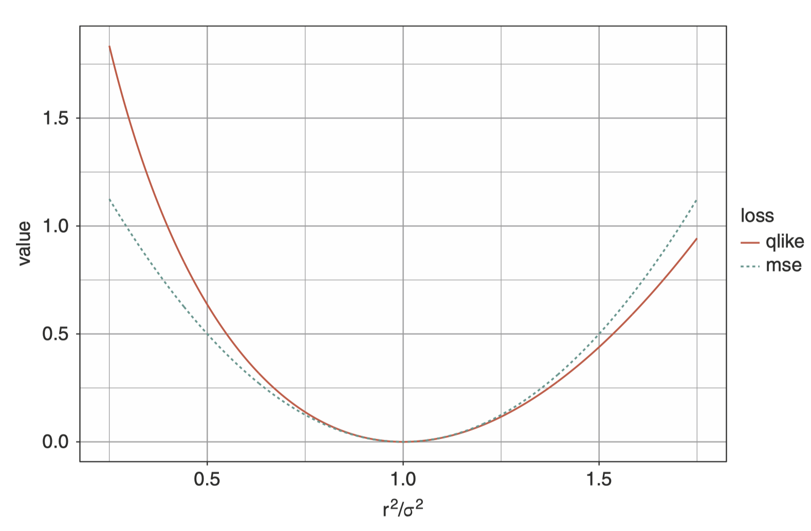

## 本章的问题

1. 鉴于不存在用于比较因子模型的单一绩效指标，应当如何确定优先事项，并为特定应用场景选择最佳模型？
2. 哪些稳健损失函数适合评估因子模型的波动率预测？
3. 哪些检验适合评估协方差矩阵在投资组合优化中的表现？
4. 不同方法各自具有哪些优点和局限？
5. 为了确保模型能够用于实际生产环境，我们还应该进行哪些检验？

***

有几十篇论文和文档盛赞商业模型的优点。有许多备选模型，涉及多种资产类别、各种地理区域的组合，当然，还有许多供应商。然而，几乎没有论文提出具有理论依据的检验程序，来检验因子模型中与从业者相关的风险性质。

检验是困难的、平凡的、谦逊的，也会让人变得谦逊。用 P. J. O’Rourke 的话来说：“人人都想拯救地球，却没有人愿意帮妈妈洗碗。”本章就是关于洗碗的。它建立在两个简单的原则之上。

首先，我们使用的指标应当尽可能与实际应用相关。我们关心波动率预测的准确性，以及优化后的投资组合的已实现波动率，并努力在现实的环境下度量这些量。

第二个原则源于这样一个事实：**不存在一个可以用来比较所有因子模型的单一绩效指标。** 因此，可能并不存在一个唯一的“最佳”模型，因为单个模型不太可能在所有指标上都优于其他模型。这未必应被视为一种诅咒，反而可以看作一种福分。我们可以将精力集中于自己的应用场景，或者至少优先考虑该场景，并找到最适合这一任务的模型。

本章余下部分围绕三类指标展开：用于评估协方差矩阵的指标、用于评估精度矩阵的指标，以及用于评估模型在次要任务中可用性的指标。

## 5.1 协方差矩阵的评估

### 5.1.1 波动率估计的稳健损失函数

因子模型的一个主要应用是波动率估计。波动率预测的质量一直是早期风险模型发展的核心问题之一。如果一个模型在某一时刻 $t$ 预测资产波动率 $\widehat{\sigma}_i$（即在时刻 $t-1$ 可以获得的、针对时间区间 $(t-1,t)$ 的波动率预测），那么可以通过损失函数度量波动率预测的质量：

$$
\overline L:=\frac{1}{T}\sum_{t=1}^{n}L(\widetilde{\sigma}_t^2,\widehat{\sigma}_t^2),
$$

其中，$\widetilde{\sigma}_t$ 是对观测波动率的经验估计（例如前面定义的已实现波动率指标）。损失函数 $L$ 非负，并且当且仅当 $\widehat{\sigma}=\widetilde{\sigma}$ 时等于零。在上述统计指标中，我们使用波动率代理量（Volatility Proxy）$\widetilde{\sigma}_t$ 代替未知的真实波动率 $\sigma_t$。

Hansen 和 Lunde（2006a）提出了损失函数的 **排序稳健性（Rank Robustness）** 概念：如果存在两个备选波动率预测 $\widehat{\sigma}_t^{(j)}$，那么使用无偏波动率代理量时一个预测优于另一个预测，当且仅当使用真实波动率时它也优于另一个预测。即：

$$
\overline L(\widehat{\sigma}^{(1)},\sigma)\leq\overline L(\widehat{\sigma}^{(2)},\sigma)
\iff
\overline L(\widehat{\sigma}^{(1)},\widetilde{\sigma})\leq\overline L(\widehat{\sigma}^{(2)},\widetilde{\sigma}).
$$

Patton 和 Sheppard（2009）以及 Patton（2011）完整刻画了这类损失函数，并证明以下两个损失函数是稳健的：

$$
\operatorname{QLIKE}(\widehat{\sigma},r):=\frac{1}{T}\sum_{t=1}^{T}\left(\frac{r_t^2}{\widehat{\sigma}_t^2}-\log\left(\frac{r_t^2}{\widehat{\sigma}_t^2}\right)-1\right)
$$

$$
\operatorname{MSE}(\widehat{\sigma},r):=\frac{1}{T}\sum_{t=1}^{T}\widehat{\sigma}_t^2\left(\frac{r_t^2}{\widehat{\sigma}_t^2}-1\right)^2
$$

除去常数项，准似然损失（Quasi-Likelihood，QLIKE）就是正态分布的负对数似然。这两个损失函数越来越多地被用来替代偏差统计量（Bias Statistic）。[^1] 它们的图像如图 5.1 所示。



### 5.1.2 多变量收益率中的应用

QLIKE 和 MSE 损失函数适用于单变量收益率，而不适用于协方差矩阵。下面介绍几种将单变量情形推广到多变量情形的方法。

**实盘策略（Production Strategies）。** 如果已经有策略在运行，一项直接而必要的检验就是评估这些策略在不同因子模型下的模拟表现。QLIKE 和 MSE 很重要，应当将它们与投资组合管理人所关心的指标（例如夏普比率或损益）一并检验。重要的是，协方差矩阵应当作为整个实盘流程的输入，即投资组合本身应当基于相应的因子模型生成。如果投资组合由因子模型 A 生成，却在模型 B 上进行检验，这种不对称性就会损害检验的有效性。

**平均情形分析（Average-Case Analysis）。** 另一种方法是估计期望损失，其中期望同时针对投资组合的分布和资产收益率的分布计算。对于收益率的分布，我们使用历史收益率的经验测度 $\widehat P$；对于投资组合的分布，我们可以选择一个简单的分布，例如球面上的均匀分布（见步骤 5.1）。然后估计

$$
E_{\mathbf w\sim D,\,\mathbf r\sim\widehat P}\left[L\left((\mathbf r^T\mathbf w)^2,\mathbf w^T\widehat{\boldsymbol\Omega}_r\mathbf w\right)\right].
$$

这种方法有几个缺点。首先，投资组合分布的选择具有一定的任意性。实际的投资组合分布几乎肯定不是均匀分布，甚至没有理由保证 Alpha 的分布是均匀的。其次，它的计算成本很高。我们在高维空间中进行模拟，$\mathbf w$ 的维度从 1,000 项资产到数万项资产不等。模拟方案和收敛准则等计算问题变得重要。

一种近似方法是选择一组投资组合基（Portfolio Basis），即 $n$ 个投资组合 $\mathbf w_{1,t},\ldots,\mathbf w_{n,t}$，然后对这 $n$ 个投资组合进行“平均”情形分析。这一特殊情形的一个特例是特征投资组合（Eigenportfolios）：将 $\boldsymbol\Omega_r$ 分解为 $\mathbf U\mathbf S\mathbf U^T$，并令基投资组合等于 $\mathbf U$ 的各列。这种方法在计算上是可处理的。

一个重要缺点是，这种平均损失并不独立于投资组合的选择；事实上，它对这种选择相当敏感。即使我们将选择限制为一组标准正交基，例如特征投资组合，度量得到的绩效仍然依赖于所选的基。由于难以从基本原则出发论证某个适当的基的选择，最终结果具有任意性。

> **步骤 5.1　随机投资组合的平均方差检验**
>
> 1. **输入：** $t=1,\ldots,T$ 时的候选协方差矩阵 $\widehat{\boldsymbol\Omega}_{r,t}$ 和收益率 $\mathbf r_t$，以及损失函数 $L$。
> 2. 令 $L_{\mathrm{tot}}=0$，$n_{\mathrm{iter}}=0$。
> 3. 令 $\mathbf w\sim N(0,\mathbf I_n)$，$\mathbf w\leftarrow\mathbf w/\|\mathbf w\|$。从 $1,\ldots,T$ 中均匀随机选择 $s$。
> 4. 令
>    $$
>    L_{\mathrm{tot}}=L_{\mathrm{tot}}+L[(\mathbf r_s^T\mathbf w)^2,\mathbf w^T\widehat{\boldsymbol\Omega}_s\mathbf w].
>    $$
>    令 $n_{\mathrm{iter}}\leftarrow n_{\mathrm{iter}}+1$。
> 5. 如果
>    $$
>    \frac{L[(\mathbf r_s^T\mathbf w)^2,\mathbf w^T\widehat{\boldsymbol\Omega}_s\mathbf w]}{L_{\mathrm{tot}}}\geq\epsilon_{\mathrm{tol}},
>    $$
>    则返回第 3 步。
> 6. **输出：** $L:=L_{\mathrm{tot}}/n_{\mathrm{iter}}$。

**最坏情形的低估与高估（Worst-Case Under/Over-Prediction）。** 还有一种方法是估计最坏情形下的损失函数：

$$
\begin{aligned}
\max\quad &E_{\mathbf r\sim\widehat P}[L((\mathbf r^T\mathbf w)^2,\mathbf w^T\widehat{\boldsymbol\Omega}_r\mathbf w)]\\
\text{s.t.}\quad &\|\mathbf w\|\leq1.
\end{aligned}
$$

这种方法的问题在于，目标函数（无论是 QLIKE 还是 MSE）都不是凸函数。当资产数量很大时，这一问题在计算上是不可处理的。

> **步骤 5.2　最坏情形方差检验**
>
> 1. **输入：** $t=1,\ldots,T$ 时的候选协方差矩阵 $\widehat{\boldsymbol\Omega}_{r,t}$ 和收益率 $\mathbf r_t$，以及损失函数 $L$。
> 2. 令 $L_{\mathrm{tot}}=0$，$n_{\mathrm{iter}}=0$。
> 3. 令 $\mathbf w\sim N(0,\mathbf I_n)$，$\mathbf w\leftarrow\mathbf w/\|\mathbf w\|$。从 $1,\ldots,T$ 中均匀随机选择 $s$。
> 4. 令
>    $$
>    \mathbf w\leftarrow\mathbf w-n_{\mathrm{iter}}^{-1}\nabla_{\mathbf w}L[(\mathbf r_s^T\mathbf w)^2,\mathbf w^T\widehat{\boldsymbol\Omega}_s\mathbf w].
>    $$
>    令 $n_{\mathrm{iter}}\leftarrow n_{\mathrm{iter}}+1$。
> 5. 如果
>    $$
>    \frac{L[(\mathbf r_s^T\mathbf w)^2,\mathbf w^T\widehat{\boldsymbol\Omega}_s\mathbf w]}{L_{\mathrm{tot}}}\geq\epsilon_{\mathrm{tol}},
>    $$
>    则返回第 3 步。
> 6. **输出：** $L:=L_{\mathrm{tot}}/n_{\mathrm{iter}}$。

上述方法中没有哪一种全面优于其他方法。只要有可用的实盘策略，就总是要将其与备选方法进行比较检验。平均情形分析和最坏情形分析的计算要求都很高。此外，对于平均情形分析，结果还依赖于关于投资组合分布的假设。

**基于前瞻 Alpha 的均值–方差优化投资组合（Leading-Alpha MVO Portfolios）。** 另一种选择是根据证券未来的已实现收益率构建投资组合。这一方案的优点是能够检验策略对于“相关”投资组合的预测能力，具体见步骤 5.3。毕竟，只有我们首先拥有 Alpha，波动率预测才有意义。如果没有 Alpha，我们就有其他问题需要担心了。

> **步骤 5.3　已实现 Alpha 的方差检验**
>
> 1. **输入：** $t=1,\ldots,T$ 时的候选协方差矩阵 $\widehat{\boldsymbol\Omega}_r$ 和收益率 $\mathbf r_t$，损失函数 $L$，以及 $\tau\in\mathbb N^+$。
> 2. 令 $L_{\mathrm{tot}}=0$。
> 3. 对于每个 $t=0,\ldots,T-\tau$，令
>    $$
>    \widehat{\boldsymbol\alpha}_t:=\frac{1}{\tau}\sum_{s=t+1}^{t+\tau}\mathbf r_s
>    $$
>    $$
>    \mathbf w:=\widehat{\boldsymbol\Omega}_{r,t}^{-1}\widehat{\boldsymbol\alpha}_t
>    $$
>    $$
>    L_{\mathrm{tot}}:=L_{\mathrm{tot}}+L(\mathbf r_t^T\mathbf w,\mathbf w^T\widehat{\boldsymbol\Omega}_{r,t}\mathbf w)
>    $$
> 4. **输出：** $L:=L_{\mathrm{tot}}/(T-\tau+1)$。

这种方法的一个优点是可以很容易地加以扩展。例如，我们可以检验加入噪声后的投资组合的表现：

$$
\mathbf w:=\widehat{\boldsymbol\Omega}_{r,t}^{-1}(\widehat{\boldsymbol\alpha}_t+\boldsymbol\eta_t),\qquad\boldsymbol\eta_t\sim N(0,\sigma^2\mathbf I_n).
$$

**分布似然（Distribution Likelihood）。** 一种不依赖于投资组合选择的备选方法，是使用零均值多元正态分布的对数似然，并将其应用于估计样本范围内的收益率。除去常数项，负对数似然[^2] 正比于

$$
\operatorname{QDIST}=\sum_t\left(\mathbf r_t^T\widehat{\boldsymbol\Omega}_{r,t}^{-1}\mathbf r_t+\log\left|\widehat{\boldsymbol\Omega}_{r,t}\right|+n\log(2\pi)\right).
\tag{5.1}
$$

## 5.2 精度矩阵的评估

### 5.2.1 最小方差投资组合

正如我们在本书中反复看到的那样，因子模型的质量体现在其精度矩阵的准确性上。我们提出两种方法。第一种使用一种众所周知的检验：最小方差投资组合（Minimum-Variance Portfolios）。

考虑一个非常简单的例子：构建一个具有最小方差、且净市值为 1（$\sum_iw_i=1$）的投资组合 $\mathbf w$。这是事前最小方差投资组合；其已实现方差将有所不同。直观上，“更好”的协方差矩阵将产生更低的已实现方差。我们将这一认识严格化，并推广到投资组合对任意因子具有给定敞口的情形，即 $\sum_i b_iw_i=1$。

令 $\widehat{\boldsymbol\Omega}_r\in\mathbb R^{n\times n}$ 为候选协方差矩阵，$\boldsymbol\Omega_r$ 为真实协方差矩阵。令 $\mathbf b\in\mathbb R^n$，并求解风险最小化问题：

$$
\begin{aligned}
\min\quad &\mathbf w^T\widehat{\boldsymbol\Omega}_r\mathbf w\\
\text{s.t.}\quad &\mathbf b^T\mathbf w=1.
\end{aligned}
\tag{5.2}
$$

令 $\mathbf w(\widehat{\boldsymbol\Omega}_r)$ 为它的解。将投资组合的已实现方差记为 $\operatorname{var}(\mathbf w(\widehat{\boldsymbol\Omega}_r),\boldsymbol\Omega_r)$。那么，投资组合 $\mathbf w(\widehat{\boldsymbol\Omega}_r)$ 的已实现波动率大于 $\mathbf w(\boldsymbol\Omega_r)$ 的已实现波动率，并且当且仅当 $\boldsymbol\Omega_r\propto\widehat{\boldsymbol\Omega}_r$ 时，二者相同。

这就是附录（5.4.1 节）中的定理 5.1。应用这一结果的一种方式如下：令 $\mathbf b=E[\mathbf r]$，即 Alpha 向量。那么，正确的协方差矩阵将产生可能的最佳夏普比率，而对协方差模型进行排序的一种自然方式，就是比较某个策略的已实现夏普比率。

我们可以使用前面针对波动率检验介绍的所有依赖于投资组合的方案，来评估精度矩阵。已实现方差充当损失函数。

### 5.2.2 马哈拉诺比斯距离

还有另一种独立于投资组合、且仅涉及精度矩阵的检验。对于多变量零均值随机向量 $\mathbf r$ 及其相应的协方差矩阵 $\boldsymbol\Omega_r$，马哈拉诺比斯距离（Mahalanobis Distance）定义为

$$
d(\mathbf r,\boldsymbol\Omega_r):=\sqrt{\mathbf r^T\boldsymbol\Omega_r^{-1}\mathbf r}.
$$

对于高斯收益率，在使用真实协方差矩阵的条件下，$d^2$ 服从具有 $n$ 个自由度的卡方分布。[^3] 因此，一种检验为

$$
\nu_t:=\frac{1}{n_t}\mathbf r_t^T\widehat{\boldsymbol\Omega}_{r,t}^{-1}\mathbf r_t
$$

$$
\operatorname{MALV}:=\operatorname{var}(\nu_1,\ldots,\nu_T).
$$

$\operatorname{MALV}(\mathbf r_{\cdot},\widehat{\boldsymbol\Omega}_{r,\cdot})$ 的值越低，精度矩阵的表现就越好。如果方差很低（例如在 $2/n$ 的数量级上），那么除一个乘法常数外，协方差矩阵的逆矩阵就能够进行完美预测。在这项检验中，我们并不主要关心该常数，因为波动率检验应当处理这一问题。

解释这一结果的另一种方式如下：如果收益率服从高斯分布，那么它们的分布与 $\boldsymbol\Omega_{r,t}^{1/2}\boldsymbol\xi_t$ 相同，其中 $\boldsymbol\xi$ 是一个多元标准正态随机变量。此外，$\boldsymbol\xi_t^T\boldsymbol\xi_t$ 的均值为 $n_t$，标准差为 $\sqrt{2n_t}$。对于较大的 $n_t$，$\boldsymbol\xi_t^T\boldsymbol\xi_t$ 集中在 $n_t$ 附近。我们将 MALV 改写如下：

$$
\bar\nu:=\frac{1}{T}\sum_t\nu_t
$$

$$
\begin{aligned}
\operatorname{MALV}
&:=\frac{1}{T}\sum_t\left(\frac{1}{n_t}\boldsymbol\xi_t^T\boldsymbol\Omega_{r,t}^{1/2}\widehat{\boldsymbol\Omega}_{r,t}^{-1}\boldsymbol\Omega_{r,t}^{1/2}\boldsymbol\xi_t-\bar\nu\right)^2\\
&\simeq\frac{1}{T}\sum_t\frac{1}{n_t^2}\left(\boldsymbol\xi_t^T\boldsymbol\Omega_{r,t}^{1/2}\widehat{\boldsymbol\Omega}_{r,t}^{-1}\boldsymbol\Omega_{r,t}^{1/2}\boldsymbol\xi_t-\bar\nu\boldsymbol\xi_t^T\boldsymbol\xi_t\right)^2\\
&=\frac{1}{T}\sum_t\frac{1}{n_t^2}\left[\boldsymbol\xi_t^T\left(\boldsymbol\Omega_{r,t}^{1/2}\widehat{\boldsymbol\Omega}_{r,t}^{-1}\boldsymbol\Omega_{r,t}^{1/2}-\bar\nu\mathbf I_n\right)\boldsymbol\xi_t\right]^2.
\end{aligned}
$$

近似等式来自我们用 $\boldsymbol\xi_t^T\boldsymbol\xi_t$ 的期望值替代了它本身。我们通过在左侧和右侧分别乘以标准多元高斯随机向量，来检验

$$
\boldsymbol\Omega_{r,t}^{1/2}\widehat{\boldsymbol\Omega}_{r,t}^{-1}\boldsymbol\Omega_{r,t}^{1/2}-\bar\nu\mathbf I_n
$$

与零的接近程度。在 10.3.2 节中我们将看到，这一矩阵差也决定了夏普比率效率的界限。

## 5.3 辅助检验

除了针对收益率协方差矩阵 $\boldsymbol\Omega_r$ 及其逆矩阵的绩效指标外，我们还应该验证模型在与投资组合优化和对冲间接相关的任务中是否表现良好。这里具体考虑两项任务。

第一项是模型换手率（Model Turnover）。我们掌握的数据随时间发生变化，会影响策略的交易成本。这些变化有三个主要驱动因素。第一个是我们每天对超额收益率的预测发生变化，即 Alpha 换手率（Alpha Turnover）。我们需要对此进行显式建模，这将在第 11 章完成。

第二个因素是市场冲击函数（Market Impact Function）本身发生变化。在某些特殊时期，交易活动变化得非常迅速，交易成本也随之迅速变化。然而在实践中，这是投资组合构建中最稳定的组成部分，因此我们忽略其短期变化。[^4] 最后一个驱动因素是因子模型，这就是下一小节的主题。

### 5.3.1 模型换手率

换手率并非模型的内在性质，而是实盘交易策略的性质。然而，寻找一个能够估计策略换手率的指标可能是有意义的。

在忽略交易成本的理想情形下，我们可能希望将因子 $i$ 的因子敞口水平保持在常数 $b_i$。在这种情形下，最优的做法是交易 **因子模拟投资组合（Factor-Mimicking Portfolios，FMPs）**。这些投资组合的收益率是模型真实因子收益率的最佳近似。我们将在 9.3 节介绍它们。这些投资组合的权重是下列矩阵的列向量：

$$
\begin{aligned}
\mathbf P_t&:=\boldsymbol\Omega_{\epsilon,t}^{-1}\mathbf B_t(\mathbf B_t^T\boldsymbol\Omega_{\epsilon,t}^{-1}\mathbf B_t)^{-1}\\
\mathbf w_t&:=\mathbf P_t\mathbf b.
\end{aligned}
$$

投资组合的换手由 $\mathbf P_t$ 的变化驱动。于是，我们定义一个简单的二次换手率（Quadratic Turnover）指标，即如下时间序列平均值：

$$
\operatorname{turnover}_2:=\frac{1}{T}\sum_{t=1}^{T}\|\mathbf P_t-\mathbf P_{t-1}\|_F,
$$

其中，$\|\cdot\|_F$ 是矩阵的 Frobenius 范数（Frobenius Norm）。这一定义的优点在于简单且直观。我们可以对其进一步细化，但代价是失去一般性。如果我们对策略的目标敞口 $\mathbf b$ 有一定了解，并且具有交易成本函数 $\operatorname{TC}:\mathbb R^n\to\mathbb R^+$，那么一个更准确的换手率度量为

$$
\operatorname{turnover}_{\mathrm{TC}}:=\frac{1}{T}\sum_{t=1}^{T}\operatorname{TC}[(\mathbf P_t-\mathbf P_{t-1})\mathbf b].
$$

### 5.3.2 Beta 检验

风险模型的一项实际应用，是预测投资者的投资组合相对于某个基准的 Beta。一个简单的例子是计算相对于市场投资组合的 Beta。一个稍微复杂的例子是计算相对于因子模拟投资组合的 Beta。一个更不明显的例子是相对于主题投资组合（Thematic Portfolio）的 Beta：例如，一家银行构建了一个主题投资组合，用来描述当时具有相关性的产业趋势或消费趋势，我们希望度量自己的投资组合相对于该主题投资组合的 Beta。

在所有这些情形中，我们都希望确保预测的 Beta 是准确的，即它与已实现 Beta 之间的差异较小。因此，作为风险模型评估的一部分，我们希望纳入对 Beta 的检验。为简单起见，考虑单个参考投资组合 $\mathbf w$（因子模拟投资组合或主题投资组合）的情形。每项资产相对于该参考投资组合的预测 Beta 所构成的向量为

$$
\boldsymbol\beta_t(\mathbf w)=\frac{\boldsymbol\Omega_{r,t}\mathbf w}{\mathbf w^T\boldsymbol\Omega_{r,t}\mathbf w}.
$$

指数加权经验协方差矩阵（Exponentially Weighted Empirical Covariance Matrix）$\widehat{\boldsymbol\Omega}_{r,t}$ 及已实现 Beta 向量由下式给出：

$$
\widehat{\boldsymbol\Omega}_{r,t}:=\frac{1-e^{-T/\tau}}{1-e^{1/\tau}}\sum_{s=1}^{T}e^{-s/\tau}\mathbf r_{t-s}\mathbf r_{t-s}^T
$$

$$
\widehat{\boldsymbol\beta}_t(\mathbf w):=\frac{\widehat{\boldsymbol\Omega}_{r,t}\mathbf w}{\mathbf w^T\widehat{\boldsymbol\Omega}_{r,t}\mathbf w}.
$$

我们以下式度量 Beta 的准确性：

$$
\operatorname{BETAERR}(\mathbf w)=\sum_t\|\boldsymbol\beta_t-\widehat{\boldsymbol\beta}_t\|^2,
$$

并将 BETAERR 用作准确性的辅助度量。

### 5.3.3 决定系数

一种非常流行的概括因子模型表现的方法，是报告加权横截面回归（Weighted Cross-Sectional Regression）的平均决定系数（Coefficient of Determination，或 $R^2$）。它被定义为 1 减去加权残差平方和与总平方和之比：

$$
R^2=1-\frac{\sum_{t=1}^{T}\|\widehat{\boldsymbol\Omega}_{\epsilon,t}^{-1/2}(\mathbf r_t-\mathbf B_t\widehat{\mathbf f}_t)\|^2}{\sum_{t=1}^{T}\|\widehat{\boldsymbol\Omega}_{\epsilon,t}^{-1/2}\mathbf r_t\|^2}.
$$

由于特异性协方差矩阵 $\boldsymbol\Omega_\epsilon$ 无法预先得知，因此使用代理量代替它，具体见第 6 章和第 7 章。估计的因子收益率 $\widehat{\mathbf f}_t$ 是第 $t$ 期横截面回归的系数。与线性回归的情形类似，较高的决定系数被视为模型设定的一个积极属性。[^5] 然而，这里存在一些重要的区别。

首先，**不存在 $R^2$ 的“样本外”（Out-of-Sample）估计。** 我们不可能在留出样本（Holdout Sample）上估计模型的表现，因为估计的系数，也就是因子收益率，必须在每个时期重新估计。这使得该指标容易受到数据挖掘的影响。即使我们保持模型的复杂度（因子数量）不变，也很容易通过对载荷矩阵 $\mathbf B_t$ 的连续操作和调整来提高 $R^2$。

通过向现有模型添加因子（即使具有随机载荷），朴素的 $R^2$ 总是能够得到改善。不过，更精细的指标，例如 AIC 和 BIC，会对因子数量施加更大的惩罚，这可能是对上述异议的一种回应。

对于使用 $R^2$ 的另一项异议是，它忽略了当前问题的旋转不变性（Rotational Invariance）。为了说明这一问题，考虑一个人为构造的例子。资产收益率服从一个简单的静态因子模型：

$$
\mathbf r_t=\mathbf B\mathbf f_t+\boldsymbol\epsilon_t,
$$

其中 $\mathbf B^T\mathbf B=\mathbf I_m$，且 $\boldsymbol\Omega_\epsilon=\mathbf I_n$。估计的因子收益率为 $\widehat{\mathbf f}_t=\mathbf B^T\mathbf r_t$。现在，让我们构建一个新的因子模型。令 $\mathbf C_t\in\mathbb R^{m\times m}$ 为一列独立同分布的随机矩阵，定义如下：

$$
\mathbf C_t=\begin{pmatrix}
\xi_{1,t}&0&0&\cdots&0\\
0&\xi_{2,t}&0&\cdots&0\\
0&0&\xi_{3,t}&\cdots&0\\
\vdots&\vdots&\vdots&\ddots&\vdots\\
0&0&0&\cdots&\xi_{m,t}
\end{pmatrix},
$$

其中 $\xi_{i,t}$ 以相等的概率取值 1 或 $-1$。注意，$\mathbf C_t^T\mathbf C_t=\mathbf C_t\mathbf C_t^T=\mathbf I_m$。经过一些机械的计算，我们发现，从这一模型估计得到的因子收益率为

$$
\widetilde{\mathbf f}_t=(\widetilde{\mathbf B}_t^T\widetilde{\mathbf B}_t)^{-1}\widetilde{\mathbf B}_t^T\mathbf r_t=\mathbf C_t^T\mathbf B^T\mathbf r_t=\mathbf C_t\widehat{\mathbf f}_t.
$$

决定系数保持不变：

$$
\begin{aligned}
R^2((\widetilde{\mathbf B}_t)_{t=1}^{T})
&=1-\frac{\sum_{t=1}^{T}\|(\mathbf I_n-\mathbf B\mathbf C_t\mathbf C_t^T\mathbf B^T)\mathbf r_t\|^2}{\sum_{t=1}^{T}\|\mathbf r_t\|^2}\\
&=1-\frac{\sum_{t=1}^{T}\|(\mathbf I_n-\mathbf B\mathbf B^T)\mathbf r_t\|^2}{\sum_{t=1}^{T}\|\mathbf r_t\|^2}\\
&=R^2(\mathbf B).
\end{aligned}
$$

然而，旋转后模型的估计因子协方差矩阵为

$$
\begin{aligned}
[\widetilde{\boldsymbol\Omega}_f]_{i,j}
&=T^{-1}\sum_{t=1}^{T}\widehat f_{i,t}\widehat f_{j,t}\xi_{i,t}\xi_{j,t}\\
&\longrightarrow\begin{cases}
[\widetilde{\boldsymbol\Omega}_f]_{i,j},&i=j,\\
0,&i\ne j.
\end{cases}
\end{aligned}
$$

当 $i=j$ 时，平均值为 $T^{-1}\sum_{t=1}^{T}\widehat f_{i,t}^2$，即它与原始未旋转模型的方差相同。当 $i\ne j$ 时，由于 $\widehat f_{i,t}\widehat f_{j,t}$、$\xi_{i,t}$ 和 $\xi_{j,t}$ 之间的独立性，该和式在极限下趋于 0：

$$
\lim_{T\to\infty}T^{-1}\sum_{t=1}^{T}\widehat f_{i,t}\widehat f_{j,t}\xi_{i,t}\xi_{j,t}=E[f_if_j]E[\xi_i]E[\xi_j]=0.
$$

旋转 $\mathbf C_t$ 起到了消除估计因子收益率之间相关性的作用。总而言之，我们有两个模型：一个是真实模型，另一个是在每个时期进行随机旋转的模型。就决定系数而言，这两个模型无法区分，因为它们的决定系数完全相同。因此，AIC 和 BIC 也相同。然而，第二个模型具有一个截然不同且错误的协方差矩阵。

专业的模型构建者了解 $R^2$ 在因子建模中的缺点，因此借助一些启发式方法（Heuristics）来确认横截面回归的有效性。其中一种启发式方法是检查特定因子收益率满足显著性准则的时期所占的百分比，即相应因子的回归系数具有绝对值大于 2 的 $t$ 统计量。另一项自然的检验是检查每个因子收益率的已实现夏普比率。

这些检验确认了 **$R^2$ 不适合用于因子模型选择**。[^6] 对于风险模型的表现，建议依靠本章前面介绍的检验；对于风险调整后的绩效，则使用第 8 章介绍的检验。

## 5.4 ★ 附录

### 5.4.1 最小方差投资组合的证明

**定理 5.1（Engle 和 Colacito，2006）。** 令 $\widehat{\boldsymbol\Omega}_r\in\mathbb R^{n\times n}$ 为候选协方差矩阵，$\boldsymbol\Omega_r$ 为真实协方差矩阵。令 $\boldsymbol\mu\in\mathbb R^n$，并求解风险最小化问题：

$$
\begin{aligned}
\min\quad &\mathbf w^T\widehat{\boldsymbol\Omega}_r\mathbf w\\
\text{s.t.}\quad &\boldsymbol\mu^T\mathbf w=1.
\end{aligned}
\tag{5.3}
$$

令 $\mathbf w(\widehat{\boldsymbol\Omega}_r)$ 为其解。将投资组合的已实现方差记为 $\operatorname{var}(\mathbf w(\widehat{\boldsymbol\Omega}_r),\boldsymbol\Omega_r)$。

投资组合 $\mathbf w(\widehat{\boldsymbol\Omega}_r)$ 的已实现波动率大于 $\mathbf w(\boldsymbol\Omega_r)$ 的已实现波动率，并且当且仅当 $\boldsymbol\Omega_r\propto\widehat{\boldsymbol\Omega}_r$ 时，二者相同。

**证明。** 问题（5.3）的解为

$$
\mathbf w(\widehat{\boldsymbol\Omega}_r)=(\boldsymbol\mu^T\widehat{\boldsymbol\Omega}_r^{-1}\boldsymbol\mu)^{-1}\widehat{\boldsymbol\Omega}_r^{-1}\boldsymbol\mu.
$$

分别基于 $\widehat{\boldsymbol\Omega}_r$ 和 $\boldsymbol\Omega_r$ 构建的投资组合，其已实现方差之比为

$$
\frac{\operatorname{var}(\mathbf w(\widehat{\boldsymbol\Omega}_r),\boldsymbol\Omega_r)}{\operatorname{var}(\mathbf w(\boldsymbol\Omega_r),\boldsymbol\Omega_r)}=\frac{\boldsymbol\mu^T\boldsymbol\Omega_r^{-1}\boldsymbol\mu}{\boldsymbol\mu^T\widehat{\boldsymbol\Omega}_r^{-1}\boldsymbol\mu}\frac{\boldsymbol\mu^T\widehat{\boldsymbol\Omega}_r^{-1}\boldsymbol\Omega_r\widehat{\boldsymbol\Omega}_r^{-1}\boldsymbol\mu}{\boldsymbol\mu^T\widehat{\boldsymbol\Omega}_r^{-1}\boldsymbol\mu}.
$$

可以直接验证，如果 $\widehat{\boldsymbol\Omega}_r^{-1}\propto\boldsymbol\Omega_r$，则该比值为 1。令 $\widehat{\boldsymbol\Omega}_r=\widehat{\mathbf U}\widehat{\mathbf S}\widehat{\mathbf U}^T$，$\boldsymbol\Omega_r=\mathbf U\mathbf S\mathbf U^T$。令

$$
\mathbf x:=\widehat{\mathbf S}^{-1/2}\widehat{\mathbf U}^T\boldsymbol\mu,
$$

并令

$$
\mathbf H:=\widehat{\mathbf S}^{1/2}\widehat{\mathbf U}^T\mathbf U\mathbf S^{-1}\mathbf U^T\widehat{\mathbf U}\widehat{\mathbf S}^{1/2}.
$$

于是，我们将方差之比改写为

$$
\begin{aligned}
&\frac{\operatorname{var}(\mathbf w(\widehat{\boldsymbol\Omega}_r),\boldsymbol\Omega_r)}{\operatorname{var}(\mathbf w(\boldsymbol\Omega_r),\boldsymbol\Omega_r)}\\
&=\frac{\mathbf x^T\widehat{\mathbf S}^{1/2}\widehat{\mathbf U}^T\mathbf U\mathbf S^{-1}\mathbf U^T\widehat{\mathbf U}\widehat{\mathbf S}^{1/2}\mathbf x}{\|\mathbf x\|^2}\frac{\mathbf x^T\widehat{\mathbf S}^{-1/2}\widehat{\mathbf U}^T\mathbf U\mathbf S\mathbf U^T\widehat{\mathbf U}\widehat{\mathbf S}^{-1/2}\mathbf x}{\|\mathbf x\|^2}\\
&=\frac{\mathbf x^T\mathbf H\mathbf x}{\|\mathbf x\|^2}\frac{\mathbf x^T\mathbf H^{-1}\mathbf x}{\|\mathbf x\|^2}.
\end{aligned}
$$

现在考虑 $\mathbf H=\mathbf V\mathbf D\mathbf V^T$ 的奇异值分解（Singular Value Decomposition，SVD），并定义 $\mathbf y:=\mathbf V^T\mathbf x$。我们有

$$
\frac{\operatorname{var}(\mathbf w(\widehat{\boldsymbol\Omega}_r),\boldsymbol\Omega_r)}{\operatorname{var}(\mathbf w(\boldsymbol\Omega_r),\boldsymbol\Omega_r)}=\left(\sum_i\frac{y_i^2}{\sum_jy_j^2}d_i\right)\left(\sum_i\frac{y_i^2}{\sum_jy_j^2}d_i^{-1}\right).
$$

右侧的表达式可以解释为 $E(\xi)E(1/\xi)$，其中 $\xi$ 是一个随机变量，以概率 $p_i:=y_i^2/\sum_jy_j^2$ 在状态 $i$ 取值 $d_i$。由 Jensen 不等式（Jensen's Inequality），有 $E(1/\xi)\geq1/E(\xi)$，因此结果成立。$\square$

## 本章要点

1. 在评估因子模型时，我们关心三个方面的表现：
   - **协方差矩阵的准确性。** 投资组合波动率预测的准确性依赖于它。
   - **精度矩阵的准确性。** 它被用于均值–方差投资组合优化。
   - **辅助绩效指标。** 例如换手率和 Beta 预测，因为它们在交易应用中很重要。
2. 波动率估计的两个具有理论依据的指标是 QLIKE 和 MSE。
3. 它们可以推广到多变量情形，从而能够针对不同策略（平均情形、最坏情形等）评估模型，并关注现实的投资组合场景。
4. 对于精度矩阵的准确性，我们使用最小方差投资组合：在所有满足线性约束的投资组合中，具有最小预测方差的投资组合。较低的已实现方差表明模型更好。
5. 另一个指标是马哈拉诺比斯距离检验，它独立于投资组合。
6. 辅助指标如下：
   - **换手率。** 考虑模型更新的频率和潜在的交易成本，例如因子模拟投资组合的换手率。
   - **Beta 准确性。** 比较投资组合（例如主题投资组合、因子模拟投资组合）的预测 Beta 与已实现 Beta，以确保与市场敞口的一致性。
7. 我们提醒读者谨慎使用 $R^2$ 评估因子模型，因为它可以被操纵，并且可能无法反映真实的预测表现。

[^1]: 偏差统计量定义为 $T^{-1}\sqrt{\sum_{t=1}^{T}r_t^2/\widehat{\sigma}_t^2}$；见 Connor 等（2010）。
[^2]: 关于式（5.1）中 QDIST 的计算，需要注意一点：计算 $\log|\mathbf A|$ 的一种数值稳定方法是对其自变量进行奇异值分解，并利用 $|\mathbf A|=|\mathbf U\mathbf S\mathbf V^T|=|\mathbf S|$ 这一事实，因此 $\log|\mathbf A|=\log|\mathbf S|=\sum_i\log s_i$。
[^3]: 为了证明这一点，注意向量 $\mathbf r$ 可以通过 $\mathbf r:=\boldsymbol\Omega_r^{1/2}\boldsymbol\xi$ 生成，其中 $\boldsymbol\xi\sim N(0,\mathbf I_n)$。因此，$\mathbf r^T\boldsymbol\Omega_r^{-1}\mathbf r\sim\sum_i\xi_i^2\sim\chi_n^2$。
[^4]: 我应该指出，有些研究者确实对执行成本的时间变化进行建模，例如通过预测交易量。但这些方法超出了本书的范围。
[^5]: 我们忽略对 $R^2$ 的“自由度”修正，以及其他拟合优度指标，例如赤池信息准则（Akaike Information Criterion，AIC）和贝叶斯信息准则（Bayesian Information Criterion，BIC）（例如见 Hastie 等（2008）），因为这里提出的主要观点同样适用于它们。
[^6]: 关于将 $R^2$ 用作时间序列模型评价指标的另一种批判性观点，见 Lewellen 等（2010）。
