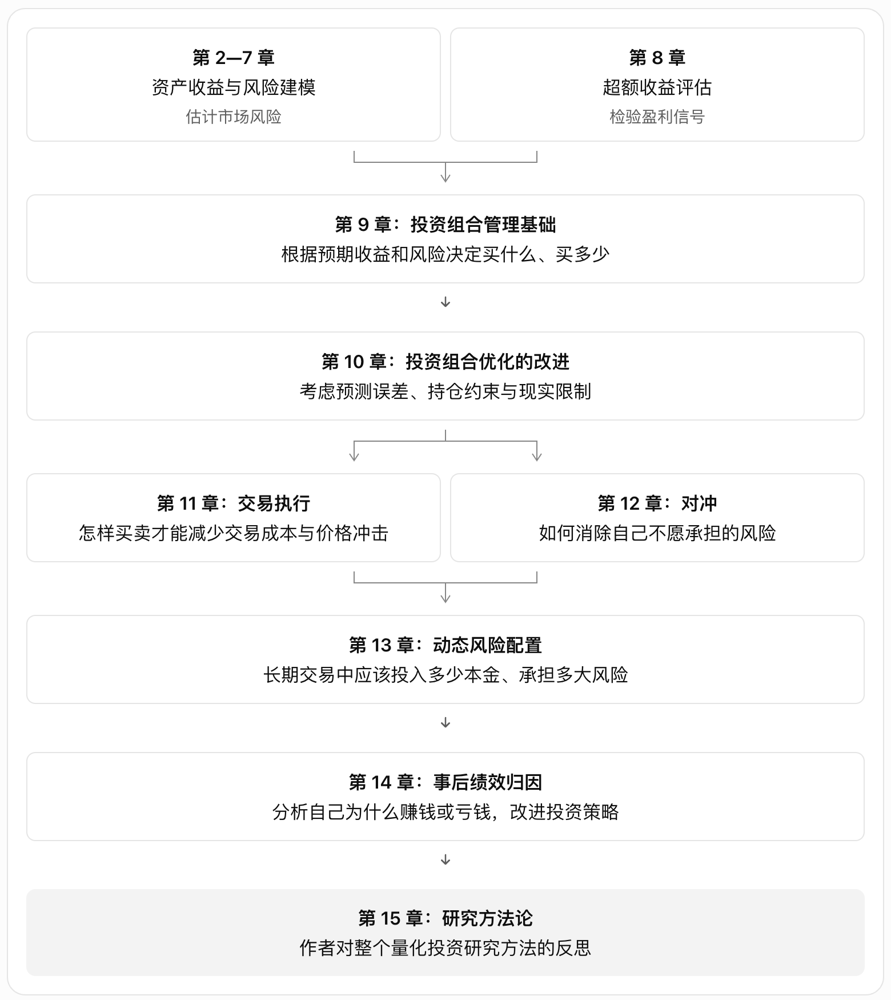
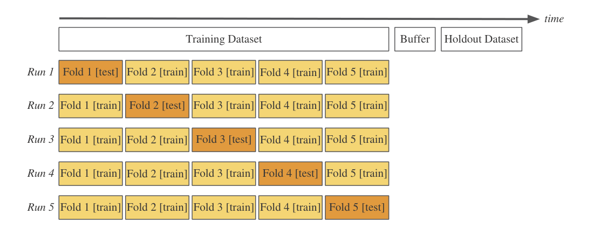
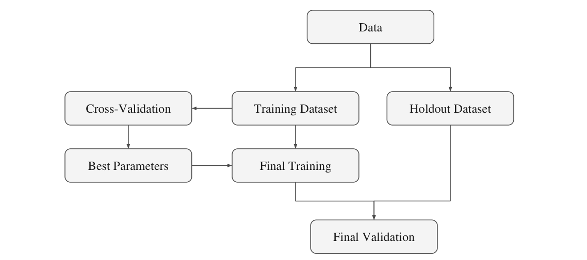
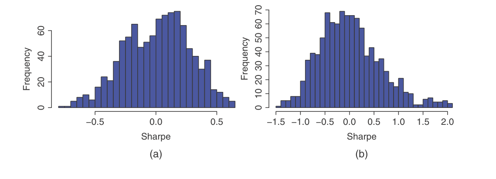
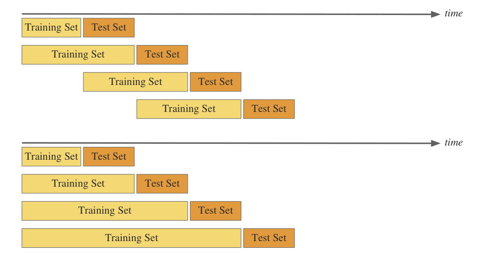
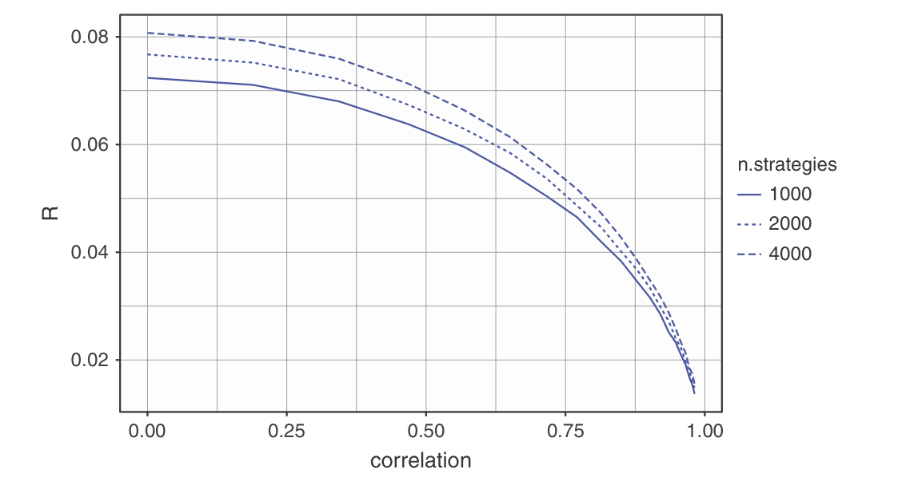

## 本章问题

1. 重复使用历史数据如何影响因子模型中的 Alpha 估计和回测？
2. 任何回测都应当遵循哪些最佳实践？
3. 两种主要的回测框架是什么？它们各有什么缺点？
4. 什么方法能够克服这些局限？

***

估计因子模型以及检验系统化策略的 Alpha，通常都需要重复使用同一批历史数据。这一点有些反直觉。过去 40 年的一个显著特征，是新的数据集越来越多地被记录下来，并得到广泛传播。投资公司为购买市场数据和另类数据（alternative data），以及定制化的数据采集（例如网页抓取），拨出了数千万美元的预算。然而，交易资产、尤其是公司的特征，并不会每分钟都发生变化；持有期较长（一天或更久）的投资策略也不一定需要逐笔成交数据。假如我们每隔 5 分钟记录一个广泛的本地投资域中的资产价格，每年将收集 6000 万个数值数据点[^1]；加上证券标识符和时间戳，所需存储空间也只是 GB 级别。

历史无法替代，有时也不够久远。所谓无法替代，是说我们很难生成一个能够被证明复现历史全部特征的模拟版本。所谓不够久远，是因为我们并不生活在一个平稳的世界中。金融之外的现实世界正以惊人的、不断加快的速度发生变化，而市场不过是这种变化的一种较为微弱的反映。即使不考虑这些变化，新技术、新市场微观结构设计、新监管规则的引入，以及所有市场参与者持续进行的集体学习，也会使五年前的投资世界与今天截然不同。我们必须依赖历史数据，这带来了一个重大挑战：我们不能设计实验，我们的研究是观察性的，而且是重复进行的。金融从业者没有一套共同遵循的实验分析协议。即使有，也很难断定它就是正确的。医学和心理学等成熟学科拥有共同的实验实践及实验设计，但当从业者发现大多数结果无法复现时，这些学科仍然经历了重新审视（Ioannidis, 2005；Open Science Collaboration, 2015）。

这给建模者带来了若干挑战。我们拥有数量极多的信号类型，而这些信号本身又取决于连续的调节参数，但我们只有有限的历史数据。这类似于生物统计学家面对 DNA 微阵列响应所进行的数万次同时检验（Dudoit et al., 2003；Huang et al., 2009）。不过具体情况很不一样。DNA 微阵列的响应变量通常是离散的（多类别），而且各响应不相关或仅弱相关。在量化金融中，响应变量（无论收益还是夏普比率）是连续的，信号之间的相关性具有决定性作用。

本章正文分为四节。首先列出数据准备和使用的一些基本最佳实践；其次描述并批评一些常见回测方法；第三节完全用于介绍一种新的回测协议，它相较前述方法有若干优点：可以为大量策略的夏普比率提供有限样本下的统一概率界。最后一节将前面建立的理论应用于模拟数据和历史数据。

## 8.1 回测的最佳实践

我们回顾若干回测的最佳实践。它们并非源于某种完备的理论。与从宙斯头脑中完整诞生的雅典娜不同，这是一套永远不完整、有时还相当浅显、通过实验逐渐形成的知识。相关参考文献包括 Wang et al. (2014)、Arnott et al. (2019)、López de Prado (2020)。

### 8.1.1 数据来源

高质量数据对回测至关重要，寻找更好的数据是研究者永无止境的任务。这里有几个主要的关注领域。首先是数据来源。多个供应商可能提供相似的数据，比较它们时应提出以下问题：

- **定义与解释。** 不仅在数据采购中，而且在量化投资中，第一个、也可能是最重要的问题是：数据意味着什么？所采集数据的精确定义是什么？其物理单位是什么？如果数据涉及货币，基准货币（汇率则涉及多种货币）必须明确。如果涉及流量（即随时间计量的速率），则应明确时间单位。由于单位换算错误而产生的失误多得令人惊讶。
- **来源。** 数据来自哪里？供应商是自行采集（例如网页抓取或互联网流量）的吗？更常见的是，供应商充当数据原始提供者与客户之间的中介。对于前者，采集标准是什么？是抽样还是全面采集？总体抽样方法是否可靠？对于后者，原始数据由谁提供？他们是否值得信赖？
- **完整性。** 这引出了完整性问题。数据集中是否存在明显缺失的数据，例如间歇性缺失的价格？是否存在不明显的缺失，例如没有被记录的消费者信用卡交易？其中一些问题可以通过对数据本身进行探索性分析来回答，另一些则需要向供应商询问。
- **质量保证。** 供应商如何确保接收或采集的数据持续保持高质量？是否会检查数据特征的变化点？
- **时点数据与重述数据。** 供应商是否提供截至某个日期所采集的数据，而不会在后来根据修正和公司更新而修改它们？这是数据泄漏（data leakage）的一种情形，后面将详细讨论。
- **变换。** 数据几乎总是经过供应商的变换。例如填补缺失数据、缩尾处理和删除异常值、期末价格计算（最后成交价、买卖报价中间价、加权平均价）。这些变换应有文档记录，并由研究分析师进行评估，可能的话还应验证。
- **探索替代数据和互补数据。** 始终从三个维度提出以下常识性问题：能否得到更好的数据？第一，是否有供应商对同类数据提供更广的覆盖（例如任何时点覆盖更多证券、更长的历史、更高的频率）？第二，是否有供应商提供质量更好的数据？例如，对于从经纪交易商采集的数据，另一家供应商可能与更多贡献数据的机构签有协议。第三，能否得到互补数据？将这些数据与原数据结合，可以显著提高原数据的价值。例如，我们除了得到能够很好估计公司成本的数据，还可以得到帮助估计公司短期收入的交易数据。

### 8.1.2 研究过程

每个研究者都有自己的研究过程。这是其竞争优势的一部分；它实际上是研究者自身的一部分，是一生的经历和学习所积累的思想与教训。试图在短短几页中把作者的整体研究哲学强加给读者，是徒劳的[^2]。然而，有几个步骤是没有争议的，属于基本的研究卫生规范，就如同出门前必须穿上内衣一样。

**数据泄漏。** 第一条建议是避免数据泄漏。数据泄漏是指训练数据（截至时刻 $t$ 可获得的数据）包含了目标中所含的信息，即 $t+1$ 期及以后各期的收益信息。基本规则是：在某个日期进行回测时，绝不使用在实际生产环境中当天无法获得的数据。识别数据泄漏更多是一门艺术，而非科学，需要深入了解数据（见上文）以及所面对的问题。下面是一些例子。

- **幸存者偏差（survivorship bias）。** 如果我们回测一项策略在很长一段时间内的表现，却只考虑在这段时间内持续交易的股票，即回测结束时的幸存股票，就会产生幸存者偏差。股票退市通常是因为发生巨大亏损、股价过低、缺乏流动性，或者不符合交易所的其他上市标准。剔除这些股票会使投资样本偏向表现优异者，它们的特征不同于当时更广泛的投资域。例如，幸存股票的流动性、动量和规模都更大。这是最简单且影响最大的数据泄漏情形。解决方法是：（a）采用适用于任意时点的合理纳入规则；（b）在回测中为退市事件规定现实而保守的规则。例如可以假设全部投资被核销。注意，（a）中的方法应在回测开始前就确定。根据回测结果修改纳入规则也是一种数据泄漏，应当避免。纳入标准确实不容易确定。一项常见建议是使用商业基准指数所定义的投资域，例如 Russell 1000、Russell 3000、MSCI 基准指数，或商业因子模型的投资域。注意，基准指数成分股的变动总是在正式生效日期（reconstitution date）之前的公告日（announcement date）公布。纳入或剔除的公告会影响股票收益。在回测中可以捕捉这些信息，以评估量化策略的表现有多少受投资域近期变化影响。
- **财务报表。** 某个季度或年度的财务报表信息应在公开发布当日（或次日）进入回测数据，而非在该数据所属季度的最后一天进入。
- **时点数据（point-in-time data）。** 某日回测所用的财务数据必须是截至该日可得到的最新数据。如果一份 10-Q（季度财务报告）因为重大错误而被重述，回测不应体现这种事后修正。必须在允许输入数据存在错误的条件下检验策略。
- **价格调整。** 股票经常进行拆股（或并股），拆股后的股价相应调整。拆股发生的原因通常是股价升至单股价格过高、妨碍投资者购买。为了计算长时间序列上的历史收益，价格与股息通常进行拆股调整。这引入了一个问题：久远过去的低股价意味着股票后来可能经历多次拆股，而这很可能是因为其收益很高。价格就包含了未来表现的信息。建议仅使用调整后价格计算收益，而在生成特征时使用截至当日的实际价格。
- **缺失性（missingness）。** 在某些情况下（主要是非结构化数据），数据点缺失，要么是因为在当时尚未提供，要么因为包含敏感信息而被删去。后一种情形中的缺失可能存在前视偏差（look-ahead bias），因而包含未来收益的信息。
- **可以避免的错误。** 有经验且高效的研究者所犯的（事后看来）愚蠢错误多得令人惊讶。例如，某数据集中的一个股票特征具有很高的信息系数（Information Coefficient, IC）[^3]。进一步调查发现，它实际上是拆股转换因子（见前述条目）。再例如，由于错误地混淆 $t$ 与 $t+1$ 的约定，某研究者在三个月动量因子的定义中纳入了次日收益，同样产生了假阳性。

**策略开发。** 下面是一些定性建议，虽然缺乏坚实的理论基础，但很难反对它们。

- **如果可能，要有理论。** 最好每个异象都有相应的理论，并在回测之前预先登记理论所作的预测。例如，Asness et al. (2019) 在关于质量因子的论文中提出了指导因子开发的理论；Frazzini 和 Pedersen (2014) 分析 Beta 异象时也是如此。有了理论指导，就更容易从众多证券特征中作出选择，从而减少被检验的策略数量；也更容易解释结果、对结果建立信心，并能够批评和修正该特征。修正可能并不是我们所希望的（最好第一次就做对），但却是必要的。
- **确保可复现性（reproducibility）。** 为所有策略编写文档，确保随时能够复现和重新运行它们。
- **尽可能使回测与生产环境一致。** 这不仅意味着使用相同的时点数据，还意味着使用相同的优化问题形式、市场冲击模型（market impact model）和代码库。
- **校准市场冲击模型。** 在回测中，市场冲击模型发挥的是描述性作用，即估计实际交易带来的效率损失。然而，无法在历史数据上验证实际发生的市场冲击。为了使回测表现与实盘表现一致，不能不加检验地接受某个市场冲击模型，特别是供应商或合作伙伴提供的模型。应根据当前版本策略的实盘表现校准其参数，尽可能使实际损益（Profit and Loss, PnL）与回测损益重合。
- **计入借券成本（borrow costs）。** 为使生产环境与模拟损益一致，应考虑做空证券的借券成本[^4]，因为它会实质性影响空头端的盈利能力。这存在挑战：历史借券费率并不容易取得，研究者可能需要近似估计它们，或根据证券特征预测它们。另一个影响相对较小的复杂因素是股息的税务处理。投资者收到股息时需要纳税，而投资者做空证券时，股息的处理更为复杂。实践中股息税务处理很复杂，又不会对回测造成实质性差异，因此通常不对其建模。不过，当会计损益与模拟损益出现差异时，应意识到这一点。
- **事先定义回测协议（backtesting protocol）。** 回测协议是为评估策略表现而采取的一系列行动和决策，也是下一节的主题。就这些经验性准则而言，只需指出：回测协议应当（a）很少改变；（b）有充分理由才改变；（c）如果改变，应按照新协议重新运行并重新评估全部策略。
- **事先确定所用数据集。** 如果将数据集选择视为回测协议的一部分，那么这条经验法则可由上一条推出。不过，新的数据每天都在出现，包括实盘数据与历史数据集的扩展。研究者可能倾向于纳入支持其结论的数据集，而忽略不支持的数据集。忽略新数据并非最优做法，选择性纳入也可能导致错误结论。运用自己的判断力和研究诚信吧，在这方面没有定理能够帮忙。

## 8.2 回测协议

### 8.2.1 交叉验证与前向滚动回测

评估交易策略与统计模型选择具有相似性（Hastie et al., 2008）。我们有一族策略（在统计学中是一族模型）以及一个表现指标，例如夏普比率（Sharpe Ratio）或总市值（Gross Market Value, GMV）收益率。策略本身可能依赖多个参数。最常见的有两种评估方案。第一种是交叉验证（cross-validation）（Hastie et al., 2008，第 7 章；Mohri et al., 2018，第 4 章）。将可用数据分为训练数据集与留出（或验证）数据集。有时根据时间序列估计出的时间依赖性，用一个缓冲数据集将训练集与留出集分隔开。训练数据集被划分为大小相等的样本，即折（folds）。与训练集和留出集之间的缓冲区类似，也可以用较短缓冲区（对股票而言仅需一两天）分隔各折以消除折间依赖性，从而消除前视偏差的一个可能来源。接着进行估计与评估：在 $K-1$ 折的每一种可能组合上估计参数，并用优化后的参数在剩余一折上评估模型表现，见图 8.1。然后将单次运行表现的平均值作为交叉验证表现的估计。最后在留出样本上检验表现，图 8.2 展示了这一流程。

金融应用中采用交叉验证存在若干不利因素。首先，样本并不独立。时间依赖性体现在收益本身之中。我们知道收益的序列依赖性较弱且具有短记忆，而波动率依赖性较强且具有长记忆。对某些时间序列而言，可以保持训练折的顺序，并要求误差序列不相关来补救（Bergmeir et al., 2018；Cerqueira et al., 2023）。然而，这并不是金融应用中的唯一问题。例如考虑将证券动量作为预测变量。该特征使用过去的收益。如果验证折在时间上位于训练折之前，那么这些过去的收益就可能位于验证折中，造成典型的数据泄漏：预测变量直接包含了目标信息。





这是一个明显的例子，但也有更加隐蔽的情况。例如，可以使用远期盈利预测作为预测变量。但远期盈利通常由分析师预测，而分析师的判断以过去收益为依据。与动量一样，我们可能将目标数据泄漏到了训练集中。除了时间依赖性之外，实践中还有一个反对 $K$ 折交叉验证的理由。Hastie et al. (2008) 在其具有影响力的著作第 7.10.2 节中有力地论证了模型应当完全通过交叉验证来选择。预测变量（在我们的框架中是 Alpha 或因子）不应预先筛选。然而实践中往往并非如此：人们分别检验信号或完整策略的预测能力。在不同类别的模型上进行足够多次交叉验证，必然会得到有利的结果。留出数据集本应作为防范这种“钓鱼式探索”（fishing expedition）（Cochrane, 2005）的最终检验。然而，当原始信号数以百万计时，反复经历若干轮改进与模型修订是不可避免的，于是留出样本的表现也成了另一个待优化的变量，而不是仅运行一次的表现检验。

一个例子有助于说明交叉验证的危险。设有 $N=1000$ 个资产。模拟独立同分布的资产收益 $r_{t,i}\sim N(0,\sigma^2)$，其中 $\sigma=0.01$。引入 $p$ 个随机资产特征，同样独立同分布地抽取：$[B]_{i,j}\sim N(0,1)$。按设计，这些随机特征对收益没有预测能力。回测由五折交叉验证组成，用于估计预测变量的表现。在每次运行中，根据样本内 IC 选择表现最佳的因子，再计算测试折上的 IC。然后报告交叉验证 IC 的平均值。在 1000 个模拟数据集上重复此过程。下面是两种情形的结果：

1. 第一种是“多期、少预测变量”：设 $T=5000$（20 年的日频数据），$p=2$；之所以选两个预测变量，是因为只有一个会显得太孤单。
2. 第二种是“期数不多、预测变量较多”：设 $T=1250$（5 年的日频数据），$p=500$；这仍远少于实践中的数量。

模拟的频数直方图见图 8.3。部分汇总统计见表 8.1。两种情形下平均值都接近于零，但多因子情形的标准差大得多。表的最后一列给出了夏普比率通过 1% 显著性水平检验的样本比例[^5]。IC 与夏普比率的转换关系是 $\mathrm{SR}=\mathrm{IC}\sqrt{251N}$。

交叉验证中数据泄漏问题的一种补救措施是前向滚动回测（walk-forward backtesting）（Pardo, 2007）。在该方案中，我们使用截至第 $t$ 期的历史数据与第 $t+1$ 期的目标收益，见图 8.4。



**表 8.1** 两种模拟情形的统计结果；IC 与夏普比率的转换为 $\mathrm{SR}=\mathrm{IC}\sqrt{251N}$。

| $T$ | $p$ | SR 均值 | SR 标准差 | 通过比例（%） |
|---:|---:|---:|---:|---:|
| 5000 | 2 | 0.07 | 0.6 | 1.2 |
| 1250 | 500 | 0.04 | 1.4 | 19 |

该方案尽可能接近生产过程。它解决了时间序列交叉验证的两个缺点——序列依赖性和数据泄漏风险——而且能够随着新数据到来，自然扩充数据集。最后，它天然具有自适应性：当环境改变时，能够微调参数。这些优点与交叉验证互补。因此，人们通常先用交叉验证检验信号或简化策略，再通过前向滚动回测进行“样本外”检验。不过，这并不理想，因为延迟策略投入生产会带来机会成本。

前向滚动回测还有一个重要缺点：使用的训练数据比交叉验证少。当模型和参数的集合非常庞大时，这种限制可能非常严重。另一方面，如果模型已经确定，只需优化少量参数，这一缺点就变得可以忽略。在另外两种交易情境中，前向滚动回测也不受数据限制困扰：（a）数据充足，例如高频交易；（b）数据具有很强的非平稳性。后一种情形在一定程度上适用于每一种交易策略。这一事实表明，无论如何，前向滚动回测都是策略验证和投入生产准备过程中的必要步骤。

总之，交叉验证与前向滚动方案都不是没有缺点的。理想的协议应具有以下特征：

1. 非预见性（non-anticipative），免受数据泄漏影响；
2. 考虑序列依赖性；
3. 使用全部数据；
4. 允许对极大量信号进行多重检验；
5. 提供严格的决策规则。



前向滚动回测满足前两项要求，交叉验证满足第三项要求。两者均不满足最后两项。下一节引入一种新的回测协议，即 Rademacher 抗血清（Rademacher Anti-Serum，简称 RAS），它满足这些要求。

## 8.3 Rademacher 抗血清

### 8.3.1 基本设定

我们关注策略和信号的表现检验。

1. **策略。** 对前向滚动回测模拟得到的收益时间序列，使用其预测波动率进行标准化（z-score），记为 $x_{t,n}$，使其平均值等于策略 $n$ 的经验夏普比率。在这一点上，本协议与前向滚动回测类似。
2. **信号。** 检验信号时，我们考虑信号 $n$ 在时刻 $t$ 的信息系数（Information Coefficient, IC）。它被定义为信号 $n$ 对第 $t$ 期预测的 Alpha 向量与同期特质收益向量之间夹角的余弦（即余弦相似度）[^6]。

定义如下[^7]：

$$
x_{t,n}:=\frac{w_{t,n}^{T}r_t}{\sqrt{w_{t,n}^{T}\Omega_t w_{t,n}}}\qquad\text{（夏普比率）}
$$

$$
x_{t,n}:=\frac{\alpha_{t,n}^{T}\epsilon_t}{\|\alpha_{t,n}\|\,\|\epsilon_t\|}\qquad\text{（信息系数）}
$$

我们对两种情形都采用 $x_{t,n}$ 这一记号，其含义由上下文确定。在任何一种情形中，分析所需的数据集都是一个 $T\times N$ 矩阵 $X$。行表示某个时间戳的观测，列表示策略，策略集合记为 $S$。为简化记号，将 $X$ 的第 $t$ 行记为 $x_t$，第 $n$ 列记为 $x^n$。以下我们作出一个重要假设：随机向量 $x_t$ 是从共同概率分布 $P$ 中抽取的独立同分布（independent and identically distributed, iid）样本。

这一假设有两个理由。第一个是经验上的：日频或更低频率观测到的收益，其序列依赖性较小[^8]。第二个是我们的框架可以推广到具有时间依赖性的收益，只是代价是得到较弱的渐近结果。我们建议检查单变量时间序列的自相关图。如果直至滞后阶数 $s$ 都存在相当大的自相关，那么将原时间序列替换为 $\lfloor N/s\rfloor$ 个非重叠连续区块 $(x_{1+ks,n},\ldots,x_{(k+1)s,n})$ 的平均值。

采用如下记号。设 $x_t$ 的联合分布为 $P$，令 $D=\bigotimes_{i=1}^T P$ 为 $T\times N$ 矩阵空间上的联合概率分布，其中矩阵的各行 $x_t\sim P$ 独立同分布。$x_t$ 的期望值记为 $\theta\in\mathbb R^N$。这是策略或信号的真实表现向量。定义 $\hat\theta(X)\in\mathbb R^N$ 为 $X$ 的列平均值向量：

$$
\hat\theta(X)=\frac{1}{T}\sum_{t=1}^T x_t
$$

（8.1）

它也是按照自助法（bootstrap）分布抽取 $X$ 的行所得的期望值。

设 Rademacher 随机向量 $\epsilon$ 是一个 $T$ 维随机向量，其各元素独立同分布，并以 $1/2$ 的概率取值 $1$ 或 $-1$。$X$ 的 Rademacher 复杂度（Rademacher complexity）定义为（Mohri et al., 2018）：

$$
\hat R=\mathbb E_\epsilon\sup_n\frac{\epsilon^T x^n}{T}
$$

在陈述将这一量与表现界联系起来的严格结果之前，我们先关注其解释。具体来说，至少可以从三个角度理解 $\hat R$。

**作为与随机噪声的协方差。** 将 $\epsilon$ 看作一个随机协变量。我们可以把 $\hat R$ 解释为所有策略的表现指标与随机噪声之间最大协方差的期望值。如果对于每组正负 1 指标，平均来说总有至少一个策略与其高度协变，那么我们就“怎么做都不会错”：对随机向量 $\epsilon$ 的每次实现，总有一个策略 $x^n$ 与它匹配得很好，即 $\epsilon^T x^n/T\simeq1$。如果将 $x_{t,n}$ 解释为时点 $t$ 的预测，那么这意味着对于任意事件序列 $\epsilon_t$，我们都存在能够很好预测它的策略。

**作为广义的双向交叉验证。** 当 $T$ 足够大时，$\epsilon_t$ 中取正值的元素数集中在 $T/2$ 附近。记 $I_+$ 为 $\epsilon_t=1$ 的 $T/2$ 个时期的集合，$I_-$ 为其余时期的集合。将上确界中的项改写为

$$
\frac{\epsilon^T x^n}{T}=\frac12\frac2T\sum_{s\in I_+}x_{s,n}-\frac12\frac2T\sum_{s\in I_-}x_{s,n}=\frac12(\hat\theta_n^+-\hat\theta_n^-)
$$

$$
\hat\theta_n^+:=\frac2T\sum_{s\in I_+}x_{s,n},\qquad \hat\theta_n^-:=\frac2T\sum_{s\in I_-}x_{s,n}
$$

对于策略 $n$，这是在两个等大小的随机观测子集上测得的平均表现之差。对策略取上确界，就是估计最坏情形：我们在一个子集上估计表现，却在剩余子集上得到截然不同的结果。如果每个随机子集的这种差异都很大，那么就表明表现不一致：总有至少一个策略在某些时期相对表现良好，却在剩余时期表现不佳。相应的 $\hat R$ 很大，意味着这一组策略的表现不可靠。

**作为对可能表现的张成程度的度量。** 将 $\epsilon$ 理解为在 $\mathbb R^T$ 中随机选取的一个方向。该向量的欧几里得范数等于 $\sqrt T$。当表现指标是标准化收益时，$\mathbb E(\|x^n\|)$ 也等于 $\sqrt T$，且高度集中在这一数值附近。因此，经验 Rademacher 复杂度 $\hat R$ 近似等于

$$
\mathbb E_\epsilon\sup_n\frac{\epsilon^Tx^n}{\|\epsilon\|\,\|x^n\|}
$$

可以这样理解：我们有 $N$ 个向量 $x^1,\ldots,x^N$，在环境空间中随机选取一个方向，观察该随机方向与这些向量之间最大的共线程度（以余弦相似度表示）。这一共线程度的期望值衡量策略向量集合对 $\mathbb R^T$ 的张成程度。如果所有向量都是同一个向量的复制品，答案就是：张成得不好。反过来，如果这些向量彼此正交，我们便得到最大的共线程度。Rademacher 复杂度是衡量向量 $x^n$ 对 $\mathbb R^T$ 的“张成”程度的一种几何度量。

Rademacher 复杂度的一个有趣特征在于它考虑了策略之间的依赖性。例如，如果在候选策略集合中加入十亿个策略，但它们完全相同（因此完全相关），Rademacher 复杂度并不会增加。但是，如果策略互不相关，Rademacher 复杂度就会很高，表明过拟合的可能性更大。

### 8.3.2 主要结果及其解释

本协议的核心是为表现统计量提供一个统一的加性扣减项（haircut），即从经验表现中减去的量。换言之，对每个策略 $n$，按照式（8.1）得到经验表现 $\hat\theta_n$。在标准化收益的情形中，这就是经验夏普比率。我们可以对真实夏普比率建立一个概率保证：以很高的概率，例如大于 $1-\delta$ 的概率，策略的夏普比率大于 $\hat\theta_n$ 减去扣减项，而扣减项是 Rademacher 复杂度、样本数 $T$ 和参数 $\delta$ 的函数。

下面描述建立表现下界的步骤。首先考虑信号。在这种情形下，由于指标是相关性，因此 $|x_{t,n}|\leq1$。对于所有信号，真实表现指标 $\theta_n$ 以大于 $1-\delta$ 的概率不低于经验表现减去扣减项：

$$
\theta_n\geq\hat\theta_n-\underbrace{2\hat R}_{\text{数据窥探}}-\underbrace{2\sqrt{\frac{\log(2/\delta)}{T}}}_{\text{估计误差}}
$$

（8.2）

该结果在流程 8.1 中描述。

**流程 8.1：用于信号的 Rademacher 抗血清**

1. 使用前向滚动程序回测全部策略。令 $X\in\mathbb R^{T\times N}$ 为策略 $n$ 在时刻 $t$ 的信息系数所构成的矩阵。
2. 按照式（8.1）计算 $\hat\theta(X)$。
3. 计算 $\hat R(X)$。
4. 对所有 $n\in\{1,\ldots,N\}$，以大于 $1-\delta$ 的概率同时有

$$
\theta_n\geq\hat\theta_n-2\hat R-2\sqrt{\frac{\log(2/\delta)}{T}}
$$

现在考虑夏普比率分析。公式类似，但估计误差项有所不同：

$$
\theta_n\geq\hat\theta_n-\underbrace{2\hat R}_{\text{数据窥探}}-\underbrace{3\sqrt{\frac{2\log(2/\delta)}{T}}+\sqrt{\frac{2\log(2N/\delta)}{T}}}_{\text{估计误差}}
$$

（8.3）

证明见附录第 8.5 节。

**流程 8.2：用于夏普比率的 Rademacher 抗血清**

1. 使用前向滚动程序回测全部策略。令 $X\in\mathbb R^{T\times N}$ 为策略 $n$ 在时刻 $t$ 的信息比率所构成的矩阵。
2. 按照式（8.1）计算 $\hat\theta(X)$。
3. 计算 $\hat R(X)$。
4. 对所有 $n\in\{1,\ldots,N\}$，以大于 $1-\delta$ 的概率同时有

$$
\theta_n\geq\hat\theta_n-2\hat R-3\sqrt{\frac{2\log(2/\delta)}{T}}-\sqrt{\frac{2\log(2N/\delta)}{T}}
$$

我们重点解释这一结论。定理指出，IC 与夏普比率的下界以至少 $1-\delta$ 的概率同时成立。而且该陈述对任何有限的 $T$ 都成立，不涉及渐近近似。真实预期表现与经验表现之间的差异由两个非负项加以衡量。

**第一项是 $2\hat R$，即数据窥探项（data-snooping term）。** 策略数量越多，$\hat R$ 越大，因为上确界随策略集合扩张而增加。并且，正如我们已经讨论过的，策略之间的依赖性越强，$\hat R$ 越小。在检验同一策略的多个复制品这一极限情形下，$\hat R=0$。为了直观理解 Rademacher 复杂度的行为，我们考虑一组收益服从正态分布、期望收益为零、策略收益之间具有给定两两相关性的策略。图 8.5 展示了 $2\hat R$ 作为两两相关性函数的表现。Rademacher 复杂度随相关性增加而降低，并随策略数量增加而提高。给定数据矩阵 $X$，可以通过模拟估计 $\hat R$。Massart 引理给出了该量的上界：

$$
\hat R\leq\frac{\sqrt{2\log N}}{T}
$$



**第二项是估计项（estimation term）。** 为了获得一些直觉，考虑 $T$ 个独立同分布的正态随机变量 $\theta_t$，其均值为零、方差为 1。它们的平均值 $\hat\theta$ 服从标准差为 $1/\sqrt T$ 的正态分布。该分布的 $\delta$ 分位数是多少？它没有闭式表达式，但可以使用式（2.6）来近似。对于均值为零、标准差为 $1/\sqrt T$、累积分布函数为 $F$ 的正态分布，有

$$
F^{-1}(\delta)\geq-\sqrt{\frac{2\log[1/(2\sqrt{2\pi}\delta)]}{T}}
$$

（8.4）

忽略常数差异，这与式（8.2）和（8.3）中的估计误差类似。当 $T\to\infty$ 时，两种流程中的估计误差都趋于零。

上述估计误差对于有界分布独立于 $N$，对于次高斯分布（sub-Gaussian distribution）则与 $\sqrt{\log N}$ 成正比。解释这种依赖关系的一种方式如下。考虑一个特殊情形：有 $N$ 个高斯信号，其收益独立同分布于 $N(0,1)$。$N$ 个策略的经验夏普比率也独立同分布，$\hat\theta_n\sim N(0,1/T)$。可以证明（van Handel, 2016；Kamath, 2020）：

$$
\frac{1}{\sqrt{\pi\log2}}\sqrt{\frac{\log N}{T}}\leq\mathbb E\left(\max_i\hat\theta_i\right)\leq2\sqrt{\frac{\log N}{T}}
$$

当真实夏普比率为零时，夏普比率的最大值（以及较高的分位数）按 $\sqrt{(\log N)/T}$ 的数量级增长。为了不出现假阳性，对经验夏普比率的扣减项应等于 $\kappa\sqrt{(\log N)/T}$，其中 $\kappa$ 为某个正数。此外，还应有一个项来刻画 $\max_i\hat\theta_i$ 的尾部行为。对于很大的 $N$，式（8.3）中估计误差的主导项是

$$
\sqrt{\frac{2\log N+2\log(2/\delta)}{T}}\leq\sqrt{\frac{2\log N}{T}}+\sqrt{\frac{2\log(2/\delta)}{T}}
$$

第一项是随策略数增长的项，第二项则是我们在式（8.4）中看到的置信区间项。

这一流程在操作上很简单：以前向滚动方式模拟所有可能的策略。不能存在前视偏差：策略的制定不应查看整个数据集，参数也只能根据过去的历史数据进行调节。如同我们在“最佳实践”一节中提到的，全部策略都应有文档记录，并应与生产策略并行运行。然后按照统计量的定义，通过计算期望来估计矩阵 $X$ 的 Rademacher 复杂度。对于数百万个（甚至更多）策略，Rademacher 复杂度也很容易计算；借助数值分析工具，还可以计算更大的策略集合的复杂度。

用于信号的 RAS 流程使用最坏情形 $|x_{t,n}|\leq1$。但在实践中，观察到接近 1 的 IC 极不可能；IC 超过 0.1 都极为罕见。如果假设 $|x_{t,n}|\leq\kappa<1$，并应用定理 8.3，估计项将缩小为原来的 $\kappa$ 倍：

$$
\text{估计误差}=2\kappa\sqrt{\frac{\log(2/\delta)}{T}}
$$

考虑一些现实的参数：$\kappa=0.02$、$\delta=0.01$、$T=2500$。此时估计误差约为 0.002。

在用于策略的 RAS 流程中，估计误差的公式是一个相当简单的界，其常数因子可能有改进空间。对现实的参数而言，误差相当大。例如，$\delta=0.01$、$T=2500$、$N=10^6$ 时，估计误差为 0.31，相当于 5.1 的年化估计误差。与夏普比率的标准误差公式（Lo, 2002）相比，这似乎是一个很宽松的界：对夏普比率等于 3 的策略，估计误差扣减项为 $F^{-1}(\delta)\sqrt{(1+\mathrm{SR}^2/2)/T}\sqrt{251}$（取其绝对值），约为 1.7。数据窥探项的常数也偏保守，因为在证明中我们依赖一系列不等式得到界。

我将以一位前同事的明智话语结束本节：“连接理论与实践的道路，是由精心调节的参数铺成的。”我们对理论最大的期待，是获得具有洞察力、可以解释的结果，并能够通过模拟针对应用进行微调。流程 8.2 的界将具有如下形式[^9]：

$$
\theta_n\geq\hat\theta_n-a\hat R-b\sqrt{\frac{2\log(2/\delta)}{T}}
$$

其中 $a,b$ 为正参数。

## 8.4 一些实证结果

### 8.4.1 模拟

首先考察该方法在模拟环境中的表现。我们先考虑收益服从正态分布、在每个策略内部独立同分布、在横截面上具有两两相关性 $\rho$ 的策略。具体而言，策略 $i$ 在第 $t$ 期的收益为 $r_{i,t}=\rho f_t+\sqrt{1-\rho^2}\epsilon_{i,t}$，其中 $\epsilon_{i,t}\sim N(0,1)$、$f_t\sim N(0,1)$。我们针对不同的相关性、不同策略数量，以及期望收益（因而也是未年化夏普比率）等于 0 和 0.1 的情形进行模拟。对每次模拟，报告最大经验夏普比率 $\max_i\hat\theta_i$、Rademacher 复杂度、估计误差，以及被检测出的正表现策略的比例，即式（8.2）右侧大于零、因而被认为具有正夏普比率的策略。我们还报告“Rademacher 正表现策略”的比例，即仅超过数据窥探扣减项的策略。用公式表示：

$$
\hat\theta_n-2\hat R-2\sqrt{\frac{\log(2/\delta)}{T}}>0\qquad\text{（正表现）}
$$

（8.5）

$$
\hat\theta_n-2\hat R>0\qquad\text{（Rademacher 正表现）}
$$

（8.6）

我们分别使用服从高斯分布与自由度为 5 的 $t$ 分布的收益进行模拟。后者旨在近似厚尾收益。模拟涵盖下列参数的所有可能组合：

1. 相关性：$\rho\in\{0.2,0.8\}$。
2. 策略数量：$N\in\{500,5000\}$。
3. 时期数量：$T\in\{2500,5000\}$。
4. 总体夏普比率：考虑两种情形。第一种情形中全部策略的 SR 为 0；第二种情形中 80% 的策略 SR 为 0，20% 的策略 SR 为 0.2（夏普比率未年化）。

对 16 种情形中的每一种，运行 8 次模拟：生成一个历史收益矩阵 $X^{(n)}$。对于每个实例，计算以下输出：

1. $\max_i\hat\theta_i^{(n)}$：所有策略实现的最大夏普比率。
2. $\hat R_n$：$X^{(n)}$ 的 Rademacher 复杂度。
3. 取 $\delta=0.05$ 时的估计误差。
4. 按照式（8.5）计算的正表现策略比例。
5. 按照式（8.6）计算的 Rademacher 正表现策略比例。
6. 真正具有正表现的策略比例。该比例为 0% 或 20%。

表 8.3 与表 8.4 分别给出正态分布和 $t$ 分布收益的结果。下面解释这些结果。

1. 在总体夏普比率分布固定时，最大经验夏普比率 $\max_i\bar\theta_i$ 如预期那样随 $N$ 增加而增大，随 $\rho$ 增加而减小（策略相关性越高，“有效”策略数越少），并由中心极限定理可知，它随 $T$ 增加而减小。

**表 8.2** $\hat R$ 与 Massart 界的比较。

| $N$ | $T$ | $\hat R$ | Massart 界 |
|---:|---:|---:|---:|
| 500 | 2500 | 0.059 | 0.070 |
| 5000 | 2500 | 0.072 | 0.083 |
| 500 | 5000 | 0.042 | 0.049 |
| 5000 | 5000 | 0.051 | 0.058 |

2. 其他条件相同，Rademacher 复杂度随 $\rho$ 增加而减小，随 $N$ 增加而增大，随 $T$ 增加而减小。比较 $\hat R$ 与 Massart 引理给出的界是有趣的。表 8.2 报告了表 8.3 中最大的 $\hat R$ 以及 Massart 界。Massart 界比观测到的 Rademacher 复杂度至多高 19%。
3. 数据窥探项与估计误差项具有相同的数量级。
4. 在零夏普比率情形（所有策略的夏普比率均为零）中，在全部情形下检测出的正表现比例（% pos）均为零或接近于零；没有假阳性。
5. 在备择夏普比率情形（20% 的策略具有 0.2 的夏普比率）中，检测出的正表现比例始终小于或等于真正正表现的比例。全部检测出的正表现事实上都是真正的正表现：错误发现率（False Discovery Rate, FDR），即假阳性占全部检测出阳性之比，为零。在少数情形中，检测出的正表现比例远低于真正正表现比例。这些界过于保守。
6. Rademacher 正表现比例更接近真正的正表现比例。在此情形中，FDR 仍为零。

**表 8.3** 正态分布收益的模拟。

| $\rho$ | $N$ | $T$ | $\max_i\theta_i$ | $\max_i\bar\theta_i$ | $\hat R$ | 误差 | 正表现（%） | Rademacher 正表现（%） | 真实正表现（%） |
|---:|---:|---:|---:|---:|---:|---:|---:|---:|---:|
| 0.2 | 500 | 2500 | 0 | 0.059 | 0.059 | 0.109 | 0.0 | 0.0 | 0.0 |
| 0.8 | 500 | 2500 | 0 | 0.050 | 0.037 | 0.109 | 0.0 | 0.0 | 0.0 |
| 0.2 | 500 | 2500 | 0.2 | 0.252 | 0.060 | 0.109 | 1.7 | 20.0 | 20.0 |
| 0.8 | 500 | 2500 | 0.2 | 0.228 | 0.037 | 0.109 | 14.3 | 20.0 | 20.0 |
| 0.2 | 5000 | 2500 | 0 | 0.074 | 0.072 | 0.109 | 0.0 | 0.0 | 0.0 |
| 0.8 | 5000 | 2500 | 0 | 0.041 | 0.044 | 0.109 | 0.0 | 0.0 | 0.0 |
| 0.2 | 5000 | 2500 | 0.2 | 0.264 | 0.072 | 0.109 | 0.1 | 19.9 | 20.0 |
| 0.8 | 5000 | 2500 | 0.2 | 0.242 | 0.045 | 0.109 | 12.3 | 20.0 | 20.0 |
| 0.2 | 500 | 5000 | 0 | 0.039 | 0.042 | 0.077 | 0.0 | 0.0 | 0.0 |
| 0.8 | 500 | 5000 | 0 | 0.019 | 0.026 | 0.077 | 0.0 | 0.0 | 0.0 |
| 0.2 | 500 | 5000 | 0.2 | 0.234 | 0.042 | 0.077 | 19.9 | 20.0 | 20.0 |
| 0.8 | 500 | 5000 | 0.2 | 0.221 | 0.026 | 0.077 | 20.0 | 20.0 | 20.0 |
| 0.2 | 5000 | 5000 | 0 | 0.051 | 0.051 | 0.077 | 0.0 | 0.0 | 0.0 |
| 0.8 | 5000 | 5000 | 0 | 0.037 | 0.031 | 0.077 | 0.0 | 0.0 | 0.0 |
| 0.2 | 5000 | 5000 | 0.2 | 0.247 | 0.051 | 0.077 | 18.6 | 20.0 | 20.0 |
| 0.8 | 5000 | 5000 | 0.2 | 0.230 | 0.032 | 0.077 | 20.0 | 20.0 | 20.0 |

**表 8.4** $t$ 分布收益的模拟。

| $\rho$ | $N$ | $T$ | $\max_i\theta_i$ | $\max_i\bar\theta_i$ | $\hat R$ | 误差 | 正表现（%） | Rademacher 正表现（%） | 真实正表现（%） |
|---:|---:|---:|---:|---:|---:|---:|---:|---:|---:|
| 0.2 | 500.0 | 2500 | 0 | 0.059 | 0.059 | 0.109 | 0.0 | 0.0 | 0.0 |
| 0.8 | 500.0 | 2500 | 0 | 0.035 | 0.036 | 0.109 | 0.0 | 0.0 | 0.0 |
| 0.2 | 500.0 | 2500 | 0.2 | 0.250 | 0.060 | 0.109 | 1.4 | 20.0 | 20.0 |
| 0.8 | 500.0 | 2500 | 0.2 | 0.237 | 0.037 | 0.109 | 16.6 | 20.0 | 20.0 |
| 0.2 | 5000.0 | 2500 | 0 | 0.070 | 0.072 | 0.109 | 0.0 | 0.0 | 0.0 |
| 0.8 | 5000.0 | 2500 | 0 | 0.045 | 0.044 | 0.109 | 0.0 | 0.0 | 0.0 |
| 0.2 | 5000.0 | 2500 | 0.2 | 0.265 | 0.072 | 0.109 | 0.1 | 19.9 | 20.0 |
| 0.8 | 5000.0 | 2500 | 0.2 | 0.242 | 0.045 | 0.109 | 11.0 | 20.0 | 20.0 |
| 0.2 | 500.0 | 5000 | 0 | 0.047 | 0.042 | 0.077 | 0.0 | 0.0 | 0.0 |
| 0.8 | 500.0 | 5000 | 0 | 0.023 | 0.026 | 0.077 | 0.0 | 0.0 | 0.0 |
| 0.2 | 500.0 | 5000 | 0.2 | 0.234 | 0.042 | 0.077 | 20.0 | 20.0 | 20.0 |
| 0.8 | 500.0 | 5000 | 0.2 | 0.220 | 0.026 | 0.077 | 20.0 | 20.0 | 20.0 |
| 0.2 | 5000.0 | 5000 | 0 | 0.051 | 0.051 | 0.077 | 0.0 | 0.0 | 0.0 |
| 0.8 | 5000.0 | 5000 | 0 | 0.034 | 0.031 | 0.077 | 0.0 | 0.0 | 0.0 |
| 0.2 | 5000.0 | 5000 | 0.2 | 0.247 | 0.051 | 0.077 | 18.5 | 20.0 | 20.0 |
| 0.8 | 5000.0 | 5000 | 0.2 | 0.231 | 0.031 | 0.077 | 20.0 | 20.0 | 20.0 |

### 8.4.2 历史异象

分析学术文献中发表的异象本身也具有独立的价值。我们考虑两个收益数据来源。Jensen et al. (2023) 在其论文中扩展了 Hou et al. (2020) 引入的因子异象数据集，并检验了这些因子的可复现性及样本外表现。数据集包含已发表的特征，但我们不可能知道发表之前检验过哪些特征。原则上，所有这类变体都应纳入研究。如果它们也被纳入，那么数据集的 Rademacher 复杂度就会更高。作为纳入标准，我们要求因子具有至少 10 年的交易历史，并且在数据集的最后一天[^10]——2023 年 12 月 31 日——仍然有数据产生。我们在国家层面进行分析。

**表 8.5** Jensen 等人的数据库中的因子汇总数据。

| 国家或地区 | $N$ | $T$ | $\max_i\bar\theta_i$ | $\hat R$ | 误差 | 正表现（%） | Rademacher 正表现（%） |
|---|---:|---:|---:|---:|---:|---:|---:|
| 澳大利亚 | 153 | 3584 | 0.072 | 0.040 | 0.091 | 0.0 | 0.0 |
| 巴西 | 141 | 2823 | 0.057 | 0.046 | 0.102 | 0.0 | 0.0 |
| 加拿大 | 153 | 3880 | 0.043 | 0.038 | 0.087 | 0.0 | 0.0 |
| 瑞士 | 153 | 3358 | 0.066 | 0.042 | 0.094 | 0.0 | 0.0 |
| 德国 | 153 | 4475 | 0.052 | 0.036 | 0.081 | 0.0 | 0.0 |
| 法国 | 153 | 4327 | 0.055 | 0.037 | 0.083 | 0.0 | 0.0 |
| 英国 | 153 | 4546 | 0.082 | 0.036 | 0.081 | 0.0 | 0.7 |
| 中国香港 | 153 | 4101 | 0.100 | 0.037 | 0.085 | 0.0 | 6.5 |
| 印度 | 153 | 2785 | 0.091 | 0.046 | 0.103 | 0.0 | 0.0 |
| 日本 | 150 | 2549 | 0.036 | 0.047 | 0.108 | 0.0 | 0.0 |
| 韩国 | 148 | 2560 | 0.049 | 0.047 | 0.107 | 0.0 | 0.0 |
| 马来西亚 | 152 | 3436 | 0.084 | 0.042 | 0.093 | 0.0 | 0.7 |
| 沙特阿拉伯 | 139 | 2925 | 0.076 | 0.045 | 0.100 | 0.0 | 0.0 |
| 泰国 | 146 | 2988 | 0.043 | 0.044 | 0.099 | 0.0 | 0.0 |
| 中国台湾 | 151 | 2899 | 0.068 | 0.044 | 0.101 | 0.0 | 0.0 |
| 美国 | 153 | 13155 | 0.069 | 0.020 | 0.047 | 0.0 | 18.3 |
| 南非 | 151 | 2676 | 0.062 | 0.047 | 0.105 | 0.0 | 0.0 |

表 8.5 展示了与前两个表相同的列，只有真正正表现的策略比例除外，因为这一比例无法事先知道。只有英国、美国、中国香港和马来西亚这几个市场中，有一定比例的因子能够满足 Rademacher 界，即式（8.6）。

另一个因子收益数据来源由 Andrew Chen 整理（Chen and Zimmermann, 2022）。在这些异象[^11]中，我们选择截至 2023 年末可用且具有至少 5 年历史的异象。汇总结果展示在表 8.6 中。满足 Rademacher 界的策略比例超过 3%。较低的比例可以归因于具有完整观测的时期（交易日）数为 5911（相比之下，Jensen、Kelly 和 Pedersen 数据集为 13155），以及 Rademacher 复杂度为 0.033（相比之下，Jensen、Kelly 和 Pedersen 数据集为 0.02）。

**表 8.6** Zimmermann 和 Chen 的数据库中的因子汇总数据。

| $N$ | $T$ | $\max_i\bar\theta_i$ | $\hat R$ | 误差 | 正表现（%） | Rademacher 正表现（%） |
|---:|---:|---:|---:|---:|---:|---:|
| 192 | 5911 | 0.126 | 0.033 | 0.070 | 0 | 3.1 |

## 8.5 附录（⋆）

### 8.5.1 RAS 的证明

我们在证明中使用若干基本不等式。标准参考文献为 Boucheron et al. (2013) 和 Vershynin (2018)。

**定理 8.1（McDiarmid 不等式）** 设 $X_1,\ldots,X_n$ 是独立随机变量，且 $f:\mathbb R^n\to\mathbb R$ 满足对每个 $i$，

$$
\sup_{x_i,x_i'}|f(x_1,\ldots,x_i,\ldots,x_n)-f(x_1,\ldots,x_i',\ldots,x_n)|\leq c_i
$$

则对所有 $\epsilon>0$，

$$
\mathbb P(|f-\mathbb Ef|>\epsilon)\leq\exp\left(-\frac{2\epsilon^2}{\sum_i c_i^2}\right)
$$

特别地，如果 $c_i=c$，则以大于 $1-\delta/2$ 的概率有

$$
f<\mathbb Ef-\sqrt{\frac{nc^2}{2}\log(\delta/2)}
$$

均值为零的 $\sigma$-次高斯随机变量（sub-Gaussian random variable）$X$ 是指存在一个正的常数 $\sigma$，使得对所有正的 $\epsilon$，不等式 $\mathbb P(|X|>\epsilon)\leq2\exp(-\epsilon^2/(2\sigma^2))$ 成立。参数 $\sigma^2$ 称为代理方差（proxy variance）。

**定理 8.2（广义 Hoeffding 不等式）** 设 $X_1,\ldots,X_n$ 为独立同分布的随机变量，其次高斯范数有限，并具有代理方差。则对所有 $\epsilon>0$，

$$
\mathbb P\left(\frac1n\sum_{i=1}^n X_i-\mathbb EX>\epsilon\right)\leq\exp\left(-\frac{n\epsilon^2}{2\sigma^2}\right)
$$

（8.7）

**定理 8.3（有界表现指标的界）** 假设对所有 $n=1,\ldots,N$、$t=1,\ldots,T$，有 $|x_{t,n}|\leq a$。对所有 $n\in\{1,\ldots,N\}$，

$$
\theta_n\geq\hat\theta_n-2\hat R-3a\sqrt{\frac{2\log(2/\delta)}{T}}
$$

（8.8）

**证明。** 对所有 $n=1,\ldots,N$，有如下直接的不等式：$\theta_n-\hat\theta_n\geq-\sup_n|\hat\theta_n-\theta_n|$。定义

$$
\Phi:=\sup_n|\hat\theta_n-\theta_n|
$$

（8.9）

我们声称以大于 $1-\delta/2$ 的概率有

$$
\Phi\leq\mathbb E_D\Phi+a\sqrt{\frac{2\log(2/\delta)}{T}}
$$

（8.10）

这样我们就可以处理较容易处理的 $\mathbb E_D\sup_n|\hat\theta_n-\theta_n|$。为了证明这一不等式，注意对所有 $x_{t,i},x_{t,i}'\in[-a,a]$、$t=1,\ldots,T$、$i=1,\ldots,N$，

$$
|\hat\theta_n(\ldots,x_{t,i},\ldots)-\hat\theta_n(\ldots,x_{t,i}',\ldots)|\leq\frac{2a}{T}
$$

（8.11）

由此可得

$$
\sup_{x_{t,n},x_{t,n}'\in\mathbb R^T}|\Phi(\ldots,x_{t,n},\ldots)-\Phi(\ldots,x_{t,n}',\ldots)|\leq\frac{2a}{T}
$$

将 McDiarmid 不等式应用于 $\Phi$ 即可得到上述结果。

为了得到 $\theta_n$ 的下界，需要得到 $\mathbb E_D\Phi$ 的上界。在下面的等式中，引入一个与 $D$ 相同且独立于 $D$ 的概率测度 $D'$：

$$
\begin{aligned}
\mathbb E_D\sup_n|\hat\theta_n-\theta_n|&=\mathbb E_D\sup_n|\hat\theta_n(X)-\mathbb E_{D'}\hat\theta_n(X')|\\
&=\mathbb E_D\sup_n|\mathbb E_{D'}\hat\theta_n(X)-\mathbb E_{D'}\hat\theta_n(X')|\\
&\leq\mathbb E_D\mathbb E_{D'}\sup_n|\hat\theta_n(X)-\hat\theta_n(X')|\\
&\leq\frac1T\mathbb E_D\mathbb E_{D'}\sup_n\left|\sum_t(x_{t,n}(X)-x_{t,n}(X'))\right|\\
&=(*)
\end{aligned}
$$

第二个等式利用条件化，随后的不等式利用 Jensen 不等式。

我们引入一个额外的噪声来源（Rademacher 向量 $\epsilon$），虽然损失了常数 2，却获得了更易处理的表达式。由于各项具有可交换性，可以将每个求和项乘以任意因子 $y_t\in\{+1,-1\}$ 来改变其符号：

$$
(*)=\frac1T\mathbb E_D\mathbb E_{D'}\sup_n\left|\sum_t y_t(x_{t,n}(X)-x_{t,n}(X'))\right|
$$

$$
=\frac1T\mathbb E_D\mathbb E_{D'}\mathbb E_\epsilon\sup_n\left|\sum_t\epsilon_t(x_{t,n}(X)-x_{t,n}(X'))\right|
$$

$$
\leq\mathbb E_D\mathbb E_{D'}\mathbb E_\epsilon\sup_n\left|\frac1T\sum_t\epsilon_t x_{t,n}(X)\right|+\mathbb E_D\mathbb E_{D'}\mathbb E_\epsilon\sup_n\left|\frac1T\sum_t\epsilon_t x_{t,n}(X')\right|
$$

$$
=\mathbb E_D\mathbb E_\epsilon\sup_n\left|\frac1T\sum_t\epsilon_t x_{t,n}(X)\right|+\mathbb E_D\mathbb E_\epsilon\sup_n\left|\frac1T\sum_t\epsilon_t x_{t,n}(X)\right|=2\mathbb E_D\hat R=2R
$$

其中 $R$ 定义为在表现实现值的分布上对 Rademacher 复杂度取期望。现在再次使用 McDiarmid 不等式。对于所有 $x_{t,i},x_{t,i}'$，

$$
|\hat R(\ldots,x_{t,i},\ldots)-\hat R(\ldots,x_{t,i}',\ldots)|\leq\frac{2a}{T}
$$

因此，以大于 $1-\delta/2$ 的概率有

$$
R\leq\hat R+a\sqrt{\frac{2\log(2/\delta)}{T}}
$$

（8.12）

现在对不等式（8.10）与（8.12）应用并集界（union bound），即可得到结论。证毕。

**定理 8.4（次高斯表现指标的界）** 假设对所有 $\epsilon>0$，以及所有 $n=1,\ldots,N$、$t=1,\ldots,T$，有 $\mathbb P(|x_{t,n}|>\epsilon)\leq2e^{-\epsilon^2/2}$。则对所有 $n\in\{1,\ldots,N\}$，

$$
\theta_n-\hat\theta_n\geq-2\hat R-3\sqrt{\frac{2\log(2/\delta)}{T}}-\sqrt{\frac{2\log(2N/\delta)}{T}}
$$

**证明。** 设 $a>0$。将 $\theta_n-\hat\theta_n$ 分为两项之和，即 $\theta_n-\hat\theta_n=g(x^n,a)+h(x^n,a)$，其中

$$
\theta_n-\hat\theta_n=g(x^n,a)+h(x^n,a)\geq-\sup_n|g(x^n,a)|-\sup_n|h(x^n,a)|
$$

$$
g(x^i,a):=\mathbb E\left[\frac1T\sum_{t=1}^T x_{t,i}\mathbf1(|x_{t,i}|\leq a)\right]-\frac1T\sum_{t=1}^T x_{t,i}\mathbf1(|x_{t,i}|\leq a)
$$

$$
h(x^i,a):=\mathbb E\left[\frac1T\sum_{t=1}^T x_{t,i}\mathbf1(|x_{t,i}|>a)\right]-\frac1T\sum_{t=1}^T x_{t,i}\mathbf1(|x_{t,i}|>a)
$$

我们对 $\mathbb P(\sup_i|h(x^i,a)|>v)$ 建立上界。通过对称化（symmetrization），

$$
\mathbb E|h(x^i,a)|\leq2\mathbb E\sum_{t=1}^T|\epsilon_t x_{t,i}\mathbf1(|x_{t,i}|>a)|
$$

随机变量 $|\epsilon_t x_{t,i}\mathbf1(|x_{t,i}|>a)|$ 是次高斯的，因为它以概率 1 被 $|x_{t,i}|$ 控制，并且具有与 $|x_{t,i}|$ 相同的代理方差。根据广义 Hoeffding 不等式，

$$
\mathbb P\left(\left|\sum_{t=1}^T h(x_{t,i})\right|>v\right)\leq\exp(-Tv^2/2)
$$

$$
\mathbb P\left(\sup_i\left|\sum_{t=1}^T h(x_{t,i})\right|>v\right)\leq N\exp(-Tv^2/2)
$$

$$
\mathbb P\left(\sup_i\left|\sum_{t=1}^T h(x_{t,i})\right|>\sqrt{2\log(2N/\delta)/T}\right)\leq\delta/2
$$

根据并集界，

$$
\theta_n-\hat\theta_n\geq-2\hat R-3\sqrt{\frac{2\log(2/\delta)}{T}}-\sqrt{\frac{2\log(2N/\delta)}{T}}
$$

（8.13）

证毕。

## 本章要点

1. 系统化策略的表现通常使用历史数据来验证。历史数据往往十分稀缺，而接受检验的策略数量可能极大。我们重复使用同一批数据来检验每一个策略。
2. 有效回测过程的两个前提条件是：（a）谨慎选择数据来源；（b）开展研究时避免数据泄漏，并使历史模拟能够复现同一策略在现实世界中的运行过程。
3. 常见回测流程包括交叉验证和前向滚动回测，两者都有缺点。
4. 我们提出一种替代流程：Rademacher 抗血清（RAS）。
   - RAS 提供一个扣减项，即从每个策略的经验表现指标中减去的量。该扣减项依赖于概率 $1-\delta$。
   - 扣减后的表现指标以大于 $1-\delta$ 的概率不低于真实表现指标。（原书如此表述；不等号方向与正文式（8.2）、（8.3）相反，见校对说明。）
   - 扣减项是两个量之和：作为策略集合函数的“数据窥探项”，以及作为采样区间函数的“估计项”。

[^1]: 假设每日交易 6.5 小时、每年 251 个交易日，以及 3000 只股票。
[^2]: 不过，你可能会说，整本书都是我的投资哲学的阐述。某种程度上，我接受这一点。我提供一些基本构件，而你则将它们重新塑造并组装为某种合理的东西。
[^3]: 信息系数在第 8.3.1 节正式定义。
[^4]: 为了做空证券，投资者（或代表投资者的代理人，例如经纪交易商）必须首先向出借人借入证券，而出借人将对借贷收取利息。
[^5]: 这是满足条件 $\mathrm{SR}>2.3\sqrt{(1+\mathrm{SR}^2/2)/T}$ 的模拟样本所占百分比。
[^6]: 第 9.5 节将重点讨论 IC。
[^7]: 关于 $\alpha$ 的定义与用途，见第 4.3 节和第 9.4 节。
[^8]: 参见第 2 章及其中的参考文献，例如 Cont (2001) 和 Taylor (2007)。
[^9]: 对于式（8.3）中的估计误差，当 $\delta\leq0.01$ 且 $N\leq10^8$ 时，依赖 $N$ 的项小于不依赖 $N$ 的项，即 $\sqrt{2\log(2N/\delta)/T}\leq0.6\times3\sqrt{2\log(2/\delta)/T}$，并且对 $N$ 的依赖很弱。（按原书脚注保留。）
[^10]: 数据于 2024 年 8 月 15 日从 https://jkpfactors.com/ 下载。
[^11]: 我们使用“Predictor”数据集，于 2024 年 8 月 20 日从原书所列网址 https://www.openassetpricing/ 下载。
