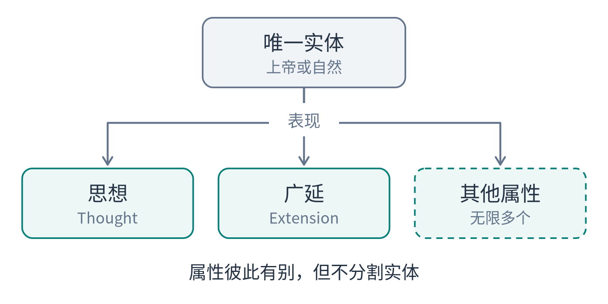
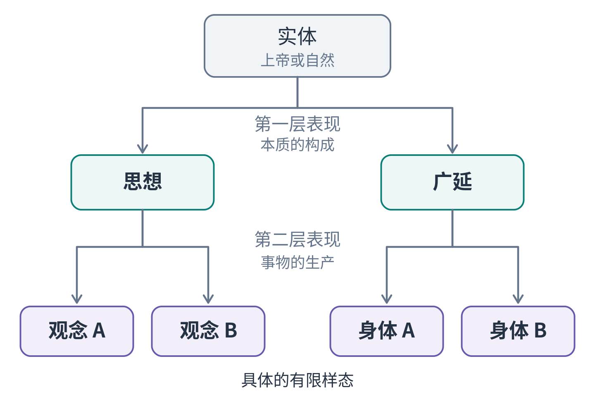
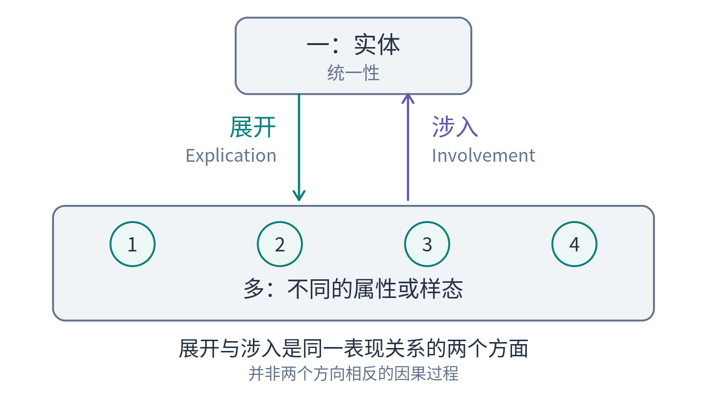
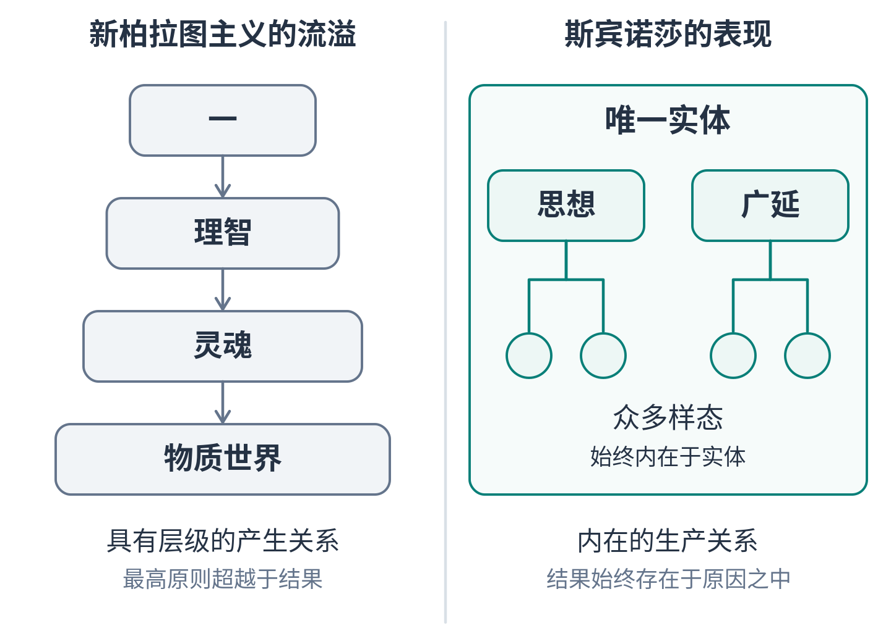
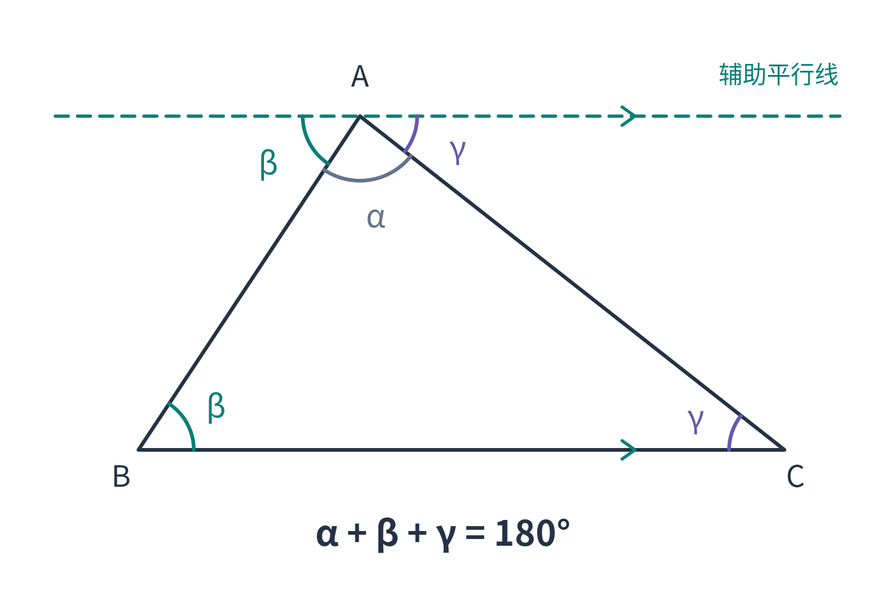

德勒兹在《斯宾诺莎与表现问题》的导论中，从《伦理学》的诸多命题中提取出了一个贯穿斯宾诺莎整个哲学体系的概念：**表现（Expression）**。这一概念同时具有神学、本体论、认识论和方法论上的意义。它既涉及实体与属性、无限与有限、统一性与多样性之间的关系，也涉及事物如何生成、观念如何认识事物，以及哲学证明何以可能。

然而，表现并不是斯宾诺莎明确加以定义或证明的概念。它虽然频繁出现于斯宾诺莎的著作之中，却长期没有得到哲学研究者充分的重视。德勒兹试图通过对这一概念的重新发掘，揭示斯宾诺莎哲学体系的内在构造，并重新考察斯宾诺莎与笛卡尔、莱布尼茨、新柏拉图主义以及黑格尔之间的思想关系。

## 一、表现的两个层次

### 实体、属性与样态

斯宾诺莎的哲学首先面临一个根本性的本体论问题：如果整个世界只有一个实体，那么世界的多样性从何而来？思想与广延具有不同的性质，它们又如何能够构成同一个实体的本质？进一步而言，绝对无限的实体如何产生无数有限的具体事物？

笛卡尔将思想与广延理解为两种不同的受造实体，由此产生了心灵与身体如何相互作用的问题。斯宾诺莎则采取了更加彻底的一元论（Monism）：真正的实体只有一个，即上帝或自然（Deus sive Natura），思想与广延都是这一实体的属性。

《伦理学》第一部分提出了三个基本概念：

| 概念 | 定义 |
| --- | --- |
| 实体（Substance） | 在自身之内并通过自身而被认识的东西 |
| 属性（Attribute） | 知性所认识到的、构成实体本质的东西 |
| 样态（Mode） | 实体的变状，存在于他物之中并通过他物而被认识的东西 |

然而，仅仅规定这三个概念还不足以说明它们之间的关系。德勒兹认为，斯宾诺莎正是通过表现建立了实体、属性与样态之间的联系。

### 第一层表现：实体本质的构成

表现的观念最早出现在《伦理学》第一部分界说六：

> 我将上帝理解成绝对无限之存在，也就是说，此系一包含无限的属性之实体，每个属性都表现了某种永恒无限的本质。

每一个属性都以自身特有的形式表现实体的本质。思想与广延虽然彼此有别，却都属于同一个实体。属性之间的区别并不会造成实体自身的分割，实体的统一性也不会取消属性之间真实的差异。



德勒兹指出，属性的表现具有三个相互关联的方面：首先，每一个属性都表现了某种永恒无限的本质；其次，每一个属性都表现了实体的本质、存在或现实性；最后，每一个属性都表现了实体存在的无限性与必然性，即实体的永恒性。

这三个方面能够相互过渡，因为在斯宾诺莎那里，实体的本质必然包含存在。实体不需要借助外部原因获得存在，因此，属性既然表现了实体的本质，也就表现了实体存在的必然性。

德勒兹将这一层次的表现理解为 **实体本质的构成**，甚至称之为实体本质的系谱学。属性具有客观的本体论地位，它们真实地构成并表现实体的本质。

### 第二层表现：具体事物的生产

即使我们已经解释了唯一实体如何具有无限属性，仍然需要解释无限的属性如何产生有限的具体事物。斯宾诺莎由此引入了表现的第二个层次：

> 实体首先表现自身于属性中，每一种属性皆表现了某种本质。然而诸属性亦表现其自身：它们表现自身于其所各自具有的样态中。

广延是实体的一种无限属性，而一个具体的身体是广延的一种有限样态；思想是实体的一种无限属性，而一个具体的观念则是思想的一种有限样态。属性在样态之中进一步表现自身，每一个样态都表现了其所属属性的一种特定变状。

因此，第二层表现可以被称为第一层表现的表现。



| 表现层次 | 关系 | 哲学意义 |
| --- | --- | --- |
| 第一层表现 | 实体与属性 | 实体本质的构成 |
| 第二层表现 | 属性与样态 | 具体事物的生产 |

第一层表现涉及实体本质的构成，第二层表现则涉及具体事物的现实生产。上帝之所以能够产生无限多的事物，并且以无限多的方式产生这些事物，正是因为其本质是绝对无限的，具有无限多个属性。

实体的生产能力建立在其本质的表现之上，而这种生产能力又通过第二层表现得到实现。

## 二、内在性与自然的生产

传统基督教神学通常将上帝与世界区分开来。上帝是创造者，世界是被创造者。上帝具有独立于世界的存在地位，世界的存在则依赖上帝的创造活动。这构成了一种超越性（Transcendence）的因果结构：世界的最终存在依据位于世界之外。

此外，在以托马斯·阿奎那为代表的神学传统中，上帝本身已经是完满的，因而没有创造世界的必要性。上帝可以创造这个世界，也可以创造另一个世界，甚至可以不创造世界。世界的产生依赖于上帝的自由意志。

斯宾诺莎则取消了上帝与世界之间的这种本体论分离。真正的实体只有一个，世界中的一切具体事物都是这一实体的样态。事物从上帝自身的本性中必然地产生，并且始终存在于上帝之中。

《伦理学》第一部分命题十八指出，上帝是万物的内在因（Immanent Cause），而非过渡因（Transitive Cause）。命题三十三则进一步否定了事物可以按照另一种方式或秩序被上帝产生的可能性。

由此，世界的生成不再依赖于人格化上帝的意志、选择或预设目的，而建立在自然自身的因果必然性之上。

### 能产的自然与被产的自然

既然事物的生产发生于自然自身之内，那么就有必要在自然内部区分生产的原因与生产的结果。斯宾诺莎由此提出两个概念：

- **能产的自然（Natura naturans）**：作为能动原因的自然，即实体及其表现永恒无限本质的属性。
- **被产的自然（Natura naturata）**：从实体本性的必然性中产生出来的一切样态，包括有限样态与无限样态。

二者是同一个自然在生产关系中的两个方面。自然既包含事物产生的根本依据，也包含事物产生的全部结果。



| | 传统神学 | 斯宾诺莎 |
| --- | --- | --- |
| 上帝与世界的关系 | 创造者与创造物 | 实体与样态 |
| 世界的产生依据 | 上帝的自由意志 | 实体自身的本性 |
| 世界的存在 | 可以不被创造 | 必然产生 |
| 世界的秩序 | 可以采取其他形式 | 具有必然性 |
| 因果结构 | 超越性 | 内在性 |
| 自然的目的 | 可以诉诸神圣目的 | 不存在预设的终极目的 |

德勒兹指出，上帝在表现自身于其产出结果之前，首先表现自身于自身之中。在表现自身于被产的自然之前，上帝首先在自身之中构成能产的自然。

这里的先后关系是逻辑上的，而非时间上的。实体通过属性表现自身的本质，而具体样态的生产以这一表现为基础。**自然的生产能力根植于自然自身的本质。**

这一点也构成了德勒兹内在性哲学的重要思想来源：现实世界自身就包含了使其得以存在和生成的力量，无须诉诸世界之外的超越性原则。

## 三、表现的认识论意义

表现的观念并不局限于本体论。既然观念也是思想属性下的样态，那么知识本身也具有表现性。

传统认识论通常从主体与对象的区分出发，将认识理解为心灵对外在对象进行感知和加工的结果。但这种框架立即产生了一个困难：既然主体与对象具有不同的存在地位，那么主体形成的观念如何能够真正认识对象？观念与事物之间的符合何以可能？

斯宾诺莎改变了这一问题的前提。思想与广延都是同一个实体的属性，观念与物体分别属于思想与广延的因果秩序。因此，二者之间的联系根植于它们共同所属的自然秩序之中。

《伦理学》第二部分命题七指出：

> 观念的次序和联系与事物的次序和联系是相同的。

这构成了斯宾诺莎平行论（Parallelism）的基本原则。人的心灵与身体是同一个个体在不同属性下的表现，身体的变化可以在广延的因果秩序中得到解释，与之对应的观念也可以在思想的因果秩序中得到解释，无须引入跨越属性的因果作用。



### 真观念与充分观念

德勒兹进一步指出，斯宾诺莎自《简论》开始，就试图建立一种能够解释知识之表现性的认识论。

如果斯宾诺莎希望超越笛卡尔关于清楚分明的观念（Clear and Distinct Ideas）的理论，就必须进一步追问：真观念中究竟有什么东西得到了表现？一个观念为什么能够具有真理性？

观念与对象之间的符合虽然构成了真理的重要方面，但德勒兹更加关注观念自身所具有的内在规定。一个观念能否表现对象的本质、本性及其因果关系，决定了我们能否从内部理解对象。

这也引出了斯宾诺莎关于 **充分观念（Adequate Idea）** 的理论。对事物的充分认识要求我们深入事物自身的本质与必然联系，而非仅仅掌握事物呈现出来的结果。

表现由此成为连接本体论与认识论的概念：事物通过自身的存在表现实体，观念则能够通过思想的秩序表现事物的本质。

## 四、表现的词义与内部结构

### 表现与彰显

德勒兹首先考察了斯宾诺莎在不同著作中使用的相关词汇。在《简论》的荷兰文文本中，斯宾诺莎曾经使用多个具有相近意义的词。

| 原文 | 基本含义 |
| --- | --- |
| utdrukken | 表达、表现 |
| uytbeelden | 描绘、表现 |
| vertoonen | 显示、彰显、说明 |
| exprimer（法语） | 表现、表达 |

斯宾诺莎尤其倾向于使用 vertoonen，即彰显或显示。无限的观念彰显与之对应的无限事物，身体的观念彰显上帝，属性彰显自身及上帝的本质。

但德勒兹认为，仅仅考察这些表示显现的词汇，还不足以理解表现的哲学内涵。真正能够揭示表现内部结构的是另外两个词：展开（explicare）与涉入（involvere）。

### 展开与涉入

| 原文 | 英文 | 中文含义 |
| --- | --- | --- |
| exprimere / exprimer | to express | 表现 |
| explicare / expliquer | to explicate | 展开 |
| développer | to develop | 拓伸、发展 |
| involvere | to involve | 涉入、包含 |
| envelopper | to envelop | 包含、包裹 |
| impliquer | to imply | 意涵、指涉 |
| complicatio | complication | 含纳 |

Explicare 具有解开、展开的含义，involvere 则具有卷入、包裹、包含的含义。这些词汇揭示了表现所具有的两个方面。

实体既然是统一的，而属性与样态又是多样的，那么实体在表现为多样事物时，是否会丧失自身的统一性？反过来说，如果所有事物都归属于同一个实体，它们的差异是否又会被统一性所消解？

德勒兹通过展开与涉入的关系回答这一问题：

- **展开（Explication）**：一展开自身于多之中。实体在属性中展开自身，属性在样态中展开自身。
- **涉入（Involvement）**：多样者包含并意涵着统一者，统一性内在于表现自身的诸多个体之中。

例如，一个具体的身体是广延属性的有限样态。广延在这个身体中以特定的形式得到展开，而这个身体的存在及其性质又必然涉入广延。



展开与涉入并不相互冲突，它们是同一个表现关系的两个方面。统一者展开自身时并不会脱离其表现形式，而多样者也在自身的具体存在中包含着统一者。

德勒兹据此将表现理解为一种共同涉入：表现者涉入并意涵其所表现的东西，同时又将后者展开并拓伸。

### 表现与定义

这些词汇同样出现在斯宾诺莎关于定义的论述中。《伦理学》第一部分命题八的附释二认为，事物的真正定义应当涉入并表现被定义事物的本性；《知性改进论》第95节则指出，一个完善的定义必须展开事物最内在的本质。

因此，定义的任务不仅在于规定一个概念的含义，还在于使事物的本质得到表现与展开。这已经预示了导论最后关于真实定义、生成原因与几何学方法的讨论。

## 五、含纳原则与表现的哲学史来源

### 一与多的统一

既然展开与涉入能够同时发生，那么二者就指向了一个更加综合的原则，即 **含纳（Complication，拉丁语 complicatio）**。

这一概念源于古老的新柏拉图主义（Neoplatonism）传统，涉及西方形而上学中长期存在的一与多的问题（Problem of the One and the Many）。

含纳具有两个方面的含义：一之中的多，以及多之中的一。统一者自身包含多样性的根据，多样性能够从统一者自身展开；与此同时，统一者又内在于多样的事物之中，每一个具体事物都以自己的方式表现统一者。

斯宾诺莎的自然包含每一种事物，同时又被其中的每一种事物所展开、所意涵。样态涉入并展开其所属的属性，属性则包含样态的本质。

因此，统一性并不处于多样性之外，而是内在于多样性的存在之中。表现理论试图使统一性与差异性同时具有本体论上的真实性。

### 新柏拉图主义传统

表现、展开、包含、意涵和含纳并非斯宾诺莎独创的概念。它们经历了中世纪与文艺复兴时期的发展，成为基督教与犹太教的新柏拉图主义传统中具有重要意义的哲学范畴。

这一传统经常受到泛神论（Pantheism）的指控。因为如果上帝包含万物，万物又展开并意涵上帝，那么上帝与世界之间的严格分离就会受到动摇，神与自然之间开始形成一种内在关系。

德勒兹特别援引了亚历山大·柯瓦雷（Alexandre Koyré）关于雅各布·波墨（Jakob Böhme）以及文艺复兴时期神秘主义者、唯灵论者和炼金术士的研究。这些材料说明，表现的观念具有广泛的哲学史背景。

德勒兹真正关注的问题在于：斯宾诺莎在多大程度上继承了这一传统，又如何通过表现理论改变了这一传统原有的性质？

### 斯宾诺莎与莱布尼茨

表现同样是莱布尼茨哲学体系中的基本概念，并且具有神学、本体论与认识论三个方面的意义。

斯宾诺莎认为实体只有一个，而莱布尼茨则提出了无限多个单子（Monad），每一个单子都从自身独特的视角表现整个宇宙。两人的哲学体系虽然具有根本差异，却都借助表现概念重新处理统一性与多样性、上帝与万物、思想与对象之间的关系。

| | 斯宾诺莎 | 莱布尼茨 |
| --- | --- | --- |
| 实体理论 | 唯一实体 | 多个单子实体 |
| 表现形式 | 实体通过属性与样态表现自身 | 每个单子从自身视角表现宇宙 |
| 统一性与多样性 | 多样性内在于唯一实体 | 多个实体通过协调构成统一世界 |

德勒兹认为，二人都试图借助表现克服笛卡尔主义的困境，重建自然哲学，并将笛卡尔主义的部分成果纳入与笛卡尔世界观根本不同的体系之中。从这一意义上说，二人都具有反笛卡尔主义的立场。

## 六、表现概念的两种还原

尽管表现对于斯宾诺莎与莱布尼茨的哲学具有如此重要的意义，许多研究者却很少直接讨论这一概念。他们往往将表现还原为其他更加熟悉的哲学范畴，其中主要有两种解释：流溢与理智的展开。

### 表现与流溢

流溢说（Emanationism）同样起源于一与多的问题。新柏拉图主义者试图解释，最高的统一者既然是完满、自足的，又为什么能够产生其他存在者。

以普罗提诺（Plotinus）为代表的新柏拉图主义认为，万物从最高的「一」中流溢出来，由一产生理智，由理智产生灵魂，并进一步构成较低层次的存在。这种生产并不依赖于人格化上帝的自由选择，而建立在最高原则的完满性之上。

流溢说与斯宾诺莎的生产理论具有明显的相似性。但在典型的流溢结构中，最高原因仍然具有超越于其产生结果的地位，存在者具有由高至低的层级关系。在斯宾诺莎那里，一切样态则始终内在于唯一实体。



莱布尼茨曾经以卡巴拉（Kabbalah，即犹太神秘主义传统）的方式理解斯宾诺莎，将其表现理论视为某种流溢说。德勒兹认为，这种解释颠倒了表现与流溢之间的历史关系。

表现理论确实产生于深受新柏拉图主义影响的思想传统之中，但它的目的与结果恰恰在于转化新柏拉图主义，使其朝向新的方向发展。

**流溢不能充分解释表现；表现反而解释了流溢因如何逐渐向内在因转化。**

因此，表现的哲学史意义就在于，它逐渐改变了原因与结果之间的超越性结构，使原因越来越内在于其所产生的结果之中。

### 表现与理智的展开

另一种解释主要来自后康德主义和黑格尔主义传统。这些哲学家承认斯宾诺莎体系中存在某种自我发展的生成结构，却将这种发展理解为抽象的、理智上的展开。

黑格尔认为，斯宾诺莎虽然确立了绝对实体，却无法说明实体自身的真正运动与发展。实体始终是一个静止的统一者，而属性和样态只是通过理智的分析从实体概念中展开出来。黑格尔主义哲学家爱德曼（Johann Eduard Erdmann）也将属性理解为理智或感性的形式。

甚至谢林（Friedrich Schelling）在构建自己的启示哲学（Philosophy of Revelation）时，也更倾向于从波墨那里寻找表现（Ausdruck）的概念，而非斯宾诺莎或莱布尼茨。

德勒兹认为，这种解释混淆了两种性质不同的展开。

| | 理智的展开 | 事物自身的展开 |
| --- | --- | --- |
| 展开者 | 认识事物的主体 | 事物自身 |
| 活动 | 概念分析与性质推导 | 内在生成与现实生产 |
| 结果 | 关于事物的知识 | 事物自身的规定与产出 |
| 哲学意义 | 认识论 | 本体论 |

在哲学史上，展开与含纳原本具有一种生机论（Vitalism）的意义，它们关心对象自身的演变及其生命。将表现完全还原为理智对对象进行的展开，就会丢失表现所具有的本体论意义。

### 表现与认识关系的优先性

如果属性只是认识主体观察实体的不同形式，那么属性就会退化为一种主观分类。实体本身究竟如何存在，我们便无从得知，只能认识它在理智中呈现出来的样子。

德勒兹则认为，属性真实地表现实体的本质，实体的无限本质也在上帝的无限理智中获得客观的表现。理智之所以能够认识属性，正是因为实体本身已经具有相应的表现结构。

因此，表现使理智中的思想与对象之间的关系成为可能，而非相反。认识的客观性建立在事物自身的表现结构之上。

## 七、实体的三重构造

在批评上述两种解释之后，德勒兹进一步考察了两位直接关注表现概念的斯宾诺莎研究者。

弗里茨·考夫曼（Fritz Kaufmann）已经意识到表现是理解斯宾诺莎哲学体系的重要线索，但依然主要从神秘主义与美学的角度理解表现。安德烈·达邦（André Darbon）则对表现关系本身提出了更加根本的质疑：如果每一个属性都表现了实体的本质，那么表现者与被表现者究竟有什么区别？

通常，当我们说某物表现了另一事物时，就已经预设了二者之间的区别。但在斯宾诺莎那里，属性真实地构成了实体的本质。如果属性与本质完全相同，表现关系似乎是多余的；如果属性与本质完全不同，那么属性又如何能够构成实体的本质？

德勒兹试图通过一种三重关系解决这一困难。

| 项目 | 在表现关系中的地位 |
| --- | --- |
| 实体 | 表现自身者 |
| 属性 | 实体借以表现自身的形式 |
| 本质 | 被表现者 |

表现关系涉及实体、属性与本质三个相互关联的项。实体借助属性表现自身，每一个属性则表现某种永恒无限的本质。

这一问题构成了全书第一部分「实体的三重构造」的主要内容。

## 八、名义定义与真实定义

### 表现在《伦理学》中的特殊地位

表现虽然对斯宾诺莎的哲学具有重要意义，却从来没有被专门定义，也没有作为一个独立的对象得到证明。

《伦理学》第一部分界说三规定了实体，界说四规定了属性，但两者都没有使用表现概念。直到界说六对上帝进行定义时，表现才真正出现。

| 界说 | 内容 | 德勒兹的理解 |
| --- | --- | --- |
| 界说三 | 实体 | 名义定义 |
| 界说四 | 属性 | 名义定义 |
| 界说六 | 上帝 | 真实定义 |

**名义定义（Nominal Definition）** 主要规定一个概念的含义，使我们知道这一概念所指的对象。**真实定义（Real Definition）** 则要求揭示事物自身的本性及其存在或生成根据，从而使事物的必然性质能够得到理解。

德勒兹认为，不能仅仅通过实体与属性的定义，就直接演绎出二者在上帝之中的完整关系。只有当实体被理解为绝对无限的实体，具有无限多个属性时，实体、属性与本质才进入一种真实的表现关系之中。

上帝的定义使实体与属性之间的关系发生了转化。但这里仍然存在一个问题：为什么我们能够从上帝自身的定义出发，认识一切事物的产生？表现关系本身为什么不需要作为独立的对象加以证明？

这一问题将讨论引向斯宾诺莎的几何学方法。

## 九、几何学方法的局限

### 谢恩豪斯提出的问题

《伦理学》采用了几何学方法（Geometrical Method），从定义与公理出发，通过证明得到一系列命题。然而，第一部分命题十六却提出了一个极强的结论：从神圣本性的必然性中，必然产生无限多的事物，并且以无限多的方式产生。

数学家谢恩豪斯（Ehrenfried Walther von Tschirnhaus）对此产生了怀疑，并在第82封信中向斯宾诺莎提出了一个方法论上的问题。

在几何学中，我们往往只能直接从事物的定义中演绎出某种性质。为了认识更多性质，通常需要引入新的视角，将原先定义的对象与其他对象联系起来。那么，斯宾诺莎如何能够从上帝自身的本性出发，演绎出无限多的事物？

例如，为了证明欧氏平面上三角形的内角和等于两个直角，可以通过一个顶点作一条平行于对边的直线。借助平行线所产生的新几何关系，我们便能够获得关于原有三角形的知识。



但是，这条辅助线并非三角形自身产生的，而是数学家为了认识它的性质所引入的。

德勒兹认为，几何学方法由此表现出双重限制：一方面，认识对象的诸多视角可以外在于对象；另一方面，从定义中获得的性质需要通过有限理智逐步演绎。

### 黑格尔对几何学方法的批评

黑格尔对斯宾诺莎的批评同样涉及这一问题。数学证明中的运动来自认识主体对对象进行的构造与操作。三角形不会自行延长自己的边，也不会主动产生一条平行线。

植物的生长则具有不同的性质。植物的枝叶通过自身的生命活动产生，其运动属于事物自身的生成过程。

黑格尔认为，如果斯宾诺莎仅仅将几何学方法应用于哲学，那么他所完成的就只是一种外在于对象的逻辑展开。他虽然能够从实体概念中推导出一系列命题，却无法通过这种推导说明实体自身的有机运动与现实生成。

这一批评揭示了一个根本性的方法论问题：**概念的演绎与事物的生成究竟具有怎样的关系？**

德勒兹承认这一问题的重要性，但不同意黑格尔对斯宾诺莎的判断。他指出，斯宾诺莎早已意识到几何学方法的这一局限，并在与谢恩豪斯的通信中直接讨论过它。

## 十、生成性定义与虚构原因

### 生成性定义

斯宾诺莎在《知性改进论》中已经意识到，单纯描述对象所具有的性质，并不足以揭示对象的内在本质。为了更加充分地理解对象，我们可以通过其产生方式或邻近原因（Proximate Cause）对其进行定义，这可以被称为生成性定义（Genetic Definition）。

斯宾诺莎以圆和球为例：

| 对象 | 性质定义 | 生成性定义 |
| --- | --- | --- |
| 圆 | 平面上到固定点距离相等的点的集合 | 一条固定长度的线段绕其固定端点旋转所形成的轨迹 |
| 球面 | 三维空间中到固定点距离相等的点的集合 | 半圆弧绕其直径所在的轴旋转所形成的曲面 |

性质定义规定了对象所具有的特征，生成性定义则通过对象的产生方式理解其本性。后者能够使对象的诸多性质获得更加统一的解释。

但即使如此，生成性定义仍然没有完全克服几何学方法的局限。

### 数学中的虚构原因

一个半圆本身并不会旋转。数学家为了形成球的概念，在思想中设定了半圆旋转这一活动。斯宾诺莎对此有着清楚的认识，并在《知性改进论》中使用了拉丁语 fingo ad libitum，即任意地设想或虚构某个原因。

这里的虚构不意味着数学知识是错误的。即使现实中没有任何一个球是通过半圆旋转产生的，这种构造依然能够为我们提供关于球的真实观念。

原因的虚构性在于，这一生成活动是数学家为了形成对象的概念而设定的，并非现实对象必然经历的生成过程。我们可以从所设想的结果出发，反过来构造一个能够产生该结果的原因。

因此，即使数学家通过生成性定义克服了单纯描述性质的局限，数学对象的生成原因仍然可能外在于对象自身。

## 十一、绝对实体与几何学方法的转化

### 从虚构原因到内在原因

斯宾诺莎在回复谢恩豪斯的第83封信中指出，当几何学方法应用于真实存在的事物，尤其是绝对存在时，我们便能够从其本性中演绎出多种性质。

德勒兹认为，要理解这一回答，就必须区分几何学对象与绝对无限的实体。

半圆的概念本身不包含旋转这一活动，因此数学家需要额外引入旋转条件。但绝对无限的实体已经包含一切存在的根本依据，其之外不可能存在另一个独立实体，为它提供生产能力。

绝对实体产生万物的根据必须内在于其自身的本性。这里不再需要通过设想结果来虚构原因，因为绝对无限的实体本身就是真实的生产原因。

| | 数学对象 | 绝对无限实体 |
| --- | --- | --- |
| 生成原因 | 可以由数学家设想 | 内在于实体自身 |
| 展开方式 | 借助构造与演绎 | 实体自身的表现 |
| 认识视角 | 可以外在于对象 | 内在于实体的属性 |
| 性质之间的联系 | 通过不同证明逐步认识 | 具有共同的内在存在根据 |

斯宾诺莎由此试图克服谢恩豪斯所指出的两项困难：一方面，使不同的认识视角内在于被认识的对象；另一方面，使分别被演绎出来的多种性质具有共同的存在根据。

德勒兹因此提出了一个颇具反转意味的判断：如果说斯宾诺莎的哲学遵循了数学方法，那么恰恰是因为数学方法在哲学之中发现了克服自身通常限制的可能。

### 属性作为内在观点

通常意义上的观点（Point of View）属于观察者。我们通过改变观察方式，获得关于同一个事物的不同认识。数学家所引入的辅助线、坐标系以及其他构造，都可以形成认识对象的新视角。

但在斯宾诺莎那里，属性虽然可以被理解为看待实体的不同观点，这些观点却内在于实体自身。

思想与广延并非人类为了认识实体而人为划分出来的两个视角，它们本身就真实地构成并表现了实体的本质。实体具有无限多个属性，也就意味着实体自身包含着关于自身的无限观点。

因此，认识视角的多样性不必然导致主观主义。视角本身也可以具有客观的本体论地位，因为事物自身就可能具有多种真实的表现形式。

### 表现与证明

在一般的数学证明中，有限理智需要逐步演绎对象的不同性质。但对于绝对无限的实体而言，这些性质所依托的是一个无限的共同存在。实体自身包含其诸多属性与样态，而相应的观念及其联系则共同地存在于无限理智（Infinite Intellect）之中。

德勒兹由此提出：

> 表现不是证明的对象；其实是表现将证明置于绝对之中。

表现之所以不需要被单独定义或证明，是因为它构成了绝对实体自身的结构，并为关于实体的哲学证明提供了客观根据。通过证明，我们能够认识事物本身已经具有的内在关系与必然性。

在《伦理学》第五部分命题二十三的附释中，斯宾诺莎说道：

> 所谓的证明就是心灵藉之以观看的眼睛。

这一表述也出现在《神学政治论》的相关讨论之中。对于那些无法直接通过感官认识的东西，证明构成了理智得以认识它们的方式。证明使不可见的东西得到彰显，使事物自身的必然关系成为理智可以把握的对象。

## 结语

德勒兹在导论中实际上已经勾勒出了整个表现理论的问题结构。

| 哲学问题 | 表现理论的基本方向 |
| --- | --- |
| 一与多 | 统一者展开为多样者，多样者同时涉入统一者 |
| 实体与属性 | 不同属性真实地构成并表现同一个实体的本质 |
| 无限与有限 | 样态内在于实体，并从自然的必然因果秩序中产生 |
| 原因与结果 | 生产原因内在于其产生的结果 |
| 思想与对象 | 认识建立在事物自身的客观表现结构之上 |
| 统一性与差异性 | 实体的统一性与属性的真实区别能够同时成立 |
| 证明与生成 | 理智的演绎以事物自身的必然关系为根据 |

其中尤其值得重视的是三组概念区分：展开与涉入、流溢因与内在因、理智的展开与事物自身的展开。第一组涉及统一性与多样性的关系，第二组涉及生产原因与生产结果的本体论关系，第三组则涉及认识与生成之间的关系。德勒兹通过表现概念将三者统一起来。

黑格尔对斯宾诺莎的批评尤其能够揭示德勒兹这一研究的思想方向。黑格尔所质疑的是，一个绝对统一的实体如何能够具有真正的差异、运动与生成。德勒兹则试图通过表现说明，实体自身已经包含真实的差异性、无限的生产能力以及自身的展开过程。差异与生产无须借助超越性原则，也无须由认识主体从外部赋予实体。

由此，表现不仅成为理解斯宾诺莎哲学体系的重要概念，也构成了德勒兹自身差异哲学与内在性哲学的重要思想来源。世界自身包含其存在与生成的根据，统一性内在于差异之中，而事物的可理解性则根植于事物自身的存在结构。
