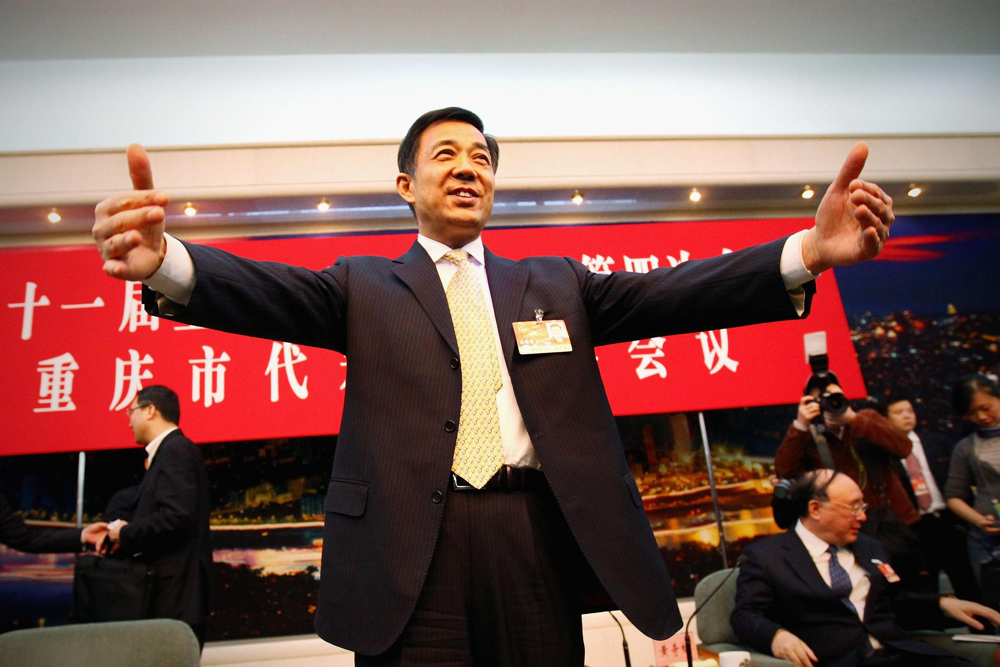
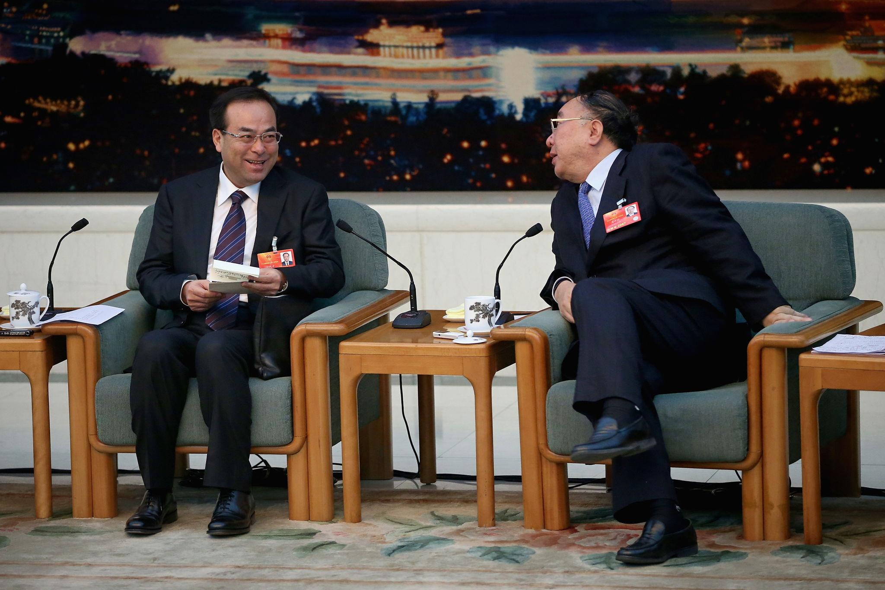

2026年10月13日，中央纪委国家监委通报，重庆市委原副书记、市政府原市长黄奇帆涉嫌严重违纪违法，正接受纪律审查和监察调查。现年74岁的黄奇帆已经离开重庆市长岗位近十年，此前仍经常以经济学者身份出席论坛、发表演讲。官方通报并未说明具体的违纪违法事实，因此目前还无法确定其所涉案件的性质和范围。〔1〕

黄奇帆受到关注，并不仅仅因为他曾担任直辖市市长。2001年从上海调任重庆后，他长期负责国资、工业和金融事务，2010年出任市长，2016年底卸任。其间，两位与他共事的重庆市委书记——薄熙来与孙政才——先后落马，而黄奇帆始终留在重庆经济决策的核心位置。外界因此称他为“政坛不倒翁”。如今，这个称呼伴随他的被查重新进入公众视野。〔2〕

理解黄奇帆的政治经历，需要先回到重庆经历的两次高层震荡；理解他的经济治理实践，则要进入另一条脉络，即地方政府如何利用土地、国有企业和金融机构组织资本，并在这种资本运作中形成新的治理能力与监督问题。

## 一、薄熙来时期的重庆政治



2007年11月，薄熙来接替汪洋，出任重庆市委书记。当时，他已经担任过大连市委书记、辽宁省省长和商务部部长，并在中共十七大上进入中央政治局。与一般的地方官员不同，薄熙来不仅拥有丰富的地方和中央任职经历，其父薄一波还是中共元老。他的家庭背景、个人知名度以及鲜明的施政风格，使其成为当时中国政坛最受关注的政治人物之一。

要理解薄熙来后来引发的政治震动，首先需要将其放回2012年中共十八大前的权力交接背景。2007年十七大召开时，习近平已经进入中央政治局常委会，而薄熙来只是中央政治局委员。所以从中国官场的程序来看，薄熙来并不是一个与习近平处于同等接班位置的正式候选人。但外界普遍认为，他希望借助重庆的治理成绩和全国影响力，在十八大上进一步晋升中央政治局常委。布鲁金斯学会研究员李成在当时的分析中，也将薄熙来视为一位具有强烈政治抱负、试图突破既有晋升方式的政治人物。〔3〕

薄熙来在重庆采取了一套极具个人色彩的治理方式。2008年11月，重庆发生大规模出租车停运事件，司机对运营成本、经营权和行业管理等问题表达不满。薄熙来没有仅仅要求行政部门处理，而是亲自与出租车司机及市民代表公开座谈，讨论出租车经营中的具体矛盾。时任常务副市长的黄奇帆也参加了此次座谈。这样的公开互动既具有解决社会问题的实际作用，也强化了薄熙来直接面对群众、亲自处理矛盾的政治形象。〔13〕

更具争议的是随后展开的“唱红打黑”。其中，“打黑”主要指2009年开始的大规模打黑除恶专项行动。薄熙来从辽宁调来的王立军担任重庆市公安局局长，主持相关行动。重庆警方查办了一批涉黑案件，也牵出了文强等政法系统高级官员。对支持者而言，这是一场打击黑恶势力、整顿地方治安和腐败网络的行动。但随着打黑规模扩大，案件侦办中的程序正义、证据取得方式以及辩护律师的权利逐渐成为争论焦点。北京律师李庄在为涉黑案件被告人辩护期间被追究刑事责任，更使重庆的司法实践受到法律界的广泛质疑。《财新周刊》当时就以李庄案为封面报道，集中讨论了其中的法治问题。〔14〕

与打黑同时推进的“唱红”，则是一场具有鲜明意识形态色彩的政治动员。重庆组织唱红歌、读经典、讲故事、传箴言等活动，强调革命传统、集体主义和社会主义价值观。薄熙来试图通过这些活动塑造重庆的政治认同，同时结合保障性住房建设、国有资本运作和产业发展，形成外界所谓的“重庆模式”。

这种模式的特殊之处，在于薄熙来并不满足于将重庆的经济增长视为普通的地方政绩，而是将其上升为具有全国示范意义的治理经验。与当时广东省委书记汪洋所倡导的改革探索相比，重庆更加突出政府主导、国有资本配置、社会分配和政治动员。两种地方治理思路因此成为十八大前中国政治与经济政策讨论中的重要话题。

在这一过程中，黄奇帆发挥了不同于薄熙来和王立军的作用。薄熙来主要塑造政治方向和公众形象，王立军负责公安系统与打黑行动，而长期主管经济、财政和国资工作的黄奇帆，则承担了大量具体的经济建设与资源配置工作。2009年12月，黄奇帆接替因年龄原因辞职的王鸿举，担任重庆市代理市长，并于次年正式出任市长。至此，薄熙来与黄奇帆形成了市委书记和市长之间的正式搭档关系。〔15〕

这也说明，薄熙来时期的重庆并非只有政治动员。其保障房建设、基础设施投资、产业引进和国有资本运营，都需要地方政府能够持续筹集资金、调配资源。黄奇帆长期经营的国资平台、土地开发和金融重组机制，在其中发挥了重要作用。薄熙来的政治声势与黄奇帆的财经治理能力相互配合，共同构成了当时重庆发展的重要特征。不过，这种工作上的密切合作，并不能直接证明两人在高层政治立场上形成了不可分割的政治联盟。

2012年2月，重庆的政治局势发生急剧变化。此前主导打黑行动、后来升任重庆市副市长的王立军，突然进入美国驻成都总领事馆并滞留。这起事件最初表现为地方高级公安官员寻求外国领事机构保护的异常举动，随后却牵出了薄熙来妻子谷开来涉嫌杀害英国商人尼尔·伍德的刑事案件。王立军由此从薄熙来治理模式的重要执行者，转变为直接引发整个政治危机的关键人物。

黄奇帆也被卷入了这场风波，但他在其中的实际角色需要依据可靠资料判断。2012年3月，重庆市政府公开确认，王立军进入领事馆后，黄奇帆与市委组织部长陈存根、市纪委书记徐敬业等人曾受市委、市政府委派前往成都。与此同时，官方否认了黄奇帆率领70辆警车前往成都的传闻。黄奇帆确实参与了事件的现场协调，但关于他究竟掌握多少内幕，以及在王立军离开领事馆的过程中发挥了多大作用，现有公开材料尚不足以作出完整判断。〔16〕

王立军事件最终引发了中央对重庆领导层的调整。2012年3月15日，薄熙来被免去重庆市委书记职务，由时任国务院副总理张德江兼任重庆市委书记。此后，薄熙来受到党纪处分并被移送司法机关。2013年9月，济南市中级人民法院以受贿、贪污和滥用职权三项罪名判处薄熙来无期徒刑。〔4〕〔17〕

从政治层面看，薄熙来事件显然不只是一起普通的地方官员腐败案件。它发生在中共十八大权力交接前夕，涉及一位具有全国影响力、被认为有望进一步晋升的中央政治局委员，也牵涉重庆长期形成的公安、司法和地方政治网络。事件的后果同时改变了地方权力格局和高层人事竞争。

对于黄奇帆而言，真正重要的变化在于薄熙来倒台之后。张德江接任市委书记，黄奇帆却继续担任市长。随后重庆开始调整此前过于个人化的政治动员方式，中央也需要维持地方行政、经济运行和重大项目的连续性。黄奇帆所掌握的财政、国资和产业治理经验，使他具有相当强的行政延续价值。这有助于解释为什么薄熙来被处理后，黄奇帆没有同步离任。

但这终究是一种基于当时人事安排和行政需求的分析。公开材料能够确认黄奇帆获得留任，却不足以揭示中央在决定其去留时的全部内部考量。

## 二、孙政才时期的权力交接



与薄熙来相比，孙政才的政治履历和个人风格明显不同。薄熙来出身于具有深厚政治背景的家庭，在地方和中央积累了长期的政治资历；孙政才则以农业科研起家，具有较强的技术官僚背景。1963年出生的孙政才早年从事农业研究，随后进入北京市地方政府系统，曾担任顺义区主要领导和北京市委秘书长。2006年，43岁的孙政才出任农业部部长；2009年调任吉林省委书记；2012年中共十八大召开时，他又以49岁的年龄进入中央政治局，并出任重庆市委书记。〔5〕

这条晋升路线之所以引人注目，并不只是因为孙政才年轻，而是因为他的年龄恰好使其具备跨越下一轮领导层更替的可能性。当时中国政坛对于“第六代领导人”的讨论十分活跃，孙政才与同样出生于1963年的胡春华经常被并列提及。胡春华长期在西藏、共青团系统和地方党委任职，孙政才则经历了农业科研、中央部委与地方党委岗位。两人既拥有不同的政治资历，也都在较年轻时获得中央政治局席位。卡内基国际和平基金会在2014年的研究中，就将二人视为未来可能进一步晋升的重要人物。〔6〕

不过，所谓“第六代接班人”主要是当时学界和政治观察者对干部年龄、履历和晋升轨迹的判断，并不是已经公布的正式接班安排。孙政才被认为具有成为未来最高领导人之一的可能性，与其已经被确定为接班人，是两回事。

2012年11月，孙政才接替张德江出任重庆市委书记。此时重庆刚刚经历薄熙来事件，政治环境与五年前完全不同。此前薄熙来所建立的高度个人化的治理风格已经受到中央否定，重庆面临的首要任务是恢复政治秩序、调整干部队伍，并维持经济和社会运行。

孙政才没有重建薄熙来式的“唱红打黑”政治动员。他在全国舆论中的存在感也远不及前任。他的执政风格概括为相对保守、避免重大政治风险，民间的一些评价是“懒政”。虽不足以衡量其全部行政表现，但大致可以明白孙政才的施政风格。另外，值得注意的是，在孙政才落马后，中央纪委的纪律审查通报也使用了“庸懒无为”等批评性表述。〔18〕

更大的问题在于，孙政才接手的是一个已经经历重大政治案件、但原有组织和经济结构不可能立即消失的重庆。地方政府仍要处理庞大的国有企业体系、土地开发、融资平台和产业投资项目；原先在薄熙来时期形成的干部任用关系与行政运作方式，也需要逐步调整。孙政才既要继续推动经济发展，又必须在政治上与薄熙来、王立军时期的做法作出区分。

2016年11月至2017年1月，中央第十一巡视组对重庆展开巡视“回头看”。2017年2月，巡视组向重庆市委反馈意见，指出一些干部存在“带病提拔”问题，清除“薄、王”思想遗毒不彻底，国有企业腐败问题仍然严峻，重庆市委在党的领导、干部管理和落实中央要求等方面存在明显不足。孙政才随后主持会议并表示接受反馈、推动整改。〔19〕

这一事件具有重要的政治含义。薄熙来倒台五年之后，中央巡视仍将清除“薄、王”影响列为重庆的重要问题，说明这场政治危机并没有随着薄熙来的司法判决而完全结束。它已经成为衡量继任地方领导班子政治表现和组织整顿成效的重要标准。作为市委书记，孙政才不仅要对自己任期内的工作负责，还必须承担处理前任政治遗产的责任。

2017年7月，孙政才被调离重庆市委书记岗位，随后接受中央纪委纪律审查。2017年9月，他被开除党籍和公职，官方通报列举了其违反政治纪律、组织纪律和廉洁纪律等问题。2018年5月，天津市第一中级人民法院以受贿罪判处孙政才无期徒刑，法院认定其非法收受财物折合人民币1.7亿余元。〔7〕〔18〕

孙政才落马发生在中共十九大之前，使他原本被外界看好的晋升前景彻底终结。从这一时间点出发，外界将其案件与十九大高层人事安排联系起来，是可以理解的政治分析。其倒台确实改变了潜在领导人选的格局，但目前可靠的公开证据还无法证明，他是因为与习近平形成了某种已经组织化的政治对抗而被查处。

至于黄奇帆，他并没有在孙政才被查处后继续留任重庆市长。2016年12月30日，黄奇帆已经辞去市长职务，随后于2017年2月出任全国人大财政经济委员会副主任委员。也就是说，孙政才落马时，黄奇帆已经离开重庆的地方领导岗位。〔20〕

因此，黄奇帆的“不倒翁”经历应该更加准确地理解为：他既参与过薄熙来时期的重大经济治理工作，又在薄熙来倒台后获得留任，并在孙政才主政时期继续掌管重庆经济，直到2016年底离任。在重庆先后经历两位引发重大政治案件的市委书记期间，黄奇帆始终保持了相当程度的行政连续性。

这种连续性与其长期积累的财经治理经验密切相关，但也使一个问题变得更加值得研究：地方政府在不同时期形成的国资平台、金融重组和土地融资安排，究竟具有怎样的经济作用，又在多大程度上依赖行政权力进行资源配置？理解这一点，才能进一步进入黄奇帆的财政金融治理及其背后的制度问题。

## 三、土地资本化

### 土地融资

黄奇帆在重庆经济治理中发挥作用的重要背景，是当时地方财政收入与城市建设需求之间的矛盾。2001年前后，重庆直辖时间不长，交通基础设施、工业园区、跨江桥梁及城市新区建设都需要大量资金，但地方财政收入有限，难以依靠当年的税收承担集中建设的支出。与此同时，重庆拥有大量尚未开发的土地，其中一些地区虽然当时经济活动较少、市场价格不高，却可能因未来交通改善、产业集聚和城市扩张而显著升值。

黄奇帆在上海参与浦东开发期间，已经接触过类似的土地开发与基础设施融资问题。在他的判断中，土地价格不仅取决于当前的区位条件，也取决于未来的城市规划和公共投资。例如，重庆江北嘴当时与解放碑隔江相望，但受交通条件、商业设施及开发程度限制，其土地价值未能充分反映未来的城市发展潜力。如果政府能够改善跨江交通、推动中央商务区建设，江北嘴的区位条件便可能发生变化。土地原有价格与未来开发价值之间的差距，成为地方政府能够利用的一项重要资源。〔2〕

不过，预期土地升值并不能直接解决基础设施建设的资金问题。假设政府计划修建一条道路，需要立即支付10亿元工程款。即使预计道路建成以后，周边土地会因为交通改善而大幅升值，施工单位也不可能接受政府以未来土地价格上涨作为今天工程款的支付方式。**预期中的土地价值并不是能够立即用于支付工资、购买材料和建设道路的现金。**

要解决这一矛盾，就必须建立能够把未来收益转化为当期资金的融资机制。

重庆采取的重要办法，是设立和壮大一批承担城市建设任务的国有投资企业，后来被称为“八大投”。这些企业分别参与城市基础设施、公路、能源、水务等领域的投资建设。地方政府通过依法配置土地使用权、国有股权、存量基础设施资产及其他资本金，使这些企业具备一定的资产规模和融资条件，再由企业向银行申请贷款，或者通过发行债券等方式筹集建设资金。〔2〕〔26〕

这里必须区分政府、融资平台与银行三个主体。地方政府负责制定发展规划、组织公共资源和依法出资；国有投资平台是具体的融资和建设主体；银行则根据企业的资本状况、项目收益、担保条件与信用风险决定是否放贷。

例如，假设重庆计划建设一条连接新区与主城区的道路，投资规模为10亿元。承担建设任务的国有企业原本没有足够的现金，但政府可以通过法定程序向其配置价值2亿元的国有资产或资本金，使企业形成一定的净资产基础。企业据此向银行申请8亿元贷款，筹足建设资金并支付工程款。

道路建成以后，周边土地可能因为交通便利而升值。如果政府随后依法出让附近的国有建设用地使用权，开发商支付的土地出让价款便形成地方政府性基金预算收入。政府可以依法将相关财政资金安排用于基础设施支出和其他规定用途。另一方面，如果投资平台本身依法持有可以经营或处置的资产，也可能通过资产经营、项目收费、资产转让等方式取得现金流，用于偿还贷款。

这样，地方政府就在时间上完成了一项转换：**先通过企业融资开展建设，再尝试用建设带来的经济发展、资产经营收入和未来财政收入支持后续偿债。**

这一机制所利用的，并不是单纯的土地价格上涨，而是基础设施建设与土地增值之间可能存在的相互促进关系。政府修路、建桥及建设公共设施，能够改善土地的开发条件；土地价值提高以后，又可能带来新增投资、商业活动和财政收入。对于快速工业化和城市化时期的重庆，这种机制能够缓解早期资本不足的问题，加快基础设施建设。

黄奇帆在2007年的一次采访中介绍，重庆通过国债资金、存量资产、土地相关权益及其他合规资本来源，逐步充实城市建设投资集团的资本金。2010年接受财新《中国改革》采访时，他又表示，重庆“八大投”在2002年以约200亿元资产起步，到2010年已经形成4000多亿元的总资产。〔26〕

土地价格管理和出让制度改革，则是与融资平台建设并行的另一条路径。2002年，重庆调整主城区土地等级与基准地价，同时推进土地储备以及经营性土地的招标、拍卖、挂牌出让制度。政府通过加强土地供应管理，使土地使用权出让更加集中和规范，也提高了取得土地出让收入的能力。财新报道提到，重庆土地出让收入从2001年的约2亿元增加至2002年的11亿元，并在2003年达到22亿元。〔2〕

这里的土地出让收入与融资平台贷款需要分别理解。前者是政府出让国有土地使用权后取得的财政收入，按照规定纳入政府性基金预算管理；后者是企业向金融机构借入的资金，属于必须偿还的债务。

此外，土地出让收入也不等于政府的纯利润。征地补偿、拆迁安置、土地整理和基础设施配套等都需要成本。即便一块土地最终卖出了很高的价格，也不能把全部成交价款当成能够自由支配的财政资金。

因此，黄奇帆推动的土地资本化并非简单地低价买地、高价卖地，而是将土地管理、城市规划、国有资产经营和金融机构融资联系起来，以此扩大重庆的公共投资能力。

不过，这一安排也包含明显的风险。如果道路建成后周边土地没有按照预期升值，或者虽然土地升值，却因为市场需求不足而无法顺利出让，预期收入便不能兑现。对于缺乏独立经营现金流的道路和公共设施项目，承担建设任务的企业还可能长期依赖政府支持。此时，最初用于加快建设的融资安排，就会逐渐转化为地方国有企业及财政体系的债务负担。

### 地票改革

黄奇帆在土地方面的改革，还包括后来具有全国影响力的“地票”制度。这项改革的背景，是中国快速城市化过程中城乡土地利用出现的结构性矛盾。一方面，大量农村人口进入城市，住宅、工厂、商业设施和基础设施建设不断增加对土地的需求；另一方面，人口流出使部分农村宅基地（农村村民依法用来建造住宅及其附属设施的土地。 它包括房屋占用的土地，以及宅基地范围内的院子、附属用房等，但不包括农民用来种粮食、蔬菜的普通耕地）及其他集体建设用地逐渐闲置。

由于国家实行耕地保护和建设用地总量管制，城市又不能无限制地增加建设用地。由此形成了一种局面：城市缺少建设指标，而农村已有的部分建设用地却没有得到充分利用。

重庆试图通过土地指标交易解决这一问题。2008年，重庆成立农村土地交易所，开展地票交易试验。所谓“地票”，是指土地权利人自愿将符合条件的农村建设用地复垦为耕地等农用地，经政府验收后，由建设用地减少而形成的可交易指标。这里的关键在于，交易对象并不是农村的某一块实体土地，而是它所对应的建设用地指标。城市中的建设主体购买地票后，可以在符合规划和其他审批要求的情况下，将相应指标用于城市建设，但仍须依法取得具体建设地块的土地使用权。〔2〕〔21〕

例如，一户农民已经迁入城市，农村原有的200平方米宅基地长期闲置。在符合相关条件并经本人自愿申请后，可以将原有住宅拆除，使宅基地重新成为耕地。经过验收，原来200平方米的建设用地减少了，扣除应当留给农村发展的面积后，相应指标便可能进入地票市场。城市中的建设主体购买这些指标，可以据此申请相应的建设用地安排。农村原来的土地仍然留在农村，复垦后的农用地也不会因此变成开发商的财产。这一制度实际转移的是建设用地指标，而不是农民原有土地的所有权。

重庆的制度还规定了地票交易收益的分配方式。根据2015年公布的《重庆市地票管理办法》，对于符合条件的农村宅基地及附属设施用地，在单户交易面积不超过667平方米的部分，扣除复垦成本后的地票净收益，85%归宅基地使用权人，15%归农村集体经济组织。因此，农民可以通过退出闲置宅基地获得一次性收入，农村集体也能够取得相应收益。复垦形成的农用地仍然保留在农村，可以继续用于农业生产。制度希望通过这种安排，使部分城市建设需求形成的资金回流农村。〔21〕

这一设计的重要性在于，它改变了传统城乡土地资源配置的一部分机制。过去，农村闲置建设用地难以直接转化为经济收益，而城市建设又需要新增用地指标。地票制度通过市场交易，为两者建立联系。城市建设主体购买指标，农民和农村集体获得收入，政府则能够在控制建设用地规模的同时调整城乡土地利用结构。按照重庆市规划和自然资源局公布的数据，截至2022年底，重庆累计交易地票35.6万亩，不含后续转让交易，向农村输送资金700多亿元。〔22〕

不过，地票制度在实践中也涉及农民土地权益与城乡收益分配问题。

**首先是宅基地退出的实际成本**。制度要求农民自愿申请复垦，并且拥有其他合法稳定住所，但这不意味着退出宅基地只是获得一笔补偿那么简单。宅基地对于农民而言，除了具有经济价值，还具有居住保障功能。农民退出宅基地后，原则上不能重新无偿申请同样的宅基地使用权。如果一户家庭获得几万元地票收益，却在未来面临更高的城市住房成本，那么仅以一次性的交易收入衡量其收益，就可能忽略长期居住保障的变化。地方政府、村集体与普通农民之间的议价能力也存在差异，因此农民是否充分知晓复垦后果、是否真正自愿，以及收益能否及时兑现，都是制度执行中的重要问题。〔21〕

**其次是城乡土地价值的差异**。农村地票的价格与城市最终开发地块的价值，并不是同一个概念。假设一块农村宅基地复垦后产生的指标交易收入为10万元，而某开发商使用相应指标，并通过合法土地出让取得城市核心地段的建设用地，最终建成价值数千万元的房地产项目。两者之间可能存在很大差距。这种差距既来自城市区位、人口和产业集聚，也来自政府道路建设、公共设施投入及规划所带来的土地增值。地票制度让农村分享了一部分城市建设需求产生的收益，但农村土地权利人主要取得的是指标交易收入，并不当然参与城市项目后续的开发收益分配。**也就是说，地票制度虽然建立了城市资金向农村流动的渠道，但城市化形成的土地增值收益，主要还是在政府和开发商手里**。

**最后是行政权力对土地价值的影响**。土地的市场价值并不完全由自然条件决定。政府对土地用途的调整、基础设施建设、城市规划及供应时序的安排，都可能显著改变土地价格。在地票制度中，政府还掌握着复垦资格审查、面积核定、指标使用和建设用地审批等权力。这些环节如果缺乏有效监督，就可能成为寻租空间。例如，相关人员可能通过虚报复垦面积套取指标收益，或者利用尚未公开的规划信息，由关联企业提前控制未来可能升值的土地。此类情形是否违法，取决于具体交易事实，但它们说明土地指标市场并不会自动消除行政权力带来的利益冲突。

***

土地融资与地票改革体现了黄奇帆经济治理思路的两个不同方面。前者主要利用土地资产、政府配置的国有资本及未来收益预期筹集建设资金；后者则通过农村建设用地复垦和指标交易，重新配置城乡土地资源，并尝试建立土地收益向农村回流的机制。两者的共同点，是地方政府通过制度设计，把原本分散、闲置或难以直接进入市场的土地资源转化为具有经济价值的资产与指标。

这种治理方式在工业化和城市化快速推进、土地需求持续增长的时期具有实际效果。政府能够集中协调土地、资本和基础设施建设，推动道路、产业园区及城市新区开发，同时也增加地方公共投资能力。但随着投资规模扩大，它逐渐暴露出两类长期风险。

**第一类是债务风险**。基础设施建设往往需要在前期投入大量资金，而投资回收依赖未来的土地出让收入、项目经营收益和经济增长。如果地方融资平台持续借款，将偿债能力建立在土地价格上涨及房地产开发需求旺盛的预期之上，一旦土地市场转弱，原来预计获得的现金收入便可能不足以偿债。土地没有按照预期升值，已经形成的银行贷款和债券却仍须偿还，风险于是逐渐向地方国企、金融机构及财政体系积累。

中央后来逐步加强了对此类融资方式的约束。2012年，财政部等部门明确要求地方政府不得将储备土地作为资产注入融资平台公司，也不得承诺以储备土地的预期出让收入作为平台偿债资金来源。2016年，财政部等四部门又进一步规范土地储备机构及融资行为，要求土地储备与政府融资、基础设施建设等业务分离，并停止新增土地储备银行贷款。此后的地方政府隐性债务治理，正是在逐步处理这一时期形成的部分融资风险。〔23〕〔24〕

**第二类是行政权力与土地资本之间的利益关系**。在土地配置高度依赖政府规划和审批的条件下，掌握决策权的人员不仅可以影响某块土地是否允许开发，还可能影响开发时点、土地用途和周边公共投资。这意味着，行政决定本身就可能创造巨额经济利益。如果有关人员提前获知规划变化，通过亲属、关联企业或隐名持股安排取得土地权益，再等待政府投资和土地用途调整推动资产升值，就可能将公共权力转化为私人收益。

黄奇帆在重庆推动的土地资本运作机制，既反映了当时地方政府试图突破财政和建设资源约束的现实需要，也体现了政府集中配置资源所具有的组织能力。它能够在特定发展阶段推动城市建设与产业发展，却也使地方财政、金融体系和土地市场形成较强的相互依赖。当土地需求放缓、资产价格调整时，原有融资模式的风险开始显现，而行政权力与资本运作高度结合的制度环境，也对交易透明度和利益冲突约束提出了更高要求。

### 两种土地制度的风险与现状

土地融资与地票改革体现了黄奇帆经济治理思路的两个不同方面。前者主要利用土地及其他国有资产增强融资能力，把未来可能获得的收入提前转化为当期建设资金；后者则通过农村建设用地复垦和指标交易，重新配置城乡土地资源，并尝试让农村分享城市建设需求带来的部分收益。

两者的共同点，是地方政府通过制度设计，将原本分散、闲置或难以直接进入市场的土地资源转化为能够参与经济活动的资产和指标。这种治理方式在城市化快速推进、建设用地需求旺盛的时期，具有提高资源配置效率和扩大公共投资能力的作用。但随着房地产市场、地方财政与债务管理制度发生变化，它们的运行条件也出现了明显分化。

首先，**土地融资并未消失，但早年依赖地方融资平台、土地资产和预期出让收入扩大借款的方式，已经受到严格限制。**

2012年，财政部等部门明确要求，地方政府不得将储备土地作为资产注入融资平台公司，也不得承诺以储备土地的预期出让收入作为融资平台的偿债资金来源。2016年，财政部等四部门进一步规范土地储备机构及其融资行为，要求将土地储备与政府融资、基础设施建设等业务分离，并停止新增土地储备银行贷款。〔23〕〔24〕

这些改革主要针对原有机制中的债务风险。过去，部分地方政府能够利用国有融资平台在企业层面借款，但相关项目可能并不具备独立偿债能力，实际上依赖政府未来提供支持。这种债务如果没有按照政府债务制度进行规范管理，就容易形成地方政府隐性债务。

近年来，中央逐步加强地方债务管理，并通过政府债券置换部分存量隐性债务。2024年11月，全国人大常委会批准增加6万亿元地方政府债务限额，用于置换存量隐性债务，同时配合其他政策缓解地方偿债压力。这类债务置换主要改变债务的承担、期限和融资成本，并不意味着既有债务被无偿消除。〔27〕

不过，国家并没有因此取消土地储备及其融资功能。2024年底，国务院办公厅允许符合条件的地方政府专项债券用于土地储备，2025年财政部等部门又出台相应管理规定。与过去一些融资平台依靠企业借款进行土地融资不同，专项债券属于纳入法定政府债务管理的融资工具，具有相应的额度、预算、项目审核及偿债管理要求。〔28〕

**这意味着，今天的土地融资仍然存在，但融资主体、债务责任与监管制度已经发生变化**。政府仍然可以依法利用土地资产和土地储备政策开展公共投资及存量土地处置，只是不能再把储备土地简单注入平台，或者把尚未实现的土地出让收入当成能够任意支配的偿债资金。

土地市场本身的变化，则进一步削弱了原有融资模式的经济基础。根据重庆市财政预算报告，2025年全市国有土地使用权出让收入为1369亿元，同比下降10.4%。从全国看，财政部公布的2026年1—8月数据显示，国有土地使用权出让收入为13753亿元，同比下降28.6%。土地出让收入虽然仍是地方政府性基金预算的重要来源，但已经难以继续维持此前高增长时期的预期。〔29〕〔30〕

2026年3月，自然资源部和国家林业和草原局联合发布的政策进一步明确，新增建设用地应优先保障重大项目和民生事业，原则上不用于经营性房地产开发，同时推动盘活存量建设用地。这反映出土地政策已经从过去侧重满足城市扩张需求，进一步转向控制新增供地、利用存量资源和提高土地使用效率。〔31〕

相比之下，**重庆地票制度并未废除，而且仍在继续调整和完善。**

2024年7月31日，重庆市人大常委会通过《重庆市土地管理条例》，自2025年1月1日起施行。其中第五十六条明确承认，农村建设用地复垦形成的地票及增减挂钩节余指标，可以依法作为农用地转用指标的来源。2025年11月，重庆市政府又公布《重庆市要素市场化配置综合改革试点行动方案》，提出进一步拓展地票使用功能，涉及工业及划拨类城镇建设用地等领域。〔25〕〔32〕

从全国范围看，地票背后的基本原理早已进入国家土地管理政策。各地实行的“城乡建设用地增减挂钩”，同样通过整理、复垦农村闲置或低效建设用地，将节余指标用于符合规定的建设项目。不过，重庆建立农村土地交易所、将指标组织为地票并公开交易的具体模式，并没有原样在全国统一推行。

## 四、渝富模式

相比土地融资，渝富模式最初面对的是另一个问题。重庆作为老工业基地，长期存在大量经营困难的国有企业。这些企业在计划经济向市场经济转型过程中积累了沉重的债务，部分企业已经停产、亏损甚至失去偿债能力。

对于银行而言，这些企业的贷款虽然仍记录在资产负债表上，但实际上已经很难按照原定合同收回。对于企业而言，沉重的历史债务又使其难以重新获得贷款，即使仍有厂房、土地或经营业务，也无法顺利推进重组。银行希望处置坏账，企业希望减轻债务，却缺乏能够同时协调各方的主体。

1999年以后，国家曾通过金融资产管理公司集中处置国有银行的不良资产，但重庆仍留有大量历史债务问题。黄奇帆于2003年提出，由重庆地方政府组织一个统一的资产经营平台，集中收购银行的不良债权，再与地方企业进行债务重组。这一思路后来促成了重庆渝富资产经营管理公司的成立。〔8〕

### 集中收购银行不良债权

根据黄奇帆2024年发表的回忆，当时中国工商银行重庆分行有一批本息合计157亿元的不良债权，其中本金约97亿元，利息约60亿元。由于这些贷款长期难以收回，银行不可能简单按照157亿元的账面金额出售债权。经过协商，双方决定以明显低于账面金额的价格进行整体处置。〔8〕

最初涉及的157亿元并没有全部进入最终交易。首批约80亿元债权涉及117家重庆市属国企，渝富需要支付17亿元。其余77亿元经过进一步核查，剔除了破产企业、中央企业及其他不适合由地方国资平台处置的债权，最终保留约27亿元，渝富支付4.8亿元。两批合计，实际处置107亿元不良债权，渝富向工商银行支付21.7亿元。〔8〕

这里需要理解一个基本事实：107亿元是原有债权的账面金额，并不代表渝富获得了107亿元的真实财富。银行之所以同意以21.7亿元出售，是因为许多企业早已无力偿还全部债务。如果按照正常破产清算，银行可能只能收回很小一部分资金。

### 渝富的融资来源

问题随之出现：渝富刚刚成立，如何拿出21.7亿元向工商银行购买债权？

重庆市政府首先为渝富筹集了约10亿元注册资本，其中包括约3亿元股权资产、评估价值约7亿元的土地，以及少量现金。随后，渝富以这些资产和待收购的不良债权为融资基础，从国家开发银行取得约20亿元的贷款，用于完成收购交易。〔8〕

这类用于连接前后两笔交易、在后续资金回收之前提供临时融资的贷款，称为搭桥贷款（Bridge Loan）。渝富先通过借款支付给工商银行，再设法从债务企业回收现金或资产，最终偿还国家开发银行的贷款。

黄奇帆回忆，渝富主要采用三种方式向企业回收资金。企业有现金的，可以直接偿还；没有现金但仍有经营能力的，可以通过重新融资偿还；既缺乏现金又难以融资的，可以采用土地等资产抵债。〔8〕

例如，一家企业原本欠银行20亿元，但已经无力偿还。银行把这笔不良债权折价出售给渝富后，渝富可以与企业协商，允许其支付4亿元便解除相应的历史债务。企业可以通过新贷款或者转让合法持有的土地资产筹集这4亿元。这样一来，企业的债务负担大幅降低，银行完成了坏账处置，而渝富收回资金用于偿还搭桥贷款。

这套安排的确能够改善资产负债表，但它的经济意义并不止于报表变化。企业解除历史债务后，可能重新获得融资能力，继续生产经营；银行不再长期持有无法正常回收的贷款，也可以改善资产质量。原本停滞的资源由此重新参与经济活动。

### 从债务清理到资产重组

渝富模式真正重要的变化，是这个平台后来超越了不良债权处置的范围。在债务重组过程中，渝富逐渐获得了大量企业股权、土地资产及其他经营性资产。它不再仅仅是一个集中收购坏账的公司，而是成为能够参与国有企业改制、整合资产和持有金融机构股权的地方国有资本运营平台。

黄奇帆在回忆中提到的ST东源重组，能够说明这一过程。2005年，因重庆钢铁集团历史担保债务产生纠纷，其持有的4508万股ST东源法人股被司法拍卖。渝富以约5500万元取得这部分股份，成为ST东源的重要股东，并进一步参与解决该上市公司与相关企业围绕土地资产形成的复杂纠纷。〔8〕

这起交易的核心是一块位于重庆观音桥附近、面积334亩的原工业用地。黄奇帆回忆，这块土地曾在2000年前后以每亩70万元的价格转让，2003年相关股权交易所体现的土地价格提高至每亩162万元。后来，渝富通过一系列股权和资产安排，于2007年投入约8亿元收回相关土地权益，并在半年后通过拍卖取得41.8亿元成交价。按照黄奇帆的说法，扣除成本后，这笔交易为渝富带来了30多亿元收益。〔8〕

这一案例揭示了渝富模式的另一层经济逻辑。原本价值受到债务纠纷、股东争议和开发障碍压制的资产，在政府协调下解决历史问题后，可能重新进入土地市场并获得更高估值。渝富不仅清理了债务，也可能通过解决资产权属和开发障碍取得投资收益。

与此同时，交易各方对土地未来价值的判断存在很大差异。原股东在经营困难时可能愿意低价出售，掌握城市规划、基础设施投资和土地市场信息的一方，则可能更准确地判断资产在未来的价值。

当这些判断发生在正常、公开、公允的市场交易中，收益属于投资者承担风险后的回报。但如果有关人员利用行政权力或未公开信息，让特定关联方以明显不公允的价格取得资产，再由公共资源推动其升值，就可能将本应归属国有企业或公共部门的收益转移给私人。

**渝富模式真正值得警惕的地方，正是同一个机构既可能负责处理国有资产的历史损失，又可能参与这些资产未来收益的分配。** 当资产处置、定价、重组和交易对象选择高度集中时，监督机制必须能够保证每一环节的交易公平。

## 五、金融机构重组

渝富模式后来的制度风险，在金融机构重组中表现得更加突出。

与一般工业企业相比，银行、证券公司等金融机构受到严格的牌照与资本监管。即使一家金融机构经营困难，只要能够妥善处置历史债务、改善股权结构并补充资本，其经营牌照、客户基础和金融业务网络仍可能具有很高价值。

问题在于，处于危机中的金融机构往往无法依靠自身解决所有问题。政府及国有资本平台可以通过协调债权人、调整股东结构、剥离坏账和注入资本帮助其恢复经营。一旦重组成功，机构的资产质量、盈利预期和市场估值都可能明显改善。

渝富由此参与了西南证券、重庆银行、重庆农村商业银行等地方金融机构的重组，逐步形成集中持有金融股权的国有资本平台。黄奇帆后来将其与中央汇金投资公司的功能进行比较，认为渝富在地方金融机构改革中同样发挥了清理历史问题、补充资本和推动上市的作用。〔8〕

但与单纯处置坏账相比，金融股权重组增加了一个重要问题：当一家企业从经营危机走向恢复经营乃至上市时，股权价值可能出现巨大变化，原有股东以及在重组过程中进入的投资者都有可能获得显著收益。

### 西南证券的重组与借壳上市

西南证券是渝富参与金融重组的典型案例。

1999年，西南证券由重庆多家地方证券机构整合组建。此后，证券市场长期低迷，加上内部治理失控和股东问题，西南证券逐渐陷入严重经营危机。财新报道提到，公司曾存在客户保证金被挪用、托管国债被挪用、大股东及关联方占用资金、违规担保等问题，最终资不抵债，濒临破产。〔2〕

这意味着西南证券虽然具有证券业务牌照和经营网络，但原有资产负债结构已经不足以支持其正常经营。如果不进行重组，公司可能失去持续经营能力，而客户、债权人和金融市场也可能因此受到冲击。

2006年，经国务院批准，中国建银投资与渝富参与西南证券重组。重组内容包括压缩原股东权益、清理问题股东、剥离不良资产和补充资本。经过这些调整，西南证券逐渐恢复经营，渝富也获得了重要股权。

2008年，中国建银投资将所持西南证券41.03%的股权转让给渝富。交易完成后，渝富成为西南证券第一大股东，持股比例达到56.63%。这一过程使地方国资平台取得了对重庆重要证券机构的控制权。〔2〕

接下来便是2009年的借壳上市。

当时西南证券尚未在A股上市，而重庆长江水运股份有限公司，即*ST长运，已经是一家上市公司，但原有经营状况较差。双方采取的方案，是先由*ST长运出售原有资产和负债，再以新增股份吸收合并西南证券。

2009年2月的交易文件显示，*ST长运拟剥离的原有业务净资产评估值为负，相关资产和负债按照协议以1元价格出售；与此同时，西南证券全部股权作价约42.64亿元，*ST长运新增约16.59亿股股份，换取西南证券原股东持有的全部股权。重组完成后，西南证券原股东持有存续上市公司约87.14%的股份，而上市公司更名为西南证券。〔9〕

这里的1元出售与42.64亿元注入，属于同一重组中的不同交易环节。原有业务净资产为负，解释了为什么需要将其剥离；西南证券的金融业务、资产与牌照则成为上市公司的新主体。

通过这一安排，西南证券没有走传统首次公开发行股票的路径，而是利用既有上市公司的上市地位实现整体上市。这便是所谓的借壳上市。

渝富也因此从一家未上市证券公司的股东，转变为一家上市证券公司的控股股东。重组完成后，渝富持有新上市公司约49.35%的股份，成为西南证券最重要的国有股东。〔9〕

### 重组之后的股权增值

理解这类交易中的利益输送风险，首先要解释为什么股权可能在重组前后出现明显增值。

第一，企业本身的经营风险发生了变化。原来西南证券存在资金被占用、坏账和治理混乱等问题，这些因素会压低投资者愿意支付的价格。当问题股东退出、资本得到补充、历史损失得到确认后，公司的经营前景可能改善，相应的股权价值也可能提高。

第二，重组改变了投资者对企业未来盈利的预期。证券业务牌照具有准入价值，经营恢复后的证券公司能够继续从经纪、承销、自营和其他业务中取得收入。市场投资者购买股权时，关注的不仅是公司当前账面净资产，还包括其未来可能获得的利润。

第三，上市提供了更便利的股权交易渠道。对于尚未上市的企业，股份往往难以找到买方，估值也依赖少数投资者之间的谈判。上市后，股票可以在符合交易和限售规定的条件下进入公开市场，获得更加连续的价格发现和交易机会。这种流动性的改善，可能提高投资者愿意支付的价格。

因此，重组能够使原本陷入困境的金融机构重新获得市场估值，其背后既有真实的经营改善，也有交易条件变化及投资者预期调整。重组并不保证股价上涨，但成功的重组确实可能为较早进入的股东创造丰厚回报。

正是在这里，正常资本收益与以权谋私之间出现了需要严格区分的边界。

### 低价入股与利益输送

假设某家地方金融机构在经营困难时需要重组。由于账面亏损和历史债务，市场对其未来价值存在很大分歧。

此时，掌握重组方案、审批进度和资金安排的有关人员，可能提前知道三件事：政府将协调解决部分历史债务，国有资本准备注资，企业未来还有上市计划。

如果这些信息尚未公开，普通投资者便无法按照同样的条件判断企业价值。

假设某批股权在公平交易条件下价值1亿元，但有关人员利用职权，将其以3000万元的价格转让给一家由亲属或关系人实际控制的公司。此后，政府推动企业解决历史问题、补充资本并完成上市，这批股权的市场价值上涨到3亿元。

对于这家公司而言，3000万元的投资获得了3亿元的账面价值，看起来是一笔极其成功的资本投资。但其收益可能包含两个不同来源：一部分是企业经营改善和市场重新定价产生的增值，另一部分则是最初以明显低于公允价值的价格取得股权所获得的不当利益。

如果股权原本属于国有企业，那么低价转让可能直接损害国有资产权益；如果低价入股机会是通过行政审批或隐蔽安排取得，则可能涉及利益输送。若有关人员还因此收受财物，便可能涉及受贿等问题。

整个过程中，外部看到的可能只是一家企业经过重组后恢复经营、一名投资者凭借早期投资取得收益。但真正需要调查的，是投资者为什么能够以那个价格取得股权，以及他是否享有其他市场参与者无法获得的权力和信息优势。

这里还有一种更隐蔽的情况，即**隐名持股**。某位实际受益人并不直接出现在股东名单上，而是通过亲属、关联公司或其他代持安排取得经济利益。交易文件中出现的股东可能是普通企业，但股权收益最终流向的却可能是参与审批、资产处置或重组决策的人员。

内幕交易与上述行为又有所区别。若有人利用重组上市等尚未公开、足以影响证券价格的重大信息，提前买卖相关上市证券，就可能涉及内幕交易。它关注的是未公开重大信息的利用；国有资产低价转让和隐名持股，则更强调交易价格是否公允、实际受益人是谁，以及公共权力是否被用于安排私人收益。

这几种行为可以分别发生，也可能相互结合。对监管部门而言，仅仅审查一笔交易是否履行了形式上的审批程序，并不足以发现所有问题，还必须追踪真实出资人、最终受益人以及交易资金的来源和去向。

### 渝富模式中的权力集中

财新报道之所以特别关注西南证券，并不只是因为它完成了借壳上市，而是因为其重组过程同时涉及金融牌照、资产处置、国有资本出资和上市交易，存在多个可能影响股权价值的关键决策。

报道引述一位重庆金融人士分析，西南证券借壳上市后，原股东持有的股权出现显著账面增值，由此产生了对内幕交易和隐性股东问题的怀疑。另有业内人士对当年借壳上市过程中的部分安排提出质疑。〔2〕

这些线索最值得追查的，不只是股票上市以后涨了多少钱，而是重组之前和重组过程中发生过哪些股权转让，交易价格如何形成，是否存在实际控制人未被充分披露的投资主体，以及某些投资者是否因为特殊关系提前取得了股权。

渝富模式还存在一个重要的制度特点。市国资委承担国有资产监管职责，渝富负责资本运营，银行和证券公司分别从事具体金融业务。但这些机构的管理人员之间长期存在较为频繁的轮岗。

这种干部流动有利于地方政府协调金融资源，缩短部门之间的沟通距离，却也可能削弱本应存在于监管者、出资人和经营者之间的制衡。当负责审批或监管的人与执行资本交易的人长期处于同一个行政网络，或者曾在相关机构之间交替担任领导职务时，外部监督便更难识别潜在利益冲突。

同时，渝富持有不同金融机构的股权，相关机构之间又可能发生融资、担保、资产转让和其他关联交易。这使监督工作不仅要审查单个公司的财务报表，还要追踪集团内部及关联主体之间的资金和股权关系。否则，部分交易可能在形式上分别符合各机构的内部审批要求，却通过多层公司和连续交易实现利益转移。

因此，渝富模式的制度矛盾不只在于国有资本是否能够有效经营，更在于地方政府同时拥有资源配置权、重要交易的决策影响力，以及国有资本收益分配中的实际控制能力。

这套机制能够提高金融重组效率，也可能让少数掌握权力和信息的人获得远超普通投资者的优势。财新所提出的隐性股东、内幕交易和关联交易风险，正是从这一权力结构中产生的。〔2〕

## 六、网络小贷

黄奇帆在重庆的金融治理还涉及互联网信贷。与渝富模式相比，这一领域的制度问题有所不同，但同样体现了金融创新与监管能力之间的矛盾。

2013年前后，中国互联网金融快速发展，大量网络借贷平台开始出现。互联网平台可以降低借贷双方的交易成本，但许多平台缺乏足够资本，也没有受到银行同等程度的监管。部分平台逐渐从提供信息撮合服务，转向直接归集投资者资金、承诺收益或向关联企业放贷，形成实际上的信用中介。

其中，个人对个人网络借贷（Peer-to-Peer Lending，P2P）原本主要指借款人与出借人通过平台建立借贷关系。但在中国的实际发展过程中，不少平台形成了资金池、自融和担保兜底等业务模式，风险已经超出单纯的信息中介范围。

黄奇帆对这类平台采取了较为严格的态度。财新报道提到，重庆在2013年前后便开始加强排查，并于2014年停止新设P2P平台，对外地平台在重庆开展相关业务也实施限制。这使重庆在此后的全国P2P风险集中暴露过程中，没有形成其他一些地区那样庞大的本地P2P平台体系。〔2〕

但对于网络小额贷款公司，黄奇帆采取了相对积极的政策。网络小贷公司原则上通过自身资本及合规融资开展放贷业务，贷款决策可以依托互联网平台积累的交易和信用数据。与直接吸收公众理财资金的平台相比，其经营主体和资本约束相对明确。

2013年，重庆批准阿里巴巴设立相关网络小贷主体。此后，京东、腾讯、百度、小米等企业也陆续在重庆设立网络小贷公司，重庆逐渐成为全国网络小贷的重要注册和经营地区。〔2〕

不过，网络小贷的发展很快产生了新的问题。即使贷款公司不直接吸收公众存款，也可以通过银行融资、资产转让和资产证券化等方式扩大放贷规模。

资产证券化（Asset-backed Securities，ABS）主要是将具有预期现金流的资产进行结构化安排，并向投资者发行由相应资产现金流支持的证券。在网络小贷领域，贷款公司可以把已经发放的一批贷款转让至证券化安排中，回收部分资金，再用于发放新贷款。

例如，一家小贷公司先发放100亿元贷款，随后将符合条件的部分贷款资产证券化，取得资金回流，再开展新一轮放贷。如此循环，其累计发放贷款金额可能远远超过最初投入的资本。

黄奇帆后来在公开演讲中回忆，他曾发现重庆部分网络小贷公司以30多亿元资本，通过反复进行资产证券化，形成累计数千亿元的贷款投放规模，因而推动有关部门限制循环融资、加强资本约束。财新也记录了这一说法。〔2〕

当这种业务规模迅速扩张，而监管机构仍主要依据注册地管理小贷公司时，新的矛盾便出现了。一家注册在重庆的小贷公司，可以依托全国性互联网平台向各地借款人发放贷款。贷款业务分布全国，监管职责却可能主要落在重庆地方金融管理部门身上，业务规模、经营地域与实际监管能力之间产生错配。

此外，网络小贷牌照本身也可能成为具有经济价值的稀缺资源。一些不具备相应放贷资质的平台，通过与持牌小贷公司合作，借用后者的经营资格开展业务，持牌机构则收取通道费用。财新提到，重庆通融小贷曾利用这种模式为外部资金提供放贷通道，形成巨额违规放贷业务，并涉及高利率等问题。〔2〕

这又将金融监管问题与行政审批权联系起来。小贷牌照由谁获得、能开展多大范围的业务、监管机构如何检查资金流向，都可能直接影响相关企业的商业价值。如果牌照审批、业务监管和企业经营之间存在不当利益关系，金融监管资源本身也可能被用于谋取私人收益。

因此，重庆互联网金融的发展呈现出相当复杂的结果。黄奇帆较早认识到P2P资金池和变相吸收公众存款的风险，却同时支持网络小贷迅速扩张。前者避免了一部分风险，后者推动了金融创新，也使重庆在异地放贷、资产证券化、牌照通道和地方监管方面积累了新的问题。

其背后仍然是同一个制度矛盾：地方政府具有推动金融创新和集聚金融机构的动力，但业务规模扩大以后，风险管理和监督机制未必能够同步跟上。

## 七、调查线索与政治解释

2026年10月13日，中央纪委国家监委宣布，黄奇帆涉嫌严重违纪违法，正在接受纪律审查和监察调查。官方通报尚未公开具体涉案事实，也没有明确指向某一笔国资交易、金融机构重组或者土地开发项目。〔1〕

然而，在黄奇帆被查之前，重庆国资金融系统已经出现多起重要人事调查。

2026年9月12日，重庆渝富控股集团原党委书记、董事长谢文辉被查。谢文辉长期任职重庆农村商业银行，曾担任行长、董事长，后来调任渝富控股。9月30日，西南证券原党委书记、董事长吴坚被查。吴坚早年进入渝富，参与西南证券重组，随后长期在西南证券担任高级管理职务。〔10〕〔11〕

两人的履历分别对应渝富参与重庆农商行和西南证券重组的重要历史阶段。财新因此将他们与黄奇帆长期推动的地方金融资本运营体系联系起来，梳理了重庆市国资委、渝富、证券公司和银行之间的人事流动与资产关系。〔2〕

报道还提到，一位熟悉重庆官场的人士认为，黄奇帆此次被查与重庆部分国有企业混合所有制改革暴露的问题有关。这条线索值得关注，因为混合所有制改革同样涉及国有股权估值、投资者选择和股权转让。〔2〕

国有企业进行混合所有制改革，原本是为了引入社会资本、改善公司治理，并通过不同所有制资本的合作提高经营效率。问题在于，国有股权在引入投资者时必须确定价格。如果资产估值偏低、交易条件不透明，或者部分投资者受到特殊照顾，社会资本进入国企的过程就可能变成私人低价获取国有资产的过程。

例如，一家地方国企拥有土地、金融股权和其他经营性资产，但因历史债务、经营亏损或者资产权属复杂而估值较低。政府决定通过债务重组和引入投资者恢复经营。如果负责改革的人员提前确定未来的资产处置方案，再让特定私人资本以不公允价格进入，待债务清理、优质资产注入或上市完成后，私人股东便可能获得大幅增值。

这与西南证券重组可能涉及的利益输送问题具有相似结构。**真正决定利益归属的，往往不是最后上市交易的那一刻，而是之前决定谁可以入股、以什么价格入股、由谁承担历史损失以及未来优质资产归属的那些交易。**

如果有人利用职务便利控制这些安排，就有可能在没有直接从国库提取资金的情况下，使特定人员取得本应归属国有资产或其他交易主体的利益。

财新还报道称，黄奇帆的儿子黄然非在此次调查期间被有关部门带走。报道梳理了黄然非长期从事金融和投资业务的履历，包括其近年来在魏桥集团旗下资本平台的任职情况。另有金融业人士向财新提及黄奇帆任职重庆期间与当地部分政商人士的交集。〔2〕

这些信息为调查关联交易、实际出资人及最终受益人提供了可能的线索，但目前并没有公开证据表明黄然非参与了渝富或西南证券历史上的某一笔违法交易，也不能仅凭亲属关系和金融业从业经历认定存在利益输送。

从制度层面看，真正需要追查的是四个问题。第一，历史重组中被处置和转让的国有资产是否按照公允价值定价；第二，是否存在通过隐名持股、关联企业或代持安排进入交易的特殊投资者；第三，政府是否通过审批、担保、注资和资产划转等方式，使特定私人主体获得不当收益；第四，相关股权在上市、转让或退出后的收益，最终流向了哪些实际受益人。

此外，还需要区分黄奇帆案件的经济调查线索与政治背景。

黄奇帆长期任职重庆，曾与薄熙来、孙政才两任后来落马的市委书记共事，又在退休多年之后被查，自然容易引发对高层政治关系的猜测。卡内基国际和平基金会2026年10月的分析，也将此次调查置于中共二十一大召开前的人事调整和纪律整肃背景中讨论。〔12〕

但政治时点上的关联，并不能直接说明案件起因。薄熙来事件发生于2012年，孙政才事件发生于2017年，黄奇帆在2026年被查，中间相隔多年。现有公开材料既没有证明此次调查直接源于薄熙来或孙政才时期的政治关系，也没有提供足以确认某一高层派系借案件打击另一派系的具体证据。

## 结语

黄奇帆的特殊经历，反映了中国地方政府在高速工业化和城市化时期形成的一套经济治理方式。

通过土地储备与融资平台，地方政府能够将未来开发收益提前转化为基础设施建设资金；通过渝富等国有资本运营平台，政府可以集中清理银行不良债权、重组困难企业、整合金融机构，并在企业经营恢复后获得资产增值收益。这些安排具有明确的现实经济功能，也在一定时期内提高了地方政府组织投资和推动产业发展的能力。

但这些制度的另一面，是政府对资源配置和资本交易具有很强的影响力。地方官员可能参与决定土地用途与供应、国有资产估值、金融机构重组方案、投资者准入以及资产转让时机。随着国有资本运营体系不断扩大，公共权力与金融资本之间的联系也愈加复杂。

当交易规则透明、资产定价公允、收益分配合理时，这种政府主导的资本运作可以用于改善公共财政和国有企业经营。但如果有人利用审批权和内部信息安排关联方低价取得资产，再通过政府注资、债务重组、上市融资或资产转让推动其增值，公共资源便可能成为私人资本积累的来源。

这正是渝富模式值得深入讨论的制度问题。它最初产生于银行坏账和国企债务危机，后来逐渐发展为地方政府集中经营金融股权和其他国有资产的工具。政府解决经济问题的能力得到增强，同时也掌握了影响资产价值及收益归属的更多权力。经济效率的提高与利益输送风险的扩大，可能发生在同一套机制之中。

黄奇帆最终因何被查，仍需等待官方进一步披露。现有资料足以说明其长期参与的金融重组与国资运营体系具有复杂的经济作用，也存在值得调查的权力寻租风险；却还不足以认定他本人通过某一具体交易获取了不当利益。

无论案件结果如何，这段历史都指向一个更一般的政治经济学问题：地方政府在通过行政权力组织资本、推动经济发展的同时，如何确保公共资产的价值不被少数掌握信息和决策权的人据为己有。渝富模式的历史经验与其后续争议，恰好集中呈现了这一制度矛盾。

## 参考文献

〔1〕中央纪委国家监委，《[重庆市委原副书记、市政府原市长黄奇帆接受纪律审查和监察调查](https://www.ccdi.gov.cn/scdcn/zggb/zjsc/202610/t20261013_516561.html?utm_source=chatgpt.com)》，2026年10月13日。

〔2〕财新，《[政坛不倒翁黄奇帆的跌宕之路](https://river.to/occasus/hawdm2xm87rjf2?utm_source=chatgpt.com)》，2026年10月（本文参考读者提供的转载页面）。

〔3〕Cheng Li, “[The Power Shift in China](https://www.brookings.edu/articles/the-power-shift-in-china/?utm_source=chatgpt.com)”, Brookings Institution, 2012年4月16日。

〔4〕新华社经中央纪委国家监委网站转载，《[薄熙来案一审公开宣判，数罪并罚被判无期徒刑](https://www.ccdi.gov.cn/yaowen/201309/t20130922_129275.html?utm_source=chatgpt.com)》，2013年9月22日。

〔5〕新华社，《[孙政才同志简历](https://www.xinhuanet.com/18cpcnc/2012-11/15/c_113700389.htm?utm_source=chatgpt.com)》，2012年11月15日。

〔6〕Alexander Gabuev, “[Xi Jinping: Strong Leader, Weak Institutions](https://carnegieendowment.org/posts/2014/02/xi-jinping-strong-leader-weak-institutions?utm_source=chatgpt.com)”, Carnegie Endowment for International Peace, 2014年2月6日。

〔7〕央广网，《[孙政才受贿案一审公开宣判](https://china.cnr.cn/news/20180509/t20180509_524226442.shtml?utm_source=chatgpt.com)》，2018年5月9日。

〔8〕黄奇帆，《[重庆渝富模式](https://ipivot.hubeidaily.net/cms/zdcj/59/59sjqy/sy/wg/273325.shtml?utm_source=chatgpt.com)》，《支点财经》，2024年6月。

〔9〕重庆长江水运股份有限公司，《[重大资产出售暨新增股份吸收合并西南证券实施情况报告书](https://static.cninfo.com.cn/finalpage/2009-02-19/49341648.PDF?utm_source=chatgpt.com)》，2009年2月。

〔10〕中央纪委国家监委，《[渝富控股集团原党委书记、董事长谢文辉接受调查](https://www.ccdi.gov.cn/yaowenn/202609/t20260912_512050.html?utm_source=chatgpt.com)》，2026年9月12日。

〔11〕新华社，《[西南证券原党委书记、董事长吴坚涉嫌严重违纪违法](https://www.xinhuanet.com/legal/20260930/5930dadd56044de9a6567ac61052a8e6/c.html?utm_source=chatgpt.com)》，2026年9月30日。

〔12〕Carnegie Endowment for International Peace, “[The Spring and Autumn of Chinese Politics](https://carnegieendowment.org/china/posts/2026/10/the-spring-and-autumn-of-chinese-politics?utm_source=chatgpt.com)”, 2026年10月。

〔13〕《经济参考报》，《[应该正视出租车罢工事件的正面意义](https://jjckb.xinhuanet.com/wzpd/2008-11/11/content_127624.htm?utm_source=chatgpt.com)》，2008年11月11日。

〔14〕贺信、王和岩，《[争锋李庄案](https://magazine.caixin.com/2010-01-10/100106888.html?utm_source=chatgpt.com)》，《财新周刊》，2010年第3期，2010年1月11日。

〔15〕欧阳洪亮、贺信，《[黄奇帆接任重庆代市长](https://china.caixin.com/2009-12-04/100017128.html?utm_source=chatgpt.com)》，财新网，2009年12月4日。

〔16〕贺信，《[重庆市政府正式回应王立军事件](https://china.caixin.com/2012-03-05/100364140.html?utm_source=chatgpt.com)》，财新网，2012年3月5日。

〔17〕汪苏，《[薄熙来不再担任重庆市委书记](https://china.caixin.com/2012-03-15/100368518.html?utm_source=chatgpt.com)》，财新网，2012年3月15日。

〔18〕中央纪委国家监委，《[中共中央决定给予孙政才开除党籍、开除公职处分，将孙政才涉嫌犯罪问题及线索移送司法机关依法处理](https://m.ccdi.gov.cn/content/51/3a/20338.html?utm_source=chatgpt.com)》，2017年9月29日。

〔19〕财新网，《[中央第十一巡视组向重庆市委反馈巡视“回头看”情况](https://china.caixin.com/2017-02-13/101054687.html?utm_source=chatgpt.com)》，2017年2月13日。

〔21〕重庆市人民政府，《[重庆市地票管理办法](https://www.cq.gov.cn/zwgk/zfxxgkml/szfwj/zfgz/zfgz/201512/t20151225_8836417.html)》，2015年12月25日。

〔22〕重庆市规划和自然资源局，《[关于市政协六届一次会议第0575号提案的复函](https://ghzrzyj.cq.gov.cn/zwgk_186/jytablqk/202312/t20231211_12685982_wap.html)》，2023年12月11日。

〔23〕财政部等四部门，《[关于制止地方政府违法违规融资行为的通知](https://m.mof.gov.cn/zcfb/201212/t20121231_723354.htm)》，财预〔2012〕463号，2012年12月。

〔24〕财政部、国土资源部、中国人民银行、中国银行业监督管理委员会，《[关于规范土地储备和资金管理等相关问题的通知](https://www.mof.gov.cn/gkml/caizhengwengao/wg2016/wg201603/201607/t20160705_2344753.htm)》，2016年。

〔25〕重庆市人民代表大会常务委员会，《[重庆市土地管理条例](https://www.cqrd.gov.cn/site/article/1299039840484560896/web/content_1299039840484560896.html)》，2024年7月31日通过，2025年1月1日起施行。

〔20〕财新网，《[黄奇帆辞去重庆市人民政府市长职务](https://china.caixin.com/2016-12-30/101031917.html?utm_source=chatgpt.com)》，2016年12月30日。

〔26〕财新《中国改革》，《[重庆“新经济政策”](https://magazine.caixin.com/2010/crfm325/index.html)》，2010年，黄奇帆访谈。

〔27〕财政部，《[增加地方政府债务限额置换存量隐性债务有关政策情况全国人大常委会办公厅新闻发布会文字实录](https://www.mof.gov.cn/zhengwuxinxi/caizhengxinwen/202411/t20241109_3947230.htm)》，2024年11月9日。

〔28〕财政部、自然资源部，《[关于做好运用地方政府专项债券支持土地储备有关工作的通知](https://zhs.mof.gov.cn/zhengcefabu/202503/t20250311_3959680.htm)》，2025年3月。

〔29〕重庆市财政局，《[关于重庆市2025年预算执行情况和2026年预算草案的报告](https://www.cq.gov.cn/zwgk/zfxxgkzl/fdzdgknr/ysjs/sjyjsqk/ys/202602/t20260211_15548713.html)》，2026年2月。

〔30〕财政部，《[2026年1—8月财政收支情况](https://m.mof.gov.cn/czxw/202609/t20260918_3997709.htm)》，2026年9月18日。

〔31〕自然资源部、国家林业和草原局，《[关于进一步做好自然资源要素保障的通知](https://www.forestry.gov.cn/lyj/1/gkzfwj/20260316/663363.html)》，自然资发〔2026〕38号，2026年3月。

〔32〕重庆市人民政府，《[重庆市要素市场化配置综合改革试点行动方案](https://cq.gov.cn/zwgk/zfxxgkml/szfwj/xzgfxwj/szf/202511/t20251128_15195161.html)》，2025年11月。
